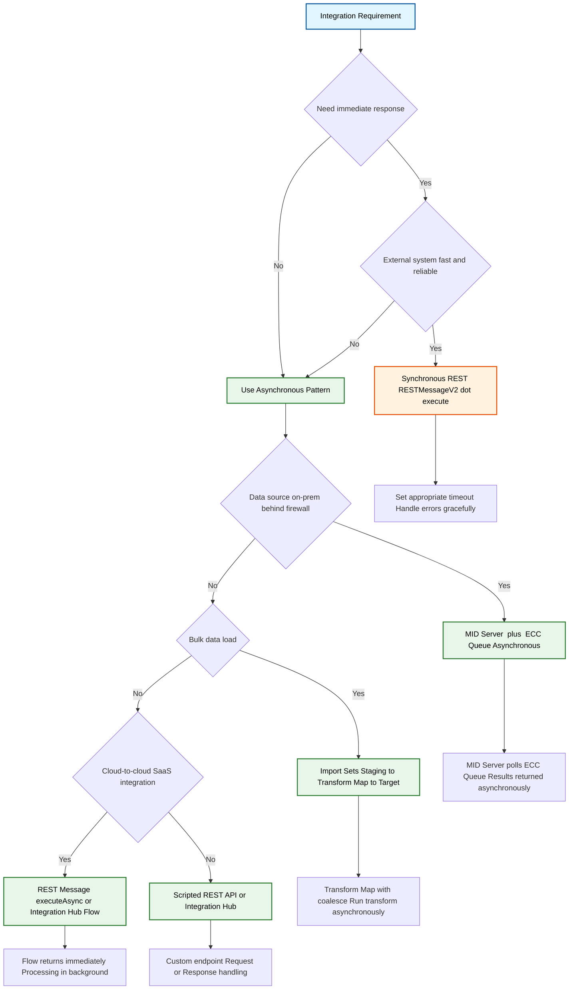

# Cross-Cutting Platform Skills

**Agent:** opencode
**Date:** 2026-11-11
**Scope:** Platform Admin, Development, and Integration
**Confidence:** high

---

## Contents

- [Integrations](#integrations)
- [ServiceNow-Salesforce Integration Lab (EBOND)](#servicenow-salesforce-integration-lab-ebond)
- [Scripting](#scripting)
- [GlideSystem (gs)](#glidesystem-gs)
- [Flow Designer](#flow-designer)
- [Workflow Studio vs Flow Designer vs Workflow](#workflow-studio-vs-flow-designer-vs-workflow)
- [Event Management vs Discovery](#event-management-vs-discovery)
- [UI Policy vs Client Script vs Data Policy vs ACL](#ui-policy-vs-client-script-vs-data-policy-vs-acl)
- [Import Sets, Transform Maps, and Coalesce](#import-sets-transform-maps-and-coalesce)
- [Business Rule Types](#business-rule-types)
- [Cross-Scope Access](#cross-scope-access)
- [Automated Test Framework (ATF)](#automated-test-framework-atf)
- [CMDB Data Manager](#cmdb-data-manager)
- [Capacity and Performance Monitoring](#capacity-and-performance-monitoring)
- [Platform Administration](#platform-administration)
- [Jelly — Legacy UI Pages](#jelly--legacy-ui-pages)
- [Update Sets vs Source Control](#update-sets-vs-source-control)
- [App Engine & Scoped Applications](#app-engine--scoped-applications)
- [CMDB De-duplication & Health](#cmdb-de-duplication--health)
- [Major Incident Management](#major-incident-management)
- [Change Advisory Board (CAB) & Change Types](#change-advisory-board-cab--change-types)
- [Testing Strategy: Unit / System / UAT / Regression](#testing-strategy-unit--system--uat--regression)
- [Upgrades: Paths, Regression Testing, Health Checks, Clone Post-Tasks](#upgrades-paths-regression-testing-health-checks-clone-post-tasks)
- [Troubleshooting: Logs, Transaction Logs, Performance](#troubleshooting-logs-transaction-logs-performance)
- [Legacy Integration Patterns: SOAP, Flat-File, MID Server Deep-Dive](#legacy-integration-patterns-soap-flat-file-mid-server-deep-dive)
- [Data Migration: Import Sets, Transform Maps, Coalesce, Data Cleansing](#data-migration-import-sets-transform-maps-coalesce-data-cleansing)
- [Platform Architecture: Instance Types, Scopes, Cross-Scope Access, ACLs](#platform-architecture-instance-types-scopes-cross-scope-access-acls)
- [Mentoring & Leadership Patterns](#mentoring--leadership-patterns)
- [Quiz](#quiz)

---

## Integrations

Integrations are how ServiceNow talks to the rest of the enterprise.

### The Integration Toolset

| Tool | When to use | Key Concept |
|-------|--------------|-------------|
| **Import Sets** | Bulk data loading (Excel, CSV) | Staging table → Transform Map → Target |
| **REST Message** | Real-time outbound calls | Endpoint, HTTP Method, Auth, JSON Parsing |
| **Scripted REST API** | Allow external systems to call SN | Custom endpoints, Request/Response handling |
| **IntegrationHub** | Low-code integrations | Spokes, Actions, Connection & Credential Aliases |
| **MID Server** | Accessing internal network data | Java agent behind firewall, probes/sensors for on-prem connectivity |
| **Instance Data Replication (IDR)** | Instance-to-instance data sync | Producer/consumer instances, replication sets, out-of-box plugin |

### ServiceNow-Salesforce Integration Lab (EBOND)

Hands-on lab using only free tiers: a **ServiceNow Personal Developer Instance (PDI)** + a **Salesforce Developer org**, bonded into a proof-of-concept Incident ⇄ Case sync with OOTB workflows and best practices.

- Live lab site: https://eltonaguiar.github.io/EBOND_ServiceNowSalesforce/
- Repository: https://github.com/eltonaguiar/EBOND_ServiceNowSalesforce
- Beginner path (Level 1→4): [lab_levels_beginner_path.md](https://github.com/eltonaguiar/EBOND_ServiceNowSalesforce/blob/main/2026-11-16-SWARM/03_DONE/INTEGRATION/lab_levels_beginner_path.md)

<details markdown="1">
<summary>🚀 Interview Insight: Integration Patterns — Async vs Sync, Queues Explained</summary>

### Synchronous vs Asynchronous Calls

**Synchronous** — The calling process waits for a response before continuing.
- **ServiceNow pattern:** `RESTMessageV2.execute()` (or equivalent SOAP method)
- The script/thread blocks until the external system replies or times out
- Use when: You need the answer immediately (e.g., real-time lookup populating a form field)
- Risk: Holds application node threads, can cause user-facing delays or timeouts, reduces instance scalability

**Asynchronous** — The calling process does not wait; it hands work off and continues immediately.
- **ServiceNow patterns:**
  - `RESTMessageV2.executeAsync()`
  - Import Sets (staging → transform → target, transform runs in background)
  - ECC Queue + MID Server (output record → MID picks up → input record with results)
  - Event queue (`gs.eventQueue()`)
  - Integration Hub / Flow Designer REST API triggers (return immediately, process in background)
- Use when: Bulk loads, non-urgent processing, on-prem system calls, anything slow or high-volume

### Is "Queues" Actually a Type in ServiceNow?

**No — "Queues" is not a standalone integration type.** It's used in two contexts:

1. **ECC Queue (`ecc_queue` table)** — The actual database table that acts as a message bus between ServiceNow and MID Servers:
   - ServiceNow inserts an **output** record into `ecc_queue` when work needs to be done on-prem
   - The MID Server polls (or is notified via AMB), picks up the job, executes it against on-prem resources
   - Writes an **input** record back with results
   - This mechanism is inherently asynchronous

2. **Event Queue** — Processed by `gs.eventQueue()` for platform-wide event-driven communication

When people say "Import Sets / Queues" in integration pattern discussions, they are usually contrasting:
- **Import Sets:** Batch/staging approach (data lands in staging table, Transform Map maps it to target)
- **Queues:** ECC Queue used with MID Servers for on-prem connectivity

### Bottom Line for Interviews

- **Prefer asynchronous patterns** (Import Sets, `executeAsync()`, ECC Queue / MID, events, Integration Hub flows) for reliability and performance
- **Use synchronous REST only** when you genuinely need an immediate response and the external system is fast and reliable
- **MID Servers + ECC Queue** are the standard, secure way to reach anything on-prem behind a customer firewall
- **Do NOT need a MID Server** for pure cloud-to-cloud integrations (e.g., ServiceNow → Salesforce, Workday, or another publicly reachable SaaS)

</details>

---

### Integration Best Practices Decision Flow



### Instance Data Replication (IDR) — instance-to-instance data sync

**Instance Data Replication (IDR)** is a ServiceNow feature (out-of-box in recent releases) that copies data updates from one ServiceNow instance — the **producer** — to one or more other ServiceNow instances — the **consumers**. It is the platform-native way to keep data consistent across instances **without** building REST Messages or IntegrationHub spokes for the same job.

**IDR is *not* the same as e-bonding or IntegrationHub.** Use the right tool:

| Need | Tool |
|---|---|
| Sync records **between ServiceNow instances** (prod → sub-prod, MSP → customer, hub → spoke) | **IDR** |
| Two-way workflow sync where **both sides own parts of the record** and must correlate tickets (ticket hand-off, MSP ↔ customer) | **e-bonding** (IntegrationHub / REST + correlation ID) |
| Call a **non-ServiceNow** external system (Salesforce, Jira, Teams, SAP) | **IntegrationHub spoke / REST Message** |

**Core IDR concepts:**

| Term | Meaning |
|---|---|
| **Producer instance** | The source instance IDR reads changes from |
| **Consumer instance** | A target instance IDR writes changes to (one-to-many supported) |
| **Replication set** | The definition of *which tables and fields* to replicate, and in which direction |
| **Direction** | One-way (producer → consumer) or bidirectional (both directions) |
| **Adapters** | The transport used to move the data between instances |
| **Excluded tables** | System/out-of-scope tables IDR will not replicate (e.g., many `sys_` internal tables) — checked during setup |

**When to choose IDR:**

- Keeping **production data flowing to a sub-production instance** for realistic testing without a full clone
- **Hub-and-spoke** designs where a central instance is the system of record and regional instances need read copies
- Replicating **CMDB / ITSM / reference data** across instances on an ongoing basis
- Avoiding overlap with update-set deployments — IDR handles **record data**, update sets handle **configuration (metadata)**

**When *not* to choose IDR:**

- **External systems** — IDR only replicates ServiceNow-to-ServiceNow. For Snowflake, Power BI, a data lake, or a third-party ITSM, use IntegrationHub / REST / JDBC / a replication product instead
- **Anything that needs ticket-level workflow hand-off with both sides editing** — that's e-bonding, not IDR
- **Initial seeding of very large tables** — there are record-count limits per replication set (roughly a few million records on initial seed); plan table selection accordingly
- **Performance-sensitive windows** — replication consumes instance resources; schedule and scope carefully

**Setup in one breath:** install/activate the IDR plugin → configure the producer and consumer instance connections → create a **replication set** per data domain → choose tables/fields + direction → run the **initial seed** → monitor replication status and stats from the IDR administrator view.

> Full walkthrough and interview Q&A: see [Integrations — Instance Data Replication](./interviews/integrations.md#instance-data-replication-idr--instance-to-instance-sync).

---

## Scripting

The "Pro-Code" side of the platform.

### Server-Side Scripting

- **Business Rules:** Triggered by database operations.
  - `before`: Validate/modify data before it hits the DB.
  - `after`: Trigger subsequent actions (e.g., create a task).
  - `async`: Long-running tasks (emails, integrations).
- **Script Includes:** Reusable, object-oriented libraries. The only way to write DRY (Don't Repeat Yourself) code.
- **Scheduled Jobs:** Periodic execution of scripts.

### Client-Side Scripting

- **Client Scripts:** Run in the browser.
  - `onLoad`, `onChange`, `onSubmit`.
- **UI Policies:** Declarative logic to show/hide or make fields mandatory.
- **GlideAjax:** The bridge between Client and Server. *Always* use GlideAjax instead of `getReference()` to avoid freezing the browser.

---

## GlideSystem (gs)

The server-side API for the current user, logging, and properties. **Only runs on the server** — not in Client Scripts.

### Common Methods

| Method | Purpose |
|--------|---------|
| `gs.getUserID()` | Current user's sys_id |
| `gs.getUserName()` | Current user's display name |
| `gs.getUser()` | Returns GlideUser object for role/group checks |
| `gs.getProperty('property_name')` | Read a system property |
| `gs.info('message')` / `gs.warn()` / `gs.error()` | Server-side logging |
| `gs.eventQueue('event_name', record)` | Queue an event for notification/flow trigger |
| `gs.addErrorMessage('msg')` | Show error on form (in Before Business Rule) |
| `gs.nowDateTime()` | Current date/time in system format |
| `gs.daysAgo(n)` / `gs.minutesAgo(n)` | Relative date calculations |

### Example: Restrict Change Closure to Change Managers

```javascript
// Before Business Rule on change_request
(function executeRule(current, previous) {
  if (current.state === '3' && !gs.getUser().isMemberOf('change_managers')) {
    gs.addErrorMessage('Only change managers can close this change.');
    current.setAbortAction(true);
  }
})(current, previous);
```

**Key point:** `gs` is server-only. In Client Scripts, use `g_form.getUserID()` or GlideAjax to call a Script Include that uses `gs`.

---

## Flow Designer

The modern replacement for Workflow.

- **Triggers:** Record-based, Schedule-based, or API-based.
- **Actions:** The discrete "steps" in a flow.
- **Subflows:** Encapsulated logic called by multiple flows.
- **Data Stream Actions:** Processing large API payloads in batches to avoid memory crashes.

---

## Workflow Studio vs Flow Designer vs Workflow

| Tool | Status | Description |
|------|--------|-------------|
| **Workflow** | Legacy | Graph editor for approvals and processes. Still runs but no longer enhanced. |
| **Flow Designer** | Current | No-code tool: triggers, actions, IntegrationHub spokes, subflows. The engine behind modern automation. |
| **Workflow Studio** | Newer workspace | Unified workspace that brings Flow Designer, Playbooks, and Decision Tables together. Not a separate engine — it's the UI for managing flows, playbooks, and decisions in one place. |

**Example:** An approval that used to be a Workflow is now a Flow in Workflow Studio, with an IntegrationHub step that opens a ticket in a finance system.

---

## Event Management vs Discovery

| Capability | Purpose |
|------------|---------|
| **Discovery** | Finds and updates CIs (Configuration Items) by scanning the network. Populates the CMDB. |
| **Event Management** | Takes alerts from monitoring tools (Splunk, Datadog, SolarWinds, etc.), turns them into ServiceNow alerts, correlates them, and can open an incident if the affected CI sits on a service map. |

**Distinction:** Discovery = "What exists in my infrastructure?" Event Management = "What's broken right now?"

---

## UI Policy vs Client Script vs Data Policy vs ACL

| Mechanism | Scope | Use Case |
|-----------|-------|----------|
| **UI Policy** | Form only (browser) | Show/hide fields, make mandatory/read-only declaratively. No code. |
| **Client Script** | Form only (browser) | JavaScript logic on `onLoad`, `onChange`, `onSubmit`. For complex dynamic behavior. |
| **Data Policy** | Form + Import Sets + API | Enforces mandatory/read-only on *all* writes, including imports and REST API. |
| **ACL (Access Control)** | Table/field level | Security: who can read/write/create/delete. Evaluated on every operation. |

**Example:** Making `close_notes` mandatory when `state` = Closed:
- **UI Policy** if it only matters on the form.
- **Data Policy** if integrations/imports must also provide it.
- **ACL** if only certain roles should be allowed to close.

---

## Import Sets, Transform Maps, and Coalesce

**Flow:** Raw file → **Import Set** (staging table) → **Transform Map** (field mapping + logic) → Target table.

| Concept | Purpose |
|---------|---------|
| **Import Set** | Temporary staging table holding raw rows from Excel, CSV, or API. |
| **Transform Map** | Maps source columns to target fields. Runs scripts, lookups, and coalesce logic. |
| **Coalesce** | On a mapped field: if a matching target record exists, **update** it; otherwise **insert** new. Prevents duplicates. |

**Example:** Nightly employee feed.
- Import Set: `u_employee_import` (raw rows).
- Transform Map: `employee_id` → `sys_user.user_name` (coalesce = true).
- Result: Existing users updated; new users created. No duplicates.

---

## Business Rule Types

| Type | When It Runs | Typical Use |
|------|--------------|-------------|
| **Before** | Before DB commit | Set field values, validate, abort save (`current.setAbortAction(true)`). |
| **After** | After DB commit | Create related records (tasks, notifications), update parent/child. |
| **Async** | After commit, background | Slow work: emails, integrations, large calculations. User doesn't wait. |
| **Display** | Before form renders | Populate `g_scratchpad` for Client Scripts / UI Policies. |

**Key rule:** Never do slow work in a Before or After rule — use Async.

---

## Cross-Scope Access

A scoped application cannot touch another app's tables or Script Includes unless explicitly allowed.

| Mechanism | Purpose |
|-----------|---------|
| **Cross-Scope Privilege** | Grants read/write/create/delete access to a table in another scope. |
| **Script Include Access** | Allows calling a Script Include from another scope (must be `Client Callable` or explicitly shared). |

**Example:** A custom `filings` app needs to read the global `incident` table. Create a Cross-Scope Privilege record: Source = `filings`, Target = `incident`, Operation = `Read`.

---

## Automated Test Framework (ATF)

ServiceNow's built-in test tool. Clicks through forms, submits data, and asserts results — runs after upgrades or deployments to catch regressions.

### Core Concepts

- **Test Suite:** Group of related tests.
- **Test:** Steps (open form, set field, click button, assert value).
- **Test Step Types:** UI (form actions), Server (script assertions), Flow (trigger flow), API (REST calls).
- **Rollback:** ATF rolls back database changes after each test by default.

### Example Test: Create Incident

1. **Open Form:** `incident` (New).
2. **Set Value:** `short_description` = "ATF test incident".
3. **Set Value:** `caller_id` = "Abel Tuter".
4. **Click:** Submit.
5. **Assert:** `number` is not empty.
6. **Assert:** `assignment_group` = "Service Desk" (if auto-assignment rule exists).

**Why it matters:** QA engineers on interview panels expect knowledge of upgrade-safe testing.

---

## CMDB Data Manager

Policy-based cleanup of Configuration Items. Retires, archives, or certifies CIs when they go stale — separate from IRE (Identification & Reconciliation Engine), which prevents duplicates *on ingest*.

| Feature | Purpose |
|---------|---------|
| **Retirement Policy** | Mark CI retired after X days without Discovery update. |
| **Certification Policy** | Require owner to certify CI is still valid periodically. |
| **Archive Policy** | Move old CIs to archive table to reduce CMDB size. |

**Example:** If a `cmdb_ci_computer` hasn't been seen by Discovery in 60 days, Data Manager marks it `Retired` and removes it from service maps. No manual deletion needed.

**IRE vs Data Manager:** IRE stops duplicates when data *arrives* (e.g., Discovery + spreadsheet both find same laptop → one CI). Data Manager cleans up CIs that *age out*.

---

## Capacity and Performance Monitoring

Practical instance health — not a single tool, but a set of habits.

| Area | What to Watch |
|------|---------------|
| **Slow Transactions** | `sys_transaction_log` — filter by duration > 5s. Look for patterns (specific Business Rules, Script Includes, UI pages). |
| **Table Growth** | `sys_storage` — track row count and size for high-volume tables (`task`, `sys_audit`, `sys_email`, `sys_attachment`). |
| **Slow Queries** | `sys_slow_query_log` — queries exceeding threshold. Often missing indexes or bad `addQuery` patterns. |
| **System Properties** | `glide.db.max_query_records`, `glide.ui.max_related_list_records` — tune to prevent runaway queries. |
| **Archival** | Archive old `task`/`audit`/`email` records instead of letting tables grow unbounded. |
| **Business Rule Count** | Too many BRs on `task` or `incident` = latency. Consolidate, move to Async, or use Flow Designer. |

**Interview line:** "I monitor slow transactions and table growth weekly. If a Business Rule on `incident` hits 2s, I move it to Async or rewrite as a Flow."

---

## Platform Administration

The "Guardrails" of the instance.

- **Update Sets:** The vehicle for moving changes between Dev $	o$ Test $	o$ Prod.
- **ACLs (Access Control Lists):** The security layer. `Role` $	o$ `Operation` $	o$ `Table`.
- **Cloning:** Copying Prod data back to Dev to refresh test data.
- **System Properties:** Global variables used to control behavior without changing code.

---

---

## Jelly — Legacy UI Pages

Jelly is the older templating language behind classic UI Pages and UI Macros. It is legacy — modern UI is Service Portal / UI Builder — but it still surfaces in older UI pages and macros, so reading it matters more than writing it from scratch.

| Tag family | Namespace | Purpose |
|------------|-----------|---------|
| **`g:` tags** | Server-side | `<g:evaluate>` runs server JavaScript; `<g:set>` sets variables |
| **`j:` tags** | Control flow | `<j:if>`, `<j:while>` handle conditionals and loops |

**Example:**

```xml
<g:evaluate var="jvar_count" expression="var gr = new GlideRecord('incident'); gr.addQuery('active', true); gr.query(); gr.getRowCount();" />
<j:if test="${jvar_count > 100}">
    <p>Active incidents: ${jvar_count}</p>
</j:if>
```

**Interview framing:** Know that Jelly exists and how to read it; don't volunteer to build new UI pages in Jelly — build in Service Portal / UI Builder instead.

---

## Update Sets vs Source Control

Two different vehicles that complement each other:

| | **Update Set** | **Source Control (Git)** |
|---|---|---|
| **What it moves** | Configuration changes (records in `sys_update_xml`) | Scoped application metadata |
| **Direction** | Dev → Test → Prod (instance to instance) | Branch → commit → merge (repo to repo) |
| **Hygiene rule** | One update set per story/feature; never mix data with config | Branch per story; PR review before merge |
| **Upgrade risk** | Skipped records during upgrades are reviewed in Upgrade History | N/A |

**Key distinction:** Update sets *move changes between instances*; source control *versions the application*. They are complements, not substitutes.

**Skipped records:** During an upgrade, customizations that conflict with the new release are skipped and reviewed in the Upgrade History / skipped-disposition workflow — this is the upgrade question Equitable and CAAT both circle.

---

## App Engine & Scoped Applications

**App Engine Studio** is where a scoped application is built — its tables, forms, flows, and access are packaged under one application scope (e.g., `x_court_services`).

| Concept | Meaning |
|---------|---------|
| **Application scope** | Protects the app: other scopes can't alter its artifacts unless access is granted |
| **Cross-scope access** | Explicit grant allowing another scope to call a Script Include or read a table |
| **Callee authorizes** | The *target* side (table's application access settings, or the Script Include being `Client Callable`) decides whether another scope may use it |
| **Scoped APIs** | Restricted versions of some global APIs; not every server API is available inside a scope |

**Example (City test shape):** The Toronto Court Services app lives in its own scope. When it needs to create an incident in the global ITSM scope, it either calls a cross-scope-approved Script Include or opens a record via a table configured "Accessible from: All application scopes" with create access. The **callee** authorizes the access.

---

## CMDB De-duplication & Health

**CMDB Data Manager** retires, archives, or certifies CIs when they go stale — separate from IRE, which prevents duplicates *on ingest*.

| Feature | Purpose |
|---------|---------|
| **Retirement Policy** | Mark CI retired after X days without Discovery update |
| **Certification Policy** | Require owner to certify CI is still valid periodically |
| **Archive Policy** | Move old CIs to archive table to reduce CMDB size |

**De-duplication:** When IRE creates two CIs for one real asset, a **de-duplication task** is raised. The remediation merges duplicates — one CI survives (richest data / correct class), its relationships and references are repointed, the other is retired. Duplicate audits and CMDB Health surface these.

**CMDB Health** — three metric families:
- **Completeness:** required fields filled, CIs discovered
- **Correctness:** no duplicates, no stale CIs, identification rules passing
- **Compliance:** CIs matching certification/audit policies

---

## Major Incident Management

A separate workbench and cadence distinct from a P1 priority:

- A **Major Incident Manager** coordinates a bridge; stakeholders get proactive comms (comms plans/tasks).
- The incident record carries a dedicated major-incident lifecycle with a post-incident review.
- Declared based on **business impact**, not just priority fields.

---

## Change Advisory Board (CAB) & Change Types

| Change type | Approval path | Risk |
|-------------|---------------|------|
| **Standard** | Pre-approved, templated | Low |
| **Normal** | Assessed, CAB-reviewed | High |
| **Emergency** | ECAB, expedited | High |

**Lead-level point:** Most change volume should be pushed toward standard changes so CAB time is spent only on genuinely risky changes.

---

## Testing Strategy: Unit / System / UAT / Regression

A mature testing approach covers four layers. Each layer catches different defect classes and maps to interview expectations.

| Layer | Scope | Tools | When It Runs | Key Interview Points |
|-------|-------|-------|--------------|---------------------|
| **Unit** | Single Business Rule, Script Include, UI Policy, Client Script | ATF Server Steps, Script Include unit tests (manual `gs.info` assertions), `gs.test()` in Script Includes | On every commit (CI) | "I write ATF server steps for every Script Include public method. Business Rules get unit tests via ATF server steps asserting field values after insert/update." |
| **System** | End-to-end flow across tables, integrations, flows | ATF UI Steps, Flow Designer test mode, Postman/Newman for REST APIs | Nightly / pre-deploy | "I chain ATF UI steps to test Incident → Problem → Change handoff. For integrations, I mock external responses in ATF or use a test MID Server pointing to a sandbox." |
| **UAT** | Business-validated scenarios with real users | ATF (recorded), manual test scripts in Test Management 2.0 | Pre-prod / pre-release | "Business stakeholders run UAT scripts from Test Management. We tag ATF tests as 'UAT' so they can be re-run by non-technical users." |
| **Regression** | Full suite after upgrades, major deployments | ATF full suite, Performance Analyzer, Upgrade History review | Post-upgrade / major release | "After every upgrade, I run the full ATF suite, review skipped records in Upgrade History, and compare slow transaction logs pre/post. Any regression gets a bug record and ATF test to prevent recurrence." |

### ATF Best Practices for Interviews

- **One test per story** — each user story gets at least one ATF test
- **Data isolation** — use `Test Data` records with unique prefixes; ATF rolls back by default but some operations (email, events) don't
- **Mock external systems** — use `Test MID Server` or `IntegrationHub Test Connection` with mocked responses
- **Tag tests** — `unit`, `system`, `uat`, `regression` tags let you run subsets in CI
- **Assert outcomes, not steps** — assert the final state (record created, field value, email sent), not every click

---

## Upgrades: Paths, Regression Testing, Health Checks, Clone Post-Tasks

ServiceNow releases two family upgrades per year (e.g., Washington → Xanadu → Yokohama → Z). Understanding the upgrade lifecycle is a core platform skill.

### Upgrade Paths

| Path | Description |
|------|-------------|
| **Family Upgrade** | Major release (e.g., Washington → Xanadu). Twice yearly. Includes new features, deprecated APIs, UI changes. |
| **Patch / Hotfix** | Minor fixes within a family. Applied more frequently (monthly). Lower risk but still need validation. |
| **Instance Upgrade** | Your instance moves from one family to the next. Scheduled by ServiceNow (usually 3–4 weeks after GA). |

### The Lead's Upgrade Checklist

| Phase | Tasks | Owner |
|-------|-------|-------|
| **Pre-Upgrade (4–6 weeks out)** | Review release notes for deprecated APIs; run Instance Health Scan; schedule clone-down; identify customizations at risk (Skipped Records prediction) | Platform Lead |
| **Clone-Down (2 weeks out)** | Clone Prod → Sub-Prod; run ATF regression suite on clone; review skipped records from Upgrade History; remediate | Platform Lead + Devs |
| **Upgrade Window** | ServiceNow applies upgrade; instance unavailable for 4–8 hours | ServiceNow |
| **Post-Upgrade (Immediate)** | Smoke test critical flows (login, Incident create, key integrations); verify Instance Health; check error logs | Platform Lead |
### Skipped Changes — What Gets Logged, How to Resolve, How to Audit

When you upgrade your instance (or install an application update), ServiceNow compares your current configuration/customization against the new base system version. Any object you customized that the base system is *also* trying to change becomes a **skipped change** (skipped update) — the platform will **not** overwrite your customization. Instead it creates a skipped-change record for you to review.

**What gets skipped** (typical examples):
- `sys_ui_form_section`, `sys_ui_related_list`, `sys_choice_set`
- Any table with at least one field of type **HTML, XML, script, or script_plain** (business rules, script includes, form layouts, UI policies, etc.)

#### Where skipped changes are logged

| Table | Purpose |
|-------|---------|
| **`sys_upgrade_history_log`** | The **skipped-change log**. One record per skipped object, with the disposition and resolution action. |
| `sys_update_xml` | **Customer Updates** — tracks every object you've customized (the current version). The upgrade process skips changes to objects that have a current version here. |
| `sys_upgrade_history` / Upgrade History record | The upgrade run itself; its **"Skipped Changes to Review"** related list lists all skipped records for that upgrade. |

#### How to review and resolve (post-upgrade)

1. Navigate to **All → Upgrade Center → Upgrade History** (or select **Review Skipped Updates** in the Upgrade Monitor after the upgrade completes).
2. Open the upgrade record for your recent release.
3. Open the **Skipped Changes to Review** related list and select a skipped record.
4. Review the base-system version vs. your customized version (diff).
5. Choose a resolution from the **Resolution** list:
   - **Not Reviewed** — defer the decision (still counts as open).
   - **Retain** — keep your customization; ignore the base change.
   - **Retain by merging** — click **Resolve Conflicts** to compare base vs. customized and merge fields into your version.
   - **Revert** — overwrite your customization with the updated base version.
6. Add **comments** explaining why you retained/merged/reverted — this is your audit trail for future upgrades.
7. Capture resolutions in an update set (make a local update set current before resolving) so the decisions propagate to Test/Prod and you don't re-review the same records next release.

**Important caveat:** The `update_synch` attribute is **not** set on `sys_upgrade_history_log` by default, so changes to this table (your resolutions/comments) are **not** captured in update sets — they live on the instance where you made them. Propagate the actual configuration decisions (merged/reverted records) via update sets, not the log itself.

**If you ignore a skipped change:** your customization is retained. It will only reappear as skipped in a *future* release if ServiceNow modifies that same record again.

#### Audit trail — what you can prove

- **`sys_upgrade_history_log`** — every skipped object, its disposition (Not Reviewed / Skipped / Skipped Error / Skipped Manual Merge / Retrieved), resolution action, and your comments.
- **Upgrade History record → Skipped Changes to Review** — per-release view of all conflicts and their status.
- **`sys_update_xml`** — proof of what you customized (baseline for why a record was skipped).
- For cross-instance audit, export the skipped-change log + your comments; note that the log itself doesn't travel in update sets.

---

### Clone Post-Tasks (After Prod → Sub-Prod Clone)

| Task | Why It Matters |
|------|----------------|
| **Deactivate scheduled jobs** | Prevent duplicate emails, integrations running against Prod data |
| **Update integration endpoints** | Point REST Messages, MID Servers, IntegrationHub connections to test/qa endpoints |
| **Scramble/obfuscate PII** | Run data masking scripts on `sys_user`, `task` tables |
| **Reset instance-specific properties** | `glide.servlet.uri`, email settings, SSO configs |
| **Verify MID Server connectivity** | Test MID Servers can reach on-prem test systems |
| **Run ATF smoke suite** | Confirm core flows work before full regression |

### Interview Soundbites

> "I treat upgrades as a project, not an event. Four weeks out I review release notes for deprecated APIs, run the Instance Health Scan, and schedule the clone-down. On the clone I run the full ATF suite, review every skipped record from Upgrade History, and remediate before the real upgrade. Post-upgrade I do a smoke test, then a full regression pass within two weeks. Any regression gets an ATF test so it never happens again."

> "Clone post-tasks are non-negotiable: deactivate scheduled jobs, point integrations to test endpoints, scramble PII, reset instance properties, verify MID Server connectivity. If you skip these, your sub-prod is a time bomb."

---

## Troubleshooting: Logs, Transaction Logs, Performance

When things break in production, these are the tools and patterns to find root cause fast.

### Key Log Tables

| Table | Purpose | Common Filters |
|-------|---------|----------------|
| `sys_transaction_log` | Every HTTP request/transaction | `duration > 5000` (slow), `status >= 400` (errors), `user`, `url` |
| `sys_slow_query_log` | Queries exceeding threshold | `execution_time > 10000`, `table_name` |
| `sys_log` / `syslog` | System events, errors, script logs | `level >= 3` (error), `source`, `message` |
| `sys_script_log` | Server-side script execution (Business Rules, Script Includes) | `script`, `execution_time > 1000` |
| `sys_attachment` | Large attachments causing OOM | `size_bytes > 50000000` |
| `ecc_queue` | MID Server integration queue | `state = 'error'`, `agent`, `topic` |

### Transaction Log Analysis Pattern

```javascript
// 1. Find slow transactions in the last hour
var gr = new GlideRecord('sys_transaction_log');
gr.addQuery('created_on', '>', gs.minutesAgo(60));
gr.addQuery('duration', '>', 5000); // > 5 seconds
gr.orderByDesc('duration');
gr.setLimit(20);
gr.query();
while (gr.next()) {
    gs.info(gr.number + ' | ' + gr.duration + 'ms | ' + gr.url + ' | ' + gr.user_name);
}
```

### Common Performance Culprits

| Symptom | Likely Cause | Fix |
|---------|-------------|-----|
| Form load > 3s | Too many Business Rules on `task`/`incident` (sync); heavy Client Scripts | Move BRs to Async; consolidate; move logic to Flow Designer |
| List load > 5s | Missing index; `addQuery` on non-indexed field; huge related list | Add index; use `addActiveQuery`; limit related list records (`glide.ui.max_related_list_records`) |
| Report/dashboard timeout | Query on `task` without filters; large aggregation | Add date filter; use `GlideAggregate`; enable report caching |
| MID Server timeout | On-prem DB slow; network latency; large payload | Increase MID Server timeout; paginate queries; compress payload |
| Upgrade skipped records | Customization conflicts with new OOTB code | Review Upgrade History; re-implement using supported APIs; add ATF test |

### Interview Soundbites

> "When a user reports slowness, I start with `sys_transaction_log` filtered by their user and duration > 5s. If it's a form load, I check Business Rules on that table — sync BRs doing GlideRecord queries are the #1 culprit. I move them to Async or Flow Designer. For list loads, I check `sys_slow_query_log` for missing indexes. For MID Server issues, I check `ecc_queue` for error state and agent connectivity."

---

## Legacy Integration Patterns: SOAP, Flat-File, MID Server Deep-Dive

Public sector and enterprise roles often require integrating with legacy systems that don't have REST APIs.

### SOAP Web Services

| Component | Purpose |
|-----------|---------|
| **SOAP Message** | Outbound SOAP call (like REST Message but XML/SOAP) |
| **Scripted SOAP API** | Inbound SOAP endpoint (WSDL-generated) |
| **WS-Security** | UsernameToken, SAML, X.509 certificates for auth |
| **MTOM/XOP** | Binary attachment optimization |

**When to use:** Legacy ERPs, mainframes, government systems, banking cores that expose SOAP only.

**Example SOAP Message structure:**
```xml
<soap:Envelope xmlns:soap="http://schemas.xmlsoap.org/soap/envelope/">
  <soap:Header>
    <wsse:Security soap:mustUnderstand="1">
      <wsse:UsernameToken>
        <wsse:Username>svc_account</wsse:Username>
        <wsse:Password Type="...">...</wsse:Password>
      </wsse:UsernameToken>
    </wsse:Security>
  </soap:Header>
  <soap:Body>
    <GetCaseDetails>
      <CaseNumber>INC123456</CaseNumber>
    </GetCaseDetails>
  </soap:Body>
</soap:Envelope>
```

### Flat-File Transfers (SFTP / Shared Drive)

| Pattern | Implementation |
|---------|----------------|
| **Outbound** | Scheduled Job → `GlideRecord` query → CSV/JSON → write to MID Server file system → external system picks up |
| **Inbound** | External system drops file on MID Server → `FileSensor` probe → Import Set → Transform Map → Target table |
| **Scheduled** | MID Server `FileSensor` runs on cron; processes new files in watched directory |

**Key tables:** `sys_attachment` (if small), MID Server file system (if large), `sys_import_set` (staging).

### MID Server Deep-Dive for Legacy Integration

| Capability | Configuration |
|------------|---------------|
| **JDBC/ODBC** | Data Source → Connection & Credential Alias → MID Server with JDBC driver JAR → Test Connection |
| **SOAP** | SOAP Message → MID Server selection (capabilities: `SOAP`) → WS-Security config |
| **File Transfer** | MID Server `FileSensor` probe → watched directory pattern → Import Set auto-creation |
| **PowerShell / Command** | `CommandProbe` / `CommandSensor` → run scripts on Windows/Linux host via MID Server |
| **Windows Services / WMI** | Built-in probes for service status, event logs, registry |

**MID Server Sizing:**
- 1 MID Server **cluster** per network zone (DMZ, internal, cloud VPC) — **2+ nodes**, not one standalone MID per subnet
- Cluster members need identical IP Ranges, Capabilities and Supported Applications; a MID can belong to only one cluster
- Keep JDBC, LDAP and export-set integrations on dedicated non-clustered MIDs (failover restarts the job and can duplicate data)
- Monitor `ecc_queue` processing latency — if > 5 min, scale the cluster instead of pushing one host harder

### Interview Soundbites

> "For the Court Services integration, I built a nightly pull from an on-prem database using a MID Server with JDBC. The MID Server runs a query, returns rows into an Import Set, and a Transform Map with coalesce on case number updates or inserts into the scoped app's table. I also built a SOAP Message with WS-Security UsernameToken for a legacy mainframe that only exposes SOAP. For flat-file, I used the MID Server FileSensor to watch a shared drive — external system drops CSV, MID picks it up, Import Set + Transform Map does the rest."

---

## Data Migration: Import Sets, Transform Maps, Coalesce, Data Cleansing

Legacy data migration is a distinct skill from ongoing integration — it's one-time, high-volume, and messy.

### Migration Phases

| Phase | Activities | Tools |
|-------|------------|-------|
| **Assess** | Profile source data: row counts, null rates, duplicates, data types | Excel, SQL, Python pandas |
| **Design** | Map source → target; define coalesce keys; write transform scripts | Transform Map designer, Script Includes for reusable logic |
| **Cleanse** | Standardize formats (phone, email, dates); handle missing required fields; dedupe | Transform scripts, `StringUtil`, `DateUtil`, custom Script Includes |
| **Load** | Run Import Sets in batches; validate row counts; spot-check | Import Set Run, Transform Map logs |
| **Reconcile** | Compare source vs target counts; verify relationships; fix gaps | GlideAggregate, CMDB reconciliation reports |
| **Cutover** | Freeze source; final delta load; switch users; monitor | Scheduled maintenance window, communication plan |

### Transform Map Patterns for Migration

| Pattern | Use Case | Script Example |
|---------|----------|----------------|
| **Coalesce on natural key** | Prevent duplicates on re-run | `source.u_case_number` → `target.number` (coalesce=true) |
| **Lookup reference** | Convert source code to target sys_id | `var gr = new GlideRecord('cmn_location'); gr.addQuery('u_legacy_code', source.u_location_code); gr.query(); if (gr.next()) return gr.sys_id;` |
| **Data standardization** | Clean phone, email, dates | `source.u_phone.replace(/[^0-9]/g, '')` → format as `+1-xxx-xxx-xxxx` |
| **Default for missing required** | Handle nulls in mandatory fields | `if (!source.u_email) return 'unknown@migration.placeholder';` |
| **Multi-source merge** | Combine HR + AD + payroll feeds | Separate Import Sets → same target table with different coalesce keys; run sequentially |

### Handling Legacy Data Quality Issues

| Issue | Detection | Resolution |
|-------|-----------|------------|
| **Duplicate rows in source** | `GROUP BY` natural key HAVING COUNT > 1 | Dedupe in staging (keep latest/most complete) before transform |
| **Missing required fields** | Null count on mandatory target fields | Transform script: default placeholder + flag for manual review |
| **Invalid reference values** | Lookup returns 0 rows | Transform script: create "Unknown" reference record or skip with log |
| **Encoding/corruption** | Garbled characters, mojibake | Detect in assess phase; specify UTF-8/UTF-16 in Import Set; fix at source |
| **Date format inconsistency** | Multiple formats in same column | Transform script: try multiple `DateUtil.parse()` patterns |

### Interview Soundbites

> "I migrated 5,000+ court case records from a legacy system. Source data had duplicates, missing emails, and three different date formats. I built separate Import Sets for each source feed, used coalesce on case number to prevent duplicates, wrote transform scripts to standardize dates and phone numbers, and created placeholder records for missing references. Final reconciliation showed zero duplicates and 100% row-count match. The key is treating migration as a project: assess → design → cleanse → load → reconcile → cutover, with validation at each step."

---

## Platform Architecture: Instance Types, Scopes, Cross-Scope Access, ACLs

A mental model of the platform architecture separates senior candidates from junior ones.

### Instance Types & Hierarchy

| Instance | Purpose | Data | Access |
|----------|---------|------|--------|
| **Production (Prod)** | Live business operations | Real customer data | Restricted |
| **Sub-Production (Sub-Prod)** | UAT, performance testing, upgrade validation | Cloned from Prod (scrambled) | QA, Business |
| **Development (Dev)** | Feature development, unit testing | Synthetic / subset | Developers |
| **Personal Developer Instance (PDI)** | Learning, proof-of-concept | Empty / sample | Individual |

**Flow:** Dev → Sub-Prod → Prod (via update sets / source control). **Never** Dev → Prod directly.

### Application Scopes

```
Global (no scope prefix)          ──►  Core platform tables (incident, cmdb_ci, sys_user)
Scoped App A (x_company_app_a)    ──►  Custom tables, flows, Script Includes
Scoped App B (x_company_app_b)    ──►  Custom tables, flows, Script Includes
```

**Scope rules:**
- Scoped app **cannot** read/write another scope's tables without explicit Cross-Scope Privilege
- Scoped app **cannot** call another scope's Script Include unless it's `Client Callable` or has explicit access
- **Callee authorizes** — the target table/Script Include decides who can access it

### Cross-Scope Access Configuration

| To Allow... | Configure On... | Setting |
|-------------|-----------------|---------|
| Scoped App A → read Global `incident` | Global `incident` table | Application Access: "Allow access to: All application scopes" + Read ACL |
| Scoped App A → write Global `task` | Global `task` table | Application Access: "Allow access to: All application scopes" + Write ACL |
| Scoped App A → call Scoped App B Script Include | Scoped App B Script Include | `Client Callable` = true OR Cross-Scope Privilege record |
| Scoped App A → create records in Scoped App B table | Scoped App B table | Application Access: "Allow access to: All application scopes" + Create ACL |

### ACL Evaluation Order

1. **Table ACL** (e.g., `incident.read`)
2. **Field ACL** (e.g., `incident.close_notes.read`)
3. **Row-level ACL** (scripted: `current.assignment_group == gs.getUser().getGroups()`)

**Rule:** Most restrictive wins. If table ACL denies read, field/row ACLs are never evaluated.

### Interview Soundbites

> "Instance hierarchy is Dev → Sub-Prod → Prod. We never deploy Dev straight to Prod. Scopes isolate apps — a scoped app can't touch another scope's tables unless the callee authorizes via Cross-Scope Privilege or Application Access. For the Court Services app, we needed to create incidents in global scope, so we configured the global `incident` table with 'Allow access to: All application scopes' and added a Create ACL for the scoped app's role. ACL evaluation is table → field → row; most restrictive wins."

---

## Mentoring & Leadership Patterns

Technical leadership in ServiceNow isn't just architecture — it's growing the team's platform fluency.

### Code Review as Teaching Surface

| Pattern | Description |
|---------|-------------|
| **Design-first review** | Before build: review table design, flow logic, API contracts. Catch scope/ACL issues early. |
| **Pair on complex BRs** | Sit with junior dev on their first async Business Rule or GlideAjax. Show logging, error handling. |
| **Enforce definition of done** | Reviewed + tested (ATF) + documented (README in update set) + deployable (no skipped records). |
| **Pattern library** | Maintain a Confluence/Git wiki of approved patterns: "How we do GlideAjax", "Async BR template", "Transform Map coalesce pattern". |

### Knowledge Transfer Rituals

| Ritual | Cadence | Purpose |
|--------|---------|---------|
| **Platform office hours** | Weekly 30 min | Open Q&A on any platform topic; junior devs bring blockers |
| **Upgrade retrospective** | Post-upgrade | What broke? What skipped records? What ATF tests caught it? What do we add? |
| **Incident post-mortem** | After P1/Major Incident | Root cause → prevention → ATF test → pattern update |
| **New hire platform onboarding** | First 2 weeks | CSA study plan, instance tour, first story with senior pair |

### Growing Platform Fluency

| Level | Focus | Mentoring Action |
|-------|-------|------------------|
| **Junior** | Syntax, BR types, UI Policies, basic flows | Pair on first 5 stories; assign CSA path; review every BR |
| **Mid** | Script Includes, integrations, scoped apps, ATF | Assign integration story; review design doc; co-write ATF tests |
| **Senior** | Architecture, governance, performance, upgrades | Lead upgrade project; own technical debt register; mentor mid-level |

### Interview Soundbites

> "I mentor through code review and pairing. Before a junior dev builds their first async Business Rule, we pair on it — I show logging, error handling, `setAbortAction`. We have a pattern library: 'How we do GlideAjax', 'Async BR template'. Every story hits definition of done: reviewed, ATF tested, documented in the update set README, no skipped records. Post-upgrade, we do a retrospective: what broke, what skipped records appeared, what ATF tests caught it, what do we add. That's how the team's platform fluency compounds."

---

## Quiz

1. When should you use a Script Include instead of a Business Rule?
<details><summary>Answer</summary>When the logic needs to be reused across multiple parts of the platform (e.g., called by both a UI Action and a Flow).</details>

2. What is the purpose of a MID Server in an integration?
<details><summary>Answer</summary>It acts as a proxy, allowing the ServiceNow Cloud instance to communicate with servers behind a corporate firewall.</details>

3. What is the difference between a Before and After Business Rule?
<details><summary>Answer</summary>A 'Before' rule modifies the record before it is saved to the DB; an 'After' rule acts on the record after it is saved, often to update related records.</details>

4. Why is GlideAjax preferred over g_form.getReference()?
<details><summary>Answer</summary>GlideAjax is asynchronous, meaning it doesn't lock the browser UI while waiting for the server to respond.</details>

5. What is the difference between a UI Policy and a Data Policy?
<details><summary>Answer</summary>UI Policy applies only on the form in the browser. Data Policy applies on the form, Import Sets, and API updates.</details>

6. What does Coalesce do in a Transform Map?
<details><summary>Answer</summary>If a matching target record exists (by the coalesce field), update it; otherwise insert a new record. Prevents duplicates.</details>

7. What is the difference between IRE and CMDB Data Manager?
<details><summary>Answer</summary>IRE prevents duplicates on data ingest (identification/reconciliation). Data Manager retires/archives stale CIs after they age out.</details>

8. When would you use an Async Business Rule instead of an After Business Rule?
<details><summary>Answer</summary>When the work is slow (email, integration, heavy calculation) and you don't want the user to wait for the form to save.</details>

9. What is Cross-Scope Access and when do you need it?
<details><summary>Answer</summary>A scoped app needs explicit Cross-Scope Privileges to read/write another scope's tables or call its Script Includes.</details>

10. What does ATF (Automated Test Framework) do?
<details><summary>Answer</summary>Automates UI and server-side tests that run after upgrades/deployments to catch regressions. Rolls back changes by default.</details>

11. What are the four layers of a mature testing strategy?
<details><summary>Answer</summary>Unit, System, UAT, Regression. Unit = single component (Script Include, BR); System = end-to-end flow; UAT = business-validated; Regression = full suite post-upgrade.</details>

12. What is the correct order of ACL evaluation?
<details><summary>Answer</summary>Table ACL → Field ACL → Row-level ACL. Most restrictive wins.</details>

13. What is the difference between IDR and e-bonding?
<details><summary>Answer</summary>IDR replicates data between ServiceNow instances (one-way or bidirectional). E-bonding correlates tickets across systems where both sides edit the ticket (MSP ↔ customer).</details>

14. What are the three MID Server HA patterns?
<details><summary>Answer</summary>Active-passive (failover), Active-active (load balancer), Per-network-zone (DMZ, internal, cloud VPC each gets dedicated MID).</details>

15. What is the migration phase sequence?
<details><summary>Answer</summary>Assess → Design → Cleanse → Load → Reconcile → Cutover. Validation at each step.</details>