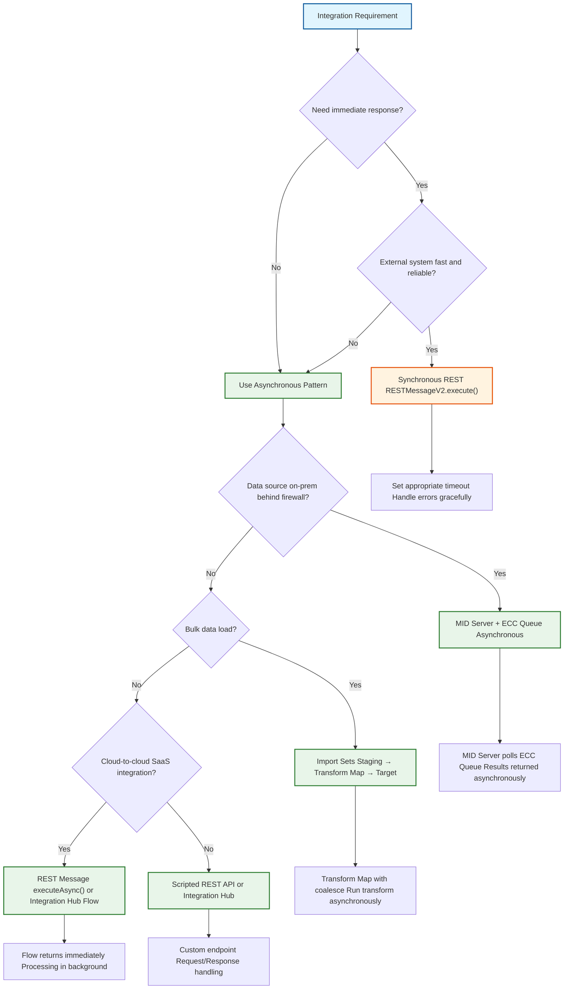

# Cross-Cutting Platform Skills

**Agent:** opencode
**Date:** 2026-11-11
**Scope:** Platform Admin, Development, and Integration
**Confidence:** high

---

## Contents

- [Integrations](#integrations)
- [Scripting](#scripting)
- [GlideSystem (gs)](#glidesystem-gs)
- [Flow Designer](#flow-designer)
- [Workflow Studio vs Flow Designer vs Workflow](#workflow-studio-vs-flow-designer-vs-workflow)
- [Event Management vs Discovery](#event-management-vs-discovery)
- [UI Policy vs Client Script vs Data Policy vs ACL](#ui-policy-vs-client-script-vs-data-policy-vs-acl)
- [Import Sets, Transform Maps, and Coalesce](#import-sets-transform-maps-and-coalesce)
- [Business Rule Types](#business-rule-types)
- [Cross-Scope Access](#cross-scope-access)
- [Automated Test Framework (ATF)](#automated-test-framework-atf)
- [CMDB Data Manager](#cmdb-data-manager)
- [Capacity and Performance Monitoring](#capacity-and-performance-monitoring)
- [Platform Administration](#platform-administration)
- [Jelly — Legacy UI Pages](#jelly---legacy-ui-pages)
- [Update Sets vs Source Control](#update-sets-vs-source-control)
- [App Engine & Scoped Applications](#app-engine--scoped-applications)
- [CMDB De-duplication & Health](#cmdb-de-duplication--health)
- [Major Incident Management](#major-incident-management)
- [Change Advisory Board (CAB) & Change Types](#change-advisory-board-cab--change-types)
- [JDBC / ODBC via MID Server](#jdbc--odbc-via-mid-server)
- [Platform Governance & Lead Layer](#platform-governance--lead-layer)
- [Quiz](#quiz)

---

## Integrations

Integrations are how ServiceNow talks to the rest of the enterprise.

### The Integration Toolset

| Tool | When to use | Key Concept |
|-------|--------------|-------------|
| **Import Sets** | Bulk data loading (Excel, CSV) | Staging table → Transform Map → Target |
| **REST Message** | Real-time outbound calls | Endpoint, HTTP Method, Auth, JSON Parsing |
| **Scripted REST API** | Allow external systems to call SN | Custom endpoints, Request/Response handling |
| **IntegrationHub** | Low-code integrations | Spokes, Actions, Connection & Credential Aliases |
| **MID Server** | Accessing internal network data | Java agent behind firewall, probes/sensors for on-prem connectivity |

<details>
<summary>🚀 Interview Insight: Integration Patterns — Async vs Sync, Queues Explained</summary>

### Synchronous vs Asynchronous Calls

**Synchronous** — The calling process waits for a response before continuing.
- **ServiceNow pattern:** `RESTMessageV2.execute()` (or equivalent SOAP method)
- The script/thread blocks until the external system replies or times out
- Use when: You need the answer immediately (e.g., real-time lookup populating a form field)
- Risk: Holds application node threads, can cause user-facing delays or timeouts, reduces instance scalability

**Asynchronous** — The calling process does not wait; it hands work off and continues immediately.
- **ServiceNow patterns:**
  - `RESTMessageV2.executeAsync()`
  - Import Sets (staging → transform → target, transform runs in background)
  - ECC Queue + MID Server (output record → MID picks up → input record with results)
  - Event queue (`gs.eventQueue()`)
  - Integration Hub / Flow Designer REST API triggers (return immediately, process in background)
- Use when: Bulk loads, non-urgent processing, on-prem system calls, anything slow or high-volume

### Is "Queues" Actually a Type in ServiceNow?

**No — "Queues" is not a standalone integration type.** It's used in two contexts:

1. **ECC Queue (`ecc_queue` table)** — The actual database table that acts as a message bus between ServiceNow and MID Servers:
   - ServiceNow inserts an **output** record into `ecc_queue` when work needs to be done on-prem
   - The MID Server polls (or is notified via AMB), picks up the job, executes it against on-prem resources
   - Writes an **input** record back with results
   - This mechanism is inherently asynchronous

2. **Event Queue** — Processed by `gs.eventQueue()` for platform-wide event-driven communication

When people say "Import Sets / Queues" in integration pattern discussions, they are usually contrasting:
- **Import Sets:** Batch/staging approach (data lands in staging table, Transform Map maps it to target)
- **Queues:** ECC Queue used with MID Servers for on-prem connectivity

### Bottom Line for Interviews

- **Prefer asynchronous patterns** (Import Sets, `executeAsync()`, ECC Queue / MID, events, Integration Hub flows) for reliability and performance
- **Use synchronous REST only** when you genuinely need an immediate response and the external system is fast and reliable
- **MID Servers + ECC Queue** are the standard, secure way to reach anything on-prem behind a customer firewall
- **Do NOT need a MID Server** for pure cloud-to-cloud integrations (e.g., ServiceNow → Salesforce, Workday, or another publicly reachable SaaS)

</details>

---

### 📊 Integration Best Practices Decision Flow



---

## Scripting

The "Pro-Code" side of the platform.

### Server-Side Scripting

- **Business Rules:** Triggered by database operations.
  - `before`: Validate/modify data before it hits the DB.
  - `after`: Trigger subsequent actions (e.g., create a task).
  - `async`: Long-running tasks (emails, integrations).
- **Script Includes:** Reusable, object-oriented libraries. The only way to write DRY (Don't Repeat Yourself) code.
- **Scheduled Jobs:** Periodic execution of scripts.

### Client-Side Scripting

- **Client Scripts:** Run in the browser.
  - `onLoad`, `onChange`, `onSubmit`.
- **UI Policies:** Declarative logic to show/hide or make fields mandatory.
- **GlideAjax:** The bridge between Client and Server. *Always* use GlideAjax instead of `getReference()` to avoid freezing the browser.

---

## GlideSystem (gs)

The server-side API for the current user, logging, and properties. **Only runs on the server** — not in Client Scripts.

### Common Methods

| Method | Purpose |
|--------|---------|
| `gs.getUserID()` | Current user's sys_id |
| `gs.getUserName()` | Current user's display name |
| `gs.getUser()` | Returns GlideUser object for role/group checks |
| `gs.getProperty('property_name')` | Read a system property |
| `gs.info('message')` / `gs.warn()` / `gs.error()` | Server-side logging |
| `gs.eventQueue('event_name', record)` | Queue an event for notification/flow trigger |
| `gs.addErrorMessage('msg')` | Show error on form (in Before Business Rule) |
| `gs.nowDateTime()` | Current date/time in system format |
| `gs.daysAgo(n)` / `gs.minutesAgo(n)` | Relative date calculations |

### Example: Restrict Change Closure to Change Managers

```javascript
// Before Business Rule on change_request
(function executeRule(current, previous) {
  if (current.state === '3' && !gs.getUser().isMemberOf('change_managers')) {
    gs.addErrorMessage('Only change managers can close this change.');
    current.setAbortAction(true);
  }
})(current, previous);
```

**Key point:** `gs` is server-only. In Client Scripts, use `g_form.getUserID()` or GlideAjax to call a Script Include that uses `gs`.

---

## Flow Designer

The modern replacement for Workflow.

- **Triggers:** Record-based, Schedule-based, or API-based.
- **Actions:** The discrete "steps" in a flow.
- **Subflows:** Encapsulated logic called by multiple flows.
- **Data Stream Actions:** Processing large API payloads in batches to avoid memory crashes.

---

## Workflow Studio vs Flow Designer vs Workflow

| Tool | Status | Description |
|------|--------|-------------|
| **Workflow** | Legacy | Graph editor for approvals and processes. Still runs but no longer enhanced. |
| **Flow Designer** | Current | No-code tool: triggers, actions, IntegrationHub spokes, subflows. The engine behind modern automation. |
| **Workflow Studio** | Newer workspace | Unified workspace that brings Flow Designer, Playbooks, and Decision Tables together. Not a separate engine — it's the UI for managing flows, playbooks, and decisions in one place. |

**Example:** An approval that used to be a Workflow is now a Flow in Workflow Studio, with an IntegrationHub step that opens a ticket in a finance system.

---

## Event Management vs Discovery

| Capability | Purpose |
|------------|---------|
| **Discovery** | Finds and updates CIs (Configuration Items) by scanning the network. Populates the CMDB. |
| **Event Management** | Takes alerts from monitoring tools (Splunk, Datadog, SolarWinds, etc.), turns them into ServiceNow alerts, correlates them, and can open an incident if the affected CI sits on a service map. |

**Distinction:** Discovery = "What exists in my infrastructure?" Event Management = "What's broken right now?"

---

## UI Policy vs Client Script vs Data Policy vs ACL

| Mechanism | Scope | Use Case |
|-----------|-------|----------|
| **UI Policy** | Form only (browser) | Show/hide fields, make mandatory/read-only declaratively. No code. |
| **Client Script** | Form only (browser) | JavaScript logic on `onLoad`, `onChange`, `onSubmit`. For complex dynamic behavior. |
| **Data Policy** | Form + Import Sets + API | Enforces mandatory/read-only on *all* writes, including imports and REST API. |
| **ACL (Access Control)** | Table/field level | Security: who can read/write/create/delete. Evaluated on every operation. |

**Example:** Making `close_notes` mandatory when `state` = Closed:
- **UI Policy** if it only matters on the form.
- **Data Policy** if integrations/imports must also provide it.
- **ACL** if only certain roles should be allowed to close.

---

## Import Sets, Transform Maps, and Coalesce

**Flow:** Raw file → **Import Set** (staging table) → **Transform Map** (field mapping + logic) → Target table.

| Concept | Purpose |
|---------|---------|
| **Import Set** | Temporary staging table holding raw rows from Excel, CSV, or API. |
| **Transform Map** | Maps source columns to target fields. Runs scripts, lookups, and coalesce logic. |
| **Coalesce** | On a mapped field: if a matching target record exists, **update** it; otherwise **insert** new. Prevents duplicates. |

**Example:** Nightly employee feed.
- Import Set: `u_employee_import` (raw rows).
- Transform Map: `employee_id` → `sys_user.user_name` (coalesce = true).
- Result: Existing users updated; new users created. No duplicates.

---

## Business Rule Types

| Type | When It Runs | Typical Use |
|------|--------------|-------------|
| **Before** | Before DB commit | Set field values, validate, abort save (`current.setAbortAction(true)`). |
| **After** | After DB commit | Create related records (tasks, notifications), update parent/child. |
| **Async** | After commit, background | Slow work: emails, integrations, large calculations. User doesn't wait. |
| **Display** | Before form renders | Populate `g_scratchpad` for Client Scripts / UI Policies. |

**Key rule:** Never do slow work in a Before or After rule — use Async.

---

## Cross-Scope Access

A scoped application cannot touch another app's tables or Script Includes unless explicitly allowed.

| Mechanism | Purpose |
|-----------|---------|
| **Cross-Scope Privilege** | Grants read/write/create/delete access to a table in another scope. |
| **Script Include Access** | Allows calling a Script Include from another scope (must be `Client Callable` or explicitly shared). |

**Example:** A custom `filings` app needs to read the global `incident` table. Create a Cross-Scope Privilege record: Source = `filings`, Target = `incident`, Operation = `Read`.

---

## Automated Test Framework (ATF)

ServiceNow's built-in test tool. Clicks through forms, submits data, and asserts results — runs after upgrades or deployments to catch regressions.

### Core Concepts

- **Test Suite:** Group of related tests.
- **Test:** Steps (open form, set field, click button, assert value).
- **Test Step Types:** UI (form actions), Server (script assertions), Flow (trigger flow), API (REST calls).
- **Rollback:** ATF rolls back database changes after each test by default.

### Example Test: Create Incident

1. **Open Form:** `incident` (New).
2. **Set Value:** `short_description` = "ATF test incident".
3. **Set Value:** `caller_id` = "Abel Tuter".
4. **Click:** Submit.
5. **Assert:** `number` is not empty.
6. **Assert:** `assignment_group` = "Service Desk" (if auto-assignment rule exists).

**Why it matters:** QA engineers on interview panels expect knowledge of upgrade-safe testing.

---

## CMDB Data Manager

Policy-based cleanup of Configuration Items. Retires, archives, or certifies CIs when they go stale — separate from IRE (Identification & Reconciliation Engine), which prevents duplicates *on ingest*.

| Feature | Purpose |
|---------|---------|
| **Retirement Policy** | Mark CI retired after X days without Discovery update. |
| **Certification Policy** | Require owner to certify CI is still valid periodically. |
| **Archive Policy** | Move old CIs to archive table to reduce CMDB size. |

**Example:** If a `cmdb_ci_computer` hasn't been seen by Discovery in 60 days, Data Manager marks it `Retired` and removes it from service maps. No manual deletion needed.

**IRE vs Data Manager:** IRE stops duplicates when data *arrives* (e.g., Discovery + spreadsheet both find same laptop → one CI). Data Manager cleans up CIs that *age out*.

---

## Capacity and Performance Monitoring

Practical instance health — not a single tool, but a set of habits.

| Area | What to Watch |
|------|---------------|
| **Slow Transactions** | `sys_transaction_log` — filter by duration > 5s. Look for patterns (specific Business Rules, Script Includes, UI pages). |
| **Table Growth** | `sys_storage` — track row count and size for high-volume tables (`task`, `sys_audit`, `sys_email`, `sys_attachment`). |
| **Slow Queries** | `sys_slow_query_log` — queries exceeding threshold. Often missing indexes or bad `addQuery` patterns. |
| **System Properties** | `glide.db.max_query_records`, `glide.ui.max_related_list_records` — tune to prevent runaway queries. |
| **Archival** | Archive old `task`/`audit`/`email` records instead of letting tables grow unbounded. |
| **Business Rule Count** | Too many BRs on `task` or `incident` = latency. Consolidate, move to Async, or use Flow Designer. |

**Interview line:** "I monitor slow transactions and table growth weekly. If a Business Rule on `incident` hits 2s, I move it to Async or rewrite as a Flow."

---

## Platform Administration

The "Guardrails" of the instance.

- **Update Sets:** The vehicle for moving changes between Dev $	o$ Test $	o$ Prod.
- **ACLs (Access Control Lists):** The security layer. `Role` $	o$ `Operation` $	o$ `Table`.
- **Cloning:** Copying Prod data back to Dev to refresh test data.
- **System Properties:** Global variables used to control behavior without changing code.

---

---

## Jelly — Legacy UI Pages

Jelly is the older templating language behind classic UI Pages and UI Macros. It is legacy — modern UI is Service Portal / UI Builder — but it still surfaces in older UI pages and macros, so reading it matters more than writing it from scratch.

| Tag family | Namespace | Purpose |
|------------|-----------|---------|
| **`g:` tags** | Server-side | `<g:evaluate>` runs server JavaScript; `<g:set>` sets variables |
| **`j:` tags** | Control flow | `<j:if>`, `<j:while>` handle conditionals and loops |

**Example:**

```xml
<g:evaluate var="jvar_count" expression="var gr = new GlideRecord('incident'); gr.addQuery('active', true); gr.query(); gr.getRowCount();" />
<j:if test="${jvar_count > 100}">
    <p>Active incidents: ${jvar_count}</p>
</j:if>
```

**Interview framing:** Know that Jelly exists and how to read it; don't volunteer to build new UI pages in Jelly — build in Service Portal / UI Builder instead.

---

## Update Sets vs Source Control

Two different vehicles that complement each other:

| | **Update Set** | **Source Control (Git)** |
|---|---|---|
| **What it moves** | Configuration changes (records in `sys_update_xml`) | Scoped application metadata |
| **Direction** | Dev → Test → Prod (instance to instance) | Branch → commit → merge (repo to repo) |
| **Hygiene rule** | One update set per story/feature; never mix data with config | Branch per story; PR review before merge |
| **Upgrade risk** | Skipped records during upgrades are reviewed in Upgrade History | N/A |

**Key distinction:** Update sets *move changes between instances*; source control *versions the application*. They are complements, not substitutes.

**Skipped records:** During an upgrade, customizations that conflict with the new release are skipped and reviewed in the Upgrade History / skipped-disposition workflow — this is the upgrade question Equitable and CAAT both circle.

---

## App Engine & Scoped Applications

**App Engine Studio** is where a scoped application is built — its tables, forms, flows, and access are packaged under one application scope (e.g., `x_court_services`).

| Concept | Meaning |
|---------|---------|
| **Application scope** | Protects the app: other scopes can't alter its artifacts unless access is granted |
| **Cross-scope access** | Explicit grant allowing another scope to call a Script Include or read a table |
| **Callee authorizes** | The *target* side (table's application access settings, or the Script Include being `Client Callable`) decides whether another scope may use it |
| **Scoped APIs** | Restricted versions of some global APIs; not every server API is available inside a scope |

**Example (City test shape):** The Toronto Court Services app lives in its own scope. When it needs to create an incident in the global ITSM scope, it either calls a cross-scope-approved Script Include or opens a record via a table configured "Accessible from: All application scopes" with create access. The **callee** authorizes the access.

---

## CMDB De-duplication & Health

**CMDB Data Manager** retires, archives, or certifies CIs when they go stale — separate from IRE, which prevents duplicates *on ingest*.

| Feature | Purpose |
|---------|---------|
| **Retirement Policy** | Mark CI retired after X days without Discovery update |
| **Certification Policy** | Require owner to certify CI is still valid periodically |
| **Archive Policy** | Move old CIs to archive table to reduce CMDB size |

**De-duplication:** When IRE creates two CIs for one real asset, a **de-duplication task** is raised. The remediation merges duplicates — one CI survives (richest data / correct class), its relationships and references are repointed, the other is retired. Duplicate audits and CMDB Health surface these.

**CMDB Health** — three metric families:
- **Completeness:** required fields filled, CIs discovered
- **Correctness:** no duplicates, no stale CIs, identification rules passing
- **Compliance:** CIs matching certification/audit policies

---

## Major Incident Management

A separate workbench and cadence distinct from a P1 priority:

- A **Major Incident Manager** coordinates a bridge; stakeholders get proactive comms (comms plans/tasks).
- The incident record carries a dedicated major-incident lifecycle with a post-incident review.
- Declared based on **business impact**, not just priority fields.

---

## Change Advisory Board (CAB) & Change Types

| Change type | Approval path | Risk |
|-------------|---------------|------|
| **Standard** | Pre-approved, templated | Low |
| **Normal** | Assessed, CAB-reviewed | High |
| **Emergency** | ECAB, expedited | High |

**Lead-level point:** Most change volume should be pushed toward standard changes so CAB time is spent only on genuinely risky changes.

---

## JDBC / ODBC via MID Server

A data source can pull from an external database over JDBC through a MID Server inside the network. The MID issues the query and returns rows into an import set for transform.

**Example:** Nightly pull of court scheduling rows from an on-premise database → import set → transform map (coalesce on the case number) → the scoped app's table.

---

## Platform Governance & Lead Layer

**Governance** = the guardrails that let many teams build on one instance without collisions: coding standards, scoped-app review, ACL review, and a platform backlog triaged like product work.

**Platform roadmap:** sequenced adoption — stabilize (health, upgrades) → automate (Flow Designer, IntegrationHub) → expand (new modules/AI) — each tied to a business outcome, not a feature list.

**Technical debt register:** skipped upgrade records left unreviewed, business rules doing synchronous GlideRecord calls in loops, update sets promoted without ATF coverage — named, owned, and burned down deliberately.

**Upgrades:** twice-yearly family releases; the lead's job is the clone-down → skipped-record review → ATF regression → remediation cycle.

**Mentoring:** code review as the teaching surface, pairing on design before build, and a definition of done the team shares (reviewed, tested, documented, deployable).

---

## Quiz

1. When should you use a Script Include instead of a Business Rule?
<details><summary>Answer</summary>When the logic needs to be reused across multiple parts of the platform (e.g., called by both a UI Action and a Flow).</details>

2. What is the purpose of a MID Server in an integration?
<details><summary>Answer</summary>It acts as a proxy, allowing the ServiceNow Cloud instance to communicate with servers behind a corporate firewall.</details>

3. What is the difference between a Before and After Business Rule?
<details><summary>Answer</summary>A 'Before' rule modifies the record before it is saved to the DB; an 'After' rule acts on the record after it is saved, often to update related records.</details>

4. Why is GlideAjax preferred over g_form.getReference()?
<details><summary>Answer</summary>GlideAjax is asynchronous, meaning it doesn't lock the browser UI while waiting for the server to respond.</details>

5. What is the difference between a UI Policy and a Data Policy?
<details><summary>Answer</summary>UI Policy applies only on the form in the browser. Data Policy applies on the form, Import Sets, and API updates.</details>

6. What does Coalesce do in a Transform Map?
<details><summary>Answer</summary>If a matching target record exists (by the coalesce field), update it; otherwise insert a new record. Prevents duplicates.</details>

7. What is the difference between IRE and CMDB Data Manager?
<details><summary>Answer</summary>IRE prevents duplicates on data ingest (identification/reconciliation). Data Manager retires/archives stale CIs after they age out.</details>

8. When would you use an Async Business Rule instead of an After Business Rule?
<details><summary>Answer</summary>When the work is slow (email, integration, heavy calculation) and you don't want the user to wait for the form to save.</details>

9. What is Cross-Scope Access and when do you need it?
<details><summary>Answer</summary>A scoped app needs explicit Cross-Scope Privileges to read/write another scope's tables or call its Script Includes.</details>

10. What does ATF (Automated Test Framework) do?
<details><summary>Answer</summary>Automates UI and server-side tests that run after upgrades/deployments to catch regressions. Rolls back changes by default.</details>