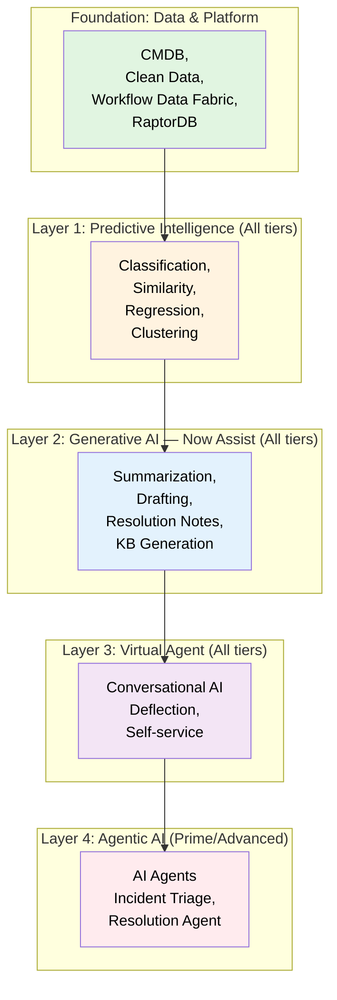
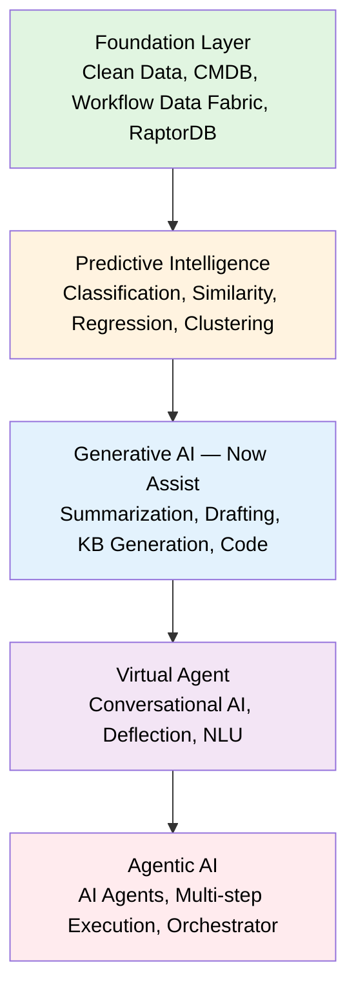
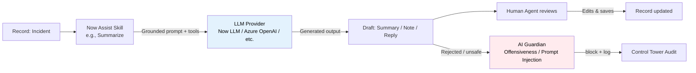
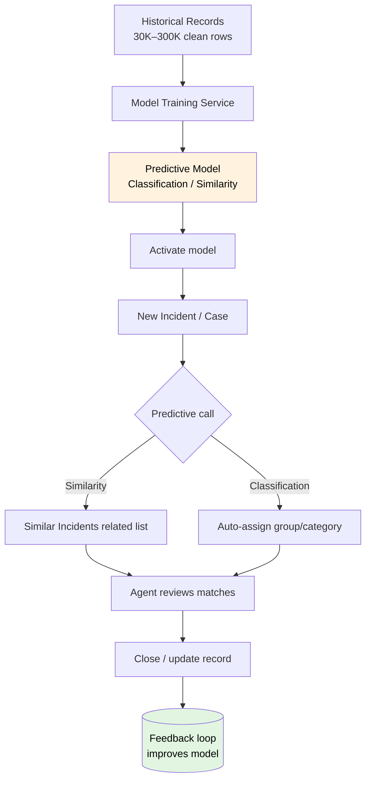
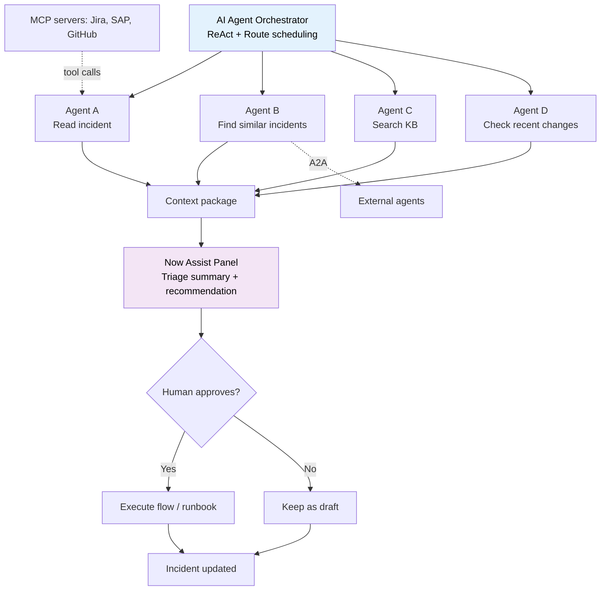
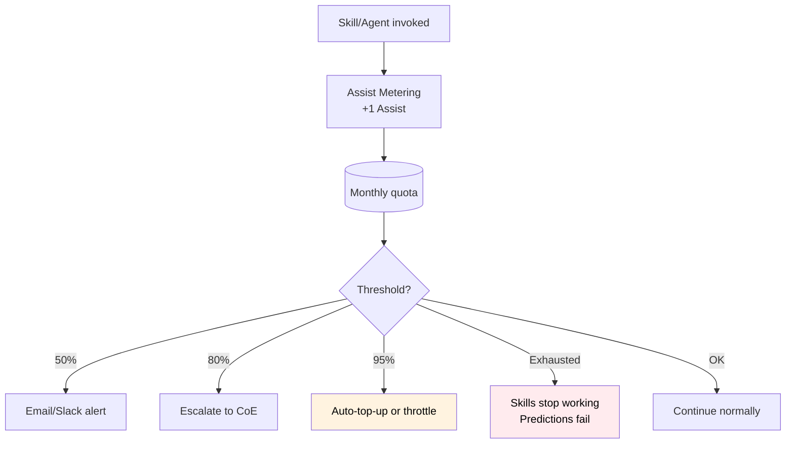

# AI — ServiceNow AI Platform, Now Assist, and Agentic Workflows

**Agent:** opencode  
**Date:** 2026-11-10  
**Module:** AI (Now Assist, Predictive Intelligence, AI Agents, Virtual Agent)  
**App:** Now Platform  
**Confidence:** high  
**Source:** ServiceNow product documentation (Zurich/Xanadu/Yokohama), ServiceNow AI Features packaging (Oct 2026)

---

## Contents

- [Purpose](#purpose)
- [Prerequisites & Setup](#prerequisites--setup)
- [AI Feature Stack](#ai-feature-stack)
- [AI Feature Types Breakdown](#ai-feature-types-breakdown)
- [Where to Find It](#where-to-find-it)
- [AI Product Packaging — Foundation, Advanced, Prime](#ai-product-packaging--foundation-advanced-prime)
- [Core AI Features Catalog](#core-ai-features-catalog)
- [Predictive Intelligence — Similar Incidents, Knowledge, Classification](#predictive-intelligence--similar-incidents-knowledge-classification)
- [Virtual Agent & Conversational AI](#virtual-agent--conversational-ai)
- [AI Agents & Agentic Workflows](#ai-agents--agentic-workflows)
- [Now Assist Panel — “Diagnose a Service Graph Connector”](#now-assist-panel--diagnose-a-service-graph-connector)
- [Now Assist Skill Kit — Build Your First AI Button](#now-assist-skill-kit--build-your-first-ai-button)
- [Custom Skill vs AI Agent — Decision Guide](#custom-skill-vs-ai-agent--decision-guide)
- [Real AI Agent Example: “Incident Triage Assistant”](#real-ai-agent-example-incident-triage-assistant)
- [Install / Enablement per Module](#install--enablement-per-module)
- [AI Control Tower — Governance & Observability](#ai-control-tower--governance--observability)
- [AI Cost Management — Avoiding Surprise Bills & Limit Breaks](#ai-cost-management--avoiding-surprise-bills--limit-breaks)
- [AI Oversight — Monitoring Usage & Identifying Risky Chats/Topics](#ai-oversight--monitoring-usage--identifying-risky-chatstopics)
- [Agentic AI — AI Agents & Agentic Workflows](#agentic-ai--ai-agents--agentic-workflows)
- [AI Guardrails & Subagents — Where Controls Are Set](#ai-guardrails--subagents--where-controls-are-set)
- [AI Guardrails & Subagents — Quick Reference](#ai-guardrails--subagents--quick-reference)
- [Best Practices That Actually Provide Value](#best-practices-that-actually-provide-value)
- [ServiceNow AI Success Packs, Best Practices & Sales Materials](#servicenow-ai-success-packs-best-practices--sales-materials)
- [Goals, Benefits & Key Metrics](#goals-benefits--key-metrics)
- [Core Concept Diagrams](#core-concept-diagrams)
- [SLAs, Dashboards & Workspaces](#slas-dashboards--workspaces)
- [Quiz](#quiz)
- [Related Guides](#related-guides)
- [Official Learning Resources](#official-learning-resources)

---

## Purpose

ServiceNow AI is the platform layer that adds generative AI, predictive ML, and agentic automation on top of the core Now Platform. It is **not** a module you install like ITSM or CSM — it is a set of capabilities (Now Assist, Predictive Intelligence, Virtual Agent, AI Agents, AI Control Tower) that you license in tiers and activate across existing modules (Incident, Change, Asset, CMDB, etc.).

**The core question AI answers:** *"Can the platform do the reading, drafting, routing, and triage so humans only do the deciding?"*

ServiceNow's AI packaging evolved to three tiers around April 2026 (Foundation, Advanced, Prime), replacing the prior five-tier model. Entitlements are contract-specific — what is "included" vs "add-on" varies by agreement. Confirm with your ServiceNow account team.

---

## Prerequisites & Setup

Before you can use AI features, ensure the following are in place.

### Required Plugins / AI Entitlements

| Plugin / Entitlement | ID | Required? | Notes |
|---|---|---|---|
| **Now Assist** | `com.snc.na_skill_kit` | ✅ Yes | Core AI Skill Kit plugin for building custom AI skills. |
| **AI Control Tower** | `com.snc.ai_control_tower` | ✅ Yes | Central governance hub for AI usage, quotas, and monitoring. |
| **Predictive Intelligence** | `com.glide.platform_ml` | ✅ Yes | Required for classification, similarity, and predictive models. |
| **AI Agent Studio** | `com.snc.ai_agent` | ✅ Yes | Visual builder for creating and managing AI agents. |
| **Virtual Agent** | `com.snc.virtual_agent` | ✅ Yes | Required for conversational AI and virtual agent topics. |
| **IntegrationHub Spokes** | `com.snc.integrationhub.speaks.*` | As needed | Spokes for third-party LLM providers (Azure OpenAI, OpenAI, Google Gemini, etc.) and IntegrationHub connectors. |
| **AI Skill Kit** | `com.snc.na_skill_kit` | ✅ Yes | Required for custom skill development (separate from Now Assist). |

### Guided Setup

AI does not have a traditional Guided Setup wizard. Configuration is done through the **AI Control Tower** and **Now Assist** administration consoles:

1. **Verify AI Tier Entitlements**: Confirm your contract includes the required AI tier (Foundation, Advanced, or Prime) with sufficient Assist allocation. Check AI Control Tower > Overview > Usage Analytics for Assist allocation.
2. **Activate Required Plugins**: System Definition > Plugins > Activate `com.snc.na_skill_kit`, `com.snc.ai_control_tower`, `com.snc.ai_agent`, and `com.snc.virtual_agent`. For third-party LLMs, ensure IntegrationHub spokes are configured with valid credentials.
3. **Set Up Predictive Intelligence Models**: Create Solution Definitions (Predictive Intelligence > Classification > Solution Definitions) for each use case (e.g., Incident Classification, Similarity). Train on 30K–300K clean, labeled historical records.
4. **Configure AI Control Tower Alerts**: Set quota alerts at 50%, 80%, and 95% of monthly Assist allocation to prevent overage.
5. **Assign AI Roles**: Assign roles like `ai_admin`, `ai_builder`, `ai_viewer` via User Administration > Roles > Edit > Assign to users who need AI capabilities.

### System Properties to Consider

| Property | Default | Description |
|---|---|---|
| `glide.ai.enabled` | `true` | Enables all AI capabilities across tiers. |
| `glide.ai.assist_quota` | Varies by tier | Monthly Assist allocation (Foundation: ~1,500; Advanced: ~3,000; Prime: ~6,000). |
| `glide.ai.llm.provider` | `Now LLM` | Primary LLM provider; can be changed to third-party (Azure, OpenAI, etc.) via IntegrationHub. |
| `glide.ai.guardrail.offensiveness_mode` | `log_only` | Controls content safety: `log_only`, `block_and_log`, or `block`. Start with `log_only`. |
| `glide.ai.data_quality_threshold` | `80%` | Minimum data quality threshold for Predictive Intelligence model training. |

### Cross-Module Dependencies

| Dependent Module | Why It Matters | Integration Point |
|---|---|---|
| **ITSM** | AI Summarization, Similar Incidents, Classification | `incident` table → AI Similarity and Classification |
| **CSM** | Now Assist Summarization, Case Summarization | `case` table → AI Summarization |
| **HRSD** | Case Summarization, Reply Generation | `hrsd_case` → AI Summarization |
| **ITOM** | Similarity, Clustering, Process Mining | `cmdb_ci`, `cmdb_ci_relationship` → AI Similarity |
| **Workflows** | Flow Generation, Flow Execution | Flow Designer AI (Advanced, Prime) |
| **Discovery** | Clean data prerequisite for accurate models | `cmdb_ci` and `cmdb_ci_relationship` data quality directly impacts Similarity accuracy |

### ACLs Related to Core Tables

| Table | Key ACLs | Typical Roles |
|---|---|---|
| `incident` | `create`, `read`, `write`, `delete` | `sn_sales.admin`, `sn_sales.user`, `sn_sales.reader` |
| `case` | `create`, `read`, `write`, `delete` | `sn_sales.admin`, `sn_sales.user`, `sn_sales.reader` |
| `hrsd_case` | `create`, `read`, `write`, `delete` | `sn_sales.admin`, `sn_sales.user`, `sn_sales.reader` |
| `cmdb_ci` | `read`, `read` (limited write) | `sn_sales.reader`, `sn_sales.admin` (read/write CI) |
| `alm_asset` | `read`, `read` (limited write) | `sn_sales.reader`, `sn_sales.admin` |

**Note:** AI capabilities typically require read access to core tables and write access to specific fields (e.g., `short_description`, `description`, `work_notes`). Ensure ACLs reflect these permissions.

### Breadcrumbs — Enable First

1. **Verify AI Tier Entitlement**: Confirm your contract includes AI tier (Foundation minimum, Advanced for agentic workflows, Prime for custom skills). Check AI Control Tower > Overview > Usage Analytics for Assist allocation.
2. **Activate Required Plugins**: System Definition > Plugins > Activate `com.snc.na_skill_kit`, `com.snc.ai_control_tower`, `com.snc.ai_agent`, and `com.snc.virtual_agent`. For third-party LLMs, ensure IntegrationHub spokes are configured with valid credentials.
3. **Enable AI Control Tower**: Navigate to AI Control Tower > Overview > Enable Assist Metering and configure Alert Policies at 50%/80%/95% of monthly allocation.
4. **Assign AI Roles**: Assign roles like `ai_admin`, `ai_builder`, `ai_viewer` to users. These roles control access to AI features and AI Control Tower configuration.
5. **Verify Data Quality**: Ensure Predictive Intelligence has access to 30K–300K clean, labeled records for classification and similarity. Use AI Control Tower > Performance Monitoring to check model accuracy and drift.

---

## AI Feature Stack

ServiceNow AI is built as a layered stack. Each layer depends on the quality of the layer below it — you can't run agentic automation on top of broken Discovery data or poor Predictive Intelligence models.



**Rule of thumb:** Start at Layer 1 (clean data + Predictive Intelligence classification) and work upward. Don't deploy AI Agents (Layer 4) until Layer 1–2 are working — agents need accurate CIs, good classification, and reliable Now Assist skills to reason over.

---

## AI Feature Types Breakdown

ServiceNow AI is not one thing — it is four distinct feature types layered on top of the Now Platform. The table below shows how they differ, what problem each solves, and a concrete example.

| Feature Type | What it does | Example | Typical Tier |
|---|---|---|---|
| **Generative AI — Now Assist** | Reads, writes, summarizes, drafts, and generates content using LLMs. Output is text, code, or structured suggestions. | Auto-summarize a 50-work-note incident thread into a 3-bullet executive summary; draft a resolution note; generate a KB article | Foundation, Advanced, Prime |
| **Predictive Intelligence (ML)** | Trains on historical data to classify, route, predict, and find similar records. Output is a score, label, or ranked list. | Auto-route “Outlook not sending” → “Messaging Team” with 92% accuracy; find 3 similar past incidents; predict change effort hours | Foundation, Advanced, Prime |
| **Virtual Agent (Conversational AI)** | Talks to users in natural language via chat/voice. Deflects tickets by resolving common requests without a human agent. | Employee says “I forgot my password” → bot verifies identity → resets password → confirms done, no ticket created | Foundation, Advanced, Prime |
| **AI Agents / Agentic Workflows** | Reasons, plans, and acts autonomously (with guardrails). Uses tools, triggers, and multi-step reasoning to complete work. | Incident Triage Agent: reads a new P1 incident, finds similar incidents + KB + recent changes, drafts a triage summary, recommends assignment | Advanced, Prime |

### Key distinctions

| Distinction | Generative AI | Predictive Intelligence | Virtual Agent | AI Agents |
|---|---|---|---|---|
| **Input** | Text, records, documents | Historical structured data (fields, values) | User utterances (chat/voice) | Records, events, tool outputs, goals |
| **Output** | Generated text / code / structured suggestion | Score, label, category, ranked list, prediction | Conversational response, ticket deflection | Action taken, recommendation, executed workflow |
| **Human role** | Reviews and edits the draft | Reviews and applies the routing/prediction | Interacts via chat; escalates if stuck | Sets guardrails, approves high-stakes actions |
| **Primary value** | Faster reading, drafting, documentation | Faster routing, fewer misroutes, proactive problem detection | Fewer tickets created, 24/7 self-service | End-to-end automation of multi-step processes |
| **Best first use case** | Incident summarization | Auto-routing incidents to the right group | Password reset / password-related self-service | Incident triage package (context + recommendation) |

### How they work together (a single incident lifecycle)

| Stage | AI feature type | What happens |
|---|---|---|
| **1. Ticket arrives** | Virtual Agent | Employee chats “my VPN isn’t working” → bot attempts password reset / VPN troubleshooting → deflects the ticket or creates an incident with context |
| **2. Ticket created** | Predictive Intelligence — Classification | Auto-routes the incident to “Network Team” based on `short_description` + historical patterns |
| **3. Agent opens ticket** | Generative AI — Now Assist | Auto-summarizes the 20-work-note thread; suggests relevant KB articles via Similar Incidents; drafts a resolution note |
| **4. Agent needs context** | AI Agent (Incident Triage Assistant) | Gathers related CIs, recent changes, similar incidents, KB articles → presents a triage package: “Likely cause: Change CHG004521. Runbook: KB009876.” |
| **5. Resolution** | Generative AI + Flow Designer | Agent clicks “Execute remediation” → agent runs a pre-approved flow (e.g., restart interface) → ticket auto-closes on verification |

**Rule of thumb:** Start with Generative AI (Now Assist summarization) for immediate productivity, then add Predictive Intelligence (classification/similarity) for routing, then Virtual Agent for deflection, then AI Agents for multi-step automation — in that order, because each layer depends on the data quality of the one before it.

---

## Where to Find It

| Destination | Breadcrumb |
|---|---|
| Now Assist Admin / AI Admin Hub | All > Now Assist > Admin > ... |
| AI Skill Kit | All > AI Skill Kit > ... |
| AI Agent Studio | All > AI Agent Studio > Create and manage > AI agents |
| Virtual Agent Designer | All > Conversational Interfaces > Virtual Agent > ... |
| Predictive Intelligence | All > Predictive Intelligence > ... |
| AI Control Tower | All > AI Control Tower > Overview |
| Now Assist skills | All > Now Assist > Admin > Features/Skills |
| Conversational Interfaces | All > Conversational Interfaces > Assistants |

---

## AI Product Packaging — Foundation, Advanced, Prime

| Tier | AI Focus | Key Additions (publicly documented) | Typical Fit |
|---|---|---|---|
| **Foundation** | Assisted insights & routine automation | OOTB Now Assist skills (summarization, drafting, categorization), Predictive Intelligence, core processes (Incident, Request, Asset/CMDB), Virtual Agent | Entry-level service desks seeking productivity gains without heavy process expansion |
| **Advanced** | Agentic workflows that synthesize context and automate steps | Full ITIL processes (Change, Problem, Major Incident, On-Call), Process Mining, Platform Analytics Advanced, AI Voice, higher Assist allocation, OOTB agentic task execution | Mature operations needing deeper processes and contextual automation |
| **Prime** | Fully autonomous AI workforce & custom builds | Ability to build net-new custom AI skills and agents, higher autonomy, advanced AI Action Fabric options | Organizations ready for end-to-end autonomous roles or highly specialized agents |

**Shared across tiers (with variations in depth/allocation):** Now Assist, Moveworks conversational layer, AI Control Tower (governance/observability), Workflow Data Fabric, RaptorDB Standard. Usage is often metered via **“Assists”** (consumed per skill/agent run, with tier allocations and top-up options). **Only Prime unlocks building truly net-new custom skills and agents.**

---

## Core AI Features Catalog

### Generative AI — Now Assist

| Feature / Skill | Description | Tier Availability |
|---|---|---|
| Incident Summarization | Auto-generates concise summaries of incident threads, work notes, and resolution details | Foundation, Advanced, Prime |
| Case Summarization (CSM) | Summarizes customer service case history for faster agent onboarding | Foundation, Advanced, Prime |
| Resolution Note Generation | Drafts resolution notes from work notes and activity | Foundation, Advanced, Prime |
| Reply Generation (Email/Chat) | AI-drafted responses for agents in email or chat channels | Foundation, Advanced, Prime |
| Knowledge Article Generation | Creates draft KB articles from resolved incidents or cases | Foundation, Advanced, Prime |
| Code Generation (Script Assist) | Generates server/client scripts, flow logic, and fix suggestions | Advanced, Prime |
| Flow Generation | Creates Flow Designer flows from natural language descriptions | Advanced, Prime |
| Playbook Generation | Generates step-by-step playbooks for processes | Advanced, Prime |
| Service Catalog Item Generation | Creates catalog items, variables, and workflows from descriptions | Advanced, Prime |

### Predictive Intelligence (ML)

| Feature | Description | Tier Availability |
|---|---|---|
| Classification | Auto-routes records (incidents, cases, requests) to assignment groups/categories | Foundation, Advanced, Prime |
| Similarity | Finds similar incidents, problems, or cases to accelerate resolution | Foundation, Advanced, Prime |
| Regression / Numeric Prediction | Predicts numeric values (priority, SLA risk, effort hours) | Advanced, Prime |
| Clustering | Groups records by latent patterns for proactive problem management | Advanced, Prime |
| Time Series Forecasting | Forecasts volume, backlog, or resource needs over time | Advanced, Prime |

### Virtual Agent & Conversational AI

| Feature | Description | Tier Availability |
|---|---|---|
| Virtual Agent Designer | Low-code builder for conversation topics, flows, and entities | Foundation, Advanced, Prime |
| NLU / Intent Classification | Natural language understanding for user utterances | Foundation, Advanced, Prime |
| ServiceNow Voice | Telephony integration with speech-to-text and text-to-speech | Advanced, Prime |
| AI Search Integration | Grounds Virtual Agent answers in Knowledge Base and catalog | Foundation, Advanced, Prime |
| Moveworks Integration | Conversational layer for employee support automation across Slack/Teams | All tiers (varies) |

### AI Agents & Agentic Workflows

| Feature | Description | Tier Availability |
|---|---|---|
| AI Agent Studio | Visual builder for creating, testing, and deploying AI agents | Advanced, Prime |
| Now Assist Skill Kit | Framework for building custom generative skills | Prime (custom); Advanced (OOTB) |
| OOTB Agentic Workflows | Pre-built agents for ITSM, CSM, HRSD, ITOM | Advanced, Prime |
| AI Action Fabric (A2A/MCP) | Multi-agent orchestration and external system collaboration | Prime |
| Agentic Task Execution | Agents that complete multi-step tasks autonomously with human-in-the-loop | Advanced, Prime |

### Data & Platform Foundations

| Feature | Description | Tier Availability |
|---|---|---|
| Workflow Data Fabric | Unified data layer connecting internal and external sources for AI grounding | All tiers |
| RaptorDB | High-performance database engine for AI/analytics workloads | All tiers (Standard); Prime (enhanced) |
| Integration Hub / Spokes | Pre-built connectors for external data ingestion into Data Fabric | All tiers |

---

## Predictive Intelligence — Similar Incidents, Knowledge, Classification

Predictive Intelligence is the ML layer of ServiceNow AI. It trains on your historical data to classify, route, and find similar records — **without** you writing rules.

### Similar Incidents

**What it does:** Given a new incident, Predictive Intelligence Similarity finds past incidents that are alike and surfaces them so the agent can apply a known fix faster.

**Concrete example:**
- New incident: *“SAP GUI timeout on PO creation”*
- AI surfaces 3 similar past incidents — all fixed by clearing SAP GUI cache + increasing HTTP timeout
- Agent applies fix in 5 min vs 45 min troubleshooting
- Target: >30% similarity match rate

**How it works:**
1. Create a **Solution Definition** (Predictive Intelligence > Classification > Solution Definitions)
2. Select the table (e.g., `incident`) and fields to train on (e.g., `short_description`, `category`, `cmdb_ci`)
3. Filter to high-quality historical data — ideally **30K–300K clean records**
4. Submit for training (runs on ServiceNow’s training service, returns the model)
5. Validate accuracy, then activate
6. On new incidents, Similar Incidents appears as a related list with matched records and confidence scores

### Relevant Knowledge Articles

When an incident is created or updated, AI can surface KB articles relevant to the incident’s short description, category, and CI. This is powered by **AI Search** + **Predictive Intelligence Similarity**. The agent sees suggested KB articles in the Now Assist panel without searching manually.

### Application Menu / Model called “Similar Incidents”

ServiceNow ships an application menu and model surface for Predictive Intelligence Similarity. On the incident form, a **“Similar Incidents”** related list (or module) shows historically similar incidents with:
- Incident number and short description
- Similarity confidence score
- Resolution notes (if closed)
- Assignment group that handled it

Agents can click through to the similar incident, copy the resolution approach, or link the records.

### Classification

Auto-routes incidents/cases/requests to assignment groups/categories based on `short_description` + historical patterns. Example: 5,000 incidents/month → train on 18 months of clean “short_description + assignment_group” pairs → model routes *“Outlook not sending”* → *“Messaging Team”* with 92% accuracy, cutting misroutes from 18% to 3%.

**Critical prerequisite:** Predictive Intelligence is only as good as your historical data. Clean, labeled records are non-negotiable. Garbage in = garbage out.

---

## Virtual Agent & Conversational AI

Virtual Agent is ServiceNow’s chatbot/self-service layer. Employees or customers ask questions in natural language (via Employee Center, Slack, Teams, or web), and Virtual Agent resolves them without creating a ticket.

### How it works

1. User asks: *“How do I reset my MFA?”*
2. Virtual Agent uses **NLU** (Natural Language Understanding) or **LLM topic discovery** to match the request to a topic
3. The topic flow runs: verify identity → call “Password Reset” spoke → confirm reset → offer “Set up MFA” follow-up
4. If unresolved, escalates to a live agent with full context

### Deflection example
- Build “Password Reset” topic in ~30 min
- Virtual Agent authenticates via caller ID + voice PIN
- Resolves 65% of password tickets without a ticket being created
- Avg handle time: 2.3 min vs 8 min live agent

### Virtual Agent Designer
Build conversation flows visually (drag-and-drop) with controls: Dynamic Choice, Card, Boolean, Decision, Text Input, Record Action. Topics can use **LLM topic discovery** instead of rigid NLU keywords — meaning the bot understands *“my VPN’s broken”* maps to the VPN topic even if the user never says the exact keyword.

---

## AI Agents & Agentic Workflows

AI Agents go beyond Now Assist summarization — they **reason, plan, and act** within guardrails.

| Capability | What it does | Tier |
|---|---|---|
| AI Agent Studio | Visual builder for creating, testing, deploying AI agents | Advanced, Prime |
| Now Assist Skill Kit | Framework for building custom generative skills | Prime (custom); Advanced (OOTB) |
| OOTB Agentic Workflows | Pre-built agents for ITSM, CSM, HRSD, ITOM (e.g., Incident Resolution Agent) | Advanced, Prime |
| AI Action Fabric (A2A/MCP) | Multi-agent orchestration across external systems | Prime |
| Agentic Task Execution | Agents complete multi-step tasks autonomously with human-in-the-loop | Advanced, Prime |

**Example — Incident Resolution Agent (OOTB):** Activates on P1/P2 incidents → auto-gathers similar incidents, KB articles, recent changes on affected CIs, runbook links → presents in Now Assist panel: *“Likely cause: Change CHG004521 (DNS update). Runbook: KB009876. Rollback steps: …”* Agent clicks *“Execute rollback”* → agent runs Flow. MTTR -35%.

---

## Now Assist Panel — “Diagnose a Service Graph Connector”

ServiceNow’s **Now Assist** panel (top-right chat bubble) can help diagnose Service Graph Connector problems directly from the chat interface. The panel surfaces suggested prompts including **“Diagnose a Service Graph Connector”** — click it to start a guided troubleshooting session without leaving the page.

| Now Assist capability | How it helps with SGC |
|---|---|
| Diagnose a Service Graph Connector | Analyzes connector configuration, schedules, and recent run status to identify misconfigurations |
| Generate KB Article | Creates a knowledge base article from the diagnosis for team reference |
| Ask free-form | Ask about specific errors, schedule failures, or data-mapping issues in plain language |

**Suggested prompts:**
- *“Diagnose a Service Graph Connector”* — general health check
- *“Why is my OpenTelemetry connector not ingesting data?”* — specific connector failure
- *“Show me failed SGC schedules in the last 24 hours”* — recent failures
- *“Generate a KB article for this SGC diagnosis”* — document for your team

**Limitations:** Now Assist suggestions are AI-generated — review for accuracy. It can identify *what* is wrong but may not have permission to *change* connector configuration.

---

## Now Assist Skill Kit — Build Your First AI Button

The Now Assist Skill Kit (NASK) turns ServiceNow AI from “here are OOTB summaries” into “here is a real button on an Incident form that drafts a resolution note, classifies the ticket, or checks policy compliance.”

### Build Your First Useful AI Button: “Draft Resolution Notes” on Incident

**Business outcome:** An agent opens an Incident, clicks **Draft Resolution Notes**, and receives a draft resolution based on work notes, short description, CI, and related knowledge.

**Prerequisites:**
- Instance has the required AI entitlement and Otto/AI Skill Kit plugins installed/updated via Application Manager
- User has appropriate Now Assist/AI Skill Kit roles
- Use a non-production instance first

**Steps:**

1. **Create the skill:** Go to `Now Assist Skill Kit / AI Skill Kit` → Create new custom skill → Name: `Draft Incident Resolution Notes`
2. **Add skill inputs** from the Incident record: `short_description`, `description`, `work_notes`, `cmdb_ci`, `priority`. Keep inputs limited to fields that genuinely improve output.
3. **Write a grounded prompt** with explicit rules (template below).
4. **Add useful tools:** NASK supports retrievers, scripts, subflows, flow actions, decision nodes, chained skills:
   - **Retriever** to search relevant KB articles or known-error records
   - **Script tool** to fetch recent related Incidents for the same CI
   - **Decision node** to skip the retriever when the Incident has no CI or insufficient description
5. **Test properly:** Use the skill’s **Test prompt** area. Inspect both the **Grounded prompt** (actual prompt + tool output sent to the model) and **Tools** (each tool’s request and response).
6. **Deploy as a UI Action:** Choose UI Action as deployment target → Select `incident` table → NASK generates a UI Action with the skill invoked from its Script field. Output appears as an informational message by default. For more utility, modify the UI Action to write the draft into `close_notes`, `work_notes`, or a custom `u_ai_draft_resolution` field — but require agent review before saving.
7. **Control access:** Activate the skill in Now Assist Admin console → Assign the role → Verify UI Action is active and visible to intended roles. Common reasons a button doesn’t appear: skill not activated, role not assigned, UI Action not active.

**Prompt starting point:**
```
You are assisting an IT service desk agent.

Using only the provided Incident data and retrieved knowledge, draft a resolution note.

Rules:
- Do not invent facts, root causes, or actions.
- If information is insufficient, say exactly what is missing.
- Use clear, professional language suitable for an Incident record.
- Separate: Summary, Actions Taken, Root Cause, Follow-up.

Incident data:
Short description: {{short_description}}
Description: {{description}}
Work notes: {{work_notes}}
Configuration item: {{cmdb_ci}}
Priority: {{priority}}

Retrieved knowledge:
{{retrieved_articles}}
```

**Acceptance criteria:**
- Button appears only for authorized fulfillers
- Output is clearly labeled as an AI draft
- Agent can edit before saving
- No automatic update to a customer-facing field without approval
- Test cases cover: empty work notes, missing CI, unrelated KB results, sensitive data, long ticket histories

---

## Custom Skill vs AI Agent — Decision Guide

NASK skills are modular building blocks; AI agents use tools — including custom skills — to complete broader tasks.

| Need | Best Fit | Example |
|---|---|---|
| Generate or transform text from the current record | NASK skill + UI Action | Draft resolution notes |
| Retrieve and summarize knowledge | NASK skill + Retriever | Find policy exceptions for an expense report |
| Run a repeatable workflow step | NASK skill as Flow Action | Classify an inbound request, then route it |
| Handle a multi-step, conversational task | AI Agent | Investigate an Incident, check similar records, recommend next action |
| Execute an end-to-end process with guardrails | Agentic workflow | Triage, enrich, assign, and notify — within defined limits |
| Let users ask for AI help anywhere | Now Assist Panel | “Summarize this incident and suggest next steps” |

---

## Real AI Agent Example: “Incident Triage Assistant”

**Business outcome:** When a P1/P2 Incident is created, the agent gathers context, identifies likely related records, proposes a category and assignment group, and creates a draft investigation summary for human approval.

**Steps:**

1. **Define the job narrowly:** Not “resolve incidents” but *“Prepare a triage package for high-priority Incidents.”*
2. **Create the agent:** `AI Agent Studio → Create and manage → AI agents` → Choose **Chat** for internal agent → Define specialty, goals, and limits.
3. **Set security first:** Define who can invoke it, which tables/fields it can read. Ensure ACLs — not only agent instructions — control data access.
4. **Add modular tools:** `Get Incident Details`, `Find Similar Incidents`, `Search Known Errors`, `Get CI Health`, `Draft Triage Summary`. Custom NASK skills can be published and added as tools.
5. **Add a trigger:** Trigger on Incident creation where priority is P1 or P2. Do not trigger on every Incident initially.
6. **Require human approval:** The agent may create a draft summary and recommendation. It should **not** automatically reassign, change priority, close, or notify executives until accuracy is proven.
7. **Test and monitor:** Use AI Agent Studio’s test capability. Track: correct category, correct assignment-group recommendation, useful similar-record retrieval, false-positive escalations, user acceptance.

---

## Install / Enablement per Module

AI features are **not** separate modules you install like ITSM. They are platform capabilities activated via plugins and entitlements, then configured per module (table/workflow).

| Module / Table | AI features you can enable | Install / Activate via |
|---|---|---|
| Incident (`incident`) | Incident Summarization, Similar Incidents, Classification, Resolution Note Generation, Reply Generation, AI Agent triage | Now Assist Admin > Skills; Predictive Intelligence > Solution Definitions; AI Agent Studio |
| Change Request (`change_request`) | Regression (predict effort/duration), Playbook Generation, Code Generation | Predictive Intelligence; Now Assist Skill Kit; Flow Designer AI |
| Problem (`problem`) | Clustering (group related incidents into problems), Similarity | Predictive Intelligence > Clustering / Similarity |
| Request (`sc_request`) | Classification (route to fulfillment group), Catalog Item Generation | Predictive Intelligence; Now Assist Skill Kit |
| CMDB (`cmdb_ci`) | — | AI does not create CIs; Discovery + ITOM Visibility do |
| Asset (`alm_asset`) | — | HAM does not have native AI features; use Classification for asset categorization |
| HR (`sn_hr_core_case`) | Case Summarization (CSM/HRSD), Reply Generation | Now Assist for CSM/HRSD skills |
| Virtual Agent (any table) | Virtual Agent topics, NLU intent classification, AI Search grounding | Conversational Interfaces > Virtual Agent > Topics |
| Flow Designer (any table) | Flow Generation from natural language | Flow Designer AI (Advanced, Prime) |

**Plugins / entitlements to verify:**
- `com.glide.platform_ml` — Predictive Intelligence
- Now Assist for ITSM / CSM / HRSD / ITOM (product-specific plugins)
- AI Skill Kit (`com.snc.na_skill_kit` or equivalent)
- AI Agent Studio (`com.snc.ai_agent` or equivalent)
- Virtual Agent (`com.snc.virtual_agent`)
- Integration Hub spokes (for external LLM providers: Azure OpenAI, OpenAI, Google Gemini, WatsonX, Aleph Alpha)

**Note:** Spokes do **not** consume Integration Hub transactions — they consume Assists.

---

## AI Control Tower — Governance & Observability

AI Control Tower is the centralized governance and observability hub for all AI capabilities across the platform. Included in all tiers with progressive depth.

| Capability | What it does |
|---|---|
| Model Inventory | Catalog of all Predictive Intelligence models, Now Assist skills, and AI Agents deployed |
| Performance Monitoring | Accuracy, drift, latency, and adoption metrics per model/skill |
| Usage & Quota Tracking | Real-time Assist consumption by skill, agent, user, department |
| Alerting & Thresholds | Alerts for quota overage (>80% monthly Assist consumption), model accuracy drift, skill failure rates, latency spikes |
| Policy Enforcement | Define allowed model providers (Now LLM vs third-party), data residency rules, approval workflows for new custom skills (Prime) |
| Audit Trail | Immutable log of all AI actions, configurations, and governance decisions |

**Setup:** Navigate to `AI Control Tower > Overview`. Enable **Assist Metering** and configure **Alert Policies** for quota thresholds. Assign `ai_control_tower_admin` and `ai_control_tower_viewer` roles.

**Assist metering:** One skill invocation = 1 Assist (varies by skill complexity). Tier allocations vary by contract — confirm your allocation and top-up terms with your ServiceNow account team. Set alerts at 50%, 80%, 95% of allocation.

---

## AI Cost Management — Avoiding Surprise Bills & Limit Breaks

Operationalizing AI at scale requires cost control. Without guardrails, Assist consumption can burn through your monthly allocation quickly, and once the quota is hit, AI features (Now Assist skills, AI agents, Predictive Intelligence predictions) can stop working — breaking workflows that depend on them.

### Cost management levers

| Lever | What it does | How to use it |
|---|---|---|
| **Assist Metering** | Tracks real-time Assist consumption by skill, agent, user, department | Enable in AI Control Tower > Overview; review daily/monthly burn rate |
| **Alert Policies** | Notifies when quota thresholds are approached | Configure alerts at 50%, 80%, 95% of monthly allocation via email, Slack, or ServiceNow notifications |
| **Top-up Options** | Purchase Assist packs via account team; auto-top-up can be enabled | Enable auto-top-up in Control Tower if you cannot afford feature interruption |
| **Tier Right-sizing** | Match tier to actual usage | Foundation for OOTB summarization/drafting; Advanced for agentic workflows; Prime only for custom agents/skills |
| **Skill Consumption Review** | Identify top-consuming skills/users/departments | Control Tower > Usage Analytics shows daily/monthly burn, top consumers, projected overage |
| **Disable Unused Skills** | Stops Assist drain from low-value skills | Turn off OOTB skills nobody uses; consolidate duplicate custom skills |

### What breaks when you hit limits

| Limit hit | What breaks | Symptom |
|---|---|---|
| **Monthly Assist quota exhausted** | All Now Assist skills and AI agent runs stop | Summarization buttons return errors; agents stop responding; Predictive Intelligence stops predicting |
| **Skill failure rate spike** | Specific skill stops working | "Draft Resolution Notes" button returns errors; check skill logs in Control Tower |
| **Model accuracy drift** | Predictions become unreliable | Classification routes incidents to wrong groups; Similarity match rate drops |
| **Latency spike** | Slow AI responses | Now Assist panel takes >5s to respond; users abandon it |

### Cost optimization tactics

- **Disable unused OOTB skills** — every active skill consumes Assists when invoked
- **Consolidate similar custom skills** — don't maintain three skills that do the same thing
- **Use caching for repeated queries** — don't re-summarize the same incident thread multiple times
- **Right-size the tier** — don't buy Prime for OOTB summarization; Foundation covers summarization/drafting/categorization
- **Set alerts before you hit the wall** — 50%/80%/95% alerts give you time to top up or throttle before features break

---

## AI Oversight — Monitoring Usage & Identifying Risky Chats/Topics

AI Control Tower provides observability into *who is using AI, what they’re asking, and whether anything looks risky*. This is essential for governance, compliance, and cost control.

### What you can oversee

| Oversight area | What to look for | Where in Control Tower |
|---|---|---|
| **Usage by user/department** | Who is consuming the most Assists? Is one team burning 50% of the quota? | Usage Analytics dashboard |
| **Skill adoption** | Which skills are used most? Which are unused? | Skill consumption report |
| **Risky chats/topics** | Users asking about sensitive data (salaries, personal info, proprietary code), attempting to bypass security, or generating harmful content | Audit Trail + skill failure/error logs |
| **Model accuracy drift** | Classification routing incidents to wrong groups; Similarity match rate dropping | Performance Monitoring (accuracy, precision/recall, F1) |
| **Latency & availability** | P50/P95/P99 response times for Now Assist panel, Virtual Agent, AI Search | Performance & Reliability Monitoring |
| **System impact** | Transaction times, semaphore waits, DB load from AI workloads | System Diagnostics > Stats; Performance Analytics |

### Identifying risky chats or topics

Control Tower's **Audit Trail** logs all AI actions, configurations, and governance decisions immutably. Use it to:

1. **Review prompts and outputs** — see what users are asking and what the AI is returning
2. **Flag sensitive data exposure** — users pasting salaries, personal information, or proprietary code into AI prompts
3. **Detect prompt injection attempts** — users trying to bypass security or get the AI to ignore its rules
4. **Monitor skill failure rates** — a spike in failures can indicate users are testing the AI's limits or asking unsupported questions

### Oversight setup

| Step | Action |
|---|---|
| **1. Enable metering** | AI Control Tower > Overview > Enable Assist Metering |
| **2. Configure alert policies** | Set quota thresholds at 50%/80%/95%; route alerts to the AI CoE or IT leadership |
| **3. Assign roles** | `ai_control_tower_admin` for configurers; `ai_control_tower_viewer` for read-only oversight |
| **4. Review weekly** | Control Tower > Usage Analytics — check top consumers, top skills, projected overage |
| **5. Audit monthly** | Audit Trail — review AI actions, configurations, governance decisions for compliance |
| **6. Enforce policies** | Policy Enforcement — allowed model providers (Now LLM vs third-party), data residency rules, approval workflows for new custom skills (Prime) |

### AI Center of Excellence (CoE) — recommended governance body

Establish an AI CoE with representatives from IT, Security, Legal, and Business Units. The CoE should:

- Define **AI Policy**: approved use cases, data classification handling, human-in-the-loop requirements, escalation paths
- Implement **Change Management** for all AI config changes (skill activation, model retraining, agent deployment)
- Schedule **Quarterly Reviews**: quota burn, model performance, skill adoption, ROI measurement
- Document **Data Lineage** for all training data used in Predictive Intelligence and custom skills

---

## Agentic AI — AI Agents & Agentic Workflows

AI Agents go beyond Now Assist summarization — they **reason, plan, and act** within guardrails.

| Capability | What it does | Tier |
|---|---|---|
| AI Agent Studio | Visual builder for creating, testing, deploying AI agents | Advanced, Prime |
| Now Assist Skill Kit | Framework for building custom generative skills | Prime (custom); Advanced (OOTB) |
| OOTB Agentic Workflows | Pre-built agents for ITSM, CSM, HRSD, ITOM (e.g., Incident Resolution Agent) | Advanced, Prime |
| AI Action Fabric (A2A/MCP) | Multi-agent orchestration across external systems | Prime |
| Agentic Task Execution | Agents complete multi-step tasks autonomously with human-in-the-loop | Advanced, Prime |

**Example — Incident Resolution Agent (OOTB):** Activates on P1/P2 incidents → auto-gathers similar incidents, KB articles, recent changes on affected CIs, runbook links → presents in Now Assist panel: *"Likely cause: Change CHG004521 (DNS update). Runbook: KB009876. Rollback steps: …"* Agent clicks *"Execute rollback"* → agent runs Flow. MTTR -35%.

**Agentic AI decision guardrails:**
- Agents should **draft, not decide** — propose actions, require human approval for high-stakes changes (reassign, change priority, close, notify executives)
- Agents should **read more than they write** — prefer read-only tools (Get Incident Details, Find Similar Incidents) over write tools unless accuracy is proven
- **Security first** — define who can invoke the agent, which tables/fields it can read; ACLs control data access, not just agent instructions

---

## AI Guardrails & Subagents — Where Controls Are Set

ServiceNow AI Agents use **three layered controls**: (1) **ACLs** govern who can invoke an agent; (2) **execution identities + role filtering** govern what the agent can access at runtime; (3) **AI Guardian** governs content safety at the prompt/output layer independent of ACLs. Every agent action is audited through **AI Control Tower**.

---

### 1. Invocation Guardrails — Who Can Invoke an Agent (ACLs)

**Breadcrumb:** `AI Agent Studio > AI Agent > guided setup > Define security controls` (also available for agentic workflows via `Define security controls for an agentic workflow`)

ACLs are configured **per agent, per agentic workflow, per external agent, and per certain tools** (GenAI Skills, Flows, Flow Actions). Each needs its own unique ACL — do not share one ACL across multiple agents.

| ACL field | Options | Purpose |
|---|---|---|
| Who can access / invoke | Users with specified roles (default) / Authenticated users / Public | Grants who can invoke the agent |
| User identity (data access scope) | Dynamic user / AI user | Which identity the agent executes under at runtime |
| Approved roles (Dynamic user) | Multi-select role list | Limits roles the dynamic user runs with — restricts data access to an allow-list |

**Key security model facts:**
- ACL type is **Allow If** (grants when any condition met). **Deny-Unless** (strict all-conditions) exists only in the `sys_security_acl` table.
- Newly activated Australia+ instances enforce **deny-by-default** for agentic components without an explicit ACL — an unset agent cannot be invoked.
- Role filtering applies only to **Dynamic user** execution (AI user runs with its fixed roles, no filtering).
- AI Agent Studio Home page shows warning banners when agents/workflows lack ACLs.

**Fluent SDK config example:**
```typescript
securityAcl: { $id: Now.ID['acl'], type: 'Specific role', roles: [...] }
runAsUser: 'sys_user_sys_id'   // OR dataAccess.roleMap / roleList
```

**Separation of concerns:** ACL controls **who can invoke**; runAsUser/dataAccess controls **which identity the agent acts as**. Keep them separate.

---

### 2. Runtime Content Guardrails — AI Guardian

**Breadcrumb:** `AI Agent Studio > Settings tab > Offensiveness / Prompt Injection` ; also `AI Admin Hub > Settings > AI Guardian`

Guardian runs **independently of ACLs and user identity** — it is a runtime content layer, not an access layer. Enable it in **log-only mode first**, review test-run logs, then enable blocking (avoids false positives breaking production flows).

| Guardrail | What it detects | Scope | Default action | Configurable per |
|---|---|---|---|---|
| **Offensiveness detection** | Toxic, defamatory, fraudulent, harmful content (input + output) | Specific Now Assist skills and agentic workflows | Log only (can block + log) | Agent/workflow level |
| **Prompt injection detection** | Attempts to override LLM instructions / expose restricted info | All generative AI applications and features | Block + log (on by default except Platform/custom skills) | Instance level or individual skill |
| **Sensitive topic filters** | Subjects unsuited for AI response (workplace safety, compensation, well-being) | Virtual Agent conversational skills only (HRSD/CSM) | Redirect to fallback topic (human agent / case) | Virtual Agent skill level |

**Enable procedure:**
1. `AI Agent Studio > Settings > turn on Offensiveness for AI agents` → Detection impact: Log or Block and log
2. `Settings > Prompt Injection > Configure`
3. Configure **Data Privacy/PII anonymization** before going live (assign a data steward)

**PII** is anonymized before requests reach the LLM (configurable via Data Privacy for Now Assist).

---

### 3. Subagents — How Multi-Agent Teams Work

ServiceNow does not use the term "subagent" in official docs. The concept is **AI Agentic Workflows** orchestrated by the **AI Agent Orchestrator**. Individual AI agents within a workflow function as specialized subagents/team members.

#### AI Agent Orchestrator (central coordinator)
- Coordinates AI agents to collaborate on complex workflows
- Agents operate iteratively, seeking Orchestrator assistance when stuck; Orchestrator can retrieve missing context from users
- Uses **ReAct prompt** with **Route scheduling mode** — enables asynchronous, parallel tool execution within agents
- **Dynamic Orchestrator:** when more than ~8–10 agents are available for a workflow, it identifies only the relevant agents in the planning phase

#### AI Agentic Workflows (multi-agent teams)
- **Team structure:** `team: { $id, name, members: [...] }` — each member is a specialized agent
- Agents share data through the **orchestration context**. Instructions must explicitly state what data to pass between steps
- **Decomposition rule:** one capability per agent; split when an agent needs >5 tools; match agent count to complexity (2–3 agents typical, 4+ only for complex multi-phase)
- **Ideal agent count per workflow:** ~8–10; beyond that the Dynamic Orchestrator filters which agents to consider

#### MCP (Model Context Protocol) — Agent → Tools
ServiceNow AI Agent acts as **MCP client**, connecting to external MCP servers (Jira, Salesforce, SAP, GitHub, etc.) to use external tools.
- **MCP Server Console** (`AI Agent Studio > Settings > Discoverability`): exposes ServiceNow capabilities (Now Assist skills, Flow Actions, Scripted REST) as MCP tools for external AI clients. Requires `sn_mcp_server` plugin.
- An AI Agent can be configured as an MCP tool itself: enable `Allow third party access to this AI agent` on the Define the specialty screen; set communication mode to Synchronous; select A2A auth scope
- Governed via AI Control Tower (identity-verified, OAuth, audit trails, metering); MCP traffic governed by AI Gateway

#### A2A (Agent-to-Agent) — Agent → Agent
- Google's open protocol for direct collaboration between AI agents across systems
- ServiceNow agents can be **primary** (delegating outward) or **secondary** (receiving delegation)
- To add an external agent: create AI Agent of type `External`, add a Provider record with Connection & Credential alias containing the Agent Card URL
- A2A connections use OAuth 2.0 or API key authentication, configured per external agent in AI Agent Studio
- **A2A does not natively enforce RBAC or delegated authorization** — must be implemented manually

#### Best Practices for Multi-Agent / Subagent Design
| Practice | Why |
|---|---|
| **One capability per agent** | Split when an agent needs fundamentally different tool types (CRUD vs script vs search) |
| **Split at >5 tools per agent** | Beyond that the agent becomes unfocused; tool-selection reliability degrades |
| **Keep total tools per use case ≤ 15** | Orchestration complexity and reliability degrade past this threshold |
| **Ideal 2–3 agents per workflow; max ~8–10** | Dynamic Orchestrator filters candidates beyond this |
| **Organize tools by data domain / workflow phase** | Minimize cross-agent context passing |
| **Explicitly define data handoffs in instructions** | What to retrieve, reference previous results, handle missing data |
| **Use supervision / human-in-the-loop** for high-risk, irreversible, or sensitive tool actions | Mitigates role-masking misconfigurations |
| **For external connections:** MCP for agent→tools; A2A for agent→agent | Remember A2A lacks native RBAC — implement authorization manually |

---

## AI Guardrails & Subagents — Quick Reference

| Layer | What it controls | Where configured | Enforcement point |
|---|---|---|---|
| **ACLs** | Who can invoke an agent/workflow | AI Agent Studio > guided setup > Define security controls | Invocation time |
| **Execution identity** | What data the agent can access (Dynamic user / AI user + approved roles) | AI Agent Studio > Define security controls | Runtime |
| **AI Guardian** | Content safety at prompt/output layer (offensiveness, prompt injection, sensitive topics) | AI Agent Studio > Settings | Request/response time |
| **AI Control Tower** | Governance, audit, quota, policy enforcement across all AI | AI Control Tower > Overview | Every AI action |
| **AI Agent Orchestrator** | Multi-agent coordination, task decomposition | AI Agent Studio > Workflows | Execution time |
| **MCP / A2A** | External tool and agent connectivity | AI Agent Studio > Settings > Discoverability / External agents | Cross-system calls |

---


## Best Practices That Actually Provide Value

| Practice | Why it provides value |
|---|---|
| **Start with OOTB skills, not custom agents** | Foundation-tier OOTB summarization and categorization give immediate ROI with zero model training. Custom agents are Prime-only and higher complexity. |
| **Train models on 30K–300K clean historical records** | Predictive Intelligence Classification/Similarity accuracy depends on data quality. Garbage in = garbage out. |
| **Keep humans in the loop for high-stakes actions** | Agents should draft summaries and recommend routing, but not auto-reassign, change priority, close, or notify executives until accuracy is proven. |
| **Use AI Control Tower for quota alerts** | Prevent surprise Assist overage charges; set alerts at 50/80/95% of allocation. |
| **Measure acceptance rate, edit rate, fallback rate** | If agents ignore or heavily edit AI suggestions, the skill needs prompt refinement or the use case is wrong. |
| **Document data lineage for training data** | Compliance and auditability — know what data trained each Predictive Intelligence model. |
| **Quarterly AI reviews** | Quota burn, model performance, skill adoption, ROI measurement. Retrain models on schedule. |
| **Right-size the tier** | Don’t buy Prime for OOTB summarization. Foundation covers summarization/drafting/categorization. Advanced covers agentic workflows. Prime covers custom agent/skill building. |

**What does NOT provide value:**
- Building custom AI agents for tasks that OOTB Now Assist skills already handle
- Training Predictive Intelligence models on dirty or insufficient historical data
- Letting agents auto-close incidents or change priorities without human approval
- Ignoring Assist quota metering until you get an overage bill

---

## ServiceNow AI Success Packs, Best Practices & Sales Materials

### Official ServiceNow AI Best Practices Documentation

| Resource | URL | Key Content |
|---|---|---|
| **Implementing AI on the ServiceNow AI Platform** | https://www.servicenow.com/docs/r/intelligent-experiences/sn-ai-implementation-landing.html | Foundational guide: assess readiness → install plugins → establish AI governance policy → choose LLM strategy → prepare data & search → activate skills → deploy agents → measure → drive a culture of AI adoption |
| **ServiceNow AI Platform Best Practices** | https://mynow.servicenow.com/now/best-practices/collections/now-platform-best-practices | Best practices for automating processes, boosting productivity, and streamlining app development across IT, HR, and customer service workflows |
| **AI Control Tower Welcome Guide** | https://www.servicenow.com/community/ai-control-tower-articles/ai-control-tower-welcome-guide/ta-p/3560221 | AICT is ServiceNow's AI governance platform — central hub to discover, govern, secure, observe, and measure all AI |
| **Guide to ServiceNow's Licensing Change (April 2026)** | https://www.servicenow.com/community/servicenow-ai-platform-articles/guide-to-servenow-s-licensing-change-april-2026/ta-p/3610010 | AI included by default, 3-tier packaging, hybrid pricing (seat + metered assists). Treat assist consumption as a non-functional requirement; governance before go-live |

### ServiceNow Success Packs Related to AI

Success Packs are curated implementation guidance (process guides, recommended sequences, scoping guides, implementation insights) that consolidate Now Create and other guidance into unified destinations (unified destination released Dec 2025). Key AI-relevant packs:

| Success Pack | Focus | URL |
|---|---|---|
| **AI Control Tower** | AI governance, observability, quota management | https://learn.servicenow.com/learning-plans/ai-control-tower |
| **AI Agent Studio** | Building, testing, deploying AI agents | https://learn.servicenow.com/learning-plans/ai-agent-studio |
| **Now Assist for ITSM: Incident Summarization** | Generative AI summarization for incidents | https://learn.servicenow.com/learning-plans/now-assist-itsm-incident-summarization |
| **Predictive Intelligence: Classification / Similarity** | ML-based auto-routing and similar-record matching | https://learn.servicenow.com/learning-plans/predictive-intelligence-classification |

### AI Pricing & Packaging (April 2026 Licensing Change)

Since April 2026, ServiceNow AI is **bundled into all three tiers** — there is no separate Now Assist SKU. Pricing is hybrid (seat + metered assists):

| Tier | Fulfiller Allocation (Assists/year) | Requester Allocation (Assists/year) | Agentic Workflow Pricing |
|---|---|---|---|
| **Foundation** | ~1,500 | ~200 | — |
| **Advanced** | ~3,000 | ~400 | 25 assists (0–4 actions) |
| **Prime** | ~6,000 | ~800 | 50 assists (5–8 actions), 150 assists (9–20 actions) |

*One "Assist" = one skill invocation (varies by skill complexity). Tier allocations vary by contract — confirm with your ServiceNow account team. Auto-top-up can be enabled in AI Control Tower.*

### AI People Readiness — Don't Go Live Without It

ServiceNow's **AI People Readiness Playbook** (community blog, "Unlocking ROI on your AI") emphasizes that technical readiness alone is insufficient. Key recommendations:

- **Assess readiness** before enabling AI — people, process, data, governance
- **Establish AI governance policy** before activating any skills
- **Choose LLM strategy** (Now LLM vs third-party) based on data residency and cost
- **Prepare data & search** — clean, labeled historical data is non-negotiable for Predictive Intelligence
- **Activate skills on purpose** — default to off; enable with named business owners
- **Deploy agents incrementally** — start narrow (e.g., P1/P2 incident triage only), prove accuracy, then expand
- **Measure and drive adoption** — track acceptance rate, edit rate, fallback rate

### Community Content

| Resource | URL | Focus |
|---|---|---|
| **AI People Readiness Playbook** | https://www.servicenow.com/community/ceg-ai-coe-blog/teams-using-this-playbook-to-guide-their-ai-rollout-report/ba-p/3568406 | "Unlocking ROI on your AI — Don't Go Live Without It" |
| **Now Assist in Virtual Agent Release Notes** | https://www.servicenow.com/docs/r/zurich/release-notes/now-assist-va-rn.html | Zurich release updates for Now Assist in Virtual Agent |
| **AI Control Tower Community** | https://www.servicenow.com/community/ai-control-tower-articles/ | Governance, observability, quota management discussions |

---

**Goal:** Create and deploy a “Draft Resolution Notes” AI skill on the Incident table using Now Assist Skill Kit.

**Prerequisites:**
- ServiceNow instance with Now Assist + AI Skill Kit entitlement (non-production)
- `admin` or Now Assist admin role

**Steps:**

1. **Navigate** to `All > AI Skill Kit > Home` → **Create new skill**
2. **Name:** “Draft Incident Resolution Notes” → Select **Create from scratch** (or use prompt assistance/library)
3. **Add skill inputs:** `short_description`, `description`, `work_notes`, `cmdb_ci`, `priority`
4. **Write the prompt** (use the template from the NASK section above)
5. **Add tools:** Retriever for KB articles; Script tool for related incidents on same CI; Decision node to skip if no CI
6. **Test in the editor:** Inspect the Grounded prompt and Tools output — do not rely only on whether the final answer “looks good”
7. **Deploy as UI Action:** Select `incident` table → NASK generates the UI Action
8. **Modify the UI Action** (optional): Write draft into `close_notes` or `u_ai_draft_resolution` field, requiring agent review before saving
9. **Activate & assign role:** In Now Assist Admin console, activate the skill and assign the configured role
10. **Verify:** Open an Incident on the incident table — the button should appear for authorized fulfillers; click it and confirm a draft appears

**Proof of concept:** The Incident form shows a new UI Action button; clicking it generates an AI-drafted resolution note that the agent can edit before saving.

---

## Goals, Benefits & Key Metrics

ServiceNow AI is measured on adoption, quality, cost control, and business outcome improvement. Because AI spans Generative AI, Predictive ML, Virtual Agent, and Agentic Automation, the KPI set is broader than a single module.

| Business Goal | Benefit ServiceNow AI Provides | Key Metric | Example Target Value |
|---------------|-------------------------------|------------|----------------------|
| Reduce agent workload | Now Assist auto-summarizes threads and drafts notes | **Time Saved per Agent / Week** | 3–5 hours |
| Route tickets correctly | Predictive Intelligence Classification auto-assigns | **Classification Accuracy** | 90%+ (target); <5% misroutes |
| Deflect tickets before they reach agents | Virtual Agent resolves common requests via chat | **Deflection Rate** (resolved without ticket) | 55–75% |
| Resolve incidents faster | AI Agents gather context + recommend runbooks | **Incident MTTR** (mean time to resolve) | −25–35% vs baseline |
| Scale AI without surprise bills | Assist metering + quota alerts in Control Tower | **Assist Quota Utilization** (consumed ÷ allocated) | 70–90% (no overage) |
| Ensure AI is trustworthy & governed | Control Tower audit trail + AI Guardian content filters | **AI Adoption Rate** (active users ÷ licensed) | 60%+ |
| Predict problems before they hit | Clustering + Similarity surface recurring patterns | **Similarity Match Rate** (matched ÷ total incidents) | 30%+ |
| Skills actually get used | Measure acceptance/edit/fallback to refine prompts | **Skill Acceptance Rate** (edits < 20%) | 75%+ |
| Models stay accurate over time | Performance monitoring detects drift | **Model Drift Alert Response Time** | < 48h to retrain |
| Predictive routing pays for itself | Fewer misroutes = less reassignment churn | **Reassignment Rate** (tickets reassigned ≥2×) | < 10% |

**How to measure in ServiceNow:** Enable Assist Metering in **AI Control Tower > Overview**. Review the **Usage Analytics** dashboard for consumption by skill/user/department. Track Classification accuracy and Similarity match rate in **Predictive Intelligence > Model Performance**. Monitor Virtual Agent deflection in **Conversational Interfaces > Analytics**. Set alert policies at 50%/80%/95% of monthly Assist allocation.

---

## Core Concept Diagrams

### Diagram 1: AI Feature Stack (Foundation → Predictive → Generative → Agentic)



### Diagram 2: Now Assist Skill Lifecycle (Record → AI Skill → LLM → Output)



### Diagram 3: Predictive Intelligence — Classification & Similarity Data Flow



### Diagram 4: AI Agent Orchestrator — Multi-Agent Team



### Diagram 5: Assist Metering & Cost Control Flow



---

## SLAs, Dashboards & Workspaces

### SLA Support

**N/A — AI has no native `task_sla` support.** ServiceNow AI (Now Assist, Predictive Intelligence, Virtual Agent, AI Agents) is a platform capability layer, not a task-driven module with its own tables. SLAs apply to the underlying modules where AI features are enabled (e.g., `incident` SLA in ITSM, `case` SLA in CSM).

AI **governance and quota tracking** is handled via **AI Control Tower** — it monitors Assist consumption, model accuracy drift, and latency, but this is metering/observability, not SLA enforcement on AI records.

| Governance Area | What It Tracks | Typical Target |
|-----------------|---------------|----------------|
| Assist quota | Monthly consumption vs. tier allocation | < 80% utilization (alert at 50/80/95%) |
| Model accuracy | Classification/similarity model F1, drift | < 5% drift quarter-over-quarter |
| Skill latency | P50/P95 response time for Now Assist skills | < 3s P50, < 8s P95 |
| Cost control | Auto-top-up / throttle before quota exhaustion | Zero feature interruption |

**How to monitor:** Enable Assist Metering in **AI Control Tower > Overview**, then configure Alert Policies at 50%/80%/95% of monthly allocation.

### Out-of-Box Dashboards

AI does not ship traditional OOTB dashboards — instead, **AI Control Tower** provides built-in analytics views:

| Dashboard / View | Purpose | Where to Find It |
|------------------|---------|------------------|
| **AI Control Tower Overview** | Real-time Assist consumption, active models/skills/agents, quota burn rate | All > AI Control Tower > Overview |
| **Usage Analytics** | Daily/monthly Assist consumption by skill, agent, user, department | All > AI Control Tower > Usage Analytics |
| **Performance Monitoring** | Model accuracy, drift, latency, adoption per model/skill | All > AI Control Tower > Performance Monitoring |
| **Audit Trail** | Immutable log of all AI actions, config changes, governance decisions | All > AI Control Tower > Audit Trail |

**Key metrics surfaced:** Assist consumption trend, top-consuming skills/users/departments, projected overage date, model F1/precision/recall, skill acceptance/edit/fallback rates, P50/P95/P99 latency.

### Out-of-Box Workspaces

**AI has no native ServiceNow workspace.** Governance and observability live in **AI Control Tower**, which serves as the central hub:

| Workspace / Console | Purpose | Path |
|---------------------|---------|------|
| **AI Control Tower** | Unified governance, observability, quota management, and policy enforcement for all AI capabilities | All > AI Control Tower > Overview |

**Breadcrumb path:** `All > AI Control Tower > Overview`. From here you access Usage Analytics, Performance Monitoring, Model Inventory, Policy Enforcement, and Audit Trail — the "workspace" for AI governance.

---

## Quiz

1. **Which ServiceNow AI tier is required to build net-new custom AI skills and agents?**
   <details><summary>Answer</summary>Prime</details>

2. **What does Predictive Intelligence Similarity do?**
   <details><summary>Answer</summary>Finds similar incidents, problems, or cases to accelerate resolution by matching historical records</details>

3. **What is an “Assist” in ServiceNow AI metering?**
   <details><summary>Answer</summary>One skill invocation = 1 Assist (varies by skill complexity)</details>

4. **Which Now Assist Skill Kit deployment target puts an AI button on an Incident form?**
   <details><summary>Answer</summary>UI Action</details>

5. **Can Now Assist generate a Virtual Agent topic or a spoke from a specification?**
   <details><summary>Answer</summary>Yes — Now Assist can generate Virtual Agent topic descriptions/roles/steps (AI Agent Studio), generate Virtual Agent prompts, generate Integration Hub spokes from API documentation snippets, and generate Flow Designer flows from natural language. It does not autonomously deploy to production without human review.</details>

6. **Which breadcrumb opens Now Assist Skill Kit?**
   <details><summary>Answer</summary>All > AI Skill Kit > ...</details>

---


---

## Related Guides

- [ITSM guide](./itsm-guide.md)
- [ITOM guide](./itom-guide.md)
- [CSM guide](./csm-guide.md)
- [TSOM guide](./tsom-guide.md)
- [Discovery guide](./discovery-guide.md)

---

## Official Learning Resources

- [Now Assist Skill Kit (NASK) — Exploring AI Skill Kit](https://www.servicenow.com/docs/r/intelligent-experiences/now-assist-skill-kit/exploring-now-assist-skill-kit.html)
- [Create a skill — Now Assist Skill Kit](https://www.servicenow.com/docs/r/yokohama/intelligent-experiences/now-assist-skill-kit/create-new-skill.html)
- [Create spoke using Now Assist spoke generation skill](https://www.servicenow.com/docs/r/build-workflows/workflow-studio/create-spk-now-spk-gen.html)
- [AI Control Tower Administration](https://learn.servicenow.com/learning-plans/ai-control-tower)
- [AI Agent Studio — Run and test AI agents](https://support.servicenow.com/kb?id=kb_article_view&sysparm_article=KB2696826)
- [ServiceNow AI Features packaging (Foundation/Advanced/Prime)](https://findtorontoevents.ca/servicenow/AIFeaturesOct2026/index.html)
- [Now Assist for ITSM: Incident Summarization](https://learn.servicenow.com/learning-plans/now-assist-itsm-incident-summarization)
- [Predictive Intelligence: Classification](https://learn.servicenow.com/learning-plans/predictive-intelligence-classification)
- [Predictive Intelligence: Similarity](https://learn.servicenow.com/learning-plans/predictive-intelligence-similarity)
- [AI Agent Studio](https://learn.servicenow.com/learning-plans/ai-agent-studio)
- [AI Control Tower](https://learn.servicenow.com/learning-plans/ai-control-tower)

---

*Part of the ServiceNow Module Guides. Verify specifics against your instance’s entitlements, release, and official ServiceNow documentation.*
