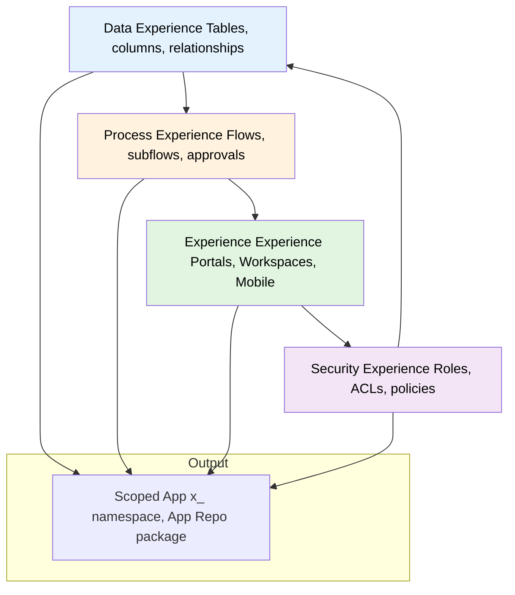
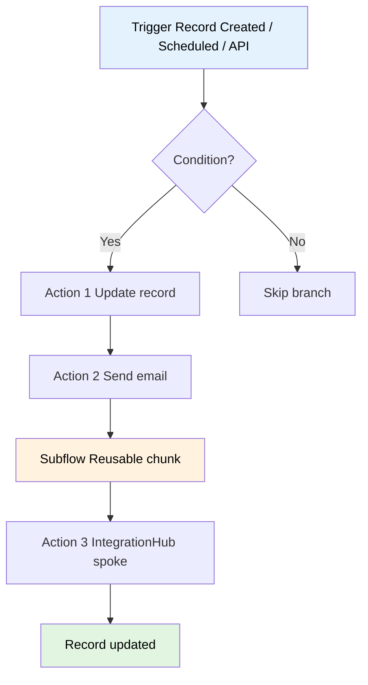
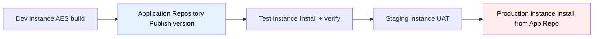
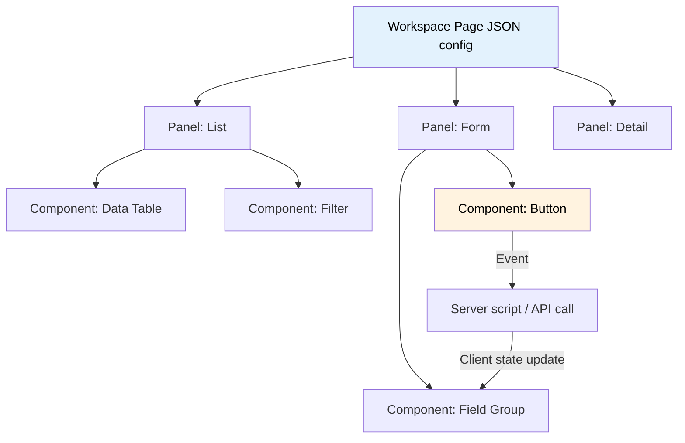
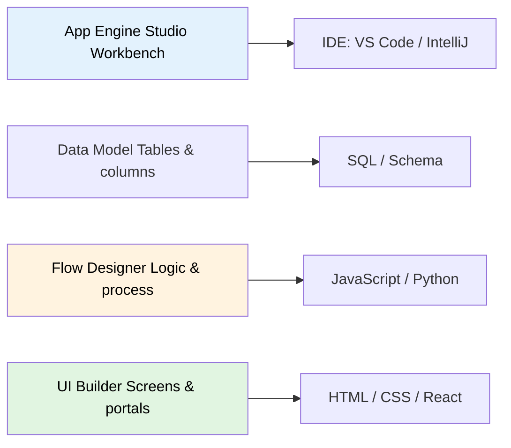

# App Engine & Creator

**Agent:** opencode  
**Date:** 2026-11-08  
**Module:** App Engine / Creator (Low-Code Development)  
**App:** App Engine Studio (AES)  
**Confidence:** high  

---

## Contents

- [Purpose](#purpose)
- [Prerequisites & Setup](#prerequisites--setup)
- [The Low-Code Stack](#the-low-code-stack)
- [App Engine Studio (AES)](#app-engine-studio-aes)
- [Flow Designer & Workflow Studio](#flow-designer--workflow-studio)
- [UI Builder & Workspace](#ui-builder--workspace)
- [Scoped Applications](#scoped-applications)
- [Common Mistakes](#common-mistakes)
- [Goals, Benefits & Key Metrics](#goals-benefits--key-metrics)
- [Core Concept Diagrams](#core-concept-diagrams)
- [SLAs, Dashboards & Workspaces](#slas-dashboards--workspaces)
- [Quiz](#quiz)
- [🎓 Official Learning Resources](#-official-learning-resources)
- [Related Guides](#related-guides)

---

## Purpose

The Creator workflow allows business analysts and "citizen developers" to build applications on the Now Platform without writing deep Java or JavaScript. It democratizes development by providing visual interfaces for data modelling, process automation, and UI design.

---

## Prerequisites & Setup

Before building apps on App Engine / Creator, ensure your ServiceNow environment is configured for low-code development and deployment.

### Required Plugins / Scoped Apps

| Plugin / App | ID | Required? | Notes |
|---|---|---|---|
| **App Engine Studio (AES)** | `com.snc.app_engine_studio` | ✅ Yes | Low-code development environment for scoped apps. |
| **App Engine Management Center (AEMC)** | `com.snc.app_engine_management` | ✅ Yes | Pipeline management: environments, deployment requests, approvals, version tracking. |
| **Flow Designer** | `com.snc.flow_designer` | ✅ Yes | Process automation within AES Data/Process experiences. |
| **UI Builder** | `com.snc.ui_builder` | ✅ Yes | Configurable Workspaces and portal pages within AES Experience experience. |
| **Application Repository** | `com.snc.app_repository` | ✅ Yes | Central versioned artifact store; publish app versions from dev, install on test/prod. |
| **IntegrationHub** | `com.glide.integrationhub` | Conditional | Required if app integrations use spokes/Flow actions. |
| **Agile Development** | `com.snc.agile` | Conditional | For Agile planning/tracking labs. |

### Guided Setup

App Engine does not have a traditional Guided Setup wizard. Configuration steps:

1. **Verify App Engine subscription**: Confirm your contract includes App Engine; AES requires a subscription.
2. **Activate required plugins**: System Definition > Plugins > Activate `com.snc.app_engine_studio`, `com.snc.app_engine_management`, `com.snc.flow_designer`, `com.snc.ui_builder`, `com.snc.app_repository`.
3. **Provision deployment environments**: Configure dev → test → staging → prod instances in AEMC > Pipelines and Deployments > Environments.
4. **Set up source control (optional but recommended)**: Link scoped apps to Git repos (non-production instances only).
5. **Create pipelines in AEMC**: Define deployment order, approvals, and environment targets.

### System Properties to Consider

| Property | Default | Description |
|---|---|---|
| `glide.aes.enabled` | `true` | Enables App Engine Studio features. |
| `glide.aemc.pipeline.enabled` | `true` | Enables pipeline management in AEMC. |
| `glide.scoped.acl.restricted` | `true` | Enforces scoped ACL restrictions; disable only if you trust all code. |
| `glide.sys.update_sets.commit_validation` | `true` | Validates update sets before commit to production. |

### Cross-Module Dependencies

| Dependent Module | Why It Matters | Integration Point |
|---|---|---|
| **Task / CMDB** | Custom tables often extend `task` or `cmdb_ci` | `sn_sales_account` etc. extend `task` |
| **Flow Designer** | Process logic inside AES Process experience | Flow actions trigger AES table updates |
| **UI Builder** | Workspace/Portal experience for AES apps | `sc_palette`, `sc_category` etc. |
| **Service Catalog** | AES apps can surface catalog items | `sc_cat_item`, `sc_cat_item_producer` |

### ACLs Related to Core Tables

| Table | Key ACLs | Typical Roles |
|---|---|---|
| `x_*` (custom scoped app tables) | `create`, `read`, `write`, `delete` | Scoped app roles / `admin` |
| `task` | `read`, `read` (limited write) | `admin`, `sn_task_admin` |
| `cmdb_ci` | `read`, `read` (limited write) | `admin`, `cmdb_admin` |
| `sys_app` | `read`, `read` | `admin`, `sn_app_admin` |
| `sys_scope` | `read`, `read` | `admin`, `security_admin` |

**Tip:** Scoped app tables are isolated to their scope. Grant ACLs per scope/role rather than using global `admin` ACLs for custom apps.

### Breadcrumbs — Enable First

1. **Activate AES plugin**: System Definition > Plugins > Activate `com.snc.app_engine_studio` (requires `admin` role).
2. **Access App Engine Studio**: Navigate to All > App Engine Studio > verify AES home page loads.
3. **Configure AEMC environments**: Pipelines and Deployments > Environments > add dev, test, staging, production instances.
4. **Create Application Repository**: Publish your first scoped app version from dev to Application Repository.
5. **Verify roles**: Ensure developers have `sn_app_developer` (or equivalent) and testers/reviewers have read access.

---

## The Low-Code Stack

| Tool | Purpose | Equivalent in Pro-Code |
|-------|----------|----------------------|
| **Data Model** | Defining tables and fields | SQL / Schema Design |
| **Flow Designer** | Designing the logic/process | Python / JavaScript / Java |
| **UI Builder** | Designing the screen/portal | HTML / CSS / React |
| **AES** | The "Workbench" for all the above | IDE (VS Code / IntelliJ) |

---

## App Engine Studio (AES)

AES is the unified environment for building apps. It breaks the process into four "Experiences":
1. **Data:** Define tables, columns, and relationships.
2. **Process:** Create flows, subflows, and approvals.
3. **Experience:** Build portals, workspaces, or mobile apps.
4. **Security:** Set roles and ACLs.

---

## Flow Designer & Workflow Studio

Flow Designer is the heart of modern ServiceNow automation. 

- **Triggers:** What starts the flow? (e.g., Record Created, Scheduled, API Call).
- **Actions:** What does the flow do? (e.g., Update Record, Send Email, IntegrationHub call).
- **Subflows:** Reusable chunks of logic (e.g., "Validate Employee Identity") called by multiple flows.
- **Data Stream Actions:** For processing large amounts of data from an API in batches.

🚀 **Interview Insight:** If asked about "Workflow vs Flow Designer," say: *"Workflows are legacy (graphical, state-based); Flow Designer is the modern standard (linear, action-based, and integration-ready via IntegrationHub)."*

---

## UI Builder & Workspace

UI Builder is the tool used to create **Configurable Workspaces**. 
- **Components:** Pre-built widgets (Lists, Forms, Data Visualizations).
- **Events:** "When user clicks X, do Y."
- **Client State:** Holding data on the screen without hitting the server.

---

## Scoped Applications

Every app built in AES is a **Scoped App**.
- **Isolation:** Prevents a custom app from accidentally breaking a core system function.
- **Deployment:** Packaged as an app for easy installation via the App Repo or Update Sets.
- **Namespace:** All tables start with `x_` (e.g., `x_company_hr_app_table`).

---

## Common Mistakes

- **Using Scripting instead of Flow Designer:** Writing a 50-line Business Rule when a 5-step Flow would be easier to maintain.
- **Creating too many tables:** Not utilizing the `task` table or `cmdb_ci` for shared attributes.
- **Hardcoding Sys-IDs:** Using a specific ID in a flow instead of a system property or reference.

---

## Goals, Benefits & Key Metrics

App Engine / Creator is measured on development speed, quality, and reuse — the core promise of low-code. These KPIs track how well the platform turns business needs into working apps.

| Business Goal | Benefit App Engine Provides | Key Metric | Example Target Value |
|---------------|----------------------------|------------|----------------------|
| Ship apps faster | Visual dev (AES) beats hand-coding from scratch | **Time-to-Market** (idea → production) | < 6 weeks for standard app |
| Empower citizen developers | Drag-and-drop data/process/UI; no Java/JS required | **Citizen Dev Adoption** (active builders ÷ licensed) | 50%+ of business analysts |
| Build once, reuse everywhere | Subflows, components, templates, scoped app packages | **Reuse Rate** (flows/components used ≥3×) | 60%+ of new flows |
| Move from dev to prod reliably | App Repo + pipeline environments (dev→test→staging→prod) | **Deployment Frequency** (successful deploys / month) | 4–8 per app |
| Apps don't break the platform | Scoped isolation prevents collisions with core tables | **Scope Violations** (cross-scope writes blocked) | 0 in production |
| Apps are actually used | Workspace/Portal adoption by end users | **User Adoption** (active users ÷ target users) | 70%+ within 90 days |
| Low maintenance burden | Flows over scripts; one place to change logic | **Maintenance Tickets / App** (per quarter) | < 3 |
| Quality stays high | Automated flows with validation; fewer manual steps | **Defect Leakage** (bugs found in prod ÷ total) | < 5% |
| Dev→Prod pipeline is smooth | Update Sets + App Repo; no manual XML shuffling | **Pipeline Success Rate** (clean installs ÷ installs) | 95%+ |
| Compliance with security policy | Roles/ACLs defined in the Security experience | **ACL Coverage** (apps with defined access control) | 100% of production apps |

**How to measure in ServiceNow:** Track app metrics in **App Engine Studio > App Analytics** (or the app's own dashboard). Monitor **Flow Designer > Flow Log** for failures. Use **Application Repository** install history for deployment frequency. Check **System Diagnostics > Stats** for transaction performance of custom apps. Report on scoped table usage via **System Definition > Tables & Columns**.

---

## Core Concept Diagrams

### Diagram 1: AES Four Experiences (Data → Process → Experience → Security)

### Diagram 2: Flow Designer Trigger → Action → Subflow

### Diagram 3: Scoped App Deployment Pipeline (Dev → Test → Prod)

### Diagram 4: UI Builder / Workspace Component Hierarchy

### Diagram 5: Low-Code Stack vs Pro-Code Mapping

---

## SLAs, Dashboards & Workspaces

### SLA Support

App Engine / Creator apps are built on custom scoped tables (e.g., `x_*`) that can extend `task` or other base tables. When they extend `task`, they inherit `task_sla` support — SLAs can be applied to app records just like any other task-based record.

| SLA Area | What It Tracks | Typical Target |
|----------|---------------|----------------|
| App record processing | Time from record creation to first status change | Per business process |
| Approval SLAs | Time from approval request to decision | < 48 hours |
| Task completion | Time from task creation to `Resolved` | Per app workflow |

**How to use `task_sla`:**
- Attach SLA definitions to custom app tables that extend `task`
- Track breach risk via `stage`, `has_breached`, and `business_duration` fields
- Configure SLA business rules to escalate when app records approach thresholds
- App Engine Studio apps can reference SLAs via Flow Designer actions (e.g., "Check SLA Status")

**Note:** App Engine itself does not ship OOTB SLA definitions — they are created per app. The SLA framework is inherited from the core `task` table.

### Out-of-Box Dashboards

App Engine does not ship OOTB dashboards for custom apps. Instead, each app can have its own analytics dashboard built with UI Builder or Workspace components:

| Dashboard | Purpose | Where to Find It |
|-----------|---------|------------------|
| **App Analytics** | Built-in app usage and performance metrics | App Engine Studio > App Analytics |
| **Flow Designer Dashboard** | Flow execution counts, failures, and performance | Flow Designer > Dashboard |
| **Custom App Dashboards** | Per-app KPIs built with UI Builder / Workspace | Inside each app's Workspace |

**Key metrics surfaced:** app adoption, flow success/failure rates, deployment frequency, user activity, and transaction performance.

### Out-of-Box Workspaces

App Engine uses **Workspace Builder** to create configurable Workspaces for custom apps:

| Workspace | Purpose | Path |
|-----------|---------|------|
| **App Engine Studio Workspace** | Central hub for builders: app creation, deployment, analytics | All > App Engine Studio > Workspace |
| **Custom App Workspaces** | Per-app workspaces built with UI Builder | Inside each app (via Experience experience) |

**Breadcrumb path:** `All > App Engine Studio > Workspace`. From here you access the app catalog, deployment pipelines, and analytics. Custom workspaces are built in the **Experience** experience of AES using UI Builder components.

---

## Quiz

1. What is the difference between a Flow and a Subflow?

Answer
A Flow is a top-level process triggered by an event; a Subflow is a reusable piece of logic called by one or more flows.

2. Why are Scoped Applications preferred over Global applications?

Answer
They provide isolation (preventing collisions), better security, and easier deployment/uninstallation.

3. What is the purpose of the "Experience" section in AES?

Answer
It is where you define how the user interacts with the app, whether via a Portal, a Workspace, or a Mobile app.

---

---

---

## 🎓 Official Learning Resources

To avoid unofficial or outdated content, always use these validated official ServiceNow sources:

### 📺 Verified Videos & Playlists

### 🚀 Quick Start Guide
For those new to the module, we recommend starting with this official overview:

  <iframe width="560" height="315" src="https://www.youtube.com/embed/KO7WangGeg4" title="App Engine Studio Beginner Overview" frameborder="0" allow="accelerometer; autoplay; clipboard-write; encrypted-media; gyroscope; picture-in-picture" allowfullscreen></iframe>

Fallback link: [App Engine Studio Official Overview](https://www.youtube.com/watch?v=KO7WangGeg4)

- [App Engine Studio | Overview](https://www.youtube.com/watch?v=KO7WangGeg4)
- [Getting Started on App Engine Studio](https://www.youtube.com/watch?v=4rCR9gBBRSQ)
- [What is App Engine Studio?](https://www.youtube.com/watch?v=f8Z-RgicTNs)
- [Building an app template with AES](https://www.youtube.com/watch?v=cRBP0AGWRh8)

### 🚀 The Authoritative Path
1. **Now Learning (Structured Training)**
   - The only official source for certification paths and structured video courses.
   - [Go to Now Learning Portal](https://nowlearning.com/) $\rightarrow$ Search for "App Engine Studio"
   
2. **Product Documentation (Technical Reference)**
   - The definitive source for every table, field, and OOB behavior.
   - [ServiceNow Product Documentation](https://docs.servicenow.com/) $\rightarrow$ Search for "App Engine Studio"

---

## Related Guides

- [ITSM guide](./itsm-guide.md)
- [CSM guide](./csm-guide.md)
- [FSM guide](./fsm-guide.md)

---
