# CMDB — Configuration Management Database

**Agent:** opencode  
**Date:** 2026-11-10  
**Module:** CMDB  
**App:** CMDB / Configuration  
**Confidence:** high  

---

## Contents

- [Purpose](#purpose)
- [Where to Find It](#where-to-find-it)
- [Official Exam Alignment — CIS-Data Foundations (CMDB and CSDM)](#official-exam-alignment--cis-data-foundations-cmdb-and-csdm)
- [CMDB Table Hierarchy Diagram](#cmdb-table-hierarchy-diagram)
- [Out-of-Box Values & Dropdowns](#out-of-box-values--dropdowns)
- [CI Attribute vs Model Attribute](#ci-attribute-vs-model-attribute-syntax-dot-walk-and-structure)
- [IRE Process Diagram (Identification & Reconciliation)](#ire-process-diagram-identification--reconciliation)
- [Identification Rules Deep Dive](#identification-rules-deep-dive)
- [Reconciliation Rules Deep Dive](#reconciliation-rules-deep-dive)
- [Field-Specific Precedence — SCCM / Soroc Example](#field-specific-precedence-sccm-soroc-example)
- [Data Refresh & Staleness Rules](#data-refresh--staleness-rules)
- [Identification vs Reconciliation vs Data Source vs Data Refresh Rules](#identification-vs-reconciliation-vs-data-source-vs-data-refresh-rules)
- [Security & ACLs for CMDB](#security--acls-for-cmdb)
- [Performance Tweaks & Debugging for CMDB](#performance-tweaks--debugging-for-cmdb)
- [Best Practices: When to Use What](#best-practices-when-to-use-what)
- [Coding JavaScript — Platform Script Types & Order of Operations](#coding-javascript--platform-script-types--order-of-operations)
- [Resolving Update Set Conflicts](#resolving-update-set-conflicts)
- [Debugging Across Contexts — Client Script, Business Rule, UI Builder, Workspace, Portal](#debugging-across-contexts--client-script-business-rule-ui-builder-workspace-portal)
- [Common Mistakes to Watch Out For](#common-mistakes-to-watch-out-for)
- [UI Builder — Key Items, Reusable Components, and Page Variants](#ui-builder--key-items-reusable-components-and-page-variants)
- [Re-usable Code / Metadata](#re-usable-code--metadata)
- [Out-of-Box Features](#out-of-box-features)
- [Key Table Hierarchy](#key-table-hierarchy)
- [Integrations](#integrations)
- [REST Integration — RESTMessageV2 vs IntegrationHub Spoke](#rest-integration--restmessagev2-vs-integrationhub-spoke)
- [Webhooks — General Integration Pattern](#webhooks--general-integration-pattern)
- [Key Fields](#key-fields)
- [Goals, Benefits & Key Metrics](#goals-benefits--key-metrics)
- [Core Concept Diagrams](#core-concept-diagrams)
- [IntegrationHub Spoke → IRE: Invoking, Suppressing, and Bridging the Gap](#integrationhub-spoke-ire-making-it-work-and-knowing-when-to-skip-it)
- [Common CMDB Gotchas & Complex Issues](#common-cmdb-gotchas--complex-issues)
- [How CI Relationships Are Determined — OOB, Detection, Fixes & Manual Creation](#how-ci-relationships-are-determined--oob-detection-fixes--manual-creation)

---

## Purpose

The CMDB (Configuration Management Database) is ServiceNow's single source of truth for configuration items (CIs) and their relationships. Every CI — server, application, database, network device, software license — is a record in `cmdb_ci` or its extensions. Relationships between CIs are stored in `cmdb_rel_ci`.

The CMDB is the foundation that ITSM, ITOM, Service Mapping, HAM, and other modules all depend on. If the CMDB is inaccurate, incident impact analysis, change risk assessment, and service mapping all produce wrong answers.

## CMDB CI Class Hierarchy

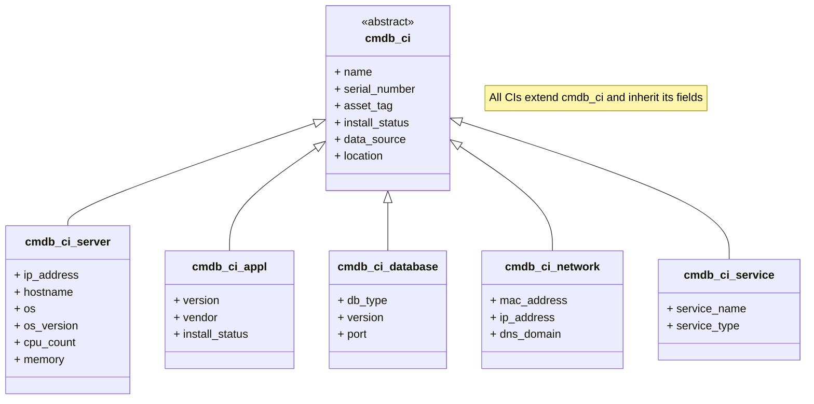

---


## Where to Find It

| Breadcrumb | Path |
|------------|------|
| Module entry | All > Configuration > ... |
| CI List | All > Configuration > CI List |
| CI Relationships | All > Configuration > CI Relationships |
| Identification/Reconciliation | All > Configuration > Identification/Reconciliation |
| CI Classes | All > Configuration > CI Classes |
| Health Dashboards | All > CMDB Health > Dashboards |

**Tip:** CMDB is core to the platform — it's always available, but the Health and IRE features require the CMDB Health plugin.

---

## Official Exam Alignment — CIS-Data Foundations (CMDB and CSDM)

This guide maps to the **Certified Implementation Specialist – Data Foundations (CMDB and CSDM)** exam blueprint (ServiceNow University, KB0012913). Exam weightings shown are the official domain percentages.

| Guide Section | CIS-DF Domain | Exam Weight | What's Covered |
|---------------|-----------------|-------------|----------------|
| **Key Table Hierarchy** | Domain: CI Class Management — CMDB Tables, CI Class Manager | 15% | CI classes, extensions, relationships, cmdb_ci base |
| **Identification & Reconciliation Deep Dive** | Domain: Identification & Reconciliation — Identification Rules, Reconciliation Rules, Datasource Precedence, De-duplication | 25% | IRE engine, identification vs reconciliation, source priority, de-duplication |
| **CMDB Health** | Domain: Govern — CMDB Health Score, CMDB Health Dashboards, Data Manager | 35% | Completeness, correctness, compliance, duplication remediation |
| **CSDM** | Domain: Design — CSDM framework, business/technical services | 15% | CSDM domains, design vs build vs consume |

**Official preparation courses:**
- Welcome to ServiceNow
- ServiceNow Administration Fundamentals
- Get Started with Now Create
- ServiceNow Platform Implementation
- CMDB Fundamentals
- CMDB Health Micro-Certification Simulator
- Configure the CMDB Micro-Certification Simulator
- Common Service Data Model (CSDM Fundamentals)
- CMDB Health Deep Dive

**Exam guidance:** Questions are based on official ServiceNow training materials, the ServiceNow Product documentation site, and the ServiceNow developer site.

---

## CMDB Table Hierarchy Diagram

```mermaid
graph TD
    subgraph "cmdb_ci — Base CI Table"
        cmdb_ci[cmdb_ci]
    end
    
    subgraph "Extended CI Classes"
        cmdb_ci_server[cmdb_ci_server]
        cmdb_ci_appl[cmdb_ci_appl]
        cmdb_ci_database[cmdb_ci_database]
        cmdb_ci_service[cmdb_ci_service]
        cmdb_ci_network[cmdb_ci_network]
    end
    
    subgraph "Relationships"
        cmdb_rel_ci[cmdb_rel_ci]
    end
    
    subgraph "Discovery Sources"
        discovery[Discovery]
        import_set[Import Set]
        manual[Manual Entry]
        sgc[Service Graph Connectors]
    end

    cmdb_ci --> cmdb_ci_server
    cmdb_ci --> cmdb_ci_appl
    cmdb_ci --> cmdb_ci_database
    cmdb_ci --> cmdb_ci_service
    cmdb_ci --> cmdb_ci_network
    
    cmdb_rel_ci -.->|parent| cmdb_ci
    cmdb_rel_ci -.->|child| cmdb_ci
    
    discovery --> cmdb_ci
    import_set --> cmdb_ci
    manual --> cmdb_ci
    sgc --> cmdb_ci

    style cmdb_ci fill:#0b0e11,stroke:#4cc38a,stroke-width:2px
    style cmdb_rel_ci fill:#0a0d10,stroke:#e5b567
```

**Exam focus:** CI class management, CMDB tables, CI class manager, relationships.

---

## Out-of-Box Values & Dropdowns

ServiceNow ships with predefined CI classes, status values, and identifier rules. Verify against your instance — values can vary by release.

### CI Status (cmdb_ci.install_status)
| Status | When to Use |
|--------|-------------|
| `development` | CI is being built or configured |
| `test` | CI is in test environment |
| `production` | CI is live in production |
| `in maintenance` | CI is under maintenance |
| `retired` | CI is no longer in use |
| `ordered` | CI has been ordered, not yet received |

### CI Class Hierarchy (OOB)
| Class | Table | Description |
|-------|-------|-------------|
| `cmdb_ci` | Base CI | All configuration items |
| `cmdb_ci_server` | Server CIs | Windows/Linux servers, hosts |
| `cmdb_ci_appl` | Application CIs | IIS, Tomcat, SQL Server |
| `cmdb_ci_database` | Database CIs | Database instances |
| `cmdb_ci_service` | Logical service | Business services |
| `cmdb_ci_network` | Network CIs | Routers, switches, firewalls |

### OOB Identifier Rules (Computer CI Class)
| Priority | Identifier Entry | Match On |
|----------|-----------------|----------|
| 100 | Serial Number + Serial Number Type | Serial number + type |
| 200 | Serial Number | Serial number only |
| 300 | Name + DNS Domain | Hostname + domain |
| 400 | MAC Address | Network adapter MAC |

**Processing order:** Identifier entries are evaluated in priority order (lowest first). First match wins — remaining entries are skipped.

**Exam focus (CIS-DF, 25%):** CI classes, identifier rules, data source precedence, de-duplication.

---

## IRE Process Diagram (Identification & Reconciliation)

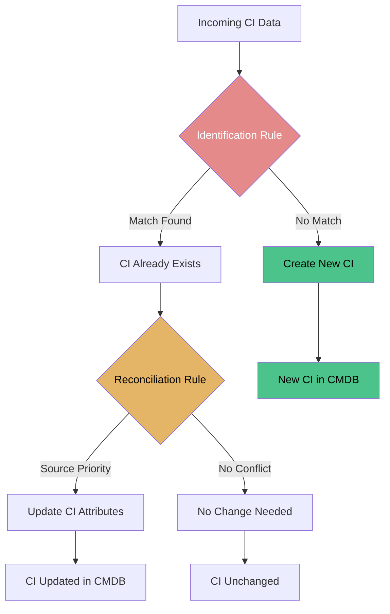

**Identification:** Answers "Is this CI already existing or is it new?" — uses CI identifiers (serial number, MAC address, hostname + DNS, etc.)
**Reconciliation:** Answers "If multiple sources update the same CI, whose data should I trust?" — uses source priority (Discovery typically outranks Import Set and Manual)
**Processing Order:** Identification → (if match) Reconciliation → Update/Create. If identification fails, no reconciliation and no update occur.

**Exam focus:** Identification Rules, Reconciliation Rules, Datasource Precedence Rules, CMDB De-duplication (25% of exam).

---

## Re-usable Code / Metadata

### Scoped Application

CMDB is primarily global scope with some scoped extensions.

| Scope Aspect | Detail |
|--------------|--------|
| Scope | Global + `com.snc.cmdb` (CI Class Models) |
| Key tables | `cmdb_ci`, `cmdb_ci_server`, `cmdb_ci_appl`, `cmdb_ci_database`, `cmdb_rel_ci`, `cmdb_ci_service` |
| Roles | `itil`, `admin`, `cmdb_admin` |

### Re-usable Metadata Inventory

| Re-usable piece | What it is | Where it lives (breadcrumb) |
|-----------------|------------|------------------------------|
| **CI Classes** | The CMDB class hierarchy (cmdb_ci → cmdb_ci_server → cmdb_ci_linux_server, etc.) | All > Configuration > CI Classes |
| **CI Relationship Types** | Types of relationships (Runs on::Runs, Depends on::Used by, etc.) | All > Configuration > CI Relationship Types |
| **Identification Rules** | Rules that determine if a discovered CI matches an existing CI | All > Configuration > Identification/Reconciliation > Identification |
| **Reconciliation Rules** | Rules that merge/update CIs when data conflicts | All > Configuration > Identification/Reconciliation > Reconciliation |
| **Dynamic CI Groups** | Query-defined CI collections | All > Configuration > Dynamic CI Groups |
| **Data Sources** | Sources of CI data (Discovery, Import Set, Manual, etc.) | All > Configuration > Data Sources |

### Re-usable Code Snippets

#### Business Rule: Prevent Duplicate Server CIs by Serial Number

```javascript
(function rule(current, previous) {
    if (current.operation() == 'insert' && current.serial_number) {
        var gr = new GlideRecord('cmdb_ci_server');
        gr.addQuery('serial_number', current.serial_number);
        gr.query();
        if (gr.next()) {
            current.setAbortAction(true);
            gs.addError('A server with this serial number already exists: ' + gr.number);
        }
    }
})(current, previous);
```

#### Script Include: CI Relationship Helper

```javascript
var CIRelationshipHelper = Class.create();
CIRelationshipHelper.prototype = Object.extendsObject(AbstractAjaxProcessor, {
    getRelatedCIs: function() {
        var ciSysId = this.getParameter('ci_sys_id');
        var gr = new GlideRecord('cmdb_rel_ci');
        gr.addQuery('parent', ciSysId);
        gr.query();
        var children = [];
        while (gr.next()) {
            children.push({sys_id: gr.getValue('child'), type: gr.getValue('type')});
        }
        return JSON.stringify(children);
    },
    type: 'CIRelationshipHelper'
});
```

---

## Out-of-Box Features

| Feature | Description | Where |
|---------|-------------|-------|
| CI List | Browse and manage all CIs | All > Configuration > CI List |
| CI Relationships | View and create CI-to-CI relationships | All > Configuration > CI Relationships |
| Identification & Reconciliation | Prevent and resolve duplicate CIs | All > Configuration > Identification/Reconciliation |
| CI Classes | Extend the CMDB class model | All > Configuration > CI Classes |
| Dynamic CI Groups | Query-based CI collections | All > Configuration > Dynamic CI Groups |
| CMDB Health | Dashboards for data quality, completeness, correctness | All > CMDB Health > Dashboards |
| Data Sources | Track where each CI came from (Discovery, Import, Manual) | All > Configuration > Data Sources |

---

## Key Table Hierarchy

| Table | Purpose | Extends | Key Fields |
|-------|---------|---------|------------|
| `cmdb_ci` | Base CI table — everything managed | — | `name`, `serial_number`, `asset_tag`, `location`, `status`, `data_source` |
| `cmdb_ci_server` | Server CIs | `cmdb_ci` | `ip_address`, `hostname`, `os`, `os_version`, `cpu_count`, `memory` |
| `cmdb_ci_appl` | Application CIs | `cmdb_ci` | `name`, `version`, `install_status`, `vendor` |
| `cmdb_ci_database` | Database CIs | `cmdb_ci` | `type`, `version`, `port`, `instance_name` |
| `cmdb_ci_service` | Logical business service | `cmdb_ci` | `name`, `description`, `owned_by` |
| `cmdb_rel_ci` | Relationships between CIs | — | `parent`, `child`, `type`, `start_date`, `end_date` |

### Table Relationships

```
cmdb_ci (Base CI)
    │
    ├──► cmdb_ci_server (WEB01, APP01, DB01)
    ├──► cmdb_ci_appl (IIS, Tomcat, SQL Server)
    ├──► cmdb_ci_database (SQL Server instance)
    ├──► cmdb_ci_service (Online Banking service)
    │
    └──► cmdb_rel_ci (relationships)
            ├──► parent: WEB01 → child: IIS → type: "Runs on::Runs"
            ├──► parent: IIS → child: APP01 → type: "Depends on::Used by"
            └──► parent: APP01 → child: DB01 → type: "Depends on::Used by"
```

---

## Integrations

| Integration | Direction | Purpose | Protocol |
|-------------|-----------|---------|----------|
| Discovery | Inbound | Auto-create and update CIs | Discovery/MID Server |
| Import Sets | Inbound | Bulk load CIs from CSV/Excel | Import Set/Transform Map |
| Service Graph Connectors | Inbound | Import CI data from external CMDBs/cloud | REST/API |
| JDBC | Inbound | Read CI data from external databases | JDBC |
| ITAM/HAM | Bidirectional | Asset and CI synchronization | Internal |

---

## REST Integration — RESTMessageV2 vs IntegrationHub Spoke

When CMDB needs to send or receive CI data from an external system (e.g., push a new CI to Soroc, pull inventory from SCCM, or sync with an external CMDB), ServiceNow offers two main REST options:

| | RESTMessageV2 | IntegrationHub REST Spoke |
|---|--------------|---------------------------|
| **What it is** | Server-side API (`sn_ws.RESTMessageV2`) for making REST calls from scripts | Low-code IntegrationHub spoke for REST-based integrations |
| **Best for** | Custom logic, Business Rules, Script Includes, one-off callouts | Reusable integration flows, Flow Designer, non-developer maintenance |
| **Where configured** | `sys_rest_message` table → REST Message record | IntegrationHub → Spokes → REST Message Spoke |
| **Authentication** | Set on the REST Message record (Basic, Bearer, OAuth, API Key) | Set on the Spoke / connection configuration |
| **Response handling** | Parsed in script (`response.getBody()`, `response.getStatusCode()`) | Mapped via output variables in Flow Designer |
| **CMDB use case** | Custom Business Rule that pushes CI changes to an external system on update | Scheduled flow that pulls external inventory and creates/updates CIs via Transform Map |

### Authentication — where it is set up and how

Authentication is configured at the **REST Message** level (not per call). All calls using that message inherit the auth.

**RESTMessageV2** — navigate to **System Web Services > REST Messages** (or `sys_rest_message` list), open the message, and set:

| Auth type | Where | How |
|-----------|-------|-----|
| **Basic Auth** | REST Message record > Authentication type = `Basic` | Enter username/password; optionally select a credential record |
| **Bearer Token** | REST Message record > Authentication type = `Bearer Token` | Paste the token; can reference a credential or secret store |
| **OAuth 1.0 / 2.0** | REST Message record > Authentication type = `OAuth` | Configure consumer key/secret, token, signature method |
| **API Key** | REST Message record > Authentication type = `None` + manual header | Add header `X-API-Key: <value>` via `message.setRequestHeader()` |

**IntegrationHub REST Spoke** — navigate to **IntegrationHub > Spokes > REST Message Spoke**, configure the spoke, then set authentication on the **connection** or spoke input (Basic, Bearer, OAuth, or API Key header) before the flow can use it.

> **Tip:** Store secrets in **System Definition > Secrets** (Credential record) rather than hard-coding tokens in the REST Message or script.

---

### End-to-end example — push a new CI to an external system via RESTMessageV2

<details>
<summary>Example: Business Rule on cmdb_ci_server insert that POSTs the CI to an external CMDB</summary>

**Scenario:** When a new Server CI is inserted, push `name`, `serial_number`, and `ip_address` to an external REST endpoint that owns the authoritative asset record.

**1. Create the REST Message**
- Navigate to **System Web Services > REST Messages > New**
- Name: `External CMDB - Create CI`
- Endpoint: `https://api.external-cmdb.com/v1/cis`
- HTTP method: `POST`
- Authentication type: `Basic` (or Bearer Token)
- Username / Password: service account for the external CMDB

**2. Add a request header**
- In the REST Message > Headers related list > New
- Name: `Content-Type`, Value: `application/json`

**3. Create a Business Rule on `cmdb_ci_server`**
- Table: `cmdb_ci_server`
- Run: `After`, `Insert`
- Advanced: `true`

```javascript
(function rule(current, previous) {
    // Only fire when this is a real CI with a serial number
    if (!current.serial_number) return;

    // Build the JSON payload
    var payload = JSON.stringify({
        name: current.name,
        serial_number: current.serial_number,
        ip_address: current.ip_address,
        data_source: current.data_source,
        source_sys_id: current.sys_id
    });

    // Create the REST message and set the body
    var sm = new sn_ws.RESTMessageV2('External CMDB - Create CI');
    sm.setRequestBody(payload);

    try {
        var response = sm.execute();
        var httpStatus = response.getStatusCode();
        var body = response.getBody();

        if (httpStatus == 200 || httpStatus == 201) {
            gs.log('CI pushed to external CMDB: ' + current.name + ' (HTTP ' + httpStatus + ')');
        } else {
            gs.logError('External CMDB reject: HTTP ' + httpStatus + ' — ' + body);
        }
    } catch (ex) {
        gs.logError('REST call failed: ' + ex.getMessage());
    }
})(current, previous);
```

**4. Test**
- Insert a new Server CI via CI List with Name, Serial Number, IP Address
- Check **System Log > All** for `CI pushed to external CMDB`
- Verify the external system received the CI

</details>

**Key differences to remember:**
- Use **RESTMessageV2** when you need code-level control (Business Rules, Script Includes, custom error handling, dynamic endpoints).
- Use **IntegrationHub REST Spoke** when you want a low-code, reusable flow that operations teams can maintain without writing JavaScript.
- Authentication is set **once on the REST Message / spoke**, not per request — secure credentials via the Credential/Secret store.
- For CMDB inbound (external → ServiceNow), prefer **Service Graph Connector** or **Import Set + Transform Map** rather than pushing via REST, so IRE and reconciliation run natively.

---

## Webhooks — General Integration Pattern

A **webhook** is a push-based, event-driven integration: ServiceNow (or an external system) sends a JSON payload to a pre-registered URL the moment an event happens. It eliminates polling — instead of ServiceNow repeatedly asking "has anything changed?", the source tells ServiceNow (or vice versa) the instant something does.

### Outbound webhook — ServiceNow tells an external system about an event

Use this when ServiceNow is the **source of truth** and an external system needs to react (e.g., post to Teams, notify an NMS, trigger a downstream ticket).

**Sections needed to set it up:**

| Section | Where | What to configure |
|---------|-------|-------------------|
| **Webhook listener (external)** | The external system | A public HTTPS endpoint that accepts `POST` with a JSON body; note the webhook URL and any secret/token it requires |
| **Authentication** | System Definition > Secrets (Credential record) | Store the webhook secret/bearer token here; do not hard-code it in the flow |
| **Flow / REST Message** | Flow Designer or System Web Services > REST Messages | Build the payload (fields from the triggering record), set the endpoint URL, add the auth header, choose `POST` |
| **Trigger** | Flow Designer (Record-based flow) or Business Rule | What fires the webhook — e.g., `cmdb_ci` insert/update, `em_alert` state change, incident close |

**Example:** A Flow Designer record-based flow on `cmdb_ci` fires on update. When `install_status` changes to `retired`, it POSTs `{ci_name, serial_number, status, source_sys_id}` to the external asset-management webhook URL with a Bearer token from Secrets.

### Inbound webhook — external system tells ServiceNow about an event

Use this when an external system is the source and ServiceNow must react (e.g., UKG timecard approved, GitHub repo pushed, Jira issue updated).

**Sections needed to set it up:**

| Section | Where | What to configure |
|---------|-------|-------------------|
| **Inbound REST API** | System Web Services > Scripted REST APIs | Create a Scripted REST API with a base path, then add a Resource (HTTP method `POST`) whose script reads `request.body.dataString` and writes to the target table |
| **Webhook registration (external)** | The external system | Point its webhook URL at your Scripted REST API endpoint (`https://<instance>/api/snc/<api_id>/<resource_path>`); subscribe to the events it should send |
| **Authentication** | Scripted REST API resource | Set auth type (None with token validation in script, Basic, or OAuth) and validate the incoming secret |
| **Target table / logic** | The resource script | Parse the payload, map fields, create/update `incident`, `cmdb_ci`, `sn_hr_core_case`, etc., and apply any IRE/reconciliation if writing CIs |

### What gets tied to a webhook — alignment to events

A webhook is not tied to a table; it's tied to an **event**. What you send depends on what happened:

| Event source | What the webhook carries | Typical target table in ServiceNow |
|--------------|-------------------------|------------------------------------|
| CI created/updated/deleted | CI sys_id, class, key attributes (`name`, `serial_number`, `install_status`, `data_source`) | `cmdb_ci` (+ IRE/reconciliation if inbound) |
| Alert state change | Alert sys_id, severity, CI, description, correlation key | `em_alert` → incident/case |
| Incident created/closed | Incident number, state, assignment group, caller, CMDB CI | `incident` / `sn_customerservice_case` |
| HR case / profile change | Case sys_id, category, employee, sensitive fields (restricted by ACL) | `sn_hr_core_case` / `sn_hr_core_profile` |

**Rule:** Tie the webhook to the *event*, not the table. The payload should contain just enough for the receiver to act (CI sys_id + changed fields), not the whole record.

### Service (Flow Designer / IntegrationHub spoke) vs webhook — when to use which

| | **Service / Flow Designer / IntegrationHub Spoke** | **Webhook** |
|---|---------------------------------|-------------|
| Direction | Usually ServiceNow-initiated or orchestrated inside ServiceNow | Push notification, either direction |
| Best for | Multi-step workflows with conditions, approvals, multiple systems, retries | Simple "something happened" notification to one external URL |
| Latency | Near real-time, but flow must be triggered | Real-time, immediate push |
| Auth | Credential store / connection config | Secret/token in header or query param |
| Maintenance | Flow Designer UI, operations-team friendly | Script or flow + external endpoint ownership |
| Volume | High, with built-in queuing/retry | Lower; external endpoint must accept the rate |

**When to use a webhook:** You need real-time push, the payload is small, and there's a single external URL to notify (e.g., alert an NMS when a CI retires, post to Teams on P1 incident, tell UKG a timecard was approved).

**When to use a service/flow instead:** You need multi-step logic, retries, approvals, multiple targets, or the external system doesn't expose a webhook URL (then you poll via REST message on a schedule).

**When to use REST poll/push instead:** The external system has no webhook capability and you must pull data on a schedule (REST poll), or you need reliable per-payload delivery with acknowledgment (REST push).

### Webhooks vs events — are they the same?

No, but they're related. An **event** (`em_event`) is a ServiceNow internal record of something that happened. A **webhook** is the delivery mechanism that tells an external system about that event (or receives an external event into ServiceNow). You typically:
- Fire an **outbound webhook** from a Flow Designer flow triggered by an `em_alert` or `cmdb_ci` change (the event → webhook mapping).
- Receive an **inbound webhook** at a Scripted REST API, then create an `em_event` / `incident` / `cmdb_ci` from the payload (the webhook → event mapping).

---

## Key Fields

| Table | Field | Type | Why It Matters |
|-------|-------|------|----------------|
| `cmdb_ci` | `name` | String | Human-readable CI name |
| `cmdb_ci` | `serial_number` | String | Unique hardware identifier (key for IRE) |
| `cmdb_ci` | `asset_tag` | String | Physical asset tag |
| `cmdb_ci` | `data_source` | String | Where the CI came from (Discovery, Import, Manual) |
| `cmdb_ci` | `status` | Choice | Installed, In Maintenance, Retired, etc. |
| `cmdb_rel_ci` | `parent` | Reference | Upstream CI or service |
| `cmdb_rel_ci` | `child` | Reference | Downstream CI |
| `cmdb_rel_ci` | `type` | Choice | Relationship type (Runs on::Runs, etc.) |

---

## Goals, Benefits & Key Metrics

The CMDB's business goal is to act as the single source of truth for all configuration items, so operational decisions about impact, change, and ownership are based on accurate data.

|| Business Goal | Benefit | Example Key Metric | Example Value |
|----------------|-------------|--------------------|----------------|
|| Single source of truth | Trust for impact analysis | CMDB completeness | ≥ 95% of CIs with required attributes |
|| Data accuracy | Reliable impact analysis | CMDB data accuracy score | ≥ 90% |
|| Data quality and health | Proactive remediation | CMDB Health Score | ≥ 90 / 100 |
|| De-duplication | Prevent duplicate CIs | Duplicate CI rate | < 3% |
|| Impact accuracy and operations | Faster incident handling | Mean Time to Identify | ≥ 85% correct impact sets |
|| Change governance | Reduce change risk | Change success rate | ≥ 80% |

---

## Core Concept Diagrams

### CI to CI Relationship Graph

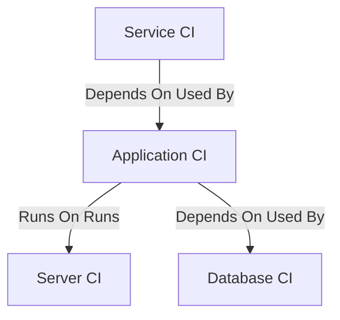

### Discovery to CMDB Population Flow

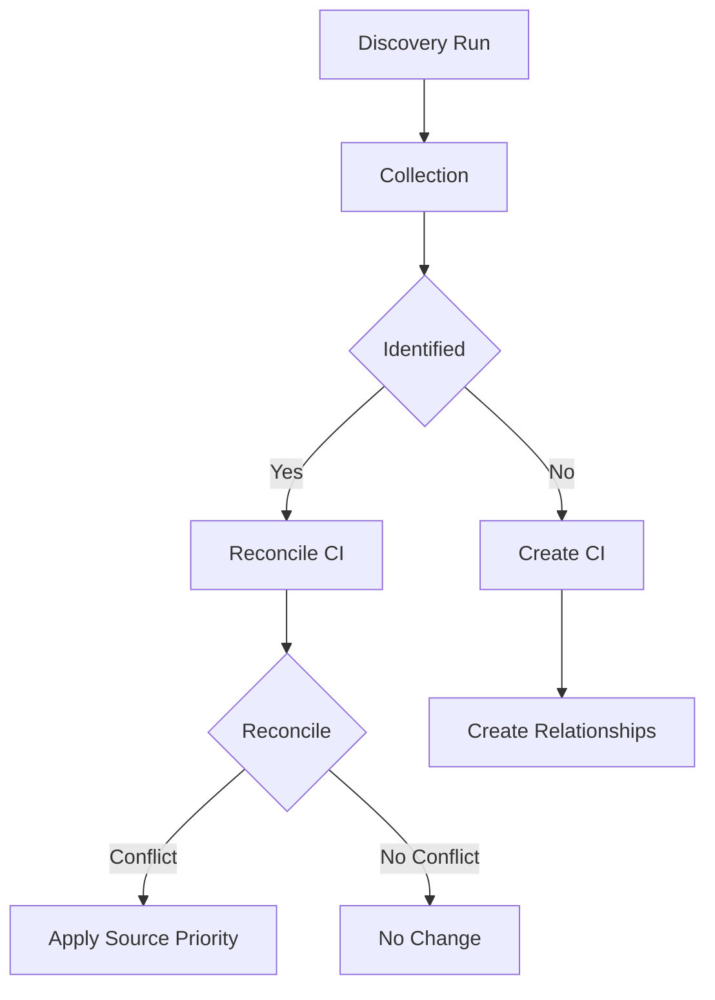

### IRE Identification and Reconciliation Flow

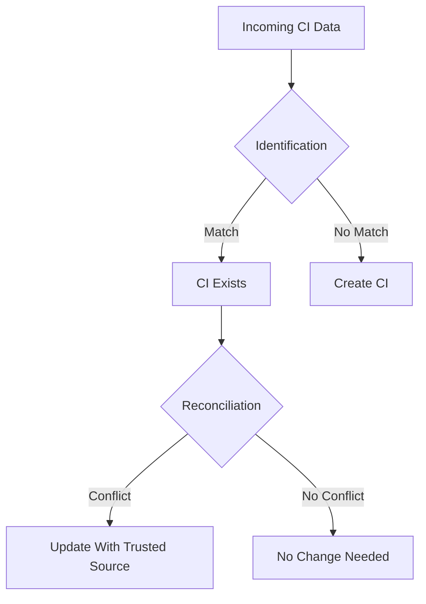

## Common Mistakes

|| Mistake | Symptom | Fix |
|---------|---------|-----|
| No identification rules | Duplicate CIs for the same server | Configure IRE identification rules before large discovery |
| Not reconciling data sources | Conflicting data for same CI | Set reconciliation priority (Discovery > Import > Manual) |
| Deleting CIs instead of retiring | Broken relationships, orphaned incidents | Use status=Retired, not delete |
| No relationship types defined | Service Mapping can't build maps | Define CI relationship types before mapping |
| CMDB not tied to incidents | No impact analysis | Populate `cmdb_ci` on incident records |
|| Ignoring CMDB Health dashboards | Data quality degrades over time | Review completeness/correctness dashboards monthly |

---

## CI Lifecycle Diagram

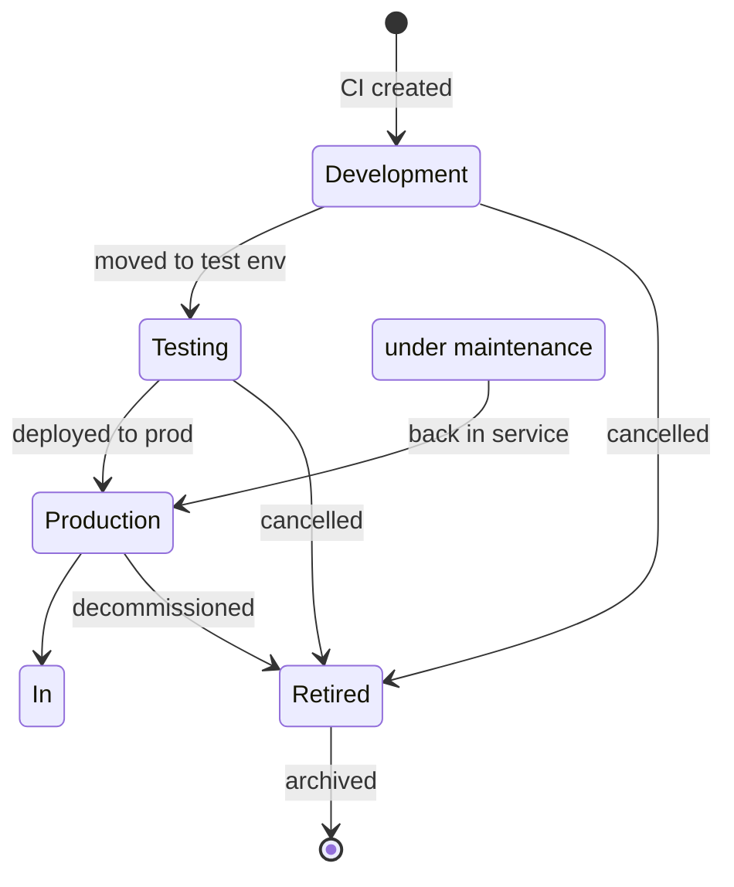

---

## IRE Data Source Precedence Diagram

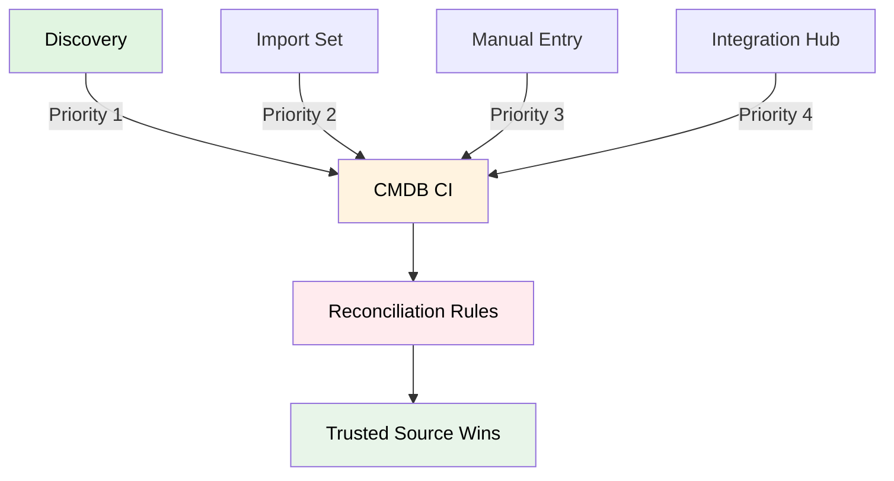

---

## Integration Hub → CMDB Integration Flow

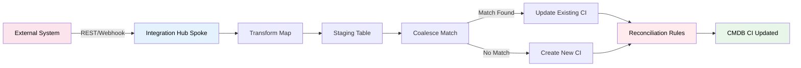

---

## Deep Dive: Identification & Reconciliation (IRE)

IRE is the engine that prevents duplicate CIs and keeps data accurate.

### Identification Rules Deep Dive

**What they do:** Identification rules answer the question "Does this incoming CI already exist in the CMDB, or is it brand new?" They are evaluated before reconciliation. If no rule matches, a new CI is created and reconciliation is skipped entirely.

**Where they live:** All > Configuration > Identification/Reconciliation > Identification

**How a rule is structured:**
- **Target table** (e.g., `cmdb_ci_computer`, `cmdb_ci_server`, `cmdb_ci_network`)
- **Identifier entries** — each entry lists the fields to match on, combined with AND logic (all fields in an entry must match)
- **Priority** — lower number = evaluated first
- **Match type** — exact match, contains, starts with, etc.
- **Active** — only active rules are evaluated

**Evaluation flow:**
1. Incoming CI data arrives (Discovery, Import Set, Service Graph Connector, etc.)
2. IRE loads the active identification rules for the target table
3. Rules are sorted by priority (lowest number first)
4. Each rule's identifier entries are AND-ed together; the first rule to produce a match wins
5. Match found → existing CI identified → proceed to reconciliation
6. No rule matches → new CI created (reconciliation skipped)

**Common identification criteria:**
- Serial number + Manufacturer + Model (hardware)
- MAC address (network interfaces)
- Hostname + DNS domain (servers, workstations)
- Asset tag
- Circuit ID (telecom)
- IMEI / MEID (mobile devices)
- Device ID / serial (SD-WAN edges, vManage)

**Identifier entry types — Regular vs Lookup vs Hybrid**

Each identifier entry within an Identification Rule pulls its matching fields from one of three sources:

| Entry type | What it uses | Example |
|------------|--------------|---------|
| **Regular** | Fields on the CI's own table | Server serial number + serial number type |
| **Lookup** | Fields on a related table that references the CI | Network adapter MAC address (from `cmdb_ci_network_adapter`) |
| **Hybrid** | Fields from both the CI table and a related table | Server name (CI table) + serial number (related table) |

These are **not** separate rule categories — they are three types of *identifier entries* within a single Identification Rule. A single rule can contain multiple entries of mixed types, each evaluated in priority order.

**Important:** Lookup entries can impact performance because they require a join to a related table. ServiceNow recommends preferring Regular entries (CI's own fields) where possible, and using Lookup entries only when the identifying attribute genuinely lives on a related table.

**Important:** Identification operates on the `cmdb_ci` hierarchy. A rule on `cmdb_ci_computer` matches against `cmdb_ci_computer` records, which are also `cmdb_ci` records. Fields used in identification must exist on the target table (or be inherited from `cmdb_ci`). Fields that live only on a Model table (`cmdb_model`) cannot be used to identify a CI record — IRE identifies the CI, not the model.

If a match is found, the existing CI is updated. If not, a new CI is created.

### Reconciliation Rules Deep Dive

**What they do:** Reconciliation rules answer the question "Multiple sources have data for this CI — which source wins for each field?" They run only after identification finds an existing match.

**Where they live:** All > Configuration > Identification/Reconciliation > Reconciliation

**How a rule is structured:**
- **Target table / CI class** (e.g., `cmdb_ci_computer`, `cmdb_ci_server`)
- **Data source** (e.g., `SCCM`, `Soroc`, `Discovery`, `Import Set`, `Manual`)
- **Priority** — lower number = higher priority
- **Field mappings** — which fields this source is allowed to update
- **Staleness / refresh behavior** — whether a source can update if its data is older than another source's

**Processing order:**
1. Identified CI exists → reconciliation evaluates all active sources for that CI
2. For each field on the CI, IRE looks at all sources providing that field
3. The source with the highest priority (lowest number) wins — **unless** staleness rules allow override
4. Losing sources' values are discarded for that field (the CI keeps the winner's value)

**Typical source priority:**

| Priority | Source | Rationale |
|----------|--------|-----------|
| 100 | Discovery | Directly observed from the device |
| 200 | SCCM / enterprise inventory | Managed, agent-based inventory |
| 300 | Soroc / external CMDB | Trusted external source |
| 400 | Import Set | Bulk load, varies in quality |
| 500 | Manual | Human entry — least trusted |

---

### Field-Specific Precedence — SCCM / Soroc Example

**Scenario:** Table `cmdb_ci_computer`. You have two authoritative sources:
- **SCCM** is authoritative for `name`
- **Soroc** is authoritative for `serial_number`

This is **field-specific precedence**, not table-wide. You do NOT pick one source to win all fields on `cmdb_ci_computer`. Instead, you configure reconciliation so that each field has its own winner.

**How to configure:**

| Step | Action | Detail |
|------|--------|--------|
| 1 | Open Reconciliation Rules | All > Configuration > Identification/Reconciliation > Reconciliation |
| 2 | Create rule for SCCM | Table: `cmdb_ci_computer`, Source: `SCCM`, Priority: `100`, Fields: `name` (and other SCCM-owned fields) |
| 3 | Create rule for Soroc | Table: `cmdb_ci_computer`, Source: `Soroc`, Priority: `200`, Fields: `serial_number` (and other Soroc-owned fields) |
| 4 | Create fallback rule | Table: `cmdb_ci_computer`, Source: `Discovery`, Priority: `300`, Fields: all remaining fields |
| 5 | Activate all rules | Only active rules participate in reconciliation |

**Result per field:**
- `name`: SCCM wins (priority 100). Soroc's `name` is ignored even if Soroc sends one.
- `serial_number`: Soroc wins (priority 200). SCCM's `serial_number` is ignored even if SCCM sends one.
- `os`, `ip_address`, etc.: Discovery wins (priority 300) as fallback.

**Mermaid — Field-specific precedence flow:**

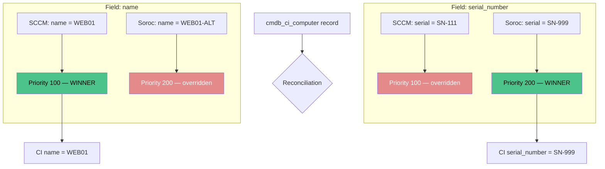

**Key point:** Field-specific precedence means different sources can own different fields on the same CI record. A source that loses on one field may win on another.

---

### Data Refresh & Staleness Rules

**Can a secondary source update a field if the primary source's data has gone stale?** Yes — but only if you configure it. By default, reconciliation is **priority-based, not time-based**: the highest-priority source wins regardless of how old its data is. A stale value from a priority-100 source will beat a fresh value from a priority-200 source.

**Staleness / refresh behavior is configured per reconciliation rule, not per table.** Each rule can specify whether the source can update a field if its own data is newer than the current CMDB value, and whether it yields to a higher-priority source even if that source is stale.

**Two common models:**

| Model | Behavior | Use case |
|-------|----------|----------|
| **Strict priority** | Highest-priority source always wins, regardless of age | SCCM is always authoritative for `name`; never let Soroc overwrite it |
| **Staleness-aware (refresh)** | A source can update if its data is newer AND the primary source hasn't refreshed within a threshold | Allow Soroc to refresh `serial_number` if SCCM hasn't sent an update in 90 days |

**Field-specific vs table-specific:**
- **Field-specific (recommended):** Each reconciliation rule lists the specific fields it owns. SCCM owns `name`; Soroc owns `serial_number`. One source's staleness on `name` does not affect `serial_number`.
- **Table-specific (avoid):** A single rule claiming all fields on `cmdb_ci_computer` for one source. This creates coupling — if SCCM goes stale on `name`, it can't be refreshed by Soroc for `name`, and Soroc may be blocked from updating other fields too.

**Configuration for staleness-aware refresh:**

| Step | Action |
|------|--------|
| 1 | On each reconciliation rule, set **Refreshable** = true if the source can update when its data is newer |
| 2 | Set **Stale threshold** (e.g., 90 days) — if the winning source hasn't updated within this window, a lower-priority source may refresh |
| 3 | Scope rules to specific fields — do not use catch-all rules |
| 4 | Test: send SCCM data, then stop SCCM for 90+ days, send Soroc data, verify Soroc updates the field |

**Warning:** Staleness-aware rules can cause "ping-pong" if two sources refresh each other alternately. Use strict priority for critical identity fields (serial number, name) and staleness-aware only for non-identifying attributes.

---

### Identification vs Reconciliation vs Data Source vs Data Refresh Rules

ServiceNow CMDB relies on four distinct mechanisms that work together in a specific order. Understanding the distinction — and the order in which they apply — is critical for IRE interviews and implementations.

#### The four pillars compared

| Feature | What it controls | Configuration level | Main purpose |
|---------|-----------------|---------------------|--------------|
| **Identification Rules** | Which attributes identify a CI (does it already exist?) | Class → identifier entry → attributes | Prevent duplicate CIs |
| **Reconciliation Rules** | Which sources can update CI attributes | Class and attribute level | Prevent unauthorized overwrites |
| **Data Source Rules** | Whether a source can insert new CIs | Class level | Block untrusted CI creation |
| **Data Refresh Rules** | When data from a higher-priority source becomes stale | Class level, with refresh criteria | Allow lower-priority sources to update stale data |

#### Class level vs attribute level

| Feature | Class-level configuration | Attribute-level configuration |
|---------|--------------------------|-------------------------------|
| **Identification** | Rule applies to a CI class | Identifier entries select matching fields |
| **Reconciliation** | Rules can authorize sources across a class | Specific attributes can have separate authorization |
| **Data Source** | Blocks inserts for a specified CI class | No individual field selection |
| **Data Refresh** | Refresh policy applies to a CI class | Refresh is evaluated against attribute freshness/history |

**Important:** A class-level rule can still have attribute-level effects. For example, a reconciliation rule is associated with a class but can authorize only selected attributes.

---

#### IRE Data Source Rules — class-level, not attribute-level

**Official ServiceNow name:** IRE Data Source Rules (often shortened to "Data Source Rules")

**Purpose:** Prevent a particular source from inserting new CIs into a specified CI class. This is a **create-only** gate — it governs whether a source is permitted to create new CI records, not whether it can update existing ones.

| Source | Can insert new servers? | Can update existing servers? |
|--------|------------------------|------------------------------|
| Discovery | Yes | Yes (subject to reconciliation) |
| IntegrationHub | No (if blocked) | Yes (subject to reconciliation) |

**Configuration:** All > Configuration > Identification/Reconciliation > Data Sources
* **CI class:** Server (or any CI class)
* **Discovery source:** IntegrationHub source (or other source name)
* **Insert Not Allowed:** Enabled

**What IRE Data Source Rules can and cannot do:**

| Can do | Cannot do |
|--------|-----------|
| Block a source from inserting new CIs of a specific class | Restrict updates to specific attributes (RAM vs CPU) |
| Prevent untrusted sources from creating CIs | Gate updates to existing CIs |
| Apply at the CI class level | Apply at the field/attribute level |
| Work independently of reconciliation priority | Use "Apply to all attributes" |

IntegrationHub (or any blocked source) can still update an existing server's attributes, subject to reconciliation rules. IRE Data Source Rules are strictly about **creation**, not modification.

**Important:** Data Source Rules are checked **only** when a new CI is being created (no identification match found). They do not affect updates to existing CIs — that is the exclusive domain of Reconciliation Rules.

---

#### Order of Operations — Multiple Conflicting Rules

When multiple rules apply to the same field or the same CI class, ServiceNow resolves conflicts in this order:

**Step 1 — Identification happens first**
Before anything else, IRE asks: *Does this CI already exist?* Identification rules run against the incoming data. If no rule matches, a new CI is created and **reconciliation is skipped entirely** — no source priority, no refresh rules, nothing else applies. Data Source Rules are checked at the insertion step.

**Step 2 — Field-level reconciliation (source priority per field)**
If the CI exists, IRE reconciles each field independently. For every field on the CI, IRE looks at all sources providing that field. The source with the **highest priority (lowest number)** wins — unless staleness rules allow override. Losing sources' values are discarded for that field.

**Step 3 — Field-specific beats table-level ("Apply to all")**
An attribute-specific rule takes precedence over an "Apply to all" rule, regardless of priority number.

| Rule | Source | Attributes | Priority | Effect |
|------|--------|------------|----------|--------|
| Rule 1 | Discovery | Apply to all | 100 | Authorized for all attributes |
| Rule 2 | IntegrationHub | RAM | 200 | Authorized for RAM |
| Rule 3 | IntegrationHub | Cost centre | 100 | Authorized for Cost centre |

**Result:** IntegrationHub's RAM rule (priority 200) takes precedence over Discovery's "Apply to all" (priority 100) for RAM. IntegrationHub's Cost centre rule (priority 100) beats Discovery (priority 100) for Cost centre. Discovery's broad rule still applies to every other attribute. **Priority number alone does not decide — scope (field-specific vs table-level) matters first.**

**Step 4 — Staleness / Data Refresh override**
If the highest-priority source's data is stale (hasn't updated within the configured threshold), a lower-priority authorized source may refresh the field — but only if Data Refresh Rules permit it and only for fields the lower-priority source is authorized to update.

#### Step-by-step examples

**Example A: Two sources update the same field — who wins?**

CI: Server `WEB01`. Both Discovery and SCCM send `os_version`.
- Discovery priority: 100
- SCCM priority: 200

**Discovery wins.** Its value is written to `cmdb_ci_server.os_version`. SCCM's value is discarded for this field.

**Example B: Same field, attribute-specific beats broad**

CI: Server `WEB01`. Both Discovery ("Apply to all", priority 100) and IntegrationHub ("RAM only", priority 200) send `ram`.

**IntegrationHub wins for RAM** because its rule is field-specific (attribute-level), even though its priority number (200) is higher than Discovery's (100). For all other fields, Discovery's "Apply to all" still governs.

**Example C: Stale primary source — lower-priority source refreshes**

CI: Server `WEB01`, field `serial_number`.
- SCCM priority 100, last updated RAM 40 days ago
- Soroc priority 200, last updated RAM today
- Data Refresh Rule: stale threshold 30 days, refreshable = true

**Soroc updates RAM.** SCCM's data is older than the 30-day threshold, so the lower-priority source (Soroc) is allowed to refresh the field.

**Example D: Same CI class, different fields — independent winners**

CI: Server `WEB01`. SCCM sends `name` + `os_version`. Soroc sends `serial_number` + `cost_centre`.
- SCCM priority 100, fields: `name`, `os_version`
- Soroc priority 200, fields: `serial_number`, `cost_centre`

**Result per field:**
- `name`: SCCM wins (only SCCM provides it)
- `os_version`: SCCM wins (only SCCM provides it)
- `serial_number`: Soroc wins (only Soroc provides it)
- `cost_centre`: Soroc wins (only Soroc provides it)

Different sources can own different fields on the same CI record. A source that loses on one field may win on another.

---

#### Complete IRE processing flow

Incoming CI payload

Discovery / IntegrationHub / Service Graph

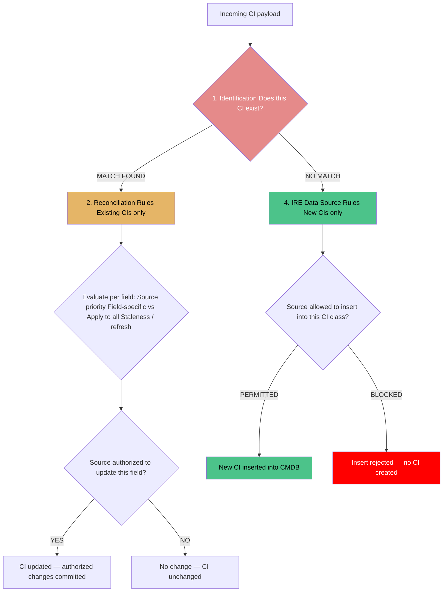

**Step-by-step examples**

| Scenario | Result |
|----------|--------|
| Discovery reports an existing server | Identification matches it; reconciliation controls which attributes Discovery can update |
| IntegrationHub reports the same server | Matches existing CI; reconciliation controls updates |
| Discovery reports a brand-new server | Data Source Rule permits insertion → new CI created |
| IntegrationHub reports a brand-new server | Data Source Rule blocks insertion if IntegrationHub is prohibited from inserting into that class |

**Remember the four responsibilities:**

| Responsibility | Question it answers |
|----------------|---------------------|
| Identification | Does this CI already exist? |
| Reconciliation | Who can update its attributes? |
| Data Refresh | Has the higher-priority source's data become stale? |
| Data Source | Can this source create a new CI? |

**Technical qualification:** This is a conceptual decision flow, not a literal guarantee of the internal execution order of every IRE processing operation in the ServiceNow platform. It describes the logical outcome: identification determines exist vs. new, reconciliation gates attribute updates on existing CIs, and Data Source Rules gate new-CI creation.

**One final nuance:** Reconciliation and Data Refresh Rules are relevant to updates of matched records. Reconciliation is not applied to a brand-new CI insert. Data Source Rules can stop that insert.

---
- Duplicate CIs → wrong impact analysis
- Stale data → wrong change risk assessment
- Missing relationships → incomplete service maps
---

## Lab: Create a CI and a Relationship

1. **Navigate** to All > Configuration > CI List > New
2. **Fill** the form:
   - Name: WEB01
   - Class: Server
   - Serial Number: SN-12345
   - IP Address: 10.10.1.20
   - Operating System: Windows Server 2022
   - Data Source: Manual
3. **Submit** — note the CI sys_id
4. **Create a second CI** for an application:
   - Name: IIS on WEB01
   - Class: Application
5. **Navigate** to All > Configuration > CI Relationships > New
6. **Fill**:
   - Parent: WEB01 (the server CI)
   - Child: IIS on WEB01 (the application CI)
   - Type: Runs on::Runs
7. **Submit** and verify the relationship appears on both CI records

---

## SLAs, Dashboards & Workspaces

### SLA Support
- **task_sla usage**: CMDB CIs (`cmdb_ci`) can have SLAs attached for maintenance windows, retirement timelines, and identification reconciliation SLAs. Primary table is `cmdb_ci` with source-specific SLA policies.
- **Module-specific SLA tables**: `cmdb_ci` (base), `cmdb_ci_server`, `cmdb_ci_appl`, etc. SLA policies are tied to CI class identifiers and data source priority.
- **Typical metrics**: CI SLA attainment, identification reconciliation timeliness, de-duplication rate, data source compliance percentage.

### OOTB Dashboards
- **CMDB Data Foundations Dashboard**: Displays CMDB completeness, correctness, and compliance scores across CI classes, with drill-through to data quality issues and source imbalance.
- **CMDB Health Dashboard**: Shows overall CMDB health score, completeness by class, duplication rate, and attribute coverage.

### OOTB Workspaces
- **CMDB Workspace**: `All > Configuration > CMDB`. Breadcrumb: `All > Configuration > CMDB`.
- **CMDB Health Dashboard**: `All > CMDB Health > Dashboards`. Breadcrumb: `All > CMDB Health > Dashboards`.

## Adding a New Field to the CMDB

When you need a new attribute on a CI, the first decision is **where** to put it: on the `cmdb_ci` base table, or on a Model table (`cmdb_model` / `cmdb_hardware_product_model`).

### Decision: cmdb_ci vs Model Table

| Place on | Use When | Example Fields |
|----------|----------|----------------|
| `cmdb_ci` (base) | The attribute applies to **every** CI regardless of class (server, network, database, app). Needed for cross-class reporting, IRE matching, or CMDB Health completeness. | `name`, `serial_number`, `asset_tag`, `location`, `data_source`, `install_status` |
| Model table (`cmdb_model` / `cmdb_hardware_product_model`) | The attribute describes a **hardware/software model**, not an individual CI instance. Vendor-specific or model-specific. | CPU type, RAM, form factor, vendor, model number, warranty term |

### Rule of Thumb

> If every CI (server, network device, database, application) needs the field → put it on `cmdb_ci` or extend the appropriate class.  
> If only a specific model/class needs it → put it on the Model table or extend that class.

### Why It Matters for IRE

Fields used in identification rules (serial number, MAC, hostname + DNS) **must** be on `cmdb_ci` (or inherited by the CI class) so the IRE engine can match across all CI classes. A field that lives only on a Model table cannot be used as an identification criterion for a CI record — IRE identifies the CI, not the model.

### Best Practices

- Reuse an existing OOB field before creating a custom one (avoid dictionary bloat).
- Don't put model-specific attributes on `cmdb_ci` — they clutter every CI form and break CMDB Health completeness expectations.
- Add cross-class fields to `cmdb_ci` so all subclasses inherit them automatically.
- Dictionary changes on `cmdb_ci` cascade to all extending classes — test in a sub-prod instance first.

### CI Attribute vs Model Attribute — Syntax, Dot-Walk, and Structure

**CI attribute** lives on the CI record itself (`cmdb_ci` or a subclass like `cmdb_ci_computer`). It describes an individual instance — this specific server, this specific router.

**Model attribute** lives on the Model record (`cmdb_model` / `cmdb_hardware_product_model`). It describes the make/model — every Cisco ISR 4331 shares the same model attributes (CPU type, RAM, form factor, warranty term).

| | CI attribute | Model attribute |
|---|-------------|-----------------|
| Lives on | `cmdb_ci` / subclass (e.g., `cmdb_ci_computer`) | `cmdb_model` / `cmdb_hardware_product_model` |
| Describes | One CI instance | One hardware/software model |
| Example | `hostname`, `ip_address`, `serial_number`, `install_status`, `u_slots` | `manufacturer`, `model_number`, `cpu_type`, `ram`, `form_factor`, `warranty_term` |
| Inherited by subclasses | Yes (from `cmdb_ci`) | N/A — models are separate records linked to CIs |
| Used by IRE identification | Yes (e.g., serial number) | No — IRE identifies CIs, not models |

#### Dot-walk syntax

A CI record holds a reference to its model (`cmdb_ci.model` → `cmdb_model`). To read a model attribute from a CI record you dot-walk through the reference:

```javascript
// Server-side (GlideRecord / business rule / script include)
var ci = new GlideRecord('cmdb_ci_computer');
ci.get('some_sys_id');

// CI attribute — direct field access
gs.print(ci.getValue('hostname'));              // WEB01
gs.print(ci.getValue('u_slots'));               // 2  (custom CI attribute)

// Model attribute — dot-walk through cmdb_ci.model
gs.print(ci.getValue('model.model_number'));    // ISR-4331
gs.print(ci.getValue('model.manufacturer.name'));// Cisco
gs.print(ci.getValue('model.cpu_type'));        // Intel Xeon
gs.print(ci.getValue('model.warranty_term'));   // 36 months
```

The equivalent dot-walk on a form or in a UI policy condition:

```
model.model_number IS [ISR-4331]
model.cpu_type CONTAINS [Xeon]
```

#### What the model looks like

Model records live in **All > Hardware Asset Management > Asset Models** (or `cmdb_model`):

| Field | Example value |
|-------|---------------|
| Name | Cisco ISR 4331 |
| Model number | ISR-4331 |
| Manufacturer | Cisco |
| Category | Network |
| CPU type | Intel Xeon |
| RAM | 8 GB |
| Form factor | Rack-mount |
| Warranty term | 36 months |

A `cmdb_ci_computer` CI for a specific router links to that model via the `model` reference field:

```
cmdb_ci_computer (WEB01)
  ├─ hostname = WEB01            ← CI attribute (instance-specific)
  ├─ serial_number = SN-12345    ← CI attribute (instance-specific)
  ├─ u_slots = 2                 ← CI attribute (instance-specific custom field)
  ├─ model → cmdb_model record   ← reference to model
  │    ├─ model_number = ISR-4331   ← Model attribute (shared)
  │    ├─ manufacturer = Cisco       ← Model attribute (shared)
  │    └─ cpu_type = Intel Xeon      ← Model attribute (shared)
```

**Key distinction:** Two WEB01-class routers of the same model share the *same* model record and therefore the same model attributes, but each has its own CI attributes (hostname, serial number, slots).

---

### Per-Attribute Discrepancies

A discrepancy can exist at the **attribute level** — not just "does a CI exist?" but "does this field on the CI match the authoritative source?"

**Examples of per-attribute discrepancies:**
- `hostname` on `cmdb_ci_computer` says `WEB01`; SCCM says `WEB01-PROD`
- `serial_number` on the CI is blank; Soroc has `SN-999`
- `model.model_number` says `ISR-4331`; the physical device is actually `ISR-4431` (model mismatch)
- `u_slots` says `2`; the asset record says `4` (CI attribute vs inventory mismatch)
- `install_status` = `production`; the OSS shows the circuit decommissioned

**How to quickly identify discrepancies:**

| Method | What it does | Best for |
|--------|-------------|----------|
| **CMDB Health dashboards** | Completeness / correctness / compliance per CI class | Bulk data-quality scan across all CIs |
| **Data Manager** | Side-by-side compare of source vs target field values; remediate in bulk | Per-attribute field conflicts |
| **Identification/Reconciliation rules** | Surfaces CIs where sources disagree on identifier fields (serial, name, MAC) | Identity-critical attributes |
| **List view + filters** | `All > Configuration > CI List` → filter `[field] [is not] [source value]` | Ad-hoc spot checks |
| **Report / Metric** | Report on `cmdb_ci` where `field` differs from transform-map staging value | Scheduled discrepancy detection |
| **Business Rule / UI Policy** | Flag a CI when a manually edited field diverges from the trusted source | Real-time detection on forms |
| **CMDB Health Micro-Certification** | Scorecards that flag classes below completeness thresholds | Governance / SLA tracking |

#### OOB ServiceNow features to detect discrepancies (platform + TSOM)

| Feature | Where | Detects |
|---------|-------|---------|
| **CMDB Health** | All > CMDB Health > Dashboards | Completeness, correctness, compliance, duplication per CI class |
| **Data Manager** | All > CMDB Health > Data Manager | Source-vs-target field conflicts; bulk remediation |
| **CMDB De-duplication** | All > Configuration > Identification/Reconciliation > De-duplication | Duplicate CIs from failed identification |
| **Identification / Reconciliation rules** | All > Configuration > Identification/Reconciliation | Identifier field conflicts between sources |
| **CI List filters** | All > Configuration > CI List | Ad-hoc per-attribute mismatch hunts |
| **TSOM: Inventory vs CMDB reconciliation** | TSOM-specific flows | `sn_tsom_inventory_item` vs `cmdb_ci` / `sn_tsom_network_element` mismatch |
| **TSOM: Alarm correlation** | TSOM alarms on `sn_tsom_network_element` | Alarms on CIs with stale/missing model or attribute data |

**TSOM note:** For telecom assets (ONT, OLT, circuit, SD-WAN edge), the model attribute (`model.model_number`, `model.manufacturer`) often drives the CSDM resource mapping. If the model attribute disagrees with what Discovery/OSS observes, service-to-resource alignment breaks — treat model-attribute discrepancies as seriously as CI-attribute discrepancies.

---

## Adding a New CI Class / Table

There are two supported ways to add a new CI table/class to the CMDB:

### Option A: CI Class Manager (Recommended for CMDB classes)

Navigate to **All > Configuration > CI Classes** and create a new CI class that extends `cmdb_ci` (or an existing subclass like `cmdb_ci_server`).

- Creates a new table that extends `cmdb_ci` under the hood.
- Automatically part of the CMDB class hierarchy.
- Inherits all `cmdb_ci` fields and identification/reconciliation rules.
- Shows up in CI List, CI Classes, and CMDB Health by default.
- Best for: new types of CIs that are genuinely configuration items (e.g., `cmdb_ci_cisco_router`, `cmdb_ci_oracle_database`).

### Option B: Table (sys_db_object) with Extends = cmdb_ci

Navigate to **All > System Definition > Tables** and create a new table, setting **Extends table** to `cmdb_ci`.

- Also creates a CI subclass that extends `cmdb_ci`.
- Gives you full dictionary/table configuration control (same as any custom table).
- Must manually ensure it's wired into CI Class Manager if you want it visible there.
- Best for: when you need table-level configuration beyond what CI Class Manager exposes.

### Both Observe IRE

**Both paths observe IRE** as long as the new table extends `cmdb_ci`. IRE operates on the `cmdb_ci` hierarchy, so any subclass — whether created via CI Class Manager or via sys_db_object with `Extends = cmdb_ci` — participates in identification and reconciliation.

The decision is not "which one observes IRE" — it's "which tool fits your governance model":
- Use **CI Class Manager** when you want the class governed as part of the CMDB model (recommended).
- Use **sys_db_object / Tables** when you need plain custom-table behavior while still being a CI.

### Store App / Alternatives vs Building from Scratch

Before creating a CI table manually, check whether a **ServiceNow Store app** or an existing content pack already models what you need:

| Alternative | When to Consider |
|-------------|------------------|
| ServiceNow Store app / Content Pack | A vendor or ServiceNow already publishes a CI class model for your domain (e.g., cloud, network, mainframe). Install and extend rather than rebuild. |
| Existing OOB class | Check if `cmdb_ci_server`, `cmdb_ci_network`, `cmdb_ci_database`, or a subclass already covers your need — extend it instead of creating a new base. |
| Import Set + Transform Map | If the data is read-only/reference data, you may not need a CMDB class at all — use a custom table + import. |
| Asset table (`alm_asset`) | If you're tracking financial/contractual lifecycle rather than configuration, HAM may be a better fit than a new CI class. |

**Default position:** Extend an existing OOB CI class or use a Store app/content pack before creating a brand-new table from scratch. Only create a new `cmdb_ci` subclass when no existing model fits.

---

## CMDB Relationships — OOB, User-Defined, or Both

CI-to-CI relationships live in `cmdb_rel_ci`. Each relationship has a `type` that comes from `cmdb_rel_rel_type`.

### Out-of-Box Relationship Types

ServiceNow ships with standard types, including:

- `Runs on::Runs` — application runs on server
- `Depends on::Used by` — one CI depends on / is used by another
- `Connected to::Connects to` — network connectivity
- `Member of::Member of` — group/cluster membership
- `Realized by::Realizes` — service realized by a CI

These are sufficient for most impact analysis and Service Mapping use cases.

### User-Defined Relationship Types

You can create new relationship types via **All > Configuration > CI Relationship Types** when OOB types don't describe your topology. Give each type a name and an inverse name (e.g., `Hosts::Hosted on`).

### OOB, User-Defined, or Both?

**Both.** OOB types handle the common patterns; user-defined types handle domain-specific relationships. They coexist in the same `cmdb_rel_ci` table and are queried the same way.

### How Relationships Are Typically Populated

| Source | How Populated | Notes |
|--------|-------------|-------|
| Discovery | Discovery patterns infer and insert `cmdb_rel_ci` records during identification/exploration | Automated; most common for server→OS, server→network |
| Service Mapping | Application dependency mapping creates patterns and relationships | Patterns + probes discover process-to-CI links |
| Import Sets / Transform Map | Bulk load parent/child pairs with a transform map | Good for initial seed data or external CMDB migration |
| Manual | All > Configuration > CI Relationships > New | Low volume, human-curated |
| Script / API | Business rules, Script Includes, or REST API writing to `cmdb_rel_ci` | Programmatic relationship creation |

**Best practice:** Let Discovery and Service Mapping populate relationships where possible; use manual entry only for exceptions. Keep relationship types stable — changing a type name breaks existing maps and reports.

---

## How CI Relationships Are Determined — OOB, Detection, Fixes & Manual Creation

Relationships between CIs live in `cmdb_rel_ci`. Each row has a `parent`, a `child`, and a `type` that comes from `cmdb_rel_rel_type`. Understanding how relationships get created — and how to detect and fix wrong ones — is critical for accurate impact analysis, change risk assessment, and service mapping.

---

### Does ServiceNow Provide Relationships Out of the Box?

**Yes — but only some of them.**

| Source | What It Provides | Automated? |
|--------|-----------------|------------|
| **Discovery patterns** | Infrastructure relationships: server→OS, server→network interface, server→CPU, VM→hypervisor, network device→connected switch | ✅ Yes — during Discovery runs |
| **Service Mapping patterns** | Application dependencies: web server→app server, app server→database, application→service | ✅ Yes — during top-down mapping |
| **OOB relationship types** | `cmdb_rel_rel_type` records: `Runs on::Runs`, `Depends on::Used by`, `Connected to::Connects to`, `Member of::Member of`, `Realized by::Realizes` | ✅ Yes — ship with the platform |
| **Import Sets / Transform Maps** | Bulk parent/child pairs from external CMDBs or asset systems | ✅ Yes — if configured with coalesce |
| **Manual entry** | Human-created relationships via CI Relationships module | ❌ No — requires admin action |
| **Script / API** | Business rules, Script Includes, or REST API writing to `cmdb_rel_ci` | ❌ No — requires development |

**Bottom line:** ServiceNow provides the *relationship types* OOB and Discovery/Service Mapping will auto-create many *relationship instances* during normal operation. But you will still have gaps — especially for custom applications, business services, and logical dependencies that Discovery can't observe.

---

### How Relationships Are Determined (Creation Flow)

| Method | How It Works | Best For |
|--------|-------------|----------|
| **Discovery** | MID Server probes the target, classifiers identify the device type, patterns explore running processes, listening ports, and connections. Discovery writes `cmdb_rel_ci` rows linking e.g. `cmdb_ci_server` → `cmdb_ci_network_adapter` → `cmdb_ci_ip_address` | Infrastructure: servers, network gear, VMs, OS, databases |
| **Service Mapping (top-down)** | Starts at an entry point (URL/hostname/IP), executes patterns against applications, follows outbound connections to discover dependent components, builds `cmdb_rel_ci` rows and `cmdb_ci_service_discovered` | Application services: web→app→db→service |
| **Import Set + Transform Map** | Bulk-load parent/child pairs; set `coalesce = true` on key fields to match existing CIs | Initial seed data, external CMDB migration, bulk loads |
| **Manual** | All > Configuration > CI Relationships > New → select parent, child, type | Exceptions, logical relationships Discovery can't see |
| **Script / API** | Business rules, Script Includes, or REST API create `cmdb_rel_ci` rows programmatically | Custom integration logic, dynamic relationship creation |

**Key principle:** Relationships are determined by **what Discovery and Service Mapping observe**, not by what you wish existed. If Discovery doesn't see a connection, no relationship row is created.

---

### Detecting Wrong or Inconsistent Relationships

Wrong relationships break impact analysis, change risk assessment, and incident routing. Here's how to find them:

| Problem | How to Detect | Where to Look |
|---------|--------------|---------------|
| **Missing relationships** | CI exists but has no `cmdb_rel_ci` rows as parent or child | CI List → open a CI → Related Lists → CI Relationships |
| **Orphaned relationships** | `cmdb_rel_ci` points to a deleted or retired CI | `cmdb_rel_ci` list → filter `parent IS NULL` or `child IS NULL` |
| **Wrong relationship type** | A server has `Connected to::Connects to` when it should be `Runs on::Runs` | CI Relationships list → review `type` values |
| **Circular dependencies** | CI A → CI B → CI A (creates loops in impact analysis) | `cmdb_rel_ci` query → self-referencing chains |
| **Duplicate relationships** | Same parent/child/type appears multiple times | `cmdb_rel_ci` list → group by parent+child+type, count > 1 |
| **Stale relationships** | Relationship exists but the connected CI is retired or decommissioned | Cross-reference `cmdb_rel_ci` with `cmdb_ci.install_status = retired` |

**Detection queries you can run:**

```javascript
// Find orphaned relationships (points to non-existent CI)
var gr = new GlideRecord('cmdb_rel_ci');
gr.addQuery('parent', 'ISEMPTY', '').addOrCondition('child', 'ISEMPTY', '');
gr.query();
while (gr.next()) {
    gs.print('Orphaned relationship: ' + gr.getValue('sys_id'));
}

// Find duplicate relationships
var gr2 = new GlideRecord('cmdb_rel_ci');
gr2.groupBy('parent', 'child', 'type');
gr2.addAggregate('COUNT', 'COUNT');
gr2.addHaving('COUNT', '>', 1);
gr2.query();
while (gr2.next()) {
    gs.print('Duplicate: parent=' + gr2.getValue('parent') + 
             ' child=' + gr2.getValue('child') + 
             ' type=' + gr2.getValue('type') + 
             ' count=' + gr2.getAggregate('COUNT', 'COUNT'));
}
```

---

### Fixing Wrong Relationships

| Issue | Fix |
|-------|-----|
| **Wrong type** | Open the `cmdb_rel_ci` record, change the `type` field, save |
| **Wrong parent/child** | Delete the incorrect row, create a new one with correct parent/child |
| **Orphaned row** | Delete the `cmdb_rel_ci` row (it points to a CI that no longer exists) |
| **Duplicate rows** | Keep one, delete the rest |
| **Missing relationship** | Create it manually (see below) |

> **Warning:** Deleting a `cmdb_rel_ci` row is safe — it only removes the relationship, not the CIs themselves. But be careful: removing relationships breaks impact analysis paths until they're recreated.

---

### Creating a Relationship Manually

**When you need to:** Discovery can't observe a logical dependency (e.g., "this business service depends on that application"), or you're building a seed map before Discovery runs.

**Steps:**

1. Navigate to **All > Configuration → CI Relationships > New**
2. Fill in the form:

| Field | What to Set |
|-------|-------------|
| **Parent** | The CI that depends on / uses the child (e.g., the web server CI) |
| **Child** | The CI that is depended upon / used by the parent (e.g., the database CI) |
| **Type** | Choose from `cmdb_rel_rel_type` (e.g., `Depends on::Used by`) |
| **Start Date** | When the relationship became effective |
| **End Date** | When it stops being effective (optional) |

3. **Submit**

**Via script (Business Rule / Script Include):**

```javascript
var gr = new GlideRecord('cmdb_rel_ci');
gr.initialize();
gr.parent = 'parent_sys_id_here';
gr.child = 'child_sys_id_here';
gr.type = 'Depends on::Used by';
gr.start_date = new Date();
gr.insert();
gs.print('Created relationship: ' + gr.getValue('sys_id'));
```

---

### Would You Realistically Need to Create Relationships Manually?

| Scenario | Manual Creation Needed? | Why |
|----------|------------------------|-----|
| Standard server discovered by Discovery | ❌ No | Discovery creates server→OS, server→network, VM→hypervisor automatically |
| Standard application discovered by Service Mapping | ❌ No | Service Mapping creates app→db, app→server dependencies |
| Custom application with no Discovery pattern | ✅ Yes | Discovery can't see inside your proprietary app |
| Business service → technical service mapping | ✅ Yes | Logical business relationships aren't discoverable |
| Cloud resources with consistent tags | ⚠️ Maybe | Tag-based mapping can associate resources, but not detailed dependencies |
| Initial CMDB seed data (before Discovery) | ✅ Yes | You need relationships before Discovery runs |
| Relationship Discovery got wrong | ✅ Yes | You may need to correct or supplement |

**Rule of thumb:** Aim for **80–90% automated** (Discovery + Service Mapping) and **10–20% manual** (exceptions, business logic, custom apps). If you're creating most relationships manually, something is wrong with your Discovery or Service Mapping configuration.

---

### Common Relationship Mistakes

| Mistake | Symptom | Fix |
|---------|---------|-----|
| **Reversing parent/child** | Impact analysis shows the wrong direction — fixing a database appears to impact web servers instead of the reverse | Swap parent and child in `cmdb_rel_ci` |
| **Using wrong type** | `Runs on::Runs` used for `Depends on::Used by` — change risk assessment is inaccurate | Change the `type` field on the `cmdb_rel_ci` record |
| **Creating relationships to retired CIs** | Impact analysis includes decommissioned systems | Add `end_date` or delete the relationship |
| **Circular dependencies** | Impact analysis loops forever | Find and break the cycle — remove one relationship in the loop |
**Not using coalesce in import** | Duplicate `cmdb_rel_ci` rows on every import | Set `coalesce = true` on parent/child fields in the Transform Map |

---

## Ensuring IRE Is Observed When Creating CI Tables

When you create a new CI class/table, IRE must be able to run on it. Here's how to guarantee that:

1. **The table must extend `cmdb_ci`.** Whether you use CI Class Manager or sys_db_object / Tables, set `Extends table = cmdb_ci`. IRE operates on the `cmdb_ci` hierarchy; tables that don't extend `cmdb_ci` are not CIs and IRE does not apply.
2. **Register in CI Class Manager (recommended).** After creating via sys_db_object, open CI Class Manager and confirm the new class appears under `cmdb_ci`. This makes it visible in CI List, CI Classes, and CMDB Health.
3. **Add identification rules for the new class.** If your new CI has unique identifiers (e.g., a serial number, asset tag, or hostname pattern), create identifier entries so Discovery/imports can match existing records instead of duplicating them.
4. **Set data source precedence.** Confirm your new class's CIs get appropriate `data_source` values so reconciliation trusts Discovery over Manual/Import.

**Which path observes IRE?** Both — CI Class Manager and the Tables route — **provided the table extends `cmdb_ci`**. IRE is table-hierarchy driven, not tool-driven.

---

## How a Child Class Overrides Parent IRE Rules

CI classes inherit identification and reconciliation rules from their parent (ultimately `cmdb_ci`). A child class can override or refine them:

### Overriding Identification Rules

- **Inherit:** The child class automatically uses its parent's identifier entries (e.g., `cmdb_ci_server` inherits `cmdb_ci`'s serial-number + hostname rules).
- **Add class-specific entries:** Add identifier entries scoped to the child class with their own priority. These are evaluated alongside (or instead of) inherited entries depending on rule configuration.
- **Disable inherited entries:** Deactivate a parent identifier entry for the child class if it doesn't apply (e.g., a virtual server without a serial number).
- **Priority order still applies:** Lowest priority number wins, first match wins — whether the entry comes from the parent or the child.

### Overriding Reconciliation Rules

- Reconciliation rules can be scoped to specific CI classes or data sources. A child class can have its own reconciliation rule that takes precedence over the parent's for conflicts on that class.
- Source priority (Discovery > Import > Manual) still applies, but you can tune which fields are reconciled per class.

### Practical Example

`cmdb_ci` identifies servers by serial number. A new child class `cmdb_ci_virtual_server` has no serial number. You:
1. Deactivate the serial-number identifier entry for `cmdb_ci_virtual_server`.
2. Add a hostname + DNS domain identifier entry for `cmdb_ci_virtual_server`.
3. Result: virtual servers are matched by hostname, physical servers by serial number — both under the same IRE engine.

---

## Invoking IRE from a CI Form (Manual Edits Bypass IRE)

By default, **manually editing a CI record does not trigger IRE.** IRE runs when data arrives through Discovery, Import Sets, Service Graph Connectors, or other inbound integration sources. A human changing `serial_number` on a CI form just saves the value — no re-identification, no duplicate check, no reconciliation.

### How to Force IRE from a Form

| Approach | How It Works | When to Use |
|----------|-------------|-------------|
| **Identify UI Action / Related Link** | Click an "Identify" action on the CI form that runs the identification engine against the current record | One-off manual re-identification of a specific CI |
| **Business Rule on update** | A business rule (async/after) on `cmdb_ci` (or subclass) calls the identification API when key fields change | Auto-re-identify whenever a human edits identifying fields |
| **UI Policy / Client Script** | Client script calls a server-side script include to invoke IRE on form save | Immediate feedback in the UI |
| **Scheduled Job** | Run identification/reconciliation on a schedule across all CIs | Bulk remediation, not per-form |

### Example: Business Rule to Invoke IRE on Field Change

```javascript
(function rule(current, previous) {
    // Only re-identify when an identifying field actually changed
    if (current.serial_number.changes() || current.name.changes() || current.dns_domain.changes()) {
        // Call ServiceNow's identification engine to re-evaluate this CI
        var idEngine = new sn_cmdb.Identification(current);
        idEngine.identify();
    }
})(current, previous);
```

> **Note:** `sn_cmdb.Identification` API availability varies by release. In some releases you trigger IRE via the `cmdb_identify` business rule or by invoking the Identify related action. Verify against your instance.

### Why Manual Edits Need This

Without an explicit IRE invocation, two CIs can end up representing the same real device because:
- Discovery created CI A with serial `SN-12345`.
- An admin manually created CI B with the same serial (or edited CI B to match).
- IRE never ran on CI B's manual creation/edit, so no duplicate was detected.

**Rule:** Any process that writes identifying fields outside of Discovery/Import must explicitly invoke IRE, or you will accumulate duplicates.

---

## IntegrationHub Spoke → IRE: Making It Work and Knowing When to Skip It
{: #integrationhub-spoke-ire-making-it-work-and-knowing-when-to-skip-it }

**ELI5:** IRE is like a security guard who checks the guest list before letting a CI into the CMDB. By default, IntegrationHub spokes slip past without the guard checking — so we need to call the guard explicitly. And we don't want the guard checking every single time someone edits a comment; only when something important (like a serial number) changes.

---

### Part 1: Make an IntegrationHub Spoke Run IRE

IntegrationHub spokes write to `cmdb_ci` but do **not** automatically trigger IRE — no identification, no duplicate detection, no reconciliation. You have two simple choices:

#### Choice A — Flow Designer Script action (simplest for single CI writes)

After the step that creates or updates the CI, add a **Script** action:

```javascript
// ci_sys_id = the sys_id of the CI the spoke just wrote
var ci = new GlideRecord('cmdb_ci');
if (ci.get(flow.inputs.ci_sys_id)) {
    try {
        var engine = new sn_cmdb.IdentificationEngine();
        engine.createOrUpdateCI(ci);
    } catch (e) {
        gs.print('IRE check skipped: ' + e);
    }
}
```

> **ELI5:** This tells the security guard to check the guest list after the spoke has already let someone in.

#### Choice B — Import Set + Transform Map (recommended for bulk loads)

If your IH flow stages data through an Import Set first, you don't need custom code at all. Just set **coalesce = true** on key fields (`serial_number`, `name`, `asset_tag`) in the Transform Map field maps. The transform matches existing CIs automatically, and IRE reconciliation runs natively.

> **ELI5:** This is like pre-sorting the guest list before anyone arrives — no guard needed at the door.

---

### Part 2: Stop Form Changes from Auto-Invoking IRE

If you have a business rule that calls IRE on every `cmdb_ci` save, it fires even when an admin only changes `comments` or `install_status`. That's wasteful. Scope it to identifying fields only:

```javascript
(function rule(current, previous) {
    var idFields = ['serial_number', 'asset_tag', 'name', 'dns_domain', 'mac_address'];
    var changed = false;
    idFields.forEach(function(f) {
        if (current[f] && current[f].changes()) { changed = true; }
    });
    if (changed) {
        try {
            var engine = new sn_cmdb.IdentificationEngine();
            engine.createOrUpdateCI(current);
        } catch (e) {
            gs.print('IRE check skipped: ' + e);
        }
    }
})(current, previous);
```

> **ELI5:** Only wake up the security guard when something important changes (serial number, name, etc.), not when someone just fixes a typo.

---

### Part 3: Configuration Checks (do these before testing)

| Check | Where | What to verify |
|-------|-------|----------------|
| **Data Source Rules** | All > Configuration > Identification/Reconciliation > IRE Data Source Rule | Your source (e.g., `ServiceNow` or `Manual Entry`) is allowed to create or update records for that CI class |
| **Reconciliation Rules** | All > Configuration > Identification/Reconciliation > Reconciliation | Your manual data source has the right priority (lower number = higher priority) so it can update attributes when needed |
| **Asset-to-CI creation** | `sys_properties.list` | Set `glide.asset.create_ci_with_ire = true` to route Asset-to-CI creation through IRE automatically |
| **Catalog Items / Record Producers** | Record Producer → staging table | Don't map variables directly to `cmdb_ci`. Map to `sys_import_set_row`, then use IntegrationHub ETL or a Transform Map with `CMDBTransformUtil` to process through IRE |

---

### Part 4: Quick Best Practices (ELI5)

| Practice | Why |
|----------|-----|
| Only call IRE on identifying fields | Don't bother the guard for minor edits like comments |
| Prefer Transform Map coalesce over custom scripts | Less code, fewer mistakes, IRE runs natively |
| Test `sn_cmdb.IdentificationEngine` in sub-prod first | API availability varies by ServiceNow release |
| Never turn IRE off completely on form saves | Disabling it guarantees duplicate CIs over time |
| Use `data_source` to tell write paths apart | A business rule can behave differently for IntegrationHub, Discovery, Import Set, and Manual |

---

## Common CMDB Gotchas & Complex Issues

| # | Gotcha / Issue | Symptom | Root Cause | Fix / Mitigation |
|---|----------------|---------|------------|------------------|
| 1 | Manual CI edits bypass IRE | Duplicate CIs for the same device; stale identifying data | IRE only runs on inbound discovery/import, not form saves | Explicitly invoke IRE from the form (business rule / Identify action) when identifying fields change |
| 2 | Duplicate CIs after a Discovery run | Multiple `cmdb_ci` records with same serial number | Missing or mis-prioritized identification rules; source precedence not set | Configure identifier entries (lowest priority first), set Discovery > Import > Manual precedence, run de-duplication |
| 3 | Orphaned / broken relationships | CI Relationships point to deleted or retired CIs | CIs deleted instead of retired; `cmdb_rel_ci` not cleaned up | Retire CIs (`install_status = retired`) rather than delete; run relationship cleanup |
| 4 | Data source precedence conflicts | Wrong value wins on a CI updated by multiple sources | Reconciliation priority not configured (Discovery should outrank Manual/Import) | Set reconciliation rules with correct source priority per CI class |
| 5 | Field placed on wrong table | Model-specific field on `cmdb_ci` bloats every CI form; or universal field stuck on a model table so IRE can't use it | Confusing instance attribute vs model attribute | Universal/IRE fields → `cmdb_ci`; model/vendor attributes → `cmdb_model` / `cmdb_hardware_product_model` |
| 6 | New CI table not in CMDB | New table doesn't show in CI List / CI Class Manager / CMDB Health | Table doesn't extend `cmdb_ci` or isn't registered in CI Class Manager | Set `Extends table = cmdb_ci`; register in CI Class Manager |
| 7 | Child class can't be identified | Virtual/server subclass creates duplicates because parent serial rule doesn't apply | Inherited identifier entry (serial number) irrelevant to child | Deactivate inherited entry for child; add class-specific identifier (e.g., hostname + DNS) |
| 8 | Changing a relationship type breaks maps | Service Mapping / impact analysis loses paths after a type rename | `cmdb_rel_ci.type` references the type name; renaming severs links | Avoid renaming OOB types; deactivate and create new, or update all `cmdb_rel_ci` rows |
| 9 | CMDB Health completeness low | Required fields show empty across classes | Custom fields added to `cmdb_ci` but not populated; completeness metrics count them | Only add truly universal fields to `cmdb_ci`; populate or exclude from Health completeness |
| 10 | Import creates duplicates instead of updating | Transform Map inserts new CIs rather than matching existing | Coalesce fields not set on the transform map; no identification rule alignment | Set coalesce=true on key fields (serial_number, name) in the transform map; align with IRE identification rules |

---

## CMDB Decision Diagrams

### Field Placement Decision Tree (cmdb_ci vs Model Table)

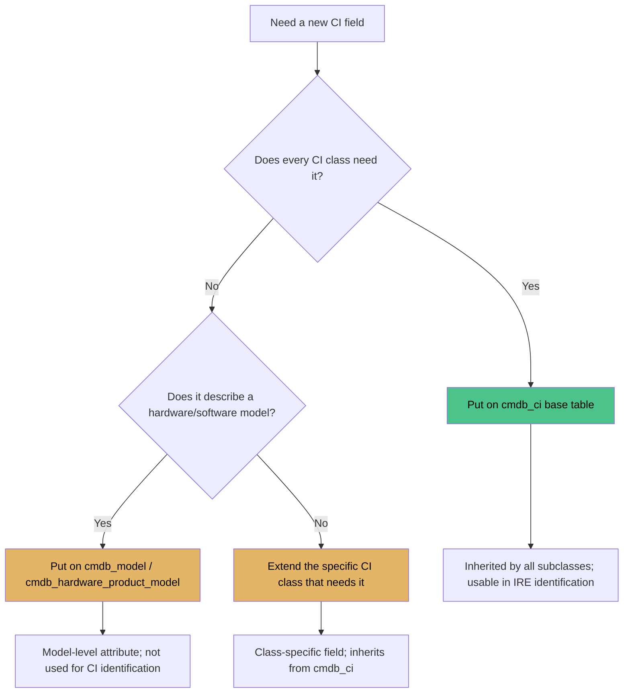

### New CI Class / Table Creation Flow

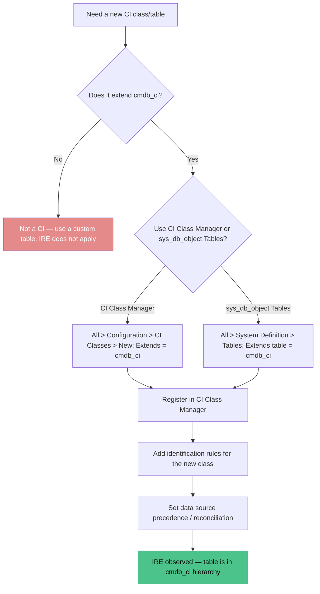

### IRE Invocation from a CI Form

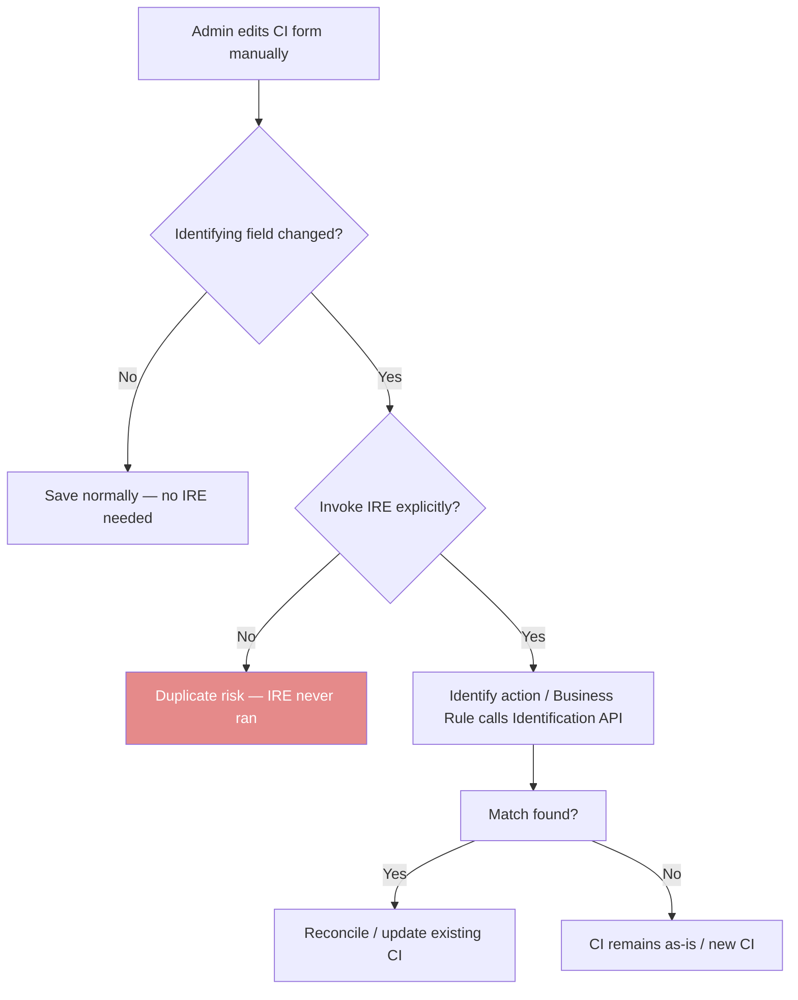

### Relationship Population Flow

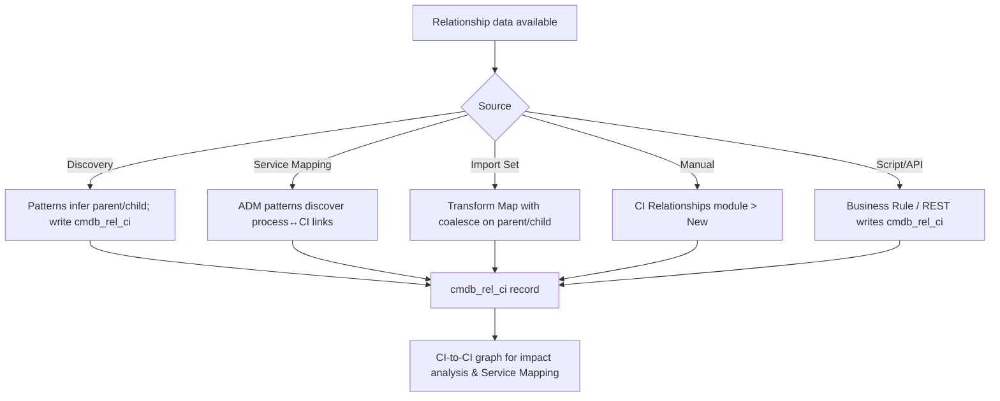

---

## FAQ

**Q: Does editing a CI manually in the form trigger IRE?**  
A: No. IRE runs on inbound data (Discovery, Import Sets, Service Graph Connectors). Manual form edits bypass IRE unless you explicitly invoke it (Identify action, business rule, or API call).

**Q: Should I put a new field on `cmdb_ci` or on a Model table?**  
A: If every CI class needs it (and especially if it's used for IRE matching or CMDB Health completeness), put it on `cmdb_ci`. If it describes a specific hardware/software model only, put it on `cmdb_model` / `cmdb_hardware_product_model`.

**Q: Which path observes IRE — CI Class Manager or the Tables (sys_db_object) route?**  
A: Both, as long as the new table extends `cmdb_ci`. IRE is driven by the `cmdb_ci` hierarchy, not by which tool you used to create the table.

**Q: Can a child CI class override its parent's identification rules?**  
A: Yes. A child inherits parent identifier entries but can add class-specific entries, deactivate inherited ones that don't apply, and set its own reconciliation rules — priority order (lowest first, first match wins) still governs.

**Q: Are CMDB relationships out-of-the-box, user-defined, or both?**  
A: Both. OOB types (Runs on::Runs, Depends on::Used by, etc.) cover common patterns; you can add user-defined types via CI Relationship Types. They coexist in `cmdb_rel_ci`.

**Q: How are CI relationships typically populated?**  
A: Discovery patterns, Service Mapping ADM patterns, Import Set/Transform Map, manual entry via CI Relationships, or script/API writing to `cmdb_rel_ci`. Prefer automated sources; use manual for exceptions.

**Q: Should I create a new CI table from scratch or use a Store app?**  
A: Check the ServiceNow Store and existing OOB classes first. Extend an existing `cmdb_ci` subclass or install a content pack before building a new table. Only create from scratch when no model fits.

**Q: Should I delete a CI that's no longer in use?**  
A: No. Set `install_status = retired`. Deleting breaks `cmdb_rel_ci` relationships and orphaned incident/problem references.

---

## Telecom Network Discrepancies (TSOM Context)

In a telecom service provider environment, the CMDB must reconcile network inventory (ONTs, circuits, network elements, services) against what Discovery and OSS/BSS actually observe. Discrepancies between these sources break TSOM service activation, alarm correlation, and inventory reconciliation.

### Discrepancy Type 1: Inventory-to-CMDB Mismatch

**What it is:** Physical telecom inventory (ONTs, modems, SIMs, circuit records in `sn_tsom_inventory_item` / `sn_tsom_circuit`) does not match the corresponding CIs in `cmdb_ci` / `cmdb_ci_network` / `sn_tsom_network_element`.

**Examples:**
- A fiber ONT was provisioned and activated in the OSS, but no `cmdb_ci_network` CI exists for it — so TSOM service activation has no CI to relate the service to.
- A circuit was decommissioned in the OSS but its `cmdb_ci` CI still shows `install_status = production`, causing false alarms and wrong impact analysis.
- A customer's modem MAC address changed (swap), but the CMDB CI still holds the old MAC — Discovery can't re-identify it, creating a duplicate CI.

**ServiceNow-endorsed solutions & prevention:**
- **CMDB Health + Data Manager:** Run completeness/correctness dashboards per CI class (`sn_tsom_network_element`, `cmdb_ci_circuit`) to surface inventory records without matching CIs and vice versa. Use Data Manager to remediate in bulk.
- **Identification & Reconciliation (IRE):** Configure identifier rules on `cmdb_ci_network` using serial number / MAC / circuit ID so Discovery re-identifies existing CIs instead of duplicating them. Set data source precedence so Discovery/OSS outranks manual entry.
- **Reconciliation to `sn_tsom_inventory_item`:** Use a transform map / IntegrationHub flow to sync inventory lifecycle state (provisioned → active → retired) into `cmdb_ci.install_status`, keeping CI state aligned with OSS inventory.
- **Prevention:** Make CI creation/retirement part of the provisioning and decommissioning workflow (Flow Designer) rather than a manual afterthought.

### Discrepancy Type 2: Circuit Topology / Termination Mismatch

**What it is:** The logical circuit relationships in `cmdb_rel_ci` (parent/child, A-end/B-end terminations) don't match the actual physical or logical network topology discovered from the OSS/BSS or network elements.

**Examples:**
- `sn_tsom_circuit` shows termination A at Node X and termination B at Node Y, but Discovery/Service Mapping sees the circuit traversing Node Z — the `cmdb_rel_ci` path is wrong, so Service Mapping impact analysis is incorrect.
- An alarm fires on `sn_tsom_network_element` Node X, but the CMDB relationship doesn't link that node to the affected circuit/service — TSOM can't correlate the alarm to the service, so the wrong incident is raised or no incident at all.
- A circuit was re-provisioned (new path) but `cmdb_rel_ci` still references the old path — change risk assessment uses stale topology.

**ServiceNow-endorsed solutions & prevention:**
- **Service Mapping / Discovery patterns:** Run network discovery patterns that infer Layer 2/Layer 3 connectivity and populate `cmdb_rel_ci` with actual `Connected to::Connects to` relationships rather than relying on static OSS data.
- **CI Relationship Types:** Define telecom-specific relationship types (e.g., `Terminates at::Termination of`, `Carries::Carried by`) via All > Configuration > CI Relationship Types, and keep them stable — renaming breaks `cmdb_rel_ci` references and Service Maps.
- **Periodic reconciliation:** Schedule a reconciliation job comparing `sn_tsom_circuit` termination data against `cmdb_rel_ci` paths; flag mismatches for Data Manager remediation.
- **Prevention:** Capture circuit terminations as CMDB relationships at provisioning time (Flow Designer → create `cmdb_rel_ci` records), not as free text on the circuit record.

### Discrepancy Type 3: Service-to-Resource Alignment (CSDM Gap)

**What it is:** The logical service layer (`sn_tsom_service`, `cmdb_ci_service`) is not correctly mapped to the underlying resource layer (`sn_tsom_network_element`, `cmdb_ci_network`, `cmdb_ci_server`), violating the CSDM model and breaking TSOM service fulfillment/assurance.

**Examples:**
- A broadband service (`sn_tsom_service` = Active) has no `Realized by::Realizes` relationship to the ONT and OLT CIs that actually deliver it — alarm correlation can't tell which customers are affected by an OLT failure.
- A service order activated a new VPN, but no `cmdb_ci_service` CI was created, so the service has no CMDB footprint and is invisible to impact analysis and change risk.
- A customer moved from DSL to fiber; the old DSL `cmdb_ci_service` was never retired and the new fiber service isn't linked — duplicate/confusing service records.

**ServiceNow-endorsed solutions & prevention:**
- **CSDM (Common Service Data Model):** Apply the CSDM design pattern — business/technical services (`cmdb_ci_service`) realized by network resources (`cmdb_ci_network`, `sn_tsom_network_element`) via `Realized by::Realizes` relationships. Map TSOM services to the CSDM service domain.
- **CMDB Health:** Use correctness and compliance dashboards to detect `cmdb_ci_service` records with no `Realized by` relationships (orphaned services) and network elements with no realizing service.
- **Service Mapping ADM:** Use Application Dependency Mapping patterns to auto-discover service↔resource relationships where possible, supplemented by provisioning workflows that create `cmdb_rel_ci` links at activation.
- **Prevention:** Make service→resource mapping a mandatory step in the service activation flow (Flow Designer) — no service is marked Active without a `Realized by` relationship to its delivery CIs.

### Discrepancy Type 4: SD-WAN Discrepancy Audit (TSOM Context)

**What it is:** SD-WAN edge devices (vEdge, vSmart, vManage, WAN edge routers) appear in the OSS/BSS inventory and in Discovery, but the CMDB lacks a consistent audit trail linking each SD-WAN device to its circuits, sites, and services. Discrepancies surface as: an SD-WAN device discovered but no matching `cmdb_ci_network` CI; a device decommissioned in SD-WAN orchestrator but still `production` in CMDB; or circuit-to-edge mappings that don't match the actual SD-WAN overlay topology — breaking TSOM service activation, path assurance, and alarm correlation for SD-WAN services.

**Examples:**
- vManage discovers a new SD-WAN edge at Branch X, but no `cmdb_ci_network` CI exists — TSOM can't activate the branch SD-WAN service or link it to the underlying circuit.
- An SD-WAN edge is removed from vManage (decommissioned) but its `cmdb_ci` CI still shows `install_status = production` — alarms on the device generate false service-impact incidents.
- SD-WAN overlay shows Branch X ↔ Hub Y over Circuit C, but `cmdb_rel_ci` still references the old MPLS path — change risk assessment and service mapping use stale topology.

**ServiceNow-endorsed solutions & prevention:**
- **Discovery / Service Mapping for SD-WAN:** Use Discovery patterns (SNMP/SSH/REST to vManage/vSmart) to detect SD-WAN edges and create/update `cmdb_ci_network` CIs. Use Service Mapping ADM patterns to discover SD-WAN overlay paths and populate `cmdb_rel_ci` with actual `Connected to::Connects to` and `Carries::Carried by` relationships.
- **Identification & Reconciliation (IRE):** Configure identifier rules on `cmdb_ci_network` using serial number / device ID / management IP so SD-WAN discovery re-identifies existing CIs instead of duplicating them. Set data source precedence so SD-WAN orchestrator (vManage) outranks manual entry.
- **CMDB Health + Data Manager:** Run completeness/correctness dashboards on `sn_tsom_network_element` / `cmdb_ci_network` filtered for SD-WAN device class to surface discovered devices without matching CIs and CIs without a corresponding SD-WAN device. Use Data Manager to remediate in bulk.
- **SD-WAN discrepancy audit job:** Schedule a periodic reconciliation job comparing vManage device inventory against `cmdb_ci_network` records — flag (a) CMDB CIs with no SD-WAN device (candidates for retirement), and (b) SD-WAN devices with no CMDB CI (candidates for creation). Route mismatches to Data Manager.
- **Prevention:** Make SD-WAN edge provisioning/decommissioning create or retire the matching CMDB CI via Flow Designer, triggered from the SD-WAN orchestrator (webhook/REST) — never treat CMDB sync as a manual afterthought.

---

## Quiz

1. What is the base table for all CIs?
   <details><summary>Answer</summary>`cmdb_ci`</details>

2. What table stores CI-to-CI relationships?  
   <details><summary>Answer</summary>`cmdb_rel_ci`</details>

3. What does IRE stand for, and what does it do?  
   <details><summary>Answer</summary>Identification and Reconciliation Engine — prevents duplicate CIs and resolves data conflicts between sources</details>

4. What field on `cmdb_ci` tracks where a CI came from?  
   <details><summary>Answer</summary>`data_source`</details>

5. Name two relationship types used in CMDB.  
   <details><summary>Answer</summary>Runs on::Runs, Depends on::Used by</details>

---


---

## CMDB Gotchas & Pitfalls — Prioritized

This section covers the most common ServiceNow CMDB failure modes, ranked by operational impact. Each entry lists the symptom, the root cause (ServiceNow-specific mechanism), and the fix.

### Prioritized Summary

|| Priority | Gotcha | Symptom | Root Cause | Fix |
||----------|--------|--------|------------|-----|
|| 1 | Manual CI edits bypass IRE | Duplicate CIs for the same device; stale identifying data after form save | IRE only runs on inbound data (Discovery, Import Sets, SGC); manual form saves never re-identify or reconcile | Invoke IRE explicitly from the form (Identify UI action, async business rule on `cmdb_ci`, or `sn_cmdb.Identification` API) when identifying fields change |
|| 2 | Duplicate CI creation | Multiple `cmdb_ci` records with same `serial_number` / `asset_tag` / `name`+`dns_domain`; Discovery creates new CI instead of updating | Identification rules missing, mis-prioritized, or not aligned with inbound data; first-match-wins on identifier entries; transform maps without coalesce insert instead of update | Configure identifier entries per class with correct priority; deactivate irrelevant inherited entries on child classes; set `coalesce=true` on key fields in transform maps; run de-duplication periodically |
|| 3 | Relationship orphans | `cmdb_rel_ci` rows point to deleted CIs; Service Mapping paths incomplete; incidents reference missing CIs | CIs hard-deleted instead of retired (`install_status = retired`); deletion does not cascade-delete `cmdb_rel_ci` parent/child references | Never delete CIs — set `install_status = retired` (+ `end_date`); run `cmdb_rel_ci` cleanup to remove dangling parent/child references; protect delete with ACLs/business rules |
|| 4 | Data source precedence conflicts | Manual value overwrites discovered value on the same CI; `data_source` flips; conflicting OS version, IP, `install_status` | Reconciliation rules not configured or source priority not set; last write wins instead of trusted-source-wins | Configure reconciliation rules per CI class with source priority (Discovery > Import Set > Manual); specify reconcilable fields; monitor CMDB Health source-imbalance dashboards |
|| 5 | Field placement (cmdb_ci vs Model table) | Model-specific attribute bloats every CI form and skews CMDB Health completeness; or universal field stuck on Model table so IRE can't match on it | Confusing instance-level vs model-level attributes; IRE identifies CI records (`cmdb_ci` hierarchy), not `cmdb_model` records | Universal/CI-instance fields → `cmdb_ci` (inherited by all subclasses, usable in IRE); model/vendor attributes → `cmdb_model` / `cmdb_hardware_product_model`; verify identification-rule fields exist on `cmdb_ci` |
|| 6 | CMDB Health data quality issues | Low completeness/correctness/compliance scores; duplication rate climbing; Health Score trending down | Custom fields added to `cmdb_ci` but never populated; no governance on data entry; IRE/reconciliation not enforced; retirement vs deletion inconsistent | Review CMDB Health dashboards monthly (`All > CMDB Health > Dashboards`); remediate via Data Manager; only add truly universal fields to `cmdb_ci`; automate IRE on manual edits; enforce retirement over deletion |

---

### Priority 1 — Manual CI Edits Bypass IRE

**Symptom.** Discovery creates a server CI with `serial_number = SN-12345`. An admin manually creates another CI (or edits an existing one) with the same serial number. No duplicate is flagged. Later, an admin changes `serial_number` or `name` on a CI form, and the CMDB still contains two CIs for one physical device. Impact analysis returns ambiguous or wrong results.

**Root Cause.** IRE (Identification & Reconciliation Engine) runs only when data arrives through an inbound source — Discovery, Import Sets, Service Graph Connectors, or REST inbound transforms. A manual save on a `cmdb_ci` form (or any subclass) does **not** trigger identification, duplicate detection, or reconciliation. Editing identifying fields (`serial_number`, `asset_tag`, `name`, `dns_domain`, `mac_address`) on a form just persists the value; the IRE engine never sees the change.

**Fix.** Explicitly invoke IRE from the form when identifying fields change:

- **One-off:** Add the out-of-box "Identify" related action / UI action on the CI form and train admins to click it after editing identifying fields.
- **Automatic:** Add an async, after business rule on `cmdb_ci` (or the specific subclass) that calls the identification API when `serial_number.changes()`, `name.changes()`, `dns_domain.changes()`, etc.:

```javascript
(function rule(current, previous) {
    if (current.serial_number.changes() || current.name.changes() || current.dns_domain.changes()) {
        var idEngine = new sn_cmdb.Identification(current);
        idEngine.identify();
    }
})(current, previous);
```

`sn_cmdb.Identification` availability varies by release — verify on your instance; if unavailable, trigger the out-of-box identify business rule or UI action instead.

**Rule:** Any process that writes identifying fields outside Discovery/Import must explicitly invoke IRE, or duplicates will accumulate.

---

### Priority 2 — Duplicate CI Creation

**Symptom.** Multiple `cmdb_ci` records share the same `serial_number`, `asset_tag`, or `name` + `dns_domain`. A Discovery run creates a brand-new CI instead of updating the existing one. Impact analysis and change risk assessment return duplicate or conflicting CIs for the same device.

**Root Cause.** Identification rules are missing, mis-prioritized, or not aligned with the data arriving. Identifier entries are evaluated lowest-priority-number first; first match wins and remaining entries are skipped. If no identifier entry matches, IRE creates a new CI rather than updating. Transform maps without `coalesce = true` on key fields (`serial_number`, `name`, `asset_tag`) also insert new records instead of matching existing ones. Child classes that inherit irrelevant parent identifier entries (e.g., `cmdb_ci_virtual_server` inheriting a serial-number rule it can't satisfy) will systematically fail to match.

**Fix.**

1. Configure CI identifier entries per class with correct priority (OOB Computer CI example: Serial Number + Type = 100, Serial Number = 200, Name + DNS Domain = 300, MAC Address = 400).
2. For child classes where an inherited identifier doesn't apply (e.g., virtual servers without serial numbers), deactivate the inherited entry and add a class-specific one (e.g., hostname + DNS domain).
3. Set `coalesce = true` on key fields in every transform map that loads CIs.
4. Run CMDB de-duplication (`cmdb_duplicate` cleanup) on a schedule to merge residual duplicates.

---

### Priority 3 — Relationship Orphans / Broken References

**Symptom.** `cmdb_rel_ci` records point to CIs that no longer exist or are retired. Service Mapping impact analysis shows incomplete paths. Incident or problem records reference CIs that can't be found. Relationship queries return empty or partial graphs.

**Root Cause.** CIs are hard-deleted instead of retired. Deleting a `cmdb_ci` record does **not** cascade-delete `cmdb_rel_ci` rows where that CI is the `parent` or `child`, leaving dangling references. Retiring without relationship hygiene can also leave stale links to inactive CIs.

**Fix.**

1. Never delete CIs. Set `install_status = retired` (and optionally `end_date`) so relationships remain valid for historical impact analysis.
2. Run `cmdb_rel_ci` cleanup to remove rows where `parent` or `child` references a deleted or (per policy) retired CI.
3. Protect deletes with ACLs or a before business rule that aborts delete and forces retirement instead.

---

### Priority 4 — Data Source Precedence Conflicts

**Symptom.** A CI updated by both Discovery and Manual entry shows the manually entered `os_version`, `ip_address`, or `install_status` instead of the discovered value. `data_source` flips back and forth between sources. Different admins see different values for the same CI depending on when they last looked.

**Root Cause.** Reconciliation rules are not configured, or source priority is not set for the CI class. Without an active reconciliation rule, the last write wins regardless of source trustworthiness. ServiceNow's typical trust order is Discovery (most trusted — directly observed) > Import Set > Manual (least trusted — human entry), but this order only applies when reconciliation rules enforce it.

**Fix.**

1. Configure reconciliation rules per CI class with explicit source priority: Discovery highest, Manual lowest.
2. Specify which fields each reconciliation rule covers (e.g., `os`, `os_version`, `ip_address`, `serial_number`).
3. Verify `cmdb_ci.data_source` is populated correctly on all inbound data.
4. Monitor CMDB Health source-imbalance dashboards to detect fields where lower-priority sources are overwriting higher-priority ones.

---

### Priority 5 — Field Placement (cmdb_ci vs Model Table)

**Symptom.** A model-specific attribute (CPU type, RAM, form factor, warranty term, vendor model number) placed on `cmdb_ci` bloats every CI form — server, network, database, and application CIs all show fields that only apply to hardware models — and skews CMDB Health completeness metrics. Conversely, a universal field needed for IRE matching or Health completeness lives only on `cmdb_model` / `cmdb_hardware_product_model`, so the IRE engine cannot use it to identify a CI record.

**Root Cause.** Confusing instance-level attributes (vary per CI) with model-level attributes (identical for every CI of that model). IRE identifies records in the `cmdb_ci` hierarchy, not records in `cmdb_model`. A field that exists only on a model table cannot be used as an identification criterion for a CI.

**Fix.**

| Place on | Use when | Example fields |
|----------|----------|----------------|
| `cmdb_ci` (base) | The attribute applies to **every** CI regardless of class; needed for cross-class reporting, IRE matching, or CMDB Health completeness | `name`, `serial_number`, `asset_tag`, `location`, `install_status`, `data_source` |
| `cmdb_model` / `cmdb_hardware_product_model` | The attribute describes a **hardware/software model**, not an individual CI instance | CPU type, RAM, form factor, vendor, model number, warranty term |

Rules of thumb:
- If every CI class needs it → `cmdb_ci` (all subclasses inherit automatically).
- If only a specific model/class needs it → the Model table or that class's extension.
- Dictionary changes on `cmdb_ci` cascade to all extending classes — test in sub-prod first.

---

### Priority 6 — CMDB Health Data Quality Issues

**Symptom.** CMDB Health dashboards (`All > CMDB Health > Dashboards`) show low completeness, correctness, or compliance scores. The duplication rate is climbing. Required fields are empty across CI classes. The overall CMDB Health Score trends downward month over month.

**Root Cause.** Custom fields added to `cmdb_ci` are never populated but still count against completeness. No governance on manual data entry. IRE and reconciliation are not enforced on non-inbound writes. Retirement vs. deletion is applied inconsistently, leaving orphaned relationships. Relationship hygiene is neglected.

**Fix.**

1. Review CMDB Health dashboards monthly — completeness by class, correctness, duplication rate, and source imbalance.
2. Use Data Manager for bulk remediation of empty required fields and duplicate CIs.
3. Only add truly universal fields to `cmdb_ci`; exclude model-specific attributes from Health completeness expectations.
4. Automate IRE invocation on manual edits (see Priority 1).
5. Enforce `install_status = retired` over deletion (see Priority 3) and run `cmdb_rel_ci` cleanup to keep the relationship graph intact.

---

## Security & ACLs for CMDB

ServiceNow uses **Access Control (ACL)** rules to determine who can read, write, create, delete, or execute operations on tables and fields. ACLs are evaluated on every server-side request — GlideRecord queries, business rules, REST API calls, form saves, and UI actions all pass through the ACL engine.

### What ACLs Control

| Operation | What it gates | Typical CMDB use |
|-----------|--------------|------------------|
| `read` | Can a user/query see this table or field? | Hiding sensitive CI fields (e.g., `u_asset_tag` on `cmdb_ci_server`) |
| `write` | Can a user modify this table or field? | Restricting `serial_number` edits to CMDB admins only |
| `create` | Can a user insert new records? | Blocking manual CI creation; forcing Discovery/Import only |
| `delete` | Can a user delete records? | Blocking CI deletion — force `install_status = retired` instead |
| `list` | Can a user see this table in list views? | Hiding internal CMDB tables from non-admin users |

### How ACL Evaluation Works

1. **Most specific match wins.** An ACL on `cmdb_ci.serial_number` beats one on `cmdb_ci.*` which beats one on `*.*`.
2. **First matching grant with a true condition wins.** If a matching ACL has a condition script that returns `true`, access is granted and evaluation stops.
3. **If no ACL matches or all matching ACLs deny**, access is denied.
4. **`admin` role bypasses ACLs.** Users with `admin` are not subject to ACL evaluation.

### CMDB-Specific ACL Patterns

| Target | Condition Example | Purpose |
|--------|------------------|---------|
| `cmdb_ci.read` | `gs.hasRole('cmdb_admin')` | Only CMDB admins can read base CI table |
| `cmdb_ci.write` | `gs.hasRole('cmdb_admin') || gs.hasRole('sn_importer')` | CMDB admins and importers can write CIs |
| `cmdb_ci.create` | `false` | Block manual CI creation entirely — force IRE-driven creation |
| `cmdb_ci.delete` | `false` | Block CI deletion; force retirement (`install_status = retired`) |
| `cmdb_ci.serial_number.write` | `gs.hasRole('cmdb_admin')` | Only admins can change serial numbers (prevents accidental duplicates) |
| `cmdb_ci.data_source.write` | `false` | Only system/integration sources can change data source |
| `cmdb_rel_ci.write` | `gs.hasRole('cmdb_admin')` | Restrict relationship edits to CMDB admins |

### Where to Configure ACLs

Navigate to **System Security → Access Control (ACL)** → **New**. Key fields:

| Field | What to set |
|-------|-------------|
| **Type** | `record` (table-level) or `field` (column-level) |
| **Name / Operation** | `read`, `write`, `create`, `delete`, `list` |
| **Table** | `cmdb_ci`, `cmdb_ci_server`, `cmdb_rel_ci`, etc. |
| **Element** | Field name (for field-level ACLs), leave blank for table-level |
| **Condition** | Script that returns `true` to grant, `false` to deny |
| **Roles** | Roles that are allowed (e.g., `cmdb_admin`, `admin`) |

**Best practice:** Start restrictive — deny everything by default, then grant specific roles specific operations. Avoid `*` wildcards on `cmdb_ci.write` or `cmdb_ci.create`.

### ACLs and IRE Interaction

IRE runs as a system process (not as a user), so it typically bypasses ACLs when Discovery, Import Sets, or Service Graph Connectors write to `cmdb_ci`. However:

- **Manual form saves** go through the ACL engine — a user without `write` on `cmdb_ci.serial_number` cannot change it via the UI.
- **Business rules** run as `admin` by default — they bypass ACLs unless you explicitly check roles (`gs.hasRole()`).
- **Transform Maps** run as the user who triggered the import — ACLs apply to the import user.

### Common CMDB ACL Mistakes

| Mistake | Symptom | Fix |
|---------|---------|-----|
| Granting `write` on `cmdb_ci.*` to `itil` | Any help-desk tech can edit serial numbers, creating duplicates | Restrict `write` to `cmdb_admin` + `sn_importer` only |
| Blocking `create` on `cmdb_ci` but not on subclasses | Users can still create `cmdb_ci_server` records directly | Apply ACLs to `cmdb_ci` and all major subclasses, or use table-level `create = false` on base |
| No ACL on `cmdb_rel_ci` | Users can delete relationships, breaking impact analysis | Restrict `cmdb_rel_ci.delete` to `cmdb_admin` |
| Forgetting `list` ACL | CMDB tables appear in list views for all users | Add `list` ACL restricting visibility to appropriate roles |

---

## Performance Tweaks & Debugging for CMDB

CMDB performance issues usually come from slow queries on large `cmdb_ci` tables, missing indexes, inefficient IRE processing, or relationship graph bloat.

### Query Performance

| Problem | Symptom | Fix |
|---------|---------|-----|
| Full table scan on `cmdb_ci` | List view loads slowly (>5s) with thousands of CIs | Ensure queries use indexed fields (`name`, `serial_number`, `sys_id`, `data_source`) |
| Unindexed custom field filter | Filtering on `u_custom_field` is slow | Add a database index on the custom field (Dictionary → Indexed = true) |
| Dot-walking in queries | `model.cpu_type = 'Xeon'` triggers table join | Avoid dot-walks in `addQuery()` where possible; query `cmdb_model` separately then join in code |
| No limit on result set | `Gr.query()` returns tens of thousands of rows | Always call `setLimit()` or use `setLimit(1)` for existence checks |

### Indexes

| Index Type | When to Use | Example |
|------------|-------------|---------|
| **Standard index** | Frequently filtered field | `serial_number`, `name`, `data_source`, `install_status` |
| **Text index** | Contains/starts-with searches | `short_description`, `u_comments` |
| **Composite index** | Queries filtering on 2+ fields together | `install_status` + `data_source` |

To add an index: **System Definition → Dictionary → open the field → Indexed = true → Update**. Test on sub-prod first — indexing a large table can lock it temporarily.

### Debugging IRE Performance

IRE can slow down when:
- **Too many identifier entries** on a class (each entry is evaluated in priority order until first match)
- **Complex reconciliation rules** with many attributes
- **Child classes inheriting irrelevant parent identifiers** (e.g., `cmdb_ci_virtual_server` trying serial-number matching)

**Debug approach:**
1. Check **All > Configuration → Identification/Reconciliation → Identification Rules** — how many entries per class?
2. Watch **ECC Queue** → State = Error for IRE-related probes
3. Check **CMDB Health → Dashboards** → Duplication rate
4. Review **System Logs** (`sys_log`) for `sn_cmdb` entries during bulk imports

### CMDB Health Monitoring

| Dashboard | What It Shows | Where |
|-----------|--------------|-------|
| **Completeness** | % of required fields populated per CI class | All > CMDB Health > Dashboards > Completeness |
| **Correctness** | Data accuracy vs. source systems | All > CMDB Health > Dashboards > Correctness |
| **Compliance** | Classes meeting completeness thresholds | All > CMDB Health > Dashboards > Compliance |
| **Duplication** | Duplicate CI rate | All > CMDB Health > Dashboards > Duplication |

### Quick Performance Wins

1. **Retire, don't delete** — deleted CIs leave orphaned `cmdb_rel_ci` rows that bloat relationship queries
2. **Limit custom fields on `cmdb_ci`** — every field on the base table is inherited by all subclasses and counted in CMDB Health completeness
3. **Use coalesce in transform maps** — prevents duplicate inserts during bulk loads
4. **Add indexes on `data_source` and `install_status`** — these are the most common filter fields
5. **Schedule IRE-heavy jobs off-peak** — Discovery runs, bulk imports, and de-duplication should run outside business hours

---

## Best Practices: When to Use What

This section helps you choose the right platform capability for a given task. The same outcome can often be achieved multiple ways — the right choice depends on where the logic lives, who maintains it, and when it needs to run.

### Decision Matrix

| Goal | Business Rule | Client Script | Flow Designer | Decision Table | Playbook | Approval Action |
|------|--------------|---------------|---------------|----------------|----------|-----------------|
| Validate field on form save | ✅ (before) | ✅ (onSubmit) | ❌ | ❌ | ❌ | ❌ |
| Auto-set a field value | ✅ (before) | ✅ (onChange) | ✅ | ✅ | ❌ | ❌ |
| Send email when incident created | ✅ (after/async) | ❌ | ✅ | ❌ | ✅ | ✅ |
| Route to approval group | ❌ | ❌ | ✅ | ❌ | ✅ | ✅ |
| Complex multi-step process | ❌ | ❌ | ✅ | ❌ | ✅ | ❌ |
| Field depends on another field value | ❌ | ✅ (onChange) | ❌ | ✅ | ❌ | ❌ |
| Show/hide UI sections | ❌ | ✅ (onLoad) | ❌ | ✅ (UI Policy) | ❌ | ❌ |
| Integrate with external system | ✅ (async) | ❌ | ✅ | ❌ | ❌ | ❌ |
| Bulk update many records | ✅ (GlideRecord) | ❌ | ✅ | ❌ | ❌ | ❌ |
| Decision based on multiple conditions | ✅ | ❌ | ✅ | ✅ | ❌ | ❌ |
| User interaction needed | ❌ | ✅ | ✅ (wait for input) | ❌ | ❌ | ✅ |

### When to Use Each

**Business Rule (server-side):**
- Data integrity — enforce rules regardless of how the record is saved (form, import, API, integration)
- Cross-table operations — update related records when a CI changes
- Bulk processing — GlideRecord queries across many records
- Async operations — emails, REST calls, long-running tasks

**Client Script (browser-side):**
- Immediate UI feedback — field validation before save
- Dynamic form behavior — show/hide, set defaults on load
- User experience — only runs in the browser, not for API/import saves

**Flow Designer (low-code automation):**
- Multi-step processes with conditions and branches
- Integrations with external systems (IntegrationHub spokes)
- Processes that need to wait for user input or external events
- When you want admins (not developers) to maintain the logic

**Decision Table:**
- Pure business logic based on multiple conditions → actions
- Rules that change frequently (non-developers can edit)
- Simple if/then mappings (e.g., priority based on impact + urgency)

**Playbook:**
- Coordinated response to incidents or major events
- Multiple tasks assigned to different groups
- Timeline-driven response procedures

**Approval Action:**
- Manager/approver sign-off before proceeding
- Process gates (e.g., change cannot implement without CAB approval)

---

## Coding JavaScript — Platform Script Types & Order of Operations

ServiceNow runs several types of JavaScript, each with a distinct execution context and order relative to the platform's backend operations.

### Script Type Reference

| Type | Where It Runs | When It Runs | Typical Use |
|------|--------------|--------------|-------------|
| **Business Rule — before** | Server | Before the record is written to the DB | Validate/modify field values, cancel the save |
| **Business Rule — after** | Server | After the record is written to the DB | Trigger downstream actions (create related records, send notifications) |
| **Business Rule — async** | Server | After the DB commit (separate thread) | Long-running tasks (emails, integrations, REST calls) — doesn't block the user |
| **Client Script — onLoad** | Browser | When the form loads | Set defaults, show/hide fields, UI initialization |
| **Client Script — onChange** | Browser | When a field value changes | Dynamic field behavior, cross-field validation |
| **Client Script — onSubmit** | Browser | When the user clicks Submit | Final validation before the form is sent to the server |
| **Client Script — onCellEdit** | Browser | When editing a list cell | Inline list editing validation |
| **UI Policy** | Browser | When the form loads / field changes | Mandatory, read-only, visible field control (no code) |
| **Transform Script** | Server | During Import Set transformation | Field-level transformation as records move from staging to target |
| **Script Include** | Server | Called from any server-side script | Reusable library functions |
| **GlideAjax (client → server)** | Browser → Server | On-demand from client script | Call server-side logic from the browser without a full page reload |

### Order of Operations — When Each Script Runs

For a record save (e.g., creating or updating a CI via a form), the execution order is:

```
1. Client Script onLoad (form already loaded earlier)
2. Client Script onChange (as user edits fields)
3. UI Policy evaluation (mandatory/read-only/visible)
4. Client Script onSubmit (user clicks Save)
5. Business Rule — before (server, before DB write)
   └─ Can modify current, can abort (set abort = true)
6. Database write (record is persisted)
7. Business Rule — after (server, after DB write)
   └─ Record exists; can create related records
8. Business Rule — async (server, after commit, separate thread)
   └─ Does not block the user; runs when platform resources are available
9. Transform Script (only during Import Set processing)
   └─ Runs per-row during transform, field-by-field
```

### Order Field vs Priority Field

Different platform features use different ordering fields:

| Feature | Ordering Field | Lower Number = Runs First? | Notes |
|---------|---------------|---------------------------|-------|
| **Business Rule** | `Order` | ✅ Yes | Business rules on the same table with `before` type run in order; lowest first |
| **UI Policy** | `Order` | ✅ Yes | UI policies evaluate in order; first matching policy with conditions wins |
| **Decision Table** | `Order` | ✅ Yes | Rules evaluated lowest order first; first match wins |
| **Flow Designer** | `Order` (on actions within a flow) | ✅ Yes | Actions within a branch run in order |
| **Transform Map** | `Order` (on field maps) | ✅ Yes | Field maps transform in order |
| **Scheduled Job** | `Priority` | ✅ Yes | Lower priority number = runs sooner |
| **Identification Rule entry** | `Priority` | ✅ Yes | Identifier entries evaluated lowest priority first; first match wins |
| **Reconciliation Rule** | `Priority` | ✅ Yes | Source priority: Discovery (lower number) outranks Manual (higher number) |
| **Event Registry** | `Order` | ✅ Yes | Event handlers run lowest order first |

**Important distinction:** A lower number means "runs first" for ordering fields, BUT certain platform features run before others regardless of their order number. For example:

- **Business Rule — before** always runs before the database write, no matter what its `Order` value is
- **Business Rule — async** always runs after the commit, even if its `Order` is lower than a `before` rule's `Order`
- **Client scripts** always run in the browser before any server-side business rule
- **UI Policies** evaluate before Business Rules on form load

### Field-Level Execution Context

| Context | When It Applies | Examples |
|---------|----------------|----------|
| **onLoad** | Form first opens | Set default `install_status = production` on new CI |
| **onChange** | User changes a field value | When `install_status` changes to `retired`, set `end_date` |
| **onSubmit** | User clicks Save | Validate that `serial_number` is not blank before allowing save |
| **onCellEdit** | Inline list editing | Validate field on list view cell edit |
| **before BR** | Before DB write | Modify `data_source` based on who is saving |
| **after BR** | After DB write | Create an `event` record when a CI is inserted |
| **async BR** | After commit | Send notification email to CMDB team |
| **Transform Script** | During import | Map source `serial` field to `cmdb_ci.serial_number` |

### Platform Backend vs Custom Script Distinction

ServiceNow's backend features (Discovery, IRE, Import Sets, Transform Maps) run in a specific internal sequence. Custom scripts (business rules, client scripts) hook into that sequence at defined points:

- **Discovery data arrives** → IRE runs (identification, then reconciliation) → Transform Map runs → Business Rules fire (before/after/async)
- **Manual form save** → Client scripts run → Business Rule — before → DB write → Business Rule — after → Business Rule — async
- **API/REST save** → Business Rule — before → DB write → Business Rule — after → Business Rule — async (no client scripts)

**Rule of thumb:** If you need to affect *what gets saved*, use a **before business rule**. If you need to affect *what happens after save*, use **after** or **async**. If you need *immediate UI feedback*, use a **client script**. Never rely on client scripts for security or data integrity — they can be bypassed by API calls.

---

## Resolving Update Set Conflicts

Update Sets move configuration changes between ServiceNow instances (dev → test → prod). They were designed for recording and moving changes, **not** for concurrent collaboration across large teams. When two Update Sets contain changes to the same record, ServiceNow cannot perform an automatic three-way merge like Git can — it's last-write-wins at the record level, and you must resolve conflicts manually.

### How Update Set Conflicts Happen

| Scenario | What happens | Why it conflicts |
|----------|-------------|------------------|
| Two developers edit the same record | Developer A commits Update Set 1 changing a Business Rule; Developer B commits Update Set 2 changing the same Business Rule | Both Update Sets contain a snapshot of the same `sys_script` record; the last one committed wins, overwriting the first |
| Production modified directly | An admin fixes a bug directly on prod; a developer's Update Set (built on a stale dev clone) is then committed to prod | The Update Set overwrites the prod fix because it contains an older snapshot of the record |
| Previous Update Set not applied | Update Set 1 committed to prod but never pulled back to dev; developer builds Update Set 2 on top of stale dev | Dev is missing changes from Update Set 1, so Update Set 2 can reintroduce old bugs |

### Conflict Resolution Options

When you preview or commit an Update Set on a target instance that has a different version of the same record, ServiceNow shows the incoming version (from the Update Set) and the current version (on the target) side by side. You choose:

| Option | What it does | When to use |
|--------|-------------|-------------|
| **Accept Remote** | Use the Update Set version (overwrites the target instance's version) | The Update Set version is newer and correct; the target change was stale or wrong |
| **Skip remote update** (Accept Local) | Keep the target instance's version; ignore the Update Set change for this record | Someone made an important fix directly on the target that must be preserved |
| **Merge** | Review both versions by hand and combine them into one | Both versions have valid changes; you need to combine them manually (no auto-merge) |

> **For script conflicts (Business Rules, Script Includes, UI Scripts), always choose Merge and carefully review both versions.** Automatically accepting remote can silently overwrite production fixes that were applied directly.

### Step-by-Step Conflict Resolution

1. **Preview before committing.** On the target instance, go to **System Update Sets → Retrieved Update Sets**, open the retrieved Update Set, and click **Preview**. ServiceNow lists all conflicts.
2. **Review each conflict.** For each conflicting record, view the incoming vs. current version side by side.
3. **Choose per-record:** Accept Remote, Skip remote update, or Merge.
4. **Commit.** After resolving all conflicts, click **Commit** to apply the Update Set.
5. **Fix-forward if needed.** If you realize a resolution was wrong, create a new Update Set with the corrected version and commit it — there is no "undo" for a committed Update Set.

### Best Practices to Avoid Conflicts

| Practice | Why |
|----------|-----|
| **One Update Set per feature or bug fix** | Smaller Update Sets = fewer overlapping records = fewer conflicts |
| **Never edit production directly** | Prod changes bypass the Update Set process and create drift |
| **Retrieve before building** | Always pull the latest Update Sets from prod/test into dev before starting new work |
| **Don't share one Update Set across developers** | Last-write-wins means the last developer committed overwrites everyone else's changes to the same records |
| **Use source control (Git) for code** | Git provides true line-by-line merging; Update Sets do not. Use Git for Script Includes, Business Rules, Client Scripts; use Update Sets for table/configuration changes |
| **Complete update sets before retrieving** | An incomplete Update Set being modified while another is retrieved can cause snapshot inconsistencies |

---

## Debugging Across Contexts — Client Script, Business Rule, UI Builder, Workspace, Portal

Debugging technique depends entirely on *where* the code runs. A client script runs in the browser; a business rule runs on the server; UI Builder pages and Workspaces are Next Experience (Vue.js) apps; Service Portal is AngularJS-based.

### Debugging Decision Diagram

```mermaid
flowchart TD
    A[Something isn't working] --> B{Where does the code run?}
    B -->|Browser (form, list, portal)| C[Client-side debugging]
    B -->|Server (business rule, script include, transform)| D[Server-side debugging]
    B -->|UI Builder / Workspace page| E[Next Experience debugging]
    B -->|Service Portal widget| F[AngularJS widget debugging]

    C --> C1[Browser DevTools F12<br/>Console.log, debugger statement, Sources tab]
    C --> C2[Field Watcher<br/>Settings > Developer > Field Watcher]
    C --> C3[GlideAjax calls<br/>Network tab → xmlhttp.do requests]

    D --> D1[System Log (sys_log)<br/>gs.print(), gs.error(), gs.info()]
    D --> D2[Script Debugger<br/>breakpoints, step-through, variable inspection]
    D --> D3[Debug Business Rule<br/>System Diagnostics > Session Debug]
    D --> D4[ECC Queue<br/>MID Server probe/sensor results]

    E --> E1[Browser DevTools<br/>Vue.js devtools, component inspection]
    E --> E2[Session Log<br/>Agent Workspace logs, GraphQL traces]
    E --> E3[glide.debugger.log.ui<br/>enable Session Log tab]

    F --> F1[CTRL+right-click widget<br/>scope data to console]
    F --> F2[$sp.log()<br/>Log [syslog] table entries]
    F --> F3[angular.element($0).scope()<br/>widget scope inspection]
    F --> F4[Browser Network tab<br/>widget server calls, slow HTTP]

    style C fill:#4cc38a,color:#000
    style D fill:#e3f2fd,color:#000
    style E fill:#fff3e0,color:#000
    style F fill:#e5b567,color:#000
```

### Debugging by Context

| Context | Primary Tools | Key Techniques | What to Watch For |
|---------|--------------|----------------|-------------------|
| **Client Script** (onLoad, onChange, onSubmit, onCellEdit) | Browser DevTools (F12), Console, Sources tab, Field Watcher | `console.log()`, `debugger;` statement, `g_form.getControl('field').value`, GlideAjax Network tab | `getXMLWait()` freezes browser — **not supported on Portal or Workspace**; use async GlideAjax with `getXMLAnswer()` and callback |
| **Business Rule** (before/after/async) | System Log, Script Debugger, Debug Business Rule (Session Debug) | `gs.print()`, `gs.error()`, `gs.addInfoMessage()`, breakpoints, logpoints | Rules run as admin — ACLs don't apply unless you explicitly check `gs.hasRole()`; async rules run after commit and don't block the user |
| **Script Include** | Script Debugger, System Log, Studio syntax editor | Breakpoints, step-through, `gs.print()` | Test in isolation before calling from business rules; verify `Accessible from` scope settings |
| **UI Builder page / Workspace** | Browser DevTools, Vue.js devtools, Session Log, `glide.debugger.log.ui` | Component inspection, event handler tracing, data resource binding checks | Variants with audiences — make sure your user matches the variant's audience criteria or you'll see the base page, not the variant |
| **Service Portal widget** | CTRL+right-click widget, `$sp.log()`, `angular.element($0).scope()`, Network tab | Widget scope inspection, `$sp.log()` to Log [syslog] table, server.update() call tracking | Too many widgets on one page, auto-refreshing widgets, scripted menu items loading large data — all cause portal-wide slowness |
| **Transform Script** | System Log, Import Set History, Transform Map logs | `gs.print()` inside transform script, check `sys_import_set_row` | Transform scripts run per-row — heavy logic here slows bulk imports dramatically |

### Common Cross-Context Gotchas

| Issue | Symptom | Root Cause | Fix |
|-------|---------|------------|-----|
| `gs.print()` not visible in UI | Server-side debug output missing | `gs.print()` writes to System Log, not the browser console | Use System Logs > System Log, or `gs.addInfoMessage()` to show on the form |
| `console.log()` not seen in business rule | Client-side debug in server code | `console.log()` is browser-only; doesn't work in server-side scripts | Use `gs.print()` / `gs.error()` for server-side; `console.log()` for client-side |
| Client script runs on form but not API save | Field validation bypassed via REST | Client scripts only run in the browser; API/REST saves skip them | Move critical validation to a before business rule |
| Business rule changes not reflected immediately | After editing a BR, form still behaves old | BR changes are immediate on save, but cached client-side state may persist | Refresh the form; check the BR is Active and applies to the right table |
| UI Builder variant not showing | User sees base page instead of variant | User doesn't match the variant's audience/user criteria | Verify audience conditions; check user's roles/groups match the variant audience |
| Portal slow on all pages | Every portal page loads slowly | Scripted menu items loading large data, heavy theme, auto-refreshing widgets | Isolate: check if all pages are slow → check header menu scripts and theme assets |
| Portal slow on one page | Specific page loads slowly | Too many widgets, unfiltered queries, auto-refresh on that page | Use browser console to find slow widgets; isolate data-heavy widgets to their own pages |

---

## Common Mistakes to Watch Out For

### Client Script Mistakes

| Mistake | Symptom | Fix |
|---------|---------|-----|
| `getXMLWait()` in client script | Browser freezes during GlideAjax call | Use async `getXMLAnswer(callback)` — `getXMLWait()` is not supported on Portal or Workspace |
| Heavy logic in `onLoad` | Form takes long to render | Defer non-critical work; only load what's needed immediately |
| No null check on `g_form.getValue()` | "Cannot read property of undefined" | Always check `if (value)` before using field values |
| Client script for security | Validation bypassed via API/import | Move security-critical logic to a before business rule or ACL |
| `onChange` firing on every keystroke | UI lag during typing | Check if the value meaningfully changed before acting |

### Business Rule Mistakes

| Mistake | Symptom | Fix |
|---------|---------|-----|
| `before` rule doing heavy API calls | Form save feels slow | Move long-running work to an `async` business rule |
| Rule fires on every field change | Unnecessary DB writes, recursion risk | Use `current.field.changes()` to only act when relevant fields change |
| `after` rule calling external API | Save waits for API response | Use `async` type — the API call won't block the user |
| Multiple rules, unpredictable order | Wrong field value wins | Set `Order` field; lower numbers run first |
| Relying on client script for data integrity | Records with invalid data saved via API | Enforce integrity in server-side business rules or ACLs |

### Transform Script Mistakes

| Mistake | Symptom | Fix |
|---------|---------|-----|
| Heavy logic in transform script | Bulk imports take very long | Transform runs per-row; keep logic lightweight |
| No coalesce on key fields | Duplicate inserts instead of updates | Set `coalesce = true` on `serial_number`, `name`, `asset_tag` |
| No `setLimit()` on existence checks | Full table scans | Always `setLimit(1)` when checking if a record exists |

### Portal / Widget Mistakes

| Mistake | Symptom | Fix |
|---------|---------|-----|
| Too many widgets on one page | Page loads slowly, many HTTP requests | Split heavy widgets onto separate pages |
| Scripted menu item loading large data | Every page in the portal loads slowly | Add filters/limits; cache results; move to a widget |
| Auto-refreshing widgets (`server.update()` loop) | Constant server load, slow portal | Use scripted REST APIs with script includes; refresh on specific events only |
| Large files/attachments in widget | Slow page loads, timeouts | Store media externally; don't serve HD images from `sys_attachment` |
| Unfiltered record watchers | Too many records returned, slow rendering | Apply filters and limits; only query what the user needs |

---

## UI Builder — Key Items, Reusable Components, and Page Variants

### What UI Builder Is

UI Builder is ServiceNow's Next Experience page builder. It's used to create and customize pages for **Agent Workspace**, **App Engine Studio workspaces**, **portals**, and **custom web experiences** using a component-based layout system.

### Key Items in UI Builder

| Item | What It Is | Purpose |
|------|-----------|---------|
| **Page** | A collection of components making up a workspace or portal UI | The top-level container users navigate to |
| **Component** | A UI building block (button, label, list, form, chart, etc.) | Individual elements placed on a page |
| **Data Resource** | Bindings that expose data from tables, records, or elements | Connects components to ServiceNow data; enables reuse |
| **Variant** | A variation of a page at the same URL, targeted to an audience | Role-based or group-based page personalization |
| **Audience** | User criteria (roles, groups, conditions) that determine who sees a variant/page | Controls which users see which page variant |
| **Custom Component** | A reusable component built in Component Builder | Encapsulates a heading, list, form, or button set for reuse across pages |
| **Page Collection** | A reusable full page layout | Replicate an entire page design across multiple pages or experiences |
| **Preset** | Predefined configuration values and event mappings | Apply standard configuration to compatible components |
| **Theme** | Styling (colors, fonts, branding) applied to pages/experiences | Visual consistency across the experience |
| **Event Handler / Event Mapping** | Actions triggered when events fire on components | Component-to-component communication on a page |

### Reusable Components (Beyond Widget Instances)

In Service Portal, the reusable unit is a **widget instance**. In UI Builder, the equivalents are:

| Reusable Unit | Description | Scope of Reuse |
|--------------|-------------|----------------|
| **Custom Component** | Built in Component Builder; can include lists, forms, visualizations, buttons | All pages in the same instance; edits propagate to every page using it |
| **Page Collection** | Full page layout and configuration | Multiple pages or entire experiences |
| **Data Resource** | Data binding definition reused across components | Any component on any page that binds to the same data |
| **Preset** | Preconfigured component properties + event mappings | Compatible components across pages |
| **Theme** | Styling applied globally | All pages in an experience |

> **Custom components are especially valuable when designing pages for different user types.** For example, build one component with a list + data visualization, then tailor its content based on the user group — consistent layout, role-specific information. Editing a custom component automatically updates it on every page where it's used.

### Page Variants — Customized Pages for Different Users

The customized version of a page for different users at the same URL is called a **page variant**.

| Concept | Description |
|---------|-------------|
| **Page Variant** | A variation of a page that exists at the **same URL path** but targets different audiences using user criteria |
| **Audience** | Roles, groups, or encoded query conditions that determine who sees the variant |
| **Same URL** | Agents and managers visit `.../it_workspace` but see different content based on their variant |

**Example:** Create a travel request page. Create a variant for managers (audience = `manager` role) that shows approval queues. Employees see the base page with the travel request form. Managers see the variant at the same URL.

**How to create a variant:**
1. Navigate to **All → Now Experience Framework → UI Builder**
2. Open the experience containing the page
3. In **Pages and variants**, click **+ → Add a variant to a page**
4. Name the variant, select an audience (role/group), set conditions
5. Build the variant's content (components, data resources, layout)
6. Users matching the audience see the variant; everyone else sees the base page

### UI Builder Architecture Diagram

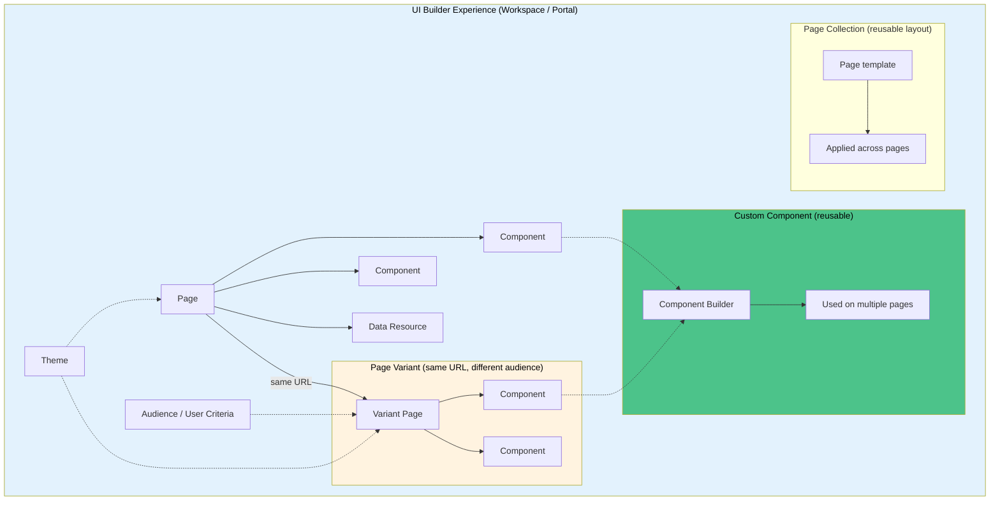

## 💡 Memory Aids & Mnemonics

<details>
<summary>💡 Click to reveal mnemonics & memory aids</summary>

### Business Rule Types — BAA
| Mnemonic | Type | When It Runs | Use Case |
|----------|------|--------------|----------|
| **B**efore | before | Before DB write | Validate/modify data, cancel save (`abort = true`) |
| **A**fter | after | After DB write | Create related records, send notifications |
| **A**sync | async | After commit (separate thread) | Long-running tasks — emails, REST calls, integrations |

**Remember:** **BAA** = Before, After, Async — and they run in that order.

---

### Client Script Types — LOCS
| Mnemonic | Type | When It Runs | Use Case |
|----------|------|--------------|----------|
| **L**oad | onLoad | Form opens | Set defaults, show/hide fields, UI initialization |
| **O**nChange | onChange | Field value changes | Dynamic field behavior, cross-field validation |
| **C**lick | onSubmit | User clicks Save | Final validation before form submits |
| **S**ave | onCellEdit | List cell edits | Inline list editing validation |

**Remember:** **LOCS** = Load, OnChange, Click (Submit), CellEdit (Save).

---

### UI Policy vs Data Policy vs Client Script
| Mnemonic | What | Where It Runs | Scope |
|----------|------|---------------|-------|
| **U**I | UI Policy | Browser (form load/change) | UI behavior only — mandatory, read-only, visible |
| **D**ata | Data Policy | Server (every save path) | Data integrity — form, API, import, all writes |
| **C**lient | Client Script | Browser only | UX feedback — can be bypassed by API/import saves |

**Remember:** **U**→UI (looks), **D**→Data (truth), **C**→Client (feel). Never rely on Client Script for security.

---

### IRE — Identification Before Reconciliation
**Mnemonic:** **I before R**

1. **I**dentification = "Does this CI already exist?" → match existing CI or create new
2. **R**econciliation = "Whose data wins for each field?" → update attributes on matched CI

**Remember:** You can't reconcile what you haven't identified first. Identification runs first; reconciliation only runs on matched CIs.

---

### Update Set Conflicts — ARM
| Mnemonic | Option | What It Does | When to Use |
|----------|--------|--------------|-------------|
| **A**ccept | Accept Remote | Update Set version overwrites target | Update Set version is newer/correct |
| **S**kip | Skip remote update | Keep target instance's version | Target has a fix that must be preserved |
| **M**erge | Merge | Review both versions, combine manually | Both versions have valid changes |

**Remember:** **ARM** = Accept Remote, Skip remote, Merge. For script conflicts (Business Rules, Script Includes), always choose **Merge**.

---

### CMDB — Retire Before Delete
**Mnemonic:** **R before D**

- **R**etire: Set `install_status = retired` — keeps `cmdb_rel_ci` relationships intact for historical impact analysis
- **D**elete: Hard delete — breaks `cmdb_rel_ci` parent/child references, orphaned incidents

**Remember:** Always retire, never delete.

---

### Order vs Priority — Lower = First
| Feature | Ordering Field | Lower Number = |
|---------|---------------|----------------|
| Business Rule | `Order` | Runs first |
| UI Policy | `Order` | Runs first |
| Decision Table | `Order` | Runs first |
| Scheduled Job | `Priority` | Runs first |
| Identification Rule entry | `Priority` | Runs first |
| Reconciliation Rule | `Priority` | Runs first |

**Remember:** **Lower number = runs first**, regardless of whether the field is called `Order` or `Priority`.

---

### Transform Script — Coalesce = Match
| Mnemonic | Setting | Result |
|----------|---------|--------|
| **C**oalesce | `coalesce = true` | Update existing CI (match on key fields) |
| **N**o coalesce | `coalesce = false` | Insert new CI (create duplicate) |

**Remember:** **Coalesce** = "come together" = match existing records instead of duplicating.

---

### Debugging — Log First, Then Debug
| Context | Primary Tool | Command |
|---------|-------------|---------|
| **S**erver | System Log (`sys_log`) | `gs.print()`, `gs.error()`, `gs.info()` |
| **C**lient | Browser Console (F12) | `console.log()`, `debugger;` |
| **B**oth | Script Debugger | Breakpoints, step-through, variable inspection |

**Remember:** **Log first** — `gs.print()` for server, `console.log()` for client. `console.log()` does NOT work in server-side business rules.

---

</details>

## Application Service Dependency Views vs Schema Map — Upstream vs Downstream Dependencies

One of the most common questions in CMDB administration and incident management is: *"If this CI goes down, what else is affected?"* ServiceNow provides two primary ways to visualize CI dependencies: **Application Service Dependency Views** and **Schema Map**. They serve different purposes, show different directions of dependency, and answer different questions.

---

### Dependency Views vs Schema Map — Comparison

| | **Application Service Dependency Views** | **Schema Map** |
|---|---|---|
| **Purpose** | Show CIs that support a business/application service and their relationships | Show the CI class hierarchy and how tables/fields relate to each other |
| **Root** | A root CI (the node you start from) — highlighted with a pulsing border | The whole CMDB class hierarchy or a selected table |
| **Direction** | Shows **both upstream and downstream** dependencies | Shows class inheritance (extends) and field relationships |
| **Levels** | Configurable depth (default: 3 levels each direction) | Typically full hierarchy |
| **Status indicators** | Shows incident/alert/problem/change/task counts per node | No operational status indicators |
| **Best for** | Impact analysis — "if this CI fails, what breaks?" | Data modeling — "which CI class extends which?" |
| **Access** | CI record → Dependency Views icon, or CMDB Workspace | System Definition → Tables → Schema Map, or CI form → Related Links |
| **Roles required** | `itil` or `ecmdb_admin` | `admin` |

**Key distinction:** Dependency Views is about **runtime impact** (which CIs depend on which for service delivery). Schema Map is about **data model structure** (which table extends which, what fields exist).

---

### Upstream vs Downstream Dependencies

When you open a Dependency Views map centered on a root CI, relationships flow in both directions:

| Direction | Meaning | Example (ATM scenario) |
|---|---|---|
| **Upstream** | CIs that this CI **depends on** — things this CI needs to function | ATM server depends on: network switch, database server, power supply, WAN router |
| **Downstream** | CIs that **depend on this CI** — things that break if this CI fails | ATM server supports: ATM kiosks, mobile banking app, online banking portal, branch teller systems |

**Rule of thumb:** Upstream = "what does this need?" Downstream = "what needs this?"

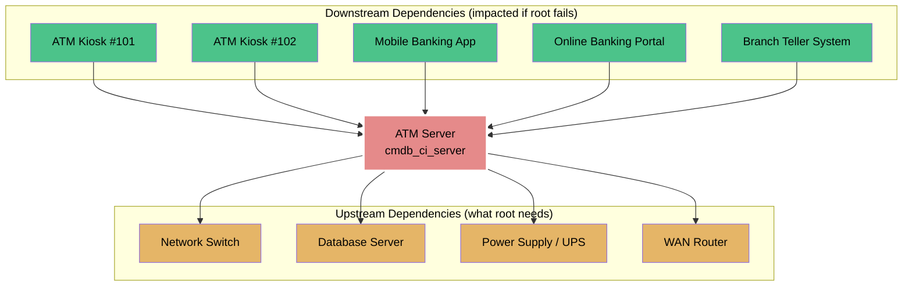

---

### Practical Example: ATM Server Down

**Scenario:** The `ATM-SERVER-01` CI goes down. You need to know how many ATMs and downstream services are affected.

#### Step 1: Open the Dependency Views Map

From the CI record (`cmdb_ci_server` = ATM-SERVER-01):

1. Open the CI record: **All > Configuration > CI List → search "ATM-SERVER-01"**
2. Click the **Dependency Views map icon** on the CI form (or from a related incident/task)
3. The map opens with ATM-SERVER-01 as the **root CI** (pulsing border)
4. By default, **3 levels upstream and 3 levels downstream** are shown

#### Step 2: Count Downstream Impact

Look at all nodes in the **downstream** direction (arrows pointing toward the root CI):

```
ATM-SERVER-01 (root, DOWN)
├── ATM Kiosk #101 (cmdb_ci_network_atm) — DOWN
├── ATM Kiosk #102 (cmdb_ci_network_atm) — DOWN
├── ATM Kiosk #103 (cmdb_ci_network_atm) — DOWN
├── Mobile Banking App (cmdb_ci_appl) — DEGRADED
├── Online Banking Portal (cmdb_ci_appl) — DEGRADED
└── Branch Teller System (cmdb_ci_appl) — IMPACTED
```

**Answer:** 3 ATM kiosks directly downstream, plus 3 business applications affected. If you expand further (more levels), you may find additional downstream CIs like ATM network interfaces, card readers, receipt printers, etc.

#### Step 3: Check Upstream Cause

Look at upstream nodes to find the root cause:

```
ATM-SERVER-01 ← Network Switch (down)
ATM-SERVER-01 ← Database Server (up)
ATM-SERVER-01 ← Power Supply (up)
```

If the network switch is also down, that's the upstream cause — fix the switch, the server comes back, and downstream ATMs recover.

---

### How to See Upstream vs Downstream in ServiceNow

| Method | Where to Find It | What It Shows |
|--------|-----------------|---------------|
| **Dependency Views map** | CI form → map icon, or CMDB Workspace → Dependency Views | Graphical map with root CI, upstream + downstream nodes, status indicators, task/incident counts |
| **CI Relations Formatter** | CI form → Related Links → "Show Relations in Split/Merge Layout" | Flat or tree list of related CIs grouped by relationship type; **Split** shows upstream and downstream separately |
| **Unified Map** | CMDB Workspace / Service Graph Workspace | Combines Dependency Views + Service Mapping into one map; shows service health and related work items |
| **cmdb_rel_ci table query** | System Definition → Tables → cmdb_rel_ci → list view | Raw relationship records: `parent` → `child` via `type`; filter to see all relationships involving a CI |
| **Service Mapping ADM** | All > Service Mapping > Application Services | Application service topology showing CIs and their dependencies |

#### Using Split View for Separate Upstream/Downstream Lists

In the CI Relations Formatter:

1. Open the CI record
2. Click **Related Links → Show Relations in Split/Merge Layout**
3. Click **Split** — this shows two separate lists:
   - **Upstream:** CIs this CI depends on (this CI is the `child`)
   - **Downstream:** CIs that depend on this CI (this CI is the `parent`)

---

### Mermaid Diagram: Full Dependency View

```mermaid
flowchart TB
    subgraph Business Services
        BS[ATM Banking Service<br/>cmdb_ci_service]
    end

    subgraph Application Tier
        APP1[ATM Application Server]
        APP2[Transaction Processing App]
        DB[Core Banking Database]
    end

    subgraph Infrastructure Tier
        SVR[ATM-SERVER-01<br/>cmdb_ci_server]
        SW[Core Network Switch]
        RTR[WAN Edge Router]
        PWR[UPS / Power Feed]
    end

    subgraph Edge Devices (Downstream)
        ATM1[ATM Kiosk #101]
        ATM2[ATM Kiosk #102]
        ATM3[ATM Kiosk #103]
        MOB[Mobile Banking App]
    end

    BS -->|Realized by| APP1
    APP1 -->|Runs on| SVR
    APP2 -->|Runs on| SVR
    APP1 -->|Depends on| DB
    SVR -->|Connected to| SW
    SW -->|Connected to| RTR
    SVR -->|Powered by| PWR

    ATM1 -->|Uses| APP1
    ATM2 -->|Uses| APP1
    ATM3 -->|Uses| APP1
    MOB -->|Uses| APP2

    style BS fill:#4cc38a,color:#000
    style SVR fill:#e58a8a,stroke:#fff,stroke-width:3px,color:#000
    style ATM1 fill:#e58a8a,color:#fff
    style ATM2 fill:#e58a8a,color:#fff
    style ATM3 fill:#e58a8a,color:#fff
```

---

### Common Mistakes

| Mistake | Symptom | Fix |
|---------|---------|-----|
| **No CI relationships defined** | Dependency Views map shows only the root CI — nothing upstream or downstream | Populate `cmdb_rel_ci` via Discovery, Service Mapping, Import Sets, or manual entry |
| **Wrong relationship direction** | Downstream impact shows upstream CIs (or vice versa) | Check `cmdb_rel_ci.parent` and `cmdb_rel_ci.child` — parent depends on child, child supports parent |
| **Only 3 levels shown** | Deep dependency chains not visible | Configure Dependency Views to show more levels (administrator setting) |
| **Using Schema Map for impact analysis** | Schema Map shows class hierarchy, not runtime dependencies — can't see which services break | Use Dependency Views or Unified Map for impact analysis; Schema Map is for data modeling |
| **Stale relationships** | Map shows CIs that no longer exist or misses new ones | Run Discovery/Service Mapping regularly; retire CIs instead of deleting; run CMDB Health de-duplication |
| **CI not extended from cmdb_ci** | CI doesn't appear in Dependency Views | Only tables extending `cmdb_ci` appear in Dependency Views maps |

---

### When to Use Which

| Question | Use | Why |
|----------|-----|-----|
| "If ATM-SERVER-01 goes down, which ATMs are affected?" | **Dependency Views** | Shows downstream CIs with status indicators |
| "What does ATM-SERVER-01 depend on to stay up?" | **Dependency Views** (upstream) | Shows upstream CIs — network, database, power |
| "Which business service does this CI support?" | **Dependency Views** | Shows the service at the top of the map |
| "Does `cmdb_ci_atm` extend `cmdb_ci_network`?" | **Schema Map** | Shows class inheritance hierarchy |
| "What fields exist on the ATM CI class?" | **Schema Map** | Shows table structure and fields |
| "How many incidents are open on downstream ATMs?" | **Dependency Views** / **Unified Map** | Shows incident counts per node |
| "What's the full topology of the ATM Banking service?" | **Unified Map** / **Service Mapping** | Combines dependency + service mapping data |

---

### Configuration for Administrators

To tune Dependency Views:

- **Number of levels:** Administrators can configure how many upstream and downstream levels display (default = 3 each)
- **Cluster collapse:** Maps collapse/expand clusters for readability; right-click a collapsed node to expand
- **Filters:** Filter the map by relationship type, CI class, or task type to focus on specific dependency patterns
- **Refresh:** The map auto-refreshes from the CMDB — no manual refresh needed

---


## Related Guides

- [Discovery guide](./discovery-guide.md)
- [Service Mapping guide](./servicemapping-guide.md)
- [ITSM guide](./itsm-guide.md)
- [HAM guide](./ham-guide.md)
- [ITOM guide](./itom-guide.md)
- [CMDB getting-started](./../../getting-started/cmdb.md)

---

## Official Learning Resources

### Now Learning (Structured Training)
- [CMDB Fundamentals](https://nowlearning.com/) — Search "CMDB" on Now Learning Portal
- [CMDB Health](https://nowlearning.com/) — Search "CMDB Health" on Now Learning Portal
- [Identification and Reconciliation](https://nowlearning.com/) — Search "IRE" or "Identification Reconciliation" on Now Learning Portal

### Product Documentation (Technical Reference)
- [ServiceNow Product Documentation — CMDB](https://docs.servicenow.com/) → Search "CMDB", "CI classes", "CI relationships"
- [ServiceNow Product Documentation — IRE](https://docs.servicenow.com/) → Search "identification reconciliation"
- [ServiceNow Product Documentation — CMDB Health](https://docs.servicenow.com/) → Search "CMDB Health"

### Official Videos & Playlists
- [ServiceNow YouTube Channel](https://www.youtube.com/c/ServiceNow) — Search "ServiceNow CMDB", "ServiceNow CI relationship", "ServiceNow identification reconciliation"
- [CMDB overview](https://www.youtube.com/results?search_query=servicenow+cmdb+overview)
- [IRE deep dive](https://www.youtube.com/results?search_query=servicenow+identification+reconciliation+engine)

---
