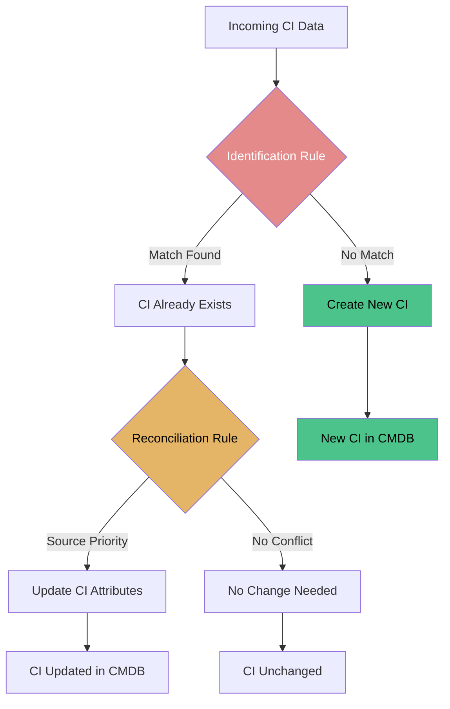
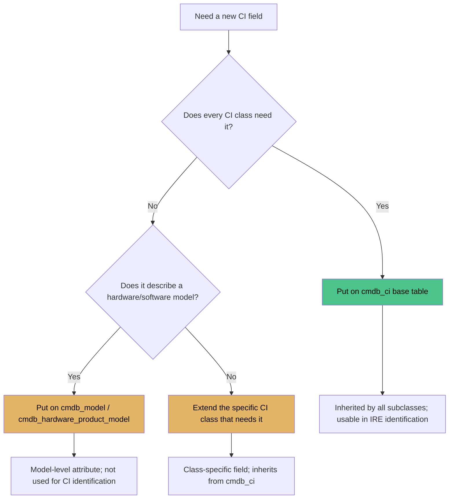
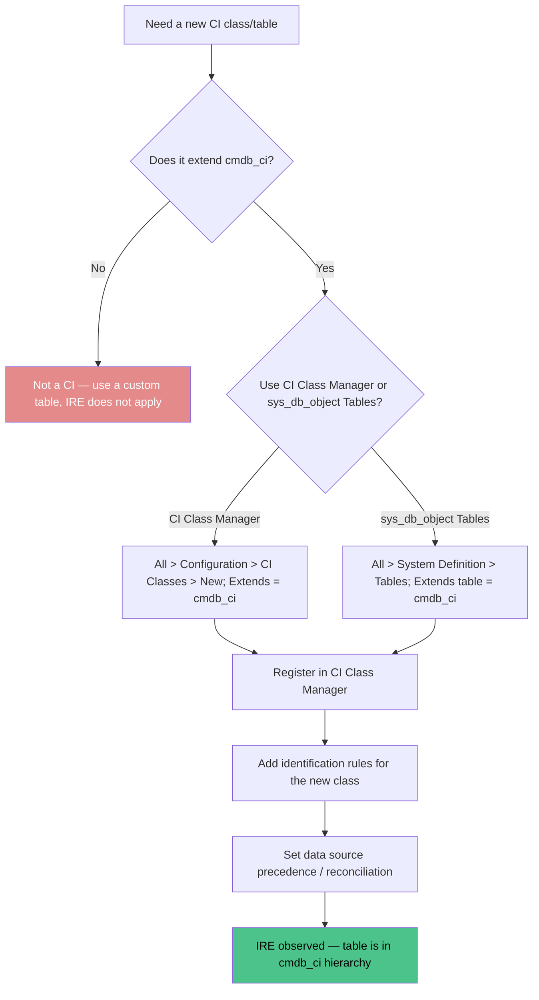
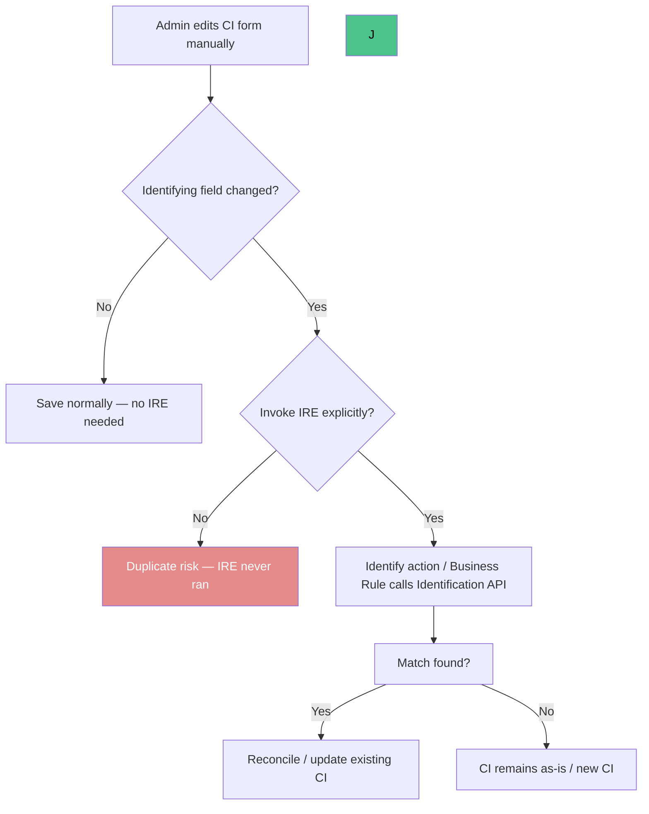
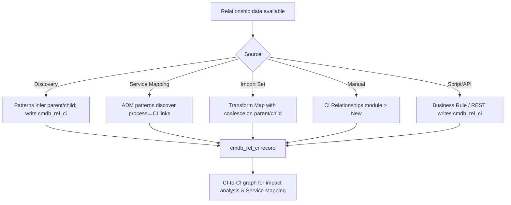

# CMDB — Configuration Management Database

**Agent:** opencode  
**Date:** 2026-11-10  
**Module:** CMDB  
**App:** CMDB / Configuration  
**Confidence:** high  

---

## Contents

- [Purpose](#purpose)
- [Where to Find It](#where-to-find-it)
- [Official Exam Alignment — CIS-Data Foundations (CMDB and CSDM)](#official-exam-alignment--cis-data-foundations-cmdb-and-csdm)
- [CMDB Table Hierarchy Diagram](#cmdb-table-hierarchy-diagram)
- [Out-of-Box Values & Dropdowns](#out-of-box-values--dropdowns)
- [CI Attribute vs Model Attribute](#ci-attribute-vs-model-attribute)
- [IRE Process Diagram (Identification & Reconciliation)](#ire-process-diagram-identification--reconciliation)
- [Identification Rules Deep Dive](#identification-rules-deep-dive)
- [Reconciliation Rules Deep Dive](#reconciliation-rules-deep-dive)
- [Field-Specific Precedence — SCCM / Soroc Example](#field-specific-precedence--sccm--soroc-example)
- [Data Refresh & Staleness Rules](#data-refresh--staleness-rules)
- [Re-usable Code / Metadata](#re-usable-code--metadata)
- [Out-of-Box Features](#out-of-box-features)
- [Key Table Hierarchy](#key-table-hierarchy)
- [Integrations](#integrations)
- [REST Integration — RESTMessageV2 vs IntegrationHub Spoke](#rest-integration--restmessagev2-vs-integrationhub-spoke)
- [Key Fields](#key-fields)
- [Goals, Benefits & Key Metrics](#goals-benefits--key-metrics)
- [Core Concept Diagrams](#core-concept-diagrams)

---

## Purpose

The CMDB (Configuration Management Database) is ServiceNow's single source of truth for configuration items (CIs) and their relationships. Every CI — server, application, database, network device, software license — is a record in `cmdb_ci` or its extensions. Relationships between CIs are stored in `cmdb_rel_ci`.

The CMDB is the foundation that ITSM, ITOM, Service Mapping, HAM, and other modules all depend on. If the CMDB is inaccurate, incident impact analysis, change risk assessment, and service mapping all produce wrong answers.

---

## Where to Find It

| Breadcrumb | Path |
|------------|------|
| Module entry | All > Configuration > ... |
| CI List | All > Configuration > CI List |
| CI Relationships | All > Configuration > CI Relationships |
| Identification/Reconciliation | All > Configuration > Identification/Reconciliation |
| CI Classes | All > Configuration > CI Classes |
| Health Dashboards | All > CMDB Health > Dashboards |

**Tip:** CMDB is core to the platform — it's always available, but the Health and IRE features require the CMDB Health plugin.

---

## Official Exam Alignment — CIS-Data Foundations (CMDB and CSDM)

This guide maps to the **Certified Implementation Specialist – Data Foundations (CMDB and CSDM)** exam blueprint (ServiceNow University, KB0012913). Exam weightings shown are the official domain percentages.

| Guide Section | CIS-DF Domain | Exam Weight | What's Covered |
|---------------|-----------------|-------------|----------------|
| **Key Table Hierarchy** | Domain: CI Class Management — CMDB Tables, CI Class Manager | 15% | CI classes, extensions, relationships, cmdb_ci base |
| **Identification & Reconciliation Deep Dive** | Domain: Identification & Reconciliation — Identification Rules, Reconciliation Rules, Datasource Precedence, De-duplication | 25% | IRE engine, identification vs reconciliation, source priority, de-duplication |
| **CMDB Health** | Domain: Govern — CMDB Health Score, CMDB Health Dashboards, Data Manager | 35% | Completeness, correctness, compliance, duplication remediation |
| **CSDM** | Domain: Design — CSDM framework, business/technical services | 15% | CSDM domains, design vs build vs consume |

**Official preparation courses:**
- Welcome to ServiceNow
- ServiceNow Administration Fundamentals
- Get Started with Now Create
- ServiceNow Platform Implementation
- CMDB Fundamentals
- CMDB Health Micro-Certification Simulator
- Configure the CMDB Micro-Certification Simulator
- Common Service Data Model (CSDM Fundamentals)
- CMDB Health Deep Dive

**Exam guidance:** Questions are based on official ServiceNow training materials, the ServiceNow Product documentation site, and the ServiceNow developer site.

---

## CMDB Table Hierarchy Diagram

```mermaid
graph TD
    subgraph "cmdb_ci — Base CI Table"
        cmdb_ci[cmdb_ci]
    end
    
    subgraph "Extended CI Classes"
        cmdb_ci_server[cmdb_ci_server]
        cmdb_ci_appl[cmdb_ci_appl]
        cmdb_ci_database[cmdb_ci_database]
        cmdb_ci_service[cmdb_ci_service]
        cmdb_ci_network[cmdb_ci_network]
    end
    
    subgraph "Relationships"
        cmdb_rel_ci[cmdb_rel_ci]
    end
    
    subgraph "Discovery Sources"
        discovery[Discovery]
        import_set[Import Set]
        manual[Manual Entry]
        sgc[Service Graph Connectors]
    end

    cmdb_ci --> cmdb_ci_server
    cmdb_ci --> cmdb_ci_appl
    cmdb_ci --> cmdb_ci_database
    cmdb_ci --> cmdb_ci_service
    cmdb_ci --> cmdb_ci_network
    
    cmdb_rel_ci -.->|parent| cmdb_ci
    cmdb_rel_ci -.->|child| cmdb_ci
    
    discovery --> cmdb_ci
    import_set --> cmdb_ci
    manual --> cmdb_ci
    sgc --> cmdb_ci

    style cmdb_ci fill:#0b0e11,stroke:#4cc38a,stroke-width:2px
    style cmdb_rel_ci fill:#0a0d10,stroke:#e5b567
```



**Exam focus:** CI class management, CMDB tables, CI class manager, relationships.

---

## Out-of-Box Values & Dropdowns

ServiceNow ships with predefined CI classes, status values, and identifier rules. Verify against your instance — values can vary by release.

### CI Status (cmdb_ci.install_status)
| Status | When to Use |
|--------|-------------|
| `development` | CI is being built or configured |
| `test` | CI is in test environment |
| `production` | CI is live in production |
| `in maintenance` | CI is under maintenance |
| `retired` | CI is no longer in use |
| `ordered` | CI has been ordered, not yet received |

### CI Class Hierarchy (OOB)
| Class | Table | Description |
|-------|-------|-------------|
| `cmdb_ci` | Base CI | All configuration items |
| `cmdb_ci_server` | Server CIs | Windows/Linux servers, hosts |
| `cmdb_ci_appl` | Application CIs | IIS, Tomcat, SQL Server |
| `cmdb_ci_database` | Database CIs | Database instances |
| `cmdb_ci_service` | Logical service | Business services |
| `cmdb_ci_network` | Network CIs | Routers, switches, firewalls |

### OOB Identifier Rules (Computer CI Class)
| Priority | Identifier Entry | Match On |
|----------|-----------------|----------|
| 100 | Serial Number + Serial Number Type | Serial number + type |
| 200 | Serial Number | Serial number only |
| 300 | Name + DNS Domain | Hostname + domain |
| 400 | MAC Address | Network adapter MAC |

**Processing order:** Identifier entries are evaluated in priority order (lowest first). First match wins — remaining entries are skipped.

**Exam focus (CIS-DF, 25%):** CI classes, identifier rules, data source precedence, de-duplication.

---

## IRE Process Diagram (Identification & Reconciliation)



**Identification:** Answers "Is this CI already existing or is it new?" — uses CI identifiers (serial number, MAC address, hostname + DNS, etc.)
**Reconciliation:** Answers "If multiple sources update the same CI, whose data should I trust?" — uses source priority (Discovery typically outranks Import Set and Manual)
**Processing Order:** Identification → (if match) Reconciliation → Update/Create. If identification fails, no reconciliation and no update occur.

**Exam focus:** Identification Rules, Reconciliation Rules, Datasource Precedence Rules, CMDB De-duplication (25% of exam).

---

## Re-usable Code / Metadata

### Scoped Application

CMDB is primarily global scope with some scoped extensions.

| Scope Aspect | Detail |
|--------------|--------|
| Scope | Global + `com.snc.cmdb` (CI Class Models) |
| Key tables | `cmdb_ci`, `cmdb_ci_server`, `cmdb_ci_appl`, `cmdb_ci_database`, `cmdb_rel_ci`, `cmdb_ci_service` |
| Roles | `itil`, `admin`, `cmdb_admin` |

### Re-usable Metadata Inventory

| Re-usable piece | What it is | Where it lives (breadcrumb) |
|-----------------|------------|------------------------------|
| **CI Classes** | The CMDB class hierarchy (cmdb_ci → cmdb_ci_server → cmdb_ci_linux_server, etc.) | All > Configuration > CI Classes |
| **CI Relationship Types** | Types of relationships (Runs on::Runs, Depends on::Used by, etc.) | All > Configuration > CI Relationship Types |
| **Identification Rules** | Rules that determine if a discovered CI matches an existing CI | All > Configuration > Identification/Reconciliation > Identification |
| **Reconciliation Rules** | Rules that merge/update CIs when data conflicts | All > Configuration > Identification/Reconciliation > Reconciliation |
| **Dynamic CI Groups** | Query-defined CI collections | All > Configuration > Dynamic CI Groups |
| **Data Sources** | Sources of CI data (Discovery, Import Set, Manual, etc.) | All > Configuration > Data Sources |

### Re-usable Code Snippets

#### Business Rule: Prevent Duplicate Server CIs by Serial Number

```javascript
(function rule(current, previous) {
    if (current.operation() == 'insert' && current.serial_number) {
        var gr = new GlideRecord('cmdb_ci_server');
        gr.addQuery('serial_number', current.serial_number);
        gr.query();
        if (gr.next()) {
            current.setAbortAction(true);
            gs.addError('A server with this serial number already exists: ' + gr.number);
        }
    }
})(current, previous);
```

#### Script Include: CI Relationship Helper

```javascript
var CIRelationshipHelper = Class.create();
CIRelationshipHelper.prototype = Object.extendsObject(AbstractAjaxProcessor, {
    getRelatedCIs: function() {
        var ciSysId = this.getParameter('ci_sys_id');
        var gr = new GlideRecord('cmdb_rel_ci');
        gr.addQuery('parent', ciSysId);
        gr.query();
        var children = [];
        while (gr.next()) {
            children.push({sys_id: gr.getValue('child'), type: gr.getValue('type')});
        }
        return JSON.stringify(children);
    },
    type: 'CIRelationshipHelper'
});
```

---

## Out-of-Box Features

| Feature | Description | Where |
|---------|-------------|-------|
| CI List | Browse and manage all CIs | All > Configuration > CI List |
| CI Relationships | View and create CI-to-CI relationships | All > Configuration > CI Relationships |
| Identification & Reconciliation | Prevent and resolve duplicate CIs | All > Configuration > Identification/Reconciliation |
| CI Classes | Extend the CMDB class model | All > Configuration > CI Classes |
| Dynamic CI Groups | Query-based CI collections | All > Configuration > Dynamic CI Groups |
| CMDB Health | Dashboards for data quality, completeness, correctness | All > CMDB Health > Dashboards |
| Data Sources | Track where each CI came from (Discovery, Import, Manual) | All > Configuration > Data Sources |

---

## Key Table Hierarchy

| Table | Purpose | Extends | Key Fields |
|-------|---------|---------|------------|
| `cmdb_ci` | Base CI table — everything managed | — | `name`, `serial_number`, `asset_tag`, `location`, `status`, `data_source` |
| `cmdb_ci_server` | Server CIs | `cmdb_ci` | `ip_address`, `hostname`, `os`, `os_version`, `cpu_count`, `memory` |
| `cmdb_ci_appl` | Application CIs | `cmdb_ci` | `name`, `version`, `install_status`, `vendor` |
| `cmdb_ci_database` | Database CIs | `cmdb_ci` | `type`, `version`, `port`, `instance_name` |
| `cmdb_ci_service` | Logical business service | `cmdb_ci` | `name`, `description`, `owned_by` |
| `cmdb_rel_ci` | Relationships between CIs | — | `parent`, `child`, `type`, `start_date`, `end_date` |

### Table Relationships

```
cmdb_ci (Base CI)
    │
    ├──► cmdb_ci_server (WEB01, APP01, DB01)
    ├──► cmdb_ci_appl (IIS, Tomcat, SQL Server)
    ├──► cmdb_ci_database (SQL Server instance)
    ├──► cmdb_ci_service (Online Banking service)
    │
    └──► cmdb_rel_ci (relationships)
            ├──► parent: WEB01 → child: IIS → type: "Runs on::Runs"
            ├──► parent: IIS → child: APP01 → type: "Depends on::Used by"
            └──► parent: APP01 → child: DB01 → type: "Depends on::Used by"
```

---

## Integrations

| Integration | Direction | Purpose | Protocol |
|-------------|-----------|---------|----------|
| Discovery | Inbound | Auto-create and update CIs | Discovery/MID Server |
| Import Sets | Inbound | Bulk load CIs from CSV/Excel | Import Set/Transform Map |
| Service Graph Connectors | Inbound | Import CI data from external CMDBs/cloud | REST/API |
| JDBC | Inbound | Read CI data from external databases | JDBC |
| ITAM/HAM | Bidirectional | Asset and CI synchronization | Internal |

---

## REST Integration — RESTMessageV2 vs IntegrationHub Spoke

When CMDB needs to send or receive CI data from an external system (e.g., push a new CI to Soroc, pull inventory from SCCM, or sync with an external CMDB), ServiceNow offers two main REST options:

| | RESTMessageV2 | IntegrationHub REST Spoke |
|---|--------------|---------------------------|
| **What it is** | Server-side API (`sn_ws.RESTMessageV2`) for making REST calls from scripts | Low-code IntegrationHub spoke for REST-based integrations |
| **Best for** | Custom logic, Business Rules, Script Includes, one-off callouts | Reusable integration flows, Flow Designer, non-developer maintenance |
| **Where configured** | `sys_rest_message` table → REST Message record | IntegrationHub → Spokes → REST Message Spoke |
| **Authentication** | Set on the REST Message record (Basic, Bearer, OAuth, API Key) | Set on the Spoke / connection configuration |
| **Response handling** | Parsed in script (`response.getBody()`, `response.getStatusCode()`) | Mapped via output variables in Flow Designer |
| **CMDB use case** | Custom Business Rule that pushes CI changes to an external system on update | Scheduled flow that pulls external inventory and creates/updates CIs via Transform Map |

### Authentication — where it is set up and how

Authentication is configured at the **REST Message** level (not per call). All calls using that message inherit the auth.

**RESTMessageV2** — navigate to **System Web Services > REST Messages** (or `sys_rest_message` list), open the message, and set:

| Auth type | Where | How |
|-----------|-------|-----|
| **Basic Auth** | REST Message record > Authentication type = `Basic` | Enter username/password; optionally select a credential record |
| **Bearer Token** | REST Message record > Authentication type = `Bearer Token` | Paste the token; can reference a credential or secret store |
| **OAuth 1.0 / 2.0** | REST Message record > Authentication type = `OAuth` | Configure consumer key/secret, token, signature method |
| **API Key** | REST Message record > Authentication type = `None` + manual header | Add header `X-API-Key: <value>` via `message.setRequestHeader()` |

**IntegrationHub REST Spoke** — navigate to **IntegrationHub > Spokes > REST Message Spoke**, configure the spoke, then set authentication on the **connection** or spoke input (Basic, Bearer, OAuth, or API Key header) before the flow can use it.

> **Tip:** Store secrets in **System Definition > Secrets** (Credential record) rather than hard-coding tokens in the REST Message or script.

---

### End-to-end example — push a new CI to an external system via RESTMessageV2

<details>
<summary>Example: Business Rule on cmdb_ci_server insert that POSTs the CI to an external CMDB</summary>

**Scenario:** When a new Server CI is inserted, push `name`, `serial_number`, and `ip_address` to an external REST endpoint that owns the authoritative asset record.

**1. Create the REST Message**
- Navigate to **System Web Services > REST Messages > New**
- Name: `External CMDB - Create CI`
- Endpoint: `https://api.external-cmdb.com/v1/cis`
- HTTP method: `POST`
- Authentication type: `Basic` (or Bearer Token)
- Username / Password: service account for the external CMDB

**2. Add a request header**
- In the REST Message > Headers related list > New
- Name: `Content-Type`, Value: `application/json`

**3. Create a Business Rule on `cmdb_ci_server`**
- Table: `cmdb_ci_server`
- Run: `After`, `Insert`
- Advanced: `true`

```javascript
(function rule(current, previous) {
    // Only fire when this is a real CI with a serial number
    if (!current.serial_number) return;

    // Build the JSON payload
    var payload = JSON.stringify({
        name: current.name,
        serial_number: current.serial_number,
        ip_address: current.ip_address,
        data_source: current.data_source,
        source_sys_id: current.sys_id
    });

    // Create the REST message and set the body
    var sm = new sn_ws.RESTMessageV2('External CMDB - Create CI');
    sm.setRequestBody(payload);

    try {
        var response = sm.execute();
        var httpStatus = response.getStatusCode();
        var body = response.getBody();

        if (httpStatus == 200 || httpStatus == 201) {
            gs.log('CI pushed to external CMDB: ' + current.name + ' (HTTP ' + httpStatus + ')');
        } else {
            gs.logError('External CMDB reject: HTTP ' + httpStatus + ' — ' + body);
        }
    } catch (ex) {
        gs.logError('REST call failed: ' + ex.getMessage());
    }
})(current, previous);
```

**4. Test**
- Insert a new Server CI via CI List with Name, Serial Number, IP Address
- Check **System Log > All** for `CI pushed to external CMDB`
- Verify the external system received the CI

</details>

**Key differences to remember:**
- Use **RESTMessageV2** when you need code-level control (Business Rules, Script Includes, custom error handling, dynamic endpoints).
- Use **IntegrationHub REST Spoke** when you want a low-code, reusable flow that operations teams can maintain without writing JavaScript.
- Authentication is set **once on the REST Message / spoke**, not per request — secure credentials via the Credential/Secret store.
- For CMDB inbound (external → ServiceNow), prefer **Service Graph Connector** or **Import Set + Transform Map** rather than pushing via REST, so IRE and reconciliation run natively.

---

## Key Fields

| Table | Field | Type | Why It Matters |
|-------|-------|------|----------------|
| `cmdb_ci` | `name` | String | Human-readable CI name |
| `cmdb_ci` | `serial_number` | String | Unique hardware identifier (key for IRE) |
| `cmdb_ci` | `asset_tag` | String | Physical asset tag |
| `cmdb_ci` | `data_source` | String | Where the CI came from (Discovery, Import, Manual) |
| `cmdb_ci` | `status` | Choice | Installed, In Maintenance, Retired, etc. |
| `cmdb_rel_ci` | `parent` | Reference | Upstream CI or service |
| `cmdb_rel_ci` | `child` | Reference | Downstream CI |
| `cmdb_rel_ci` | `type` | Choice | Relationship type (Runs on::Runs, etc.) |

---

## Goals, Benefits & Key Metrics

The CMDB's business goal is to act as the single source of truth for all configuration items, so operational decisions about impact, change, and ownership are based on accurate data.

|| Business Goal | Benefit | Example Key Metric | Example Value |
|----------------|-------------|--------------------|----------------|
|| Single source of truth | Trust for impact analysis | CMDB completeness | ≥ 95% of CIs with required attributes |
|| Data accuracy | Reliable impact analysis | CMDB data accuracy score | ≥ 90% |
|| Data quality and health | Proactive remediation | CMDB Health Score | ≥ 90 / 100 |
|| De-duplication | Prevent duplicate CIs | Duplicate CI rate | < 3% |
|| Impact accuracy and operations | Faster incident handling | Mean Time to Identify | ≥ 85% correct impact sets |
|| Change governance | Reduce change risk | Change success rate | ≥ 80% |

---

## Core Concept Diagrams

### CI to CI Relationship Graph

```mermaid
graph TD
    SVC[Service CI] -->|Depends On Used By| APP[Application CI]
    APP -->|Runs On Runs| WEB[Server CI]
    APP -->|Depends On Used By| DB[Database CI]

### Discovery to CMDB Population Flow

```mermaid
flowchart TD
    DISC[Discovery Run] --> COL[Collection]
    COL --> ID{Identified}
    ID -->|No| NEW[Create CI]
    ID -->|Yes| EXIST[Reconcile CI]
    EXIST --> REC{Reconcile}
    REC -->|Conflict| PR[Apply Source Priority]
    REC -->|No Conflict| SKIP[No Change]
    NEW --> REL[Create Relationships]

### IRE Identification and Reconciliation Flow

```mermaid
flowchart TD
    IN[Incoming CI Data] --> IDR{Identification}
    IDR -->|Match| EX[CI Exists]
    IDR -->|No Match| NEW[Create CI]
    EX --> REC{Reconciliation}
    REC -->|Conflict| UP[Update With Trusted Source]
    REC -->|No Conflict| UN[No Change Needed]

---

## Common Mistakes

|| Mistake | Symptom | Fix |
|---------|---------|-----|
| No identification rules | Duplicate CIs for the same server | Configure IRE identification rules before large discovery |
| Not reconciling data sources | Conflicting data for same CI | Set reconciliation priority (Discovery > Import > Manual) |
| Deleting CIs instead of retiring | Broken relationships, orphaned incidents | Use status=Retired, not delete |
| No relationship types defined | Service Mapping can't build maps | Define CI relationship types before mapping |
| CMDB not tied to incidents | No impact analysis | Populate `cmdb_ci` on incident records |
| Ignoring CMDB Health dashboards | Data quality degrades over time | Review completeness/correctness dashboards monthly |

---

## Deep Dive: Identification & Reconciliation (IRE)

IRE is the engine that prevents duplicate CIs and keeps data accurate.

### Identification Rules Deep Dive

**What they do:** Identification rules answer the question "Does this incoming CI already exist in the CMDB, or is it brand new?" They are evaluated before reconciliation. If no rule matches, a new CI is created and reconciliation is skipped entirely.

**Where they live:** All > Configuration > Identification/Reconciliation > Identification

**How a rule is structured:**
- **Target table** (e.g., `cmdb_ci_computer`, `cmdb_ci_server`, `cmdb_ci_network`)
- **Identifier entries** — each entry lists the fields to match on, combined with AND logic (all fields in an entry must match)
- **Priority** — lower number = evaluated first
- **Match type** — exact match, contains, starts with, etc.
- **Active** — only active rules are evaluated

**Evaluation flow:**
1. Incoming CI data arrives (Discovery, Import Set, Service Graph Connector, etc.)
2. IRE loads the active identification rules for the target table
3. Rules are sorted by priority (lowest number first)
4. Each rule's identifier entries are AND-ed together; the first rule to produce a match wins
5. Match found → existing CI identified → proceed to reconciliation
6. No rule matches → new CI created (reconciliation skipped)

**Common identification criteria:**
- Serial number + Manufacturer + Model (hardware)
- MAC address (network interfaces)
- Hostname + DNS domain (servers, workstations)
- Asset tag
- Circuit ID (telecom)
- IMEI / MEID (mobile devices)
- Device ID / serial (SD-WAN edges, vManage)

**Important:** Identification operates on the `cmdb_ci` hierarchy. A rule on `cmdb_ci_computer` matches against `cmdb_ci_computer` records, which are also `cmdb_ci` records. Fields used in identification must exist on the target table (or be inherited from `cmdb_ci`). Fields that live only on a Model table (`cmdb_model`) cannot be used to identify a CI record — IRE identifies the CI, not the model.

If a match is found, the existing CI is updated. If not, a new CI is created.

### Reconciliation Rules Deep Dive

**What they do:** Reconciliation rules answer the question "Multiple sources have data for this CI — which source wins for each field?" They run only after identification finds an existing match.

**Where they live:** All > Configuration > Identification/Reconciliation > Reconciliation

**How a rule is structured:**
- **Target table / CI class** (e.g., `cmdb_ci_computer`, `cmdb_ci_server`)
- **Data source** (e.g., `SCCM`, `Soroc`, `Discovery`, `Import Set`, `Manual`)
- **Priority** — lower number = higher priority
- **Field mappings** — which fields this source is allowed to update
- **Staleness / refresh behavior** — whether a source can update if its data is older than another source's

**Processing order:**
1. Identified CI exists → reconciliation evaluates all active sources for that CI
2. For each field on the CI, IRE looks at all sources providing that field
3. The source with the highest priority (lowest number) wins — **unless** staleness rules allow override
4. Losing sources' values are discarded for that field (the CI keeps the winner's value)

**Typical source priority:**

| Priority | Source | Rationale |
|----------|--------|-----------|
| 100 | Discovery | Directly observed from the device |
| 200 | SCCM / enterprise inventory | Managed, agent-based inventory |
| 300 | Soroc / external CMDB | Trusted external source |
| 400 | Import Set | Bulk load, varies in quality |
| 500 | Manual | Human entry — least trusted |

---

### Field-Specific Precedence — SCCM / Soroc Example

**Scenario:** Table `cmdb_ci_computer`. You have two authoritative sources:
- **SCCM** is authoritative for `name`
- **Soroc** is authoritative for `serial_number`

This is **field-specific precedence**, not table-wide. You do NOT pick one source to win all fields on `cmdb_ci_computer`. Instead, you configure reconciliation so that each field has its own winner.

**How to configure:**

| Step | Action | Detail |
|------|--------|--------|
| 1 | Open Reconciliation Rules | All > Configuration > Identification/Reconciliation > Reconciliation |
| 2 | Create rule for SCCM | Table: `cmdb_ci_computer`, Source: `SCCM`, Priority: `100`, Fields: `name` (and other SCCM-owned fields) |
| 3 | Create rule for Soroc | Table: `cmdb_ci_computer`, Source: `Soroc`, Priority: `200`, Fields: `serial_number` (and other Soroc-owned fields) |
| 4 | Create fallback rule | Table: `cmdb_ci_computer`, Source: `Discovery`, Priority: `300`, Fields: all remaining fields |
| 5 | Activate all rules | Only active rules participate in reconciliation |

**Result per field:**
- `name`: SCCM wins (priority 100). Soroc's `name` is ignored even if Soroc sends one.
- `serial_number`: Soroc wins (priority 200). SCCM's `serial_number` is ignored even if SCCM sends one.
- `os`, `ip_address`, etc.: Discovery wins (priority 300) as fallback.

**Mermaid — Field-specific precedence flow:**

```mermaid
flowchart TD
    CI[cmdb_ci_computer record] --> RECON{Reconciliation}

    subgraph "Field: name"
        SCCM[SCCM: name = WEB01] --> P1[Priority 100 — WINNER]
        Soroc[Soroc: name = WEB01-ALT] --> P2[Priority 200 — overridden]
    end

    subgraph "Field: serial_number"
        SCCM2[SCCM: serial = SN-111] --> P3[Priority 100 — overridden]
        Soroc2[Soroc: serial = SN-999] --> P4[Priority 200 — WINNER]
    end

    P1 --> FINAL[CI name = WEB01]
    P4 --> FINAL2[CI serial_number = SN-999]

    style P1 fill:#4cc38a,color:#000
    style P4 fill:#4cc38a,color:#000
    style P2 fill:#e58a8a,color:#fff
    style P3 fill:#e58a8a,color:#fff
```

**Key point:** Field-specific precedence means different sources can own different fields on the same CI record. A source that loses on one field may win on another.

---

### Data Refresh & Staleness Rules

**Can a secondary source update a field if the primary source's data has gone stale?** Yes — but only if you configure it. By default, reconciliation is **priority-based, not time-based**: the highest-priority source wins regardless of how old its data is. A stale value from a priority-100 source will beat a fresh value from a priority-200 source.

**Staleness / refresh behavior is configured per reconciliation rule, not per table.** Each rule can specify whether the source can update a field if its own data is newer than the current CMDB value, and whether it yields to a higher-priority source even if that source is stale.

**Two common models:**

| Model | Behavior | Use case |
|-------|----------|----------|
| **Strict priority** | Highest-priority source always wins, regardless of age | SCCM is always authoritative for `name`; never let Soroc overwrite it |
| **Staleness-aware (refresh)** | A source can update if its data is newer AND the primary source hasn't refreshed within a threshold | Allow Soroc to refresh `serial_number` if SCCM hasn't sent an update in 90 days |

**Field-specific vs table-specific:**
- **Field-specific (recommended):** Each reconciliation rule lists the specific fields it owns. SCCM owns `name`; Soroc owns `serial_number`. One source's staleness on `name` does not affect `serial_number`.
- **Table-specific (avoid):** A single rule claiming all fields on `cmdb_ci_computer` for one source. This creates coupling — if SCCM goes stale on `name`, it can't be refreshed by Soroc for `name`, and Soroc may be blocked from updating other fields too.

**Configuration for staleness-aware refresh:**

| Step | Action |
|------|--------|
| 1 | On each reconciliation rule, set **Refreshable** = true if the source can update when its data is newer |
| 2 | Set **Stale threshold** (e.g., 90 days) — if the winning source hasn't updated within this window, a lower-priority source may refresh |
| 3 | Scope rules to specific fields — do not use catch-all rules |
| 4 | Test: send SCCM data, then stop SCCM for 90+ days, send Soroc data, verify Soroc updates the field |

**Warning:** Staleness-aware rules can cause "ping-pong" if two sources refresh each other alternately. Use strict priority for critical identity fields (serial number, name) and staleness-aware only for non-identifying attributes.

### The Cost of Poor IRE
- Duplicate CIs → wrong impact analysis
- Stale data → wrong change risk assessment
- Missing relationships → incomplete service maps
---

## Lab: Create a CI and a Relationship

1. **Navigate** to All > Configuration > CI List > New
2. **Fill** the form:
   - Name: WEB01
   - Class: Server
   - Serial Number: SN-12345
   - IP Address: 10.10.1.20
   - Operating System: Windows Server 2022
   - Data Source: Manual
3. **Submit** — note the CI sys_id
4. **Create a second CI** for an application:
   - Name: IIS on WEB01
   - Class: Application
5. **Navigate** to All > Configuration > CI Relationships > New
6. **Fill**:
   - Parent: WEB01 (the server CI)
   - Child: IIS on WEB01 (the application CI)
   - Type: Runs on::Runs
7. **Submit** and verify the relationship appears on both CI records

---

## SLAs, Dashboards & Workspaces

### SLA Support
- **task_sla usage**: CMDB CIs (`cmdb_ci`) can have SLAs attached for maintenance windows, retirement timelines, and identification reconciliation SLAs. Primary table is `cmdb_ci` with source-specific SLA policies.
- **Module-specific SLA tables**: `cmdb_ci` (base), `cmdb_ci_server`, `cmdb_ci_appl`, etc. SLA policies are tied to CI class identifiers and data source priority.
- **Typical metrics**: CI SLA attainment, identification reconciliation timeliness, de-duplication rate, data source compliance percentage.

### OOTB Dashboards
- **CMDB Data Foundations Dashboard**: Displays CMDB completeness, correctness, and compliance scores across CI classes, with drill-through to data quality issues and source imbalance.
- **CMDB Health Dashboard**: Shows overall CMDB health score, completeness by class, duplication rate, and attribute coverage.

### OOTB Workspaces
- **CMDB Workspace**: `All > Configuration > CMDB`. Breadcrumb: `All > Configuration > CMDB`.
- **CMDB Health Dashboard**: `All > CMDB Health > Dashboards`. Breadcrumb: `All > CMDB Health > Dashboards`.

## Adding a New Field to the CMDB

When you need a new attribute on a CI, the first decision is **where** to put it: on the `cmdb_ci` base table, or on a Model table (`cmdb_model` / `cmdb_hardware_product_model`).

### Decision: cmdb_ci vs Model Table

| Place on | Use When | Example Fields |
|----------|----------|----------------|
| `cmdb_ci` (base) | The attribute applies to **every** CI regardless of class (server, network, database, app). Needed for cross-class reporting, IRE matching, or CMDB Health completeness. | `name`, `serial_number`, `asset_tag`, `location`, `data_source`, `install_status` |
| Model table (`cmdb_model` / `cmdb_hardware_product_model`) | The attribute describes a **hardware/software model**, not an individual CI instance. Vendor-specific or model-specific. | CPU type, RAM, form factor, vendor, model number, warranty term |

### Rule of Thumb

> If every CI (server, network device, database, application) needs the field → put it on `cmdb_ci` or extend the appropriate class.  
> If only a specific model/class needs it → put it on the Model table or extend that class.

### Why It Matters for IRE

Fields used in identification rules (serial number, MAC, hostname + DNS) **must** be on `cmdb_ci` (or inherited by the CI class) so the IRE engine can match across all CI classes. A field that lives only on a Model table cannot be used as an identification criterion for a CI record — IRE identifies the CI, not the model.

### Best Practices

- Reuse an existing OOB field before creating a custom one (avoid dictionary bloat).
- Don't put model-specific attributes on `cmdb_ci` — they clutter every CI form and break CMDB Health completeness expectations.
- Add cross-class fields to `cmdb_ci` so all subclasses inherit them automatically.
- Dictionary changes on `cmdb_ci` cascade to all extending classes — test in a sub-prod instance first.

### CI Attribute vs Model Attribute — Syntax, Dot-Walk, and Structure

**CI attribute** lives on the CI record itself (`cmdb_ci` or a subclass like `cmdb_ci_computer`). It describes an individual instance — this specific server, this specific router.

**Model attribute** lives on the Model record (`cmdb_model` / `cmdb_hardware_product_model`). It describes the make/model — every Cisco ISR 4331 shares the same model attributes (CPU type, RAM, form factor, warranty term).

| | CI attribute | Model attribute |
|---|-------------|-----------------|
| Lives on | `cmdb_ci` / subclass (e.g., `cmdb_ci_computer`) | `cmdb_model` / `cmdb_hardware_product_model` |
| Describes | One CI instance | One hardware/software model |
| Example | `hostname`, `ip_address`, `serial_number`, `install_status`, `u_slots` | `manufacturer`, `model_number`, `cpu_type`, `ram`, `form_factor`, `warranty_term` |
| Inherited by subclasses | Yes (from `cmdb_ci`) | N/A — models are separate records linked to CIs |
| Used by IRE identification | Yes (e.g., serial number) | No — IRE identifies CIs, not models |

#### Dot-walk syntax

A CI record holds a reference to its model (`cmdb_ci.model` → `cmdb_model`). To read a model attribute from a CI record you dot-walk through the reference:

```javascript
// Server-side (GlideRecord / business rule / script include)
var ci = new GlideRecord('cmdb_ci_computer');
ci.get('some_sys_id');

// CI attribute — direct field access
gs.print(ci.getValue('hostname'));              // WEB01
gs.print(ci.getValue('u_slots'));               // 2  (custom CI attribute)

// Model attribute — dot-walk through cmdb_ci.model
gs.print(ci.getValue('model.model_number'));    // ISR-4331
gs.print(ci.getValue('model.manufacturer.name'));// Cisco
gs.print(ci.getValue('model.cpu_type'));        // Intel Xeon
gs.print(ci.getValue('model.warranty_term'));   // 36 months
```

The equivalent dot-walk on a form or in a UI policy condition:

```
model.model_number IS [ISR-4331]
model.cpu_type CONTAINS [Xeon]
```

#### What the model looks like

Model records live in **All > Hardware Asset Management > Asset Models** (or `cmdb_model`):

| Field | Example value |
|-------|---------------|
| Name | Cisco ISR 4331 |
| Model number | ISR-4331 |
| Manufacturer | Cisco |
| Category | Network |
| CPU type | Intel Xeon |
| RAM | 8 GB |
| Form factor | Rack-mount |
| Warranty term | 36 months |

A `cmdb_ci_computer` CI for a specific router links to that model via the `model` reference field:

```
cmdb_ci_computer (WEB01)
  ├─ hostname = WEB01            ← CI attribute (instance-specific)
  ├─ serial_number = SN-12345    ← CI attribute (instance-specific)
  ├─ u_slots = 2                 ← CI attribute (instance-specific custom field)
  ├─ model → cmdb_model record   ← reference to model
  │    ├─ model_number = ISR-4331   ← Model attribute (shared)
  │    ├─ manufacturer = Cisco       ← Model attribute (shared)
  │    └─ cpu_type = Intel Xeon      ← Model attribute (shared)
```

**Key distinction:** Two WEB01-class routers of the same model share the *same* model record and therefore the same model attributes, but each has its own CI attributes (hostname, serial number, slots).

---

### Per-Attribute Discrepancies

A discrepancy can exist at the **attribute level** — not just "does a CI exist?" but "does this field on the CI match the authoritative source?"

**Examples of per-attribute discrepancies:**
- `hostname` on `cmdb_ci_computer` says `WEB01`; SCCM says `WEB01-PROD`
- `serial_number` on the CI is blank; Soroc has `SN-999`
- `model.model_number` says `ISR-4331`; the physical device is actually `ISR-4431` (model mismatch)
- `u_slots` says `2`; the asset record says `4` (CI attribute vs inventory mismatch)
- `install_status` = `production`; the OSS shows the circuit decommissioned

**How to quickly identify discrepancies:**

| Method | What it does | Best for |
|--------|-------------|----------|
| **CMDB Health dashboards** | Completeness / correctness / compliance per CI class | Bulk data-quality scan across all CIs |
| **Data Manager** | Side-by-side compare of source vs target field values; remediate in bulk | Per-attribute field conflicts |
| **Identification/Reconciliation rules** | Surfaces CIs where sources disagree on identifier fields (serial, name, MAC) | Identity-critical attributes |
| **List view + filters** | `All > Configuration > CI List` → filter `[field] [is not] [source value]` | Ad-hoc spot checks |
| **Report / Metric** | Report on `cmdb_ci` where `field` differs from transform-map staging value | Scheduled discrepancy detection |
| **Business Rule / UI Policy** | Flag a CI when a manually edited field diverges from the trusted source | Real-time detection on forms |
| **CMDB Health Micro-Certification** | Scorecards that flag classes below completeness thresholds | Governance / SLA tracking |

#### OOB ServiceNow features to detect discrepancies (platform + TSOM)

| Feature | Where | Detects |
|---------|-------|---------|
| **CMDB Health** | All > CMDB Health > Dashboards | Completeness, correctness, compliance, duplication per CI class |
| **Data Manager** | All > CMDB Health > Data Manager | Source-vs-target field conflicts; bulk remediation |
| **CMDB De-duplication** | All > Configuration > Identification/Reconciliation > De-duplication | Duplicate CIs from failed identification |
| **Identification / Reconciliation rules** | All > Configuration > Identification/Reconciliation | Identifier field conflicts between sources |
| **CI List filters** | All > Configuration > CI List | Ad-hoc per-attribute mismatch hunts |
| **TSOM: Inventory vs CMDB reconciliation** | TSOM-specific flows | `sn_tsom_inventory_item` vs `cmdb_ci` / `sn_tsom_network_element` mismatch |
| **TSOM: Alarm correlation** | TSOM alarms on `sn_tsom_network_element` | Alarms on CIs with stale/missing model or attribute data |

**TSOM note:** For telecom assets (ONT, OLT, circuit, SD-WAN edge), the model attribute (`model.model_number`, `model.manufacturer`) often drives the CSDM resource mapping. If the model attribute disagrees with what Discovery/OSS observes, service-to-resource alignment breaks — treat model-attribute discrepancies as seriously as CI-attribute discrepancies.

---

## Adding a New CI Class / Table

There are two supported ways to add a new CI table/class to the CMDB:

### Option A: CI Class Manager (Recommended for CMDB classes)

Navigate to **All > Configuration > CI Classes** and create a new CI class that extends `cmdb_ci` (or an existing subclass like `cmdb_ci_server`).

- Creates a new table that extends `cmdb_ci` under the hood.
- Automatically part of the CMDB class hierarchy.
- Inherits all `cmdb_ci` fields and identification/reconciliation rules.
- Shows up in CI List, CI Classes, and CMDB Health by default.
- Best for: new types of CIs that are genuinely configuration items (e.g., `cmdb_ci_cisco_router`, `cmdb_ci_oracle_database`).

### Option B: Table (sys_db_object) with Extends = cmdb_ci

Navigate to **All > System Definition > Tables** and create a new table, setting **Extends table** to `cmdb_ci`.

- Also creates a CI subclass that extends `cmdb_ci`.
- Gives you full dictionary/table configuration control (same as any custom table).
- Must manually ensure it's wired into CI Class Manager if you want it visible there.
- Best for: when you need table-level configuration beyond what CI Class Manager exposes.

### Both Observe IRE

**Both paths observe IRE** as long as the new table extends `cmdb_ci`. IRE operates on the `cmdb_ci` hierarchy, so any subclass — whether created via CI Class Manager or via sys_db_object with `Extends = cmdb_ci` — participates in identification and reconciliation.

The decision is not "which one observes IRE" — it's "which tool fits your governance model":
- Use **CI Class Manager** when you want the class governed as part of the CMDB model (recommended).
- Use **sys_db_object / Tables** when you need plain custom-table behavior while still being a CI.

### Store App / Alternatives vs Building from Scratch

Before creating a CI table manually, check whether a **ServiceNow Store app** or an existing content pack already models what you need:

| Alternative | When to Consider |
|-------------|------------------|
| ServiceNow Store app / Content Pack | A vendor or ServiceNow already publishes a CI class model for your domain (e.g., cloud, network, mainframe). Install and extend rather than rebuild. |
| Existing OOB class | Check if `cmdb_ci_server`, `cmdb_ci_network`, `cmdb_ci_database`, or a subclass already covers your need — extend it instead of creating a new base. |
| Import Set + Transform Map | If the data is read-only/reference data, you may not need a CMDB class at all — use a custom table + import. |
| Asset table (`alm_asset`) | If you're tracking financial/contractual lifecycle rather than configuration, HAM may be a better fit than a new CI class. |

**Default position:** Extend an existing OOB CI class or use a Store app/content pack before creating a brand-new table from scratch. Only create a new `cmdb_ci` subclass when no existing model fits.

---

## CMDB Relationships — OOB, User-Defined, or Both

CI-to-CI relationships live in `cmdb_rel_ci`. Each relationship has a `type` that comes from `cmdb_rel_rel_type`.

### Out-of-Box Relationship Types

ServiceNow ships with standard types, including:

- `Runs on::Runs` — application runs on server
- `Depends on::Used by` — one CI depends on / is used by another
- `Connected to::Connects to` — network connectivity
- `Member of::Member of` — group/cluster membership
- `Realized by::Realizes` — service realized by a CI

These are sufficient for most impact analysis and Service Mapping use cases.

### User-Defined Relationship Types

You can create new relationship types via **All > Configuration > CI Relationship Types** when OOB types don't describe your topology. Give each type a name and an inverse name (e.g., `Hosts::Hosted on`).

### OOB, User-Defined, or Both?

**Both.** OOB types handle the common patterns; user-defined types handle domain-specific relationships. They coexist in the same `cmdb_rel_ci` table and are queried the same way.

### How Relationships Are Typically Populated

| Source | How Populated | Notes |
|--------|-------------|-------|
| Discovery | Discovery patterns infer and insert `cmdb_rel_ci` records during identification/exploration | Automated; most common for server→OS, server→network |
| Service Mapping | Application dependency mapping creates patterns and relationships | Patterns + probes discover process-to-CI links |
| Import Sets / Transform Map | Bulk load parent/child pairs with a transform map | Good for initial seed data or external CMDB migration |
| Manual | All > Configuration > CI Relationships > New | Low volume, human-curated |
| Script / API | Business rules, Script Includes, or REST API writing to `cmdb_rel_ci` | Programmatic relationship creation |

**Best practice:** Let Discovery and Service Mapping populate relationships where possible; use manual entry only for exceptions. Keep relationship types stable — changing a type name breaks existing maps and reports.

---

## Ensuring IRE Is Observed When Creating CI Tables

When you create a new CI class/table, IRE must be able to run on it. Here's how to guarantee that:

1. **The table must extend `cmdb_ci`.** Whether you use CI Class Manager or sys_db_object / Tables, set `Extends table = cmdb_ci`. IRE operates on the `cmdb_ci` hierarchy; tables that don't extend `cmdb_ci` are not CIs and IRE does not apply.
2. **Register in CI Class Manager (recommended).** After creating via sys_db_object, open CI Class Manager and confirm the new class appears under `cmdb_ci`. This makes it visible in CI List, CI Classes, and CMDB Health.
3. **Add identification rules for the new class.** If your new CI has unique identifiers (e.g., a serial number, asset tag, or hostname pattern), create identifier entries so Discovery/imports can match existing records instead of duplicating them.
4. **Set data source precedence.** Confirm your new class's CIs get appropriate `data_source` values so reconciliation trusts Discovery over Manual/Import.

**Which path observes IRE?** Both — CI Class Manager and the Tables route — **provided the table extends `cmdb_ci`**. IRE is table-hierarchy driven, not tool-driven.

---

## How a Child Class Overrides Parent IRE Rules

CI classes inherit identification and reconciliation rules from their parent (ultimately `cmdb_ci`). A child class can override or refine them:

### Overriding Identification Rules

- **Inherit:** The child class automatically uses its parent's identifier entries (e.g., `cmdb_ci_server` inherits `cmdb_ci`'s serial-number + hostname rules).
- **Add class-specific entries:** Add identifier entries scoped to the child class with their own priority. These are evaluated alongside (or instead of) inherited entries depending on rule configuration.
- **Disable inherited entries:** Deactivate a parent identifier entry for the child class if it doesn't apply (e.g., a virtual server without a serial number).
- **Priority order still applies:** Lowest priority number wins, first match wins — whether the entry comes from the parent or the child.

### Overriding Reconciliation Rules

- Reconciliation rules can be scoped to specific CI classes or data sources. A child class can have its own reconciliation rule that takes precedence over the parent's for conflicts on that class.
- Source priority (Discovery > Import > Manual) still applies, but you can tune which fields are reconciled per class.

### Practical Example

`cmdb_ci` identifies servers by serial number. A new child class `cmdb_ci_virtual_server` has no serial number. You:
1. Deactivate the serial-number identifier entry for `cmdb_ci_virtual_server`.
2. Add a hostname + DNS domain identifier entry for `cmdb_ci_virtual_server`.
3. Result: virtual servers are matched by hostname, physical servers by serial number — both under the same IRE engine.

---

## Invoking IRE from a CI Form (Manual Edits Bypass IRE)

By default, **manually editing a CI record does not trigger IRE.** IRE runs when data arrives through Discovery, Import Sets, Service Graph Connectors, or other inbound integration sources. A human changing `serial_number` on a CI form just saves the value — no re-identification, no duplicate check, no reconciliation.

### How to Force IRE from a Form

| Approach | How It Works | When to Use |
|----------|-------------|-------------|
| **Identify UI Action / Related Link** | Click an "Identify" action on the CI form that runs the identification engine against the current record | One-off manual re-identification of a specific CI |
| **Business Rule on update** | A business rule (async/after) on `cmdb_ci` (or subclass) calls the identification API when key fields change | Auto-re-identify whenever a human edits identifying fields |
| **UI Policy / Client Script** | Client script calls a server-side script include to invoke IRE on form save | Immediate feedback in the UI |
| **Scheduled Job** | Run identification/reconciliation on a schedule across all CIs | Bulk remediation, not per-form |

### Example: Business Rule to Invoke IRE on Field Change

```javascript
(function rule(current, previous) {
    // Only re-identify when an identifying field actually changed
    if (current.serial_number.changes() || current.name.changes() || current.dns_domain.changes()) {
        // Call ServiceNow's identification engine to re-evaluate this CI
        var idEngine = new sn_cmdb.Identification(current);
        idEngine.identify();
    }
})(current, previous);
```

> **Note:** `sn_cmdb.Identification` API availability varies by release. In some releases you trigger IRE via the `cmdb_identify` business rule or by invoking the Identify related action. Verify against your instance.

### Why Manual Edits Need This

Without an explicit IRE invocation, two CIs can end up representing the same real device because:
- Discovery created CI A with serial `SN-12345`.
- An admin manually created CI B with the same serial (or edited CI B to match).
- IRE never ran on CI B's manual creation/edit, so no duplicate was detected.

**Rule:** Any process that writes identifying fields outside of Discovery/Import must explicitly invoke IRE, or you will accumulate duplicates.

---

## Common CMDB Gotchas & Complex Issues

| # | Gotcha / Issue | Symptom | Root Cause | Fix / Mitigation |
|---|----------------|---------|------------|------------------|
| 1 | Manual CI edits bypass IRE | Duplicate CIs for the same device; stale identifying data | IRE only runs on inbound discovery/import, not form saves | Explicitly invoke IRE from the form (business rule / Identify action) when identifying fields change |
| 2 | Duplicate CIs after a Discovery run | Multiple `cmdb_ci` records with same serial number | Missing or mis-prioritized identification rules; source precedence not set | Configure identifier entries (lowest priority first), set Discovery > Import > Manual precedence, run de-duplication |
| 3 | Orphaned / broken relationships | CI Relationships point to deleted or retired CIs | CIs deleted instead of retired; `cmdb_rel_ci` not cleaned up | Retire CIs (`install_status = retired`) rather than delete; run relationship cleanup |
| 4 | Data source precedence conflicts | Wrong value wins on a CI updated by multiple sources | Reconciliation priority not configured (Discovery should outrank Manual/Import) | Set reconciliation rules with correct source priority per CI class |
| 5 | Field placed on wrong table | Model-specific field on `cmdb_ci` bloats every CI form; or universal field stuck on a model table so IRE can't use it | Confusing instance attribute vs model attribute | Universal/IRE fields → `cmdb_ci`; model/vendor attributes → `cmdb_model` / `cmdb_hardware_product_model` |
| 6 | New CI table not in CMDB | New table doesn't show in CI List / CI Class Manager / CMDB Health | Table doesn't extend `cmdb_ci` or isn't registered in CI Class Manager | Set `Extends table = cmdb_ci`; register in CI Class Manager |
| 7 | Child class can't be identified | Virtual/server subclass creates duplicates because parent serial rule doesn't apply | Inherited identifier entry (serial number) irrelevant to child | Deactivate inherited entry for child; add class-specific identifier (e.g., hostname + DNS) |
| 8 | Changing a relationship type breaks maps | Service Mapping / impact analysis loses paths after a type rename | `cmdb_rel_ci.type` references the type name; renaming severs links | Avoid renaming OOB types; deactivate and create new, or update all `cmdb_rel_ci` rows |
| 9 | CMDB Health completeness low | Required fields show empty across classes | Custom fields added to `cmdb_ci` but not populated; completeness metrics count them | Only add truly universal fields to `cmdb_ci`; populate or exclude from Health completeness |
| 10 | Import creates duplicates instead of updating | Transform Map inserts new CIs rather than matching existing | Coalesce fields not set on the transform map; no identification rule alignment | Set coalesce=true on key fields (serial_number, name) in the transform map; align with IRE identification rules |

---

## CMDB Decision Diagrams

### Field Placement Decision Tree (cmdb_ci vs Model Table)



### New CI Class / Table Creation Flow



### IRE Invocation from a CI Form



### Relationship Population Flow



---

## FAQ

**Q: Does editing a CI manually in the form trigger IRE?**  
A: No. IRE runs on inbound data (Discovery, Import Sets, Service Graph Connectors). Manual form edits bypass IRE unless you explicitly invoke it (Identify action, business rule, or API call).

**Q: Should I put a new field on `cmdb_ci` or on a Model table?**  
A: If every CI class needs it (and especially if it's used for IRE matching or CMDB Health completeness), put it on `cmdb_ci`. If it describes a specific hardware/software model only, put it on `cmdb_model` / `cmdb_hardware_product_model`.

**Q: Which path observes IRE — CI Class Manager or the Tables (sys_db_object) route?**  
A: Both, as long as the new table extends `cmdb_ci`. IRE is driven by the `cmdb_ci` hierarchy, not by which tool you used to create the table.

**Q: Can a child CI class override its parent's identification rules?**  
A: Yes. A child inherits parent identifier entries but can add class-specific entries, deactivate inherited ones that don't apply, and set its own reconciliation rules — priority order (lowest first, first match wins) still governs.

**Q: Are CMDB relationships out-of-the-box, user-defined, or both?**  
A: Both. OOB types (Runs on::Runs, Depends on::Used by, etc.) cover common patterns; you can add user-defined types via CI Relationship Types. They coexist in `cmdb_rel_ci`.

**Q: How are CI relationships typically populated?**  
A: Discovery patterns, Service Mapping ADM patterns, Import Set/Transform Map, manual entry via CI Relationships, or script/API writing to `cmdb_rel_ci`. Prefer automated sources; use manual for exceptions.

**Q: Should I create a new CI table from scratch or use a Store app?**  
A: Check the ServiceNow Store and existing OOB classes first. Extend an existing `cmdb_ci` subclass or install a content pack before building a new table. Only create from scratch when no model fits.

**Q: Should I delete a CI that's no longer in use?**  
A: No. Set `install_status = retired`. Deleting breaks `cmdb_rel_ci` relationships and orphaned incident/problem references.

---

## Telecom Network Discrepancies (TSOM Context)

In a telecom service provider environment, the CMDB must reconcile network inventory (ONTs, circuits, network elements, services) against what Discovery and OSS/BSS actually observe. Discrepancies between these sources break TSOM service activation, alarm correlation, and inventory reconciliation.

### Discrepancy Type 1: Inventory-to-CMDB Mismatch

**What it is:** Physical telecom inventory (ONTs, modems, SIMs, circuit records in `sn_tsom_inventory_item` / `sn_tsom_circuit`) does not match the corresponding CIs in `cmdb_ci` / `cmdb_ci_network` / `sn_tsom_network_element`.

**Examples:**
- A fiber ONT was provisioned and activated in the OSS, but no `cmdb_ci_network` CI exists for it — so TSOM service activation has no CI to relate the service to.
- A circuit was decommissioned in the OSS but its `cmdb_ci` CI still shows `install_status = production`, causing false alarms and wrong impact analysis.
- A customer's modem MAC address changed (swap), but the CMDB CI still holds the old MAC — Discovery can't re-identify it, creating a duplicate CI.

**ServiceNow-endorsed solutions & prevention:**
- **CMDB Health + Data Manager:** Run completeness/correctness dashboards per CI class (`sn_tsom_network_element`, `cmdb_ci_circuit`) to surface inventory records without matching CIs and vice versa. Use Data Manager to remediate in bulk.
- **Identification & Reconciliation (IRE):** Configure identifier rules on `cmdb_ci_network` using serial number / MAC / circuit ID so Discovery re-identifies existing CIs instead of duplicating them. Set data source precedence so Discovery/OSS outranks manual entry.
- **Reconciliation to `sn_tsom_inventory_item`:** Use a transform map / IntegrationHub flow to sync inventory lifecycle state (provisioned → active → retired) into `cmdb_ci.install_status`, keeping CI state aligned with OSS inventory.
- **Prevention:** Make CI creation/retirement part of the provisioning and decommissioning workflow (Flow Designer) rather than a manual afterthought.

### Discrepancy Type 2: Circuit Topology / Termination Mismatch

**What it is:** The logical circuit relationships in `cmdb_rel_ci` (parent/child, A-end/B-end terminations) don't match the actual physical or logical network topology discovered from the OSS/BSS or network elements.

**Examples:**
- `sn_tsom_circuit` shows termination A at Node X and termination B at Node Y, but Discovery/Service Mapping sees the circuit traversing Node Z — the `cmdb_rel_ci` path is wrong, so Service Mapping impact analysis is incorrect.
- An alarm fires on `sn_tsom_network_element` Node X, but the CMDB relationship doesn't link that node to the affected circuit/service — TSOM can't correlate the alarm to the service, so the wrong incident is raised or no incident at all.
- A circuit was re-provisioned (new path) but `cmdb_rel_ci` still references the old path — change risk assessment uses stale topology.

**ServiceNow-endorsed solutions & prevention:**
- **Service Mapping / Discovery patterns:** Run network discovery patterns that infer Layer 2/Layer 3 connectivity and populate `cmdb_rel_ci` with actual `Connected to::Connects to` relationships rather than relying on static OSS data.
- **CI Relationship Types:** Define telecom-specific relationship types (e.g., `Terminates at::Termination of`, `Carries::Carried by`) via All > Configuration > CI Relationship Types, and keep them stable — renaming breaks `cmdb_rel_ci` references and Service Maps.
- **Periodic reconciliation:** Schedule a reconciliation job comparing `sn_tsom_circuit` termination data against `cmdb_rel_ci` paths; flag mismatches for Data Manager remediation.
- **Prevention:** Capture circuit terminations as CMDB relationships at provisioning time (Flow Designer → create `cmdb_rel_ci` records), not as free text on the circuit record.

### Discrepancy Type 3: Service-to-Resource Alignment (CSDM Gap)

**What it is:** The logical service layer (`sn_tsom_service`, `cmdb_ci_service`) is not correctly mapped to the underlying resource layer (`sn_tsom_network_element`, `cmdb_ci_network`, `cmdb_ci_server`), violating the CSDM model and breaking TSOM service fulfillment/assurance.

**Examples:**
- A broadband service (`sn_tsom_service` = Active) has no `Realized by::Realizes` relationship to the ONT and OLT CIs that actually deliver it — alarm correlation can't tell which customers are affected by an OLT failure.
- A service order activated a new VPN, but no `cmdb_ci_service` CI was created, so the service has no CMDB footprint and is invisible to impact analysis and change risk.
- A customer moved from DSL to fiber; the old DSL `cmdb_ci_service` was never retired and the new fiber service isn't linked — duplicate/confusing service records.

**ServiceNow-endorsed solutions & prevention:**
- **CSDM (Common Service Data Model):** Apply the CSDM design pattern — business/technical services (`cmdb_ci_service`) realized by network resources (`cmdb_ci_network`, `sn_tsom_network_element`) via `Realized by::Realizes` relationships. Map TSOM services to the CSDM service domain.
- **CMDB Health:** Use correctness and compliance dashboards to detect `cmdb_ci_service` records with no `Realized by` relationships (orphaned services) and network elements with no realizing service.
- **Service Mapping ADM:** Use Application Dependency Mapping patterns to auto-discover service↔resource relationships where possible, supplemented by provisioning workflows that create `cmdb_rel_ci` links at activation.
- **Prevention:** Make service→resource mapping a mandatory step in the service activation flow (Flow Designer) — no service is marked Active without a `Realized by` relationship to its delivery CIs.

### Discrepancy Type 4: SD-WAN Discrepancy Audit (TSOM Context)

**What it is:** SD-WAN edge devices (vEdge, vSmart, vManage, WAN edge routers) appear in the OSS/BSS inventory and in Discovery, but the CMDB lacks a consistent audit trail linking each SD-WAN device to its circuits, sites, and services. Discrepancies surface as: an SD-WAN device discovered but no matching `cmdb_ci_network` CI; a device decommissioned in SD-WAN orchestrator but still `production` in CMDB; or circuit-to-edge mappings that don't match the actual SD-WAN overlay topology — breaking TSOM service activation, path assurance, and alarm correlation for SD-WAN services.

**Examples:**
- vManage discovers a new SD-WAN edge at Branch X, but no `cmdb_ci_network` CI exists — TSOM can't activate the branch SD-WAN service or link it to the underlying circuit.
- An SD-WAN edge is removed from vManage (decommissioned) but its `cmdb_ci` CI still shows `install_status = production` — alarms on the device generate false service-impact incidents.
- SD-WAN overlay shows Branch X ↔ Hub Y over Circuit C, but `cmdb_rel_ci` still references the old MPLS path — change risk assessment and service mapping use stale topology.

**ServiceNow-endorsed solutions & prevention:**
- **Discovery / Service Mapping for SD-WAN:** Use Discovery patterns (SNMP/SSH/REST to vManage/vSmart) to detect SD-WAN edges and create/update `cmdb_ci_network` CIs. Use Service Mapping ADM patterns to discover SD-WAN overlay paths and populate `cmdb_rel_ci` with actual `Connected to::Connects to` and `Carries::Carried by` relationships.
- **Identification & Reconciliation (IRE):** Configure identifier rules on `cmdb_ci_network` using serial number / device ID / management IP so SD-WAN discovery re-identifies existing CIs instead of duplicating them. Set data source precedence so SD-WAN orchestrator (vManage) outranks manual entry.
- **CMDB Health + Data Manager:** Run completeness/correctness dashboards on `sn_tsom_network_element` / `cmdb_ci_network` filtered for SD-WAN device class to surface discovered devices without matching CIs and CIs without a corresponding SD-WAN device. Use Data Manager to remediate in bulk.
- **SD-WAN discrepancy audit job:** Schedule a periodic reconciliation job comparing vManage device inventory against `cmdb_ci_network` records — flag (a) CMDB CIs with no SD-WAN device (candidates for retirement), and (b) SD-WAN devices with no CMDB CI (candidates for creation). Route mismatches to Data Manager.
- **Prevention:** Make SD-WAN edge provisioning/decommissioning create or retire the matching CMDB CI via Flow Designer, triggered from the SD-WAN orchestrator (webhook/REST) — never treat CMDB sync as a manual afterthought.

---

## Quiz

1. What is the base table for all CIs?
   <details><summary>Answer</summary>`cmdb_ci`</details>

2. What table stores CI-to-CI relationships?  
   <details><summary>Answer</summary>`cmdb_rel_ci`</details>

3. What does IRE stand for, and what does it do?  
   <details><summary>Answer</summary>Identification and Reconciliation Engine — prevents duplicate CIs and resolves data conflicts between sources</details>

4. What field on `cmdb_ci` tracks where a CI came from?  
   <details><summary>Answer</summary>`data_source`</details>

5. Name two relationship types used in CMDB.  
   <details><summary>Answer</summary>Runs on::Runs, Depends on::Used by</details>

---


---

## CMDB Gotchas & Pitfalls — Prioritized

This section covers the most common ServiceNow CMDB failure modes, ranked by operational impact. Each entry lists the symptom, the root cause (ServiceNow-specific mechanism), and the fix.

### Prioritized Summary

|| Priority | Gotcha | Symptom | Root Cause | Fix |
||----------|--------|--------|------------|-----|
|| 1 | Manual CI edits bypass IRE | Duplicate CIs for the same device; stale identifying data after form save | IRE only runs on inbound data (Discovery, Import Sets, SGC); manual form saves never re-identify or reconcile | Invoke IRE explicitly from the form (Identify UI action, async business rule on `cmdb_ci`, or `sn_cmdb.Identification` API) when identifying fields change |
|| 2 | Duplicate CI creation | Multiple `cmdb_ci` records with same `serial_number` / `asset_tag` / `name`+`dns_domain`; Discovery creates new CI instead of updating | Identification rules missing, mis-prioritized, or not aligned with inbound data; first-match-wins on identifier entries; transform maps without coalesce insert instead of update | Configure identifier entries per class with correct priority; deactivate irrelevant inherited entries on child classes; set `coalesce=true` on key fields in transform maps; run de-duplication periodically |
|| 3 | Relationship orphans | `cmdb_rel_ci` rows point to deleted CIs; Service Mapping paths incomplete; incidents reference missing CIs | CIs hard-deleted instead of retired (`install_status = retired`); deletion does not cascade-delete `cmdb_rel_ci` parent/child references | Never delete CIs — set `install_status = retired` (+ `end_date`); run `cmdb_rel_ci` cleanup to remove dangling parent/child references; protect delete with ACLs/business rules |
|| 4 | Data source precedence conflicts | Manual value overwrites discovered value on the same CI; `data_source` flips; conflicting OS version, IP, `install_status` | Reconciliation rules not configured or source priority not set; last write wins instead of trusted-source-wins | Configure reconciliation rules per CI class with source priority (Discovery > Import Set > Manual); specify reconcilable fields; monitor CMDB Health source-imbalance dashboards |
|| 5 | Field placement (cmdb_ci vs Model table) | Model-specific attribute bloats every CI form and skews CMDB Health completeness; or universal field stuck on Model table so IRE can't match on it | Confusing instance-level vs model-level attributes; IRE identifies CI records (`cmdb_ci` hierarchy), not `cmdb_model` records | Universal/CI-instance fields → `cmdb_ci` (inherited by all subclasses, usable in IRE); model/vendor attributes → `cmdb_model` / `cmdb_hardware_product_model`; verify identification-rule fields exist on `cmdb_ci` |
|| 6 | CMDB Health data quality issues | Low completeness/correctness/compliance scores; duplication rate climbing; Health Score trending down | Custom fields added to `cmdb_ci` but never populated; no governance on data entry; IRE/reconciliation not enforced; retirement vs deletion inconsistent | Review CMDB Health dashboards monthly (`All > CMDB Health > Dashboards`); remediate via Data Manager; only add truly universal fields to `cmdb_ci`; automate IRE on manual edits; enforce retirement over deletion |

---

### Priority 1 — Manual CI Edits Bypass IRE

**Symptom.** Discovery creates a server CI with `serial_number = SN-12345`. An admin manually creates another CI (or edits an existing one) with the same serial number. No duplicate is flagged. Later, an admin changes `serial_number` or `name` on a CI form, and the CMDB still contains two CIs for one physical device. Impact analysis returns ambiguous or wrong results.

**Root Cause.** IRE (Identification & Reconciliation Engine) runs only when data arrives through an inbound source — Discovery, Import Sets, Service Graph Connectors, or REST inbound transforms. A manual save on a `cmdb_ci` form (or any subclass) does **not** trigger identification, duplicate detection, or reconciliation. Editing identifying fields (`serial_number`, `asset_tag`, `name`, `dns_domain`, `mac_address`) on a form just persists the value; the IRE engine never sees the change.

**Fix.** Explicitly invoke IRE from the form when identifying fields change:

- **One-off:** Add the out-of-box "Identify" related action / UI action on the CI form and train admins to click it after editing identifying fields.
- **Automatic:** Add an async, after business rule on `cmdb_ci` (or the specific subclass) that calls the identification API when `serial_number.changes()`, `name.changes()`, `dns_domain.changes()`, etc.:

```javascript
(function rule(current, previous) {
    if (current.serial_number.changes() || current.name.changes() || current.dns_domain.changes()) {
        var idEngine = new sn_cmdb.Identification(current);
        idEngine.identify();
    }
})(current, previous);
```

`sn_cmdb.Identification` availability varies by release — verify on your instance; if unavailable, trigger the out-of-box identify business rule or UI action instead.

**Rule:** Any process that writes identifying fields outside Discovery/Import must explicitly invoke IRE, or duplicates will accumulate.

---

### Priority 2 — Duplicate CI Creation

**Symptom.** Multiple `cmdb_ci` records share the same `serial_number`, `asset_tag`, or `name` + `dns_domain`. A Discovery run creates a brand-new CI instead of updating the existing one. Impact analysis and change risk assessment return duplicate or conflicting CIs for the same device.

**Root Cause.** Identification rules are missing, mis-prioritized, or not aligned with the data arriving. Identifier entries are evaluated lowest-priority-number first; first match wins and remaining entries are skipped. If no identifier entry matches, IRE creates a new CI rather than updating. Transform maps without `coalesce = true` on key fields (`serial_number`, `name`, `asset_tag`) also insert new records instead of matching existing ones. Child classes that inherit irrelevant parent identifier entries (e.g., `cmdb_ci_virtual_server` inheriting a serial-number rule it can't satisfy) will systematically fail to match.

**Fix.**

1. Configure CI identifier entries per class with correct priority (OOB Computer CI example: Serial Number + Type = 100, Serial Number = 200, Name + DNS Domain = 300, MAC Address = 400).
2. For child classes where an inherited identifier doesn't apply (e.g., virtual servers without serial numbers), deactivate the inherited entry and add a class-specific one (e.g., hostname + DNS domain).
3. Set `coalesce = true` on key fields in every transform map that loads CIs.
4. Run CMDB de-duplication (`cmdb_duplicate` cleanup) on a schedule to merge residual duplicates.

---

### Priority 3 — Relationship Orphans / Broken References

**Symptom.** `cmdb_rel_ci` records point to CIs that no longer exist or are retired. Service Mapping impact analysis shows incomplete paths. Incident or problem records reference CIs that can't be found. Relationship queries return empty or partial graphs.

**Root Cause.** CIs are hard-deleted instead of retired. Deleting a `cmdb_ci` record does **not** cascade-delete `cmdb_rel_ci` rows where that CI is the `parent` or `child`, leaving dangling references. Retiring without relationship hygiene can also leave stale links to inactive CIs.

**Fix.**

1. Never delete CIs. Set `install_status = retired` (and optionally `end_date`) so relationships remain valid for historical impact analysis.
2. Run `cmdb_rel_ci` cleanup to remove rows where `parent` or `child` references a deleted or (per policy) retired CI.
3. Protect deletes with ACLs or a before business rule that aborts delete and forces retirement instead.

---

### Priority 4 — Data Source Precedence Conflicts

**Symptom.** A CI updated by both Discovery and Manual entry shows the manually entered `os_version`, `ip_address`, or `install_status` instead of the discovered value. `data_source` flips back and forth between sources. Different admins see different values for the same CI depending on when they last looked.

**Root Cause.** Reconciliation rules are not configured, or source priority is not set for the CI class. Without an active reconciliation rule, the last write wins regardless of source trustworthiness. ServiceNow's typical trust order is Discovery (most trusted — directly observed) > Import Set > Manual (least trusted — human entry), but this order only applies when reconciliation rules enforce it.

**Fix.**

1. Configure reconciliation rules per CI class with explicit source priority: Discovery highest, Manual lowest.
2. Specify which fields each reconciliation rule covers (e.g., `os`, `os_version`, `ip_address`, `serial_number`).
3. Verify `cmdb_ci.data_source` is populated correctly on all inbound data.
4. Monitor CMDB Health source-imbalance dashboards to detect fields where lower-priority sources are overwriting higher-priority ones.

---

### Priority 5 — Field Placement (cmdb_ci vs Model Table)

**Symptom.** A model-specific attribute (CPU type, RAM, form factor, warranty term, vendor model number) placed on `cmdb_ci` bloats every CI form — server, network, database, and application CIs all show fields that only apply to hardware models — and skews CMDB Health completeness metrics. Conversely, a universal field needed for IRE matching or Health completeness lives only on `cmdb_model` / `cmdb_hardware_product_model`, so the IRE engine cannot use it to identify a CI record.

**Root Cause.** Confusing instance-level attributes (vary per CI) with model-level attributes (identical for every CI of that model). IRE identifies records in the `cmdb_ci` hierarchy, not records in `cmdb_model`. A field that exists only on a model table cannot be used as an identification criterion for a CI.

**Fix.**

| Place on | Use when | Example fields |
|----------|----------|----------------|
| `cmdb_ci` (base) | The attribute applies to **every** CI regardless of class; needed for cross-class reporting, IRE matching, or CMDB Health completeness | `name`, `serial_number`, `asset_tag`, `location`, `install_status`, `data_source` |
| `cmdb_model` / `cmdb_hardware_product_model` | The attribute describes a **hardware/software model**, not an individual CI instance | CPU type, RAM, form factor, vendor, model number, warranty term |

Rules of thumb:
- If every CI class needs it → `cmdb_ci` (all subclasses inherit automatically).
- If only a specific model/class needs it → the Model table or that class's extension.
- Dictionary changes on `cmdb_ci` cascade to all extending classes — test in sub-prod first.

---

### Priority 6 — CMDB Health Data Quality Issues

**Symptom.** CMDB Health dashboards (`All > CMDB Health > Dashboards`) show low completeness, correctness, or compliance scores. The duplication rate is climbing. Required fields are empty across CI classes. The overall CMDB Health Score trends downward month over month.

**Root Cause.** Custom fields added to `cmdb_ci` are never populated but still count against completeness. No governance on manual data entry. IRE and reconciliation are not enforced on non-inbound writes. Retirement vs. deletion is applied inconsistently, leaving orphaned relationships. Relationship hygiene is neglected.

**Fix.**

1. Review CMDB Health dashboards monthly — completeness by class, correctness, duplication rate, and source imbalance.
2. Use Data Manager for bulk remediation of empty required fields and duplicate CIs.
3. Only add truly universal fields to `cmdb_ci`; exclude model-specific attributes from Health completeness expectations.
4. Automate IRE invocation on manual edits (see Priority 1).
5. Enforce `install_status = retired` over deletion (see Priority 3) and run `cmdb_rel_ci` cleanup to keep the relationship graph intact.

---

## Related Guides

- [Discovery guide](./discovery-guide.md)
- [Service Mapping guide](./servicemapping-guide.md)
- [ITSM guide](./itsm-guide.md)
- [HAM guide](./ham-guide.md)
- [ITOM guide](./itom-guide.md)
- [CMDB getting-started](./../../getting-started/cmdb.md)

---

## Official Learning Resources

### Now Learning (Structured Training)
- [CMDB Fundamentals](https://nowlearning.com/) — Search "CMDB" on Now Learning Portal
- [CMDB Health](https://nowlearning.com/) — Search "CMDB Health" on Now Learning Portal
- [Identification and Reconciliation](https://nowlearning.com/) — Search "IRE" or "Identification Reconciliation" on Now Learning Portal

### Product Documentation (Technical Reference)
- [ServiceNow Product Documentation — CMDB](https://docs.servicenow.com/) → Search "CMDB", "CI classes", "CI relationships"
- [ServiceNow Product Documentation — IRE](https://docs.servicenow.com/) → Search "identification reconciliation"
- [ServiceNow Product Documentation — CMDB Health](https://docs.servicenow.com/) → Search "CMDB Health"

### Official Videos & Playlists
- [ServiceNow YouTube Channel](https://www.youtube.com/c/ServiceNow) — Search "ServiceNow CMDB", "ServiceNow CI relationship", "ServiceNow identification reconciliation"
- [CMDB overview](https://www.youtube.com/results?search_query=servicenow+cmdb+overview)
- [IRE deep dive](https://www.youtube.com/results?search_query=servicenow+identification+reconciliation+engine)

---
