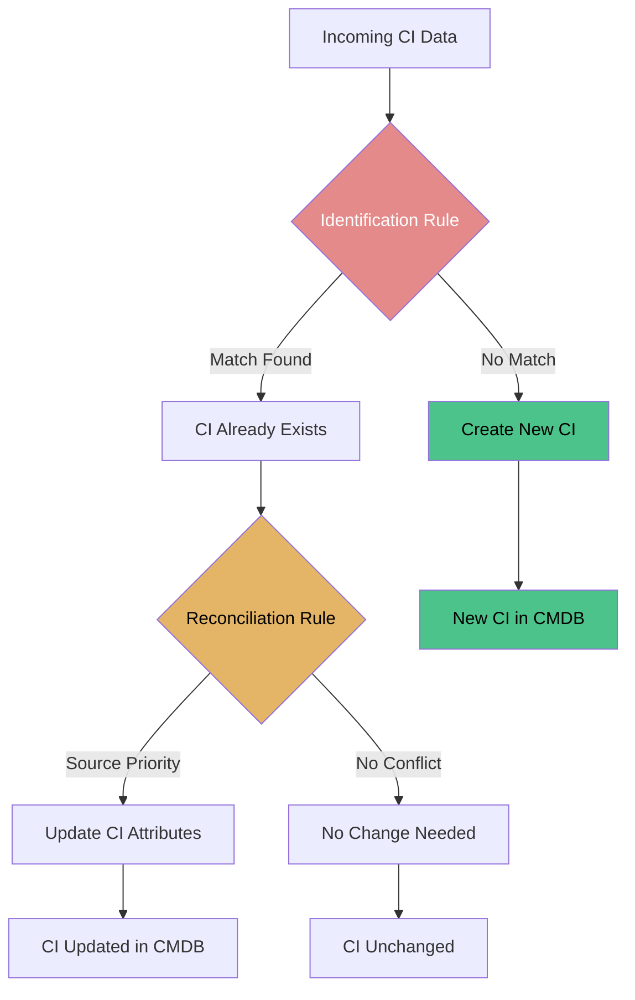

# CMDB — Configuration Management Database

**Agent:** opencode  
**Date:** 2026-11-10  
**Module:** CMDB  
**App:** CMDB / Configuration  
**Confidence:** high  

---

## Contents

- [Purpose](#purpose)
- [Where to Find It](#where-to-find-it)
- [Re-usable Code / Metadata](#re-usable-code--metadata)
- [Out-of-Box Features](#out-of-box-features)
- [Key Table Hierarchy](#key-table-hierarchy)
- [Integrations](#integrations)
- [Key Fields](#key-fields)
- [Common Mistakes](#common-mistakes)
- [Deep Dive: Identification & Reconciliation (IRE)](#deep-dive-identification--reconciliation-ire)
- [Lab: Create a CI and a Relationship](#lab-create-a-ci-and-a-relationship)
- [Quiz](#quiz)
- [Official Learning Resources](#official-learning-resources)
- [Visual & Video Guides](#visual--video-guides)

---

## Purpose

The CMDB (Configuration Management Database) is ServiceNow's single source of truth for configuration items (CIs) and their relationships. Every CI — server, application, database, network device, software license — is a record in `cmdb_ci` or its extensions. Relationships between CIs are stored in `cmdb_rel_ci`.

The CMDB is the foundation that ITSM, ITOM, Service Mapping, HAM, and other modules all depend on. If the CMDB is inaccurate, incident impact analysis, change risk assessment, and service mapping all produce wrong answers.

---

## Where to Find It

| Breadcrumb | Path |
|------------|------|
| Module entry | All > Configuration > ... |
| CI List | All > Configuration > CI List |
| CI Relationships | All > Configuration > CI Relationships |
| Identification/Reconciliation | All > Configuration > Identification/Reconciliation |
| CI Classes | All > Configuration > CI Classes |
| Health Dashboards | All > CMDB Health > Dashboards |

**Tip:** CMDB is core to the platform — it's always available, but the Health and IRE features require the CMDB Health plugin.

---

## Official Exam Alignment — CIS-Data Foundations (CMDB and CSDM)

This guide maps to the **Certified Implementation Specialist – Data Foundations (CMDB and CSDM)** exam blueprint (ServiceNow University, KB0012913). Exam weightings shown are the official domain percentages.

| Guide Section | CIS-DF Domain | Exam Weight | What's Covered |
|---------------|-----------------|-------------|----------------|
| **Key Table Hierarchy** | Domain: CI Class Management — CMDB Tables, CI Class Manager | 15% | CI classes, extensions, relationships, cmdb_ci base |
| **Identification & Reconciliation Deep Dive** | Domain: Identification & Reconciliation — Identification Rules, Reconciliation Rules, Datasource Precedence, De-duplication | 25% | IRE engine, identification vs reconciliation, source priority, de-duplication |
| **CMDB Health** | Domain: Govern — CMDB Health Score, CMDB Health Dashboards, Data Manager | 35% | Completeness, correctness, compliance, duplication remediation |
| **CSDM** | Domain: Design — CSDM framework, business/technical services | 15% | CSDM domains, design vs build vs consume |

**Official preparation courses:**
- Welcome to ServiceNow
- ServiceNow Administration Fundamentals
- Get Started with Now Create
- ServiceNow Platform Implementation
- CMDB Fundamentals
- CMDB Health Micro-Certification Simulator
- Configure the CMDB Micro-Certification Simulator
- Common Service Data Model (CSDM Fundamentals)
- CMDB Health Deep Dive

**Exam guidance:** Questions are based on official ServiceNow training materials, the ServiceNow Product documentation site, and the ServiceNow developer site.

---

## CMDB Table Hierarchy Diagram

```mermaid
graph TD
    subgraph "cmdb_ci — Base CI Table"
        cmdb_ci[cmdb_ci]
    end
    
    subgraph "Extended CI Classes"
        cmdb_ci_server[cmdb_ci_server]
        cmdb_ci_appl[cmdb_ci_appl]
        cmdb_ci_database[cmdb_ci_database]
        cmdb_ci_service[cmdb_ci_service]
        cmdb_ci_network[cmdb_ci_network]
    end
    
    subgraph "Relationships"
        cmdb_rel_ci[cmdb_rel_ci]
    end
    
    subgraph "Discovery Sources"
        discovery[Discovery]
        import_set[Import Set]
        manual[Manual Entry]
        sgc[Service Graph Connectors]
    end

    cmdb_ci --> cmdb_ci_server
    cmdb_ci --> cmdb_ci_appl
    cmdb_ci --> cmdb_ci_database
    cmdb_ci --> cmdb_ci_service
    cmdb_ci --> cmdb_ci_network
    
    cmdb_rel_ci -.->|parent| cmdb_ci
    cmdb_rel_ci -.->|child| cmdb_ci
    
    discovery --> cmdb_ci
    import_set --> cmdb_ci
    manual --> cmdb_ci
    sgc --> cmdb_ci

    style cmdb_ci fill:#0b0e11,stroke:#4cc38a,stroke-width:2px
    style cmdb_rel_ci fill:#0a0d10,stroke:#e5b567
```



**Exam focus:** CI class management, CMDB tables, CI class manager, relationships.

---

## IRE Process Diagram (Identification & Reconciliation)



**Identification:** Answers "Is this CI already existing or is it new?" — uses CI identifiers (serial number, MAC address, hostname + DNS, etc.)
**Reconciliation:** Answers "If multiple sources update the same CI, whose data should I trust?" — uses source priority (Discovery typically outranks Import Set and Manual)
**Processing Order:** Identification → (if match) Reconciliation → Update/Create. If identification fails, no reconciliation and no update occur.

**Exam focus:** Identification Rules, Reconciliation Rules, Datasource Precedence Rules, CMDB De-duplication (25% of exam).

---

## Re-usable Code / Metadata

### Scoped Application

CMDB is primarily global scope with some scoped extensions.

| Scope Aspect | Detail |
|--------------|--------|
| Scope | Global + `com.snc.cmdb` (CI Class Models) |
| Key tables | `cmdb_ci`, `cmdb_ci_server`, `cmdb_ci_appl`, `cmdb_ci_database`, `cmdb_rel_ci`, `cmdb_ci_service` |
| Roles | `itil`, `admin`, `cmdb_admin` |

### Re-usable Metadata Inventory

| Re-usable piece | What it is | Where it lives (breadcrumb) |
|-----------------|------------|------------------------------|
| **CI Classes** | The CMDB class hierarchy (cmdb_ci → cmdb_ci_server → cmdb_ci_linux_server, etc.) | All > Configuration > CI Classes |
| **CI Relationship Types** | Types of relationships (Runs on::Runs, Depends on::Used by, etc.) | All > Configuration > CI Relationship Types |
| **Identification Rules** | Rules that determine if a discovered CI matches an existing CI | All > Configuration > Identification/Reconciliation > Identification |
| **Reconciliation Rules** | Rules that merge/update CIs when data conflicts | All > Configuration > Identification/Reconciliation > Reconciliation |
| **Dynamic CI Groups** | Query-defined CI collections | All > Configuration > Dynamic CI Groups |
| **Data Sources** | Sources of CI data (Discovery, Import Set, Manual, etc.) | All > Configuration > Data Sources |

### Re-usable Code Snippets

#### Business Rule: Prevent Duplicate Server CIs by Serial Number

```javascript
(function rule(current, previous) {
    if (current.operation() == 'insert' && current.serial_number) {
        var gr = new GlideRecord('cmdb_ci_server');
        gr.addQuery('serial_number', current.serial_number);
        gr.query();
        if (gr.next()) {
            current.setAbortAction(true);
            gs.addError('A server with this serial number already exists: ' + gr.number);
        }
    }
})(current, previous);
```

#### Script Include: CI Relationship Helper

```javascript
var CIRelationshipHelper = Class.create();
CIRelationshipHelper.prototype = Object.extendsObject(AbstractAjaxProcessor, {
    getRelatedCIs: function() {
        var ciSysId = this.getParameter('ci_sys_id');
        var gr = new GlideRecord('cmdb_rel_ci');
        gr.addQuery('parent', ciSysId);
        gr.query();
        var children = [];
        while (gr.next()) {
            children.push({sys_id: gr.getValue('child'), type: gr.getValue('type')});
        }
        return JSON.stringify(children);
    },
    type: 'CIRelationshipHelper'
});
```

---

## Out-of-Box Features

| Feature | Description | Where |
|---------|-------------|-------|
| CI List | Browse and manage all CIs | All > Configuration > CI List |
| CI Relationships | View and create CI-to-CI relationships | All > Configuration > CI Relationships |
| Identification & Reconciliation | Prevent and resolve duplicate CIs | All > Configuration > Identification/Reconciliation |
| CI Classes | Extend the CMDB class model | All > Configuration > CI Classes |
| Dynamic CI Groups | Query-based CI collections | All > Configuration > Dynamic CI Groups |
| CMDB Health | Dashboards for data quality, completeness, correctness | All > CMDB Health > Dashboards |
| Data Sources | Track where each CI came from (Discovery, Import, Manual) | All > Configuration > Data Sources |

---

## Key Table Hierarchy

| Table | Purpose | Extends | Key Fields |
|-------|---------|---------|------------|
| `cmdb_ci` | Base CI table — everything managed | — | `name`, `serial_number`, `asset_tag`, `location`, `status`, `data_source` |
| `cmdb_ci_server` | Server CIs | `cmdb_ci` | `ip_address`, `hostname`, `os`, `os_version`, `cpu_count`, `memory` |
| `cmdb_ci_appl` | Application CIs | `cmdb_ci` | `name`, `version`, `install_status`, `vendor` |
| `cmdb_ci_database` | Database CIs | `cmdb_ci` | `type`, `version`, `port`, `instance_name` |
| `cmdb_ci_service` | Logical business service | `cmdb_ci` | `name`, `description`, `owned_by` |
| `cmdb_rel_ci` | Relationships between CIs | — | `parent`, `child`, `type`, `start_date`, `end_date` |

### Table Relationships

```
cmdb_ci (Base CI)
    │
    ├──► cmdb_ci_server (WEB01, APP01, DB01)
    ├──► cmdb_ci_appl (IIS, Tomcat, SQL Server)
    ├──► cmdb_ci_database (SQL Server instance)
    ├──► cmdb_ci_service (Online Banking service)
    │
    └──► cmdb_rel_ci (relationships)
            ├──► parent: WEB01 → child: IIS → type: "Runs on::Runs"
            ├──► parent: IIS → child: APP01 → type: "Depends on::Used by"
            └──► parent: APP01 → child: DB01 → type: "Depends on::Used by"
```

---

## Integrations

| Integration | Direction | Purpose | Protocol |
|-------------|-----------|---------|----------|
| Discovery | Inbound | Auto-create and update CIs | Discovery/MID Server |
| Import Sets | Inbound | Bulk load CIs from CSV/Excel | Import Set/Transform Map |
| Service Graph Connectors | Inbound | Import CI data from external CMDBs/cloud | REST/API |
| JDBC | Inbound | Read CI data from external databases | JDBC |
| ITAM/HAM | Bidirectional | Asset and CI synchronization | Internal |

---

## Key Fields

| Table | Field | Type | Why It Matters |
|-------|-------|------|----------------|
| `cmdb_ci` | `name` | String | Human-readable CI name |
| `cmdb_ci` | `serial_number` | String | Unique hardware identifier (key for IRE) |
| `cmdb_ci` | `asset_tag` | String | Physical asset tag |
| `cmdb_ci` | `data_source` | String | Where the CI came from (Discovery, Import, Manual) |
| `cmdb_ci` | `status` | Choice | Installed, In Maintenance, Retired, etc. |
| `cmdb_rel_ci` | `parent` | Reference | Upstream CI or service |
| `cmdb_rel_ci` | `child` | Reference | Downstream CI |
| `cmdb_rel_ci` | `type` | Choice | Relationship type (Runs on::Runs, etc.) |

---

## Common Mistakes

| Mistake | Symptom | Fix |
|---------|---------|-----|
| No identification rules | Duplicate CIs for the same server | Configure IRE identification rules before large discovery |
| Not reconciling data sources | Conflicting data for same CI | Set reconciliation priority (Discovery > Import > Manual) |
| Deleting CIs instead of retiring | Broken relationships, orphaned incidents | Use status=Retired, not delete |
| No relationship types defined | Service Mapping can't build maps | Define CI relationship types before mapping |
| CMDB not tied to incidents | No impact analysis | Populate `cmdb_ci` on incident records |
| Ignoring CMDB Health dashboards | Data quality degrades over time | Review completeness/correctness dashboards monthly |

---

## Deep Dive: Identification & Reconciliation (IRE)

IRE is the engine that prevents duplicate CIs and keeps data accurate.

### Identification
When Discovery finds a server, it checks identification rules to see if that server already exists in the CMDB.

**Common identification criteria:**
- Serial number + Manufacturer + Model
- MAC address
- Hostname + DNS domain
- Asset tag

If a match is found, the existing CI is updated. If not, a new CI is created.

### Reconciliation
When multiple data sources provide data for the same CI, reconciliation decides which value wins.

**Typical priority:**
1. Discovery (most trusted — directly observed)
2. Import Set (bulk loads from trusted sources)
3. Manual (least trusted — human entry)

### The Cost of Poor IRE
- Duplicate CIs → wrong impact analysis
- Stale data → wrong change risk assessment
- Missing relationships → incomplete service maps

---

## Lab: Create a CI and a Relationship

1. **Navigate** to All > Configuration > CI List > New
2. **Fill** the form:
   - Name: WEB01
   - Class: Server
   - Serial Number: SN-12345
   - IP Address: 10.10.1.20
   - Operating System: Windows Server 2022
   - Data Source: Manual
3. **Submit** — note the CI sys_id
4. **Create a second CI** for an application:
   - Name: IIS on WEB01
   - Class: Application
5. **Navigate** to All > Configuration > CI Relationships > New
6. **Fill**:
   - Parent: WEB01 (the server CI)
   - Child: IIS on WEB01 (the application CI)
   - Type: Runs on::Runs
7. **Submit** and verify the relationship appears on both CI records

---

## Quiz

1. What is the base table for all CIs?  
   <details><summary>Answer</summary>`cmdb_ci`</details>

2. What table stores CI-to-CI relationships?  
   <details><summary>Answer</summary>`cmdb_rel_ci`</details>

3. What does IRE stand for, and what does it do?  
   <details><summary>Answer</summary>Identification and Reconciliation Engine — prevents duplicate CIs and resolves data conflicts between sources</details>

4. What field on `cmdb_ci` tracks where a CI came from?  
   <details><summary>Answer</summary>`data_source`</details>

5. Name two relationship types used in CMDB.  
   <details><summary>Answer</summary>Runs on::Runs, Depends on::Used by</details>

---

## Official Learning Resources

### Now Learning (Structured Training)
- [CMDB Fundamentals](https://nowlearning.com/) — Search "CMDB" on Now Learning Portal
- [CMDB Health](https://nowlearning.com/) — Search "CMDB Health" on Now Learning Portal
- [Identification and Reconciliation](https://nowlearning.com/) — Search "IRE" or "Identification Reconciliation" on Now Learning Portal

### Product Documentation (Technical Reference)
- [ServiceNow Product Documentation — CMDB](https://docs.servicenow.com/) → Search "CMDB", "CI classes", "CI relationships"
- [ServiceNow Product Documentation — IRE](https://docs.servicenow.com/) → Search "identification reconciliation"
- [ServiceNow Product Documentation — CMDB Health](https://docs.servicenow.com/) → Search "CMDB Health"

### Official Videos & Playlists
- [ServiceNow YouTube Channel](https://www.youtube.com/c/ServiceNow) — Search "ServiceNow CMDB", "ServiceNow CI relationship", "ServiceNow identification reconciliation"
- [CMDB overview](https://www.youtube.com/results?search_query=servicenow+cmdb+overview)
- [IRE deep dive](https://www.youtube.com/results?search_query=servicenow+identification+reconciliation+engine)

---
