# CSM — Customer Service Management

**Agent:** opencode  
**Date:** 2026-11-05  
**Module:** CSM (Customer Service Management)  
**App:** CSM  
**Confidence:** high  

---

## Contents

- [Purpose](#purpose)
- [Where to Find It](#where-to-find-it)
- [Re-usable Code / Metadata](#re-usable-code--metadata)
- [Out-of-Box Features](#out-of-box-features)
- [Key Table Hierarchy](#key-table-hierarchy)
- [Integrations](#integrations)
- [Key Fields](#key-fields)
- [Common Mistakes](#common-mistakes)
- [Lab: Create Your First Customer Case](#lab-create-your-first-customer-case)
- [Quiz](#quiz)
- [Official Learning Resources](#official-learning-resources)
- [Visual & Video Guides](#visual--video-guides)

---

## Purpose

Customer Service Management (CSM) is ServiceNow's platform for managing customer-facing service operations. Unlike ITSM (which is internal IT-facing), CSM is built for **customer-facing** support: cases, accounts, entitlements, and SLAs that apply to paying customers. CSM includes a customer-facing portal, agent workspace, and entitlement-based SLAs.

---

## Where to Find It

| Breadcrumb | Path |
|------------|------|
| Module entry | All > Customer Service > ... |
| Cases | All > Customer Service > Cases > All |
| Accounts | All > Customer Service > Accounts |
| Consumers | All > Customer Service > Consumers |
| Entitlements | All > Customer Service > Administration > Entitlements |
| Case Types | All > Customer Service > Administration > Case Types |
| CSM Portal | All > Customer Service > Customer Service Portal |
| Administration | All > Customer Service > Administration > ... |

**Tip:** If menus are missing, verify the `com.snc.customerservice` plugin is active (System Definition → Plugins).

---

## Official Exam Alignment — CIS-CSM

This guide maps to the **Certified Implementation Specialist – Customer Service Management (CIS-CSM)** exam blueprint (ServiceNow University, KB0011529). Exam weightings shown are the official domain percentages.

| Guide Section | CIS-CSM Domain | Exam Weight | What's Covered |
|---------------|-----------------|-------------|----------------|
| **CSM Foundational Data Model** | Domain 1: CSM foundational data model — Business models, Product models, Install base management, Contracts and entitlements | 27% | B2B/B2C/B2B2C/B2B2E models, install base, entitlements, contracts, product models |
| **CSM Configuration** | Domain 2: CSM configuration — CSM in ServiceNow, Routing and assignment, Case types, Channels | 38% | Case routing, assignment rules, case types, communication channels |
| **Case Management** | Domain 3: Case management — Case state flows, Major issue management, Case digests and service definitions, CSM workspace, Case actions, tasks, and escalations | 17% | Case lifecycle, MIM, workspace, escalations, tasks |
| **Workspace, Portals, Service Catalog, Analytics** | Domain 4: CSM Workspace, Portals, Service Catalog, Analytics, and Reporting | 8% | Customer portal, service catalog, SLAs, reporting |
| **Best Practices & Knowledge Management** | Domain 5: CSM Best Practices and Knowledge Management | 10% | Architecture, end-to-end processes, project scope, knowledge management |

**Official preparation courses:**
- Welcome to ServiceNow
- ServiceNow Administration Fundamentals
- Get Started with Now Create
- ServiceNow Platform Implementation
- Customer Service Management Essentials
- Customer Service Management Essentials Simulator
- Knowledge Management for Customer Service Management Fundamentals
- Customer Service Management Best Practices for Implementation

**Exam guidance:** Questions are based on official ServiceNow training materials, the ServiceNow Product documentation site, and the ServiceNow developer site.

---

## CSM Business Model Diagram

```mermaid
graph TD
    subgraph "B2B — Business to Business"
        company[Customer Account] --> contact[Contact]
        company --> entitlement[Entitlement]
        company --> install_base[Install Base]
    end
    
    subgraph "B2C — Business to Consumer"
        consumer[Consumer] --> case[Case]
    end
    
    subgraph "B2B2C — Business to Business to Consumer"
        company2[Customer Account] --> consumer2[Consumer via Portal]
        company2 --> product[Product Model]
    end
    
    subgraph "B2B2E — Business to Business to Employee"
        company3[Customer Account] --> employee[Employee User]
        employee --> case2[Case]
    end

    style company fill:#0b0e11,stroke:#4cc38a
    style consumer fill:#10141a,stroke:#4cc38a
    style company2 fill:#0b0e11,stroke:#4cc38a
    style company3 fill:#0b0e11,stroke:#4cc38a
```



**Exam focus (Domain 1, 27%):** Business models (B2B, B2C, B2B2C, B2B2E), product models, install base management, contracts and entitlements.

---

## Out-of-Box Values & Dropdowns

ServiceNow ships with predefined case types and choice list values. Verify against your instance — values can vary by release and plugin activation.

### Case Type Categories (OOB)
| Category | Description |
|----------|-------------|
| `Onboarding` | Customer onboarding cases |
| `Complaint` | Customer complaint cases |
| `Orders` | Order-related cases |
| `General` | General-purpose cases |

**Note:** Additional case types become available through plugins, e.g. `Complaints` via the `sn_csm_complaint` plugin.

### Case Type Selector Versions
| Version | Behavior | Controlling Property |
|---------|----------|---------------------|
| `Multi-select` (default) | Agent selects a case type, optionally narrows by category/subtype | `sncsmcasetypes.casetypesinglefieldselect` |
| `Single-select` | Agent selects one case type and creates the case with one click | `sncsmcasetypes.casetypesinglefieldselect` |
| `Product Service Select` | Agent selects a product and/or service to create a case | `sncsmcasetypes.servicedefinitionselect` (takes precedence over single-select) |

### Case State Flow
| State | When to Use |
|-------|-------------|
| `New` | Case created, not yet assigned |
| `In Progress` | Agent actively working |
| `On Hold` | Waiting on dependency |
| `Resolved` | Issue resolved |
| `Closed` | Case closed |

**Exam focus (CIS-CSM Domain 1, 27%):** Case type categories, case type selector versions, case state flows, business models.

---

## Re-usable Code / Metadata

### Scoped Application

CSM ships as a scoped application (`com.snc.customerservice`).

| Scope Aspect | Detail |
|--------------|--------|
| Scope name | `com.snc.customerservice` |
| Tables | `sn_customerservice_case`, `customer_account`, `sn_customerservice_entitlement`, etc. |
| Roles | `sn_customerservice_agent`, `sn_customerservice_manager`, `sn_customerservice.customer` |

### Meta Data Patterns

| Metadata Element | Example | Notes |
|------------------|---------|-------|
| Application menu | `sn_customerservice.menu.main` | CSM left-nav root |
| Module | `sn_customerservice.menu.cases` | Points to case list |
| Case type | `sn_customerservice.case_type.billing` | Defines workflow per case type |
| Choice list | `sn_customerservice.case_state` | New, In Progress, Resolved, Closed |
| UI Policy | `sn_customerservice.policy.entitlement_required` | Hides fields when no entitlement |

### The re-usable metadata inventory

CSM's real reuse is configuration, not code. These are the objects you design once and every case then inherits:

| Re-usable piece | What it is | Where it lives (breadcrumb) |
|-----------------|------------|------------------------------|
| **Case types & case type rules** | A case type defines the fields, states, and flow for one class of customer issue (billing, product support, …). Define the type once; every case of that type follows it. Case type rules then route by product, account, or channel. | All > Customer Service > **Case Types** |
| **Playbooks (Process Automation)** | Guided, reusable case flows: the same resolution procedure (intake → diagnose → resolve → close) attached to many case types instead of being re-taught to every agent. | All > Process Automation > **Playbook Designer** |
| **Decision tables** | Routing, entitlement, and approval decisions kept as editable tables (`sys_decision`) that flows, business rules, and playbooks all consult — change the decision once, every consumer changes. | All > System Definition > **Decision Tables** |
| **Entitlements & service contracts** | The reusable coverage definitions (`sn_customerservice_entitlement`, contracts): what support an account/product is owed, checked automatically on every case. | All > Customer Service > **Entitlements** / **Contracts** |
| **SLA definitions** | Response/resolution clocks defined once and attached across case types and priorities (`task_sla` is the running record; the definition is the reusable part). | All > Service Level Management > **SLA Definitions** |
| **Assignment rules & AWA queues** | Assignment rules route cases by account, product, and skill; Advanced Work Assignment queues and work-item definitions are configured once and reused by every channel (chat, case, phone). | All > Customer Service > **Assignment** · All > Advanced Work Assignment > **Queues** |
| **Service definitions (CSDM)** | The services a customer can raise cases against — the same service/offerings model ITSM consumes, so a case and an incident can point at one service record. | All > Customer Service > **Service Definitions** |
| **Accounts, contacts & relationships** | The customer master data (`customer_account`, contacts, account relationships, consumer records): entered once, referenced by every case, entitlement, asset, and order. Bad reuse here poisons everything downstream. | All > Customer Service > **Accounts** / **Contacts** |
| **Knowledge bases & article templates** | Article templates and feedback loops shared by agents and the customer portal — one well-kept article serves thousands of cases. | All > Knowledge > **Knowledge Bases** |

### Re-usable Code Snippets

#### Business Rule: Auto-assign Case Based on Account

```javascript
(function rule(current, previous) {
    if (current.operation() == 'insert' && current.account && !current.assignment_group) {
        var gr = new GlideRecord('sn_customerservice_account');
        gr.addQuery('sys_id', current.account);
        gr.query();
        if (gr.next() && gr.assignment_group) {
            current.assignment_group = gr.assignment_group;
        }
    }
})(current, previous);
```

#### Business Rule: Validate Entitlement on Case Create

```javascript
(function rule(current, previous) {
    if (current.operation() == 'insert' && current.entitlement) {
        var gr = new GlideRecord('sn_customerservice_entitlement');
        gr.addQuery('sys_id', current.entitlement);
        gr.addQuery('state', 'active');
        gr.query();
        if (!gr.next()) {
            current.setAbortAction(true);
            gs.addErrorMessage('Selected entitlement is not active. Case cannot be created.');
        }
    }
})(current, previous);
```

#### UI Policy: Show/Hide Fields Based on Case Type

```javascript
(function rule(current) {
    if (current.case_type == 'billing') {
        g_form.setVisible('billing_account', true);
        g_form.setMandatory('billing_account', true);
        g_form.setHidden('technical_contact', true);
    } else if (current.case_type == 'technical') {
        g_form.setVisible('technical_contact', true);
        g_form.setMandatory('technical_contact', true);
        g_form.setHidden('billing_account', true);
    } else {
        g_form.setHidden('billing_account', true);
        g_form.setHidden('technical_contact', true);
    }
})(current);
```

#### Script Include: CSM Helper

```javascript
var CSMHelper = Class.create();
CSMHelper.prototype = Object.extendsObject(AbstractAjaxProcessor, {
    getCustomerCases: function() {
        var accountSysId = this.getParameter('accountSysId');
        var gr = new GlideRecord('sn_customerservice_case');
        gr.addQuery('account', accountSysId);
        gr.addQuery('state', '!=', 'closed');
        gr.query();
        var results = [];
        while (gr.next()) {
            results.push({
                number: gr.getValue('number'),
                state: gr.getDisplayValue('state'),
                priority: gr.getDisplayValue('priority'),
                sys_id: gr.getValue('sys_id')
            });
        }
        return JSON.stringify(results);
    },
    type: 'CSMHelper'
});
```

---

## Out-of-Box Features

| Feature | Description | Where |
|---------|-------------|-------|
| Cases | Customer support cases | All > Customer Service > Cases |
| Accounts | Customer accounts (B2B) | All > Customer Service > Accounts |
| Consumers | Individual consumers (B2C) | All > Customer Service > Consumers |
| Entitlements | Service level agreements per customer | All > Customer Service > Administration > Entitlements |
| Case Types | Categories that drive workflow | All > Customer Service > Administration > Case Types |
| CSM Portal | Customer self-service portal | All > Customer Service > Customer Service Portal |
| Customer Service Workspace | Agent console | All > Customer Service > Agent Workspace |
| Knowledge Base | Self-service articles for customers | All > Knowledge |
| Customer Satisfaction (CSAT) | Post-case satisfaction surveys | All > Customer Service > CSAT |

---

## Key Table Hierarchy

### Core Tables

| Table | Purpose | Extends | Key Fields |
|-------|---------|---------|------------|
| `sn_customerservice_case` | Customer support case | `task` | `number`, `account`, `contact`, `case_type`, `state`, `priority`, `entitlement` |
| `customer_account` | B2B customer account | `task` | `name`, `account_number`, `industry`, `parent_account` |
| `sn_customerservice_consumer` | Individual consumer | `sys_user` | `email`, `phone`, `account` |
| `sn_customerservice_entitlement` | Service entitlement/SLA | `task` | `account`, `start_date`, `end_date`, `coverage_type` |
| `sn_customerservice_sla` | SLA record | `task_sla` | `case`, `entitlement`, `breach_time` |
| `sn_customerservice_product` | Product/asset | `cmdb_ci` | `name`, `serial_number`, `account` |

### Table Relationships

```
customer_account
    │
    ├──► sn_customerservice_case (one account → many cases)
    ├──► sn_customerservice_consumer (one account → many consumers)
    ├──► sn_customerservice_entitlement (one account → many entitlements)
    │
sn_customerservice_case
    │
    ├──► sn_customerservice_sla (one case → many SLAs)
    ├──► sn_customerservice_product (linked products)
    │
sn_customerservice_entitlement
    │
    ├──► sn_customerservice_case (entitlement validates case)
```

### CMDB Integration

| CSM Table | Maps to CMDB Table | Relationship |
|-----------|-------------------|--------------|
| `sn_customerservice_product` | `cmdb_ci` | Extends |
| `sn_customerservice_consumer` | `sys_user` | Extends |
| `customer_account` | Standalone (not CI) | Standalone |

---

## Integrations

| Integration | Direction | Purpose | Protocol |
|-------------|-----------|---------|----------|
| Email | Inbound/Outbound | Create cases from email, send notifications | Email/SMTP |
| Chat/Messaging | Inbound | Live chat, WhatsApp, SMS | Twilio/SMS spokes |
| Salesforce | Bidirectional | Sync accounts and cases | REST/IntegrationHub |
| ERP | Outbound | Sync customer billing data | REST/SOAP |
| Knowledge Base | Inbound | Publish articles to customer portal | Internal |
| CSM Portal | Inbound | Customers create cases via portal | Service Portal |
| SMS | Outbound | Send case updates via SMS | Twilio/SMS spoke |
| Email Notification | Outbound | Case status updates to customers | SMTP |

---

## Key Fields

| Table | Field | Type | Why It Matters |
|-------|-------|------|----------------|
| `sn_customerservice_case` | `number` | String | Auto-number, customer-facing ID |
| `sn_customerservice_case` | `account` | Reference | Drives entitlement, SLA, reporting |
| `sn_customerservice_case` | `contact` | Reference | Who reported; drives auth/comms |
| `sn_customerservice_case` | `case_type` | Choice | Selects workflow and fields |
| `sn_customerservice_case` | `entitlement` | Reference | Validates service level |
| `sn_customerservice_case` | `state` | Choice | New → In Progress → Resolved → Closed |
| `sn_customerservice_case` | `priority` | Choice | Drives SLA and escalation |
| `customer_account` | `name` | String | Customer company name |
| `customer_account` | `account_number` | String | External billing reference |
| `sn_customerservice_entitlement` | `start_date` | Date | Entitlement begins |
| `sn_customerservice_entitlement` | `end_date` | Date | Entitlement expires |
| `sn_customerservice_entitlement` | `coverage_type` | Choice | What is covered (support, parts, etc.) |

---

## Common Mistakes

| Mistake | Symptom | Fix |
|---------|---------|-----|
| Skipping entitlement setup | SLAs don't trigger, customers billed wrong | Configure entitlements per account |
| Testing portal as admin | Can't see customer experience | Test as actual customer user |
| One case type for everything | Workflow can't differentiate | Create case types per request type |
| Missing account on case | No entitlement/SLA resolution | Always populate account |
| Not setting contact | No notification recipient | Always set contact/consumer |

---

## Lab: Create Your First Customer Case

1. **Navigate** to All > Customer Service > Cases > All
2. **Click New** and fill:
   - Case Type: Billing Inquiry
   - Account: Select existing account (or create one first)
   - Contact: Select contact under that account
   - Entitlement: Select active entitlement for account
   - Short Description: Customer disputing invoice charge
   - Priority: High
3. **Submit** and note the case number
4. **Open** the case → change State to "In Progress"
5. **Add** a work note: "Investigating billing discrepancy"
6. **Change** State to "Resolved" → add Close Code and Close Notes
7. **Observe** CSAT survey may be triggered
8. **Verify** in Related Lists: Tasks, Approvals, Entitlements, Knowledge


---


## 📺 Visual & Video Guides

### CSM Full Overview
<div style="text-align: center; margin: 1.5rem 0;">
  <iframe width="560" height="315" src=" title="CSM Full Overview" frameborder="0" allow="accelerometer; autoplay; clipboard-write; encrypted-media; gyroscope; picture-in-picture" allowfullscreen></iframe>
</div>

Fallback link: [CSM Full Overview]()
---

## Quiz

1. What field determines which case workflow fires?
<details><summary>Answer</summary>Case Type / Category</details>

2. What is the difference between an account and a consumer in CSM?
<details><summary>Answer</summary>Account = B2B (Organization); Consumer = B2C (Individual).</details>

3. What happens if entitlement is missing on a case?
<details><summary>Answer</summary>Case may be created, but service delivery is restricted/blocked depending on configuration.</details>

4. What table stores customer accounts?
<details><summary>Answer</summary>customer_account</details>

5. How does CSM differ from ITSM Incident Management?
<details><summary>Answer</summary>CSM focuses on external customers; ITSM Incident focuses on internal users/employees.</details>

---

---

---

## 🎓 Official Learning Resources

To avoid unofficial or outdated content, always use these validated official ServiceNow sources:

### 📺 Verified Videos & Playlists

### 🚀 Quick Start Guide
For those new to the module, we recommend starting with this official overview:
<div style="text-align: center; margin: 1.5rem 0;">
  <iframe width="560" height="315" src="https://www.youtube.com/embed/ktYPUwEVSf4" title="Customer Service Management Beginner Overview" frameborder="0" allow="accelerometer; autoplay; clipboard-write; encrypted-media; gyroscope; picture-in-picture" allowfullscreen></iframe>
</div>
Fallback link: [Customer Service Management Official Overview](https://www.youtube.com/watch?v=ktYPUwEVSf4)


- [Main CSM playlist (Community)](https://www.youtube.com/playlist?list=PLkGSnjw5y2U5Lcs_iGJNeYisgQ4gYNvng)
- [ServiceNow Exchange: CSM](https://www.youtube.com/playlist?list=PLkGSnjw5y2U511sEht7PkHhVFhtEH8ObV)
- [Self-Service for CSM](https://www.youtube.com/playlist?list=PLkGSnjw5y2U6hoEVe_Rh9qftPS2rVfELS)
- [Customer Success Management](https://www.youtube.com/playlist?list=PLkGSnjw5y2U6KAWN_dexa69O4Uz44Y8Hq)
- [CSM Configurable Workspace](https://www.youtube.com/playlist?list=PLkGSnjw5y2U628hT0MZNNUErF9lnKVEln)

### 🚀 The Authoritative Path
1. **Now Learning (Structured Training)**
   - The only official source for certification paths and structured video courses.
   - [Go to Now Learning Portal](https://nowlearning.com/) $\rightarrow$ Search for "Customer Service Management"
   
2. **Product Documentation (Technical Reference)**
   - The definitive source for every table, field, and OOB behavior.
   - [ServiceNow Product Documentation](https://docs.servicenow.com/) $\rightarrow$ Search for "Customer Service Management"
