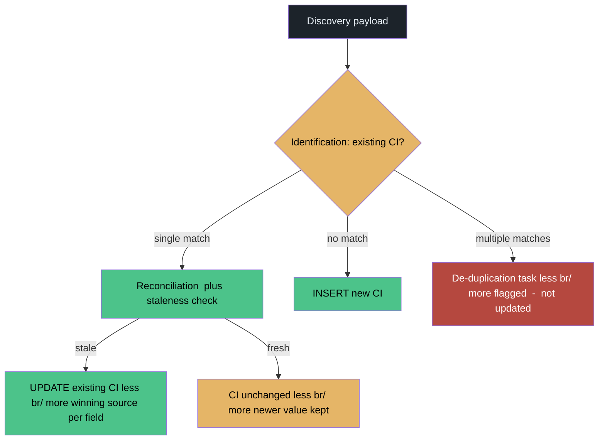
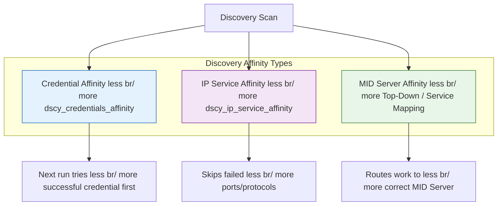

# Discovery — ITOM Discovery

> **Validated on:** ServiceNow ITOM Discovery (Xanadu / Washington DC family), plugin `com.snc.discovery.core` active. UI breadcrumbs reference the **Discovery Configuration Console**, which is newer-family; classic list paths apply to older releases. Verify navigation against your instance before following.

Discovery is how ServiceNow finds out what actually exists. It reaches targets through three different mechanisms, each with its own prerequisites, credentials, and CI classes:

| Mechanism | Transport | Credentials | Typical schedule |
|-----------|-----------|-------------|------------------|
| Agentless IP Discovery | WMI / WinRM / SSH / SNMP over the network | OS or device credentials | IP ranges |
| Cloud Discovery | HTTPS to provider APIs | Cloud service account / IAM role | Cloud schedule by region |
| Agent-based (ACC) | Agent → MID Server → instance | Often credential-less | Agent-driven |

All three land in the CMDB through the same Identification and Reconciliation Engine (IRE), so data-source precedence — not the collection method — decides who wins each attribute. Everything downstream (ITSM impact analysis, SAM license counts, TSOM inventory reconciliation) is only as good as what Discovery put in the CMDB.

This guide covers classic Discovery end to end, with a deep focus on **File-Based Discovery (FBD)**: how to reach the Discovery Configuration Console, how to configure it area by area, how filtering really works, and how to run an FBD scan and prove it executed — on the instance *and* on the target device.

## Contents


- [Purpose](#purpose)
- [Where to Find It](#where-to-find-it)
- [Prerequisites & Setup](#prerequisites--setup)
  - [Plugins and Scoped Apps](#plugins-and-scoped-apps)
  - [Guided Setup Requirements](#guided-setup-requirements)
  - [System Properties to Consider](#system-properties-to-consider)
  - [Cross-Module Dependencies](#cross-module-dependencies)
  - [ACLs Related to Core Tables](#acls-related-to-core-tables)
  - [Breadcrumbs — What Needs to Be Enabled First](#breadcrumbs--what-needs-to-be-enabled-first)
- [How Discovery Works](#how-discovery-works)
- [Goals, Benefits & Key Metrics](#goals-benefits--key-metrics)
- [Core Concept Diagrams](#core-concept-diagrams)
  - [Discovery Phases — Scan → Classify → Identify → Explore](#discovery-phases--scan--classify--identify--explore)
  - [MID Server → ECC Queue → CI Flow](#mid-server--ecc-queue--ci-flow)
  - [Pattern → Probe → Sensor Flow](#pattern--probe--sensor-flow)
- [Re-usable Code / Metadata](#re-usable-code--metadata)
  - [The re-usable metadata inventory](#the-re-usable-metadata-inventory)
- [Out-of-Box Features](#out-of-box-features)
- [Key Table Hierarchy](#key-table-hierarchy)
- [Integrations](#integrations)
- [Key Fields](#key-fields)
- [Common Mistakes](#common-mistakes)
- [Deep Dive: Discovery Affinities — Credential, IP Service, and MID Server](#deep-dive-discovery-affinities--credential-ip-service-and-mid-server)
  - [1. Credential Affinity (dscy_credentials_affinity)](#1-credential-affinity-dscy_credentials_affinity)
  - [2. IP Service Affinity (dscy_ip_service_affinity)](#2-ip-service-affinity-dscy_ip_service_affinity)
  - [3. MID Server Affinity (Top-Down Discovery / Service Mapping)](#3-mid-server-affinity-top-down-discovery--service-mapping)
  - [Affinity Comparison Table](#affinity-comparison-table)
  - [Common Affinity Mistakes](#common-affinity-mistakes)
  - [Debugging Affinities](#debugging-affinities)
- [Deep Dive: Discovery End-to-End Implementation — Architecture, Coverage, and Rollout](#deep-dive-discovery-end-to-end-implementation--architecture-coverage-and-rollout)
  - [Phase 1: Architecture & MID Server Strategy](#phase-1-architecture--mid-server-strategy)
    - [Network zones, scan scope, and proving you missed nothing](#network-zones-scan-scope-and-proving-you-missed-nothing)
      - [What a "network zone" actually is](#what-a-network-zone-actually-is)
      - [Why one cluster per zone, not one MID per subnet](#why-one-cluster-per-zone-not-one-mid-per-subnet)
      - [How to find a company's real zones](#how-to-find-a-companys-real-zones)
      - [Turning the IP plan into scan scope](#turning-the-ip-plan-into-scan-scope)
      - [Proving you missed nothing — the reconciliation triangle](#proving-you-missed-nothing--the-reconciliation-triangle)
      - [Per-OS completeness rules](#per-os-completeness-rules)
      - [Anti-patterns that silently lose servers](#anti-patterns-that-silently-lose-servers)
      - [Definition of done for coverage](#definition-of-done-for-coverage)
    - [Network & Firewall Prerequisites](#network--firewall-prerequisites)
    - [macOS and Apple endpoints — what Discovery actually covers](#macos-and-apple-endpoints--what-discovery-actually-covers)
    - [iPhone / iPad (and Android) — automated yes, Discovery no](#iphone--ipad-and-android--automated-yes-discovery-no)
      - [How the automated route actually works](#how-the-automated-route-actually-works)
      - [Where this fails — and it fails quietly](#where-this-fails--and-it-fails-quietly)
      - [Coordination rule for mobile in the CMDB](#coordination-rule-for-mobile-in-the-cmdb)
  - [Phase 2: Achieving Full Coverage (On-Prem vs. Cloud)](#phase-2-achieving-full-coverage-on-prem-vs-cloud)
  - [Phase 3: Capturing All IP Ranges](#phase-3-capturing-all-ip-ranges)
    - [CI class scoping](#ci-class-scoping)
  - [Phase 4: Step-by-Step Implementation Rollout](#phase-4-step-by-step-implementation-rollout)
  - [Phase 5: Ongoing Governance](#phase-5-ongoing-governance)
- [Appendix: IntegrationHub & e-Bonding — connecting discovered data out](#appendix-integrationhub--e-bonding--connecting-discovered-data-out)
  - [What is IntegrationHub?](#what-is-integrationhub)
  - [What is e-bonding?](#what-is-e-bonding)
  - [How Discovery + e-bonding fit together](#how-discovery--e-bonding-fit-together)
  - [Integration patterns compared](#integration-patterns-compared)
  - [Mini lab: Conceptual e-bond — Discovery CI change → Teams](#mini-lab-conceptual-e-bond--discovery-ci-change--teams)
  - [Common e-bonding mistakes](#common-e-bonding-mistakes)
- [Deep Dive: Service Graph Connector for OpenTelemetry](#deep-dive-service-graph-connector-for-opentelemetry)
  - [What OpenTelemetry is](#what-opentelemetry-is)
  - [SGC for OpenTelemetry vs Discovery](#sgc-for-opentelemetry-vs-discovery)
  - [Breadcrumbs](#breadcrumbs)
  - [Configuration steps](#configuration-steps)
  - [How OpenTelemetry feeds TSOM assurance](#how-opentelemetry-feeds-tsom-assurance)
  - [Common OpenTelemetry SGC mistakes](#common-opentelemetry-sgc-mistakes)
  - [Mini lab: Verify OpenTelemetry SGC data flow](#mini-lab-verify-opentelemetry-sgc-data-flow)
  - [Using Now Assist to debug a Service Graph Connector issue](#using-now-assist-to-debug-a-service-graph-connector-issue)
- [Deep Dive: Customizing an Out-of-Box Pattern — and Making Your Own](#deep-dive-customizing-an-out-of-box-pattern--and-making-your-own)
  - [First, the anatomy](#first-the-anatomy)
  - [The golden rule](#the-golden-rule)
  - [Route 1 — Duplicate the pattern and own the copy](#route-1--duplicate-the-pattern-and-own-the-copy)
  - [Route 2 — Extend the original (when it offers extension sections)](#route-2--extend-the-original-when-it-offers-extension-sections)
  - [Route 3 — Build your own pattern from scratch](#route-3--build-your-own-pattern-from-scratch)
- [Deep Dive: The Discovery Configuration Console](#deep-dive-the-discovery-configuration-console)
- [Deep Dive: File-Based Discovery](#deep-dive-file-based-discovery)
  - [How the Filtering Actually Works (a common misconception)](#how-the-filtering-actually-works-a-common-misconception)
  - [The Allow-List: samp_file_name → cmdb_file_information](#the-allow-list-samp_file_name--cmdb_file_information)
  - [Worked Example — Getting a Custom File Discovered: `C:\temp\server_runner.exe`](#worked-example--getting-a-custom-file-discovered-ctempserver_runnerexe)
  - [Worked Example — One Windows Server, Four Files](#worked-example--one-windows-server-four-files)
  - [Worked Example — A Custom Application Folder](#worked-example--a-custom-application-folder)
- [Deep Dive: Running File-Based Discovery](#deep-dive-running-file-based-discovery)
  - [Step 1 — Enable FBD in the Discovery Configuration Console](#step-1--enable-fbd-in-the-discovery-configuration-console)
  - [Step 2 — Run Discovery and verify initiation in the Status record](#step-2--run-discovery-and-verify-initiation-in-the-status-record)
  - [Step 3 — Verify the FBD scan file executed on the target device](#step-3--verify-the-fbd-scan-file-executed-on-the-target-device)
- [Deep Dive: From Files to Licenses — File Signature Normalization](#deep-dive-from-files-to-licenses--file-signature-normalization)
- [Lab: Run Your First Discovery and File-Based Scan](#lab-run-your-first-discovery-and-file-based-scan)
- [SLAs, Dashboards & Workspaces](#slas-dashboards--workspaces)
- [Deep Dive: Web Certificate Discovery](#deep-dive-web-certificate-discovery)
  - [Overview & Use Cases](#overview--use-cases)
  - [Configuration Steps](#configuration-steps)
  - [Key Tables & Fields](#key-tables--fields)
  - [Scheduling & Scoping](#scheduling--scoping)
  - [Expiry Alerting & Remediation](#expiry-alerting--remediation)
- [Deep Dive: Firewall Audits & Reporting](#deep-dive-firewall-audits--reporting)
  - [Overview & Use Cases](#overview--use-cases)
  - [Discovery Scope & Prerequisites](#discovery-scope--prerequisites)
  - [Configuration Steps](#configuration-steps)
  - [Key Tables & CMDB Classes](#key-tables--cmdb-classes)
  - [Compliance & Cleanup Use Cases](#compliance--cleanup-use-cases)
- [Deep Dive: Agent Client Collector (ACC) — Agent vs Agentless Decision](#deep-dive-agent-client-collector-acc--agent-vs-agentless-decision)
  - [When to Use ACC](#when-to-use-acc)
  - [ACC Variants](#acc-variants)
  - [MID Server Requirements for ACC](#mid-server-requirements-for-acc)
  - [Network/Air-Gapped Use Cases](#networkair-gapped-use-cases)
- [Scoping Worksheet: Fixed 5-MID Capacity Design](#scoping-worksheet-fixed-5-mid-capacity-design)
  - [Capacity Math](#capacity-math)
  - [Thread Budget Per MID](#thread-budget-per-mid)
  - [Coverage Example](#coverage-example)
  - [Single Cloud Provider Scoping](#single-cloud-provider-scoping)
  - [SLA Support](#sla-support)
  - [Out-of-Box Dashboards](#out-of-box-dashboards)
  - [Out-of-Box Workspaces](#out-of-box-workspaces)
- [Deep Dive: IRE + CMDB Data Quality + Stale CI Lifecycle — Implementation Lab [NEW-Nov242026]](#deep-dive-ire--cmdb-data-quality--stale-ci-lifecycle--implementation-lab-new-nov242026)
- [Deep Dive: Troubleshooting Playbook — Symptom to Evidence [NEW-Nov242026]](#deep-dive-troubleshooting-playbook--symptom-to-evidence-new-nov242026)
- [Deep Dive: Credential Lifecycle & External Vaults [NEW-Nov242026]](#deep-dive-credential-lifecycle--external-vaults-new-nov242026)
- [Deep Dive: Scan Safety — Exclusions, Discovery Behaviors, and Scan Impact [NEW-Nov242026]](#deep-dive-scan-safety--exclusions-discovery-behaviors-and-scan-impact-new-nov242026)
  - [Name resolution and duplicate CIs](#name-resolution-and-duplicate-cis)
- [Deep Dive: Discovery Strategy — Agentless vs Agent vs Connector vs Cloud [NEW-Nov242026]](#deep-dive-discovery-strategy--agentless-vs-agent-vs-connector-vs-cloud-new-nov242026)
- [Deep Dive: CSDM Alignment & Cross-Module Contracts [NEW-Nov242026]](#deep-dive-csdm-alignment--cross-module-contracts-new-nov242026)
- [Deep Dive: Troubleshooting Decision Table — Symptom to Phase to Cause [NEW-Nov242026]](#deep-dive-troubleshooting-decision-table--symptom-to-phase-to-cause-new-nov242026)
- [Deep Dive: Readiness Gate — Before You Scan Anything [NEW-Nov242026]](#deep-dive-readiness-gate--before-you-scan-anything-new-nov242026)
- [Deep Dive: Day 2 Operations [NEW-Nov242026]](#deep-dive-day-2-operations-new-nov242026)
- [Quiz](#quiz)
- [🎓 Official Learning Resources](#official-learning-resources)
  - [📺 Verified Videos & Playlists](#verified-videos-playlists)
  - [🚀 Quick Start Guide](#quick-start-guide)
  - [🚀 The Authoritative Path](#the-authoritative-path)
- [💡 Memory Aids & Mnemonics](#memory-aids-mnemonics)
  - [Business Rule Types — BAA](#business-rule-types--baa)
  - [Client Script Types — LOCS](#client-script-types--locs)
  - [UI Policy vs Data Policy vs Client Script](#ui-policy-vs-data-policy-vs-client-script)
  - [IRE — Identification Before Reconciliation](#ire--identification-before-reconciliation)
  - [Update Set Conflicts — ARM](#update-set-conflicts--arm)
  - [CMDB — Retire Before Delete](#cmdb--retire-before-delete)
  - [Order vs Priority — Lower = First](#order-vs-priority--lower--first)
  - [Transform Script — Coalesce = Match](#transform-script--coalesce--match)
  - [Debugging — Log First, Then Debug](#debugging--log-first-then-debug)
- [Related Guides](#related-guides)


---

## Purpose

- **Populate the CMDB with facts, not spreadsheets.** Discovery scans IP ranges on a schedule and keeps CIs current as devices change.
- **Identify hardware and software.** Servers, VMs, network gear, databases — and, with File-Based Discovery, the software files physically present on a machine, even software that never registered itself anywhere.
- **Feed everything else.** ITSM uses CIs for impact; SAM reconciles installations against entitlements; HAM matches discovered devices to asset records; TSOM reconciles discovered network state against inventory (see the TSOM guide's discrepancy checks).

## Where to Find It

| Destination | Breadcrumb |
|-------------|------------|
| Discovery dashboard / home | All > Discovery > Dashboard |
| **Discovery Configuration Console** | All > Discovery > **Discovery Definition > Configuration Console** |
| Discovery schedules | All > Discovery > Discovery Definition > Schedules |
| Discovery status (per-run record) | All > Discovery > Status |
| Discovery log | All > Discovery > Discovery Log |
| MID Servers | All > Discovery > MID Servers |
| Credentials | All > Discovery > Credentials |
| Probes and patterns | All > Discovery > Discovery Definition > Probes · Patterns |
| Internal Discovery properties | Type `discovery_private_properties.list` in the navigator filter |
| Software installations created | `cmdb_sam_sw_install` |
| Files kept by File-Based Discovery | `cmdb_file_information` (also a related list on the CI) |
| Files that matched nothing | `cmdb_unidentified_file_set` |

Roles that matter: **discovery_admin** (configure and run Discovery), **admin**, **agent_admin** (MID Server administration), **pattern_admin** (Pattern Designer), the MID Server's service account user (with the `mid_server` role) on the instance side, and local/domain credentials on the target side.

## Prerequisites & Setup

### Plugins and Scoped Apps
- **Discovery Core**: `com.snc.discovery.core` — required for all Discovery functionality
- **MID Server**: `com.snc.mid_server` — the agent that executes Discovery probes in your network
- **File-Based Discovery**: `com.snc.discovery.file_based_discovery` — included with the Discovery subscription, activation must be requested. FBD feeds SAM normalization (`cmdb_sam_sw_install`); the full File Signature Normalization workflow is SAM-driven, so confirm your SAM entitlement before relying on FBD for license counts.
- **SAM File Signature Normalization**: `com.snc.file_signature_normalization` — activated automatically with File-Based Discovery
- **Cloud Discovery** (optional): `com.snc.discovery.cloud_discovery` — for AWS, Azure, GCP discovery

### Guided Setup Requirements
1. **MID Server Installation**: Install and validate MID Server(s) in your private network (All > Discovery > MID Servers). Ensure status is "Validated" and "Up"
2. **Credentials Configuration**: Configure credentials for target hosts (All > Discovery > Credentials) and test connectivity
3. **Discovery Schedule**: Create a discovery schedule with IP ranges (All > Discovery > Discovery Definition > Schedules)
4. **File-Based Discovery Activation**: Enable in Configuration Console (All > Discovery > Discovery Definition > Configuration Console)
5. **CDS Synchronization**: Ensure initial Content Data Service sync has completed (~24 hours) before enabling File-Based Discovery

### System Properties to Consider
- `glide.discovery.file_discovery.wildcard.windows` — additive extensions for FBD on Windows
- `glide.discovery.file_discovery.blacklist.windows` — hard filter extensions on Windows
- `discovery_private_properties.list` — internal Discovery settings (filter in navigator)
- Timeout properties: `glide.discovery.timeout`, `glide.discovery.scan_timeout`

### Cross-Module Dependencies
- **CMDB**: Discovery populates `cmdb_ci` and subclasses (e.g., `cmdb_ci_server`, `cmdb_ci_appl`); IRE identification rules prevent duplicates
- **ITSM**: Discovery CIs feed impact analysis and incident management
- **SAM/HAM**: File-Based Discovery installations flow into `cmdb_sam_sw_install` records
- **TSOM**: Reconciles discovered network state against inventory; requires CMDB accuracy

### ACLs Related to Core Tables
- `discovery_admin` role required for configuration and run permissions
- `mid_server` role required on instance side for MID Server service account
- `admin` role for Configuration Console access
- ACLs on `cmdb_ci`, `discovery_status`, `ecc_queue`, `discovery_credentials`, `sa_pattern`, etc.

### Breadcrumbs — What Needs to Be Enabled First
1. **MID Server** — Must be installed, validated, and "Up" status (All > Discovery > MID Servers)
2. **Credentials** — Configure host credentials with appropriate OS permissions (All > Discovery > Credentials)
3. **Discovery Schedule** — Define IP ranges and schedule frequency (All > Discovery > Discovery Definition > Schedules)
4. **Run Discovery** — Populates CMDB with CIs (All > Discovery > Status)
5. **File-Based Discovery** — Enable in Configuration Console after prerequisite steps (All > Discovery > Discovery Definition > Configuration Console)

## How Discovery Works

A Discovery run moves through four phases, all coordinated through the **ECC Queue** (`ecc_queue`) between the instance and a **MID Server** sitting inside the network:

1. **Scanning** — Shazzam is a TCP port sweep driven by active port probes (not an ICMP ping sweep). A host that is up but blocks every probed port is invisible; non-standard ports require editing the port probe.
2. **Classification** — classifiers decide what kind of device answered (Windows server, Linux, switch, …).
3. **Identification** — identification rules and the Identification and Reconciliation Engine (IRE) match the device to an existing CI or create a new one — this is what prevents duplicates.
4. **Exploration** — probes and patterns gather the detail: OS, CPU, memory, running processes, installed software — and this is the phase where **File-Based Discovery runs**.

Work is sent to the MID Server as ECC Queue **output** records; results come back as **input** records, where sensors/pattern steps process them into the CMDB.

The **Identification** phase (step 3) is where the CMDB's de-duplication controls live. IRE decides whether a discovered device becomes a **new CI**, **updates an existing CI**, or creates a **de-duplication task** — see the [CMDB guide](../cmdb/cmdb-guide/) for the full deep dive (scope, parameters, and worked examples):

| Rule family | What it decides | Insert new CI? | Update existing CI? |
|-------------|-----------------|----------------|---------------------|
| Identification rules | Does this payload match an existing CI? | yes — no match → create | yes — match → update |
| Reconciliation rules | Whose data wins per attribute (data source precedence)? | no | yes — winning source updates fields |
| Data Refresh rules | Is the incumbent value too stale to protect? | no | yes — stale value may be replaced |
| De-duplication tasks | Multiple matches — which CI is the survivor? | no — flagged for review | no — blocked until resolved |

**Common misconception:** data source precedence governs *which source wins an attribute write*, not whether a source is "allowed to insert a CI." Insert permission is controlled by identification rules and class-level settings, not by reconciliation precedence alone. If you see "match but no update," check reconciliation priority first; if you see "no match but also no CI," check de-duplication tasks and identifier criteria.



---

## Goals, Benefits & Key Metrics

| Business Goal | Benefit | Key Metric (KPI) | Example Value | Where to measure |
|---------------|---------|------------------|---------------|------------------|
| Build an accurate, current CMDB | ITSM impact, SAM licenses, HAM assets, and TSOM inventory all trust the same device data | CMDB discovery coverage — % of expected in-scope devices with a CI | ≥95% | `discovery_range` vs `cmdb_ci` |
| Surface new devices before they cause incidents | New hardware is visible to change and impact processes immediately | Mean Time to Discover (new CIs) | <24h from first scan to CI created | `discovery_status` → `cmdb_ci.last_discovered` |
| Keep CI data fresh enough to act on | Stale CIs break impact maps and license counts | CI freshness — % of CIs discovered in the last 30 days | ≥90% | `cmdb_ci.last_discovered` |
| Prevent duplicate CIs | Clean relationships; correct blast-radius math | Duplicate CI rate | <1% | `cmdb_identifier` (IRE) match results |
| Run schedules reliably | Predictable dashboards and maintenance windows | Discovery schedule success rate | ≥98% of scheduled runs complete | `discovery_status.state` |
| Identify installed software from disk | SAM can count licenses for software that never registered itself | File-Based Discovery match rate | ≥80% of scanned files matched to a known product | `cmdb_file_information` → `cmdb_sam_sw_install` |
| Debug failed runs fast | Less MTTR on Discovery itself | ECC Queue error rate | <2% of `ecc_queue` rows in error state | `ecc_queue.state = error` |

> Indicative starting KPIs — baseline your own instance, then set targets.

---

## Core Concept Diagrams

### Discovery Phases — Scan → Classify → Identify → Explore

```mermaid
flowchart TD
    Start[Discovery Schedule fires] --> Scan[1 dot  Scanning Shazzam port probes find live IPs]
    Scan --> Classify[2 dot  Classification Classifiers decide device type  -  Windows and  Linux and  switch and   dot  dot  dot ]
    Classify --> Identify[3 dot  Identification IRE matches an existing CI or creates a new one]
    Identify --> Explore[4 dot  Exploration Patterns/probes gather OS and  CPU and  software File-Based Discovery runs here]
    Explore --> CI[CI created or updated in CMDB cmdb_ci  and   cmdb_ci_server  and   cmdb_file_information]
    CI -.->|feeds| Downstream[ITSM impact  and   SAM  and   HAM  and   TSOM]

    style Start fill:#e58a8a,color:#000
    style Classify fill:#e5b567,color:#000
    style Identify fill:#0a0d10,stroke:#e5b567
    style Explore fill:#4cc38a,color:#000
    style CI fill:#10141a


```



### MID Server → ECC Queue → CI Flow

```mermaid
flowchart LR
    Instance[ServiceNow Instance] <==>|output records work sent to MID| ECC[ECC Queue ecc_queue]
    ECC <==>|input records results returned| MID[MID Server inside your network]
    MID -->|WMI ,  WinRM ,  SSH ,  SNMP| Target[Target Device server and  switch and  appliance]
    Target -->|returns data| MID
    MID -->|parsed by Sensors / pattern steps| CI[(CMDB cmdb_ci  plus  subclasses)]

    subgraph InstanceSide [Instance side]
        Instance
        ECC
        CI
    end
    subgraph NetworkSide [Network side]
        MID
        Target
    end

    style Instance fill:#e58a8a,color:#000
    style ECC fill:#e5b567,color:#000
    style MID fill:#4cc38a,color:#000
    style CI fill:#10141a


```



### Pattern → Probe → Sensor Flow

**Modern Discovery is Pattern-based.** Patterns replaced most legacy Probe/Sensor pairs. A Pattern is a self-contained set of steps that run **on the MID Server**, transported by a single generic `HorizontalDiscoveryProbe`. The probe collects from the target, builds a JSON payload, and returns it to the instance, where the `HorizontalDiscoverySensor` parses it and hands it straight to IRE. Legacy Probes and Sensors still exist (e.g. Shazzam for scanning, some older classifiers), but a modern Pattern does **not** call individual legacy probes to do its exploration.

```mermaid
flowchart TD
    Pattern[Discovery Pattern (sa_pattern) less br/ more steps execute ON the MID Server]
    HDP[HorizontalDiscoveryProbe less br/ more single generic probe  -  transports the pattern less br/ more to the target and returns a JSON payload]
    HDS[HorizontalDiscoverySensor less br/ more instance-side parser less br/ more hands the payload straight to IRE]
    IRE[(IRE  -  identify or create CI)]
    CI[(CMDB cmdb_ci_ star )]

    Pattern -->|runs via| HDP
    HDP -->|collects from| Target[Target device files  and   registry  and   WMI  and   SNMP]
    Target -->|raw output| HDP
    HDP -->|returns JSON payload| HDS
    HDS -->|maps to CI fields via| IRE
    IRE -->|create or update| CI

    subgraph MIDServer [MID Server side]
        Pattern
        HDP
        Target
    end
    subgraph Instance [Instance side]
        HDS
        IRE
        CI
    end

    style Pattern fill:#e5b567,color:#000
    style HDP fill:#4cc38a,color:#000
    style HDS fill:#4cc38a,color:#000
    style IRE fill:#e5b567,color:#000
    style CI fill:#10141a,color:#e6edf3

```

---

## Re-usable Code / Metadata

Check the latest Discovery outcome for a CI from a script or background job:

```javascript
// discovery_status is a per-run record (schedule, started, state) — it does NOT have a cmdb_ci field.
// Query discovery_device_history instead, which links each CI (cmdb_ci) to its Discovery run (status).
var dh = new GlideRecord('discovery_device_history');
dh.addQuery('cmdb_ci', current.sys_id); // or a sys_id string
dh.orderByDesc('sys_created_on');
dh.setLimit(1);
dh.query();
if (dh.next()) {
  gs.info('Last device-history row: ' + dh.getValue('sys_id') +
          ' | State: ' + dh.getDisplayValue('status') +
          ' | Created: ' + dh.getValue('sys_created_on'));
}

// Equivalent read straight off the CI (simplest, most reliable):
var ci = new GlideRecord('cmdb_ci');
ci.get(current.sys_id);
gs.info('CI last_discovered: ' + ci.getValue('last_discovered') +
        ' | most_recent_discovery: ' + ci.getValue('most_recent_discovery'));
```

Navigator shortcuts worth memorizing (type in the filter box):

| Shortcut | Opens |
|----------|-------|
| `discovery_status.list` | All Discovery run records |
| `discovery_log.list` | The Discovery log |
| `ecc_queue.list` | MID Server in/out traffic — the first place to debug a stuck run |
| `discovery_private_properties.list` | Internal Discovery properties (incl. file-discovery internals) |
| `cmdb_unidentified_file_set.list` | Files File-Based Discovery could not match |
| `cmdb_sam_sw_install.list` | Software installations |
| `sa_pattern.list` | Every Discovery pattern (out-of-box and yours) |

### The re-usable metadata inventory

Beyond scripts, Discovery is built from configuration records you define **once** and reuse everywhere. Every row below has the same shape: a concrete **example**, the plain-English version (**ELI5**), the **technical** version, and exactly **how the reuse works** — because the whole point of these objects is that you change them in one place instead of twenty.

| Component | What it is — and what it does | How the reuse works | Where it lives |
|---|---|---|---|
| **Discovery Schedules** | A saved trip plan — route, time, vehicle. Copy the plan and change the destination instead of planning from zero. <br> e.g. A "HQ Datacenters — Nightly" schedule cloned to make "Branch Offices — Weekly" <br> A `discovery_schedule` record binding ranges, MID selection, a behaviour, and the credential set, with its own run frequency. | Clone the schedule and change only what differs (ranges, MID); the proven behaviour + credential combination carries over untouched. | All > Discovery > Discovery Definition > **Schedules** |
| **IP ranges** | A neighbourhood on a map, instead of a written list of every house address in it. <br> e.g. `10.20.0.0/16` — the Toronto datacenter, entered once on the schedule <br> A CIDR block (or start–end pair) stored as a `discovery_range_item`; the scan phase probes every address inside the block. | The block is scanned as a unit by every run of every schedule that includes it — nobody maintains individual IPs anywhere. | All > Discovery > Discovery Definition > **Schedules** > open a schedule > **Discovery Ranges** |
| **IP range sets** | A mailing list. You add a person to the list once, and every email sent to the list reaches them — you never re-type their address into 20 separate emails. <br> e.g. The set "All Canadian Sites" = Toronto /16 + Montreal /16 + Vancouver /16, referenced by 20 schedules <br> Structured range records (`discovery_range`, `discovery_range_item`, `discovery_range_item_ip`) grouping sub-ranges and individual IPs under one named parent that schedules reference. | **This is the "change it in 1 place" object.** Add the new Calgary subnet to the set once and all 20 schedules scan it on their next run — instead of opening 20 schedules and editing each one. | On the schedule's **Discovery Ranges** — maintain the set, not copies of it |
| **MID Server IP ranges** | Each delivery driver has a territory; a parcel is only handed to the driver whose territory contains the address. <br> e.g. MID-TOR-01 may scan `10.20.0.0/16`; MID-MTL-01 may scan `10.30.0.0/16` <br> Range records on the MID Server (`ecc_agent`) constraining which targets that MID's work may address. | One schedule can cover the whole country; the ranges route each part to the right MID automatically — no separate per-site schedules. | All > MID Server > **Servers** > open the MID > **IP Ranges** |
| **MID Server capabilities** | A handyman's advertised skills — you only get sent jobs matching the skills on your card. <br> e.g. A MID with SNMP + WMI capabilities receives switch and Windows work; a Linux-only MID never does <br> Capability records on the MID declaring which protocols and applications it can execute; the instance matches work to capabilities when assigning it. | Set capabilities once per MID; every schedule and pattern benefits from the routing — no per-schedule MID micromanagement. | All > MID Server > **Servers** > open the MID > **Capabilities** |
| **Patterns** | One recipe that works in every kitchen — same steps, whatever house you are cooking in. <br> e.g. The *Windows OS – Servers* pattern explores every Windows server Discovery finds, anywhere <br> A `sa_pattern` definition: an identification section plus ordered steps/operations the MID executes against a target, writing CIs and relations. | Write the exploration logic once; every classifier and schedule that invokes it reuses it. Fix a parsing step once and every future run on every network is fixed. | All > Discovery > Discovery Definition > **Patterns** (Pattern Designer) |
| **Pattern libraries** | A Lego brick used in many models — redesign the brick and every model built with it improves. <br> e.g. The library step "get running processes" is called by a dozen patterns <br> Shared, versioned step sequences in Pattern Designer, invoked from pattern steps instead of being rebuilt inside each pattern. | Change the library once; all patterns calling it pick up the change — no hunting through each pattern to patch the same logic. | Inside **Pattern Designer** (shared libraries) |
| **Probes and sensors** | One person takes the photo, another files it — and the same pair can be assigned to any beat. <br> e.g. The *Windows – Installed Software* probe collects the registry data; its sensor turns it into install records <br> A probe (`discovery_probe`) is the MID-side collection script; the sensor is the instance-side parser that maps the returned data onto CI fields. | Define the pair once and attach it to any classifier; the same collection logic then serves every schedule that reaches that classifier. | All > Discovery > Discovery Definition > **Probes** / **Sensors** |
| **Classifiers** | A sorting hat: it looks at what answered the door and decides which rulebook applies to it. <br> e.g. The *Windows* classifier fires when a host answers on WMI and identifies itself as Windows <br> A classification record whose trigger conditions (port-probe results, banners) select the pattern or probe set and the CI class used for exploration. | One classifier decision serves every schedule — change which pattern "Windows" uses in this one record and all schedules follow. | All > Discovery > Discovery Definition > **Classifiers** |
| **Discovery Behaviours** | A dress code for a venue: whichever event is held there, the same rules apply to everyone entering. <br> e.g. A "WMI-only" behaviour attached to ranges where firewall policy blocks SSH <br> A `discovery_behavior` record grouping functionality definitions (which probes/patterns may run) that a schedule applies to specified ranges. | Define the behaviour once, attach it to many schedules and ranges. A policy change ("no SNMP v2 in PCI ranges") is edited in one behaviour, not in every schedule. | All > Discovery > Discovery Definition > **Behaviours** |
| **Credentials & credential aliases** | A name in your contacts. You tap "Mom" — if her number changes, you update the contact once, not every message thread you ever sent her. <br> e.g. Schedules reference the alias "Windows Domain Cred"; the credential record behind it is rotated quarterly <br> Credential records (`discovery_credentials`) tried per target type; aliases decouple the reference from the record, so patterns and schedules point at the alias. | Rotate or replace the credential in one record; every schedule and pattern using the alias keeps working unchanged. | All > Discovery > **Credentials** · **Connections & Credential Aliases** |
| **Credential affinities** | Remembering which key opened which door, so next time you don't try the whole keyring. <br> e.g. After MID-TOR-01 logs into 10.20.4.15 with the domain credential, the next run tries that credential first for that host <br> `dscy_credentials_affinity` rows (IP + MID + credential) written on each successful authentication and consulted before the general credential order. | The system builds this reuse itself — every successful login makes the next run faster, with zero configuration from you. | `dscy_credentials_affinity.list` (system-maintained) |
| **IP Service Affinity** | Remembering which door lock worked, so you don't try the wrong keyhole next time. <br> e.g. After 10.20.4.15 is classified via SSH on port 22, future runs try SSH first instead of cycling WMI, SNMP, etc. <br> Controlled by `glide.discovery.ip_service_affinity` property; stores successful IP service (port/protocol + classification path) per target IP in `dscy_ip_service_affinity`. | Enabled by default — Discovery skips failed classification paths on subsequent runs, reducing scan time. | `dscy_ip_service_affinity.list` (system-maintained) |
| **MID Server Affinity (Top-Down / Service Mapping)** | The same delivery driver knows the route — faster, avoids network zone mismatches. <br> e.g. In Service Mapping or top-down discovery, the MID Server associated with a network location or prior run is preferred for subsequent discovery. <br> Used in top-down discovery and Service Mapping (`sa_pattern` connection sections); MID Server selected by network proximity or prior association. | Configured via MID Server IP ranges and capabilities; critical for multi-zone environments to avoid cross-firewall scan attempts. | All > MID Server > **Servers** > **IP Ranges** + **Capabilities** |
| **Identification rules (IRE identifiers)** | A bouncer checking two pieces of ID: if they match the list, you are already inside — no second entry gets created. <br> e.g. Windows servers are matched on `name` + `serial_number` — so the SCCM connector cannot create a second CI for a laptop Discovery already found <br> IRE identifier records (`cmdb_identifier` and its entries), per CI class, defining the attribute sets used to match an incoming payload to an existing CI. | One rule per class serves *every* source — Discovery, Service Graph Connectors, import sets. Change the matching once; deduplication changes everywhere, consistently. | All > Configuration > **Identification/Reconciliation** (CI Identifiers) |
| **Discovery properties** | One thermostat for the whole house instead of a separate dial in every room. <br> e.g. One timeout property governs how long every schedule waits on an unresponsive host <br> Engine-level settings (`discovery_private_properties` and `glide.discovery.*` properties) read at run time by all schedules. | Tune once, centrally — no schedule carries its own copy of the setting to drift out of sync with the others. | All > Discovery > **Properties** · `discovery_private_properties.list` |

The pattern to notice: **schedules are the *when and where*, everything above is the *how* — and the *how* is all shared.** That is why the next deep dive (customizing a pattern) matters: change one pattern and every schedule that reaches it changes with it.

## Out-of-Box Features

- **Discovery schedules** — recurring scans by IP range, with behaviours that control which probes run where.
- **Patterns** — the modern, declarative way to explore devices and applications (replacing probe/sensor pairs for most content).
- **Discovery Configuration Console** — one place to control which CI types and information get discovered, File-Based Discovery, and SWID tags.
- **File-Based Discovery** — software discovery from files on disk (deep dives below).
- **Cloud Discovery** — API-based discovery of AWS, Azure, and GCP resources.
- **Agent Client Collector (ACC)** — agent-based data collection for endpoints that can't be scanned remotely.
- **Service Graph Connectors** — partner/third-party data (e.g. SCCM) imported through the same IRE rules — see the CSDM/SCCM map in the ITSM guide.

## Key Table Hierarchy

| Table | What it holds |
|-------|---------------|
| `discovery_schedule` | When Discovery runs, against which ranges |
| `discovery_range_item` | The IP ranges attached to a schedule |
| `dscy_credentials_affinity` | Learned credential affinities (IP + MID → the credential that worked) |
| `dscy_ip_service_affinity` | Learned IP service affinities (IP → successful port/protocol + classification path) |
| `cmdb_identifier` | IRE identification rules — how a discovered device matches an existing CI |
| `sa_pattern` | Discovery patterns (out-of-box and custom copies) |
| `discovery_behavior` | Behaviours: which functionality runs against which ranges |
| `discovery_status` | One record per run — state, timing, devices found |
| `discovery_log` | Human-readable messages from a run |
| `discovery_device_history` | Per-device outcome per run |
| `ecc_queue` | MID Server work orders and results |
| `ecc_agent` | MID Server records |
| `discovery_credentials` | Credentials Discovery can use on targets |
| `discovery_private_properties` | Internal Discovery settings |
| `cmdb_ci` (+ subclasses) | The CIs Discovery creates and updates |
| `cmdb_file_information` | The actual files FBD found on a CI — name, size, version, path, CI reference |
| `samp_file_name` | The controlled allow-list of file names Discovery keeps (synced from CDS) |
| `samp_custom_file_name` | Your own additions to the allow-list, for software CDS doesn't know |
| `cmdb_sam_sw_install` | Software installations (incl. from File-Based Discovery) |
| `cmdb_unidentified_file_set` | Discovered files no signature matched |
| `cmdb_swid_tag` | SWID tags, when enabled in the console |

## Integrations

- **MID Server** — the agent in your network that does the actual scanning (WMI/WinRM/PowerShell on Windows, SSH on UNIX/Linux, SNMP on network devices).
- **Service Graph Connectors** — SCCM and others; complementary to Discovery, reconciled by the same IRE.
- **Event Management / TSOM** — discovered topology feeds service impact and discrepancy checks.
- **SAM / HAM** — installations and device data flow into normalization and asset matching (see the HAM guide).

## Key Fields

| Field | Where | Why it matters |
|-------|-------|----------------|
| `cmdb_ci.discovery_source` | CI | Which source last updated the CI (e.g. ServiceNow Discovery) |
| `cmdb_ci.last_discovered` | CI | Freshness — stale CIs usually mean a failing schedule or credential |
| `discovery_status.state` | Status record | Whether a run completed, is active, or had errors |
| `ecc_queue.queue` / `ecc_queue.state` | ECC Queue | Input vs output; ready/processed/error — your debugging lens |
| `glide.discovery.file_discovery.wildcard.windows` | System property | Extra file extensions FBD collects on Windows |
| `glide.discovery.file_discovery.blacklist.windows` | System property | Extensions FBD always drops on Windows |

## Common Mistakes

- **Expired or under-privileged credentials** — the #1 cause of "Discovery found nothing." Test credentials from the MID Server host, not your laptop.
- **Assuming extension wildcards limit what FBD collects** — they don't; wildcards are additive on top of signature-driven collection. Blacklist is the only hard filter. (Full model below.)
- **Leaving `c:\windows` in Folders To Scan** — scan times balloon on Windows servers for near-zero SAM value. Remove it.
- **Expecting FBD to run again tomorrow** — the default frequency is **Monthly**; a CI is not re-scanned until the interval expires.
- **Enabling FBD before CDS sync finishes** — File-Based Discovery does not trigger until the initial Content Data Service synchronization completes (~24h).
- **Scanning a whole drive by accident** — setting Folders To Scan to `C:/` scans *everything*; combined with a high Maximum Files cap it can hammer the target.
- **Debugging in the CMDB** — when a run looks wrong, read the ECC Queue and Discovery Log first; the CI is the *result*, not the evidence.

---

## Deep Dive: Discovery Affinities — Credential, IP Service, and MID Server

Discovery uses **three types of affinity** to accelerate subsequent scans and avoid repeated failed attempts. These are system-maintained tables that Discovery populates automatically during successful runs.



### 1. Credential Affinity (`dscy_credentials_affinity`)

| Aspect | Detail |
|--------|--------|
| **Purpose** | Remembers which credential successfully authenticated a target IP on a specific MID Server |
| **Table** | `dscy_credentials_affinity` |
| **Key fields** | `ip_address`, `mid_server` (reference to `ecc_agent`), `credential_id` (reference to `discovery_credentials`), `last_used` |
| **Trigger** | Written on every **successful authentication** during the Identification/Exploration phase |
| **Consulted** | Before trying the general credential order — Discovery tries the affinity credential first for that IP+MID combination |
| **Property** | None (always active) |
| **Retention** | Rows persist until manually deleted or the credential is rotated/removed |
| **Debugging** | `dscy_credentials_affinity.list` — shows IP, MID, credential, and last successful use timestamp |

**Interview note:** "Credential affinity is built automatically — every successful login writes a row. The next scan for that IP on that MID tries that credential first, skipping the credential order. This is why rotating credentials can temporarily slow Discovery until new affinities form."

### 2. IP Service Affinity (`dscy_ip_service_affinity`)

| Aspect | Detail |
|--------|--------|
| **Purpose** | Remembers the successful IP service (port/protocol + classification path) for a target IP, so Discovery skips failed classification attempts on subsequent runs |
| **Table** | `dscy_ip_service_affinity` |
| **Key fields** | `ip_address`, `ip_service` (reference to `discovery_ip_service`), `classification_path`, `last_used` |
| **Trigger** | Written when a probe successfully classifies a device (e.g., SSH on port 22 → Linux classifier → pattern) |
| **Consulted** | Before the Shazzam/Classification phase — Discovery tries the known IP service first |
| **Property** | `glide.discovery.ip_service_affinity` (default: `true`) |
| **Retention** | Rows persist; updated when a different service succeeds |
| **Debugging** | `dscy_ip_service_affinity.list` — shows IP, service (SSH/WMI/SNMP), classification path, last used |

**How it works:** On the first scan of `10.20.4.15`, Discovery tries all open ports (22/SSH, 135/WMI, 161/SNMP, etc.) and their classifiers. When SSH + Linux classifier succeeds, it writes an affinity row. On the next run, Discovery tries SSH first — if it works, it skips WMI/SNMP probes entirely for that IP.

**Interview note:** "IP Service Affinity is controlled by `glide.discovery.ip_service_affinity=true`. It stores the *successful classification path*, not just the port. So it remembers 'port 22 → SSH probe → Linux classifier → Windows OS pattern' as a chain. This is why a device that changes OS (Linux → Windows) can get stuck — the affinity remembers the old path until it fails and gets overwritten."

### 3. MID Server Affinity (Top-Down Discovery / Service Mapping)

| Aspect | Detail |
|--------|--------|
| **Purpose** | In top-down discovery and Service Mapping, prefers the MID Server associated with a network location or prior discovery run |
| **Mechanism** | MID Server selection via **IP Ranges** on the MID Server record (`ecc_agent`) + **Capabilities** |
| **Tables involved** | `ecc_agent` (MID Server), `ecc_agent_ip_range`, `ecc_agent_capability`, `sa_pattern` connection sections |
| **Top-Down flow** | Pattern connection sections specify target CI type → system selects MID Server that can reach that target's network zone |
| **Configuration** | All > MID Server > **Servers** > open MID > **IP Ranges** (define network zones) + **Capabilities** (protocols it can execute) |
| **Key difference** | Not a learned affinity table like the other two — it's **configured routing** based on network topology |

**How it works in Service Mapping:**
1. Service Mapping pattern's **connection section** identifies a target CI (e.g., database server behind a firewall)
2. System looks at the target's IP address
3. Finds MID Server whose **IP Ranges** cover that IP
4. Validates MID has required **Capabilities** (SSH, JDBC, etc.)
5. Routes the probe to that MID Server

**Interview note:** "MID Server Affinity isn't a learned table — it's configured network topology. You define IP ranges on each MID Server so work routes correctly. In multi-zone environments (DMZ, internal, cloud VPC), this prevents cross-firewall scan attempts that would fail anyway."

### Affinity Comparison Table

| Affinity Type | Table | Learned or Configured | Scope | Key Property |
|---------------|-------|----------------------|-------|--------------|
| **Credential** | `dscy_credentials_affinity` | Learned (auto-written) | Per IP + MID | None (always on) |
| **IP Service** | `dscy_ip_service_affinity` | Learned (auto-written) | Per IP | `glide.discovery.ip_service_affinity` |
| **MID Server** | N/A (uses `ecc_agent` config) | Configured (IP Ranges + Capabilities) | Per network zone — every cluster member shares the same ranges | N/A |

### Common Affinity Mistakes

| Mistake | Symptom | Fix |
|---------|---------|-----|
| **Credential rotated but affinity not cleared** | Discovery keeps trying old (now-invalid) credential first | Delete rows from `dscy_credentials_affinity` for the rotated credential, or wait for failed attempts to overwrite |
| **Device OS changed (Linux→Windows) but IP Service Affinity remembers old path** | Classification fails repeatedly until affinity expires | Delete `dscy_ip_service_affinity` row for the IP, or disable property temporarily |
| **MID Server IP ranges not defined** | Top-down/Service Mapping sends work to wrong MID; scans fail or timeout | Define IP ranges on every MID Server; match network zones exactly |
| **MID Server missing capability** | Service Mapping pattern can't find a MID that supports the protocol | Add capability to MID (e.g., SSH, JDBC, PowerShell) or install MID in correct zone |
| **Assuming affinities are shared across MIDs** | Credential affinity is MID-specific — same IP on different MID = new affinity | Each MID builds its own affinities; don't expect cross-MID sharing |

### Debugging Affinities

```javascript
// Check credential affinity for a specific IP
var ca = new GlideRecord('dscy_credentials_affinity');
ca.addQuery('ip_address', '10.20.4.15');
ca.query();
while (ca.next()) {
    gs.info('IP: ' + ca.ip_address +
            ' | MID: ' + ca.mid_server.name +
            ' | Credential: ' + ca.credential_id.name +
            ' | Last used: ' + ca.last_used);
}

// Check IP service affinity for a specific IP
var isa = new GlideRecord('dscy_ip_service_affinity');
isa.addQuery('ip_address', '10.20.4.15');
isa.query();
while (isa.next()) {
    gs.info('IP: ' + isa.ip_address +
            ' | Service: ' + isa.ip_service.name +
            ' | Classification: ' + isa.classification_path +
            ' | Last used: ' + isa.last_used);
}

// Clear affinities for an IP (run in Background Script / Fix Script)
var ca2 = new GlideRecord('dscy_credentials_affinity');
ca2.addQuery('ip_address', '10.20.4.15');
ca2.deleteMultiple();

var isa2 = new GlideRecord('dscy_ip_service_affinity');
isa2.addQuery('ip_address', '10.20.4.15');
isa2.deleteMultiple();
```

---

## Appendix: IntegrationHub & e-Bonding — connecting discovered data out

Discovery populates the CMDB. IntegrationHub and e-bonding are how that data (and incidents, changes, CIs) flows *out* to external systems and *back in* — without building custom REST code for every connection.

### What is IntegrationHub?

IntegrationHub is ServiceNow's low-code integration layer: **spokes** (prebuilt adapters), **Flow Designer** actions, and **Connection & Credential Aliases** for secure auth. Instead of writing a REST Message from scratch for Salesforce, Teams, Jira, or SAP, you drag a spoke onto a flow canvas and map fields.

| Concept | What it is | Example |
|---|---|---|
| **Spoke** | Prebuilt adapter wrapping an external API | ServiceNow, Salesforce, Microsoft Teams, Jira, ServiceNow (instance-to-instance) |
| **Flow** | Low-code automation built in Flow Designer | "When a CI changes in Discovery, post to Teams" |
| **Action** | One step in a flow | Create a Jira issue, send a Teams message, query a CMDB CI |
| **Connection & Credential Alias** | Stored auth (OAuth2, basic, API key) | One alias reused across flows; rotate the password in one place |

### What is e-bonding?

E-bonding is **bidirectional synchronization** between ServiceNow and an external ITSM/monitoring tool. Both sides create and update records, and a correlation ID prevents infinite loops (ServiceNow → external → ServiceNow → external …).

Common e-bonding pairs:
- ServiceNow ↔ ServiceNow (MSP ↔ customer instances)
- ServiceNow ↔ SolarWinds Service Desk
- ServiceNow ↔ BMC Helix / Remedy
- ServiceNow ← third-party monitoring (PagerDuty, Datadog alerts → incidents)

### How Discovery + e-bonding fit together

Discovery finds CIs and writes them to the CMDB. E-bonding then syncs those CIs (and the incidents/problems built on them) to an external tool — and pulls the external tool's status back onto the CI. Without Discovery's CMDB data, e-bonding has nothing reliable to correlate.

```
Discovery run → CI created/updated in CMDB
                    │
                    ▼
          E-bonding sync (IntegrationHub flow or REST Message)
                    │
                    ▼
        External tool (SolarWinds, BMC, second SN instance)
                    │
                    ▼
          Status comes back → updated on the CI / incident
```

### Integration patterns compared

| Pattern | Best for | Discovery relevance |
|---|---|---|
| **IntegrationHub spoke + Flow Designer** | Low-code, no custom code, prebuilt adapters | Sync discovered CIs to Teams/Jira/ServiceNow |
| **Outbound REST Message** | Custom APIs, full control | Push CI changes to a home-grown CMDB consumer |
| **Inbound Scripted REST API** | External systems write into ServiceNow | External tool creates incidents on discovered CIs |
| **MID Server** | On-prem targets the cloud can't reach | Discovery itself uses this; so does JDBC-based e-bonding |
| **Import Sets** | Bulk one-time loads | Initial CMDB population before live e-bonding starts |

### Mini lab: Conceptual e-bond — Discovery CI change → Teams

1. **Flow Designer → New flow**, Table: `cmdb_ci`, Trigger: **Field updated** on `install_status` or `discovery_source`
2. **Condition:** only run when `discovery_source` = `ServiceNow Discovery` (avoid sync loops)
3. **Action:** Microsoft Teams → Post message (via the Teams spoke, or a REST Message to a Teams webhook)
4. **Message body:** `CI ${name} (${
sys_class_name}) was discovered/updated by ${discovery_source} at ${discovered}`
5. **Activate.** Run Discovery against a target; confirm the Teams message arrives.

**Why this isn't a loop:** the condition checks `discovery_source`, so only Discovery-originated changes post to Teams — manual CMDB edits don't retrigger the flow.

### Common e-bonding mistakes

| Mistake | Symptom | Fix |
|---|---|---|
| **No correlation ID** | Each side creates a new record every sync — endless duplicates | Store the external system's record ID on the CI (custom field `u_external_ci_id`) and match on it |
| **No loop guard** | ServiceNow update triggers external update which triggers ServiceNow update … | Check `discovery_source` / `u_external_updated` before writing; skip if already synced |
| **Hard-coded credentials** | Password rotation breaks the e-bond | Use Connection & Credential Aliases; never embed passwords in flow actions |
| **Syncing every field** | Massive payloads, slow syncs, field conflicts | Sync only the fields that matter (CI name, status, discovery source, last_discovered) |
| **Forgetting the MID Server** | Cloud instance can't reach the external on-prem tool | Install a MID Server in the external tool's network; route the e-bond through it |

---

## Deep Dive: Service Graph Connector for OpenTelemetry

Service Graph Connector (SGC) for OpenTelemetry is how ServiceNow ingests **metrics, traces, and logs** from OpenTelemetry collectors — the CNCF open-source observability standard. This is **not** Discovery. Discovery scans and polls infrastructure to fill the CMDB with CIs. OpenTelemetry pushes **telemetry data** (metrics, traces, logs) from applications and infrastructure that is already instrumented.

### What OpenTelemetry is

OpenTelemetry (OTel) is a vendor-neutral framework for instrumenting applications to generate and export telemetry data:
- **Metrics** — numerical measurements over time (CPU %, memory %, response time)
- **Traces** — distributed request traces across microservices (span ID, trace ID, latency)
- **Logs** — structured log records with severity, timestamp, attributes

OTel collectors receive this data, process it, and export it to backends — including ServiceNow via the SGC for OpenTelemetry.

### SGC for OpenTelemetry vs Discovery

| Aspect | ITOM Discovery | SGC for OpenTelemetry |
|---|---|---|
| Direction | Instance **pulls** (scans/polls targets) | External **pushes** telemetry to ServiceNow |
| What it creates | CIs in the CMDB (`cmdb_ci_*`) | Metric data, trace data, log entries |
| Typical targets | Servers, network devices, cloud accounts | Instrumented apps, Kubernetes clusters, microservices |
| Timing | Scheduled (daily, weekly, monthly) | Continuous / near real-time |
| Primary consumer | CMDB, ITOM Visibility, TSOM inventory | Metric Intelligence, Health Log Analytics, TSOM assurance |
| TSOM role | Builds the topology (what connects to what) | Feeds performance metrics and alerts for service impact |

In TSOM, you need **both**: Discovery builds the network topology (routers, circuits, services), and OpenTelemetry feeds the metrics that tell you *whether* that topology is healthy.

### Breadcrumbs

| Destination | Breadcrumb |
|---|---|
| SGC central | All > Service Graph Connectors > Service Graph Connectors |
| OpenTelemetry connector setup | All > Service Graph Connectors > OpenTelemetry > Setup |
| Data sources | All > Service Graph Connectors > OpenTelemetry > Data Sources |
| Credentials | All > Service Graph Connectors > OpenTelemetry > Credentials |
| Schedules | All > Service Graph Connectors > OpenTelemetry > Schedules |
| Ingested data | `sn_otel_metric`, `sn_otel_trace`, `sn_otel_log` tables |

### Configuration steps

1. **Install the connector** — Store app `sn_otel_sgc` (Service Graph Connector for OpenTelemetry)
2. **Create a data source** — Define the OTel endpoint (OTLP HTTP/gRPC URL) the collector will export to
3. **Configure credentials** — API token or basic auth for the OTel export endpoint
4. **Create a schedule** — How often ServiceNow polls the OTel endpoint (or set up webhook push)
5. **Map telemetry to CIs** — Configure identification rules so OTel metrics attach to existing CIs discovered by ITOM Discovery or SGC
6. **Activate** — Turn on the connector; verify data appears in `sn_otel_metric`, `sn_otel_trace`, `sn_otel_log`

### How OpenTelemetry feeds TSOM assurance

OTel metrics flow into **Metric Intelligence** and **Health Log Analytics** (ITOM features TSOM consumes), which then feed:
- **Event Management** — metric threshold breaches become events → alerts
- **Service Impact Analysis** — alerts on a network element CI propagate impact to the customer service CI
- **Now Assist for ITOM** — AI-assisted alert investigation using the metric context

### Common OpenTelemetry SGC mistakes

| Mistake | Symptom | Fix |
|---|---|---|
| **No CI identification mapping** | Metrics ingest but don't attach to any CI | Configure identification rules so OTel resource attributes match `cmdb_ci` fields (name, serial_number, etc.) |
| **Wrong export protocol** | Collector can't reach ServiceNow | OTLP HTTP is the standard; confirm the endpoint URL and port (4318 for HTTP, 4317 for gRPC) |
| **Missing MID Server** | OTel collector is on-prem, ServiceNow is cloud | Install a MID Server between the collector and the instance, or use OTel collector's built-in ServiceNow exporter |
| **No schedule or wrong frequency** | Data is stale or missing | Set a schedule that matches the OTel export interval (typically 30s–5m for metrics) |
| **Confusing OTel with Discovery** | Expecting OTel to create CIs | OTel creates metric/trace/log records, not CIs. Run Discovery first to build the CI topology |

### Mini lab: Verify OpenTelemetry SGC data flow

**Goal:** Confirm OTel metrics are ingested and attached to a CI.

**Prerequisites:**
- ServiceNow instance with ITOM Discovery and SGC for OpenTelemetry installed
- An OTel collector running and exporting to the ServiceNow OTLP endpoint
- A discovered CI (e.g., a server) whose name matches an OTel resource attribute

**Steps:**
1. **All > Service Graph Connectors > OpenTelemetry > Setup** — confirm the connector is active
2. **All > Service Graph Connectors > OpenTelemetry > Data Sources** — verify your OTel endpoint is listed and active
3. **All > Service Graph Connectors > OpenTelemetry > Schedules** — confirm a schedule exists and is enabled
4. Run the schedule manually; open the **Schedule Status** record and confirm it completed without errors
5. Query `sn_otel_metric` — confirm rows exist with recent `sys_created_on` timestamps
6. Open a metric record and check the **CI reference** field — if identification mapping is correct, it should point to a discovered `cmdb_ci` (e.g., your server)
7. Open that CI in the CMDB and confirm related metric data appears (if your instance has Metric Intelligence configured)

**Proof of concept:** A metric row in `sn_otel_metric` with a populated `cmdb_ci` reference means OTel telemetry is successfully attached to your discovered topology — the foundation for TSOM service impact analysis.

---

### Using Now Assist to debug a Service Graph Connector issue

ServiceNow's **Now Assist** can help diagnose Service Graph Connector problems directly from the chat interface. The Now Assist panel surfaces suggested prompts including **"Diagnose a Service Graph Connector"** — click it to start a guided troubleshooting session without leaving the page.

#### What Now Assist can do for SGC debugging

| Now Assist capability | How it helps with SGC |
|---|---|
| **Diagnose a Service Graph Connector** | Analyzes connector configuration, schedules, and recent run status to identify misconfigurations |
| **Generate KB Article** | Creates a knowledge base article from the diagnosis for team reference |
| **Ask free-form** | Ask about specific errors, schedule failures, or data-mapping issues in plain language |

#### When to use Now Assist for SGC

- Connector schedule is failing but you don't know why
- Data is ingesting but not attaching to CIs (identification mapping issue)
- You need a quick health check before digging into `sys_otel_metric` / `sn_otel_metric` tables manually
- You want to document the fix as a KB article for the team

#### Suggested Now Assist prompts for SGC debugging

| Prompt | Best for |
|---|---|
| *"Diagnose a Service Graph Connector"* | General health check of all SGCs |
| *"Why is my OpenTelemetry connector not ingesting data?"* | Specific connector failure |
| *"Show me failed SGC schedules in the last 24 hours"* | Recent schedule failures |
| *"Generate a KB article for this SGC diagnosis"* | Documenting the fix for your team |

#### Suggested workflow

1. **Open Now Assist** (the chat panel in the top-right of your ServiceNow instance)
2. **Click "Diagnose a Service Graph Connector"** — or type your own question
3. **Review the diagnosis** — Now Assist will surface connector status, schedule errors, and configuration issues
4. **If needed, click "Generate KB Article"** to save the findings as knowledge for your team
5. **Apply the fix** — correct the schedule, credentials, or identification mapping based on the diagnosis
6. **Re-run the connector schedule** and confirm data flows into `sn_otel_metric` / `sn_otel_trace` / `sn_otel_log`

#### Limitations

- Now Assist suggestions are AI-generated — **review for accuracy** before acting on them
- Now Assist can identify *what* is wrong but may not have permission to *change* connector configuration — you may need to apply the fix manually in the connector setup page
- For complex SGC issues (custom ETL maps, MID Server connectivity), Now Assist is a starting point, not a replacement for hands-on debugging

---

---
- [ServiceNow IntegrationHub Fundamentals](https://nowlearning.com/) — Search "IntegrationHub" on Now Learning Portal
- [ServiceNow Product Documentation — IntegrationHub](https://docs.servicenow.com/) → Search "IntegrationHub", "e-bonding", "spokes"
- [Flow Designer documentation](https://docs.servicenow.com/) → Search "Flow Designer"

---

## Deep Dive: Customizing an Out-of-Box Pattern — and Making Your Own

Patterns are where Discovery's real behaviour lives, sooner or later every implementer has to change one: collect one more attribute, parse one vendor's odd output format, identify one application ServiceNow never heard of. There are three routes, in increasing order of commitment.

### First, the anatomy

A pattern (`sa_pattern`) is an ordered set of **steps** built in the **Pattern Designer**:

- The **Identification section** runs first: its steps decide *what this thing is* and which CI type it becomes (matching on process, port, banner, or a file on disk).
- **Connection sections** (mainly for Service Mapping) describe how to get from this CI to the next one.
- Each step is built from **operations** — connect to the device, run a command or query, parse the output, match values, set CI fields, create relations to other CIs.

**Where:** All > Discovery > Discovery Definition > **Patterns** — the list opens in Pattern Designer. Nothing about a pattern is edited on a normal form; it is all in the designer.

### The golden rule

**Out-of-box patterns are read-only. You never edit them in place** — the designer will not save changes to a ServiceNow pattern, and anything you forced in would be overwritten by the next upgrade or store release anyway. You customize a **copy**, or you **extend** the original (route 2).

### Route 1 — Duplicate the pattern and own the copy

1. **Open the original.** All > Discovery > Discovery Definition > **Patterns** > open the out-of-box pattern in Pattern Designer (e.g. the *Windows OS – Servers* pattern).
2. **Make your copy.** Use the designer's create-from-existing / duplicate option so the copy — not the original — opens for editing. Rename it with your own prefix (e.g. `Acme — Windows OS – Servers`) so nobody mistakes it for vendor content.
3. **Edit the steps in the copy.** Add or adjust operations: run an extra command, parse one more field, tighten the identification match. Steps read and write CI attributes, so work on the attributes your copy actually changes.
4. **Test with the Pattern Debugger, inside the designer.** The debugger runs your pattern against a real target IP and shows every step's input and output. Fix parsing here — never by re-running full schedules and reading tea leaves in the CMDB.
5. **Point Discovery at your copy.** A pattern only runs when something calls it, and for horizontal Discovery that something is the **classifier**. All > Discovery > Discovery Definition > **Classifiers** > open the classifier (e.g. *Windows*) > set its **Pattern** field to your copy — instead of the original, or in addition to it where the classifier supports both. From then on, that device type is explored by your version.
6. **Check the pre/post processing scripts.** Some patterns are also referenced by name in Discovery's pre- and post-processing scripts. Search those scripts for the **original pattern's name**; if it appears, add or re-point the reference to your copy, or your pattern will run but its surrounding processing won't.
7. **Prove it, then widen.** Run one schedule against one known IP, check the Discovery Status and the CI's attributes, then let normal schedules pick it up.

**The cost, stated plainly:** your copy is frozen at the moment you made it. When ServiceNow ships an improved original, your copy does **not** get the improvement — after upgrades, diff your copies against the new originals and re-apply your changes to a fresh copy where the difference matters. Keep customized patterns few, prefixed, and documented, or this debt sneaks up on you.

### Route 2 — Extend the original (when it offers extension sections)

Some patterns expose **extension sections**: reserved places in the step sequence where you add your own steps (collect one extra file, read one extra registry key or config value) *without* forking the pattern. The base pattern stays vendor-maintained and keeps receiving updates; your extension rides along. If the change you need fits in an extension section, this is the right route — check for one in Pattern Designer before reaching for Route 1.

### Route 3 — Build your own pattern from scratch

For a device or application nothing ships for:

1. **New pattern.** All > Discovery > Discovery Definition > **Patterns** > **New** in Pattern Designer. Set the pattern type and discovery type (**Horizontal** for classic Discovery) and name it with your prefix.
2. **Identification section first.** Declare the CI type the pattern creates and the match logic that proves "this is that thing" (a running process, an open port plus banner, a signature file).
3. **Add exploration steps.** Connect with the right credential type, collect with command/query operations, parse output into CI fields, and create relations (runs on, hosts, contains) so the CI lands connected, not orphaned.
4. **Debug against a real target** until a single run produces exactly the CI you intended — no duplicates, no empty key fields.
5. **Wire it to a classifier.** If it is a new device/app type, create the classifier too: All > Discovery > Discovery Definition > **Classifiers** > New — set the classification criteria (what answer on the wire means "use my pattern") and put your pattern in the classifier's **Pattern** field. Without this step your pattern exists but never runs.
6. **Schedule it** like any other discovery — the schedule, ranges, behaviours and credentials from the re-usable inventory above all apply unchanged.

| Route | Use it when | Upgrade behaviour |
|-------|-------------|-------------------|
| 1. Duplicate & own | You must change the original's core logic | Your copy is frozen — re-base after upgrades |
| 2. Extension section | You only need to *add* collection steps | Base pattern keeps updating; extension survives |
| 3. New pattern | No shipped pattern exists for the target | Entirely yours to maintain |

---

## Deep Dive: Discovery End-to-End Implementation — Architecture, Coverage, and Rollout

Setting up ServiceNow Discovery end-to-end requires careful planning across network architecture, credential management, and MID Server placement to ensure complete visibility across both on-premises and cloud environments.

### Phase 1: Architecture & MID Server Strategy

The MID (Management, Instrumentation, and Discovery) Server acts as the bridge between your ServiceNow instance and your internal network.

| Decision Point | Recommendation | Rationale |
|----------------|---------------|-----------|
| **OS Selection** | Default to **Windows** MIDs for breadth; use **Linux** MIDs where you need scale or have no Windows estate | A Windows MID can discover **everything** — Windows via WMI/WinRM, Linux/UNIX and network devices via SSH/SNMP. A Linux MID **cannot run WMI probes at all**, so it cannot discover Windows servers that way. Linux MIDs are fully supported and are the better choice for large UNIX-heavy fleets (lower overhead, easier automation), but deploying Linux-only means Windows discovery needs WinRM plus a separate Windows MID for any WMI-only gap. See the two constraints below — this is a coverage decision, not a preference. |
| **Windows domain constraint** | One Windows MID per **Windows domain**, plus a separate SSH/SNMP scan | WMI authenticates with the domain credentials of the MID's own host, so **a Windows MID can only WMI-scan the domain it is joined to**. To cover two domains you need two Windows MIDs; the SSH/SNMP work must run as a separate functionality ("All except Windows (no WMI)") because the WMI functionality's domain criteria lock the whole behaviour to one domain. |
| **Sizing & Placement** | Place MIDs **close to target infrastructure** (same VLAN/datacenter) | Minimizes latency, avoids restrictive firewalls. For large environments: dedicate separate MIDs for Discovery vs Integrations/Orchestration to prevent thread starvation. |
| **High Availability** | Group MIDs into **MID Server Clusters**, minimum 2 per zone | **Load Balancing (active/active)** is the default choice for Discovery — work is shared continuously and a failed member's jobs are simply handled by the survivors. **Failover (active/passive)** keeps a fixed order instead; use it where a job must have one owner. Keep LDAP, export-set and JDBC integrations on dedicated non-clustered MIDs (a failover restarts the ECC job from the start and can duplicate data). |
| **Network Zones** | **One MID Server *cluster* (2+ nodes) per network zone** (DMZ, Internal, Cloud VPC) — not one MID per subnet | Prevents cross-firewall scan attempts. Every member of a cluster carries the **same** IP Ranges, Capabilities and Supported Applications so any member can take any job. |

**MID Server Capability Mapping:**
| Capability | Required For | Add to MID When... |
|------------|--------------|-------------------|
| `SSH` | Linux/UNIX discovery | Scanning Linux servers, network devices via SSH |
| `WMI` / `WinRM` | Windows discovery | Scanning Windows servers (WinRM preferred over WMI) |
| `SNMP` | Network devices | Scanning switches, routers, load balancers, printers |
| `JDBC` | Database discovery | Connecting to Oracle, SQL Server, MySQL, PostgreSQL |
| `PowerShell` | Windows Orchestration | Running PowerShell activities on targets |
| `AWS` / `Azure` / `GCP` | Cloud Discovery | API-based cloud resource discovery |

### Network zones, scan scope, and proving you missed nothing

"One MID Server cluster per network zone" is the most-quoted and least-explained line in Discovery design. Below is what a zone actually is, how to find a company's real zones, and how to prove you did not miss a host.

#### What a "network zone" actually is

A zone is **not** a subnet, a VLAN, or a data centre. It is *the largest set of hosts that share one security and routing policy* — i.e. hosts you can reach from one place without a firewall rule being written specifically for that traffic. A zone boundary is wherever one of these exists:

| Boundary | How you detect it | Why it decides MID placement |
|---|---|---|
| **Firewall / security policy** | Firewall rulebase (source → destination pairs), security groups, NSGs | Every MID → target port must be permitted. One cluster per side beats opening a corridor between zones |
| **Routing domain** | Routing tables, BGP/OSPF areas, MPLS VRFs, SD-WAN segments | No route means no scan, regardless of credentials |
| **L2 segmentation** | VLAN / VXLAN registry, switch port assignments | Usually coincides with a policy boundary, not always |
| **Cloud boundary** | Account/subscription, VPC/VNet, subnet, region | Cloud is better served by API discovery than by probing (see below) |
| **Trust boundary** | DMZ vs internal, OT/ICS vs IT, PCI scope, regulated enclaves | Scanning across it is often a change-control and audit problem, not just a netadmin one |
| **Egress/proxy** | Proxy PAC files, NAT gateways, egress IP allow-lists | A MID behind a proxy needs the instance connection proxied; targets may see only the NAT address |

So the practical definition to write down per zone: **name, CIDR list, boundary reason, which MID cluster, which credentials, which protocols, and who owns it.**

#### Why one cluster per zone, not one MID per subnet

| Reason | Consequence if you get it wrong |
|---|---|
| **Firewall traversal** | A MID can only scan what it can route to. One cluster per zone means the firewall rules are written once per zone, not once per MID per subnet |
| **Blast radius** | A MID that hangs or is saturated takes down only its zone's scans, not the whole estate |
| **Credential/domain scope** | WMI authenticates with the MID host's own domain, so a Windows MID only covers its own domain. This is a hard boundary, not a tuning choice |
| **MID selection** | Discovery selects MIDs by functionality criteria (`mid_server`, `win_domain`). Fewer, well-named clusters make those criteria readable and auditable |
| **Performance/latency** | Shazzam bursts probes. A remote cluster adds latency and a WAN bottleneck to every scan |

Multiple subnets inside one zone is normal and expected — that is the whole point. Adding a MID per subnet creates N times the firewall rules, N times the patching, and N times the credentials to rotate, for no extra coverage.

#### How to find a company's real zones

Do not ask for a network diagram — ask for the artefacts that are maintained by someone who is accountable:

| Source | What it gives you | Owner |
|---|---|---|
| Firewall rulebase export | Actual policy boundaries, plus a source→destination list of what is *already* permitted | Network security |
| IPAM (Infoblox, BlueCat, phpIPAM) | Authoritative subnet list, utilisation, and often MAC/lease history | Network |
| Routing tables / VRFs / SD-WAN inventory | Which segments exist and whether they are reachable at all | Network |
| Cloud org structure | Account/subscription list, VPC/VNet/subnet inventory, resource counts per region | Cloud/platform |
| Hypervisor inventory | vCenter/ESXi, Nutanix, Hyper-V — the ground truth for what VMs *exist* on-prem | Virtualisation |
| AD Sites & Subnets | The company's own declared mapping of subnets to sites — an excellent second opinion on "where" | Identity/AD |
| DNS forward/reverse zones | Hostname population and naming conventions; reverse zones reveal ranges nobody mentioned | Network/identity |
| Switch CDP/LLDP + ARP tables | What devices are actually *live* on each segment right now | Network |
| CMDB / SCCM / Intune / JAMF | Endpoint and server population your other systems already believe in | IT ops |

The reconciliation of these is the real deliverable: any CIDR present in IPAM but absent from the scan list is a **known gap**, and any CIDR in the firewall table with no scan is an **unknown gap**. Write both down before scheduling anything.

#### Turning the IP plan into scan scope

Discovery scans **IP ranges**, grouped into **range sets**, and each range set is what a schedule and its MID/credentials are attached to.

| Mechanism | Behaviour | Watch out for |
|---|---|---|
| **IP address range** | Scans every address in the range | It also scans network and broadcast addresses, which ServiceNow warns can produce inaccurate results. Prefer host-aligned ranges |
| **Range set** | A named group of ranges you can attach different schedules, credentials or probes to | Perfect unit for "one range set per zone per OS family" |
| **Exclusions** | Keeps fragile or forbidden devices out of scope | An exclusion without a named owner is how devices stay invisible for years |
| **Very large ranges** | A `/8` or a netmask typed as `0.0.0.0` is nearly always a typo | Split into several schedules/ranges and run them in sequence; Shazzam can exhaust memory on huge range counts |

A workable convention: `ZONE-<name>-<os-family>` range sets (e.g. `ZONE-DMZ-linux`, `ZONE-CORP-win`), each with its own MID cluster, its own credential alias, and its own schedule. That makes coverage auditable per row rather than per monolith.

#### Proving you missed nothing — the reconciliation triangle

Discovery alone can never prove completeness: it only finds what it can reach and authenticate to. You need **three independent lists** and the differences between them.

1. **Declared** — every range set in scope.
2. **Scanned** — what Shazzam actually saw respond (the Discovery Status / ECC Queue results).
3. **Independent truth** — IPAM leases, cloud resource inventory, hypervisor VM list, ARP tables, DNS records.

| Discrepancy | What it means | Where to look first |
|---|---|---|
| Declared but **no response** | Firewall, credential, or host powered off | Discovery Status errors; test the port from the MID host, not your laptop |
| Responded but **unclassified** | Traffic arrived but no pattern/credential matched | Credentials per OS family; pattern support for the device class |
| In independent truth but **never discovered** | **A genuinely missed asset** — the metric that matters | Usually a range nobody declared: a second NIC, a new VPC, an acquired site, an unmanaged lab |
| Discovered but **absent** from independent truth | Shadow IT, or a stale CI that should be retired | IRE/identification rules and lifecycle status, not the scan |

Define coverage as **discovered ÷ independent truth**, not as "the schedule ran green". A green schedule proves the scan completed; it says nothing about hosts that were never in a range.

#### Per-OS completeness rules

| Target | What must be true | The usual reason it is missed |
|---|---|---|
| **Windows** | A Windows MID **joined to that domain**, WMI or WinRM enabled, admin-level credential, port 135 + dynamic RPC or 5985/5986 open | Linux-only MID deployment (cannot run WMI at all); second domain with no second MID; credential works locally but not as the MID service account |
| **Linux/UNIX** | SSH on 22 reachable from the MID, account with shell + `sudo` for the privileged commands | Firewall between the MID's zone and the server zone; key-only auth not imported; hardened hosts with `AllowUsers` limits |
| **macOS** | SSH (Remote Login) on 22, account able to run `system_profiler` / `ps` / `lsof` | Assumed unsupported (it is supported); assumed to need a Mac-hosted MID (it does not); laptops asleep at scan time — use ACC or JAMF for those |
| **Cloud** | API-based Cloud Discovery with a read-only service account, plus Service Graph Connectors; **not** IP scanning | Ephemeral instances that never exist at scan time; new accounts/subscriptions not added to scope; assuming a VPC scan covers managed services |
| **Network devices** | SNMP (161) credit, ACLs permitting the MID, correct MIB support | ACL restricts SNMP to specific hosts; device in a zone with no MID; SNMP v3 credentials missing |
| **OT / IoT** | Explicit exclusions or very small Shazzam batch sizes, with an owner | Blanket scanning of a fragile segment; "we will add it later" with no ticket |

#### Anti-patterns that silently lose servers

- **Scanning only the supernets someone remembered.** The list lives in one person's head, and it is wrong after the next acquisition.
- **A single giant range.** A `/8` typo, a `0.0.0.0` netmask, or one schedule for the whole estate — Shazzam memory pressure and scan windows that never finish.
- **Ignoring second NICs and multi-homed hosts.** One host, two addresses, two zones — and only one of them in a range set.
- **Identifying by IP.** DHCP churn creates duplicates or overwrites. Use serial/MAC/UUID-based identifier rules.
- **Overlapping RFC1918 across sites.** `10.0.0.0/8` in three places is three different zones; one MID cannot meaningfully cover all three.
- **NAT hiding segments.** The MID sees the NAT address, not the host, so pattern detail and identifiers degrade.
- **Assuming cloud equals a subnet scan.** Cloud coverage comes from the API. Instance churn defeats probing.
- **Treating "green schedule" as coverage.** It is a completion signal, not a completeness proof.

#### Definition of done for coverage

- [ ] Every CIDR in IPAM and every cloud account/subscription appears in a range set, or is on a documented exclusion with a named owner
- [ ] Each range set has: one owning zone, one MID cluster, one credential alias per OS family, one schedule
- [ ] Discovery Status is green **and** the ECC Queue shows no repeated authentication failures
- [ ] **Zero "in independent truth but never discovered" hosts** across three consecutive runs — this is the only real completeness test
- [ ] Coverage % is computed against independent truth (IPAM + cloud + hypervisor), not against the declared ranges
- [ ] The miss rate and its top three causes are written down and reviewed monthly

**Interview Insight:** "I define a zone by its security and routing boundary, not by subnet — then I place one MID cluster per zone so the firewall rules are written once. To prove coverage I reconcile three lists: what I declared, what Shazzam answered, and what IPAM, the cloud API and the hypervisor independently say exists. The difference between the third list and the first two is the only honest measure of what I missed."

**Exam focus:** this section supports **CIS-Discovery** — configuration (35%) and readiness (15%) — and the CMDB correctness concerns tested in **CIS-Data Foundations** (35% govern).

### Network & Firewall Prerequisites

A MID Server only initiates outbound connections — it never listens for inbound from targets. The instance-side connection is always outbound HTTPS 443 (MID → instance). Target-side ports depend on the protocol being scanned. Share this matrix with the network team before the pilot:

| Direction | Port (protocol) | Required For | Notes |
|-----------|-----------------|--------------|-------|
| MID → ServiceNow instance | 443 (HTTPS/TLS) | All Discovery | Outbound from the MID to your instance URL. Configure a proxy here if your network requires one. |
| MID → Windows target | 135 (TCP/RPC) | WMI | Plus the dynamic RPC range 1024–65535 unless you restrict it. WinRM avoids this entirely. |
| MID → Windows target | 5985 (HTTP) | WinRM | Preferred over WMI. Requires WinRM enabled and configured on the target. |
| MID → Windows target | 5986 (HTTPS) | WinRM encrypted | Use when targets require encrypted WinRM. |
| MID → Linux/UNIX **or macOS** target | 22 (TCP) | SSH | Requires the SSH daemon running (Remote Login on macOS) and a credential with shell access. |
| MID → Network device | 161 (UDP) | SNMP | SNMP v2c/v3. Devices must expose the requested MIBs. |
| MID → Network device | 162 (UDP) | SNMP traps | Optional; only if you consume SNMP traps. |
| MID → Database | 1433 / 3306 / 5432 / 1521 (TCP) | JDBC | SQL Server / MySQL / PostgreSQL / Oracle respectively. |
| Target → MID | 443 (HTTPS) | ACC | ACC agents push to the MID; direction is agent → MID, not MID → target. |

### macOS and Apple endpoints — what Discovery actually covers

macOS **is** a supported agentless Discovery target, and it is a common source of wrong assumptions in both directions (people assume Macs are unsupported, or that they need a Mac-hosted MID).

| Question | Answer |
|---|---|
| Can Discovery find macOS? | **Yes.** ServiceNow documents *Mac (OS/X)* computers as a classified CI, with a per-release list of the data collected. |
| How does it get the data? | Over **SSH (TCP 22)**, like any other UNIX-like host. macOS patterns run native commands — `system_profiler` for hardware/OS detail, `ps` for processes, `lsof` for open files and ports. **No WMI**: WMI is a Windows API and plays no part here. |
| Which MID Server OS is required? | **Either.** A Windows MID can run SSH probes, and a Linux MID can too. Unix-heavy estates often put the SSH work on Linux MIDs, but nothing about macOS requires one. |
| Can the MID Server itself run on a Mac? | **No.** MID Servers install on supported Windows and Linux hosts only. macOS is a *target*, never a MID host. |
| What has to be true on the Mac? | Remote Login (SSH) enabled; an account able to run the collection commands, with `sudo` where the pattern needs it; TCP 22 reachable MID → Mac subnet. |
| What if the Mac is off-network or asleep? | Agentless needs the host awake and reachable. For remote or VPN-disconnected Macs, use **Agent Client Collector (ACC)**, which has a macOS installer and pushes to a MID instead of being polled. |
| What about macOS inventory as a system of record? | **JAMF** is the usual source of truth for Mac hardware/software, ingested through a Service Graph Connector / IntegrationHub rather than by probing the device. Where both exist, reconciliation rules — not the collection method — decide which source owns each attribute. |
| And iPhone/iPad? | **Not agentless-discoverable.** Mobile devices are only ever imported (JAMF, Intune); Discovery has no probe path for them. |

**Interview Insight:** "macOS is discovered over SSH with native commands, not WMI — so any validated MID can do it and the constraint is network reachability plus an account with sudo, not the MID's operating system. The MID itself cannot be installed on macOS. For laptops that sleep or sit off-VPN, I use ACC or JAMF instead, because agentless assumes the device is awake when the schedule runs."

**Exam focus:** this section supports **CIS-Discovery** — pattern design and protocols (35%) and configuration (35%).

### iPhone / iPad (and Android) — automated yes, Discovery no

Mobile devices are the clearest case where "we can't discover it" is true for Discovery and false for the platform as a whole. Be precise about which mechanism you mean:

| Mechanism | iOS / iPadOS | Android | Why |
|---|---|---|---|
| **Discovery (agentless)** | **No** | **No** | No SSH, no SNMP, no WMI, no remote management interface to probe. The OS is locked down and battery-powered — it may not even be on when the schedule runs |
| **Cloud Discovery** | **No** | **No** | Cloud Discovery is for cloud *infrastructure* — VMs, storage, networks via provider APIs. A phone is not a cloud resource |
| **Agent Client Collector (ACC)** | **No** | **No** | ACC targets Windows, Linux and macOS hosts. There is no iOS/Android ACC target |
| **Service Graph Connector for Jamf** | **Yes** | Partial | Explicitly tracks **iPhones and iPads** alongside Macs |
| **Service Graph Connector for Microsoft Intune** | **Yes** | **Yes** | Imports Mobile Device (Handheld Computing), Mobile Apps, and Computers |

#### How the automated route actually works

Both connectors are **scheduled imports**, not probes. The MDM already collected the data; the connector maps and reconciles it:

| What happens | Jamf | Intune |
|---|---|---|
| Data source | Jamf Classic API (10.x), or Jamf Pro API when `use_jamf_mobile_pro_api` is enabled | Microsoft Graph / Intune API |
| "Discovery Source" you will see | `SG-Jamf` | SGC for Intune |
| Mobile staging table | `sn_jamf_integrate_sg_jamf_mobile_devices` | connector-specific staging |
| Target CI class | **`cmdb_ci_handheld_computing`** (Handheld Computing device) | **`cmdb_ci_handheld_computing`** |
| Also populates | Computers, disks, network adapters, IP addresses, software installs/instances | Mobile apps, computers, software |
| Transform / identity | RTE transform, then **IRE** for identification and reconciliation | RTE + IRE |
| Refresh | Scheduled jobs (`SG-Jamf Mobile Devices`, with the computer job as parent); delta sync available via `is_delta_enabled_for_mobiles` | Scheduled imports |
| Prerequisites | Integration Commons for CMDB, CMDB CI Class Model, ITOM Licensing plugin, plus the connector from the Store | Connector from the Store, plus Graph API app registration with read permission |

#### Where this fails — and it fails quietly

Because it is an import, the connector can only ever reflect **what the MDM knows**. That produces four predictable gaps:

1. **Unenrolled devices are invisible.** A personal or BYOD phone that was never enrolled simply does not exist to JAMF/Intune, so it never reaches the CMDB. Discovery has no fallback for mobile — there is no second path.
2. **Stale check-ins.** A device that has not contacted the MDM in weeks still imports at its last-known state. Nothing in the import tells you the record is stale; you have to watch the MDM's own last-seen field.
3. **Personal vs managed apps.** Jamf's `import_managed_apps_only` property decides whether you import only managed application records or all of them. Getting this wrong either hides software or floods the CMDB with personal apps.
4. **Publisher/attribute gaps.** Lookup imports can go inactive and silently degrade data — the documented Jamf case is `Discovered Publisher` showing `Unknown` across most records because the `SG-Jamf Lookup Mac Software Bundle Ids` scheduled import was inactive. Check the lookup imports, not just the main one.

#### Coordination rule for mobile in the CMDB

Mobile is **MDM-owned, not Discovery-owned**. Write that into the reconciliation rules explicitly:

- If both an MDM connector and anything else can touch a mobile CI, the MDM wins for hardware identity and installed software.
- Discovery should never be expected to produce or repair a mobile CI. A mobile device missing from the CMDB is an **enrollment** problem, routed to the MDM team — not a Discovery coverage gap to be chased in scan ranges.
- Count mobile separately in your coverage reporting. Folding phones into a "hosts discovered" KPI makes the estate look covered when the mobile population is simply unquantified.

**Interview Insight:** "Mobile can be automated, but not by Discovery — there is no probe path to iOS or Android. I use the Service Graph Connector for Jamf or Intune, which lands devices in `cmdb_ci_handheld_computing` through IRE on a scheduled import. The trade-off is that the CMDB is only as complete as MDM enrollment and last check-in, so an unenrolled phone is invisible with no fallback — which is why I treat mobile gaps as an enrollment issue and report mobile coverage separately from server discovery."

**Exam focus:** supports **CIS-Discovery** (readiness 15% — coverage boundaries) and the CMDB/data-source precedence content in **CIS-Data Foundations** (35%).

**Service account design:** Windows discovery via WMI/WinRM depends on the MID's own service account as much as on the supplied target credentials. The MID service account needs "Log on as a service" and, for WMI, domain-level read access. A credential that works in Quick Discovery from your laptop can still fail on the MID because the MID runs under a different service account. Test credentials *from the MID Server host*, not your laptop.

**Shazzam tuning:** Shazzam (the scanning probe) sends batch-sized probe bursts. If you scan a fragile or OT/IoT segment, lower the Shazzam batch size and the MID `threads.max` so you don't DoS the segment or overwhelm the MID. See MID Server Threads & JVM Tuning below for `threads.max`.

---

#### How Many MID Servers Do You Need?

There is no single formula, but ServiceNow provides a useful starting table (from KB2729323 and related guidance) based on environment size:

| Environment Size | Devices | Recommended MID Servers | Typical Host Specs | Notes |
|------------------|---------|--------------------------|--------------------|-------|
| Small | <1,000 | 1–2 | 4 cores / 8 GB RAM | Low volume |
| Medium (mixed) | 1,000–5,000 | 2–4 | 4–8 cores / 8–16 GB | Mixed devices |
| Medium (mostly Windows) | 1,000–5,000 | 2–4 | 8 cores / 12–16 GB | Higher JVM needs |
| Large | 5,000–15,000 | 4–8 | 8 cores / 16 GB | Watch runtimes |
| Enterprise | 15,000+ | 8+ | 8+ cores / 16+ GB | Location-based clusters |

**Key practical rules of thumb used in the field:**
- Roughly 1 MID Server per ~5,000–10,000 CIs (many teams target the lower end for comfort).
- Always deploy **at least 2 per critical location/segment** for failover (cluster them).
- Scale by geography/network segment first (one cluster per data center or major zone), then by volume.
- Separate Discovery MIDs from high-volume integrations or Event Management when possible.
- ServiceNow publishes a **MID Server Discovery Estimator/Calculator** (Excel) on Now Create / Community. Use it with your estimated device counts + desired completion window + thread count.

**Monitor actual load** (CPU, queue depth, Discovery runtime) and add capacity horizontally rather than over-sizing a single host.

---

#### Placement: one cluster per network zone, not one MID per subnet

The most common misreading of MID placement is turning "each MID needs IP ranges" into **one MID Server per subnet**. That model conflicts with ServiceNow's guidance on every dimension that matters:

| Dimension | 1 MID per subnet | Zone-based clustered design |
|---|---|---|
| **Placement** | A host in every individual subnet | A cluster per routed, firewall-isolated zone (DC core, DMZ, cloud VPC), close to targets |
| **Availability** | Single node = single point of failure; patching stops all work there | 2+ members per zone in a load-balancing cluster; if every member is down the discovery is cancelled, so ≥2 is the floor |
| **Workload** | Discovery, integrations and events share one agent | Dedicated Discovery cluster vs Integration/Event cluster in busy zones |
| **Config** | Unique IP ranges/capabilities per host | **Identical** IP Ranges, Capabilities and Supported Applications on every cluster member |
| **Overhead** | Dozens of VMs to patch, monitor and upgrade | A handful of hosts per zone, sized properly |

**The rule in practice:**

1. Map subnets to **zones** by firewall rules and routing — not by `/24` boundary.
2. Stand up a **load-balancing cluster of at least 2** MIDs in each zone; give every member the same ranges, capabilities and supported applications (documented prerequisite for clustering).
3. **Split the workload** where a zone is busy: Discovery/Service Mapping on one cluster, Integrations/Event Management on another.
4. Only an **air-gapped or unroutable subnet** earns its own standalone MID — and pair it with a second node if the assets are critical.
5. Never put one MID in **two** clusters (KB0997595 → Discovery authentication/timeout errors).

IP range auto-assignment (assigning a qualified MID to a subnet by the subnet's IP address range) is a **selection** mechanism — one cluster covering a zone's ranges satisfies it exactly as well as dozens of single-subnet agents, and leaves a maintainable range table. Full architectural treatment: [ITOM guide → MID Server placement](../itom/itom-guide.md#mid-server-placement--network-zones-not-subnets).

---

#### Windows Server vs Linux?

- **Windows MID Server is required** for Windows targets that use WMI/WinRM/PowerShell, Nmap credential-less discovery, and certain Active Directory or Windows-specific patterns.
- A **Windows MID can also scan Linux, network gear, and cloud** (via SSH/SNMP/APIs).
- **Linux MID is preferred** when you only need Linux, network devices, cloud APIs, or integrations — lower overhead, easier to automate, more stable under load.
- Best practice for most hybrid environments: Mix both. Use Windows MIDs (or clusters) for Windows-heavy zones and Linux MIDs for the rest. Many production designs still lean Windows for simplicity because one Windows MID covers everything.

---

#### Can / Should They Run on Virtual Machines?

**Yes, they can and usually should** run as VMs (or containers on Linux). ServiceNow fully supports this.

**Recommendations:**
- Prefer a **dedicated host** (or at least dedicated vCPU/RAM with no noisy neighbors) for production Discovery MIDs. One MID application per host for a given instance is the cleanest model for predictable performance.
- Avoid extreme over-provisioning (e.g., 20+ vCPUs on a single VM can cause hypervisor scheduling delays).
- Place them close to the targets (same data center or cloud region) to minimize latency and firewall hops.
- For non-prod + prod on the same physical/virtual host: This is actually a common and recommended pattern when resource headroom exists, because network/firewall/DNS behavior stays consistent for troubleshooting.
- Cloud-native MIDs belong in the cloud (Azure/AWS) for cloud discovery; keep on-prem MIDs on-prem for local infrastructure.

---

#### How to Check a MID Server's Last Discovery / Activity

Several places give this visibility:

- **Discovery > Status** — Each run shows start/complete time, MID Server used (or cluster), probes started/completed, and state (Completed, Canceled, etc.). Filter by schedule or date.
- **Discovery Admin Workspace** (Workspaces > Discovery Admin Workspace) — Home page and Diagnostics give active schedules, errors, and health.
- On the **MID Server record** (MID Server > Servers): Status (Up/Validated), last heartbeat, related ECC Queue activity, and threads.
- **ECC Queue** (System Logs > ECC Queue) filtered by agent = your MID name — shows recent input/output traffic and processing times.
- **Discovery Result** / performance metrics tables and the Discovery Timeline (on smaller runs) for deeper probe-level timing.
- MID Server logs on the host (`agent/logs`) if you need host-side confirmation.

---

#### Are We in the Right Ballpark on Number of Discovered CIs?

Do not rely solely on "Discovery finished." Use these cross-checks:

- Compare discovered server/network counts against independent sources: vCenter/ESXi inventory, cloud consoles (AWS/Azure/GCP), IPAM (Infoblox, etc.), SCCM/Intune/Jamf, or network device inventories.
- **CMDB Health Dashboard** and **CMDB Data Foundations Dashboard** — Look at completeness, correctness (duplicates/orphans/staleness), and coverage. Set staleness rules aligned to your schedule (e.g., 7 days for servers).
- **CMDB 360** (in CMDB Workspace) — Shows multi-source coverage, gaps, and which sources are reporting. Excellent for spotting "we have the CI but Discovery isn't updating it" or missing ranges.
- Discovery Home / Admin Workspace — Track alive vs dead IPs, authentication failures, unclassified devices, and new CI rates over time. High ongoing "new CI" rates after the initial population often signal duplicates or incomplete IRE rules.
- License-related views (ITOM Licensable CIs) and simple reports on `cmdb_ci` filtered by `discovery_source` and `last_discovered`.
- Sample high-value classes (Windows servers, Linux servers, network gear) and verify key attributes (serial, OS, IP) against the source of truth.

A healthy mature environment typically shows high completeness on critical classes, low duplicates, and most CIs refreshed within one or two schedule cycles.

---

### MID Server Threads & JVM Tuning — Exact Files, Safe Starting Values, and How to Validate

Understanding what a thread and the JVM actually are is the first step to tuning them correctly.

#### What a Thread and the JVM Actually Are

- **JVM (Java Virtual Machine)** = the Java process that *is* the MID Server. All MID Server code runs inside this single Java process. It has a memory limit called the **heap**.
- **Thread** = a worker slot inside that JVM. Each thread can run one probe/pattern (or part of one) at a time.  
  Default **Standard** pool = 25 threads. That means the MID can actively work on at most 25 Discovery probes simultaneously. Everything else waits in a queue.

There are three pools:
- **Standard** (`threads.max`) – normal scheduled Discovery (default 25)
- **Expedited** (`threads.expedited.max`) – Quick Discovery, Service Mapping, higher priority (default 20)
- **Interactive** (`threads.interactive.max`) – heartbeats, admin commands (default 10) — leave this alone

---

#### Where to Change Them (Exact Locations)

**1. Threads (the number of concurrent workers)**

File on the MID host:  
`<MID_install_folder>/agent/config.xml`

Look for:
```xml
<parameter name="threads.max" value="25"/>
```

Change the value, save, then restart the MID Server service.

You can also set it from the instance (preferred for consistency):
- Navigate to **MID Server > Properties** (or Configuration Parameters)
- Create/edit a property named `threads.max` (and optionally `threads.expedited.max`)
- Or open the individual MID Server record → related list of configuration parameters

**2. JVM Heap (memory the Java process is allowed to use)**

File on the MID host:  
`<MID_install_folder>/agent/conf/wrapper-override.conf`  
(Never edit `wrapper.conf` — upgrades overwrite it.)

Add or change this line (remove the `#` if it is commented):
```
wrapper.java.maxmemory=2048
```
Values are in MB. Common safe starting points: 2048 (2 GB) or 4096 (4 GB).

Restart the MID Server service after saving.

---

#### Safe Starting Values

| Workload | threads.max | JVM heap | Notes |
|----------|-------------|----------|-------|
| Default / light | 25 | 1024 MB | Out-of-box |
| Typical production Discovery | 50 | 2048–4096 MB | Most common increase |
| Heavy Windows Discovery | 40–50 max | 4096 MB | PowerShell is heavy — higher threads often just thrash CPU |
| Large Linux / network / cloud | 75–100 | 4096 MB | Usually safer to go higher |

**Important Windows note**: PowerShell processes sit *outside* the JVM. Going above ~50 threads on a Windows MID often saturates the host even if the JVM looks fine.

---

#### How to Raise Them Safely (Step-by-Step)

1. **Baseline first**  
   - Note current Discovery duration and host CPU/memory.  
   - On the MID Server record check the **Threads** related list and **Statistics (3 hours)** related list.

2. **Raise JVM first (safer)**  
   - Set `wrapper.java.maxmemory=2048` (or 4096 if the host has plenty of RAM).  
   - Restart MID.  
   - Confirm in `agent/logs/wrapper.log` you see something like `max memory = ... 2048MB`.

3. **Raise threads in small steps**  
   - Change `threads.max` from 25 → 50.  
   - Restart MID.  
   - Run a representative Discovery schedule and watch for 30–60 minutes.

4. **Watch these signals while testing:**
   - **Host CPU** (Task Manager / `top` / `htop`) — sustained 95–100% for long periods is bad; short spikes during Discovery are normal.
   - **Host memory** — leave headroom for the OS + PowerShell (Windows).
   - MID Server form → **Threads** related list — how many `Worker-Standard` are busy vs Idle.
   - **ECC Queue** filtered to that MID — growing backlog of Ready/Processing records means you still don't have enough capacity (or the instance is the bottleneck).
   - Discovery Status duration — did it actually get faster?

5. **Only go higher if the host still has free CPU and the queue is still backing up.**

---

#### Where to Watch Host CPU and Instance Worker Load

**On the MID host**
- Windows: Task Manager or Resource Monitor → look at the `java.exe` process and any `powershell.exe` processes.
- Linux: `top`, `htop`, or `ps`.
- MID Server Dashboard (MID Server > Dashboards) shows CPU and memory charts.
- MID Server record → **Statistics (3 hours)** related list.

**On the ServiceNow instance**
- Discovery Status records — duration and probe counts.
- ECC Queue — age of unprocessed records for that MID.
- For deeper instance pressure: `stats.do` or Instance Observer (if you have it). Sensor processing happens on instance worker threads; if those are saturated, more MID threads just create a bigger queue.

---

#### Practical Rule of Thumb

- Start with **threads.max = 50** and **JVM = 2–4 GB**.
- On Windows MIDs doing heavy Windows Discovery, stop at 50 threads and give the host more cores/RAM instead of raising threads further.
- If you still need more throughput after that, add another MID Server to the cluster rather than pushing one host harder.

That gives you the exact files, the order to change things, and the places to look while you tune.

---

### Other Gaps Worth Addressing Early

- **Credentials & vaults**: External vault integration (CyberArk, etc.) plus least-privilege accounts is essential. Test with Quick Discovery on representative devices before full schedules.
- **IP range hygiene**: Prefer smaller, location-aligned schedules over giant blocks. Use MID Server IP range auto-assignment or IPAM sync where possible.
- **Cloud-specific**: Cloud Discovery / Service Graph Connectors often need less (or no) traditional MID scanning for pure API data, but still benefit from MID placement inside the cloud for any deep OS-level scans of VMs.
- **Ongoing operations**: Auto-upgrade MID Servers, monitor Resource Threshold alerts, review Discovery Status regularly, and keep IRE rules clean so you do not create duplicates.

### Phase 2: Achieving Full Coverage (On-Prem vs. Cloud)

A hybrid environment requires distinct approaches because on-premise networks rely on IP scanning, while cloud platforms rely on APIs.

| Discovery Method | Target Environment | How It Works | Key Setup |
|------------------|-------------------|--------------|-----------|
| **Horizontal Discovery** | On-Premises & Cloud VMs | Scans IP ranges using protocols (SSH, WMI, SNMP) to find devices, classify them, and map installed software | MID Server + credentials + IP ranges |
| **Cloud Discovery** | AWS, Azure, GCP, OCI | Connects directly to cloud provider APIs using service accounts to pull VMs, storage, databases, VPCs | Cloud provider service account + IAM roles |
| **Service Graph Connectors** | AWS, Azure, Jamf, Intune, SCCM | Pre-built API integrations to ingest asset data from third-party management tools | Connector plugin + auth (OAuth/SAML/API key) |
| **Agent Client Collector (ACC)** | Ephemeral VMs, Remote Laptops | Lightweight agent installed on endpoints pushes data back, bypassing firewall/VPN | Agent deployment (Intune, SCCM, manual) + MID Server |

**Coverage Strategy:** Run **Cloud Discovery first** — it automatically discovers your cloud subnets (VPCs/VNets) and populates them into ServiceNow. Then generate IP-based discovery schedules for deep OS-level scanning of cloud VMs.

### Phase 3: Capturing All IP Ranges

Missing IP ranges is the most common cause of CMDB blind spots. Use a multi-layered approach:

| Source | What It Gives You | How to Import |
|--------|------------------|---------------|
| **IPAM Integration** | Active subnets from Infoblox, BlueCat, SolarWinds | IPAM Spoke (IntegrationHub) or scheduled Import Sets → `discovery_range` |
| **Network Team Audits** | Routing tables (BGP/OSPF) from core routers/firewalls | Export to CSV → Import Sets → `discovery_range_item` |
| **Cloud VPC/VNet Sync** | Cloud subnets from AWS VPCs, Azure VNets, GCP VPCs | Cloud Discovery automatically populates `discovery_range` |
| **CMDB Network Gear** | Subnets from discovered switches/routers | Discovery patterns for network devices create `cmdb_ci_subnet` |

**Schedule Segmentation:** Avoid scanning massive `/8` or `/16` blocks in a single schedule. Break into `/24` subnets grouped by geographic location or data center, linked to the nearest MID Server cluster via IP Ranges.

#### CI class scoping

Don't enable every classifier just because it's available. Each enabled classifier can create CIs in its class, which drives ITOM Visibility subscription-unit consumption and CI sprawl. Disable classifiers for device types you don't need tracked (e.g., printers, legacy lab gear) and review which CI classes Discovery is allowed to populate against your CSDM model before the first full rollout.

### Phase 4: Step-by-Step Implementation Rollout

| Step | Action | Verification |
|------|--------|--------------|
| **1. Plugin Activation** | Activate `com.snc.discovery` (Discovery), ITOM Discovery License, Cloud Discovery plugins, Service Graph Connectors in sub-production | Check **System Applications > Plugins** — all show "Active" |
| **2. Firewall & Port Readiness** | Open outbound **HTTPS 443** from MID Servers → ServiceNow instance. Internally: **SSH 22** (Linux), **WinRM 5985/5986** or WMI/RPC 135+dynamic (Windows), **SNMP 161** (network gear) | Test from MID Server host: `curl https://instance.service-now.com`, `nc -zv target 22`, `Test-WSMan target` |
| **3. Credential Setup** | Configure credentials in **Discovery > Credentials**. Store secrets in external vault (CyberArk, HashiCorp Vault) integrated with ServiceNow. Grant **read-only** privileges (e.g., sudo for specific commands on Linux). | **Test Connection** from Credential record — must succeed from MID Server, not your laptop |
| **4. Pilot Testing (Quick Discovery)** | Run **Quick Discovery** (All > Discovery > Quick Discovery) against 1 IP per device type: Windows server, Linux server, Cisco switch, vCenter | Status = "Completed", CI created/updated in CMDB, no errors in ECC Queue |
| **5. IRE Validation** | Verify Identification & Reconciliation rules: no duplicates created, existing CIs updated correctly | Run Discovery against known CI → check `cmdb_ci.last_discovered` updates, no new CI with same serial_number |
| **6. Scheduled Rollout** | Create staggered **Discovery Schedules** during off-peak hours. Order: Core infra (vCenter, storage, network switches) → Servers → Cloud APIs | Monitor `discovery_status` — success rate ≥98%, CI coverage ≥95% |

### Phase 5: Ongoing Governance

| Governance Activity | Cadence | Tool / Location |
|---------------------|---------|-----------------|
| **Monitor Discovery Status** | Daily | Discovery Home dashboard (`discovery_status.list`) — catch auth failures, timeouts, unclassified devices |
| **Review CI Freshness** | Weekly | `cmdb_ci.last_discovered` > 30 days = stale; report to asset owners |
| **MID Server Upgrades** | Auto (enable) | MID Server > **Auto Upgrade** = true; stays synced with instance after platform patches |
| **Credential Rotation** | Quarterly or per policy | Update in Credential record; clear `dscy_credentials_affinity` for rotated creds |
| **IP Range Audit** | Monthly | Compare `discovery_range` against IPAM source; add missing subnets |
| **Duplicate CI Review** | Monthly | `cmdb_identifier` match results — investigate IRE blocks/merges |
| **Capacity Review** | Quarterly | MID Server thread usage, ECC Queue backlog, scan duration trends |

**Key Dashboards for Governance:**
- **Discovery Home** (All > Discovery > Dashboard) — run success rate, device count, errors
- **ECC Queue** (`ecc_queue.list` filtered by `agent` + `state=error`) — real-time debugging
- **CMDB Health** (All > Configuration > CMDB Health) — completeness, correctness, compliance scores

---

## Deep Dive: The Discovery Configuration Console

The console is where you manage **what kind of CIs and CI information you want to discover** — including File-Based Discovery and SWID tags.

**Breadcrumb:** All > Discovery > **Discovery Definition > Configuration Console**. Role required: **admin**. Toggles work as expected: right = enabled, left = disabled.

**The File-Based Discovery areas of the console** (the ones that matter for this guide):

| Area | What you control there |
|------|------------------------|
| **Enable File Based Discovery** (master toggle, top) | Turns FBD on/off entirely. If you disable it before scan results return, the file data is ignored. |
| **Windows** › Add %PATH% Folders To Scan List | Also scan every folder on the system `%PATH%`. |
| **Windows** › Folders To Scan | Root folders FBD walks. Defaults include `c:\program files*` and `%PATH%`. Add your own with the path field + **Add Path**. Set `C:/` to scan a whole drive. |
| **Windows** › Folders To Ignore | Subfolders carved out of the scan list (e.g. `C:\Program Files\Temp`). |
| **Windows** › Extensions Blacklist | Extensions dropped on sight (hard filter — see filtering model). |
| **Windows** › Extensions Wildcards | Extra extensions collected on top of signature matches (additive). |
| **Windows** › Advanced | Platform tuning options. |
| **Unix** | The same folder/extension controls for UNIX/Linux targets. |
| **Common** › Maximum Files | Cap on files discovered per target (100000 in the standard example). |
| **Common** › Frequency | How often FBD re-runs per CI. **Monthly by default.** |

## Deep Dive: File-Based Discovery

File-Based Discovery identifies software running on Windows, UNIX/Linux, and macOS devices **from the files on disk**, even when registration information is absent — portable apps, copied binaries, in-house tools. It runs during the **exploration phase** of normal Discovery: the MID Server asks the target to enumerate files in the configured folders, filters them, and the results are matched to software using file **name, size, and version**.

**Prerequisites**

- Plugin: **File-based Discovery** (`com.snc.discovery.file_based_discovery`) — included with the Discovery subscription, but activation must be requested. Activating it also activates **SAM File Signature Normalization** (`com.snc.file_signature_normalization`).
- The initial **CDS synchronization** must have occurred (~24 hours for the first data set) — FBD will not trigger before it.
- FBD is **disabled by default** (performance cost); you turn it on in the console.
- On Windows, discovery runs a signed PowerShell payload — the **Windows - File discovery** probe carries `filebaseddiscovery.ps1` as a probe parameter. PowerShell 7 is not supported for FBD on Windows hosts.

### How the Filtering Actually Works (a common misconception)

It is **not** true that everything outside your extension wildcards is ignored. FBD uses a layered filtering system:

1. **The Core Target List (content-based).** ServiceNow automatically looks for files that match your active Software Signatures and File Signatures. If a signature specifies a file like `app.exe` or `version.txt`, Discovery looks for it **regardless** of the wildcard properties.
2. **The Extension Wildcards (additive).** The property `glide.discovery.file_discovery.wildcard.windows` tells the system: *"In addition to the specific files required by my software signatures, also collect and evaluate any file that ends with these extensions."*
3. **The Exclusion List (blacklist, hard filter).** The property `glide.discovery.file_discovery.blacklist.windows` acts as a hard filter: if a file matches a blacklisted extension (like `.log` or `.tmp`), it is dropped immediately — even if a signature or wildcard would otherwise have included it.

**The rule of thumb**

- If a file matches your **blacklist**, it is ignored.
- If a file matches a **Software/File Signature**, it is collected.
- If a file matches an **extension wildcard**, it is collected.
- If a file matches **none of the above**, it is ignored.

### The Allow-List: samp_file_name → cmdb_file_information

There is a second, stricter gate after the scan-scope and extension layers, and it decides what is actually **kept and stored**: the file's **name** must be on the allow-list.

- **Results land in File Information [`cmdb_file_information`].** This table stores the actual files Discovery found on a CI — file name, size, version (when available), path, and a reference back to the CI. You can also view them as a related list on the CI record itself.
- **Only files listed in File Names [`samp_file_name`] are kept.** `samp_file_name` is a controlled list of file names (signatures) ServiceNow recognizes as belonging to software products. Most records come from the **Content Data Service (CDS)** and stay current through a scheduled sync.
- **`samp_custom_file_name` is your extension of the list** — add your own file names there to discover software that is not in the standard content.
- **Everything else is filtered out before it is ever stored.** On **Windows**, the **MID Server** performs this filtering against the allowed file-name list it received from the instance. On **UNIX/Linux**, the **File-based Discovery probe itself** filters the results. A file whose name is not on the list is discarded and never written to `cmdb_file_information`.

Why the design exists: FBD's job is finding software that does **not** appear cleanly in the Windows Registry or standard package managers — portable apps, custom installs, UNIX software. Restricting collection to defined file names avoids storing thousands of irrelevant files, focuses on files that can be matched to known products, and feeds SAM: a matched file can create or update a Software Installation [`cmdb_sam_sw_install`] record (when SAM is active) for license compliance. A file that is kept but cannot be matched to a known product can later surface in the Unidentified File Set, where an administrator maps it to a publisher and product for future discoveries.

> **The shopping-list analogy:** `samp_file_name` is a shopping list of specific file names Discovery is allowed to "buy" (collect). The MID Server or probe is the store clerk who only rings up items on the list. Everything else stays on the shelf. What makes it through is recorded in `cmdb_file_information` for processing and software identification.

### Worked Example — Getting a Custom File Discovered: `C:\temp\server_runner.exe`

Scenario: your most important in-house service runs from **`C:\temp\server_runner.exe`** on a fleet of Windows servers. It is not in the CDS content, it registers nothing in the Registry, and SAM is blind to it. Three separate things keep it invisible by default — fix all three:

1. **The folder is not scanned.** Default Folders To Scan cover `c:\program files*` and `%PATH%` — `C:\temp` is neither. In the Configuration Console (Windows section), add **`C:\temp`** via the path field + **Add Path**. (Check Folders To Ignore doesn't carve it back out.)
2. **The extension must be evaluated.** Ensure `.exe` is covered — either by an active file signature for the name or by the **Extensions Wildcards** list (`glide.discovery.file_discovery.wildcard.windows`). An `.exe` in a scanned folder gets *evaluated*; that alone doesn't guarantee it is *kept* — see step 3.
3. **The name must be on the allow-list — this is the step everyone misses.** `server_runner.exe` is in-house, so CDS has no `samp_file_name` record for it, and the MID Server's name filter will discard it. Add a **custom file name** record in **`samp_custom_file_name`** for `server_runner.exe`, mapped to your publisher and product (e.g. Publisher: *Internal IT*, Product: *Server Runner*). That single record is what turns the file from "stays on the shelf" into "collected, stored, and matched."

Then run it and verify the chain end to end:

4. Run Discovery against one pilot server (respect the FBD **frequency** — if the CI was FBD-scanned recently, the Monthly interval will skip it; pilot on a fresh CI or wait for the interval).
5. On the instance: open the CI → **File Information related list** → `server_runner.exe` should appear with its size, version, and `C:\temp` path. No row here = it was filtered out (re-check steps 1–3, in that order).
6. Normalization: because the custom file name maps the file to a product, the sensor match produces a **Software Installation** in `cmdb_sam_sw_install` — the file is now countable by SAM. If you skipped the product mapping, the kept file would instead wait in `cmdb_unidentified_file_set` for a `sam_admin` to map it — same destination, one manual step later.
7. Roll out: the console change and the custom file name are instance-wide — every subsequent FBD run on every in-scope server now collects `server_runner.exe` automatically.

### Worked Example — One Windows Server, Four Files

Configuration: Folders To Scan = `c:\program files*`, `%PATH%` · Wildcards include `.exe`, `.dll` · Blacklist includes `.log`, `.tmp` · Maximum Files 100000 · Frequency Monthly.

| File found on target | What happens | Why |
|----------------------|--------------|-----|
| `C:\Program Files\VendorApp\app.exe` (matches a CDS file signature) | **Collected**, matched to a normalized installation in `cmdb_sam_sw_install` | Core target list — signature match |
| `C:\Program Files\InHouse\custom-tool.exe` (no signature anywhere) | **Collected** (via the `.exe` wildcard), lands in `cmdb_unidentified_file_set` for a SAM admin to normalize | Wildcard match, no signature |
| `C:\Program Files\VendorApp\debug.log` | **Ignored** | Blacklist hard filter — dropped even though it sits in a scanned folder |
| `C:\Program Files\VendorApp\readme.txt` (no signature, `.txt` not in wildcards) | **Ignored** | Matches none of the three layers |

### Worked Example — A Custom Application Folder

Your company deploys an in-house app to `D:\apps` on every app server, and SAM needs it counted:

1. Console → Windows → **Folders To Scan** → add `D:\apps*` (**Add Path**).
2. **Extensions Wildcards** → ensure `.exe` (and `.dll` if the app ships side-by-side libraries) are present.
3. **Extensions Blacklist** → add noisy extensions the app writes (`.log`, `.tmp`, `.bak`) so they never reach the instance.
4. Leave **Frequency** at Monthly unless the app changes often — every FBD run has a real cost on the target.
5. Run Discovery (next section) and expect the app's binaries in `cmdb_unidentified_file_set` on the first pass — in-house software has no CDS signature until a SAM admin creates a custom normalization rule for it (see the HAM guide's File Signature Normalization deep dive).

## Deep Dive: Running File-Based Discovery

Running FBD is a three-step procedure — configure, run, verify — and the verification happens in **two places**: the instance, and the target device itself.

### Step 1 — Enable FBD in the Discovery Configuration Console

1. All > Discovery > Discovery Definition > **Configuration Console**.
2. Turn on **Enable File Based Discovery**.
3. Define **Folders To Scan** and the **Frequency** (Common section; Monthly by default), plus Folders To Ignore, Extensions Blacklist, and Extensions Wildcards as needed.
4. Confirm prerequisites: the FBD plugin is active and the initial CDS sync has completed.

### Step 2 — Run Discovery and verify initiation in the Status record

1. Run Discovery against the target (from a schedule, or **Discovery > Status > New** / Quick Discovery against the IP).
2. Open the resulting **Discovery Status record** (`discovery_status`) and confirm the run progresses through exploration.
3. Check the **Discovery Log** for the file-based scan being initiated — you are looking for the **Windows - File Based Discovery** probe activity for the target. If it never appears: FBD is not enabled, the interval (frequency) has not expired for that CI, or CDS sync has not finished — in that order.

### Step 3 — Verify the FBD scan file executed on the target device

The MID Server delivers a temporary scan payload to the Windows target, and it executes there during the scan:

1. On the Windows server, open **`C:\Windows\Temp`**.
2. Look for the FBD scan file — a temporary file named like **`snc_tmp_<hash>.tmp`** (roughly 10 MB in the reference example: `snc_tmp_5fe23251db1eff001f63e2399619d.tmp`, 10,192 KB) with a Date modified matching your Discovery run.
3. Its presence + timestamp is your on-device proof the FBD scan executed; its absence, with a "successful" Discovery run, means the scan phase ran but FBD never fired on that target — go back to Step 2's checks.

The full picture: **Configuration Console settings → Run Discovery → Status record / Discovery Log on the instance → `snc_tmp_*.tmp` scan file on the Windows target.** Each arrow is a place a failure can hide, and now you know where to look for each one.

## Deep Dive: From Files to Licenses — File Signature Normalization

FBD is the collection half; **File Signature Normalization** is the matching half. Discovered file attributes (name, size, version, binary signatures) are mapped to standardized entries in the **Content Data Service (CDS)**, creating normalized software installation records automatically. Files the CDS doesn't know become `cmdb_unidentified_file_set` records; a user with the **sam_admin** role reviews them and can create custom normalization rules that optionally sync back to the CDS. Duplicate installations from multiple sources are marked inactive by default.

**Worked example — `superman.exe` → DC Comics Software.** FBD is configured to find all `.exe` and `.dll` files. (1) File information for `superman.exe` is sent to the MID Server and compared, **by name**, against a synchronized list from the instance. (2) `superman.exe` is on the list of files of potential software packages, so the file is sent via the payload to the ServiceNow instance. (3) The instance sensor processes `superman.exe` using its **Name, Size, and Version** to match a software package called **DC Comics Software**. (4) Match found → a software installation record is created. If no match had been found, the file would be added to the **Unidentified File Set** [`cmdb_unidentified_file_set`]: a `sam_admin` can create a custom file signature rule for it manually, the **next** Discovery run associates the file with that customized mapping, and customers who opt in to the content service can have their custom signatures sent to the CDS for analysis and inclusion in future discovery.

The full treatment — plugin (`com.snc.file_signature_normalization`), tables (`samp_file_set`, `samp_file_map`, `samp_file_name`, `samp_custom_file_name`), and the admin workflow — lives in the **HAM guide**: [Deep Dive: File Signature Normalization (SAM)](../ham/ham-guide.md#deep-dive-file-signature-normalization-sam). The console-side configuration is covered from the Discovery side in the [HAM guide's File-Based Discovery section](../ham/ham-guide.md#deep-dive-file-based-discovery-and-the-discovery-configuration-console) as well.

---

## Lab: Run Your First Discovery and File-Based Scan

**Goal:** Discover one Windows server, enable File-Based Discovery, and prove the scan ran — in the Status record and on the target.

1. **MID Server:** Confirm a MID Server is Validated and Up (All > Discovery > MID Servers).
2. **Credentials:** Add a Windows credential with local admin rights on the target (All > Discovery > Credentials) and test it.
3. **Baseline run:** Run Quick Discovery against the target IP. Open the Status record; confirm a CI was created/updated (`cmdb_ci_win_server`) and note `last_discovered`.
4. **Enable FBD:** Configuration Console → Enable File Based Discovery → Folders To Scan: keep `c:\program files*`, **remove `c:\windows`** if present → Blacklist: `.log`, `.tmp` → Common: Maximum Files 100000, Frequency **Monthly**.
5. **Re-run Discovery** against the same target.
6. **Verify on the instance:** Status record completes; Discovery Log shows the **Windows - File Based Discovery** probe; check `cmdb_sam_sw_install` for new installations on the CI and `cmdb_unidentified_file_set` for unmatched files.
7. **Verify on the target:** Check `C:\Windows\Temp` for the `snc_tmp_*.tmp` scan file timestamped with your run.
8. **Write down** which layer of the filtering model explains every file you saw collected — and every one you didn't.

---

## Deep Dive: Web Certificate Discovery

Web Certificate Discovery automatically discovers SSL/TLS certificates from web endpoints and populates them into the CMDB for tracking, expiry monitoring, and compliance reporting.

### Overview & Use Cases

| Use Case | Description |
|----------|-------------|
| **Certificate Inventory** | Discover all public-facing certificates across your web infrastructure |
| **Expiry Monitoring** | Track certificate expiration dates; alert before expiry |
| **Compliance Reporting** | Report on certificate standards (key length, algorithm, CA) |
| **Vulnerability Management** | Identify weak certificates (SHA-1, short keys, expired) |

**Scoping note:** The ITOM Scoping Guide includes "Web Certificate Discovery" as a configurable option. Typical scope: up to 500 URLs/certificates per engagement.

### Configuration Steps

1. **Activate Plugin**: `com.snc.discovery.web_certificate` (included with Discovery subscription)
2. **Create Certificate Discovery Schedule**: All > Discovery > Discovery Definition > Schedules > New
   - Discovery Type: **Web Certificate**
   - Frequency: Daily/Weekly (recommend daily for public endpoints)
   - MID Server: Select MID with internet access
3. **Define Target URLs**: In the schedule, add URLs or URL patterns to scan
   - Format: `https://example.com`, `https://*.example.com` (wildcard supported)
   - Can import from CSV for bulk URLs
4. **Configure MID Server**: Ensure MID has outbound HTTPS (443) to target endpoints
   - For internal endpoints: MID in same network zone
   - For external endpoints: MID with internet access (DMZ or cloud MID)
5. **Run & Verify**: Execute schedule; check `cmdb_ci_certificate` for discovered certificates

### Key Tables & Fields

| Table | Purpose | Key Fields |
|-------|---------|------------|
| `cmdb_ci_certificate` | Certificate CI records | `name`, `subject_dn`, `issuer_dn`, `valid_from`, `valid_to`, `key_algorithm`, `key_length`, `signature_algorithm`, `serial_number`, `fingerprint_sha256` |
| `discovery_certificate` | Discovery-specific certificate data | `url`, `port`, `certificate` (ref to `cmdb_ci_certificate`), `status`, `error_message` |
| `cmdb_ci_web_service` | Web service CI (parent of certificates) | `name`, `url`, `status` |

### Scheduling & Scoping

| Parameter | Recommendation | Rationale |
|-----------|----------------|-----------|
| **Frequency** | Daily for public/critical; Weekly for internal | Public certs rotate faster (Let's Encrypt = 90 days) |
| **URL Count per Schedule** | ≤500 URLs per schedule | Performance; large schedules timeout |
| **MID Selection** | Dedicated MID for cert discovery | Separate from infrastructure scanning threads |
| **Timeout** | 30 seconds per URL | Prevents hangs on unresponsive endpoints |

### Expiry Alerting & Remediation

**Expiry Alerting Setup:**
1. Create **Business Rule** on `cmdb_ci_certificate` (After, Insert/Update)
2. Condition: `valid_to` within 30 days (or configurable threshold)
3. Action: Create **Event** → Event Management → Alert → Notification

**Remediation Workflow (IntegrationHub):**
1. Trigger: Certificate expiry alert
2. Action: Notify certificate owner (from `owned_by` or custom field)
3. Action: Create **Change Request** for certificate renewal
4. Action: Track renewal via **Certificate Request** record (`cmdb_certificate_request` if customized)

**Interview note:** "Web Certificate Discovery is passive — it only sees what's exposed on HTTPS endpoints. It won't find internal certs (LDAPS, internal APIs) unless you scan those URLs explicitly. Pair with Firewall Audit for internal certificate visibility."

---

## Deep Dive: Firewall Audits & Reporting

Firewall Audit Discovery discovers firewall rules, objects, and policies from firewall devices and imports them into the CMDB for compliance analysis, rule cleanup, and change impact assessment.

### Overview & Use Cases

| Use Case | Description |
|----------|-------------|
| **Rule Compliance** | Verify firewall rules match policy (e.g., no `any-any` rules, no unused rules) |
| **Change Impact** | Before changing a firewall, see which rules/applications are affected |
| **Rule Cleanup** | Identify unused, shadowed, or redundant rules |
| **Audit Readiness** | Generate reports for PCI-DSS, SOX, NIST compliance |

**Scoping note:** ITOM Scoping Guide includes "Firewall Audits and Reporting" as a configurable option. Typical scope: up to 5 firewall devices/vendors per engagement.

### Discovery Scope & Prerequisites

| Requirement | Detail |
|-------------|--------|
| **Supported Vendors** | Cisco ASA/Firepower, Palo Alto Networks, Fortinet, Check Point, Juniper SRX |
| **Plugin** | `com.snc.discovery.firewall_audit` (included with Discovery) |
| **Credentials** | SSH/API credentials with read-only access to firewall config |
| **MID Server** | Network access to firewall management interface (SSH 22, HTTPS 443) |
| **Firewall Config** | Running config must be accessible; some vendors require specific API enablement |

### Configuration Steps

1. **Activate Plugin**: `com.snc.discovery.firewall_audit`
2. **Create Firewall Credential**: All > Discovery > Credentials > New
   - Type: **SSH** or **REST** (vendor-dependent)
   - Target: Firewall management IP
3. **Create Discovery Schedule**: All > Discovery > Discovery Definition > Schedules > New
   - Discovery Type: **Firewall Audit**
   - Frequency: Weekly (config changes are less frequent)
   - MID Server: MID with network access to firewall
4. **Define Target Firewalls**: Add firewall management IPs to schedule ranges
5. **Run & Verify**: Execute schedule; check CMDB for firewall CIs and rule records

### Key Tables & CMDB Classes

| Table | Purpose | Key Fields |
|-------|---------|------------|
| `cmdb_ci_firewall` | Firewall device CI | `name`, `model`, `version`, `management_ip`, `vendor` |
| `cmdb_ci_firewall_rule` | Individual firewall rule | `name`, `source_zone`, `dest_zone`, `source_address`, `dest_address`, `service`, `action`, `enabled`, `hit_count`, `last_hit` |
| `cmdb_ci_firewall_object` | Address/service objects | `name`, `object_type` (address/service/group), `value` |
| `cmdb_ci_firewall_policy` | Policy/package grouping rules | `name`, `firewall` (ref), `description` |
| `cmdb_rel_ci` | Relationships | `parent` (firewall) → `child` (rule/policy); `type`: `Contains::Contained by` |

### Compliance & Cleanup Use Cases

| Use Case | Implementation |
|----------|----------------|
| **Unused Rule Detection** | Rules with `hit_count = 0` for > 90 days → flag for review |
| **Shadowed Rule Detection** | Rules never hit because earlier rule matches same traffic → query rule order + hit counts |
| **Any-Any Rule Alert** | Rules with `source=any` AND `dest=any` AND `service=any` → create compliance violation |
| **Change Impact Analysis** | Before modifying rule X, query `cmdb_rel_ci` for CIs dependent on affected zones/addresses |
| **PCI-DSS Report** | Dashboard: rule count, any-any rules, unused rules, rule changes last 30 days |

**Interview note:** "Firewall Audit is read-only Discovery — it doesn't push changes back to the firewall. For bidirectional sync (e-bonding), you'd need IntegrationHub + firewall vendor spoke + change approval workflow."

---

## Deep Dive: Agent Client Collector (ACC) — Agent vs Agentless Decision

Agent Client Collector (ACC) is a lightweight agent installed on endpoints to collect hardware/software data and push it to ServiceNow, bypassing network scanning requirements.

### When to Use ACC

| Scenario | Agentless Discovery | ACC |
|----------|---------------------|-----|
| **Ephemeral VMs** (auto-scale groups) | Missed — IP changes, short-lived | ✅ Agent persists, reports on boot |
| **Remote/Laptop Users** | Blocked by VPN/firewall | ✅ Works over internet (HTTPS) |
| **Air-Gapped Networks** | No MID Server access | ✅ If agent can reach MID/instance |
| **High-Frequency Updates** | Scheduled (daily/weekly) | ✅ Near real-time (configurable interval) |
| **Credential Management** | Central credentials on MID | ❌ Each endpoint needs agent install |

**Decision Matrix:**
- Use **Agentless (Discovery)** for: stable servers, network devices, data centers, cloud VMs with static IPs
- Use **ACC** for: laptops, auto-scale groups, contractor devices, networks without MID access, high-churn environments

### ACC Variants

| Variant | Description | Use Case |
|---------|-------------|----------|
| **ACC Standard** | Full hardware + software collection | General endpoint inventory |
| **ACC Light** | Hardware only (no software scan) | Bandwidth-constrained; laptops |
| **ACC Virtual** | For VDI/non-persistent desktops | Citrix, VMware Horizon, AVD |
| **ACC Cloud** | Pre-installed in cloud images (AWS/Azure) | Auto-scale groups, golden images |

### MID Server Requirements for ACC

- **MID Server required** for ACC communication (agents push to MID, MID forwards to instance)
- **HTTPS 443** from endpoints → MID Server (or instance directly if no MID)
- **ACC Proxy** (optional): For internet-facing endpoints, place MID in DMZ with ACC proxy enabled
- **Thread Impact**: ACC traffic uses **Expedited** thread pool on MID — size accordingly

### Network/Air-Gapped Use Cases

| Scenario | Architecture |
|----------|--------------|
| **Remote Workers** | Agent → Internet → Cloud MID (DMZ) → Instance |
| **Air-Gapped DC** | Agent → Local MID (in air-gapped zone) → Instance (via MID) |
| **Hybrid** | Cloud VMs: Agentless Discovery; Laptops: ACC; Servers: Agentless |

**Scoping note:** ITOM Scoping Guide includes "Agent Client Collector for Discovery" as a configurable option. Typical scope: up to 5,000 endpoints per engagement; requires MID Server for ACC proxy.

---

## Scoping Worksheet: Fixed 5-MID Capacity Design

The ITOM Scoping Guide specifies "Assist with implementation of up to five (5) MID Servers" and "Discover up to five (5) data centers" and "Discover up to five thousand (5,000) servers and network devices." This section translates those constraints into a practical capacity design.

### Capacity Math

| Constraint | Value | Implication |
|------------|-------|-------------|
| **Max MIDs** | 5 | Hard limit for scoping engagement |
| **Max Data Centers** | 5 | One MID per DC minimum for HA |
| **Max Devices** | 5,000 | Total CI target (servers + network gear) |
| **MID Threads (Standard)** | 50 (tuned from 25) | 50 concurrent probes per MID |
| **MID Threads (Expedited)** | 20 | Quick Discovery, Service Mapping |
| **Scan Window** | 8 hours (overnight) | Typical maintenance window |

**Throughput Calculation:**
- 5 MIDs × 50 threads = 250 concurrent probes
- Average probe duration: 30 seconds (Linux SSH) to 120 seconds (Windows WMI)
- Devices per hour ≈ 250 × (3600 / avg_probe_sec)
- At 60 sec avg: 15,000 devices/hour theoretical; 5,000 devices in ~20 minutes
- Real-world with retries, classification, exploration: **5,000 devices in 4–6 hours** fits 8-hour window comfortably

### Thread Budget Per MID

| MID Role | Standard Threads | Expedited Threads | Notes |
|----------|------------------|-------------------|-------|
| **Primary (DC1)** | 50 | 20 | Handles largest DC; also runs Service Mapping |
| **Secondary (DC2)** | 50 | 20 | Failover for DC1; primary for DC2 |
| **Tertiary (DC3)** | 50 | 20 | Primary for DC3 |
| **Cloud/Integration** | 40 | 20 | Cloud Discovery + ACC proxy; lower standard threads |
| **Spare/Failover** | 25 | 10 | Hot spare; minimal threads until failover |

**Total Thread Budget:** 215 Standard + 90 Expedited across 5 MIDs — well within typical host capacity (8 cores / 16 GB RAM per MID).

### Coverage Example

**Scenario:** 4 data centers (DC1–DC4), 1 cloud provider (AWS), 4,200 total devices
- DC1: 1,500 devices (core) → MID1 (Primary) + MID2 (Failover)
- DC2: 1,000 devices → MID3 (Primary)
- DC3: 800 devices → MID3 also covers (same region)
- DC4: 500 devices → MID4 (Primary)
- AWS: 400 EC2 + 200 RDS → MID5 (Cloud/Integration) + Cloud Discovery

**Schedule Design:**
- DC1: 3 schedules (/24 per rack) → MID1 primary, MID2 failover
- DC2+DC3: 2 schedules each → MID3
- DC4: 1 schedule → MID4
- AWS: Cloud Discovery (no MID scan) + 1 IP schedule for EC2 deep scan → MID5

### Single Cloud Provider Scoping

The scoping guide limits to **"one (1) cloud provider"** for Discovery implementation.

| Decision Point | Recommendation |
|----------------|----------------|
| **Provider Selection** | Choose the provider with the largest footprint (most accounts/subscriptions/VPCs) |
| **Account Scoping** | Single master payer account + linked accounts (AWS); single tenant + subscriptions (Azure); single organization + projects (GCP) |
| **Region Scoping** | Limit to regions with active workloads; exclude DR-only regions from initial scope |
| **Service Scoping** | Focus on compute (EC2/VM/Instance), storage (EBS/Disk), network (VPC/VNet), database (RDS/Cloud SQL) — exclude serverless (Lambda/Functions) unless specifically required |
| **Cloud Discovery vs SGC** | Use **Cloud Discovery** for API-based resource inventory; use **Service Graph Connector** for the same provider if deeper integration (tags, cost, governance) needed — but not both for same resources to avoid duplicates |

**Interview note:** "The 'one cloud provider' constraint means you pick the primary cloud. If the customer is multi-cloud (AWS + Azure), you implement Discovery for the primary and use SGC for the secondary — or phase the second cloud into a follow-up engagement."

---

## SLAs, Dashboards & Workspaces

### SLA Support

Discovery itself does not own SLA definitions — it feeds the CMDB, and SLAs are attached to the *tasks and incidents that consume CMDB data* (incidents, service requests, work orders) via `task_sla`. The SLA records that matter for Discovery are the ones triggered when a CI is stale, a Discovery run fails, or a SAM/HAM/TSOM downstream process cannot reconcile.

| SLA Area | What It Tracks | Typical Target |
|----------|---------------|----------------|
| CI freshness | Time since `cmdb_ci.last_discovered` exceeds the freshness window | Alert when a CI is > 30 days stale |
| Discovery run success | Time since the last successful scheduled run per range | Escalate when a schedule fails > 2 consecutive runs |
| ECC Queue error rate | Time `ecc_queue` rows remain in `error` state | Escalate when > 2% of rows are stuck in error |
| SAM normalization lag | Time from File-Based Discovery collection to `cmdb_sam_sw_install` creation | < 24 hours after FBD run completes |

**MTTD (Mean Time to Detect)** — measured from a CI going stale or a Discovery run failing until the discrepancy is surfaced. Typical target: under 24 hours for stale CIs, under 1 hour for failed runs.

**MTTR (Mean Time to Resolve)** — measured from the alert/incident creation until the CI is re-discovered or the run is re-established. Typical target: under 48 hours for CI re-discovery, under 8 hours for a failed schedule.

Use `task_sla` to:
- Attach SLA definitions to incidents raised when a Discovery schedule fails (`discovery_status.state = error`)
- Track breach risk with `stage`, `has_breached`, and `business_duration` fields
- Escalate tasks when an SLA stage approaches its threshold, e.g. a CI freshness SLA nearing breach

> **Note:** Discovery does not create its own SLA definitions. SLAs are defined centrally (All > Service Level Management > SLA Definitions) and attached to the incident/task types that Discovery operations generate. The Discovery guide's [Goals, Benefits & Key Metrics](#goals-benefits--key-metrics) section lists the underlying KPIs (CMDB coverage ≥ 95%, schedule success ≥ 98%, duplicate CI rate < 1%) that these SLAs are built to protect.

### Out-of-Box Dashboards

| Dashboard | Purpose | Where to Find It |
|-----------|---------|------------------|
| Discovery Dashboard / Home | Overall Discovery health: run success rates, ECC Queue status, MID Server status, CI count over time | All > Discovery > Dashboard |
| CMDB Health Dashboard | CMDB completeness, correctness, and compliance — including Discovery coverage and CI freshness | All > CMDB Health > Dashboards |
| Discovery Status Report | Per-run outcomes: devices found, state, timing, errors per schedule | All > Discovery > Status (list view) |

**Key metrics surfaced OOTB:** Discovery schedule success rate, CI freshness (% discovered in last 30 days), ECC Queue error rate, MID Server status, duplicate CI rate, File-Based Discovery match rate, CMDB coverage vs expected ranges.

### Out-of-Box Workspaces

| Workspace | Purpose | Path |
|-----------|---------|------|
| Discovery Admin Workspace | Configure Discovery: schedules, ranges, patterns, classifiers, credentials, MID Servers, and the Configuration Console — plus run status and logs | All > Discovery > Discovery Admin Workspace |

**Workflow tip:** Start in the Discovery Admin Workspace to configure and run Discovery, monitor the ECC Queue and Discovery Log, then switch to the CMDB Health Dashboard to verify CI freshness and coverage — and to the TSOM Workspace (see the TSOM guide) when reconciling discovered network state against inventory.

---

## Quiz

1. What are the four phases of a Discovery run, and in which phase does File-Based Discovery execute?
<details><summary>Answer</summary>Scanning, Classification, Identification, Exploration. FBD executes during Exploration.</details>

2. Where do you enable File-Based Discovery, and what must have happened before it will trigger for the first time?
<details><summary>Answer</summary>In the Discovery profile; needs a successful identification (CI created) first.</details>

3. A file matches an extension wildcard **and** the blacklist. Is it collected? Why?
<details><summary>Answer</summary>Not collected; blacklist overrides wildcard.</details>

4. You ran Discovery successfully but no file-based scan appears in the log. Name three things to check, in order.
<details><summary>Answer</summary>1. Check MID Server status; 2. Check Discovery Profile configuration; 3. Check target OS permissions.</details>

5. How do you prove an FBD scan actually executed on a Windows target — what file, in which folder?
<details><summary>Answer</summary>C:\Windows\Temp\servicenow_discovery.log (or similar agent log).</details>

6. A discovered .exe has no CDS signature. Which table does it land in, and who deals with it?
<details><summary>Answer</summary>cmdb_ci_discovered_item (unidentified); the Discovery admin/owner resolves it.</details>

## 🎓 Official Learning Resources {#official-learning-resources}

To avoid unofficial or outdated content, always use these validated official ServiceNow sources:

### 📺 Verified Videos & Playlists {#verified-videos-playlists}

### Quick Start Guide
For those new to the module, we recommend starting with this official overview:
<div style="text-align: center; margin: 1.5rem 0;">
  <iframe width="560" height="315" src="https://www.youtube.com/embed/vLBDPIW-yT0" title="ITOM Discovery Beginner Overview" frameborder="0" allow="accelerometer; autoplay; clipboard-write; encrypted-media; gyroscope; picture-in-picture" allowfullscreen></iframe>
</div>
Fallback link: [ITOM Discovery Official Overview](https://www.youtube.com/watch?v=vLBDPIW-yT0)


- [How to: Get Started with ITOM Discovery](https://www.youtube.com/watch?v=vLBDPIW-yT0)
- [ITOM Academy: Discovery and CMDB Diagnostics](https://www.youtube.com/watch?v=8xCHM7Q12vA)
- [Enhancing Application Portfolio Management with ITOM Visibility](https://www.youtube.com/watch?v=A6FzPmLeLms)
- [ITOM Visibility Overview](https://www.youtube.com/@ServiceNowDocs/search?query=ITOM%20Visibility)

### The Authoritative Path
1. **Now Learning (Structured Training)**
   - The only official source for certification paths and structured video courses.
   - [Go to Now Learning Portal](https://nowlearning.com/) $\rightarrow$ Search for "ITOM Discovery"
   
2. **Product Documentation (Technical Reference)**
   - The definitive source for every table, field, and OOB behavior.
   - [ServiceNow Product Documentation](https://docs.servicenow.com/) $\rightarrow$ Search for "ITOM Discovery"

## Memory Aids & Mnemonics {#memory-aids-mnemonics}

<details markdown="1">
<summary>💡 Click to reveal mnemonics & memory aids</summary>

### Business Rule Types — BAA
| Mnemonic | Type | When It Runs | Use Case |
|----------|------|--------------|----------|
| **B**efore | before | Before DB write | Validate/modify data, cancel save (`abort = true`) |
| **A**fter | after | After DB write | Create related records, send notifications |
| **A**sync | async | After commit (separate thread) | Long-running tasks — emails, REST calls, integrations |

**Remember:** **BAA** = Before, After, Async — and they run in that order.

---

### Client Script Types — LOCS
| Mnemonic | Type | When It Runs | Use Case |
|----------|------|--------------|----------|
| **L**oad | onLoad | Form opens | Set defaults, show/hide fields, UI initialization |
| **O**nChange | onChange | Field value changes | Dynamic field behavior, cross-field validation |
| **C**lick | onSubmit | User clicks Save | Final validation before form submits |
| **S**ave | onCellEdit | List cell edits | Inline list editing validation |

**Remember:** **LOCS** = Load, OnChange, Click (Submit), CellEdit (Save).

---

### UI Policy vs Data Policy vs Client Script
| Mnemonic | What | Where It Runs | Scope |
|----------|------|---------------|-------|
| **U**I | UI Policy | Browser (form load/change) | UI behavior only — mandatory, read-only, visible |
| **D**ata | Data Policy | Server (every save path) | Data integrity — form, API, import, all writes |
| **C**lient | Client Script | Browser only | UX feedback — can be bypassed by API/import saves |

**Remember:** **U**→UI (looks), **D**→Data (truth), **C**→Client (feel). Never rely on Client Script for security.

---

### IRE — Identification Before Reconciliation
**Mnemonic:** **I before R**

1. **I**dentification = "Does this CI already exist?" → match existing CI or create new
2. **R**econciliation = "Whose data wins for each field?" → update attributes on matched CI

**Remember:** You can't reconcile what you haven't identified first. Identification runs first; reconciliation only runs on matched CIs.

---

### Update Set Conflicts — ARM
| Mnemonic | Option | What It Does | When to Use |
|----------|--------|--------------|-------------|
| **A**ccept | Accept Remote | Update Set version overwrites target | Update Set version is newer/correct |
| **S**kip | Skip remote update | Keep target instance's version | Target has a fix that must be preserved |
| **M**erge | Merge | Review both versions, combine manually | Both versions have valid changes |

**Remember:** **ARM** = Accept Remote, Skip remote, Merge. For script conflicts (Business Rules, Script Includes), always choose **Merge**.

---

### CMDB — Retire Before Delete
**Mnemonic:** **R before D**

- **R**etire: Set `install_status = retired` — keeps `cmdb_rel_ci` relationships intact for historical impact analysis
- **D**elete: Hard delete — breaks `cmdb_rel_ci` parent/child references, orphaned incidents

**Remember:** Always retire, never delete.

---

### Order vs Priority — Lower = First
| Feature | Ordering Field | Lower Number = |
|---------|---------------|----------------|
| Business Rule | `Order` | Runs first |
| UI Policy | `Order` | Runs first |
| Decision Table | `Order` | Runs first |
| Scheduled Job | `Priority` | Runs first |
| Identification Rule entry | `Priority` | Runs first |
| Reconciliation Rule | `Priority` | Runs first |

**Remember:** **Lower number = runs first**, regardless of whether the field is called `Order` or `Priority`.

---

### Transform Script — Coalesce = Match
| Mnemonic | Setting | Result |
|----------|---------|--------|
| **C**oalesce | `coalesce = true` | Update existing CI (match on key fields) |
| **N**o coalesce | `coalesce = false` | Insert new CI (create duplicate) |

**Remember:** **Coalesce** = "come together" = match existing records instead of duplicating.

---

### Debugging — Log First, Then Debug
| Context | Primary Tool | Command |
|---------|-------------|---------|
| **S**erver | System Log (`sys_log`) | `gs.print()`, `gs.error()`, `gs.info()` |
| **C**lient | Browser Console (F12) | `console.log()`, `debugger;` |
| **B**oth | Script Debugger | Breakpoints, step-through, variable inspection |

**Remember:** **Log first** — `gs.print()` for server, `console.log()` for client. `console.log()` does NOT work in server-side business rules.

---

</details>

---

## Deep Dive: IRE + CMDB Data Quality + Stale CI Lifecycle — Implementation Lab [NEW-Nov242026]

Discovery running is not the same as a trustworthy CMDB. This lab walks through the controls that make Discovery safe to operate at scale: IRE identification/reconciliation, CI data quality, duplicate and stale CI detection, and the decommissioning lifecycle.

### Why this lab exists

"Discovery ran" does not mean "the CMDB is healthy." Discovery only creates and updates CIs — it never deletes or retires them. Without explicit data-quality controls, the CMDB fills with duplicates, stale CIs, and wrong-class assets, and every downstream consumer (ITSM impact, SAM licenses, HAM assets, TSOM inventory) inherits the noise.

### Part 1: IRE — identification and reconciliation in practice

**Identification** answers "does this CI already exist?" using IRE identifier rules (`cmdb_identifier`) per CI class. **Reconciliation** answers "whose data wins for each field?" using reconciliation rules with data-source precedence. Identification runs first; reconciliation only runs on matched CIs.

Practical checks:
- **Verify the same target updates the same CI across repeated scans.** Run Discovery against a known CI twice. Check `cmdb_ci.last_discovered` advances and no new CI with the same `serial_number` or `name` is created.
- **Investigate duplicate CI updates.** Query `discovery_device_history` linked to `discovery_status` to see which runs touched a CI and their outcome. A CI that keeps spawning new records means the identification rule isn't matching — check the identifier's key attributes (e.g. Windows servers on `name` + `serial_number`).
- **Investigate rejected CI updates.** IRE Data Source rules can block a source from inserting new CIs. If a legitimate new device never appears, check whether a Data Source rule with higher precedence is blocking inserts from Discovery.

**Reconciliation rule hygiene:** Lower `Priority` runs first. Use data-source precedence to protect authoritative fields (e.g. SCCM wins on `serial_number`, Discovery wins on `ip_address`). Never let two sources write the same field with conflicting precedence or you'll get field-level flip-flopping.

### Part 2: CMDB data quality — completeness, correctness, duplicates, staleness

| Dimension | What to check | Where | Target |
|-----------|---------------|-------|--------|
| Completeness | % of expected in-scope devices with a CI | `discovery_range` vs `cmdb_ci` | ≥95% |
| Correctness / duplicates | Duplicate CI rate by serial number | `cmdb_identifier` match results | <1% |
| Staleness | % of CIs discovered in last 30 days | `cmdb_ci.last_discovered` | ≥90% |
| Class accuracy | CIs in the wrong class (e.g. server vs network device) | `cmdb_ci.sys_class_name` vs source of truth | Investigate outliers |
| Required attributes | CIs missing `serial_number`, `os`, `ip_address` | `cmdb_ci` null checks | Asset-owner review |

**Duplicate causes beyond IRE rules:** Inconsistent reverse DNS (forward/reverse lookup disagree → two hostnames for one device → two CIs) and DHCP churn (a device that changes IP between runs matches a new CI unless the identifier uses a stable attribute such as serial number, MAC, or UUID). Prefer hardware-bound identifiers over IP in IRE identifier rules for anything with a DHCP-assigned address. See the Name resolution section under Scan Safety for details.

**Stale CI handling:** A CI is stale when `last_discovered` exceeds your staleness window (align to schedule frequency — e.g. 7 days for servers, 30 days for workstations). Do not delete stale CIs — retire them (`install_status = retired`) to keep `cmdb_rel_ci` relationships intact for historical impact analysis. Deletion breaks parent/child references and orphans incidents.

**Ownership:** Define who owns cleanup and exception handling. Discovery admins run the scans; CMDB/data owners approve retirements; the network team owns IP-range exclusions.

### Part 3: Decommissioning lifecycle

When a device is decommissioned, renamed, moved, or no longer reachable:
1. Discovery stops updating it → `last_discovered` ages → CI goes stale.
2. Review before retiring: confirm the device is truly gone (check CMDB 360, asset records, change requests).
3. Retire: set `install_status = retired`. Keep relationships.
4. Delete only as a last resort, and only after confirming no `cmdb_rel_ci`, incident, or change dependencies exist.

**Discovery never deletes.** If your CMDB is full of ghost CIs, the fix is a retirement/archival policy (CMDB Data Manager or a scheduled fix script), not expecting Discovery to clean up.

### Lab acceptance criteria
- [ ] Repeated scans of one target update the same CI (no duplicates).
- [ ] Duplicate CI rate <1% and trending down.
- [ ] Stale-CI report reviewed weekly; retirements approved by asset owner.
- [ ] Reconciliation rules documented with data-source precedence per field.
- [ ] One decommissioned device walked through retire (not delete) end to end.

---

## Deep Dive: Troubleshooting Playbook — Symptom to Evidence [NEW-Nov242026]

A single end-to-end diagnostic path turns "Discovery is broken" into a specific, fixable cause. Work top-down; the CI is the *result*, not the evidence.

| Symptom | First place to look | What confirms it | Next evidence |
|---------|---------------------|------------------|---------------|
| **Target not reached** | ECC Queue (`ecc_queue`), filter `state = error` | Output record stuck in `error` / `timeout` | MID Server log (`agent/logs`), firewall port test (`nc -zv target port`) |
| **Classification failed** | Device History (`discovery_device_history`) | Row shows "Active, couldn't classify" | Shazzam probe output; IP Service Affinity row for that IP |
| **Authentication failed** | Discovery Log (`discovery_log`) + credential test | Credential "Test Connection" fails | Test from MID Server host; check `dscy_credentials_affinity` for stale credential |
| **Identification failed** | `discovery_device_history` + IRE logs | CI created as new when it should match | Check `cmdb_identifier` key attributes for that class |
| **Update rejected** | Reconciliation / Data Source rule logs | Field not updated despite successful scan | Check reconciliation rule priority and data-source precedence |
| **CI in wrong class** | Classifier + CI `sys_class_name` | Device classified as wrong type | Classification criteria (port, banner, sysObjectID) |

**Distinguish the failure domain:**
- "Target not reached" = network/credential/MID problem (instance never got a response).
- "Classification failed" = the device answered but its type wasn't recognized (no CI class assigned).
- "Identification failed" = a CI class was assigned but no existing CI matched (new CI or duplicate).
- "Update rejected" = CI matched but IRE blocked the field write (data-source precedence).
- "CI created in wrong class" = classification/identification rule mapped it to the wrong `sys_class_name`.

**Standard evidence chain:** Discovery Status → Discovery Log → Device History → ECC Queue input/output → credential test → target-side verification (can you SSH/WMI/SNMP from the MID host?) → IRE/CMDB result. If you can't reach the target from the MID Server host, no instance-side change will fix it.

---

## Deep Dive: Credential Lifecycle & External Vaults [NEW-Nov242026]

Credential problems are the #1 cause of "Discovery found nothing." Treat credentials as an operating model, not a one-time setup.

### Credential lifecycle
1. **Least-privilege accounts:** Windows — local admin or a delegated account with WMI/WinRM rights (Domain Admin is convenient but security will reject it). Linux — a sudo-enabled account for the specific commands Discovery needs (e.g. `dmidecode`, `lsof`, package queries). Document what breaks without elevation (serial numbers, FBD on restricted directories) so you don't get false "Discovery is broken" escalations.
2. **Approved credential types:** Windows, SSH (key-based preferred over password), SNMP v2c/v3, VMware, JDBC, cloud service accounts (AWS access key/role, Azure service principal, GCP service account).
3. **External credential storage:** Mature enterprises do not store static passwords in `discovery_credentials`. Integrate with CyberArk, HashiCorp Vault, or Azure Key Vault via MID Server External Credential Storage so secrets rotate outside ServiceNow.
4. **Credential tags & aliases:** Use credential aliases on schedules to pin specific credentials to specific environments, and credential tags to limit which credentials a schedule tries — critical when you have hundreds of credentials and account-lockout policies.
5. **Rotation:** Rotate on policy cadence (quarterly). When you rotate a credential, clear `dscy_credentials_affinity` rows for that credential (or Discovery keeps trying the old one first until affinities reform).
6. **Failure monitoring:** Alert on credential authentication failures; a spike means a rotation was missed or a password expired.

**Safe pre-rollout test:** Use Quick Discovery against one representative device per type (Windows server, Linux server, switch) from the MID Server host. Confirm credentials work before wiring up full schedules.

---

## Deep Dive: Scan Safety — Exclusions, Discovery Behaviors, and Scan Impact [NEW-Nov242026]

One of the first things you configure in a real rollout is what **not** to scan.

### Exclude lists
Define exclusion ranges up front: fragile OT/IoT devices, medical equipment, honeypots, printers you don't want credited, non-routable ranges, and sensitive segments. Exclusions live on the schedule (Discovery Ranges) and via Discovery Behaviors. Review exclusions monthly with the network and asset teams.

### Discovery Behaviors
A behavior groups functionality definitions (which probes/patterns may run) that a schedule applies to specified ranges. Use behaviors to restrict a schedule to only specific protocols — e.g. an SNMP-only network scan, or a WMI-only server scan where firewall policy blocks SSH. This prevents Discovery from attempting protocols that will fail and generate noise.

### Scan impact & frequency
- **Scan windows:** Run heavy schedules in off-hours / maintenance windows. Coordinate weekday vs weekend scans with the network team.
- **Range sizing:** Avoid scanning massive `/8` or `/16` blocks in a single schedule. Break into `/24` subnets grouped by location and tied to the nearest MID Server cluster via IP Ranges.
- **Frequency:** Don't over-scan. Align FBD frequency to Monthly (default) unless software changes often; every FBD walk of a filesystem has a real cost on the target.
- **Reduce scope when slow/disruptive:** If a scan is slow or disruptive, shrink the IP range, lower MID `threads.max`, add exclusions, or move the schedule off-hours — before adding more MIDs.
- **Security coordination:** Whitelist the MID Server IP addresses with the SOC/IDS-IPS team **before** scanning. Unexpected port-scan-like traffic from a new source is a leading cause of discovery being blocked or shut down in week one. Document which MIDs scan which zones so the security team can allow-list the right sources.

### Name resolution and duplicate CIs
Inconsistent reverse DNS and DHCP churn are a leading source of duplicate CIs:
- **Reverse DNS:** If forward and reverse lookup disagree for a target, Discovery may see two hostnames for one device and create two CIs. Confirm DNS is consistent before trusting identification on `name`.
- **Dynamic IP / DHCP churn:** A device that moves IP ranges between runs can match a new CI unless the identification rule uses a stable attribute (serial number, MAC, UUID). Prefer hardware-bound identifiers over IP in IRE identifier rules for anything with a DHCP-assigned address.

### Shazzam tuning
Shazzam sends batch-sized probe bursts. For fragile network segments, lower Shazzam batch size and MID `threads.max` to avoid DoSing the segment. See MID Server Threads & JVM Tuning for `threads.max`.

---

## Deep Dive: Discovery Strategy — Agentless vs Agent vs Connector vs Cloud [NEW-Nov242026]

The most expensive mistake in a Discovery rollout is choosing the wrong collection mechanism for the estate. Agentless IP scanning is the default, but it is not the right answer for everything. Choose by reachability, credentialability, and ownership:

| Mechanism | Best for | What it needs | What it does NOT give you |
|-----------|----------|---------------|---------------------------|
| Agentless IP Discovery | Servers, network gear, storage, data centers | Reachable targets + credentials + MID in zone | Cloud-native services, SaaS, intermittently-connected laptops |
| Agent Client Collector (ACC / ACC-Visibility) | Roaming laptops, DMZ hosts, zero-trust segments, NAT'd devices | Agent deployed, MID as gateway | Deep OS inventory on hosts the agent can't reach |
| Service Graph Connector / IntegrationHub ETL | SCCM, Intune, Jamf, Tanium, vCenter, EDR estates you already manage | Connector plugin + auth + IRE precedence contract | Discovery-only data (fresh running-process snapshots) |
| Cloud Discovery (AWS/Azure/GCP) | PaaS, serverless, cloud-native relationships | Cloud service account / IAM role | Deep OS-level data inside VMs (still needs agentless + MID in cloud) |
| Service Mapping | Application services & dependencies | Entry points + Discovery CIs as foundation | Infrastructure inventory (Discovery's job) |

**The rule:** Discovery builds infrastructure CIs; it does **not** produce application services or business services. Those come from Service Mapping or manual CSDM modeling. Set that expectation with ITSM stakeholders before the first schedule runs, or they will blame Discovery for an empty service map.

**The multi-source contract:** When two or more sources feed the same CI (e.g. Discovery reports running processes, SCCM reports OS build, a manual edit owns the support group), IRE data-source precedence is the contract. Decide per attribute who wins *before* you turn schedules on — not after you see conflicting values.

---

## Deep Dive: CSDM Alignment & Cross-Module Contracts [NEW-Nov242026]

Discovery populates the technical layer of the CMDB. It does not, by itself, produce a governed service model. If your repo spans TSOM/CSM/FSM/ITSM/SAM/HAM, align Discovery output to CSDM up front:

- **Infrastructure CIs** (`cmdb_ci_server`, `cmdb_ci_network_device`, `cmdb_ci_lb`, `cmdb_ci_storage`) are Discovery's home turf. Keep class scoping tight — disable classifiers for device types you don't track to limit ITOM Visibility subscription-unit consumption and CI sprawl.
- **Application services / technical services / service instances** (CSDM `cmdb_ci_service_auto`, `cmdb_ci_service_discovered`, `cmdb_ci_service`) are **not** produced by Discovery. They come from Service Mapping or manual CSDM work.
- **Asset ↔ CI synchronisation** (`alm_asset` ↔ `cmdb_ci`, model categories, tracking strategy): Discovery creating CIs does not mean correct assets exist. The HAM handoff is where most HAM implementations leak — normalise hardware models (`cmdb_hardware_product_model`) and serial/model quality before relying on asset counts.
- **SAM:** installed software (`cmdb_sam_sw_install`) → normalisation → software models → licence position. Enabling software discovery has a real cost; don't collect what you won't reconcile.
- **Event Management:** alert CI binding depends on CI name/IP/identifier quality. Bad Discovery = unbound alerts = noisy operations.
- **CSM / FSM:** customer-visible CIs, installed base items, and ACL/domain implications of exposing discovered infrastructure to customers. A mis-domained Discovery run is a data-leak incident, not a bug.
- **Sales CRM:** no direct dependency — state this explicitly rather than letting readers infer one.

---

## Deep Dive: Troubleshooting Decision Table — Symptom to Phase to Cause [NEW-Nov242026]

Upgrade "Common Mistakes" to a runbook. Work top-down by phase; capture evidence artefacts at each step.

| Symptom | Phase | First three checks | Evidence to capture |
|---------|-------|--------------------|---------------------|
| No device found | Scan | MID up & Validated? IP in range & assigned to that MID? Port probe active for that port? | ECC output sys_id, MID `agent0.log`, `nc -zv target port` |
| Found, not classified | Classify | Behaviour includes the port probe? Classifier criteria met? Credential authenticates? | Shazzam probe output, `dscy_ip_service_affinity` row |
| Classified, not identified | Identify | IRE identifier criteria met (serial present)? De-dup task created? Payload errors? | `discovery_device_history`, IRE error/partial payload |
| Identified, not explored | Explore | Pattern step failure? Target privilege (sudo / WMI rights)? Timeout? | Pattern Designer debug, ECC input payload, target-side audit |
| Everything slow | Any | ECC backlog? MID threads/heap saturated? Schedule overlap? Credential-order retries? | MID Statistics (3h), `ecc_queue` age by agent, `discovery_status` duration |

**Evidence artefacts for any "prove it" argument:** ECC output/input sys_ids, a payload snippet, `discovery_device_history.state`, the CI's `last_discovered` + `discovery_source`, and the target-side audit entry — normalised to a single timezone. Positive-only proof (the scan ran) is half a test; also prove the error path (wrong credential → expected failure) and the exclusion path (filtered file → absent).

---

## Deep Dive: Readiness Gate — Before You Scan Anything [NEW-Nov242026]

Copy this into your change record as a pre-flight checklist:

- [ ] MID Server deployed, Validated, and Up in every network zone / NAT domain that will be scanned
- [ ] Credentials tested per OS / domain / cloud account from the **MID Server host**, not a laptop
- [ ] Port/firewall matrix signed off by network and security (443 outbound MID→instance; 22/135/5985-5986/161 MID→targets)
- [ ] SOC/IDS-IPS notified; MID Server IPs allow-listed before scanning begins
- [ ] IP ranges reconciled with IPAM; exclusion list documented with owners and expiry dates
- [ ] Behaviours scoped per range set (no default "scan everything" behaviour)
- [ ] CMDB identifier rules reviewed per class; stable attributes (serial/MAC/UUID) preferred over IP
- [ ] Data-source precedence contract signed off per attribute across all ingestion sources
- [ ] Rollback / disable plan defined (how to stop schedules and clear affinities if something goes wrong)
- [ ] Sub-prod test MID and schedule proven against a pilot subnet before production rollout

---

## Deep Dive: Day 2 Operations [NEW-Nov242026]

Discovery is not a one-time project. Define the operating rhythm up front:

| Activity | Cadence | Owner | Output |
|----------|---------|-------|--------|
| Daily Discovery triage (status, ECC errors, auth failures) | Daily | Discovery admin | Incident tickets for failed schedules |
| De-duplication task review | Weekly | CMDB data owner | Merged or retired duplicate CIs |
| Staleness report (`last_discovered` > threshold) | Weekly | Asset owners | Retirement approvals |
| Coverage reconciliation vs independent source (AD / vCenter / cloud API / EDR) | Monthly | Discovery admin | Coverage gap backlog |
| Credential rotation + affinity clearing | Quarterly / per policy | Security + Discovery admin | Rotated credentials, cleared `dscy_*` rows |
| IP range audit vs IPAM | Monthly | Network team | Added / removed ranges |
| Custom-pattern regression vs new OOB pattern after upgrade | Per upgrade | Discovery admin | Re-based custom patterns |
| Capacity review (MID threads, heap, scan duration trends) | Quarterly | Platform team | Scale decision |

**The single most important Day 2 metric is not "did the schedule complete" — it is "does the CI in the CMDB match what actually exists."** Run coverage reconciliation against an independent source monthly; anything else is self-reported accuracy.

---

## Related Guides

- [CMDB guide](./cmdb-guide.md)
- [Service Mapping guide](./servicemapping-guide.md)
- [ITOM guide](./itom-guide.md)
- [ITSM guide](./itsm-guide.md)
- [Discovery getting-started](./../../getting-started/discovery.md)

---
