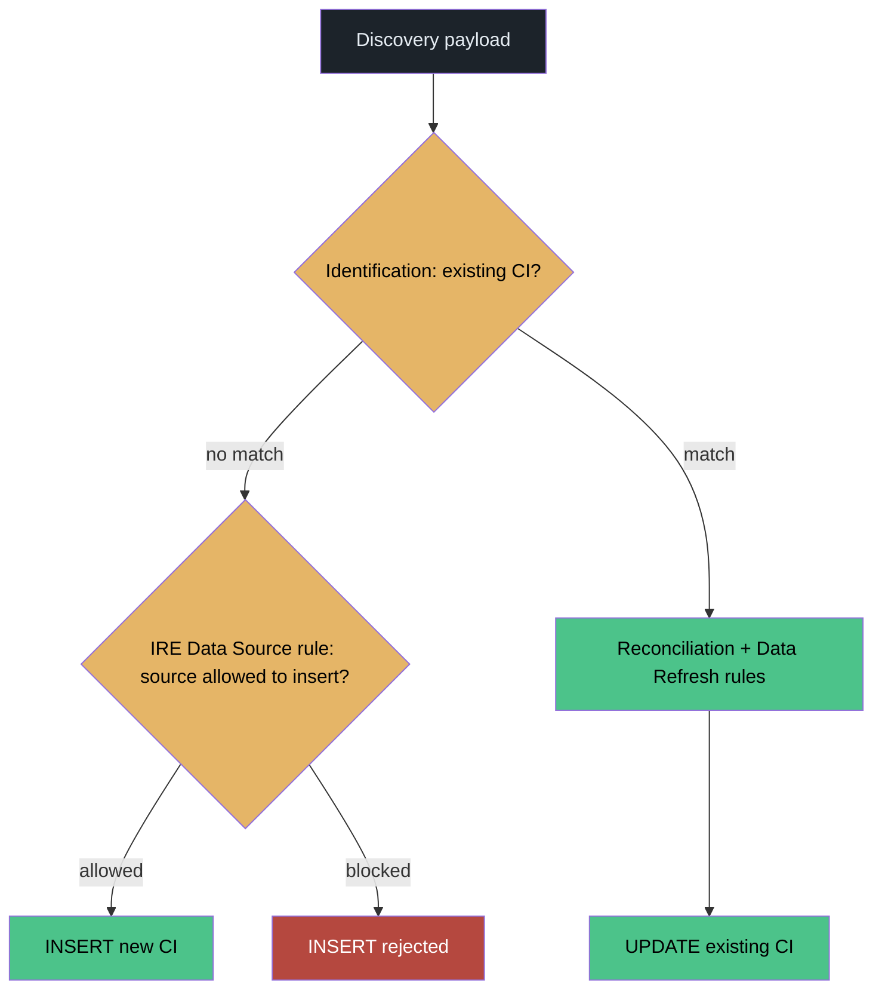

# Discovery — ITOM Discovery

Discovery is how ServiceNow finds out what actually exists on the network. It logs into servers, network devices, and cloud accounts through a MID Server, identifies each device, and creates or updates its Configuration Item (CI) in the CMDB — including the software installed on it. Everything upstream (ITSM impact analysis, SAM license counts, TSOM inventory reconciliation) is only as good as what Discovery put in the CMDB.

This guide covers classic Discovery end to end, with a deep focus on **File-Based Discovery (FBD)**: how to reach the Discovery Configuration Console, how to configure it area by area, how filtering really works, and how to run an FBD scan and prove it executed — on the instance *and* on the target device.

## Contents


- [Purpose](#purpose)
- [Where to Find It](#where-to-find-it)
- [Prerequisites & Setup](#prerequisites--setup)
  - [Plugins and Scoped Apps](#plugins-and-scoped-apps)
  - [Guided Setup Requirements](#guided-setup-requirements)
  - [System Properties to Consider](#system-properties-to-consider)
  - [Cross-Module Dependencies](#cross-module-dependencies)
  - [ACLs Related to Core Tables](#acls-related-to-core-tables)
  - [Breadcrumbs — What Needs to Be Enabled First](#breadcrumbs--what-needs-to-be-enabled-first)
- [How Discovery Works](#how-discovery-works)
- [Goals, Benefits & Key Metrics](#goals-benefits--key-metrics)
- [Core Concept Diagrams](#core-concept-diagrams)
  - [Discovery Phases — Scan → Classify → Identify → Explore](#discovery-phases--scan--classify--identify--explore)
  - [MID Server → ECC Queue → CI Flow](#mid-server--ecc-queue--ci-flow)
  - [Pattern → Probe → Sensor Flow](#pattern--probe--sensor-flow)
- [Re-usable Code / Metadata](#re-usable-code-metadata)
  - [The re-usable metadata inventory](#the-re-usable-metadata-inventory)
- [Out-of-Box Features](#out-of-box-features)
- [Key Table Hierarchy](#key-table-hierarchy)
- [Integrations](#integrations)
- [Key Fields](#key-fields)
- [Common Mistakes](#common-mistakes)
- [Appendix: IntegrationHub & e-Bonding — connecting discovered data out](#appendix-integrationhub--e-bonding--connecting-discovered-data-out)
  - [What is IntegrationHub?](#what-is-integrationhub?)
  - [What is e-bonding?](#what-is-e-bonding?)
  - [How Discovery + e-bonding fit together](#how-discovery-+-e-bonding-fit-together)
  - [Integration patterns compared](#integration-patterns-compared)
  - [Mini lab: Conceptual e-bond — Discovery CI change → Teams](#mini-lab-conceptual-e-bond--discovery-ci-change--teams)
  - [Common e-bonding mistakes](#common-e-bonding-mistakes)
- [Deep Dive: Service Graph Connector for OpenTelemetry](#deep-dive-service-graph-connector-for-opentelemetry)
  - [What OpenTelemetry is](#what-opentelemetry-is)
  - [SGC for OpenTelemetry vs Discovery](#sgc-for-opentelemetry-vs-discovery)
  - [Breadcrumbs](#breadcrumbs)
  - [Configuration steps](#configuration-steps)
  - [How OpenTelemetry feeds TSOM assurance](#how-opentelemetry-feeds-tsom-assurance)
  - [Common OpenTelemetry SGC mistakes](#common-opentelemetry-sgc-mistakes)
  - [Mini lab: Verify OpenTelemetry SGC data flow](#mini-lab-verify-opentelemetry-sgc-data-flow)
  - [Using Now Assist to debug a Service Graph Connector issue](#using-now-assist-to-debug-a-service-graph-connector-issue)
- [Deep Dive: Customizing an Out-of-Box Pattern — and Making Your Own](#deep-dive-customizing-an-out-of-box-pattern--and-making-your-own)
  - [First, the anatomy](#first-the-anatomy)
  - [The golden rule](#the-golden-rule)
  - [Route 1 — Duplicate the pattern and own the copy](#route-1--duplicate-the-pattern-and-own-the-copy)
  - [Route 2 — Extend the original (when it offers extension sections)](#route-2--extend-the-original-when-it-offers-extension-sections)
  - [Route 3 — Build your own pattern from scratch](#route-3--build-your-own-pattern-from-scratch)
- [Deep Dive: The Discovery Configuration Console](#deep-dive-the-discovery-configuration-console)
- [Deep Dive: File-Based Discovery](#deep-dive-file-based-discovery)
  - [How the Filtering Actually Works (a common misconception)](#how-the-filtering-actually-works-a-common-misconception)
  - [The Allow-List: samp_file_name → cmdb_file_information](#the-allow-list-samp_file_name--cmdb_file_information)
  - [Worked Example — Getting a Custom File Discovered: `C:\temp\server_runner.exe`](#worked-example--getting-a-custom-file-discovered-`ctempserver_runnerexe`)
  - [Worked Example — One Windows Server, Four Files](#worked-example--one-windows-server-four-files)
  - [Worked Example — A Custom Application Folder](#worked-example--a-custom-application-folder)
- [Deep Dive: Running File-Based Discovery](#deep-dive-running-file-based-discovery)
  - [Step 1 — Enable FBD in the Discovery Configuration Console](#step-1--enable-fbd-in-the-discovery-configuration-console)
  - [Step 2 — Run Discovery and verify initiation in the Status record](#step-2--run-discovery-and-verify-initiation-in-the-status-record)
  - [Step 3 — Verify the FBD scan file executed on the target device](#step-3--verify-the-fbd-scan-file-executed-on-the-target-device)
- [Deep Dive: From Files to Licenses — File Signature Normalization](#deep-dive-from-files-to-licenses--file-signature-normalization)
- [Lab: Run Your First Discovery and File-Based Scan](#lab-run-your-first-discovery-and-file-based-scan)
- [SLAs, Dashboards & Workspaces](#slas-dashboards--workspaces)
  - [SLA Support](#sla-support)
  - [Out-of-Box Dashboards](#out-of-box-dashboards)
  - [Out-of-Box Workspaces](#out-of-box-workspaces)
- [Quiz](#quiz)
- [🎓 Official Learning Resources](#official-learning-resources)
  - [📺 Verified Videos & Playlists](#verified-videos--playlists)
  - [🚀 Quick Start Guide](#quick-start-guide)
  - [🚀 The Authoritative Path](#the-authoritative-path)
- [💡 Memory Aids & Mnemonics](#memory-aids--mnemonics)
  - [Business Rule Types — BAA](#business-rule-types--baa)
  - [Client Script Types — LOCS](#client-script-types--locs)
  - [UI Policy vs Data Policy vs Client Script](#ui-policy-vs-data-policy-vs-client-script)
  - [IRE — Identification Before Reconciliation](#ire--identification-before-reconciliation)
  - [Update Set Conflicts — ARM](#update-set-conflicts--arm)
  - [CMDB — Retire Before Delete](#cmdb--retire-before-delete)
  - [Order vs Priority — Lower = First](#order-vs-priority--lower-=-first)
  - [Transform Script — Coalesce = Match](#transform-script--coalesce-=-match)
  - [Debugging — Log First, Then Debug](#debugging--log-first-then-debug)
- [Related Guides](#related-guides)


---

## Purpose

- **Populate the CMDB with facts, not spreadsheets.** Discovery scans IP ranges on a schedule and keeps CIs current as devices change.
- **Identify hardware and software.** Servers, VMs, network gear, databases — and, with File-Based Discovery, the software files physically present on a machine, even software that never registered itself anywhere.
- **Feed everything else.** ITSM uses CIs for impact; SAM reconciles installations against entitlements; HAM matches discovered devices to asset records; TSOM reconciles discovered network state against inventory (see the TSOM guide's discrepancy checks).

## Where to Find It

| Destination | Breadcrumb |
|-------------|------------|
| Discovery dashboard / home | All > Discovery > Dashboard |
| **Discovery Configuration Console** | All > Discovery > **Discovery Definition > Configuration Console** |
| Discovery schedules | All > Discovery > Discovery Definition > Schedules |
| Discovery status (per-run record) | All > Discovery > Status |
| Discovery log | All > Discovery > Discovery Log |
| MID Servers | All > Discovery > MID Servers |
| Credentials | All > Discovery > Credentials |
| Probes and patterns | All > Discovery > Discovery Definition > Probes · Patterns |
| Internal Discovery properties | Type `discovery_private_properties.list` in the navigator filter |
| Software installations created | `cmdb_sam_sw_install` |
| Files kept by File-Based Discovery | `cmdb_file_information` (also a related list on the CI) |
| Files that matched nothing | `cmdb_unidentified_file_set` |

Roles that matter: **discovery_admin** (configure and run Discovery), **admin**, the MID Server's service account user (with the `mid_server` role) on the instance side, and local/domain credentials on the target side.

## Prerequisites & Setup

### Plugins and Scoped Apps
- **Discovery Core**: `com.snc.discovery.core` — required for all Discovery functionality
- **MID Server**: `com.snc.mid_server` — the agent that executes Discovery probes in your network
- **File-Based Discovery**: `com.snc.discovery.file_based_discovery` — included with Discovery subscription, activation must be requested
- **SAM File Signature Normalization**: `com.snc.file_signature_normalization` — activated automatically with File-Based Discovery
- **Cloud Discovery** (optional): `com.snc.discovery.cloud_discovery` — for AWS, Azure, GCP discovery

### Guided Setup Requirements
1. **MID Server Installation**: Install and validate MID Server(s) in your private network (All > Discovery > MID Servers). Ensure status is "Validated" and "Up"
2. **Credentials Configuration**: Configure credentials for target hosts (All > Discovery > Credentials) and test connectivity
3. **Discovery Schedule**: Create a discovery schedule with IP ranges (All > Discovery > Discovery Definition > Schedules)
4. **File-Based Discovery Activation**: Enable in Configuration Console (All > Discovery > Discovery Definition > Configuration Console)
5. **CDS Synchronization**: Ensure initial Content Data Service sync has completed (~24 hours) before enabling File-Based Discovery

### System Properties to Consider
- `glide.discovery.file_discovery.wildcard.windows` — additive extensions for FBD on Windows
- `glide.discovery.file_discovery.blacklist.windows` — hard filter extensions on Windows
- `discovery_private_properties.list` — internal Discovery settings (filter in navigator)
- Timeout properties: `glide.discovery.timeout`, `glide.discovery.scan_timeout`

### Cross-Module Dependencies
- **CMDB**: Discovery populates `cmdb_ci` and subclasses (e.g., `cmdb_ci_server`, `cmdb_ci_appl`); IRE identification rules prevent duplicates
- **ITSM**: Discovery CIs feed impact analysis and incident management
- **SAM/HAM**: File-Based Discovery installations flow into `cmdb_sam_sw_install` records
- **TSOM**: Reconciles discovered network state against inventory; requires CMDB accuracy

### ACLs Related to Core Tables
- `discovery_admin` role required for configuration and run permissions
- `mid_server` role required on instance side for MID Server service account
- `admin` role for Configuration Console access
- ACLs on `cmdb_ci`, `discovery_status`, `ecc_queue`, `discovery_credentials`, `sa_pattern`, etc.

### Breadcrumbs — What Needs to Be Enabled First
1. **MID Server** — Must be installed, validated, and "Up" status (All > Discovery > MID Servers)
2. **Credentials** — Configure host credentials with appropriate OS permissions (All > Discovery > Credentials)
3. **Discovery Schedule** — Define IP ranges and schedule frequency (All > Discovery > Discovery Definition > Schedules)
4. **Run Discovery** — Populates CMDB with CIs (All > Discovery > Status)
5. **File-Based Discovery** — Enable in Configuration Console after prerequisite steps (All > Discovery > Discovery Definition > Configuration Console)

## How Discovery Works

A Discovery run moves through four phases, all coordinated through the **ECC Queue** (`ecc_queue`) between the instance and a **MID Server** sitting inside the network:

1. **Scanning** — port probes (Shazzam) find live IPs and open ports.
2. **Classification** — classifiers decide what kind of device answered (Windows server, Linux, switch, …).
3. **Identification** — identification rules and the Identification and Reconciliation Engine (IRE) match the device to an existing CI or create a new one — this is what prevents duplicates.
4. **Exploration** — probes and patterns gather the detail: OS, CPU, memory, running processes, installed software — and this is the phase where **File-Based Discovery runs**.

Work is sent to the MID Server as ECC Queue **output** records; results come back as **input** records, where sensors/pattern steps process them into the CMDB.

The **Identification** phase (step 3) is where the CMDB's de-duplication controls live. Four IRE rule
families decide whether a discovered device becomes a **new CI** or **updates an existing one** — see the
[CMDB guide](../cmdb/cmdb-guide/) for the full deep dive (scope, parameters, and worked examples):

| Rule family | Insert (new CI)? | Update (existing CI)? |
|---|---|---|
| Identification rules | yes — no match → create | yes — match → update |
| Reconciliation rules | no | yes |
| IRE Data Source rules | yes — **blocks insert** | no |
| Data Refresh rules | no | yes (stale → lower-priority source may update) |



---

## Goals, Benefits & Key Metrics

| Business Goal | Benefit | Key Metric (KPI) | Example Value | Where to measure |
|---------------|---------|------------------|---------------|------------------|
| Build an accurate, current CMDB | ITSM impact, SAM licenses, HAM assets, and TSOM inventory all trust the same device data | CMDB discovery coverage — % of expected in-scope devices with a CI | ≥95% | `discovery_range` vs `cmdb_ci` |
| Surface new devices before they cause incidents | New hardware is visible to change and impact processes immediately | Mean Time to Discover (new CIs) | <24h from first scan to CI created | `discovery_status` → `cmdb_ci.last_discovered` |
| Keep CI data fresh enough to act on | Stale CIs break impact maps and license counts | CI freshness — % of CIs discovered in the last 30 days | ≥90% | `cmdb_ci.last_discovered` |
| Prevent duplicate CIs | Clean relationships; correct blast-radius math | Duplicate CI rate | <1% | `cmdb_identifier` (IRE) match results |
| Run schedules reliably | Predictable dashboards and maintenance windows | Discovery schedule success rate | ≥98% of scheduled runs complete | `discovery_status.state` |
| Identify installed software from disk | SAM can count licenses for software that never registered itself | File-Based Discovery match rate | ≥80% of scanned files matched to a known product | `cmdb_file_information` → `cmdb_sam_sw_install` |
| Debug failed runs fast | Less MTTR on Discovery itself | ECC Queue error rate | <2% of `ecc_queue` rows in error state | `ecc_queue.state = error` |

> Indicative starting KPIs — baseline your own instance, then set targets.

---

## Core Concept Diagrams

### Discovery Phases — Scan → Classify → Identify → Explore

```mermaid
flowchart TD
    Start[Discovery Schedule fires] --> Scan[1. Scanning Shazzam port probes find live IPs]
    Scan --> Classify[2. Classification Classifiers decide device type — Windows, Linux, switch, …]
    Classify --> Identify[3. Identification IRE matches an existing CI or creates a new one]
    Identify --> Explore[4. Exploration Patterns/probes gather OS, CPU, software File-Based Discovery runs here]
    Explore --> CI[CI created or updated in CMDB cmdb_ci · cmdb_ci_server · cmdb_file_information]
    CI -.->|feeds| Downstream[ITSM impact · SAM · HAM · TSOM]

    style Start fill:#e58a8a,color:#000
    style Classify fill:#e5b567,color:#000
    style Identify fill:#0a0d10,stroke:#e5b567
    style Explore fill:#4cc38a,color:#000
    style CI fill:#10141a


```



### MID Server → ECC Queue → CI Flow

```mermaid
flowchart LR
    Instance[ServiceNow Instance] <==>|output records work sent to MID| ECC[ECC Queue ecc_queue]
    ECC <==>|input records results returned| MID[MID Server inside your network]
    MID -->|WMI · WinRM · SSH · SNMP| Target[Target Device server, switch, appliance]
    Target -->|returns data| MID
    MID -->|parsed by Sensors / pattern steps| CI[(CMDB cmdb_ci + subclasses)]

    subgraph InstanceSide [Instance side]
        Instance
        ECC
        CI
    end
    subgraph NetworkSide [Network side]
        MID
        Target
    end

    style Instance fill:#e58a8a,color:#000
    style ECC fill:#e5b567,color:#000
    style MID fill:#4cc38a,color:#000
    style CI fill:#10141a


```



### Pattern → Probe → Sensor Flow

```mermaid
flowchart TD
    Pattern[Discovery Pattern sa_pattern steps and operations]
    Probe[Probe discovery_probe runs on the MID Server]
    Sensor[Sensor instance-side parser]
    CI[(CMDB CI cmdb_ci_*)]

    Pattern -->|calls| Probe
    Probe -->|collects from| Target[Target device files · registry · WMI · SNMP]
    Target -->|raw output| Probe
    Probe -->|returns payload| Sensor
    Sensor -->|maps onto CI fields| CI

    style Pattern fill:#e5b567,color:#000
    style Probe fill:#4cc38a,color:#000
    style Sensor fill:#0a0d10,stroke:#e5b567
    style CI fill:#10141a


```



---

## Re-usable Code / Metadata

Check the latest Discovery status for a CI from a script or background job:

```javascript
// Most recent Discovery status that touched a given CI
var st = new GlideRecord('discovery_status');
st.addQuery('cmdb_ci', current.sys_id); // or a sys_id string
st.orderByDesc('sys_created_on');
st.setLimit(1);
st.query();
if (st.next()) {
  gs.info('Last run: ' + st.getValue('sys_id') +
          ' | State: ' + st.getDisplayValue('state') +
          ' | Created: ' + st.getValue('sys_created_on'));
}
```

Navigator shortcuts worth memorizing (type in the filter box):

| Shortcut | Opens |
|----------|-------|
| `discovery_status.list` | All Discovery run records |
| `discovery_log.list` | The Discovery log |
| `ecc_queue.list` | MID Server in/out traffic — the first place to debug a stuck run |
| `discovery_private_properties.list` | Internal Discovery properties (incl. file-discovery internals) |
| `cmdb_unidentified_file_set.list` | Files File-Based Discovery could not match |
| `cmdb_sam_sw_install.list` | Software installations |
| `sa_pattern.list` | Every Discovery pattern (out-of-box and yours) |

### The re-usable metadata inventory

Beyond scripts, Discovery is built from configuration records you define **once** and reuse everywhere. Every row below has the same shape: a concrete **example**, the plain-English version (**ELI5**), the **technical** version, and exactly **how the reuse works** — because the whole point of these objects is that you change them in one place instead of twenty.

| Re-usable piece | Example | ELI5 | Technical explanation | How the reuse works | Where it lives |
|---|---|---|---|---|---|
| **Discovery Schedules** | A "HQ Datacenters — Nightly" schedule cloned to make "Branch Offices — Weekly" | A saved trip plan — route, time, vehicle. Copy the plan and change the destination instead of planning from zero. | A `discovery_schedule` record binding ranges, MID selection, a behaviour, and the credential set, with its own run frequency. | Clone the schedule and change only what differs (ranges, MID); the proven behaviour + credential combination carries over untouched. | All > Discovery > Discovery Definition > **Schedules** |
| **IP ranges** | `10.20.0.0/16` — the Toronto datacenter, entered once on the schedule | A neighbourhood on a map, instead of a written list of every house address in it. | A CIDR block (or start–end pair) stored as a `discovery_range_item`; the scan phase probes every address inside the block. | The block is scanned as a unit by every run of every schedule that includes it — nobody maintains individual IPs anywhere. | All > Discovery > Discovery Definition > **Schedules** > open a schedule > **Discovery Ranges** |
| **IP range sets** | The set "All Canadian Sites" = Toronto /16 + Montreal /16 + Vancouver /16, referenced by 20 schedules | A mailing list. You add a person to the list once, and every email sent to the list reaches them — you never re-type their address into 20 separate emails. | Structured range records (`discovery_range`, `discovery_range_item`, `discovery_range_item_ip`) grouping sub-ranges and individual IPs under one named parent that schedules reference. | **This is the "change it in 1 place" object.** Add the new Calgary subnet to the set once and all 20 schedules scan it on their next run — instead of opening 20 schedules and editing each one. | On the schedule's **Discovery Ranges** — maintain the set, not copies of it |
| **MID Server IP ranges** | MID-TOR-01 may scan `10.20.0.0/16`; MID-MTL-01 may scan `10.30.0.0/16` | Each delivery driver has a territory; a parcel is only handed to the driver whose territory contains the address. | Range records on the MID Server (`ecc_agent`) constraining which targets that MID's work may address. | One schedule can cover the whole country; the ranges route each part to the right MID automatically — no separate per-site schedules. | All > MID Server > **Servers** > open the MID > **IP Ranges** |
| **MID Server capabilities** | A MID with SNMP + WMI capabilities receives switch and Windows work; a Linux-only MID never does | A handyman's advertised skills — you only get sent jobs matching the skills on your card. | Capability records on the MID declaring which protocols and applications it can execute; the instance matches work to capabilities when assigning it. | Set capabilities once per MID; every schedule and pattern benefits from the routing — no per-schedule MID micromanagement. | All > MID Server > **Servers** > open the MID > **Capabilities** |
| **Patterns** | The *Windows OS – Servers* pattern explores every Windows server Discovery finds, anywhere | One recipe that works in every kitchen — same steps, whatever house you are cooking in. | A `sa_pattern` definition: an identification section plus ordered steps/operations the MID executes against a target, writing CIs and relations. | Write the exploration logic once; every classifier and schedule that invokes it reuses it. Fix a parsing step once and every future run on every network is fixed. | All > Discovery > Discovery Definition > **Patterns** (Pattern Designer) |
| **Pattern libraries** | The library step "get running processes" is called by a dozen patterns | A Lego brick used in many models — redesign the brick and every model built with it improves. | Shared, versioned step sequences in Pattern Designer, invoked from pattern steps instead of being rebuilt inside each pattern. | Change the library once; all patterns calling it pick up the change — no hunting through each pattern to patch the same logic. | Inside **Pattern Designer** (shared libraries) |
| **Probes and sensors** | The *Windows – Installed Software* probe collects the registry data; its sensor turns it into install records | One person takes the photo, another files it — and the same pair can be assigned to any beat. | A probe (`discovery_probe`) is the MID-side collection script; the sensor is the instance-side parser that maps the returned data onto CI fields. | Define the pair once and attach it to any classifier; the same collection logic then serves every schedule that reaches that classifier. | All > Discovery > Discovery Definition > **Probes** / **Sensors** |
| **Classifiers** | The *Windows* classifier fires when a host answers on WMI and identifies itself as Windows | A sorting hat: it looks at what answered the door and decides which rulebook applies to it. | A classification record whose trigger conditions (port-probe results, banners) select the pattern or probe set and the CI class used for exploration. | One classifier decision serves every schedule — change which pattern "Windows" uses in this one record and all schedules follow. | All > Discovery > Discovery Definition > **Classifiers** |
| **Discovery Behaviours** | A "WMI-only" behaviour attached to ranges where firewall policy blocks SSH | A dress code for a venue: whichever event is held there, the same rules apply to everyone entering. | A `discovery_behavior` record grouping functionality definitions (which probes/patterns may run) that a schedule applies to specified ranges. | Define the behaviour once, attach it to many schedules and ranges. A policy change ("no SNMP v2 in PCI ranges") is edited in one behaviour, not in every schedule. | All > Discovery > Discovery Definition > **Behaviours** |
| **Credentials & credential aliases** | Schedules reference the alias "Windows Domain Cred"; the credential record behind it is rotated quarterly | A name in your contacts. You tap "Mom" — if her number changes, you update the contact once, not every message thread you ever sent her. | Credential records (`discovery_credentials`) tried per target type; aliases decouple the reference from the record, so patterns and schedules point at the alias. | Rotate or replace the credential in one record; every schedule and pattern using the alias keeps working unchanged. | All > Discovery > **Credentials** · **Connections & Credential Aliases** |
| **Credential affinities** | After MID-TOR-01 logs into 10.20.4.15 with the domain credential, the next run tries that credential first for that host | Remembering which key opened which door, so next time you don't try the whole keyring. | `dscy_credentials_affinity` rows (IP + MID + credential) written on each successful authentication and consulted before the general credential order. | The system builds this reuse itself — every successful login makes the next run faster, with zero configuration from you. | `dscy_credentials_affinity.list` (system-maintained) |
| **Identification rules (IRE identifiers)** | Windows servers are matched on `name` + `serial_number` — so the SCCM connector cannot create a second CI for a laptop Discovery already found | A bouncer checking two pieces of ID: if they match the list, you are already inside — no second entry gets created. | IRE identifier records (`cmdb_identifier` and its entries), per CI class, defining the attribute sets used to match an incoming payload to an existing CI. | One rule per class serves *every* source — Discovery, Service Graph Connectors, import sets. Change the matching once; deduplication changes everywhere, consistently. | All > Configuration > **Identification/Reconciliation** (CI Identifiers) |
| **Discovery properties** | One timeout property governs how long every schedule waits on an unresponsive host | One thermostat for the whole house instead of a separate dial in every room. | Engine-level settings (`discovery_private_properties` and `glide.discovery.*` properties) read at run time by all schedules. | Tune once, centrally — no schedule carries its own copy of the setting to drift out of sync with the others. | All > Discovery > **Properties** · `discovery_private_properties.list` |

The pattern to notice: **schedules are the *when and where*, everything above is the *how* — and the *how* is all shared.** That is why the next deep dive (customizing a pattern) matters: change one pattern and every schedule that reaches it changes with it.

## Out-of-Box Features

- **Discovery schedules** — recurring scans by IP range, with behaviours that control which probes run where.
- **Patterns** — the modern, declarative way to explore devices and applications (replacing probe/sensor pairs for most content).
- **Discovery Configuration Console** — one place to control which CI types and information get discovered, File-Based Discovery, and SWID tags.
- **File-Based Discovery** — software discovery from files on disk (deep dives below).
- **Cloud Discovery** — API-based discovery of AWS, Azure, and GCP resources.
- **Agent Client Collector (ACC)** — agent-based data collection for endpoints that can't be scanned remotely.
- **Service Graph Connectors** — partner/third-party data (e.g. SCCM) imported through the same IRE rules — see the CSDM/SCCM map in the ITSM guide.

## Key Table Hierarchy

| Table | What it holds |
|-------|---------------|
| `discovery_schedule` | When Discovery runs, against which ranges |
| `discovery_range_item` | The IP ranges attached to a schedule |
| `dscy_credentials_affinity` | Learned credential affinities (IP + MID → the credential that worked) |
| `cmdb_identifier` | IRE identification rules — how a discovered device matches an existing CI |
| `sa_pattern` | Discovery patterns (out-of-box and custom copies) |
| `discovery_behavior` | Behaviours: which functionality runs against which ranges |
| `discovery_status` | One record per run — state, timing, devices found |
| `discovery_log` | Human-readable messages from a run |
| `discovery_device_history` | Per-device outcome per run |
| `ecc_queue` | MID Server work orders and results |
| `ecc_agent` | MID Server records |
| `discovery_credentials` | Credentials Discovery can use on targets |
| `discovery_private_properties` | Internal Discovery settings |
| `cmdb_ci` (+ subclasses) | The CIs Discovery creates and updates |
| `cmdb_file_information` | The actual files FBD found on a CI — name, size, version, path, CI reference |
| `samp_file_name` | The controlled allow-list of file names Discovery keeps (synced from CDS) |
| `samp_custom_file_name` | Your own additions to the allow-list, for software CDS doesn't know |
| `cmdb_sam_sw_install` | Software installations (incl. from File-Based Discovery) |
| `cmdb_unidentified_file_set` | Discovered files no signature matched |
| `cmdb_swid_tag` | SWID tags, when enabled in the console |

## Integrations

- **MID Server** — the agent in your network that does the actual scanning (WMI/WinRM/PowerShell on Windows, SSH on UNIX/Linux, SNMP on network devices).
- **Service Graph Connectors** — SCCM and others; complementary to Discovery, reconciled by the same IRE.
- **Event Management / TSOM** — discovered topology feeds service impact and discrepancy checks.
- **SAM / HAM** — installations and device data flow into normalization and asset matching (see the HAM guide).

## Key Fields

| Field | Where | Why it matters |
|-------|-------|----------------|
| `cmdb_ci.discovery_source` | CI | Which source last updated the CI (e.g. ServiceNow Discovery) |
| `cmdb_ci.last_discovered` | CI | Freshness — stale CIs usually mean a failing schedule or credential |
| `discovery_status.state` | Status record | Whether a run completed, is active, or had errors |
| `ecc_queue.queue` / `ecc_queue.state` | ECC Queue | Input vs output; ready/processed/error — your debugging lens |
| `glide.discovery.file_discovery.wildcard.windows` | System property | Extra file extensions FBD collects on Windows |
| `glide.discovery.file_discovery.blacklist.windows` | System property | Extensions FBD always drops on Windows |

## Common Mistakes

- **Expired or under-privileged credentials** — the #1 cause of "Discovery found nothing." Test credentials from the MID Server host, not your laptop.
- **Assuming extension wildcards limit what FBD collects** — they don't; wildcards are additive on top of signature-driven collection. Blacklist is the only hard filter. (Full model below.)
- **Leaving `c:\windows` in Folders To Scan** — scan times balloon on Windows servers for near-zero SAM value. Remove it.
- **Expecting FBD to run again tomorrow** — the default frequency is **Monthly**; a CI is not re-scanned until the interval expires.
- **Enabling FBD before CDS sync finishes** — File-Based Discovery does not trigger until the initial Content Data Service synchronization completes (~24h).
- **Scanning a whole drive by accident** — setting Folders To Scan to `C:/` scans *everything*; combined with a high Maximum Files cap it can hammer the target.
- **Debugging in the CMDB** — when a run looks wrong, read the ECC Queue and Discovery Log first; the CI is the *result*, not the evidence.

---

## Appendix: IntegrationHub & e-Bonding — connecting discovered data out

Discovery populates the CMDB. IntegrationHub and e-bonding are how that data (and incidents, changes, CIs) flows *out* to external systems and *back in* — without building custom REST code for every connection.

### What is IntegrationHub?

IntegrationHub is ServiceNow's low-code integration layer: **spokes** (prebuilt adapters), **Flow Designer** actions, and **Connection & Credential Aliases** for secure auth. Instead of writing a REST Message from scratch for Salesforce, Teams, Jira, or SAP, you drag a spoke onto a flow canvas and map fields.

| Concept | What it is | Example |
|---|---|---|
| **Spoke** | Prebuilt adapter wrapping an external API | ServiceNow, Salesforce, Microsoft Teams, Jira, ServiceNow (instance-to-instance) |
| **Flow** | Low-code automation built in Flow Designer | "When a CI changes in Discovery, post to Teams" |
| **Action** | One step in a flow | Create a Jira issue, send a Teams message, query a CMDB CI |
| **Connection & Credential Alias** | Stored auth (OAuth2, basic, API key) | One alias reused across flows; rotate the password in one place |

### What is e-bonding?

E-bonding is **bidirectional synchronization** between ServiceNow and an external ITSM/monitoring tool. Both sides create and update records, and a correlation ID prevents infinite loops (ServiceNow → external → ServiceNow → external …).

Common e-bonding pairs:
- ServiceNow ↔ ServiceNow (MSP ↔ customer instances)
- ServiceNow ↔ SolarWinds Service Desk
- ServiceNow ↔ BMC Helix / Remedy
- ServiceNow ← third-party monitoring (PagerDuty, Datadog alerts → incidents)

### How Discovery + e-bonding fit together

Discovery finds CIs and writes them to the CMDB. E-bonding then syncs those CIs (and the incidents/problems built on them) to an external tool — and pulls the external tool's status back onto the CI. Without Discovery's CMDB data, e-bonding has nothing reliable to correlate.

```
Discovery run → CI created/updated in CMDB
                    │
                    ▼
          E-bonding sync (IntegrationHub flow or REST Message)
                    │
                    ▼
        External tool (SolarWinds, BMC, second SN instance)
                    │
                    ▼
          Status comes back → updated on the CI / incident
```

### Integration patterns compared

| Pattern | Best for | Discovery relevance |
|---|---|---|
| **IntegrationHub spoke + Flow Designer** | Low-code, no custom code, prebuilt adapters | Sync discovered CIs to Teams/Jira/ServiceNow |
| **Outbound REST Message** | Custom APIs, full control | Push CI changes to a home-grown CMDB consumer |
| **Inbound Scripted REST API** | External systems write into ServiceNow | External tool creates incidents on discovered CIs |
| **MID Server** | On-prem targets the cloud can't reach | Discovery itself uses this; so does JDBC-based e-bonding |
| **Import Sets** | Bulk one-time loads | Initial CMDB population before live e-bonding starts |

### Mini lab: Conceptual e-bond — Discovery CI change → Teams

1. **Flow Designer → New flow**, Table: `cmdb_ci`, Trigger: **Field updated** on `install_status` or `discovery_source`
2. **Condition:** only run when `discovery_source` = `ServiceNow Discovery` (avoid sync loops)
3. **Action:** Microsoft Teams → Post message (via the Teams spoke, or a REST Message to a Teams webhook)
4. **Message body:** `CI ${name} (${
sys_class_name}) was discovered/updated by ${discovery_source} at ${discovered}`
5. **Activate.** Run Discovery against a target; confirm the Teams message arrives.

**Why this isn't a loop:** the condition checks `discovery_source`, so only Discovery-originated changes post to Teams — manual CMDB edits don't retrigger the flow.

### Common e-bonding mistakes

| Mistake | Symptom | Fix |
|---|---|---|
| **No correlation ID** | Each side creates a new record every sync — endless duplicates | Store the external system's record ID on the CI (custom field `u_external_ci_id`) and match on it |
| **No loop guard** | ServiceNow update triggers external update which triggers ServiceNow update … | Check `discovery_source` / `u_external_updated` before writing; skip if already synced |
| **Hard-coded credentials** | Password rotation breaks the e-bond | Use Connection & Credential Aliases; never embed passwords in flow actions |
| **Syncing every field** | Massive payloads, slow syncs, field conflicts | Sync only the fields that matter (CI name, status, discovery source, last_discovered) |
|| **Forgetting the MID Server** | Cloud instance can't reach the external on-prem tool | Install a MID Server in the external tool's network; route the e-bond through it |

---

## Deep Dive: Service Graph Connector for OpenTelemetry

Service Graph Connector (SGC) for OpenTelemetry is how ServiceNow ingests **metrics, traces, and logs** from OpenTelemetry collectors — the CNCF open-source observability standard. This is **not** Discovery. Discovery scans and polls infrastructure to fill the CMDB with CIs. OpenTelemetry pushes **telemetry data** (metrics, traces, logs) from applications and infrastructure that is already instrumented.

### What OpenTelemetry is

OpenTelemetry (OTel) is a vendor-neutral framework for instrumenting applications to generate and export telemetry data:
- **Metrics** — numerical measurements over time (CPU %, memory %, response time)
- **Traces** — distributed request traces across microservices (span ID, trace ID, latency)
- **Logs** — structured log records with severity, timestamp, attributes

OTel collectors receive this data, process it, and export it to backends — including ServiceNow via the SGC for OpenTelemetry.

### SGC for OpenTelemetry vs Discovery

| Aspect | ITOM Discovery | SGC for OpenTelemetry |
|---|---|---|
| Direction | Instance **pulls** (scans/polls targets) | External **pushes** telemetry to ServiceNow |
| What it creates | CIs in the CMDB (`cmdb_ci_*`) | Metric data, trace data, log entries |
| Typical targets | Servers, network devices, cloud accounts | Instrumented apps, Kubernetes clusters, microservices |
| Timing | Scheduled (daily, weekly, monthly) | Continuous / near real-time |
| Primary consumer | CMDB, ITOM Visibility, TSOM inventory | Metric Intelligence, Health Log Analytics, TSOM assurance |
| TSOM role | Builds the topology (what connects to what) | Feeds performance metrics and alerts for service impact |

In TSOM, you need **both**: Discovery builds the network topology (routers, circuits, services), and OpenTelemetry feeds the metrics that tell you *whether* that topology is healthy.

### Breadcrumbs

| Destination | Breadcrumb |
|---|---|
| SGC central | All > Service Graph Connectors > Service Graph Connectors |
| OpenTelemetry connector setup | All > Service Graph Connectors > OpenTelemetry > Setup |
| Data sources | All > Service Graph Connectors > OpenTelemetry > Data Sources |
| Credentials | All > Service Graph Connectors > OpenTelemetry > Credentials |
| Schedules | All > Service Graph Connectors > OpenTelemetry > Schedules |
| Ingested data | `sn_otel_metric`, `sn_otel_trace`, `sn_otel_log` tables |

### Configuration steps

1. **Install the connector** — Store app `sn_otel_sgc` (Service Graph Connector for OpenTelemetry)
2. **Create a data source** — Define the OTel endpoint (OTLP HTTP/gRPC URL) the collector will export to
3. **Configure credentials** — API token or basic auth for the OTel export endpoint
4. **Create a schedule** — How often ServiceNow polls the OTel endpoint (or set up webhook push)
5. **Map telemetry to CIs** — Configure identification rules so OTel metrics attach to existing CIs discovered by ITOM Discovery or SGC
6. **Activate** — Turn on the connector; verify data appears in `sn_otel_metric`, `sn_otel_trace`, `sn_otel_log`

### How OpenTelemetry feeds TSOM assurance

OTel metrics flow into **Metric Intelligence** and **Health Log Analytics** (ITOM features TSOM consumes), which then feed:
- **Event Management** — metric threshold breaches become events → alerts
- **Service Impact Analysis** — alerts on a network element CI propagate impact to the customer service CI
- **Now Assist for ITOM** — AI-assisted alert investigation using the metric context

### Common OpenTelemetry SGC mistakes

| Mistake | Symptom | Fix |
|---|---|---|
| **No CI identification mapping** | Metrics ingest but don't attach to any CI | Configure identification rules so OTel resource attributes match `cmdb_ci` fields (name, serial_number, etc.) |
| **Wrong export protocol** | Collector can't reach ServiceNow | OTLP HTTP is the standard; confirm the endpoint URL and port (4318 for HTTP, 4317 for gRPC) |
| **Missing MID Server** | OTel collector is on-prem, ServiceNow is cloud | Install a MID Server between the collector and the instance, or use OTel collector's built-in ServiceNow exporter |
| **No schedule or wrong frequency** | Data is stale or missing | Set a schedule that matches the OTel export interval (typically 30s–5m for metrics) |
| **Confusing OTel with Discovery** | Expecting OTel to create CIs | OTel creates metric/trace/log records, not CIs. Run Discovery first to build the CI topology |

### Mini lab: Verify OpenTelemetry SGC data flow

**Goal:** Confirm OTel metrics are ingested and attached to a CI.

**Prerequisites:**
- ServiceNow instance with ITOM Discovery and SGC for OpenTelemetry installed
- An OTel collector running and exporting to the ServiceNow OTLP endpoint
- A discovered CI (e.g., a server) whose name matches an OTel resource attribute

**Steps:**
1. **All > Service Graph Connectors > OpenTelemetry > Setup** — confirm the connector is active
2. **All > Service Graph Connectors > OpenTelemetry > Data Sources** — verify your OTel endpoint is listed and active
3. **All > Service Graph Connectors > OpenTelemetry > Schedules** — confirm a schedule exists and is enabled
4. Run the schedule manually; open the **Schedule Status** record and confirm it completed without errors
5. Query `sn_otel_metric` — confirm rows exist with recent `sys_created_on` timestamps
6. Open a metric record and check the **CI reference** field — if identification mapping is correct, it should point to a discovered `cmdb_ci` (e.g., your server)
7. Open that CI in the CMDB and confirm related metric data appears (if your instance has Metric Intelligence configured)

**Proof of concept:** A metric row in `sn_otel_metric` with a populated `cmdb_ci` reference means OTel telemetry is successfully attached to your discovered topology — the foundation for TSOM service impact analysis.

---

### Using Now Assist to debug a Service Graph Connector issue

ServiceNow's **Now Assist** can help diagnose Service Graph Connector problems directly from the chat interface. The Now Assist panel surfaces suggested prompts including **"Diagnose a Service Graph Connector"** — click it to start a guided troubleshooting session without leaving the page.

#### What Now Assist can do for SGC debugging

| Now Assist capability | How it helps with SGC |
|---|---|
| **Diagnose a Service Graph Connector** | Analyzes connector configuration, schedules, and recent run status to identify misconfigurations |
| **Generate KB Article** | Creates a knowledge base article from the diagnosis for team reference |
| **Ask free-form** | Ask about specific errors, schedule failures, or data-mapping issues in plain language |

#### When to use Now Assist for SGC

- Connector schedule is failing but you don't know why
- Data is ingesting but not attaching to CIs (identification mapping issue)
- You need a quick health check before digging into `sys_otel_metric` / `sn_otel_metric` tables manually
- You want to document the fix as a KB article for the team

#### Suggested Now Assist prompts for SGC debugging

| Prompt | Best for |
|---|---|
| *"Diagnose a Service Graph Connector"* | General health check of all SGCs |
| *"Why is my OpenTelemetry connector not ingesting data?"* | Specific connector failure |
| *"Show me failed SGC schedules in the last 24 hours"* | Recent schedule failures |
| *"Generate a KB article for this SGC diagnosis"* | Documenting the fix for your team |

#### Suggested workflow

1. **Open Now Assist** (the chat panel in the top-right of your ServiceNow instance)
2. **Click "Diagnose a Service Graph Connector"** — or type your own question
3. **Review the diagnosis** — Now Assist will surface connector status, schedule errors, and configuration issues
4. **If needed, click "Generate KB Article"** to save the findings as knowledge for your team
5. **Apply the fix** — correct the schedule, credentials, or identification mapping based on the diagnosis
6. **Re-run the connector schedule** and confirm data flows into `sn_otel_metric` / `sn_otel_trace` / `sn_otel_log`

#### Limitations

- Now Assist suggestions are AI-generated — **review for accuracy** before acting on them
- Now Assist can identify *what* is wrong but may not have permission to *change* connector configuration — you may need to apply the fix manually in the connector setup page
- For complex SGC issues (custom ETL maps, MID Server connectivity), Now Assist is a starting point, not a replacement for hands-on debugging

---

---
- [ServiceNow IntegrationHub Fundamentals](https://nowlearning.com/) — Search "IntegrationHub" on Now Learning Portal
- [ServiceNow Product Documentation — IntegrationHub](https://docs.servicenow.com/) → Search "IntegrationHub", "e-bonding", "spokes"
- [Flow Designer documentation](https://docs.servicenow.com/) → Search "Flow Designer"

---

## Deep Dive: Customizing an Out-of-Box Pattern — and Making Your Own

Patterns are where Discovery's real behaviour lives, sooner or later every implementer has to change one: collect one more attribute, parse one vendor's odd output format, identify one application ServiceNow never heard of. There are three routes, in increasing order of commitment.

### First, the anatomy

A pattern (`sa_pattern`) is an ordered set of **steps** built in the **Pattern Designer**:

- The **Identification section** runs first: its steps decide *what this thing is* and which CI type it becomes (matching on process, port, banner, or a file on disk).
- **Connection sections** (mainly for Service Mapping) describe how to get from this CI to the next one.
- Each step is built from **operations** — connect to the device, run a command or query, parse the output, match values, set CI fields, create relations to other CIs.

**Where:** All > Discovery > Discovery Definition > **Patterns** — the list opens in Pattern Designer. Nothing about a pattern is edited on a normal form; it is all in the designer.

### The golden rule

**Out-of-box patterns are read-only. You never edit them in place** — the designer will not save changes to a ServiceNow pattern, and anything you forced in would be overwritten by the next upgrade or store release anyway. You customize a **copy**, or you **extend** the original (route 2).

### Route 1 — Duplicate the pattern and own the copy

1. **Open the original.** All > Discovery > Discovery Definition > **Patterns** > open the out-of-box pattern in Pattern Designer (e.g. the *Windows OS – Servers* pattern).
2. **Make your copy.** Use the designer's create-from-existing / duplicate option so the copy — not the original — opens for editing. Rename it with your own prefix (e.g. `Acme — Windows OS – Servers`) so nobody mistakes it for vendor content.
3. **Edit the steps in the copy.** Add or adjust operations: run an extra command, parse one more field, tighten the identification match. Steps read and write CI attributes, so work on the attributes your copy actually changes.
4. **Test with the Pattern Debugger, inside the designer.** The debugger runs your pattern against a real target IP and shows every step's input and output. Fix parsing here — never by re-running full schedules and reading tea leaves in the CMDB.
5. **Point Discovery at your copy.** A pattern only runs when something calls it, and for horizontal Discovery that something is the **classifier**. All > Discovery > Discovery Definition > **Classifiers** > open the classifier (e.g. *Windows*) > set its **Pattern** field to your copy — instead of the original, or in addition to it where the classifier supports both. From then on, that device type is explored by your version.
6. **Check the pre/post processing scripts.** Some patterns are also referenced by name in Discovery's pre- and post-processing scripts. Search those scripts for the **original pattern's name**; if it appears, add or re-point the reference to your copy, or your pattern will run but its surrounding processing won't.
7. **Prove it, then widen.** Run one schedule against one known IP, check the Discovery Status and the CI's attributes, then let normal schedules pick it up.

**The cost, stated plainly:** your copy is frozen at the moment you made it. When ServiceNow ships an improved original, your copy does **not** get the improvement — after upgrades, diff your copies against the new originals and re-apply your changes to a fresh copy where the difference matters. Keep customized patterns few, prefixed, and documented, or this debt sneaks up on you.

### Route 2 — Extend the original (when it offers extension sections)

Some patterns expose **extension sections**: reserved places in the step sequence where you add your own steps (collect one extra file, read one extra registry key or config value) *without* forking the pattern. The base pattern stays vendor-maintained and keeps receiving updates; your extension rides along. If the change you need fits in an extension section, this is the right route — check for one in Pattern Designer before reaching for Route 1.

### Route 3 — Build your own pattern from scratch

For a device or application nothing ships for:

1. **New pattern.** All > Discovery > Discovery Definition > **Patterns** > **New** in Pattern Designer. Set the pattern type and discovery type (**Horizontal** for classic Discovery) and name it with your prefix.
2. **Identification section first.** Declare the CI type the pattern creates and the match logic that proves "this is that thing" (a running process, an open port plus banner, a signature file).
3. **Add exploration steps.** Connect with the right credential type, collect with command/query operations, parse output into CI fields, and create relations (runs on, hosts, contains) so the CI lands connected, not orphaned.
4. **Debug against a real target** until a single run produces exactly the CI you intended — no duplicates, no empty key fields.
5. **Wire it to a classifier.** If it is a new device/app type, create the classifier too: All > Discovery > Discovery Definition > **Classifiers** > New — set the classification criteria (what answer on the wire means "use my pattern") and put your pattern in the classifier's **Pattern** field. Without this step your pattern exists but never runs.
6. **Schedule it** like any other discovery — the schedule, ranges, behaviours and credentials from the re-usable inventory above all apply unchanged.

| Route | Use it when | Upgrade behaviour |
|-------|-------------|-------------------|
| 1. Duplicate & own | You must change the original's core logic | Your copy is frozen — re-base after upgrades |
| 2. Extension section | You only need to *add* collection steps | Base pattern keeps updating; extension survives |
| 3. New pattern | No shipped pattern exists for the target | Entirely yours to maintain |

---

## Deep Dive: The Discovery Configuration Console

The console is where you manage **what kind of CIs and CI information you want to discover** — including File-Based Discovery and SWID tags.

**Breadcrumb:** All > Discovery > **Discovery Definition > Configuration Console**. Role required: **admin**. Toggles work as expected: right = enabled, left = disabled.

**The File-Based Discovery areas of the console** (the ones that matter for this guide):

| Area | What you control there |
|------|------------------------|
| **Enable File Based Discovery** (master toggle, top) | Turns FBD on/off entirely. If you disable it before scan results return, the file data is ignored. |
| **Windows** › Add %PATH% Folders To Scan List | Also scan every folder on the system `%PATH%`. |
| **Windows** › Folders To Scan | Root folders FBD walks. Defaults include `c:\program files*` and `%PATH%`. Add your own with the path field + **Add Path**. Set `C:/` to scan a whole drive. |
| **Windows** › Folders To Ignore | Subfolders carved out of the scan list (e.g. `C:\Program Files\Temp`). |
| **Windows** › Extensions Blacklist | Extensions dropped on sight (hard filter — see filtering model). |
| **Windows** › Extensions Wildcards | Extra extensions collected on top of signature matches (additive). |
| **Windows** › Advanced | Platform tuning options. |
| **Unix** | The same folder/extension controls for UNIX/Linux targets. |
| **Common** › Maximum Files | Cap on files discovered per target (100000 in the standard example). |
| **Common** › Frequency | How often FBD re-runs per CI. **Monthly by default.** |

## Deep Dive: File-Based Discovery

File-Based Discovery identifies software running on Windows, UNIX/Linux, and macOS devices **from the files on disk**, even when registration information is absent — portable apps, copied binaries, in-house tools. It runs during the **exploration phase** of normal Discovery: the MID Server asks the target to enumerate files in the configured folders, filters them, and the results are matched to software using file **name, size, and version**.

**Prerequisites**

- Plugin: **File-based Discovery** (`com.snc.discovery.file_based_discovery`) — included with the Discovery subscription, but activation must be requested. Activating it also activates **SAM File Signature Normalization** (`com.snc.file_signature_normalization`).
- The initial **CDS synchronization** must have occurred (~24 hours for the first data set) — FBD will not trigger before it.
- FBD is **disabled by default** (performance cost); you turn it on in the console.
- On Windows, discovery runs a signed PowerShell payload — the **Windows - File discovery** probe carries `filebaseddiscovery.ps1` as a probe parameter. PowerShell 7 is not supported for FBD on Windows hosts.

### How the Filtering Actually Works (a common misconception)

It is **not** true that everything outside your extension wildcards is ignored. FBD uses a layered filtering system:

1. **The Core Target List (content-based).** ServiceNow automatically looks for files that match your active Software Signatures and File Signatures. If a signature specifies a file like `app.exe` or `version.txt`, Discovery looks for it **regardless** of the wildcard properties.
2. **The Extension Wildcards (additive).** The property `glide.discovery.file_discovery.wildcard.windows` tells the system: *"In addition to the specific files required by my software signatures, also collect and evaluate any file that ends with these extensions."*
3. **The Exclusion List (blacklist, hard filter).** The property `glide.discovery.file_discovery.blacklist.windows` acts as a hard filter: if a file matches a blacklisted extension (like `.log` or `.tmp`), it is dropped immediately — even if a signature or wildcard would otherwise have included it.

**The rule of thumb**

- If a file matches your **blacklist**, it is ignored.
- If a file matches a **Software/File Signature**, it is collected.
- If a file matches an **extension wildcard**, it is collected.
- If a file matches **none of the above**, it is ignored.

### The Allow-List: samp_file_name → cmdb_file_information

There is a second, stricter gate after the scan-scope and extension layers, and it decides what is actually **kept and stored**: the file's **name** must be on the allow-list.

- **Results land in File Information [`cmdb_file_information`].** This table stores the actual files Discovery found on a CI — file name, size, version (when available), path, and a reference back to the CI. You can also view them as a related list on the CI record itself.
- **Only files listed in File Names [`samp_file_name`] are kept.** `samp_file_name` is a controlled list of file names (signatures) ServiceNow recognizes as belonging to software products. Most records come from the **Content Data Service (CDS)** and stay current through a scheduled sync.
- **`samp_custom_file_name` is your extension of the list** — add your own file names there to discover software that is not in the standard content.
- **Everything else is filtered out before it is ever stored.** On **Windows**, the **MID Server** performs this filtering against the allowed file-name list it received from the instance. On **UNIX/Linux**, the **File-based Discovery probe itself** filters the results. A file whose name is not on the list is discarded and never written to `cmdb_file_information`.

Why the design exists: FBD's job is finding software that does **not** appear cleanly in the Windows Registry or standard package managers — portable apps, custom installs, UNIX software. Restricting collection to defined file names avoids storing thousands of irrelevant files, focuses on files that can be matched to known products, and feeds SAM: a matched file can create or update a Software Installation [`cmdb_sam_sw_install`] record (when SAM is active) for license compliance. A file that is kept but cannot be matched to a known product can later surface in the Unidentified File Set, where an administrator maps it to a publisher and product for future discoveries.

> **The shopping-list analogy:** `samp_file_name` is a shopping list of specific file names Discovery is allowed to "buy" (collect). The MID Server or probe is the store clerk who only rings up items on the list. Everything else stays on the shelf. What makes it through is recorded in `cmdb_file_information` for processing and software identification.

### Worked Example — Getting a Custom File Discovered: `C:\temp\server_runner.exe`

Scenario: your most important in-house service runs from **`C:\temp\server_runner.exe`** on a fleet of Windows servers. It is not in the CDS content, it registers nothing in the Registry, and SAM is blind to it. Three separate things keep it invisible by default — fix all three:

1. **The folder is not scanned.** Default Folders To Scan cover `c:\program files*` and `%PATH%` — `C:\temp` is neither. In the Configuration Console (Windows section), add **`C:\temp`** via the path field + **Add Path**. (Check Folders To Ignore doesn't carve it back out.)
2. **The extension must be evaluated.** Ensure `.exe` is covered — either by an active file signature for the name or by the **Extensions Wildcards** list (`glide.discovery.file_discovery.wildcard.windows`). An `.exe` in a scanned folder gets *evaluated*; that alone doesn't guarantee it is *kept* — see step 3.
3. **The name must be on the allow-list — this is the step everyone misses.** `server_runner.exe` is in-house, so CDS has no `samp_file_name` record for it, and the MID Server's name filter will discard it. Add a **custom file name** record in **`samp_custom_file_name`** for `server_runner.exe`, mapped to your publisher and product (e.g. Publisher: *Internal IT*, Product: *Server Runner*). That single record is what turns the file from "stays on the shelf" into "collected, stored, and matched."

Then run it and verify the chain end to end:

4. Run Discovery against one pilot server (respect the FBD **frequency** — if the CI was FBD-scanned recently, the Monthly interval will skip it; pilot on a fresh CI or wait for the interval).
5. On the instance: open the CI → **File Information related list** → `server_runner.exe` should appear with its size, version, and `C:\temp` path. No row here = it was filtered out (re-check steps 1–3, in that order).
6. Normalization: because the custom file name maps the file to a product, the sensor match produces a **Software Installation** in `cmdb_sam_sw_install` — the file is now countable by SAM. If you skipped the product mapping, the kept file would instead wait in `cmdb_unidentified_file_set` for a `sam_admin` to map it — same destination, one manual step later.
7. Roll out: the console change and the custom file name are instance-wide — every subsequent FBD run on every in-scope server now collects `server_runner.exe` automatically.

### Worked Example — One Windows Server, Four Files

Configuration: Folders To Scan = `c:\program files*`, `%PATH%` · Wildcards include `.exe`, `.dll` · Blacklist includes `.log`, `.tmp` · Maximum Files 100000 · Frequency Monthly.

| File found on target | What happens | Why |
|----------------------|--------------|-----|
| `C:\Program Files\VendorApp\app.exe` (matches a CDS file signature) | **Collected**, matched to a normalized installation in `cmdb_sam_sw_install` | Core target list — signature match |
| `C:\Program Files\InHouse\custom-tool.exe` (no signature anywhere) | **Collected** (via the `.exe` wildcard), lands in `cmdb_unidentified_file_set` for a SAM admin to normalize | Wildcard match, no signature |
| `C:\Program Files\VendorApp\debug.log` | **Ignored** | Blacklist hard filter — dropped even though it sits in a scanned folder |
| `C:\Program Files\VendorApp\readme.txt` (no signature, `.txt` not in wildcards) | **Ignored** | Matches none of the three layers |

### Worked Example — A Custom Application Folder

Your company deploys an in-house app to `D:\apps` on every app server, and SAM needs it counted:

1. Console → Windows → **Folders To Scan** → add `D:\apps*` (**Add Path**).
2. **Extensions Wildcards** → ensure `.exe` (and `.dll` if the app ships side-by-side libraries) are present.
3. **Extensions Blacklist** → add noisy extensions the app writes (`.log`, `.tmp`, `.bak`) so they never reach the instance.
4. Leave **Frequency** at Monthly unless the app changes often — every FBD run has a real cost on the target.
5. Run Discovery (next section) and expect the app's binaries in `cmdb_unidentified_file_set` on the first pass — in-house software has no CDS signature until a SAM admin creates a custom normalization rule for it (see the HAM guide's File Signature Normalization deep dive).

## Deep Dive: Running File-Based Discovery

Running FBD is a three-step procedure — configure, run, verify — and the verification happens in **two places**: the instance, and the target device itself.

### Step 1 — Enable FBD in the Discovery Configuration Console

1. All > Discovery > Discovery Definition > **Configuration Console**.
2. Turn on **Enable File Based Discovery**.
3. Define **Folders To Scan** and the **Frequency** (Common section; Monthly by default), plus Folders To Ignore, Extensions Blacklist, and Extensions Wildcards as needed.
4. Confirm prerequisites: the FBD plugin is active and the initial CDS sync has completed.

### Step 2 — Run Discovery and verify initiation in the Status record

1. Run Discovery against the target (from a schedule, or **Discovery > Status > New** / Quick Discovery against the IP).
2. Open the resulting **Discovery Status record** (`discovery_status`) and confirm the run progresses through exploration.
3. Check the **Discovery Log** for the file-based scan being initiated — you are looking for the **Windows - File Based Discovery** probe activity for the target. If it never appears: FBD is not enabled, the interval (frequency) has not expired for that CI, or CDS sync has not finished — in that order.

### Step 3 — Verify the FBD scan file executed on the target device

The MID Server delivers a temporary scan payload to the Windows target, and it executes there during the scan:

1. On the Windows server, open **`C:\Windows\Temp`**.
2. Look for the FBD scan file — a temporary file named like **`snc_tmp_<hash>.tmp`** (roughly 10 MB in the reference example: `snc_tmp_5fe23251db1eff001f63e2399619d.tmp`, 10,192 KB) with a Date modified matching your Discovery run.
3. Its presence + timestamp is your on-device proof the FBD scan executed; its absence, with a "successful" Discovery run, means the scan phase ran but FBD never fired on that target — go back to Step 2's checks.

The full picture: **Configuration Console settings → Run Discovery → Status record / Discovery Log on the instance → `snc_tmp_*.tmp` scan file on the Windows target.** Each arrow is a place a failure can hide, and now you know where to look for each one.

## Deep Dive: From Files to Licenses — File Signature Normalization

FBD is the collection half; **File Signature Normalization** is the matching half. Discovered file attributes (name, size, version, binary signatures) are mapped to standardized entries in the **Content Data Service (CDS)**, creating normalized software installation records automatically. Files the CDS doesn't know become `cmdb_unidentified_file_set` records; a user with the **sam_admin** role reviews them and can create custom normalization rules that optionally sync back to the CDS. Duplicate installations from multiple sources are marked inactive by default.

**Worked example — `superman.exe` → DC Comics Software.** FBD is configured to find all `.exe` and `.dll` files. (1) File information for `superman.exe` is sent to the MID Server and compared, **by name**, against a synchronized list from the instance. (2) `superman.exe` is on the list of files of potential software packages, so the file is sent via the payload to the ServiceNow instance. (3) The instance sensor processes `superman.exe` using its **Name, Size, and Version** to match a software package called **DC Comics Software**. (4) Match found → a software installation record is created. If no match had been found, the file would be added to the **Unidentified File Set** [`cmdb_unidentified_file_set`]: a `sam_admin` can create a custom file signature rule for it manually, the **next** Discovery run associates the file with that customized mapping, and customers who opt in to the content service can have their custom signatures sent to the CDS for analysis and inclusion in future discovery.

The full treatment — plugin (`com.snc.file_signature_normalization`), tables (`samp_file_set`, `samp_file_map`, `samp_file_name`, `samp_custom_file_name`), and the admin workflow — lives in the **HAM guide**: [Deep Dive: File Signature Normalization (SAM)](../ham/ham-guide.md#deep-dive-file-signature-normalization-sam). The console-side configuration is covered from the Discovery side in the [HAM guide's File-Based Discovery section](../ham/ham-guide.md#deep-dive-file-based-discovery-and-the-discovery-configuration-console) as well.

---

## Lab: Run Your First Discovery and File-Based Scan

**Goal:** Discover one Windows server, enable File-Based Discovery, and prove the scan ran — in the Status record and on the target.

1. **MID Server:** Confirm a MID Server is Validated and Up (All > Discovery > MID Servers).
2. **Credentials:** Add a Windows credential with local admin rights on the target (All > Discovery > Credentials) and test it.
3. **Baseline run:** Run Quick Discovery against the target IP. Open the Status record; confirm a CI was created/updated (`cmdb_ci_win_server`) and note `last_discovered`.
4. **Enable FBD:** Configuration Console → Enable File Based Discovery → Folders To Scan: keep `c:\program files*`, **remove `c:\windows`** if present → Blacklist: `.log`, `.tmp` → Common: Maximum Files 100000, Frequency **Monthly**.
5. **Re-run Discovery** against the same target.
6. **Verify on the instance:** Status record completes; Discovery Log shows the **Windows - File Based Discovery** probe; check `cmdb_sam_sw_install` for new installations on the CI and `cmdb_unidentified_file_set` for unmatched files.
7. **Verify on the target:** Check `C:\Windows\Temp` for the `snc_tmp_*.tmp` scan file timestamped with your run.
8. **Write down** which layer of the filtering model explains every file you saw collected — and every one you didn't.

## SLAs, Dashboards & Workspaces

### SLA Support

Discovery itself does not own SLA definitions — it feeds the CMDB, and SLAs are attached to the *tasks and incidents that consume CMDB data* (incidents, service requests, work orders) via `task_sla`. The SLA records that matter for Discovery are the ones triggered when a CI is stale, a Discovery run fails, or a SAM/HAM/TSOM downstream process cannot reconcile.

| SLA Area | What It Tracks | Typical Target |
|----------|---------------|----------------|
| CI freshness | Time since `cmdb_ci.last_discovered` exceeds the freshness window | Alert when a CI is > 30 days stale |
| Discovery run success | Time since the last successful scheduled run per range | Escalate when a schedule fails > 2 consecutive runs |
| ECC Queue error rate | Time `ecc_queue` rows remain in `error` state | Escalate when > 2% of rows are stuck in error |
| SAM normalization lag | Time from File-Based Discovery collection to `cmdb_sam_sw_install` creation | < 24 hours after FBD run completes |

**MTTD (Mean Time to Detect)** — measured from a CI going stale or a Discovery run failing until the discrepancy is surfaced. Typical target: under 24 hours for stale CIs, under 1 hour for failed runs.

**MTTR (Mean Time to Resolve)** — measured from the alert/incident creation until the CI is re-discovered or the run is re-established. Typical target: under 48 hours for CI re-discovery, under 8 hours for a failed schedule.

Use `task_sla` to:
- Attach SLA definitions to incidents raised when a Discovery schedule fails (`discovery_status.state = error`)
- Track breach risk with `stage`, `has_breached`, and `business_duration` fields
- Escalate tasks when an SLA stage approaches its threshold, e.g. a CI freshness SLA nearing breach

> **Note:** Discovery does not create its own SLA definitions. SLAs are defined centrally (All > Service Level Management > SLA Definitions) and attached to the incident/task types that Discovery operations generate. The Discovery guide's [Goals, Benefits & Key Metrics](#goals-benefits--key-metrics) section lists the underlying KPIs (CMDB coverage ≥ 95%, schedule success ≥ 98%, duplicate CI rate < 1%) that these SLAs are built to protect.

### Out-of-Box Dashboards

| Dashboard | Purpose | Where to Find It |
|-----------|---------|------------------|
| Discovery Dashboard / Home | Overall Discovery health: run success rates, ECC Queue status, MID Server status, CI count over time | All > Discovery > Dashboard |
| CMDB Health Dashboard | CMDB completeness, correctness, and compliance — including Discovery coverage and CI freshness | All > CMDB Health > Dashboards |
| Discovery Status Report | Per-run outcomes: devices found, state, timing, errors per schedule | All > Discovery > Status (list view) |

**Key metrics surfaced OOTB:** Discovery schedule success rate, CI freshness (% discovered in last 30 days), ECC Queue error rate, MID Server status, duplicate CI rate, File-Based Discovery match rate, CMDB coverage vs expected ranges.

### Out-of-Box Workspaces

| Workspace | Purpose | Path |
|-----------|---------|------|
| Discovery Admin Workspace | Configure Discovery: schedules, ranges, patterns, classifiers, credentials, MID Servers, and the Configuration Console — plus run status and logs | All > Discovery > Discovery Admin Workspace |

**Workflow tip:** Start in the Discovery Admin Workspace to configure and run Discovery, monitor the ECC Queue and Discovery Log, then switch to the CMDB Health Dashboard to verify CI freshness and coverage — and to the TSOM Workspace (see the TSOM guide) when reconciling discovered network state against inventory.

---

## Quiz

1. What are the four phases of a Discovery run, and in which phase does File-Based Discovery execute?
<details><summary>Answer</summary>Scanning, Classification, Identification, Exploration. FBD executes during Exploration.</details>

2. Where do you enable File-Based Discovery, and what must have happened before it will trigger for the first time?
<details><summary>Answer</summary>In the Discovery profile; needs a successful identification (CI created) first.</details>

3. A file matches an extension wildcard **and** the blacklist. Is it collected? Why?
<details><summary>Answer</summary>Not collected; blacklist overrides wildcard.</details>

4. You ran Discovery successfully but no file-based scan appears in the log. Name three things to check, in order.
<details><summary>Answer</summary>1. Check MID Server status; 2. Check Discovery Profile configuration; 3. Check target OS permissions.</details>

5. How do you prove an FBD scan actually executed on a Windows target — what file, in which folder?
<details><summary>Answer</summary>C:\Windows\Temp\servicenow_discovery.log (or similar agent log).</details>

6. A discovered .exe has no CDS signature. Which table does it land in, and who deals with it?
<details><summary>Answer</summary>cmdb_ci_discovered_item (unidentified); the Discovery admin/owner resolves it.</details>

## 🎓 Official Learning Resources

To avoid unofficial or outdated content, always use these validated official ServiceNow sources:

### 📺 Verified Videos & Playlists

### 🚀 Quick Start Guide
For those new to the module, we recommend starting with this official overview:
<div style="text-align: center; margin: 1.5rem 0;">
  <iframe width="560" height="315" src="https://www.youtube.com/embed/vLBDPIW-yT0" title="ITOM Discovery Beginner Overview" frameborder="0" allow="accelerometer; autoplay; clipboard-write; encrypted-media; gyroscope; picture-in-picture" allowfullscreen></iframe>
</div>
Fallback link: [ITOM Discovery Official Overview](https://www.youtube.com/watch?v=vLBDPIW-yT0)


- [How to: Get Started with ITOM Discovery](https://www.youtube.com/watch?v=vLBDPIW-yT0)
- [ITOM Academy: Discovery and CMDB Diagnostics](https://www.youtube.com/watch?v=8xCHM7Q12vA)
- [Enhancing Application Portfolio Management with ITOM Visibility](https://www.youtube.com/watch?v=A6FzPmLeLms)
- [ITOM Visibility Overview](https://www.youtube.com/@ServiceNowDocs/search?query=ITOM%20Visibility)

### 🚀 The Authoritative Path
1. **Now Learning (Structured Training)**
   - The only official source for certification paths and structured video courses.
   - [Go to Now Learning Portal](https://nowlearning.com/) $\rightarrow$ Search for "ITOM Discovery"
   
2. **Product Documentation (Technical Reference)**
   - The definitive source for every table, field, and OOB behavior.
   - [ServiceNow Product Documentation](https://docs.servicenow.com/) $\rightarrow$ Search for "ITOM Discovery"

## 💡 Memory Aids & Mnemonics

<details>
<summary>💡 Click to reveal mnemonics & memory aids</summary>

### Business Rule Types — BAA
| Mnemonic | Type | When It Runs | Use Case |
|----------|------|--------------|----------|
| **B**efore | before | Before DB write | Validate/modify data, cancel save (`abort = true`) |
| **A**fter | after | After DB write | Create related records, send notifications |
| **A**sync | async | After commit (separate thread) | Long-running tasks — emails, REST calls, integrations |

**Remember:** **BAA** = Before, After, Async — and they run in that order.

---

### Client Script Types — LOCS
| Mnemonic | Type | When It Runs | Use Case |
|----------|------|--------------|----------|
| **L**oad | onLoad | Form opens | Set defaults, show/hide fields, UI initialization |
| **O**nChange | onChange | Field value changes | Dynamic field behavior, cross-field validation |
| **C**lick | onSubmit | User clicks Save | Final validation before form submits |
| **S**ave | onCellEdit | List cell edits | Inline list editing validation |

**Remember:** **LOCS** = Load, OnChange, Click (Submit), CellEdit (Save).

---

### UI Policy vs Data Policy vs Client Script
| Mnemonic | What | Where It Runs | Scope |
|----------|------|---------------|-------|
| **U**I | UI Policy | Browser (form load/change) | UI behavior only — mandatory, read-only, visible |
| **D**ata | Data Policy | Server (every save path) | Data integrity — form, API, import, all writes |
| **C**lient | Client Script | Browser only | UX feedback — can be bypassed by API/import saves |

**Remember:** **U**→UI (looks), **D**→Data (truth), **C**→Client (feel). Never rely on Client Script for security.

---

### IRE — Identification Before Reconciliation
**Mnemonic:** **I before R**

1. **I**dentification = "Does this CI already exist?" → match existing CI or create new
2. **R**econciliation = "Whose data wins for each field?" → update attributes on matched CI

**Remember:** You can't reconcile what you haven't identified first. Identification runs first; reconciliation only runs on matched CIs.

---

### Update Set Conflicts — ARM
| Mnemonic | Option | What It Does | When to Use |
|----------|--------|--------------|-------------|
| **A**ccept | Accept Remote | Update Set version overwrites target | Update Set version is newer/correct |
| **S**kip | Skip remote update | Keep target instance's version | Target has a fix that must be preserved |
| **M**erge | Merge | Review both versions, combine manually | Both versions have valid changes |

**Remember:** **ARM** = Accept Remote, Skip remote, Merge. For script conflicts (Business Rules, Script Includes), always choose **Merge**.

---

### CMDB — Retire Before Delete
**Mnemonic:** **R before D**

- **R**etire: Set `install_status = retired` — keeps `cmdb_rel_ci` relationships intact for historical impact analysis
- **D**elete: Hard delete — breaks `cmdb_rel_ci` parent/child references, orphaned incidents

**Remember:** Always retire, never delete.

---

### Order vs Priority — Lower = First
| Feature | Ordering Field | Lower Number = |
|---------|---------------|----------------|
| Business Rule | `Order` | Runs first |
| UI Policy | `Order` | Runs first |
| Decision Table | `Order` | Runs first |
| Scheduled Job | `Priority` | Runs first |
| Identification Rule entry | `Priority` | Runs first |
| Reconciliation Rule | `Priority` | Runs first |

**Remember:** **Lower number = runs first**, regardless of whether the field is called `Order` or `Priority`.

---

### Transform Script — Coalesce = Match
| Mnemonic | Setting | Result |
|----------|---------|--------|
| **C**oalesce | `coalesce = true` | Update existing CI (match on key fields) |
| **N**o coalesce | `coalesce = false` | Insert new CI (create duplicate) |

**Remember:** **Coalesce** = "come together" = match existing records instead of duplicating.

---

### Debugging — Log First, Then Debug
| Context | Primary Tool | Command |
|---------|-------------|---------|
| **S**erver | System Log (`sys_log`) | `gs.print()`, `gs.error()`, `gs.info()` |
| **C**lient | Browser Console (F12) | `console.log()`, `debugger;` |
| **B**oth | Script Debugger | Breakpoints, step-through, variable inspection |

**Remember:** **Log first** — `gs.print()` for server, `console.log()` for client. `console.log()` does NOT work in server-side business rules.

---

</details>

---

## Related Guides

- [CMDB guide](./cmdb-guide.md)
- [Service Mapping guide](./servicemapping-guide.md)
- [ITOM guide](./itom-guide.md)
- [ITSM guide](./itsm-guide.md)
- [Discovery getting-started](./../../getting-started/discovery.md)

---
