# Discovery — ITOM Discovery

> **Validated on:** ServiceNow ITOM Discovery (Xanadu / Washington DC family), plugin `com.snc.discovery.core` active. UI breadcrumbs reference the **Discovery Configuration Console**, which is newer-family; classic list paths apply to older releases. Verify navigation against your instance before following.
> **Last reviewed:** Nov 2026.
> **How to use this guide:** New to Discovery? Read **Part 0**, then **Part 1**, then **Part 2**, then run the **Part 3 labs**. Skip collapsed Parts 4–6 until you need them. Each heading is numbered (e.g. 3.4) so "you are here" links and prev/next navigation work across pages.

Discovery is how ServiceNow finds out what actually exists. It reaches targets through three mechanisms — agentless IP scanning, cloud API calls, and agent-based collection — and lands everything in the CMDB through the same Identification and Reconciliation Engine (IRE). Everything downstream (ITSM impact, SAM licenses, TSOM inventory) is only as good as what Discovery put in the CMDB.

---

## Contents

| Part | Title | Type | Time | Why it matters |
|------|-------|------|------|----------------|
| **0** | Start here | Concept + Lab | 30–45 min | Your first CI, proven, before any theory. |
| **1** | Understand the model | Concept | ~45 min | What Discovery does, the four phases, MID → ECC → CMDB, IRE in five minutes. |
| **2** | Set up Discovery | Task | 60–90 min | Readiness gate, plugins, MID, credentials, IP ranges, schedules, behaviors, console, firewall. |
| **3** | Run, verify, prove | Task + Lab | ~90 min | Run a schedule, read the evidence, File-Based Discovery end to end, IRE + CMDB quality lab. |
| **4** | Troubleshoot & operate | Reference | ~45 min | Symptom → phase → cause decision table, evidence runbook, top mistakes, Day 2 cadence. |
| **5** | Advanced deep dives | Advanced — collapsed | as needed | MID architecture, coverage engineering, credential vaults, affinities, pattern customization, specialized discovery. |
| **6** | Quick reference | Reference — collapsed | as needed | Where to find it, navigator shortcuts, table hierarchy, key fields, properties, metadata inventory, glossary, scripts, KPIs. |

**Reading paths:** New to Discovery → **0 → 1 → 2 → 3.1 → 6.7** • Implementing a rollout → **2 → 3 → 6.4** • Day 2 ops → **4 → 6.5 → 4.4** • CIS-Discovery study → **1 → 3 → 4 → 6.7** • SAM/HAM focus → **3.4 → 6.6**

>[!note] Why the numbering skips
>Parts are numbered by teaching order, not by page importance. Part 0 is the hands-on lab you run first so you get a visible result before any theory; Parts 5–6 are collapsed reference you open only when you need them. Jump to the part that matches your goal rather than reading straight through.

<!--
Hidden section — reading-path rationale + TL;DR

Why follow this order:
- Part 0 gives you a proven CI in ~30 minutes, which makes every later concept concrete instead of abstract.
- Part 1 defines the vocabulary (CI, MID Server, ECC Queue, IRE, Shazzam, FBD) before you configure anything, so jargon never hits before it's defined.
- Part 2 is the pre-flight: readiness gate, plugins, MID Server, credentials, IP ranges, schedules, behaviors, firewall. Nothing scans until this is done.
- Part 3 is where you run schedules, read the evidence (status → log → device history → ECC Queue), and complete the File-Based Discovery and IRE/CMDB quality labs.
- Part 4 is your troubleshooting operating system: symptom → phase → cause decision table, evidence runbook, top-10 mistakes, Day 2 cadence.
- Parts 5–6 are specialist reference (MID architecture, affinities, pattern customization, navigator shortcuts, glossary, KPIs) — collapsed by default because most readers never need them on the first pass.

TL;DR — what you discover in each part:
- Part 0 Start here: your first discovered CI, FBD proven on the target, roles you need.
- Part 1 Understand the model: four phases (Scan → Classify → Identify → Explore), MID → ECC → CMDB flow, IRE in five minutes, horizontal vs top-down.
- Part 2 Set up Discovery: readiness gate, plugins, MID Server install/sizing/tuning, credentials & affinities, IP ranges & schedules, behaviors, console, firewall port matrix.
- Part 3 Run, verify, prove: run a schedule, read the evidence, FBD end-to-end lab, IRE + CMDB data quality + stale CI lifecycle lab.
- Part 4 Troubleshoot & operate: symptom→phase→cause table, evidence runbook, top-10 mistakes, affinity failures, Day 2 governance cadence.
- Part 5 Advanced deep dives: MID zones/clusters/sizing, coverage engineering, credential vaults, affinities, pattern customization routes, specialized discovery (web certs, firewall audit, cloud, ACC, macOS/mobile).
- Part 6 Quick reference: where to find it, navigator shortcuts, table hierarchy, key fields, properties, metadata inventory, glossary, safe scripts, KPI targets.
-->

- [Further learning:](#further-learning)
---

## Part 0 — Start here (30–45 min)

**Goal:** Discover one IP, confirm a CI was created in the CMDB, and verify File-Based Discovery executed — before reading any theory.

### 0.1 What you will achieve
One CI representing a real target, with `last_discovered` populated, plus proof the File-Based Discovery scan file ran on the target device. This is the visible result that makes the rest of the guide make sense.

### 0.2 Discovery in one paragraph
Discovery scans targets (IP ranges, cloud APIs, agents), classifies what answered, matches it to an existing CI or creates a new one (IRE), then explores its details and writes them into the CMDB. Three collection mechanisms — **agentless IP**, **cloud API**, **ACC agent** — all feed the same CMDB.

### 0.3 Vocabulary you need before clicking (8 terms max)

| Term | Plain English |
|------|---------------|
| CI | Anything you track: server, switch, software, certificate |
| CMDB | The database holding all CIs |
| MID Server | Agent inside your network that does the scanning |
| ECC Queue | Mailbox between instance and MID: work out, results back |
| Shazzam | TCP port sweep that finds live IPs (not ICMP ping) |
| IRE | Matches new data to an existing CI, or creates a new one |
| FBD | File-Based Discovery: finds software from files on disk |
| Schedule | When and what Discovery scans |

### 0.4 Roles & access at a glance
- `discovery_admin` — configure and run Discovery
- `admin` — Configuration Console access
- `agent_admin` — MID Server administration
- `pattern_admin` — Pattern Designer
- `mid_server` — MID Server's service account on the instance side

### 0.5 [LAB] Your first Discovery: Quick Discovery on one IP

1. **Confirm the MID Server.** All > Discovery > MID Servers. Status must be **Validated** and **Up**.
2. **Configure and test credentials.** All > Discovery > Credentials > New. Create a credential for your target (Windows for Windows, SSH for Linux). Click **Test Connection** — test from the **MID Server host**, not your laptop.
3. **Run Quick Discovery.** All > Discovery > Quick Discovery. Enter the target IP, select your MID Server and credential, run it.
4. **Verify the CI in the CMDB.** Open the Discovery Status record (All > Discovery > Status). Confirm state = **Completed**. Open All > CMDB > CI List (`cmdb_ci`), search by name/IP. Confirm one CI exists (`cmdb_ci_win_server` or `cmdb_ci_linux_server`) with a recent `last_discovered`, and no duplicate with the same serial number.
5. **Enable File-Based Discovery (FBD).** All > Discovery > Discovery Definition > Configuration Console → turn on **Enable File Based Discovery**. Keep default folders, set **Frequency: Monthly**, blacklist `.log` and `.tmp`. Re-run against the same target.
6. **Prove FBD ran on the target.** On the instance, Discovery Log should show **Windows - File Based Discovery** probe activity. On the Windows target, `C:\Windows\Temp` should contain `snc_tmp_<hash>.tmp` timestamped with your run.

> **Where to go next:** Ran it → Part 3 • Configure it → Part 2 • Fix it → Part 4 • Exam prep → Appendix D

---

## Part 1 — Understand the model (~45 min)

### 1.1 What Discovery is for — and what it is not for

**Discovery:**
- Finds what exists on your network and keeps its CI current.
- Feeds ITSM impact analysis, SAM license counts, HAM asset matching, TSOM inventory reconciliation.

**Discovery is NOT:**
- Service Mapping — that draws relationships between CIs to build service maps. Discovery builds CIs; Service Mapping connects them.
- Telemetry — OpenTelemetry pushes metrics/traces/logs; Discovery polls infrastructure to create CIs.
- License normalization by itself — File-Based Discovery finds files; SAM normalization turns them into licensable installations.

### 1.2 The four phases: Scan → Classify → Identify → Explore

1. **Scanning** — Shazzam is a TCP port sweep driven by active port probes (not an ICMP ping sweep). A host up but blocking every probed port is invisible.
2. **Classification** — classifiers decide what kind of device answered (Windows server, Linux, switch, …).
3. **Identification** — IRE matches the device to an existing CI or creates a new one — prevents duplicates.
4. **Exploration** — patterns/probes gather OS, CPU, memory, processes, software. **File-Based Discovery runs here.**

### 1.3 MID Server → ECC Queue → CMDB (diagram)

```mermaid
flowchart LR
    Instance[ServiceNow Instance] <==>|output records — work sent to MID| ECC[ECC Queue ecc_queue]
    ECC <==>|input records — results returned| MID[MID Server inside your network]
    MID -->|WMI · WinRM · SSH · SNMP| Target[Target Device]
    Target -->|returns data| MID
    MID -->|parsed by Sensors / pattern steps| CI[(CMDB cmdb_ci + subclasses)]

    subgraph InstanceSide [Instance side]
        Instance
        ECC
        CI
    end
    subgraph NetworkSide [Network side]
        MID
        Target
    end

    style Instance fill:#e58a8a,color:#000
    style ECC fill:#e5b567,color:#000
    style MID fill:#4cc38a,color:#000
    style CI fill:#10141a
```



A MID Server only initiates **outbound** connections — it never listens for inbound from targets. The instance-side connection is always outbound HTTPS 443 (MID → instance).

### 1.4 Probes, sensors and patterns — who runs where

- **Probe** — collection script that runs on the MID Server and talks to a target (`discovery_probe`, e.g. Shazzam, HorizontalDiscoveryProbe).
- **Sensor** — instance-side parser that turns probe output into CI data (`discovery_sensor`, e.g. HorizontalDiscoverySensor).
- **Pattern** — self-contained set of exploration steps running on the MID Server, modern replacement for most probe/sensor pairs (`sa_pattern`, edited in Pattern Designer).

Scanning/classification always use probes. Identification/exploration may use patterns. A pattern is transported by one generic `HorizontalDiscoveryProbe`; the `HorizontalDiscoverySensor` parses the returned JSON payload straight to IRE.

### 1.5 IRE in five minutes

| Rule family | What it decides | Insert new CI? | Update existing CI? |
|-------------|-----------------|----------------|---------------------|
| Identification rules | Does this payload match an existing CI? | yes — no match → create | yes — match → update |
| Reconciliation rules | Whose data wins per attribute (data-source precedence)? | no | yes — winning source updates fields |
| Data Source rules | May this source insert new CIs at all? | no — can block inserts | n/a |
| Data Refresh rules | Is the incumbent value too stale to protect? | no | yes — stale value may be replaced |
| De-duplication tasks | Multiple matches — which CI survives? | no — flagged for review | no — blocked until resolved |

Identification runs first; reconciliation only runs on matched CIs. **Data-source precedence governs which source wins an attribute write, not whether a source is allowed to insert a CI.** Insert permission is controlled by identification rules and class-level settings. If you see "match but no update," check reconciliation priority; if you see "no match but also no CI," check de-duplication tasks and identifier criteria.

> **Common misconception:** you cannot reconcile what you haven't identified first. **I before R.**

### 1.6 Horizontal vs top-down discovery (short orientation)
- **Horizontal Discovery** starts from IP ranges and scans outward — classic Discovery, what this guide covers.
- **Top-down discovery / Service Mapping** starts from a business service or entry point and walks connections, using MID Server affinity (IP ranges + capabilities on the MID record) to route work to the right MID.

**Next:** 2.1 Readiness gate — pre-flight checklist ◀ **Prev:** 0.5 First Quick Discovery lab

---

## Part 2 — Set up Discovery (60–90 min)

### 2.1 Readiness gate — pre-flight checklist
Copy into your change record before scanning anything:

- [ ] MID Server deployed, Validated, and Up in every network zone / NAT domain to be scanned
- [ ] Credentials tested per OS / domain / cloud account from the **MID Server host**, not a laptop
- [ ] Port/firewall matrix signed off (443 outbound MID→instance; 22/135/5985-5986/161 MID→targets)
- [ ] SOC/IDS-IPS notified; MID Server IPs allow-listed before scanning
- [ ] IP ranges reconciled with IPAM; exclusion list documented with owners and expiry dates
- [ ] Behaviors scoped per range set (no default "scan everything" behavior)
- [ ] CMDB identifier rules reviewed per class; stable attributes (serial/MAC/UUID) preferred over IP
- [ ] Data-source precedence contract signed off per attribute across all ingestion sources
- [ ] Rollback/disable plan defined (how to stop schedules and clear affinities)
- [ ] Sub-prod test MID and schedule proven against a pilot subnet before production rollout

### 2.2 Plugins, licensing and core tables

| Plugin | Purpose | Notes |
|--------|---------|-------|
| `com.snc.discovery.core` | Discovery Core — required | Must be active |
| `com.snc.mid_server` | MID Server | Required |
| `com.snc.discovery.file_based_discovery` | File-Based Discovery | Included with Discovery; activation must be requested |
| `com.snc.file_signature_normalization` | SAM File Signature Normalization | Activated automatically with FBD |
| `com.snc.discovery.cloud_discovery` | Cloud Discovery | Optional — AWS/Azure/GCP |
| `com.snc.discovery.web_certificate` | Web Certificate Discovery | Optional |
| `com.snc.discovery.firewall_audit` | Firewall Audit | Optional |

### 2.3 MID Server essentials

**Install & validate:** Download installer from your instance (MID Server > Servers > download), install on a Windows or Linux host inside the zone to scan, configure `agent/config.xml` with instance URL and MID name, start the service, confirm status **Validated** and **Up** (All > Discovery > MID Servers).

**Windows vs Linux:** Windows MID is required for WMI/WinRM/PowerShell against Windows targets and can also scan Linux/network via SSH/SNMP. Linux MID cannot run WMI probes at all. Use Windows MIDs for Windows-heavy zones, Linux MIDs for UNIX-heavy estates.

**Placement:** One MID Server cluster (2+ nodes) per network zone — not one MID per subnet. Every cluster member carries identical IP Ranges, Capabilities, Supported Applications. Place MIDs close to targets (same VLAN/datacenter).

**Sizing:** ~1 MID per 5,000–10,000 CIs. Small (<1k devices): 1–2 MIDs. Medium (1k–5k): 2–4. Large (5k–15k): 4–8. Enterprise (15k+): 8+. Always ≥2 per critical zone for failover.

**Tuning (exact files):**
- Threads — `<MID_install_folder>/agent/config.xml`: `<parameter name="threads.max" value="25"/>`. Safe starts: 25 light, 50 typical production, 75–100 large Linux/network/cloud. On Windows MIDs doing heavy Windows discovery, stop at ~50 threads (PowerShell sits outside the JVM).
- JVM heap — `<MID_install_folder>/agent/conf/wrapper-override.conf` (never `wrapper.conf`): `wrapper.java.maxmemory=2048` (MB; 2048 or 4096 common). Restart MID service after saving.

### 2.4 Credentials essentials

**Types:** Windows, SSH (key-based preferred), SNMP v2c/v3, VMware, JDBC, cloud service accounts (AWS access key/role, Azure service principal, GCP service account).

**Test from the MID host, not your laptop** — the MID runs under a different service account; a credential that works on your laptop can fail on the MID.

**Least privilege:** Windows — local admin or delegated WMI/WinRM rights (Domain Admin convenient but security will reject). Linux — sudo-enabled account for specific commands (`dmidecode`, `lsof`, package queries).

**Credential order & affinity:** Discovery tries credentials in configured order per target type. On each successful auth it writes a `dscy_credentials_affinity` row (IP + MID → credential). Next run for that IP+MID tries the affinity credential first — why the "right" credential sometimes isn't used, and why rotating credentials temporarily slows Discovery until new affinities form. Clear `dscy_credentials_affinity` rows for a rotated credential.

**External vaults:** Mature enterprises don't store static passwords in `discovery_credentials`. Integrate CyberArk, HashiCorp Vault, or Azure Key Vault via MID Server External Credential Storage.

**IP service affinity:** Remembers successful port/protocol + classification path per target IP (`dscy_ip_service_affinity`). Controlled by `glide.discovery.ip_service_affinity=true`. Next run tries the known service first and skips failed classification paths. If a device changes OS (Linux → Windows), clear `dscy_ip_service_affinity` for that IP if classification gets stuck.

### 2.5 IP ranges, range sets and schedules

Discovery scans **IP ranges**, grouped into **range sets**, attached to schedules.

| Mechanism | Behaviour | Watch out for |
|-----------|-----------|---------------|
| IP address range | Scans every address in the range | Also scans network/broadcast addresses; prefer host-aligned ranges |
| Range set | Named group of ranges; schedules reference it | Change once, every schedule using it picks it up |
| Exclusions | Keeps fragile/forbidden devices out of scope | Exclusion without a named owner = invisible devices for years |
| Very large ranges | `/8` or `0.0.0.0` netmask is nearly always a typo | Split into `/24` subnets; Shazzam can exhaust memory |

**Workable convention:** `ZONE-<name>-<os-family>` range sets (e.g. `ZONE-DMZ-linux`), each with its own MID cluster, credential alias, schedule — coverage auditable per row.

**Creating a schedule:** All > Discovery > Discovery Definition > Schedules > New — name, ranges, MID server/cluster, credential set, behavior, frequency.

**Best practices:** Run heavy schedules off-hours. Align FBD frequency to Monthly unless software changes often. Break large blocks into `/24` subnets grouped by location tied to nearest MID cluster. Whitelist MID IPs with SOC/IDS-IPS before scanning.

**IPv6:** Discovery supports IPv6 ranges; schedule same as IPv4. Prefer serial/MAC/UUID over IP for DHCP devices in IRE rules.

### 2.6 Discovery Behaviours and CI classification (basic)
A behavior groups functionality definitions (which probes/patterns may run) that a schedule applies to specified ranges. Use behaviors to restrict a schedule to specific protocols — e.g. SNMP-only network scan, WMI-only server scan where firewall blocks SSH. Prevents Discovery from attempting protocols that will fail and generate noise.

### 2.7 The Discovery Configuration Console (toggles and what they mean)
All > Discovery > Discovery Definition > Configuration Console. Role: **admin**. Toggles: right = enabled, left = disabled. Controls what CI types and information get discovered — including File-Based Discovery and SWID tags.

### 2.8 Network & firewall port matrix
Share with the network team before the pilot:

| Direction | Port | Required for | Notes |
|-----------|------|--------------|-------|
| MID → instance | 443 HTTPS/TLS | All Discovery | Outbound from MID to your instance URL; configure proxy if required |
| MID → Windows target | 135 TCP/RPC | WMI | Plus dynamic RPC range 1024–65535 unless restricted; WinRM avoids this |
| MID → Windows target | 5985/5986 TCP | WinRM | Preferred over WMI; requires WinRM enabled on target |
| MID → Linux/macOS target | 22 TCP | SSH | SSH daemon / Remote Login running; shell-access credential |
| MID → network device | 161 UDP | SNMP | v2c/v3; devices must expose requested MIBs |
| MID → database | 1433/3306/5432/1521 TCP | JDBC | SQL Server/MySQL/PostgreSQL/Oracle |
| Target → MID | 443 HTTPS | ACC | Agent pushes to MID (agent → MID, not MID → target) |

### 2.9 Key system properties (4–5 only)
- `glide.discovery.file_discovery.wildcard.windows` — additive extensions for FBD on Windows
- `glide.discovery.file_discovery.blacklist.windows` — hard filter extensions on Windows
- `glide.discovery.ip_service_affinity` (default `true`) — IP service affinity on/off
- `glide.discovery.timeout`, `glide.discovery.scan_timeout` — timeout properties
- Full list in 6.5.

**Next:** 3.1 Run a schedule / Discover Now / Quick Discovery ◀ **Prev:** 2.9 Key system properties

---

## Part 3 — Run, verify, prove (~90 min)

### 3.1 Run a schedule / Discover Now / Quick Discovery
Run from a schedule, **Discovery > Status > New**, or **Quick Discovery** against one IP. Watch the Discovery Status record progress through the four phases.

### 3.2 Read the evidence: discovery_status → discovery_log → discovery_device_history → ecc_queue
- **Discovery Status** (`discovery_status`): one record per run — state, timing, devices found. State = Completed / Active / Canceled / Error.
- **Discovery Log** (`discovery_log`): human-readable messages from a run.
- **Device History** (`discovery_device_history`): links each CI to its Discovery run — which runs touched a CI and their outcome.
- **ECC Queue**: output = work sent to MID; input = results returned. Filter `state = error` for stuck runs.
- **CI record**: `last_discovered` and `discovery_source` tell you freshness and origin.

### 3.3 Validate results: CI freshness + coverage vs independent truth
Compare discovered server/network counts against vCenter/ESXi inventory, cloud consoles, IPAM, SCCM/Intune/Jamf. Define coverage as **discovered ÷ independent truth**, not "the schedule ran green." A green schedule proves completion, not that every host was in a range.

### 3.4 [LAB] File-Based Discovery end to end
**Goal:** Configure FBD, run it, prove execution on instance and target, trace files to installations. (~30 min)

**3.4.1 How filtering really works (signatures → wildcards → blacklist)**
FBD uses layered filtering:
1. **Core target list (content-based):** ServiceNow looks for files matching active Software/File Signatures — regardless of wildcard properties.
2. **Extension wildcards (additive):** `glide.discovery.file_discovery.wildcard.windows` — collect files with these extensions *in addition* to signature-required files.
3. **Blacklist (hard filter):** `glide.discovery.file_discovery.blacklist.windows` — drop these extensions immediately, even if a signature or wildcard would include them.

**Rule of thumb:** blacklisted → ignored; signature match → collected; wildcard match → collected; none of the above → ignored.

**3.4.2 The allow-list: samp_file_name → cmdb_file_information**
Only file names on `samp_file_name` (CDS-synced controlled list) are kept and stored in `cmdb_file_information`. `samp_custom_file_name` is your extension for software CDS doesn't know. Everything else is filtered out before storage — on Windows the MID filters against the name list; on UNIX/Linux the probe itself filters. A kept but unmatched file lands in `cmdb_unidentified_file_set` for a `sam_admin` to map.

**3.4.3 Worked examples**
- **Custom EXE `C:\temp\server_runner.exe`:** (1) Add `C:\temp` to Folders To Scan (Console, Windows section). (2) Ensure `.exe` covered by signature or Extensions Wildcards. (3) Add custom file name record in `samp_custom_file_name` for `server_runner.exe`, mapped to publisher/product — this is the step everyone misses; without it the MID's name filter discards the file. (4) Run Discovery (respect FBD Monthly frequency; pilot on a fresh CI). (5) Verify: CI → File Information related list → `server_runner.exe` appears with size/version/path.
- **One Windows server, four files:** signature-matched `.exe` collected and normalized to `cmdb_sam_sw_install`; no-signature `.exe` collected via wildcard → `cmdb_unidentified_file_set`; `.log` ignored (blacklist); `.txt` ignored (matches none of the three layers).
- **Custom app folder `D:\apps`:** add `D:\apps*` to Folders To Scan; ensure `.exe`/`.dll` in wildcards; add `.log`/`.tmp`/`.bak` to blacklist; Frequency Monthly unless app changes often.

**3.4.4 Enable → run → prove (Status/Log and snc_tmp_*.tmp on the target)**
1. Configuration Console → Enable File Based Discovery; define folders, frequency, ignore list, blacklist, wildcards. Confirm plugin active + CDS sync done (~24h initial sync).
2. Run Discovery against target; open Discovery Status record; confirm exploration phase. Check Discovery Log for **Windows - File Based Discovery** probe activity. If absent: FBD not enabled, frequency interval not expired, or CDS sync not finished — in that order.
3. Verify on target: `C:\Windows\Temp` → `snc_tmp_<hash>.tmp` (~10 MB) timestamped with your run. Presence = on-device proof FBD executed.

**3.4.5 From files to installations (cmdb_sam_sw_install, unidentified files)**
A matched file produces a Software Installation in `cmdb_sam_sw_install` — countable by SAM. If skipped product mapping, the kept file waits in `cmdb_unidentified_file_set` for a `sam_admin` to map it.

### 3.5 [LAB] IRE + CMDB data quality + stale CI lifecycle
**Goal:** Prove repeated scans update the same CI (no duplicates), detect duplicates/stale CIs, walk one decommissioned device through retirement. (~30 min)

**Acceptance criteria:**
- [ ] Repeated scans of one target update the same CI (no duplicates).
- [ ] Duplicate CI rate <1% and trending down.
- [ ] Stale-CI report reviewed weekly; retirements approved by asset owner.
- [ ] Reconciliation rules documented with data-source precedence per field.
- [ ] One decommissioned device walked through retire (not delete) end to end.

**Steps:**
1. Run Discovery against a known CI twice. Check `cmdb_ci.last_discovered` advances and no new CI with the same `serial_number` is created.
2. Query `discovery_device_history` linked to `discovery_status` to see which runs touched a CI and their outcome. A CI spawning new records means the identification rule isn't matching — check identifier key attributes (Windows servers on `name` + `serial_number`).
3. Investigate rejected updates: IRE Data Source rules can block a source from inserting new CIs. If a legitimate new device never appears, check whether a Data Source rule with higher precedence blocks inserts from Discovery.
4. Duplicate causes beyond IRE rules: inconsistent reverse DNS (forward/reverse disagree → two hostnames → two CIs) and DHCP churn (device changes IP between runs; matches a new CI unless identifier uses serial/MAC/UUID). Prefer hardware-bound identifiers over IP.
5. Stale CI handling: a CI is stale when `last_discovered` exceeds your staleness window (align to schedule — 7 days for servers, 30 days for workstations). **Do not delete — retire** (`install_status = retired`) to keep `cmdb_rel_ci` relationships intact for historical impact analysis. Deletion breaks parent/child references and orphans incidents.
6. Decommissioning lifecycle: Discovery stops updating → `last_discovered` ages → CI stale → review (CMDB 360, asset records, change requests) → retire → delete only as last resort after confirming no `cmdb_rel_ci`, incident, or change dependencies.

**Next:** 4.1 Symptom → phase → cause decision table ◀ **Prev:** 3.5 IRE + CMDB data quality lab

---

## Part 4 — Troubleshoot & operate (~45 min)

### 4.1 Symptom → phase → cause decision table

| Symptom | Phase | First three checks | Evidence to capture |
|---------|-------|--------------------|---------------------|
| No device found | Scan | MID up & Validated? IP in range & assigned to that MID? Port probe active for that port? | ECC output sys_id, MID `agent0.log`, `nc -zv target port` |
| Found, not classified | Classify | Behavior includes the port probe? Classifier criteria met? Credential authenticates? | Shazzam probe output, `dscy_ip_service_affinity` row |
| Classified, not identified | Identify | IRE identifier criteria met (serial present)? De-dup task created? Payload errors? | `discovery_device_history`, IRE error/partial payload |
| Identified, not explored | Explore | Pattern step failure? Target privilege (sudo / WMI rights)? Timeout? | Pattern Designer debug, ECC input payload, target-side audit |
| Everything slow | Any | ECC backlog? MID threads/heap saturated? Schedule overlap? Credential-order retries? | MID Statistics (3h), `ecc_queue` age by agent, `discovery_status` duration |

### 4.2 Evidence chain runbook
Work top-down; the CI is the *result*, not the evidence:

1. Discovery Status → state, timing, devices found
2. Discovery Log → human-readable messages
3. Device History → which runs touched a CI
4. ECC Queue input/output → payload details
5. Credential test → from MID Server host
6. Target-side verification → can you SSH/WMI/SNMP from the MID host?
7. IRE/CMDB result → did the CI update?

If you can't reach the target from the MID Server host, no instance-side change will fix it.

**Evidence chain for any "prove it" argument:** ECC output/input sys_ids, a payload snippet, `discovery_device_history.state`, the CI's `last_discovered` + `discovery_source`, and target-side audit — normalized to a single timezone. Positive-only proof (the scan ran) is half a test; also prove the error path (wrong credential → expected failure) and the exclusion path (filtered file → absent).

### 4.3 Top 10 mistakes (attached to their step)
- Expired/under-privileged credentials → #1 cause of "Discovery found nothing." Test from MID host.
- Assuming extension wildcards limit what FBD collects — they don't; wildcards are additive, blacklist is the hard filter.
- Leaving `c:\windows` in Folders To Scan — scan times balloon for near-zero SAM value. Remove it.
- Expecting FBD to run again tomorrow — default frequency is Monthly.
- Enabling FBD before CDS sync finishes — FBD won't trigger until initial CDS sync (~24h).
- Scanning a whole drive by accident — `C:/` scans everything; combined with high Maximum Files cap it hammers the target.
- Debugging in the CMDB — read ECC Queue and Discovery Log first; the CI is the result, not the evidence.
- Credential rotated but affinity not cleared → Discovery keeps trying the old credential first.
- One giant `/8` range → Shazzam memory pressure, scan windows that never finish.
- Treating "green schedule" as coverage → completion signal, not completeness proof.

### 4.4 Affinity-related failures
- Credential rotated, Discovery keeps trying old → clear `dscy_credentials_affinity` rows for that credential.
- Device changed OS (Linux → Windows), classification stuck → clear `dscy_ip_service_affinity` row for that IP (affinity remembers old path until it fails).

### 4.5 Day 2 operations & governance cadence

| Activity | Cadence | Owner | Output |
|----------|---------|-------|--------|
| Daily Discovery triage (status, ECC errors, auth failures) | Daily | Discovery admin | Incident tickets for failed schedules |
| De-duplication task review | Weekly | CMDB data owner | Merged or retired duplicate CIs |
| Staleness report (`last_discovered` > threshold) | Weekly | Asset owners | Retirement approvals |
| Coverage reconciliation vs independent source | Monthly | Discovery admin | Coverage gap backlog |
| Credential rotation + affinity clearing | Quarterly / per policy | Security + Discovery admin | Rotated credentials, cleared `dscy_*` rows |
| IP range audit vs IPAM | Monthly | Network team | Added / removed ranges |
| Custom-pattern regression vs new OOB pattern after upgrade | Per upgrade | Discovery admin | Re-based custom patterns |
| Capacity review (MID threads, heap, scan duration trends) | Quarterly | Platform team | Scale decision |

**The single most important Day 2 metric is not "did the schedule complete" — it is "does the CI in the CMDB match what actually exists."** Run coverage reconciliation against an independent source monthly; anything else is self-reported accuracy.

**Next:** 5.1 MID architecture (collapsed) ◀ **Prev:** 4.5 Day 2 operations

---

## Part 5 — Advanced deep dives [ADVANCED — collapsed]

### 5.1 MID architecture: zones, clusters, placement, sizing, threads & JVM tuning
See 2.3 for essentials. Full treatment: one cluster per network zone (not per subnet), zones defined by security/routing boundary not subnet, reconciliation triangle (declared vs scanned vs independent truth), per-OS completeness rules, anti-patterns that silently lose servers, definition of done for coverage.

### 5.2 Coverage engineering
Reconciliation triangle, per-OS completeness rules (Windows/WMI domain constraint, Linux SSH, macOS SSH, cloud API-based, network SNMP, OT/IoT exclusions), anti-patterns, CI class scoping (disable classifiers for device types you don't track to limit ITOM Visibility subscription-unit consumption), single cloud provider scoping.

### 5.3 Credential lifecycle & external vaults
Rotation cadence, external vault integration (CyberArk/HashiCorp/Azure Key Vault), credential aliases and tags, failure monitoring, safe pre-rollout test with Quick Discovery per device type.

### 5.4 Scan safety: exclusions, behaviours, Shazzam tuning, name resolution and duplicate CIs
Define exclusions up front (fragile OT/IoT, medical, honeypots, sensitive segments). Behaviors restrict protocols per range. Shazzam batch size + `threads.max` for fragile segments. Name resolution: inconsistent forward/reverse DNS → duplicate CIs; DHCP churn → use serial/MAC/UUID in IRE rules.

### 5.5 Affinities in full (corrected table names)
| Affinity | Table | Learned or configured | Scope | Key property |
|----------|-------|----------------------|-------|--------------|
| Credential | `dscy_credentials_affinity` | Learned (auto-written) | Per IP + MID | None (always on) |
| IP Service | `ip_service_affinity` | Learned (auto-written) | Per IP | `glide.discovery.ip_service_affinity` |
| MID Server | N/A (`ecc_agent` config) | Configured (IP Ranges + Capabilities) | Per network zone | N/A |

> **Fix:** the table is `ip_service_affinity` (not `dscy_ip_service_affinity`). Credential affinity table is `dscy_credentials_affinity`.

Debug snippets:
```javascript
// Credential affinity for an IP
var ca = new GlideRecord('dscy_credentials_affinity');
ca.addQuery('ip_address', '10.20.4.15');
ca.query();
while (ca.next()) {
  gs.info('IP: ' + ca.ip_address + ' | MID: ' + ca.mid_server.name +
    ' | Credential: ' + ca.credential_id.name + ' | Last used: ' + ca.last_used);
}
// Clear affinities for an IP (Background Script / Fix Script)
var ca2 = new GlideRecord('dscy_credentials_affinity');
ca2.addQuery('ip_address', '10.20.4.15');
ca2.deleteMultiple();
var isa2 = new GlideRecord('ip_service_affinity');
isa2.addQuery('ip_address', '10.20.4.15');
isa2.deleteMultiple();
```

### 5.6 Customizing patterns: duplicate · extend · from scratch
Out-of-box patterns are **read-only**; never edit in place.

| Route | Use it when | Upgrade behaviour |
|-------|-------------|-------------------|
| 1. Duplicate & own | Change original's core logic | Your copy is frozen — re-base after upgrades |
| 2. Extension section | Only *add* collection steps | Base pattern keeps updating; extension survives |
| 3. New pattern | No shipped pattern exists | Entirely yours to maintain |

Route 1: Open original in Pattern Designer → duplicate → rename with prefix → edit steps → test with Pattern Debugger against real target → point classifier at your copy → check pre/post-processing scripts reference the copy → prove on one IP, then widen. Your copy is frozen at copy time; re-diff after upgrades.
Route 3: New pattern → type = Horizontal → Identification section first (CI type + match logic) → exploration steps (connect, collect, parse into CI fields, create relations) → debug against real target → wire to classifier (classification criteria + Pattern field) → schedule like any other discovery.

### 5.7 Specialized discovery
**5.7.1 Web Certificate Discovery** — plugin `com.snc.discovery.web_certificate`, schedule type "Web Certificate", ≤500 URLs/schedule, daily for public endpoints. Tables: `cmdb_ci_certificate`, `discovery_certificate`, `cmdb_ci_web_service`. Expiry alerting via business rule on `valid_to` within 30 days → event → alert → notification.
**5.7.2 Firewall Audits & Reporting** — plugin `com.snc.discovery.firewall_audit`, Cisco ASA/Firepower, Palo Alto, Fortinet, Check Point, Juniper SRX. Tables: `cmdb_ci_firewall`, `cmdb_ci_firewall_rule`, `cmdb_ci_firewall_object`, `cmdb_ci_firewall_policy`, `cmdb_rel_ci`.
**5.7.3 Cloud Discovery** — AWS/Azure/GCP/OCI via cloud service account + IAM role. API-based; no MID inside provider network needed for resource inventory.
**5.7.4 ACC** — agent pushed to endpoints, pushes to MID → instance. Variants: Standard, Light, Virtual, Cloud. Requires MID; HTTPS 443 endpoints→MID; Expedited thread pool.
**5.7.5 macOS and mobile** — macOS discovered over SSH (`system_profiler`, `ps`, `lsof`); any validated MID can do it; MID itself cannot run on macOS. iPhone/iPad/Android: not agentless-discoverable — imported via Jamf/Intune Service Graph Connectors into `cmdb_ci_handheld_computing`; mobile is MDM-owned, not Discovery-owned.

### 5.8 Discovery strategy: agentless vs agent vs connector vs cloud
| Mechanism | Best for | Needs | Does NOT give you |
|-----------|----------|-------|-------------------|
| Agentless IP Discovery | Servers, network gear, storage, data centers | Reachable targets + credentials + MID in zone | Cloud-native services, SaaS, intermittently-connected laptops |
| ACC | Roaming laptops, DMZ hosts, zero-trust, NAT'd devices | Agent deployed + MID gateway | Deep OS inventory on hosts the agent can't reach |
| SGC / IntegrationHub ETL | SCCM, Intune, Jamf, Tanium, vCenter | Connector plugin + auth + IRE precedence contract | Discovery-only data (running-process snapshots) |
| Cloud Discovery | PaaS, serverless, cloud-native relationships | Cloud service account / IAM role | Deep OS-level data inside VMs (still needs agentless + MID in cloud) |
| Service Mapping | Application services & dependencies | Entry points + Discovery CIs as foundation | Infrastructure inventory |

Discovery builds **infrastructure CIs**; application/business services come from Service Mapping or manual CSDM modeling.

### 5.9 Full IRE deep dive (payloads, partial payloads, precedence contracts)
Discovery never deletes or retires CIs. Multi-source contract: decide per attribute who wins *before* turning schedules on. Data-source precedence to protect authoritative fields (SCCM wins on `serial_number`, Discovery wins on `ip_address`). Never let two sources write the same field with conflicting precedence — field-level flip-flopping.

**Next:** 6.1 Where to find it ◀ **Prev:** 5.9 Full IRE deep dive

---

## Part 6 — Quick reference [REFERENCE — collapsed]

### 6.1 Where to find it
| Destination | Breadcrumb |
|-------------|------------|
| Discovery dashboard | All > Discovery > Dashboard |
| Discovery Configuration Console | All > Discovery > Discovery Definition > Configuration Console |
| Discovery schedules | All > Discovery > Discovery Definition > Schedules |
| Discovery status | All > Discovery > Status |
| Discovery log | All > Discovery > Discovery Log |
| MID Servers | All > Discovery > MID Servers |
| Credentials | All > Discovery > Credentials |
| Probes and patterns | All > Discovery > Discovery Definition > Probes · Patterns |
| Internal Discovery properties | `discovery_private_properties.list` |

### 6.2 Navigator shortcuts
`discovery_status.list`, `discovery_log.list`, `ecc_queue.list`, `discovery_private_properties.list`, `cmdb_unidentified_file_set.list`, `cmdb_sam_sw_install.list`, `sa_pattern.list`, `dscy_credentials_affinity.list`, `ip_service_affinity.list`.

### 6.3 Key table hierarchy
`discovery_schedule`, `discovery_range_item`, `dscy_credentials_affinity`, `ip_service_affinity`, `cmdb_identifier`, `sa_pattern`, `discovery_behavior`, `discovery_status`, `discovery_log`, `discovery_device_history`, `ecc_queue`, `ecc_agent`, `discovery_credentials`, `discovery_private_properties`, `cmdb_ci` (+ subclasses), `cmdb_file_information`, `samp_file_name`, `samp_custom_file_name`, `cmdb_sam_sw_install`, `cmdb_unidentified_file_set`, `cmdb_swid_tag`.

### 6.4 Key fields
`cmdb_ci.discovery_source`, `cmdb_ci.last_discovered`, `discovery_status.state`, `ecc_queue.queue` / `ecc_queue.state`, FBD wildcard/blacklist properties.

### 6.5 Full system property list
`glide.discovery.file_discovery.wildcard.windows`, `glide.discovery.file_discovery.blacklist.windows`, `glide.discovery.ip_service_affinity`, `glide.discovery.timeout`, `glide.discovery.scan_timeout`, plus `discovery_private_properties.list`.

### 6.6 Reusable metadata inventory (3 columns)
Schedules (when/where), IP ranges/rangesets, MID IP ranges, MID capabilities, patterns, pattern libraries, probes/sensors, classifiers, behaviors, credentials/aliases, credential affinities, IP service affinity, MID Server affinity, identification rules (IRE identifiers), Discovery properties. The pattern: schedules are the *when and where*; everything above is the *how* — and the *how* is all shared.

### 6.7 Glossary
CI, CMDB, Discovery, MID Server, ECC Queue, probe, sensor, pattern, classifier, Shazzam, IRE, identification, reconciliation, payload, schedule, behavior, affinity, FBD, CDS, CSDM — see Part 0.3.

### 6.8 Safe script snippets (warning banners)
```javascript
// Check last discovery for a CI — read-only, safe
var ci = new GlideRecord('cmdb_ci');
ci.get(current.sys_id);
gs.info('last_discovered: ' + ci.getValue('last_discovered'));
```
⚠️ `deleteMultiple()` on affinity tables is destructive — back up first, run in a Fix Script, target specific IPs only.

### 6.9 KPIs and indicative targets
CMDB discovery coverage ≥95%, MTD <24h, CI freshness ≥90% in last 30 days, duplicate CI rate <1%, schedule success ≥98%, FBD match rate ≥80%, ECC Queue error rate <2%. **Baseline your own instance; these are starting points, not vendor targets.**

**Next:** Appendix A ◀ **Prev:** 6.9 KPIs

---

## Appendices — separate pages, linked from the guide

**A. IntegrationHub & e-bonding** — connecting discovered data out (off-page; assumes IntegrationHub knowledge).
**B. SGC for OpenTelemetry + Now Assist debugging** — TSOM topic, not Discovery core (off-page).
**C. SLAs, dashboards & workspaces** — SLA areas: CI freshness, discovery run success, ECC Queue error rate, SAM normalization lag. Dashboards: Discovery Home, CMDB Health, Discovery Status Report. Workspace: Discovery Admin Workspace.
**D. Exam & interview prep** — mnemonics (IRE = Identification Before Reconciliation; Lower = first; CMDB = Retire Before Delete; Coalesce = match; BAA = Before/After/Async), interview notes, quiz.
**E. Official learning resources** — Now Learning (nowlearning.com), Product Documentation (docs.servicenow.com), verified videos.
**F. Related guides** — CMDB guide, Service Mapping guide, ITOM guide, ITSM guide, Discovery getting-started.

---

## Quiz

1. What are the four phases of a Discovery run, and in which phase does File-Based Discovery run?  
   <details><summary>Answer</summary>Scanning → Classification → Identification → Exploration. FBD runs during Exploration.</details>
2. Where do you enable File-Based Discovery, and what must have happened before it triggers for the first time?  
   <details><summary>Answer</summary>Discovery Configuration Console; the initial CDS sync (~24h) must have completed.</details>
3. A file matches an extension wildcard **and** the blacklist. Is it collected? Why?  
   <details><summary>Answer</summary>No. The blacklist is a hard filter and overrides the wildcard.</details>
4. You ran Discovery successfully but no file-based scan appears in the log. Name three things to check, in order.  
   <details><summary>Answer</summary>1. FBD enabled in Configuration Console. 2. FBD frequency interval has expired for that CI. 3. Initial CDS sync has completed.</details>
5. How do you prove an FBD scan actually executed on a Windows target — what file, in which folder?  
   <details><summary>Answer</summary>`snc_tmp_<hash>.tmp` in `C:\Windows\Temp`, timestamped with your run.</details>
6. A discovered `.exe` has no CDS signature. Which table does it land in, and who deals with it?  
   <details><summary>Answer</summary>`cmdb_unidentified_file_set`; a `sam_admin` maps it.</details>
7. What is the corrected name of the IP service affinity table?  
   <details><summary>Answer</summary>`ip_service_affinity` (the credential affinity table is `dscy_credentials_affinity`).</details>
8. Does Discovery delete stale CIs?  
   <details><summary>Answer</summary>No. Retire them (`install_status = retired`); deletion breaks `cmdb_rel_ci` relationships.</details>

---

> **Was this helpful? What was missing?** Open an issue on the repo or edit this page directly. Last reviewed Nov 2026 against ITOM Discovery (Xanadu / Washington DC).

## Further learning:

Capabilities this guide does not cover in depth. Bullet points first; the deep dives are added below as they are researched.

- **Discovery Manager / Discovery status** — per-schedule status, phase timings and the *Discovery Log* per device; the first place to look when a CI stops updating.
- **MID Server dashboard** — MID health, queue depth, ECC queue throughput and version; a saturated or outdated MID silently produces partial CIs rather than errors.
- **Discovery patterns** — horizontal/vertical pattern designer; custom patterns are how you extend discovery to an application the OOTB patterns do not classify.
- **Agent Client Collector (ACC)** — agent-based discovery for endpoints that cannot be probed (remote laptops, hardened hosts); complements, does not replace, the MID.
- **Service Graph Connectors** — for cloud and endpoint-management sources (AWS, Azure, GCP, Intune, SCCM) where API integration beats network probing.
- **Certificate Inventory and Management** — discovery of TLS certificates and expiry, a frequent blind spot in impact analysis.
- **Cloud Discovery** — tag-based resource discovery and account onboarding; tags are what make cloud CIs land in the right service.
- **Scheduling and blackout windows** — discovery schedules, IP ranges/behaviour and maintenance windows; overlapping schedules on the same range is a common source of duplicate CIs.

- **Verify in your instance**: most items below are plugin-gated (e.g. `com.snc.`) or release-specific; check *All › System Applications › All Available Applications* before relying on one.
