# Discovery — ITOM Discovery

> **Validated on:** ServiceNow ITOM Discovery (Xanadu / Washington DC family), plugin `com.snc.discovery.core` active. UI breadcrumbs reference the **Discovery Configuration Console**, which is newer-family; classic list paths apply to older releases. Verify navigation against your instance before following.
> **Last reviewed:** Nov 2026 — this page is split into a beginner path first, then reference material. If you are new to Discovery, start at **[Start Here: Your First Discovery in 20 Minutes](#start-here-your-first-discovery-in-20-minutes)**.

Discovery is how ServiceNow finds out what actually exists. It reaches targets through three different mechanisms, each with its own prerequisites, credentials, and CI classes:

| Mechanism | Transport | Credentials | Typical schedule |
|-----------|-----------|-------------|------------------|
| **Agentless IP Discovery** | WMI / WinRM / SSH / SNMP over the network | OS or device credentials | IP ranges |
| **Cloud Discovery** | HTTPS to provider APIs | Cloud service account / IAM role | Cloud schedule by region |
| **Agent-based (ACC)** | Agent → MID Server → instance | Often credential-less | Agent-driven |

All three land in the CMDB through the same **Identification and Reconciliation Engine (IRE)**, so data-source precedence — not the collection method — decides who wins each attribute. Everything downstream (ITSM impact analysis, SAM license counts, TSOM inventory reconciliation) is only as good as what Discovery put in the CMDB.

---

## Start Here: Your First Discovery in 20 Minutes

**Level:** 🟢 Beginner • **Time:** ~20–30 minutes • **Goal:** Discover one server, prove it landed in the CMDB, and verify File-Based Discovery ran.

This is the one section to read first. Everything else is reference you can come back to.

### What Discovery is (and isn't)

- **Discovery** = scans targets (IP ranges, cloud APIs, agents), classifies them, matches them to existing CIs or creates new ones, and explores their details → writes into the **CMDB**.
- **Service Mapping** = draws the *relationships* between CIs (what runs on what, what talks to what) to build service maps. Discovery builds the CIs; Service Mapping connects them.
- **CMDB** = the database of CIs (servers, network devices, software, etc.). Discovery populates it; Discovery does not delete or retire CIs.
- **Cloud Discovery / Orchestration / ACC** = different collection mechanisms that all feed the same IRE/CMDB pipeline.

### Prerequisites (have these before you start)

- [ ] A ServiceNow **PDI or dev instance** with the **Discovery plugin** (`com.snc.discovery.core`) active
- [ ] A **MID Server** installed and validated inside your network (status "Up")
- [ ] One Windows or Linux target server reachable from the MID Server
- [ ] Local/domain credentials with admin rights on that target
- [ ] Your role: `discovery_admin` (or `admin`) on the instance

### Step 1 — Confirm the MID Server is up

Go to **All > Discovery > MID Servers**. Your MID Server should show **Status: Validated** and **Up**. If it is not, install and validate it before continuing — nothing else works without a validated MID.

> **Expected result:** The MID Server row is green ("Up") and its last heartbeat is recent.

### Step 2 — Configure and test credentials

Go to **All > Discovery > Credentials > New**. Create a credential for your target (Windows credential for a Windows target, SSH for Linux). Fill in the username/password, then click **Test Connection** — test it **from the MID Server host**, not your laptop (a credential that works on your laptop can fail on the MID because the MID runs under a different service account).

> **Expected result:** Test Connection returns success.

### Step 3 — Run Quick Discovery against one IP

Go to **All > Discovery > Quick Discovery**. Enter the target's IP address, select your MID Server and credential, and run it.

### Step 4 — Verify the CI appeared in the CMDB

Open the resulting **Discovery Status** record (**All > Discovery > Status**). Confirm state = "Completed". Then open **All > CMDB > CI List** (`cmdb_ci`) and search for your target by name or IP. Confirm a CI exists (e.g., `cmdb_ci_win_server` or `cmdb_ci_linux_server`) and that `last_discovered` is recent.

> **Expected result:** One CI for your target, `last_discovered` populated, no duplicate CI with the same serial number.

### Step 5 — Enable File-Based Discovery (FBD) and re-run

Go to **All > Discovery > Discovery Definition > Configuration Console**. Turn on **Enable File Based Discovery**. Keep default folders (`c:\program files*`, `%PATH%`), set **Frequency: Monthly**, blacklist `.log` and `.tmp`. Re-run Discovery against the same target.

### Step 6 — Prove FBD executed on the target

On the instance, check the **Discovery Log** for the **Windows - File Based Discovery** probe activity. On the Windows target, open `C:\Windows\Temp` and look for a temporary file like `snc_tmp_<hash>.tmp` timestamped with your run. Its presence proves the FBD scan executed on the device.

> **Expected result:** FBD probe appears in the Discovery Log; `snc_tmp_*.tmp` file exists on the target with today's timestamp.

<details><summary>🧠 Quick quiz — check you got it</summary>

1. What are the four phases of a Discovery run, and in which phase does File-Based Discovery run?  
   <details><summary>Answer</summary>Scanning → Classification → Identification → Exploration. FBD runs during Exploration.</details>

2. Where do you enable File-Based Discovery?  
   <details><summary>Answer</summary>Discovery Configuration Console (All > Discovery > Discovery Definition > Configuration Console), master toggle "Enable File Based Discovery".</details>

3. A file matches an extension wildcard **and** the blacklist. Is it collected? Why?  
   <details><summary>Answer</summary>No. The blacklist is a hard filter and overrides the wildcard.</details>

</details>

---

## Discovery Coverage Map — Where You Are

Use this progress map as you work through the guide. Each step links to its section below.

| # | Step | Section | Level | Time | You are here |
|---|------|---------|-------|------|--------------|
| 1 | Your first discovery (this page) | [Start Here](#start-here-your-first-discovery-in-20-minutes) | 🟢 Beginner | 20–30 min | ← |
| 2 | How Discovery works (phases + flow) | [How Discovery Works](#how-discovery-works) | 🟢 Beginner | 10 min | |
| 3 | Glossary of terms | [Glossary](#glossary) | 🟢 Beginner | 5 min | |
| 4 | Install & validate a MID Server | [MID Server Setup](#mid-server-setup) | 🟢 Beginner | 30 min | |
| 5 | Configure & test credentials | [Credentials](#credentials) | 🟢 Beginner | 15 min | |
| 6 | Create IP ranges & a schedule | [IP Ranges & Schedules](#ip-ranges--schedules) | 🟢 Beginner | 15 min | |
| 7 | Read results: ECC, logs, CMDB | [Results & Troubleshooting](#results--troubleshooting) | 🟡 Intermediate | 20 min | |
| 8 | Classification & patterns | [Classification & Patterns](#classification--patterns) | 🟡 Intermediate | 20 min | |
| 9 | Identification, reconciliation, CMDB health | [IRE & CMDB Health](#ire--cmdb-health) | 🟡 Intermediate | 25 min | |
| 10 | Troubleshooting decision tree | [Troubleshooting Decision Tree](#troubleshooting-decision-tree) | 🟡 Intermediate | 20 min | |
| 11 | Security, governance, Day 2 ops | [Best Practices & Governance](#best-practices--governance) | 🔴 Advanced | 30 min | |
| 12 | Deep dives & reference | [Reference & Deep Dives](#reference--deep-dives) | 🔴 Advanced | as needed | |

Level key: 🟢 Beginner = read first • 🟡 Intermediate = configure and operate • 🔴 Advanced = design, tune, troubleshoot at scale.

---

## Glossary (read before you go deeper)

Beginners stall on vocabulary, not concepts. Look these up the first time they appear.

| Term | Plain English | Technical |
|------|---------------|-----------|
| **CI** | Configuration Item — anything you track: a server, switch, software, certificate | A row in `cmdb_ci` or a subclass (`cmdb_ci_server`, `cmdb_ci_network_device`, …) |
| **CMDB** | The database that holds all CIs | The `cmdb_*` family of tables |
| **Discovery** | Finding what exists and keeping its CI current | MID-driven scanning + IRE → `cmdb_ci` |
| **MID Server** | The agent inside your network that does the actual scanning | `ecc_agent` record; runs as a Java process on a Windows/Linux host |
| **ECC Queue** | The mailbox between instance and MID Server: work goes out, results come back | `ecc_queue` table (output → MID, input → instance) |
| **Probe** | The collection script that runs on the MID Server and talks to a target | `discovery_probe` (e.g. Shazzam, HorizontalDiscoveryProbe) |
| **Sensor** | The instance-side parser that turns probe output into CI data | `discovery_sensor` (e.g. HorizontalDiscoverySensor) |
| **Pattern** | A self-contained set of exploration steps that run on the MID Server (modern replacement for most probe/sensor pairs) | `sa_pattern`, edited in Pattern Designer |
| **Classifier** | Decides what kind of device answered so the right pattern runs | Classification record; trigger conditions pick the pattern + CI class |
| **Shazzam** | The TCP port-sweep probe that finds live IPs (not an ICMP ping) | `HorizontalDiscoveryProbe`-based scanner |
| **IRE** | Identification & Reconciliation Engine — matches new data to existing CIs or creates new ones | `cmdb_identifier`, reconciliation rules |
| **Identification** | "Does this CI already exist?" — match or create | Runs first in IRE |
| **Reconciliation** | "Whose data wins for each field?" — data-source precedence | Runs on matched CIs only |
| **Payload** | The JSON bundle of discovered data sent from MID to instance | Carried on ECC Queue input records |
| **Schedule** | When and what Discovery scans (IP ranges, MID, behavior, frequency) | `discovery_schedule` + `discovery_range_item` |
| **Behavior** | Which probes/patterns may run against a range | `discovery_behavior` |
| **Affinity** | Remembering what worked (credential, IP service) so the next run is faster | `dscy_credentials_affinity`, `dscy_ip_service_affinity` |
| **FBD** | File-Based Discovery — finds software from files on disk | `cmdb_file_information`, `samp_file_name`, `samp_custom_file_name` |
| **CDS** | Content Data Service — synced file signatures that FBD matches against | Content from ServiceNow |
| **CSDM** | Common Service Data Model — where discovered CIs fit in the service model | Infrastructure vs application service layers |

---

## How Discovery Works

A Discovery run moves through four phases, all coordinated through the **ECC Queue** (`ecc_queue`) between the instance and a **MID Server** inside your network:

1. **Scanning** — Shazzam is a TCP port sweep driven by active port probes (not an ICMP ping sweep). A host that is up but blocks every probed port is invisible; non-standard ports require editing the port probe.
2. **Classification** — classifiers decide what kind of device answered (Windows server, Linux, switch, …).
3. **Identification** — IRE matches the device to an existing CI or creates a new one — this prevents duplicates.
4. **Exploration** — probes and patterns gather detail: OS, CPU, memory, processes, installed software — and this is where **File-Based Discovery runs**.

Work is sent to the MID Server as ECC Queue **output** records; results come back as **input** records, where sensors/pattern steps process them into the CMDB.

```mermaid
flowchart TD
    Start[Discovery Schedule fires] --> Scan[1. Scanning — Shazzam port probes find live IPs]
    Scan --> Classify[2. Classification — classifiers decide device type]
    Classify --> Identify[3. Identification — IRE matches existing CI or creates new]
    Identify --> Explore[4. Exploration — patterns/probes gather detail; FBD runs here]
    Explore --> CI[CI created or updated in CMDB — cmdb_ci, cmdb_ci_server, cmdb_file_information]
    CI -.->|feeds| Downstream[ITSM impact · SAM · HAM · TSOM]

    style Start fill:#e58a8a,color:#000
    style Classify fill:#e5b567,color:#000
    style Identify fill:#0a0d10,stroke:#e5b567
    style Explore fill:#4cc38a,color:#000
    style CI fill:#10141a
```





The **Identification** phase is where CMDB de-duplication lives. IRE decides whether a discovered device becomes a **new CI**, **updates an existing CI**, or creates a **de-duplication task**:

| Rule family | What it decides | Insert new CI? | Update existing CI? |
|-------------|-----------------|----------------|---------------------|
| Identification rules | Does this payload match an existing CI? | yes — no match → create | yes — match → update |
| Reconciliation rules | Whose data wins per attribute (data-source precedence)? | no | yes — winning source updates fields |
| Data Refresh rules | Is the incumbent value too stale to protect? | no | yes — stale value may be replaced |
| De-duplication tasks | Multiple matches — which CI is the survivor? | no — flagged for review | no — blocked until resolved |

**Common misconception:** data-source precedence governs *which source wins an attribute write*, not whether a source is "allowed to insert a CI." Insert permission is controlled by identification rules and class-level settings. If you see "match but no update," check reconciliation priority; if you see "no match but also no CI," check de-duplication tasks and identifier criteria.

---

## Prerequisites & Setup

### Plugins and scoped apps

| Plugin | Purpose | Notes |
|--------|---------|-------|
| `com.snc.discovery.core` | Discovery Core — required for all Discovery | Must be active |
| `com.snc.mid_server` | MID Server — the agent that executes probes in your network | Required |
| `com.snc.discovery.file_based_discovery` | File-Based Discovery — included with Discovery subscription; activation must be requested | Feeds SAM normalization |
| `com.snc.file_signature_normalization` | SAM File Signature Normalization — activated automatically with FBD | |
| `com.snc.discovery.cloud_discovery` | Cloud Discovery — optional, for AWS/Azure/GCP | |
| `com.snc.discovery.web_certificate` | Web Certificate Discovery — optional | |
| `com.snc.discovery.firewall_audit` | Firewall Audit — optional | |

### Guided setup requirements (in order)

1. **MID Server Installation** — install and validate MID Server(s) in your private network (All > Discovery > MID Servers). Status must be "Validated" and "Up".
2. **Credentials Configuration** — configure host credentials (All > Discovery > Credentials) and test connectivity **from the MID Server host**.
3. **Discovery Schedule** — create a schedule with IP ranges (All > Discovery > Discovery Definition > Schedules).
4. **File-Based Discovery Activation** — enable in Configuration Console (All > Discovery > Discovery Definition > Configuration Console).
5. **CDS Synchronization** — ensure the initial Content Data Service sync has completed (~24 hours) before enabling File-Based Discovery.

### Roles that matter

- `discovery_admin` — configure and run Discovery
- `admin` — Configuration Console access
- `agent_admin` — MID Server administration
- `pattern_admin` — Pattern Designer
- `mid_server` — the MID Server's service account on the instance side
- `sam_admin` — File-Based Discovery / SAM normalization review

### System properties to consider

- `glide.discovery.file_discovery.wildcard.windows` — additive extensions for FBD on Windows
- `glide.discovery.file_discovery.blacklist.windows` — hard filter extensions on Windows
- `glide.discovery.ip_service_affinity` (default `true`) — IP service affinity on/off
- `glide.discovery.timeout`, `glide.discovery.scan_timeout` — timeout properties
- `discovery_private_properties.list` — internal Discovery settings (navigator filter)

---

## MID Server Setup

```mermaid
flowchart LR
    Instance[ServiceNow Instance] <==>|output records — work sent to MID| ECC[ECC Queue ecc_queue]
    ECC <==>|input records — results returned| MID[MID Server inside your network]
    MID -->|WMI · WinRM · SSH · SNMP| Target[Target Device]
    Target -->|returns data| MID
    MID -->|parsed by Sensors / pattern steps| CI[(CMDB cmdb_ci + subclasses)]

    subgraph InstanceSide [Instance side]
        Instance
        ECC
        CI
    end
    subgraph NetworkSide [Network side]
        MID
        Target
    end

    style Instance fill:#e58a8a,color:#000
    style ECC fill:#e5b567,color:#000
    style MID fill:#4cc38a,color:#000
    style CI fill:#10141a
```

A MID Server only initiates **outbound** connections — it never listens for inbound from targets. The instance-side connection is always outbound HTTPS 443 (MID → instance).

### Install & validate

1. Download the MID Server installer from your instance (MID Server > Servers > download).
2. Install on a Windows or Linux host inside the network zone you want to scan.
3. Configure `agent/config.xml` with your instance URL and MID name.
4. Start the MID Server service.
5. On the instance, go to **All > Discovery > MID Servers** and confirm status = **Validated** and **Up**.

### Windows vs Linux MID

| | Windows MID | Linux MID |
|---|-------------|-----------|
| Best for | Windows targets via WMI/WinRM/PowerShell; can also do SSH/SNMP | Linux, network devices, cloud APIs; lower overhead |
| Cannot do | — | WMI probes (no Windows domain join) |
| Recommendation | Use Windows MIDs for Windows-heavy zones | Use Linux MIDs for UNIX-heavy estates |

### Sizing & placement

- Place MIDs **close to targets** (same VLAN/datacenter) to minimize latency and firewall hops.
- One **MID Server cluster (2+ nodes)** per network zone — not one MID per subnet.
- Every cluster member carries identical IP Ranges, Capabilities, and Supported Applications.
- Separate Discovery MIDs from high-volume integrations/Event Management when possible.

| Environment | Devices | Recommended MIDs | Typical host specs |
|-------------|---------|------------------|--------------------|
| Small | <1,000 | 1–2 | 4 cores / 8 GB |
| Medium (mixed) | 1,000–5,000 | 2–4 | 4–8 cores / 8–16 GB |
| Large | 5,000–15,000 | 4–8 | 8 cores / 16 GB |
| Enterprise | 15,000+ | 8+ | 8+ cores / 16+ GB |

Roughly 1 MID per ~5,000–10,000 CIs. Always ≥2 per critical zone for failover.

### Tuning (exact files)

**Threads** — `<MID_install_folder>/agent/config.xml`:
```xml
<parameter name="threads.max" value="25"/>
```
Safe starting values: 25 (light), 50 (typical production), 75–100 (large Linux/network/cloud). On Windows MIDs doing heavy Windows discovery, stop at ~50 threads — PowerShell processes sit outside the JVM and can saturate the host.

**JVM heap** — `<MID_install_folder>/agent/conf/wrapper-override.conf` (never edit `wrapper.conf`):
```
wrapper.java.maxmemory=2048
```
Values in MB. Common safe starts: 2048 (2 GB) or 4096 (4 GB). Restart the MID Server service after saving.

### Verify MID activity

- **Discovery > Status** — run start/complete time, MID used, state
- **MID Server record** — Status (Up/Validated), last heartbeat, related ECC Queue activity
- **ECC Queue** filtered by agent = your MID name — recent input/output traffic
- MID Server host logs: `agent/logs`

<details><summary>🧠 Mini quiz — MID Server</summary>

1. Does a MID Server listen for inbound connections from targets?  
   <details><summary>Answer</summary>No. It only initiates outbound connections (to targets and to the instance over HTTPS 443).</details>

2. Can a Linux MID Server run WMI probes against Windows targets?  
   <details><summary>Answer</summary>No. WMI requires a Windows MID joined to the target's domain.</details>

3. Where do you change `threads.max`?  
   <details><summary>Answer</summary>`<MID_install_folder>/agent/config.xml` (or MID Server > Properties on the instance), then restart the MID service.</details>

</details>

---

## Credentials

Credential problems are the #1 cause of "Discovery found nothing." Treat credentials as an operating model, not a one-time setup.

### Credential types

Windows, SSH (key-based preferred over password), SNMP v2c/v3, VMware, JDBC, cloud service accounts (AWS access key/role, Azure service principal, GCP service account).

### Credential order & affinity

Discovery tries credentials in a configured order per target type. On each successful authentication, Discovery writes a **credential affinity** row (`dscy_credentials_affinity`: IP + MID → credential). On the next run for that IP+MID, Discovery tries the affinity credential first — this is why the "right" credential sometimes isn't used and why rotating credentials temporarily slows Discovery until new affinities form.

### Least privilege

- Windows: local admin or delegated account with WMI/WinRM rights (Domain Admin is convenient but security will reject it).
- Linux: sudo-enabled account for the specific commands Discovery needs (`dmidecode`, `lsof`, package queries).
- Document what breaks without elevation (serial numbers, FBD on restricted directories) so you don't get false "Discovery is broken" escalations.

### External vaults

Mature enterprises do not store static passwords in `discovery_credentials`. Integrate with CyberArk, HashiCorp Vault, or Azure Key Vault via MID Server External Credential Storage so secrets rotate outside ServiceNow.

### Rotation

Rotate on policy cadence (quarterly). When you rotate a credential, clear `dscy_credentials_affinity` rows for that credential (Discovery keeps trying the old one first until affinities reform).

### Safe pre-rollout test

Use **Quick Discovery** against one representative device per type (Windows server, Linux server, switch) from the MID Server host. Confirm credentials work before wiring up full schedules. **Test from the MID Server host, not your laptop.**

### IP service affinity

Remembers the successful IP service (port/protocol + classification path) per target IP (`dscy_ip_service_affinity`). Controlled by `glide.discovery.ip_service_affinity=true`. On the next run, Discovery tries the known service first and skips failed classification paths. If a device changes OS (Linux → Windows), the affinity remembers the old path until it fails and gets overwritten — clear `dscy_ip_service_affinity` for that IP if classification gets stuck.

<details><summary>🧠 Mini quiz — credentials</summary>

1. Why should you test credentials from the MID Server host, not your laptop?  
   <details><summary>Answer</summary>The MID runs under a different service account; a credential that works on your laptop can fail on the MID.</details>

2. What happens when you rotate a credential but don't clear affinities?  
   <details><summary>Answer</summary>Discovery keeps trying the old (now-invalid) credential first for that IP+MID until new successful affinities form.</details>

</details>

---

## IP Ranges & Schedules

### Building scan scope

Discovery scans **IP ranges**, grouped into **range sets**, and each range set is what a schedule and its MID/credentials attach to.

| Mechanism | Behaviour | Watch out for |
|-----------|-----------|---------------|
| IP address range | Scans every address in the range | Also scans network/broadcast addresses; prefer host-aligned ranges |
| Range set | Named group of ranges; attach different schedules/credentials/probes | Good unit: one range set per zone per OS family |
| Exclusions | Keeps fragile/forbidden devices out of scope | An exclusion without a named owner = invisible devices for years |
| Very large ranges | `/8` or `0.0.0.0` netmask is nearly always a typo | Split into `/24` subnets; Shazzam can exhaust memory on huge range counts |

**Workable convention:** `ZONE-<name>-<os-family>` range sets (e.g. `ZONE-DMZ-linux`, `ZONE-CORP-win`), each with its own MID cluster, credential alias, and schedule — coverage auditable per row.

### Creating a schedule

All > Discovery > Discovery Definition > Schedules > New:
- Name, description
- Discovery ranges (add your range set)
- MID Server (or cluster)
- Credential set
- Behavior (which probes/patterns may run)
- Schedule frequency (when it runs)

### Scheduling best practices

- Run heavy schedules in off-hours / maintenance windows.
- Align FBD frequency to Monthly (default) unless software changes often — every FBD walk of a filesystem has a real cost on the target.
- Break large blocks into `/24` subnets grouped by location, tied to the nearest MID cluster.
- Coordinate weekday vs weekend scans with the network team.
- Whitelist MID Server IPs with SOC/IDS-IPS **before** scanning — unexpected port-scan-like traffic is a leading cause of Discovery being blocked in week one.

### IPv6

Discovery supports IPv6 ranges. Schedule them the same way as IPv4 ranges; note that reverse DNS and identifier rules behave the same (prefer serial/MAC/UUID over IP for DHCP devices).

<details><summary>🧠 Mini quiz — IP ranges & schedules</summary>

1. What is the difference between a range and a range set?  
   <details><summary>Answer</summary>A range is a CIDR/start-end block; a range set is a named group of ranges that schedules reference — change it once and every schedule using it picks up the change.</details>

2. Why avoid one giant `/8` range in a single schedule?  
   <details><summary>Answer</summary>Shazzam memory pressure and scan windows that never finish; it's usually a typo (`0.0.0.0` netmask).</details>

</details>

---

## Classification & Patterns

### Classifiers

A classifier is a sorting hat: it looks at what answered the door (port-probe results, banners) and decides which rulebook applies — which pattern or probe set runs, and which CI class the device becomes. One classifier decision serves every schedule; change which pattern "Windows" uses in one record and all schedules follow.

All > Discovery > Discovery Definition > Classifiers.

### Patterns (modern Discovery)

Patterns replaced most legacy probe/sensor pairs. A pattern is a self-contained set of steps that run **on the MID Server**, transported by a single generic `HorizontalDiscoveryProbe`. The probe collects from the target, builds a JSON payload, returns it to the instance, where the `HorizontalDiscoverySensor` parses it and hands it to IRE.

| | Legacy probe/sensor | Modern pattern |
|---|---------------------|----------------|
| Where collection runs | Probe on MID | Pattern steps on MID (via one HorizontalDiscoveryProbe) |
| Where parsing runs | Sensor on instance | HorizontalDiscoverySensor on instance |
| Pairing | One probe + one sensor per content type | One pattern does both collection & parsing structure |
| Examples | Shazzam (scanning), some older classifiers | Windows OS – Servers, Linux, network device patterns |

All > Discovery > Discovery Definition > Patterns (opens in Pattern Designer). Nothing is edited on a normal form; it's all in the designer.

### Horizontal vs top-down discovery

- **Horizontal Discovery** starts from IP ranges and scans outward — classic Discovery, what this guide covers.
- **Top-down discovery / Service Mapping** starts from a business service or entry point and walks connections. It uses MID Server affinity (configured IP ranges + capabilities on the MID record) to route work to the right MID. Discovery builds the CIs; Service Mapping connects them into services.

### Customizing a pattern — three routes

Out-of-box patterns are **read-only**. You never edit them in place.

| Route | Use it when | Upgrade behaviour |
|-------|-------------|-------------------|
| 1. Duplicate & own | You must change the original's core logic | Your copy is frozen — re-base after upgrades |
| 2. Extension section | You only need to *add* collection steps | Base pattern keeps updating; extension survives |
| 3. New pattern | No shipped pattern exists for the target | Entirely yours to maintain |

**Route 1 (duplicate):** Open original in Pattern Designer → duplicate → rename with your prefix → edit steps → test with the Pattern Debugger against a real target → point the classifier at your copy → check pre/post-processing scripts reference the copy → prove on one IP, then widen. Your copy is frozen at the moment you made it; re-diff after upgrades.

**Route 3 (new):** New pattern in Pattern Designer → set type = Horizontal → Identification section first (declare CI type + match logic) → add exploration steps (connect, collect, parse into CI fields, create relations) → debug against a real target → wire to a classifier (classification criteria + Pattern field) → schedule it like any other discovery.

<details><summary>🧠 Mini quiz — patterns</summary>

1. Can you edit an out-of-box pattern in place?  
   <details><summary>Answer</summary>No. Out-of-box patterns are read-only; duplicate the pattern or use an extension section.</details>

2. What must you do before a custom pattern actually runs?  
   <details><summary>Answer</summary>Wire it to a classifier (set the classifier's Pattern field to your pattern); otherwise it exists but never runs.</details>

</details>

---

## Results & Troubleshooting

### Where to look (navigator shortcuts)

Type these in the navigator filter:

| Shortcut | Opens |
|----------|-------|
| `discovery_status.list` | All Discovery run records |
| `discovery_log.list` | The Discovery log |
| `ecc_queue.list` | MID Server in/out traffic — first place to debug a stuck run |
| `discovery_private_properties.list` | Internal Discovery properties |
| `cmdb_unidentified_file_set.list` | Files FBD could not match |
| `cmdb_sam_sw_install.list` | Software installations |
| `sa_pattern.list` | Every Discovery pattern |
| `dscy_credentials_affinity.list` | Credential affinity rows |
| `dscy_ip_service_affinity.list` | IP service affinity rows |

### Reading a run

- **Discovery Status** (`discovery_status`): one record per run — state, timing, devices found. State = Completed / Active / Canceled / Error.
- **Discovery Log** (`discovery_log`): human-readable messages from a run.
- **Device History** (`discovery_device_history`): links each CI to its Discovery run — which runs touched a CI and their outcome.
- **ECC Queue**: output = work sent to MID; input = results returned. Filter `state = error` for stuck runs.
- **CI record**: `last_discovered` and `discovery_source` tell you freshness and origin.

### Troubleshooting matrix

| Symptom | Likely cause | Check first |
|---------|--------------|-------------|
| MID not validating | Wrong service-account rights / proxy / firewall | MID Server log (`agent/logs`), instance MID record status |
| Target not reached | Network / firewall / port blocked | `ecc_queue` error/timeout records; `nc -zv target port` from MID host |
| No CIs discovered | No matching classifier / IP range not assigned to that MID | Discovery Log, ECC Queue, `dscy_ip_service_affinity` |
| Auth failure | Credential order / affinity / security window | Credential Test Connection (from MID host); `dscy_credentials_affinity` |
| Classification failed | Device answered but type unrecognized | Shazzam probe output; behavior includes the port probe? |
| Duplicate CIs | Identifier/reconciliation misconfig | IRE identifier key attributes; DNS forward/reverse mismatch; DHCP churn |
| CI not updated | Reconciliation / data-source precedence blocked write | Reconciliation rule priority; data-source precedence |
| Everything slow | ECC backlog / MID threads saturated / schedule overlap | MID Statistics (3h); ECC Queue age; `discovery_status` duration |

### Troubleshooting decision tree

```
START: "Discovery is broken"
│
├─ Is the MID Server Up & Validated? ── No ──> Install/validate MID. Re-test.
│                                          │
│                                          Yes
│
├─ Is the target IP in a range assigned to that MID? ── No ──> Add range to schedule/MID.
│                                                       │
│                                                       Yes
│
├─ Can you reach the target port from the MID host (nc -zv)? ── No ──> Firewall/network issue. Open port.
│                                                             │
│                                                             Yes
│
├─ Does Credential Test Connection succeed (from MID host)? ── No ──> Fix credential / rights / affinity.
│                                                            │
│                                                            Yes
│
├─ Did the device classify? ── No ──> Check behavior + port probe + classifier criteria.
│                                 │
│                                 Yes
│
├─ Did IRE match an existing CI? ── No ──> New CI created or de-dup task. Check identifier rules.
│                                    │
│                                    Yes
│
├─ Were CI fields updated? ── No ──> Check reconciliation priority / data-source precedence.
│                               │
│                               Yes ──> Discovery working. Check CI freshness (last_discovered).
```

**Evidence chain for any "prove it" argument:** ECC output/input sys_ids, a payload snippet, `discovery_device_history.state`, the CI's `last_discovered` + `discovery_source`, and target-side audit — normalized to a single timezone. Positive-only proof (the scan ran) is half a test; also prove the error path (wrong credential → expected failure) and the exclusion path (filtered file → absent).

<details><summary>🧠 Mini quiz — troubleshooting</summary>

1. A run looks wrong but the CI exists. Where do you look first?  
   <details><summary>Answer</summary>The CI is the result, not the evidence. Read the ECC Queue and Discovery Log first.</details>

2. You rotate a credential; Discovery then fails to authenticate. What table do you clear?  
   <details><summary>Answer</summary>`dscy_credentials_affinity` rows for that credential (or wait for failed attempts to overwrite).</details>

</details>

---

## IRE & CMDB Health

### Why CMDB health matters

Discovery only creates and updates CIs — it never deletes or retires them. Without data-quality controls, the CMDB fills with duplicates, stale CIs, and wrong-class assets, and every downstream consumer (ITSM impact, SAM licenses, HAM assets, TSOM inventory) inherits the noise.

### Data-quality dimensions

| Dimension | What to check | Where | Target |
|-----------|---------------|-------|--------|
| Completeness | % of expected in-scope devices with a CI | `discovery_range` vs `cmdb_ci` | ≥95% |
| Correctness / duplicates | Duplicate CI rate by serial number | `cmdb_identifier` match results | <1% |
| Staleness | % of CIs discovered in last 30 days | `cmdb_ci.last_discovered` | ≥90% |
| Class accuracy | CIs in the wrong class | `cmdb_ci.sys_class_name` vs source of truth | Investigate outliers |
| Required attributes | CIs missing `serial_number`, `os`, `ip_address` | `cmdb_ci` null checks | Asset-owner review |

### Duplicate causes beyond IRE rules

- Inconsistent reverse DNS (forward/reverse disagree → two hostnames for one device → two CIs)
- DHCP churn (device changes IP between runs; matches a new CI unless the identifier uses serial/MAC/UUID)

Prefer hardware-bound identifiers over IP in IRE identifier rules for anything with a DHCP-assigned address.

### Stale CI handling

A CI is stale when `last_discovered` exceeds your staleness window (align to schedule — e.g., 7 days for servers, 30 days for workstations). **Do not delete stale CIs — retire them** (`install_status = retired`) to keep `cmdb_rel_ci` relationships intact for historical impact analysis. Deletion breaks parent/child references and orphans incidents.

### Decommissioning lifecycle

1. Discovery stops updating → `last_discovered` ages → CI goes stale.
2. Review before retiring: confirm the device is truly gone (CMDB 360, asset records, change requests).
3. Retire: set `install_status = retired`. Keep relationships.
4. Delete only as a last resort, after confirming no `cmdb_rel_ci`, incident, or change dependencies.

**Discovery never deletes.** Ghost CIs are fixed by a retirement/archival policy (CMDB Data Manager or scheduled fix script), not by expecting Discovery to clean up.

### Reconciliation rule hygiene

Lower `Priority` runs first. Use data-source precedence to protect authoritative fields (e.g., SCCM wins on `serial_number`, Discovery wins on `ip_address`). Never let two sources write the same field with conflicting precedence — you'll get field-level flip-flopping.

---

## Best Practices & Governance

### Security & least privilege

- `discovery_admin` for configuration/run; `admin` for Configuration Console; `mid_server` for the MID service account.
- Credentials: least privilege, external vault (CyberArk/HashiCorp/Azure Key Vault), rotate quarterly, clear affinities on rotation.
- ACLs on `cmdb_ci`, `discovery_status`, `ecc_queue`, `discovery_credentials`, `sa_pattern`, etc.
- Domain separation: a mis-domained Discovery run is a data-leak incident, not a bug — especially for CSM/FSM customer-visible CIs.

### Day 2 operations rhythm

| Activity | Cadence | Owner | Output |
|----------|---------|-------|--------|
| Daily Discovery triage (status, ECC errors, auth failures) | Daily | Discovery admin | Incident tickets for failed schedules |
| De-duplication task review | Weekly | CMDB data owner | Merged or retired duplicate CIs |
| Staleness report (`last_discovered` > threshold) | Weekly | Asset owners | Retirement approvals |
| Coverage reconciliation vs independent source (AD/vCenter/cloud/EDR) | Monthly | Discovery admin | Coverage gap backlog |
| Credential rotation + affinity clearing | Quarterly / per policy | Security + Discovery admin | Rotated credentials, cleared `dscy_*` rows |
| IP range audit vs IPAM | Monthly | Network team | Added / removed ranges |
| Custom-pattern regression vs new OOB pattern after upgrade | Per upgrade | Discovery admin | Re-based custom patterns |
| Capacity review (MID threads, heap, scan duration trends) | Quarterly | Platform team | Scale decision |

**The single most important Day 2 metric is not "did the schedule complete" — it is "does the CI in the CMDB match what actually exists."** Run coverage reconciliation against an independent source monthly; anything else is self-reported accuracy.

### Key dashboards

- **Discovery Home** (All > Discovery > Dashboard) — run success rate, device count, errors
- **ECC Queue** (`ecc_queue.list` filtered by `agent` + `state=error`) — real-time debugging
- **CMDB Health** (All > Configuration > CMDB Health) — completeness, correctness, compliance scores

### Readiness gate (pre-flight checklist)

Copy into your change record before scanning anything:

- [ ] MID Server deployed, Validated, and Up in every network zone / NAT domain to be scanned
- [ ] Credentials tested per OS / domain / cloud account from the **MID Server host**, not a laptop
- [ ] Port/firewall matrix signed off (443 outbound MID→instance; 22/135/5985-5986/161 MID→targets)
- [ ] SOC/IDS-IPS notified; MID Server IPs allow-listed before scanning
- [ ] IP ranges reconciled with IPAM; exclusion list documented with owners and expiry dates
- [ ] Behaviors scoped per range set (no default "scan everything" behavior)
- [ ] CMDB identifier rules reviewed per class; stable attributes (serial/MAC/UUID) preferred over IP
- [ ] Data-source precedence contract signed off per attribute across all ingestion sources
- [ ] Rollback/disable plan defined (how to stop schedules and clear affinities)
- [ ] Sub-prod test MID and schedule proven against a pilot subnet before production rollout

---

## Lab: Run Your First Discovery and File-Based Scan

**Goal:** Discover one Windows server, enable FBD, prove the scan ran — in the Status record and on the target. (~30 minutes)

1. **MID Server:** Confirm a MID Server is Validated and Up (All > Discovery > MID Servers).
2. **Credentials:** Add a Windows credential with local admin rights on the target (All > Discovery > Credentials) and test it **from the MID Server host**.
3. **Baseline run:** Run Quick Discovery against the target IP. Open the Status record; confirm a CI was created/updated (`cmdb_ci_win_server`) and note `last_discovered`.
4. **Enable FBD:** Configuration Console → Enable File Based Discovery → Folders To Scan: keep `c:\program files*`, **remove `c:\windows`** if present → Blacklist: `.log`, `.tmp` → Common: Maximum Files 100000, Frequency **Monthly**.
5. **Re-run Discovery** against the same target.
6. **Verify on the instance:** Status record completes; Discovery Log shows the **Windows - File Based Discovery** probe; check `cmdb_sam_sw_install` for new installations and `cmdb_unidentified_file_set` for unmatched files.
7. **Verify on the target:** Check `C:\Windows\Temp` for the `snc_tmp_*.tmp` scan file timestamped with your run.
8. **Write down** which layer of the filtering model explains every file you saw collected — and every one you didn't.

**Lab acceptance criteria:**
- [ ] Repeated scans of one target update the same CI (no duplicates).
- [ ] FBD probe appears in Discovery Log; `snc_tmp_*.tmp` exists on target.
- [ ] You can explain the scanning, classification, identification, exploration phases for your run.

---

## Reference & Deep Dives

Everything below is reference you can jump to as needed. Level: 🔴 Advanced.

### File-Based Discovery (FBD) deep dive

FBD identifies software from files on disk (portable apps, copied binaries, in-house tools) during the **exploration phase**. The MID asks the target to enumerate files, filters them, results matched by name/size/version.

**Prerequisites:** FBD plugin (`com.snc.discovery.file_based_discovery`) active + initial CDS sync (~24h). FBD disabled by default. On Windows, FBD runs a signed PowerShell payload (`filebaseddiscovery.ps1`); PowerShell 7 is not supported for FBD on Windows hosts.

**Filtering model (layered):**
1. **Core target list (content-based):** ServiceNow looks for files matching active Software/File Signatures — regardless of wildcard properties.
2. **Extension wildcards (additive):** `glide.discovery.file_discovery.wildcard.windows` — collect files with these extensions *in addition* to signature-required files.
3. **Blacklist (hard filter):** `glide.discovery.file_discovery.blacklist.windows` — drop these extensions immediately, even if a signature or wildcard would include them.

**Rule of thumb:** blacklisted → ignored; signature match → collected; wildcard match → collected; none of the above → ignored.

**Allow-list gate:** Only file names on `samp_file_name` (CDS-synced, controlled list) are kept and stored in `cmdb_file_information`. `samp_custom_file_name` is your extension for software CDS doesn't know. Everything else is filtered out before storage — on Windows the MID filters against the name list; on UNIX/Linux the probe itself filters. A kept but unmatched file lands in `cmdb_unidentified_file_set` for a `sam_admin` to map.

**Worked example — `C:\temp\server_runner.exe`:**
1. Folder not scanned by default → add `C:\temp` to Folders To Scan (Console, Windows section).
2. Ensure `.exe` covered by signature or Extensions Wildcards.
3. Name must be on the allow-list — add a custom file name record in `samp_custom_file_name` for `server_runner.exe`, mapped to publisher/product.
4. Run Discovery (respect FBD Monthly frequency; pilot on a fresh CI).
5. Verify: CI → File Information related list → `server_runner.exe` appears with size/version/path.
6. Normalization: mapped file → Software Installation in `cmdb_sam_sw_install` (countable by SAM).

### Running FBD (3 steps)

1. **Enable FBD** in Configuration Console; define folders, frequency, ignore list, blacklist, wildcards. Confirm plugin active + CDS sync done.
2. **Run Discovery** against target; open Discovery Status record; confirm exploration phase. Check Discovery Log for **Windows - File Based Discovery** probe activity. If absent: FBD not enabled, frequency interval not expired, or CDS sync not finished — in that order.
3. **Verify on target:** `C:\Windows\Temp` → `snc_tmp_<hash>.tmp` (~10 MB) timestamped with your run. Presence = on-device proof FBD executed.

### Discovery affinities deep dive

Three affinity types accelerate subsequent scans:

| Affinity | Table | Learned or configured | Scope | Key property |
|----------|-------|----------------------|-------|--------------|
| Credential | `dscy_credentials_affinity` | Learned (auto-written) | Per IP + MID | None (always on) |
| IP Service | `dscy_ip_service_affinity` | Learned (auto-written) | Per IP | `glide.discovery.ip_service_affinity` |
| MID Server | N/A (uses `ecc_agent` config) | Configured (IP Ranges + Capabilities) | Per network zone | N/A |

**Credential affinity:** written on every successful authentication; consulted before general credential order. Rotating credentials → clear affinity rows or Discovery keeps trying the old one.

**IP service affinity:** remembers successful port/protocol + classification path per IP; skips failed classification paths on subsequent runs. If a device changes OS, clear `dscy_ip_service_affinity` for that IP.

**MID Server affinity (top-down / Service Mapping):** configured routing, not learned. MID IP ranges + capabilities determine which MID reaches a target's network zone. Prevents cross-firewall scan attempts in multi-zone environments.

### Discovery strategies (agentless vs agent vs connector vs cloud)

| Mechanism | Best for | Needs | Does NOT give you |
|-----------|----------|-------|-------------------|
| Agentless IP Discovery | Servers, network gear, storage, data centers | Reachable targets + credentials + MID in zone | Cloud-native services, SaaS, intermittently-connected laptops |
| Agent Client Collector (ACC) | Roaming laptops, DMZ hosts, zero-trust, NAT'd devices | Agent deployed + MID gateway | Deep OS inventory on hosts the agent can't reach |
| Service Graph Connector / IntegrationHub ETL | SCCM, Intune, Jamf, Tanium, vCenter estates | Connector plugin + auth + IRE precedence contract | Discovery-only data (running-process snapshots) |
| Cloud Discovery (AWS/Azure/GCP) | PaaS, serverless, cloud-native relationships | Cloud service account / IAM role | Deep OS-level data inside VMs (still needs agentless + MID in cloud) |
| Service Mapping | Application services & dependencies | Entry points + Discovery CIs as foundation | Infrastructure inventory (Discovery's job) |

Discovery builds **infrastructure CIs**; it does **not** produce application services or business services — those come from Service Mapping or manual CSDM modeling.

### CSDM alignment

- **Infrastructure CIs** (`cmdb_ci_server`, `cmdb_ci_network_device`, `cmdb_ci_lb`, `cmdb_ci_storage`) are Discovery's home turf. Keep class scoping tight — disable classifiers for device types you don't track to limit ITOM Visibility subscription-unit consumption and CI sprawl.
- **Application/technical services** (`cmdb_ci_service_auto`, `cmdb_ci_service_discovered`, `cmdb_ci_service`) are **not** produced by Discovery — Service Mapping or manual CSDM work.
- **Asset ↔ CI sync** (`alm_asset` ↔ `cmdb_ci`): Discovery creating CIs does not mean correct assets exist. Normalize hardware models and serial/model quality first.
- **SAM:** installed software → normalization → software models → licence position. Don't collect what you won't reconcile.
- **Event Management:** alert CI binding depends on CI name/IP/identifier quality. Bad Discovery = unbound alerts = noisy ops.
- **CSM/FSM:** customer-visible CIs, installed base, domain implications of exposing discovered infrastructure to customers.
- **Sales CRM:** no direct dependency — stated explicitly.

### IntegrationHub & e-bonding (connecting discovered data out)

Discovery populates the CMDB. IntegrationHub and e-bonding move that data out to external systems and back in.

- **IntegrationHub:** low-code layer — spokes (prebuilt adapters), Flow Designer actions, Connection & Credential Aliases.
- **E-bonding:** bidirectional sync between ServiceNow and an external ITSM/monitoring tool; correlation ID prevents loops.
- **Discovery → e-bonding:** Discovery writes CIs to CMDB; e-bonding syncs those CIs (and incidents/problems on them) to external tools and pulls status back.

**Mini lab — CI change → Teams:** Flow Designer → new flow on `cmdb_ci`, trigger field updated on `discovery_source`, condition `discovery_source = ServiceNow Discovery`, action Teams post message. Activate, run Discovery, confirm message arrives.

### Web Certificate Discovery

Discovers SSL/TLS certificates from web endpoints → `cmdb_ci_certificate`. Plugin `com.snc.discovery.web_certificate`. Schedule type "Web Certificate", ≤500 URLs per schedule, daily for public endpoints. Expiry alerting via business rule on `valid_to` within 30 days → event → alert → notification.

### Firewall Audit & Reporting

Discovers firewall rules/objects/policies → CMDB for compliance. Plugin `com.snc.discovery.firewall_audit`. Vendors: Cisco ASA/Firepower, Palo Alto, Fortinet, Check Point, Juniper SRX. Schedule type "Firewall Audit", weekly, SSH/API credential. Tables: `cmdb_ci_firewall`, `cmdb_ci_firewall_rule`, `cmdb_ci_firewall_object`, `cmdb_ci_firewall_policy`, `cmdb_rel_ci`.

### ACC (Agent Client Collector)

Agent pushed to endpoints; pushes data to MID → instance. Bypasses firewall/VPN. Variants: Standard, Light (hardware only), Virtual (VDI), Cloud (pre-installed in images). Requires MID Server; HTTPS 443 endpoints→MID; uses Expedited thread pool.

### Scoping worksheet: fixed 5-MID capacity design

5 MIDs, 5 data centers, 5,000 devices, 8-hour scan window. 5 MIDs × 50 threads = 250 concurrent probes; ~5,000 devices in 4–6 hours real-world. One cluster per zone, not one MID per subnet.

### SLAs, dashboards & workspaces

Discovery feeds CMDB; SLAs attach to tasks/incidents that consume CMDB data (`task_sla`). SLA areas: CI freshness, discovery run success, ECC Queue error rate, SAM normalization lag. MTTD target <24h stale CIs / <1h failed runs; MTTR <48h CI re-discovery / <8h failed schedule.

**Out-of-box dashboards:** Discovery Dashboard, CMDB Health Dashboard, Discovery Status Report. **Workspaces:** Discovery Admin Workspace (configure + run + monitor).

---

## Official Learning Resources

- **Now Learning (structured training):** nowlearning.com → search "ITOM Discovery" — the only official source for certification paths and structured video courses.
- **Product documentation (technical reference):** docs.servicenow.com → search "ITOM Discovery" — definitive source for every table, field, and OOB behavior.
- **Verified videos:**
  - How to: Get Started with ITOM Discovery — https://www.youtube.com/watch?v=vLBDPIW-yT0
  - ITOM Academy: Discovery and CMDB Diagnostics — https://www.youtube.com/watch?v=8xCHM7Q12vA
  - ITOM Visibility Overview — https://www.youtube.com/@ServiceNowDocs/search?query=ITOM%20Visibility

---

## Memory Aids & Mnemonics

<details><summary>💡 Click to reveal</summary>

- **IRE:** Identification Before Reconciliation. I = "does this CI exist?" R = "whose data wins?" You can't reconcile what you haven't identified.
- **Lower = first:** Order/Priority fields — lower number runs first (Business Rule, UI Policy, Identification Rule entry, Reconciliation Rule).
- **CMDB:** Retire Before Delete — retire keeps `cmdb_rel_ci` relationships; delete breaks them.
- **Coalesce = match:** Transform script `coalesce = true` updates existing CI; false creates a duplicate.
- **BAA:** Business Rule types — Before, After, Async, in that order.

</details>

---

## Related Guides

- [CMDB guide](./cmdb-guide.md)
- [Service Mapping guide](./servicemapping-guide.md)
- [ITOM guide](./itom-guide.md)
- [ITSM guide](./itsm-guide.md)
- [Discovery getting-started](./../../getting-started/discovery.md)

---

> **Was this helpful? What was missing?** Feedback welcome — open an issue on the repo or edit this page directly. Last reviewed Nov 2026 against ITOM Discovery (Xanadu / Washington DC).
