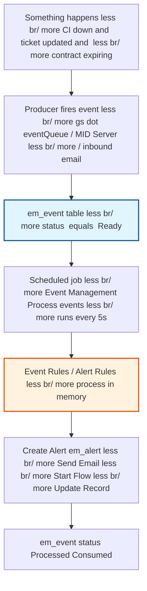

# Events in ServiceNow — When to Use Them (and When Not To)

**Agent:** Hermes
**Date:** 2026-11-20
**Module:** Events / Event Management / Notifications
**App:** Now Platform (Event Management, Notification Engine)
**Confidence:** high on tables/mechanics, **verify** on release-specific behavior

---

## Contents

- [Purpose](#purpose)
- [Five Reasons to Use Events](#five-reasons-to-use-events)
- [What an Event Is (ELI5)](#what-an-event-is-eli5)
- [Scenario: Incident Assignment — End-to-End](#scenario-incident-assignment--end-to-end)
- [Create and Trigger an Event — Step by Step](#create-and-trigger-an-event--step-by-step)
- [When to Use Events — Decision Guide](#when-to-use-events--decision-guide)
- [Many consumers — what can react to a single event?](#many-consumers--what-can-react-to-a-single-event)
- [Events vs Flow — Which One for Email?](#events-vs-flow--which-one-for-email)
- [Events vs Flow Designer](#events-vs-flow-designer)
- [Events vs Flow Designer — Interview Comparison](#events-vs-flow-designer--interview-comparison)
- [Interview Question: When Would You Use an Event?](#interview-question-when-would-you-use-an-event)
- [Key Tables & Breadcrumbs](#key-tables--breadcrumbs)
- [Important Terms to Remember](#important-terms-to-remember)
- [How Events Flow Through the System](#how-events-flow-through-the-system)
- [Event vs Alert vs Notification — Pick the Right One](#event-vs-alert-vs-notification--pick-the-right-one)
- [When NOT to Use Events](#when-not-to-use-events)
- [Fire a Custom Event (Quick Lab)](#fire-a-custom-event-quick-lab)
- [Common Mistakes](#common-mistakes)
- [Quiz](#quiz)
- [Official Resources](#official-resources)

- [Further learning:](#further-learning)
---

## Purpose

Events are ServiceNow's lightweight "something happened" signals. A CI goes down, a ticket is updated, a contract expires — an event fires, and anything listening can react (create an alert, send an email, start a flow, update a record). This guide covers **when to use events** (especially for email), which tables log them, and how to audit what happened.

---

## Five Reasons to Use Events

| Benefit | Explanation |
|---------|-------------|
| **Asynchronous processing** | Execute follow-up actions without making the user wait for them. |
| **Loose coupling** | The process generating the event doesn't need to know who will consume it. |
| **Reusability** | Multiple notifications or other event consumers can respond to the same event. |
| **Performance** | Move non-critical processing outside the current transaction. |
| **Centralized notifications** | Trigger email notifications through event-based conditions. |

Events help decouple processes, reduce dependencies, and trigger actions without putting all the logic inside a Business Rule or Flow.

---

## What an Event Is (ELI5)

Think of an event like a doorbell. Someone rings it (a CI fails, a ticket is updated, a contract nears expiry). The doorbell doesn't *do* the work itself — it just tells everyone inside that something happened. Each listener decides what to do: one person creates an alert, another sends an email, another kicks off a flow.

- **Producer:** The code/system that rings the doorbell (`gs.eventQueue()` from a business rule, a MID Server connector, an email inbound action).
- **Event record:** The doorbell chime itself — stored in `em_event`.
- **Consumer:** Anything that listens (event rules, alert management rules, notifications, flows).

---

## Scenario: Incident Assignment — End-to-End

An Incident is assigned to a new group, and you want to notify the group.

| Step | What happens | Detail |
|------|-------------|--------|
| **1. Business Rule** | Incident assignment changes. | An **After Update** Business Rule on `incident` detects `assignment_group.changes()`. |
| **2. Event is queued** | `gs.eventQueue()` | The rule queues the event with the new and previous group names. |
| **3. Event is processed** | Event appears in the queue | The event lands in `em_event` with status **Ready**. The "Event Management Process events" job (every ~5s) picks it up. |
| **4. Email Notification** | Notification listens for the registered event | An event-based email notification subscribed to the event name fires. |
| **5. Email is sent** | Assigned group receives notification | The group gets the email asynchronously — the user's save wasn't blocked. |

---

## Create and Trigger an Event — Step by Step

### Step 1: Register the event

Navigate to:

**Event Management → Administration → Event Registry**

(Table: `sysevent_register`)

Create an event with:

* **Event name:** `incident.assignment.changed`
* **Table:** Incident `[incident]`
* **Queue:** Default (unless you need a custom queue)
* **Description:** What the event means and when it fires

Custom events should be registered before being generated and consumed.

### Step 2: Trigger the event

Create an **After Update** Business Rule on Incident:

```javascript
(function executeRule(current, previous) {

    if (current.assignment_group.changes()) {

        gs.eventQueue(
            'incident.assignment.changed',
            current,
            current.assignment_group.getDisplayValue(),
            previous.assignment_group.getDisplayValue()
        );

    }

})(current, previous);
```

### `gs.eventQueue()` method signature

```javascript
gs.eventQueue(
    eventName,
    currentRecord,
    parm1,
    parm2
);
```

| Parameter | Purpose |
|-----------|---------|
| `eventName` | Registered event name (must match `sysevent_register.event_name`) |
| `currentRecord` | GlideRecord associated with the event (e.g. `current`) |
| `parm1` | First additional parameter (passed to consumers) |
| `parm2` | Second additional parameter (passed to consumers) |

### Step 3: Consume the event

You can create:

* **An Email Notification** that listens for `incident.assignment.changed`.
* **A Script Action** that executes server-side JavaScript when the event fires.

**For an email notification:**

* Navigate to **System Notification → Email → Notifications**.
* Create a notification.
* Set the table to Incident.
* Select the **event-based** sending option.
* Specify `incident.assignment.changed`.
* Configure recipients and email content.

The event's parameters (`parm1`, `parm2`) can also be used in notification scripts and templates.

---


## When to Use Events — Decision Guide

Use events when you need **decoupled, asynchronous reactions** — especially when one thing happening should trigger **multiple independent actions**, or when you must **pass context** to downstream consumers without blocking the user.

| Scenario | Use Events? | Why |
|----------|-------------|-----|
| One trigger, **multiple** independent reactions (e.g. incident resolved → send email + update CMDB + close related tasks) | ✅ Yes | One event fans out to many consumers |
| Passing contextual data to downstream consumers | ✅ Yes | Event parameters (parm1–parm4) carry data |
| **Async** processing that shouldn't block the user | ✅ Yes | Event is queued and processed later (~every 5s) |
| Single reaction to a record change (e.g. set a field when priority changes) | ❌ No | Use a Business Rule or UI Policy directly — simpler |
| Synchronous validation / must complete before user can save | ❌ No | Events are async; use a Business Rule (onBefore/onAfter) |
| High-volume streaming from many sources | ⚠️ Carefully | Use custom queues (`sysevent_queue`) to avoid flooding the default processor |
| Email triggered by a business event | ✅ Yes | Event-based email notification (`sysevent_email_action`) |
| Low-volume event collection **from** email | ✅ Yes | Inbound email action → `em_event` |

### Many consumers — what can react to a single event?

One fired event can be consumed by many independent systems at once. Each consumer decides what to do with it — none of them need to know about the others. Examples of consumers:

| Consumer | Table / Location | What it does on the event |
|----------|-----------------|---------------------------|
| **Event-based Email Notification** | `sysevent_email_action` | Sends an email to a person or group |
| **Event Rule / Alert Management Rule** | Event Management > Alert Rules | Creates or updates an alert (`em_alert`) |
| **Flow Designer flow** | Flow Designer > Flows (triggered by event) | Runs a multi-step process (approval, update, integration call) |
| **Custom script / Business Rule** | Reads `em_event` via script | Runs custom logic (call an external API, update a CMDB CI) |
| **Notification Engine** | System Notification > Email / SMS | Sends SMS, chat, or other channel alerts |
| **Event Management alert → Incident** | `em_alert` → `incident` | Auto-opens an incident for the on-call team |

**How the fan-out works:**
1. You fire the event once: `gs.eventQueue('sn_myapp.ci.down', current, ci_name, impact_severity)`
2. The event lands in `em_event` with status **Ready**
3. The "Event Management Process events" job (every ~5s) checks **every** subscriber whose `eventName` matches `sn_myapp.ci.down`
4. Each subscriber acts independently — one sends email, one creates an alert, one starts a flow — without knowing the others exist

This is the core value of events: **fire once, react many times.** If you later add a new consumer (e.g. a new team wants to be notified), you just create another subscription — you don't touch the firing code.

---

### The classic email example

You want to email the contract owner when a contract expires in 30 days.

**Event-based approach:**
1. Register the event (`sn_myapp.contract.expiring`) in **Event Registry** (`sysevent_register`).
2. A scheduled job or business rule fires the event via `gs.eventQueue()`, passing the contract owner's email as `parm1`.
3. Create an **Event-Based Email Notification** (`sysevent_email_action`) referencing that event name; use `eventParm1WithRecipient: true` so the email goes to the owner.
4. The notification fires asynchronously — the contract record save isn't blocked.

**Alternative (simpler):** A scheduled job querying expiring contracts and sending emails directly. Use events when you want the *event* to be reusable by other consumers too (e.g. also create an alert when a contract expires).

### Events vs Flow — Which One for Email?

**Scenario:** You need to email the contract owner when a contract expires in 30 days.

| | Flow Designer (scheduled flow) | Events + Event-Based Notification |
|---|---|---|
| **How it works** | A scheduled flow runs daily, queries `sn_contract` where expiry is in 30 days, and sends an email template to the owner. | A business rule on the contract table fires `gs.eventQueue('sn_myapp.contract.expiring', current, owner_email)` when expiry nears. An event-based notification subscribes to that event name and sends the email. |
| **Best when** | Email is the **only** action. Business owners edit it visually. No other system needs to react. | One business event triggers **multiple independent reactions** — or other teams might want to react to the same event later. |
| **Adding a second action later** (e.g. create an alert, start a fulfillment flow) | Rebuild the flow to add the new step — it's a closed loop. | Just add another consumer (event rule, flow, notification) that subscribes to the same event name. No change to the firing code. |
| **Timing** | Runs on the schedule you set (e.g. daily). | Near real-time — queued and processed by the "Event Management Process events" job every ~5 seconds. |
| **Blocking** | Async — doesn't block the user's save. | Async — doesn't block the user's save. |
| **Trade-off** | Simpler to build and maintain for a single output. | More moving parts (register event, fire it, create each consumer). Async delay. |

**Decision rule:**

| If your need is… | Choose |
|------------------|--------|
| *"When a contract expires, send one email."* | **Flow Designer** |
| *"When a contract expires, email **+** create an alert **+** start fulfillment."* | **Events** |
| *"Other teams should react to this event without me changing my firing code."* | **Events** |
| *"I need the email sent before the user can save the record."* | **Neither** — use a Business Rule (onBefore/onAfter). Events and Flow are both async. |

> **Bottom line:** Events aren't "better" for email — they're better when **email is part of a fan-out**, not the whole point. If email is the only output, a scheduled Flow is simpler. If email is one of several reactions to the same business event, events keep your consumers decoupled and reusable.

---

### Events vs Flow Designer

The key distinction:

* **Event:** Announces that something happened.
* **Flow:** Defines what should happen next.

For example:

An employee gets terminated.

An event could announce:

`employee.termination.completed`

Multiple consumers could react:

* HR notification.
* IT account deactivation.
* Asset recovery notification.
* Security audit logging.

Alternatively, a Flow could orchestrate the entire termination lifecycle, including approvals, task creation, integrations and notifications.

You can even use an event to initiate another process.

---

### Events vs Flow Designer — Interview Comparison

| Scenario | Recommended Approach |
|----------|---------------------|
| Send a notification when an incident is assigned | Event or Flow |
| Notify multiple independent consumers about something that happened | **Event** |
| Execute complex multi-step approvals | **Flow Designer** |
| Integrate with multiple systems using conditional logic | **Flow Designer** |
| Trigger a reusable server-side Script Action | **Event** |
| Perform a simple record update | **Business Rule or Flow** |
| Queue non-critical follow-up processing | **Event** |
| Orchestrate a complete business process | **Flow Designer** |

---

### Interview Question: When Would You Use an Event?

**Suggested answer:**

> "I use ServiceNow Events when I want to decouple the occurrence of an action from the processes that respond to it.
>
> For example, when an Incident assignment group changes, I can generate a custom event using `gs.eventQueue()`. That event can trigger an email notification or a Script Action asynchronously.
>
> I particularly prefer events when **multiple independent processes need to respond to the same occurrence**, or when I want **reusable event-driven processing**.
>
> However, I wouldn't introduce an event unnecessarily for a simple operation that can be handled directly through Flow Designer or a Business Rule."

**My recommendation for your ServiceNow developer interview:** Understand the difference between Events, Async Business Rules and Flow Designer. All three can support asynchronous processing, but they solve different architectural problems.

---


## Events for Email Notifications

| Direction | Mechanism | Table | When to use |
|-----------|-----------|-------|-------------|
| **Send email when an event fires** | Event-based notification (`generationType: event`) | `sysevent_email_action` | React to a business event (contract expiry, incident resolved) |
| **Collect events from inbound email** | Inbound Email Action → Event Management | `em_event` | Low-volume sources only; email content becomes an event record |

**Key rules for event-based email (from the ServiceNow SDK / Event Management docs):**
- The event **must be registered** in `sysevent_register` before a notification can reference it.
- Fire the event via a **Business Rule** using `gs.eventQueue('<event_name>', current, parm1, parm2)`.
- The notification references the event by its **name string** (not the sys_id). Mixing up sys_id vs name is a common failure.
- Query `sysevent_register` for the exact event name before using it — don't assume it exists.
- For inbound email: target table = `em_event`, enable "Email receiving"; the email content generates/updates events and normal event rules run afterward.
- **Email is for low-volume sources.** If you have high volume, use a script, SNMP trap, or MID Server connector instead.

---

## Key Tables & Breadcrumbs

| Table | Purpose | Breadcrumbs |
|-------|---------|-------------|
| **`em_event`** | Stores every event (status = Ready → processed → consumed) | Event Management > Events > All, or type `em_event.list` in the navigator filter |
| **`sysevent_register`** | Event Registry — register custom events before firing/consuming | Event Management > Administration > Event Registry |
| **`sysevent_email_action`** | Event-based email notifications | System Notification > Email > Notifications (event-based) |
| **`sysevent_queue`** | Custom event queues for high-volume / serial processing | Event Management > Administration > Event Queues |
| **`em_mapping_rule`** | Event field mappings (which event fields populate alert fields) | Event Management > Event Field Mapping |
| **`em_alert`** | Alerts generated from events | Event Management > Alerts > All |
| **`em_impact_status`** | Impact/severity after event processing | Event Management (internal) |

**Event processing scheduled job:** "Event Management Process events" (`sys_trigger`) runs every 5 seconds, reading `em_event` records with status **Ready**.

---

## How Events Flow Through the System



---

## Event vs Alert vs Notification — Pick the Right One

| Concept | Table | What it means | Use when |
|---------|-------|---------------|----------|
| **Event** | `em_event` | "Something happened" signal (raw data) | You need a lightweight, async trigger |
| **Alert** | `em_alert` | Processed, de-duplicated event ready for human action | You want operators to see/act on it |
| **Notification** | `sysevent_email_action` / `sysevent_email_action` | Email/SMS sent to a person or group | You need to notify a person |

> An event becomes an alert after event rules process it; an alert can trigger a notification. The chain is: **Event → Alert → Notification.**

---

## When NOT to Use Events

- **Single reaction to a record change.** A business rule updating a field is simpler, synchronous, and easier to debug than an event + consumer.
- **Must-complete-before-save validation.** Events are asynchronous; the record is already saved by the time the event is processed.
- **Directly extending `em_event` with custom fields.** ServiceNow explicitly advises against adding columns to `em_event` — put extra data in the **Additional information** field instead.
- **Business rules on `em_event` tables.** They don't run in the default REST URL used for event injection — a common source of "my business rule never fired" confusion.
- **High-volume email collection.** Use email only for low-volume sources; otherwise flood the event processor.

---

## Fire a Custom Event (Quick Lab)

**Prerequisite role:** `event_mgmt_admin` or `nlu_admin` for registry; `admin` to create notifications.

1. **Register the event:** Event Management > Administration > Event Registry → New → `event_name = sn_myapp.contract.expiring`, table = `sn_myapp_contract`, description = "Fired when a contract is 30 days from expiry", `fired_by` = traceable source.
2. **Fire it from a Business Rule** on the contract table (after insert/update, when expiry nears):
   ```js
   gs.eventQueue('sn_myapp.contract.expiring', current, current.u_owner.email, current.number);
   ```
3. **Create the notification:** System Notification > Email > Notifications → New → `generationType = event`, `eventName = sn_myapp.contract.expiring`, `eventParm1WithRecipient = true`.
4. **Test:** Update a contract to be 30 days from expiry → check `em_event` for a Ready record → check the owner's inbox.

---

## Common Mistakes

| Mistake | Why it fails | Fix |
|---------|--------------|-----|
| Notification references event by sys_id instead of name | Notifications match on the event **name string** | Use the `event_name` value from `sysevent_register` |
| Event not registered before firing | `gs.eventQueue` may succeed but nothing consumes | Register in `sysevent_register` first |
| Business rule on `em_event` not firing | Event injection uses a REST URL where BRs don't run | Use event rules / alert rules instead |
| Adding custom columns to `em_event` | Not supported; breaks upgrades | Store extra data in **Additional information** |
| Firing events synchronously in a high-volume loop | Floods the default 5s processor; delays all events | Use a custom queue (`sysevent_queue`) |
| Assuming the event name exists | Silently never fires if unregistered | Query `sysevent_register` for the exact name |

---

## Quiz

1. **What table stores every event?**  
   <details><summary>Answer</summary>`em_event` — events are written here with status = Ready, then processed by the "Event Management Process events" scheduled job every 5 seconds.</details>

2. **Where do you register a custom event before firing it?**  
   <details><summary>Answer</summary>`sysevent_register` (Event Registry) — Event Management > Administration > Event Registry. The event must exist before a notification or consumer can reference it.</details>

3. **How do you fire an event from a business rule?**  
   <details><summary>Answer</summary>`gs.eventQueue('<event_name>', current, parm1, parm2)` — queues the event asynchronously so it doesn't block the user's save.</details>

4. **Events vs alerts vs notifications — which is the raw signal?**  
   <details><summary>Answer</summary>Event (`em_event`). An alert (`em_alert`) is a processed, de-duplicated event ready for human action; a notification sends the email/SMS.</details>

5. **True or false: Use events for a single field update on a record change.**  
   <details><summary>Answer</summary>False — that's simpler and faster as a Business Rule. Use events for fan-out (one trigger → many consumers), context passing, or async processing.</details>

---

## Important Terms to Remember

| Term | Meaning |
|------|---------|
| **Event Registry** | Defines/registers events (table: `sysevent_register`) |
| **`sysevent` / `em_event`** | Event queue and event records. `em_event` is the Event Management table; some platform documentation references `sysevent`. Check your release. |
| **`gs.eventQueue()`** | Generates an event asynchronously |
| **Parm1 / Parm2** | Additional event parameters passed to consumers |
| **Notification** | Can listen for an event and send email |
| **Script Action** | Executes server-side logic in response to an event |
| **Event Processor** | Scheduled job ("Event Management Process events") that picks up queued events (~every 5s) |

---

## Official Resources

- [Event Management — What is an Event](https://support.servicenow.com/kb/kb_article_view.do?sysparm_article=KB0756665)
- [Event Management configuration preferences](https://www.servicenow.com/docs/r/it-operations-management/event-management/r_EMBestPractice.html)
- [Configure event collection from email](https://www.servicenow.com/docs/r/zurich/it-operations-management/event-management/t_EMConfigureEmailConnector.html)
- [Registering Events Guide (ServiceNow SDK)](https://servicenow.github.io/sdk/guides/registering-events-guide)
- [Email Notification Guide (ServiceNow SDK)](https://servicenow.github.io/sdk/4.12.0/guides/email-notification-guide)
- [ServiceNow – System Events](https://www.servicenow.com/docs/r/platform-administration/system-events/events.html)
- [ServiceNow – Create an Event](https://www.servicenow.com/docs/r/build-workflows/system-events/t_CreateYourOwnEvent.html)

> Verify table names, navigation paths, and release-specific behavior against your own instance and the official ServiceNow docs — this is a working notebook, not product documentation.

## Further learning:

Capabilities this guide does not cover in depth. Bullet points first; the deep dives are added below as they are researched.

- **Event registry and event rules** — `sysevent_register`, `em_event`, and the rule chain that turns a raw event into an alert or a notification.
- **gs.eventQueue / gs.eventQueueScheduled** — the scripted entry points; scheduled variants are what you want for anything that should not block a transaction.
- **Event-to-alert-to-notification chain** — events are transient, alerts are records, notifications are consumers; conflating them is the most common modelling mistake.
- **Email notifications vs Notify** — classic notification records versus the Notify product; know which one a given module uses before debugging 'no email'.
- **Event log retention** — the event log is high-volume; check retention and archiving before querying it in a dashboard.
- **Fan-out patterns** — one event, many consumers (notification, flow, integration); the queue is the only place to see whether a consumer actually ran.
- **Debugging** — System Logs plus the event queue; a registered event with no listener looks exactly like an event that never fired.

- **Verify in your instance**: most items above are plugin-gated (e.g. `com.snc.`) or release-specific; check *All › System Applications › All Available Applications* before relying on one.
