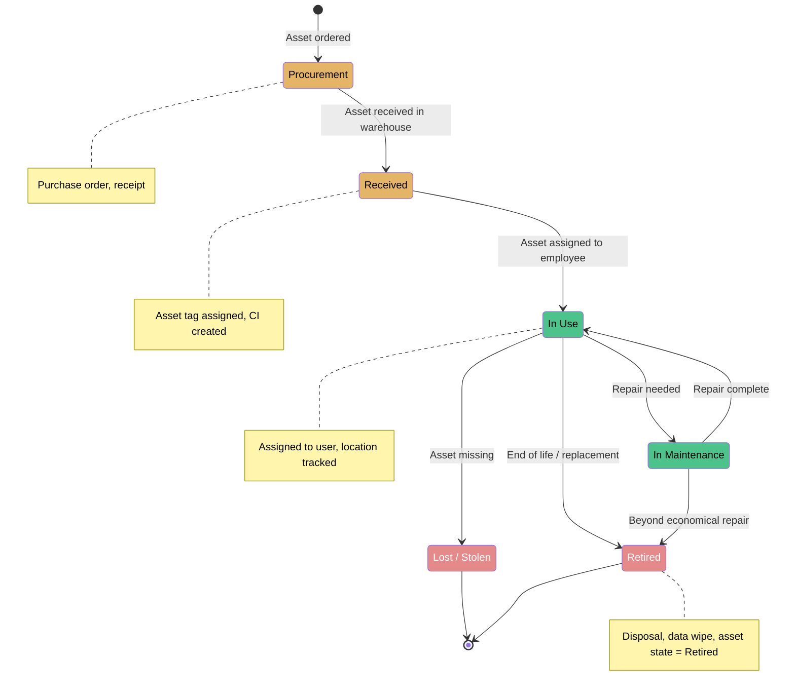
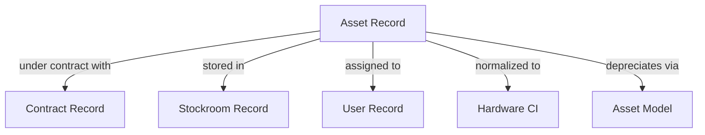
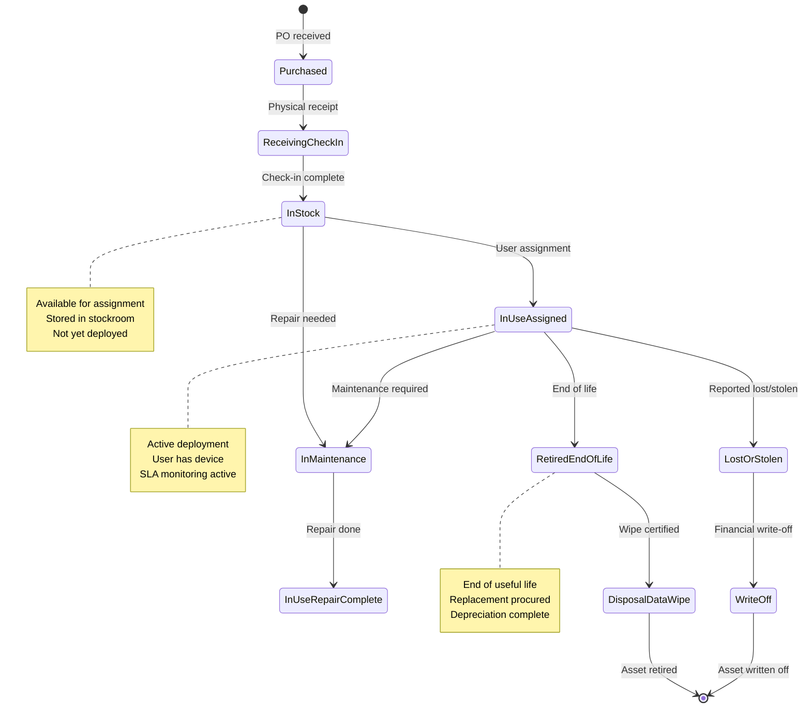

# HAM — Hardware Asset Management

**Agent:** opencode  
**Date:** 2026-11-05  
**Module:** HAM (Hardware Asset Management)  
**App:** ITAM  
**Confidence:** high  

---

## Contents

- [Purpose](#purpose)
- [Where to Find It](#where-to-find-it)
- [Official Exam Alignment — CIS-Hardware Asset Management](#official-exam-alignment--cis-hardware-asset-management)
- [HAM Asset Lifecycle Diagram](#ham-asset-lifecycle-diagram)
- [Asset vs CI Diagram](#asset-vs-ci-diagram)
- [Out-of-Box Values & Dropdowns](#out-of-box-values--dropdowns)
- [Re-usable Code / Metadata](#re-usable-code--metadata)
- [Out-of-Box Features](#out-of-box-features)
- [Key Table Hierarchy](#key-table-hierarchy)
- [Integrations](#integrations)
- [Key Fields](#key-fields)
- [Goals, Benefits & Key Metrics](#goals-benefits--key-metrics)
- [Core Concept Diagrams](#core-concept-diagrams)
- [Common Mistakes](#common-mistakes)
- [Deep Dive: File-Based Discovery and the Discovery Configuration Console](#deep-dive-file-based-discovery-and-the-discovery-configuration-console)
- [Deep Dive: File Signature Normalization (SAM)](#deep-dive-file-signature-normalization-sam)
- [Lab: Create Your First Asset](#lab-create-your-first-asset)
- [📺 Visual & Video Guides](#-visual--video-guides)
- [SLAs, Dashboards & Workspaces](#slas-dashboards--workspaces)
- [Quiz](#quiz)
- [🎓 Official Learning Resources](#-official-learning-resources)
- [Related Guides](#related-guides)

---

## Purpose

Hardware Asset Management (HAM) is the hardware-focused subset of ServiceNow IT Asset Management (ITAM). HAM tracks physical IT assets—laptops, servers, monitors, phones, printers, and other hardware—from procurement through disposal. HAM answers: *What do we own, where is it, who has it, when was it bought, when does it expire, and what does it cost?* HAM is distinct from SAM (Software Asset Management) though they share the ITAM application.

---

## Where to Find It

| Breadcrumb | Path |
|------------|------|
| Module entry | All > Asset Management > ... |
| Assets | All > Asset Management > Assets > All |
| Hardware | All > Asset Management > Assets > Hardware |
| Software | All > Asset Management > Assets > Software |
| Asset Models | All > Asset Management > Administration > Asset Models |
| Vendors | All > Asset Management > Vendors > All |
| Locations | All > Asset Management > Locations |
| Asset Categories | All > Asset Management > Administration > Categories |
| Asset States | All > Asset Management > Administration > States |
| Asset Lifecycle | All > Asset Management > Asset Lifecycle |
| Contracts | All > Asset Management > Contracts > All |

**Tip:** If menus are missing, verify the `com.snc.iam` (IT Asset Management) plugin is active (System Definition → Plugins).

---

## Official Exam Alignment — CIS-Hardware Asset Management

This guide maps to the **Certified Implementation Specialist – Hardware Asset Management (CIS-HAM)** exam blueprint (ServiceNow University, KB0011563). Exam weightings shown are the official domain percentages.

| Guide Section | CIS-HAM Domain | Exam Weight | What's Covered |
|---------------|-----------------|-------------|----------------|
| **Asset Lifecycle** | Domain 1: IT Asset Management Overview & Fundamentals — Hardware Asset Lifecycle | 20% | Asset lifecycle stages, asset models, HAM implementation best practices |
| **Asset vs CI / Data Integrity** | Domain 2: Data Integrity – Attributes and Data Sources — Assets vs CIs, Hardware Discovery and Normalization | 27% | Assets vs CIs, hardware model normalization, Discovery, NDS, CI classes |
| **Practical Management** | Domain 3: Practical Management of IT Assets — Consumables, Inventory, Audits, Retirement | 30% | Asset states, workflows, audits, contracts, change management |
| **Operational Integration** | Domain 4: Operational Integration — Reports/Dashboards, Requests and Procurement, Extending AM | 18% | Dashboards, procurement, asset/CI extension, data certification |
| **Financial Management** | Domain 5: Financial Management of IT Assets — Hardware Contract Financials, IT Cost Management | 5% | Contract rate cards, depreciation, TCO |

**Official preparation courses:**
- Welcome to ServiceNow
- ServiceNow Administration Fundamentals
- Get Started with Now Create
- ServiceNow Platform Implementation
- Hardware Asset Management (HAM) Fundamentals (or HAM Fundamentals - On Demand)

**Additional recommended resources:**
- Hardware Asset Simulator
- Additional Recommended Courses for Hardware Asset Management (HAM) Implementers

**Exam guidance:** Questions are based on official ServiceNow training materials, the ServiceNow Product documentation site, and the ServiceNow developer site.

---

## HAM Asset Lifecycle Diagram



**Exam focus:** Hardware asset lifecycle, stages, components, asset states, retirement workflows (20% + 30% of CIS-HAM exam).

---

## Asset vs CI Diagram

```mermaid
graph TD
    subgraph "Hardware Asset (alm_asset)"
        asset[Asset Record]
        asset -->|tracks| financial[Financial Data Cost, PO, Contract, Depreciation]
        asset -->|tracks| assignment[Assignment User, Location, Department]
    end
    
    subgraph "Configuration Item (cmdb_ci)"
        ci[CI Record]
        ci -->|tracks| technical[Technical Data OS, IP, Serial, CPU, RAM]
        ci -->|tracks| relationships[Relationships Runs on, Depends on, Connected to]
    end
    
    subgraph "The Link"
        asset -->|normalized to| ci
        ci -->|sourced from| asset
    end

    style asset fill:#e5b567,color:#000
    style ci fill:#0a0d10,stroke:#e5b567
    style financial fill:#10141a
    style technical fill:#10141a

```



**Key distinction for exam:**
- **Asset** (`alm_asset`): Financial and ownership view — cost, purchase date, contract, assigned user, depreciation
- **CI** (`cmdb_ci`): Technical and relationship view — OS, IP address, serial number, what it runs on/depends on
- **Normalization:** Discovery + NDS reconciles asset data to CI data, preventing duplicates

**Exam focus:** Assets vs CIs, hardware model normalization, asset and CI data synchronization (27% of CIS-HAM exam).

---

## Out-of-Box Values & Dropdowns

ServiceNow ships with predefined asset states and substates. Verify against your instance — values can vary by release (e.g., Rome release asset states are numeric 1–11).

### Asset State & Substate (install_status / install_substatus)
| State | Substates | When to Use |
|-------|-----------|-------------|
| `On Order` | — | Assets have only been ordered |
| `In Stock` | Available, Reserved, Defective, Pending repair, Pending install, Pending disposal, Pending transfer, Pre-allocated, On hold, Legal hold, Quarantine, Pending fulfillment, Pending certificate, Pending return, Test, End of support, Pending Retirement, Pending resale, Pending evaluation | Assets in storage needing assessment or confirmed broken |
| `In transit` | Available, Reserved, Defective, Pending install, Pending disposal, Pending donation, Pre-allocated, Pending resale | Assets on their way |
| `In Use` | Pending fulfillment, End of support, Pending retirement | Devices actively assigned to users and operational |
| `In maintenance` | — | Assets being repaired or scheduled for maintenance |
| `Retired` | Disposed, Pending disposal, Sold, Donated, Vendor credit, Lease return, Obsolete, RMA, Buy out, Pending resale | Asset completed its lifecycle |
| `Missing` | Lost, Stolen | Asset is lost or stolen |
| `Build` | — | Asset being prepared (usually for bundled assets) |

### Hardware Model Lifecycle Phase
| Phase | Description |
|-------|-------------|
| `Availability` | Model is available for purchase |
| `End of sale` | Model no longer sold by manufacturer |
| `End of support` | Manufacturer stops support |
| `End of extended support` | Extended support period ends |
| `End of life` | Model fully end of life |

**Exam focus (CIS-HAM Domain 2, 27%):** Asset states/substates, hardware model lifecycle phases, hardware model normalization.

---

## Re-usable Code / Metadata

### Application Scope

HAM is part of the ITAM application (`com.snc.iam`), not a fully scoped app. Tables use the `alm_` prefix convention.

| Scope Aspect | Detail |
|--------------|--------|
| Application | IT Asset Management (com.snc.iam) |
| Tables | `alm_asset`, `alm_hardware`, `alm_license`, `alm_asset_model`, `ast_contract` |
| Roles | `asset`, `itil`, `sam`, `sn_hamp_admin`, `admin` |

### Meta Data Patterns

| Metadata Element | Example | Notes |
|------------------|---------|-------|
| Application menu | `sn_iam.menu.main` | ITAM left-nav root |
| Module | `sn_iam.menu.assets` | Points to asset list |
| Asset Category | `alm_asset_category.hardware` | Hardware vs software vs contract |
| Asset State | `alm_asset_state.in_stock` | In stock, assigned, in repair, retired |
| UI Policy | `sn_iam.policy.validate_asset_tag` | Validates asset tag uniqueness |
| Business Rule | `sn_iam.rule.auto_assign_asset_tag` | Auto-generates asset tag |

### The re-usable metadata inventory

HAM is almost entirely reusable metadata — the asset records are the *output* of these definitions:

| Re-usable piece | What it is | Where it lives (breadcrumb) |
|-----------------|------------|------------------------------|
| **Model categories & models** | The master classification every asset hangs off: model categories (`cmdb_model_category`) group models (`alm_asset_model`), and the model drives lifecycle, depreciation, and normalization defaults for thousands of assets at once. Get this layer right and most of HAM follows. | All > Asset > **Models** / **Model Categories** |
| **Normalization rules & the Content Service** | CDS content plus your own normalization rules turn messy discovered names into clean publisher/product/version — applied automatically to every discovery import. File-signature rules are the file-level equivalent (see the FSN deep dive below, incl. `samp_custom_file_name` for in-house software). | All > Software Asset > **Normalization** · HAM content in the HAM guide's deep dives |
| **Stockrooms & stock rules** | Stockrooms (`alm_stockroom`) hold inventory; stock rules define reorder thresholds and transfer behaviour once, then fire automatically whenever stock moves. | All > Asset > **Stockrooms** / **Stock Rules** |
| **Depreciation schedules** | The financial write-down method (straight-line, etc.) and period defined once per model/category and applied to every asset in it — never per asset. | All > Asset > **Depreciation** |
| **Lifecycle flows (Flow Designer)** | HAM's refresh, disposal, RMA, and lease-return processes ship as flows: reusable, versioned automation that asset tasks invoke instead of ad-hoc scripts. | All > Process Automation > **Flow Designer** (HAM flows) |
| **Asset task & disposal templates** | Standard task sets for receiving, deploying, swapping, and disposing — a disposal *order* pattern (wipe, recycle, certificate) defined once and reused for every retirement. | All > Asset > **Asset Tasks** / **Disposal** |
| **Contract templates & terms** | Contract types, renewal terms, and coverage clauses defined once and instantiated per vendor agreement (`ast_contract`). | All > Contract > **Contracts** |
| **Catalog & procurement models** | The vendor catalog items and product models purchasing orders against — the same model record later becomes the asset's model, closing the procure-to-retire loop. | All > Self-Service > **Product Catalog** |

### Re-usable Code Snippets

#### Business Rule: Auto-generate Asset Tag

```javascript
(function rule(current, previous) {
    if (current.operation() == 'insert' && !current.asset_tag) {
        var gr = new GlideRecord('alm_asset');
        gr.addQuery('category', current.category);
        gr.orderByDesc('number');
        gr.setLimit(1);
        gr.query();
        var nextNum = 1;
        if (gr.next()) {
            var lastNum = gr.getValue('number');
            var match = lastNum.match(/(\d+)$/);
            if (match) {
                nextNum = parseInt(match[1]) + 1;
            }
        }
        var categoryGr = new GlideRecord('alm_asset_category');
        gr.addQuery('sys_id', current.category);
        gr.query();
        if (categoryGr.next()) {
            var prefix = categoryGr.getValue('name').substring(0,3).toUpperCase();
            current.asset_tag = prefix + '-' + String(nextNum).padStart(4, '0');
        }
    }
})(current, previous);
```

#### UI Policy: Validate Serial Number and Asset Tag

```javascript
(function rule(current) {
    if (current.serial_number && current.asset_tag) {
        var gr = new GlideRecord('alm_asset');
        gr.addQuery('serial_number', current.serial_number);
        gr.addQuery('sys_id', '!=', current.sys_id);
        gr.query();
        if (gr.next()) {
            g_form.showErrorMsg('serial_number', 'Serial number already exists on another asset');
        }
        gr.query();
        gr.addQuery('asset_tag', current.asset_tag);
        gr.addQuery('sys_id', '!=', current.sys_id);
        gr.query();
        if (gr.next()) {
            g_form.showErrorMsg('asset_tag', 'Asset tag already exists on another asset');
        }
    }
})(current);
```

#### Script Include: HAM Helper

```javascript
var HAMHelper = Class.create();
HAMHelper.prototype = Object.extendsObject(AbstractAjaxProcessor, {
    getAssetLifecycleStatus: function() {
        var assetSysId = this.getParameter('assetSysId');
        var gr = new GlideRecord('alm_asset');
        gr.addQuery('sys_id', assetSysId);
        gr.query();
        if (gr.next()) {
            var state = gr.getValue('state');
            var installStatus = gr.getValue('install_status');
            return JSON.stringify({
                asset_tag: gr.getValue('asset_tag'),
                state: gr.getDisplayValue('state'),
                install_status: gr.getDisplayValue('install_status'),
                is_retired: state == 'retired',
                is_available: state == 'in_stock'
            });
        }
        return '{}';
    },
    type: 'HAMHelper'
});
```

#### Business Rule: Sync Asset to CI

```javascript
(function rule(current, previous) {
    if (current.operation() == 'insert' && current.cmdb_ci) {
        var ciGr = new GlideRecord('cmdb_ci');
        gr.addQuery('sys_id', current.cmdb_ci);
        gr.query();
        if (ciGr.next()) {
            current.company = ciGr.getValue('company');
            current.location = ciGr.getValue('location');
        }
    }
})(current, previous);
```

---

## Out-of-Box Features

| Feature | Description | Where |
|---------|-------------|-------|
| Assets | All hardware/software assets | All > Asset Management > Assets > All |
| Hardware | Hardware-specific assets | All > Asset Management > Assets > Hardware |
| Software | Software licenses/installs | All > Asset Management > Assets > Software |
| Asset Models | Product models (Dell XPS 13, etc.) | All > Asset Management > Administration > Asset Models |
| Vendors | Suppliers/vendors | All > Asset Management > Vendors > All |
| Contracts | Maintenance/support contracts | All > Asset Management > Contracts > All |
| Asset Lifecycle | Procure → Receive → Deploy → Maintain → Retire | All > Asset Management > Asset Lifecycle |
| Procurement | Purchase orders and receiving | All > Asset Management > Procurement |
| Asset Categories | Categorize assets | All > Asset Management > Administration > Categories |
| Asset States | Lifecycle states | All > Asset Management > Administration > States |

---

## Key Table Hierarchy

### Core Tables

| Table | Purpose | Extends | Key Fields |
|-------|---------|---------|------------|
| `alm_asset` | Core asset record | `task` | `number`, `name`, `category`, `state`, `asset_tag`, `serial_number`, `purchase_date`, `cost`, `assigned_to`, `location`, `vendor`, `employment_type` |
| `alm_hardware` | Hardware-specific fields | `alm_asset` | `serial_number`, `mac_address`, `warranty_expiration`, `manufacturer`, `model_number` |
| `alm_license` | Software license | `task` | `name`, `license_count`, `installation_count`, `license_type`, `expiration_date` |
| `alm_asset_model` | Asset model definition | `task` | `name`, `manufacturer`, `category`, `model_number` |
| `ast_contract` | Maintenance/support contract | `task` | `name`, `vendor`, `start_date`, `end_date`, `renewal_date`, `contract_value` |
| `cmdb_ci_hardware` | Hardware CI | `cmdb_ci` | `name`, `serial_number`, `discovery_source`, `operational_status` |

### Table Relationships

```
alm_asset_model
    │
    ├──► alm_asset (many assets per model)
    │
alm_asset
    │
    ├──► cmdb_ci_hardware (one asset → one CI)
    ├──► customer_account (assigned to account/user)
    ├──► ast_contract (linked contracts)
    ├──► location (where asset is)
    │
cmdb_ci_hardware
    │
    ├──► cmdb_ci (extends CI table)
    │
ast_contract
    │
    ├──► alm_asset (assets under contract)
```

### CMDB Integration

| HAM Table | Maps to CMDB Table | Relationship |
|-----------|-------------------|--------------|
| `alm_asset` | `cmdb_ci_hardware` | Links via `cmdb_ci` field |
| `alm_asset_model` | `cmdb_ci_model` | Model reference |
| `alm_hardware` | `cmdb_ci_hardware` | Hardware details |
| `sn_sales_product` | `cmdb_ci` | Product as CI |

---

## Integrations

| Integration | Direction | Purpose | Protocol |
|-------------|-----------|---------|----------|
| Discovery (MID Server) | Inbound | Auto-discover hardware on network | Discovery/MID Server |
| SCCM/Intune | Inbound | Import hardware from Microsoft endpoints | Service Graph Connector |
| Jamf | Inbound | Import Mac assets | Service Graph Connector |
| AWS/Azure | Inbound | Import cloud instances | Service Graph Connector |
| vCenter | Inbound | Import VMware servers | Service Graph Connector |
| Procurement | Outbound | Create purchase orders | Internal/REST |
| Contract Management | Outbound | Link assets to maintenance contracts | Internal |
| CMDB | Bidirectional | Assets ↔ CIs | Internal |
| Financial | Outbound | Push asset costs to finance system | REST/SFTP |
| Barcode/RFID | Inbound | Scan asset tags during audits | Barcode/RFID readers |

---

## Key Fields

| Table | Field | Type | Why It Matters |
|-------|-------|------|----------------|
| `alm_asset` | `number` | String | Auto-number; unique asset identifier |
| `alm_asset` | `asset_tag` | String | Physical sticker number; must be unique |
| `alm_asset` | `category` | Choice | Determines which fields appear |
| `alm_asset` | `state` | Choice | In stock, assigned, in repair, retired |
| `alm_asset` | `serial_number` | String | Manufacturer serial; warranty link |
| `alm_asset` | `purchase_date` | Date | Warranty start, depreciation |
| `alm_asset` | `cost` | Currency | Purchase price; TCO calculation |
| `alm_asset` | `assigned_to` | Reference | Who has the asset |
| `alm_asset` | `location` | Reference | Physical location |
| `alm_asset` | `vendor` | Reference | Who sold it |
| `alm_asset` | `model_id` | Reference | Make/model of asset |
| `alm_asset` | `employment_type` | Choice | Owned, leased, rented |
| `alm_hardware` | `serial_number` | String | Hardware serial number |
| `alm_hardware` | `mac_address` | String | Network MAC address |
| `alm_hardware` | `warranty_expiration` | Date | Warranty end date |
| `ast_contract` | `start_date` | Date | Contract start |
| `ast_contract` | `end_date` | Date | Contract expiration |
| `ast_contract` | `renewal_date` | Date | When to renew |
| `alm_asset_model` | `name` | String | Model name (e.g., "Dell XPS 13") |
| `alm_asset_model` | `manufacturer` | String | Manufacturer (e.g., Dell) |

---

## Goals, Benefits & Key Metrics

HAM's business goals center on maintaining an accurate hardware asset inventory and controlling cost from procurement through retirement.

|| Business Goal | Benefit | Example Key Metric | Example Value |
|----------------|-------------|--------------------|----------------|
|| Complete hardware inventory | Foundation for ITAM decisions | Inventory completeness | ≥ 98% of procured assets recorded |
|| Cost control and TCO | Optimize purchasing and renewals | Asset utilization rate | ~72% in use; target ≥ 70% |
|| TCO management | Reduce lifecycle cost | TCO and cost avoidance via reuse | ~15% reduction over 3 years |
|| Retirement compliance | Reduce orphaned assets | Asset retirement compliance rate | ≥ 98% |
|| Financial data accuracy | Accurate cost tracking | Depreciation and cost accuracy | ≥ 95% |
|| License compliance | Prevent over and under purchasing | License compliance rate | ≥ 95% |

**Example targets:** ~70% asset utilization, ~98% retirement compliance, and ~98% inventory completeness.

---

## Core Concept Diagrams

### Asset Lifecycle Journey

```mermaid
flowchart TD
    PO[Purchased] --> RC[Receiving Check In]
    RC --> IS[In Stock]
    IS --> AS[In Use Assigned]
    AS --> IM[In Maintenance Repair]
    IM --> AS2[In Use Repair Complete]
    AS --> RT[Retired End Of Life]
    RT --> DP[Disposal Data Wipe]
    AS --> LOST[Lost Or Stolen]
    LOST --> WR[Write Off]

### Asset to CI Normalization Link

```mermaid
flowchart LR
    subgraph ITAM["ITAM View Asset"]
        A[Asset Record]
        A --> FIN[Financial Data Cost PO Contract Depreciation]
        A --> ASG[Assignment Data User Location]
    end
    subgraph CMDB["CMDB View CI"]
        C[CI Record]
        C --> TEC[Technical Data OS IP Serial]
        C --> REL[Relationships Runs On Depends On]
    end
    A -->|Normalized via NDS| C
    C -->|Sourced From Asset| A
```

### Asset Relationship Map



---

---

### 📊 HAM vs ITAM vs CMDB Comparison

```mermaid
flowchart TD
    subgraph "HAM — Hardware Asset Management"
        HAM[Asset Record] -->|install_status| STATE[State: Purchased, In Stock, In Use, Retired]
        HAM --> FIN[Financial Data Cost, PO, Contract, Depreciation]
        HAM --> ASG[Assignment Data User, Location, Department]
    end
    
    subgraph "ITAM — IT Asset Management (umbrella)"
        HAM -->|normalized via NDS| CMDB[CMDB CI Record]
        HAM --> CONTRACT[Contract/PO Link]
        HAM --> MODEL[Asset Model]
    end
    
    subgraph "CMDB — Configuration Management Database"
        CMDB --> TEC[Technical Data OS, IP Address, Serial Number]
        CMDB --> REL[Relationships Runs On, Depends On, Connected To]
        CMDB --> SERVICES[Business Services Mapped via CSDM]
    end
    
    HAM -.->|Financial view| ITAM
    CMDB -.->|Technical view| ITAM
    
    style HAM fill:#e5b567,color:#000
    style ITAM fill:#4cc38a,color:#000
    style CMDB fill:#4d96ff,color:#fff
    
    note right of HAM
        HAM tracks:
        - Physical hardware assets
        - Procurement → retirement lifecycle
        - Financial ownership & depreciation
        - Assignment to users/locations
    end note
    
    note right of CMDB
        CMDB tracks:
        - Technical configuration items
        - OS, network, relationships
        - Business service dependencies
        - CSDM framework alignment
    end note
    
    note right of ITAM
        ITAM unifies:
        - HAM (hardware) + SAM (software)
        - Financial + technical views
        - Cost optimization & compliance
    end note
```

---

### 📊 Asset Lifecycle with Discovery Integration

```mermaid
flowchart LR
    subgraph "Procurement"
        REQ[Request Submitted] --> APPROVE[Approval Workflow]
        APPROVE --> PO[Purchase Order Created]
        PO --> VENDOR[Vendor Ships Equipment]
    end
    
    subgraph "Receiving & Check-In"
        VENDOR --> RECEIVED[Received at Facility]
        RECEIVED --> CHECKIN[Check-In Record Created]
        CHECKIN --> INSTOCK[In Stock State]
    end
    
    subgraph "Assignment & Discovery"
        INSTOCK --> ASSIGN[Assigned to User/Location]
        ASSIGN --> DISCOVER[Discovery Scans Device]
        DISCOVER --> NORMALIZE[NDS Normalization]
        NORMALIZE --> CMDB[CI Created/Updated in CMDB]
    end
    
    subgraph "Maintenance & Retirement"
        CMDB --> ACTIVE[Active Asset Lifecycle]
        ACTIVE --> MAINT[Maintenance/Repair]
        MAINT --> ACTIVE
        ACTIVE --> RETIRE[Retirement Initiated]
        RETIRE --> WIPE[Data Wipe Certified]
        WIPE --> DISPOSAL[Disposal Completed]
    end
    
    style INSTOCK fill:#6bcb77,color:#fff
    style CMDB fill:#4d96ff,color:#fff
    style ACTIVE fill:#ffd93d,color:#000
    style DISPOSAL fill:#ff6b6b,color:#fff
    
    note right of DISCOVER
        Discovery integration:
        - MID Server scans device
        - Serial number captured
        - CI normalized to asset
        - Relationships discovered
    end note
```

---

### 📊 Asset State Machine


## Common Mistakes

|| Mistake | Symptom | Fix |
|---------|---------|-----|
| Creating assets without categories | Asset form missing fields | Define categories first |
| Duplicate asset tags | Can't identify physical asset | Enforce unique asset tags |
| Missing serial numbers | Can't claim warranty | Record serial at receipt |
| Not retiring old assets | Reports show ghost assets | Retire assets when replaced |
| Creating asset without location | Can't find physical asset | Require location field |
| Confusing asset with CI | Duplicate records | Understand asset vs CI distinction |
| Not linking contract to asset | Missed renewal dates | Link contract to asset |
| Backdating purchase dates | Wrong depreciation | Use actual purchase date |

---

## Deep Dive: File-Based Discovery and the Discovery Configuration Console

> **Full module:** File-Based Discovery now has a complete home in the [Discovery module guide](../discovery/discovery-guide.md) — console areas, the filtering model, worked examples, and the three-step run-and-verify procedure (Status record + the `snc_tmp_*.tmp` scan file on the target). This section keeps the SAM-side configuration view.

File-Based Discovery finds installed software on Windows, UNIX/Linux, and macOS machines from the files actually on disk — even when the software left no registration data (no installer record, no registry entry). It runs during the **exploration phase** of a normal Discovery, via the MID Server, and its results feed File Signature Normalization (next section) and the software installation records SAM reconciles against.

**Prerequisites**

- The **File-based Discovery plugin** (`com.snc.discovery.file_based_discovery`) must be activated — it is included with the Discovery subscription but activation has to be requested. Activating it also activates the SAM File Signature Normalization plugin (`com.snc.file_signature_normalization`).
- Role required: **admin**.
- File-Based Discovery does not trigger until the initial **Content Data Service (CDS) synchronization** has occurred — allow roughly 24 hours for the first CDS data set.
- It is **disabled by default**, to avoid performance impact.

### Breadcrumbs — Getting There and Everything Related

| Destination | Breadcrumb |
|-------------|------------|
| **Discovery Configuration Console** (enable + configure) | All > Discovery > Discovery Definition > **Configuration Console** |
| Discovery home / dashboard | All > Discovery > Dashboard |
| Discovery schedules (what runs, when) | All > Discovery > Discovery Definition > Schedules |
| Discovery status and logs (did the run work?) | All > Discovery > Status · All > Discovery > Discovery Log |
| MID Servers (the probes run from here) | All > Discovery > MID Servers |
| File discovery probes | All > Discovery > Discovery Definition > Probes → **Windows - File discovery** / **UNIX - File discovery** (the Windows probe carries the signed `filebaseddiscovery.ps1` script as a probe parameter) |
| Internal file-discovery properties | Type `discovery_private_properties.list` in the navigator filter (table: `discovery_private_properties`) |
| Wildcard / blacklist properties (system properties) | `glide.discovery.file_discovery.wildcard.windows` · `glide.discovery.file_discovery.blacklist.windows` (edited through the console's Extensions sections) |
| Software installations created | `cmdb_sam_sw_install` |
| Files that matched nothing | `cmdb_unidentified_file_set` (reviewed by `sam_admin` — see File Signature Normalization below) |
| SWID tags (if enabled in the console) | `cmdb_swid_tag` |

### Configuring It in the Console

1. **Enable File Based Discovery** — the master toggle at the top of the console (toggle right = on).
2. **Windows section**
   - **Add %PATH% Folders To Scan List** — optionally include every folder on the system `%PATH%`.
   - **Folders To Scan** — where Discovery looks. Defaults include `c:\program files*` and `%PATH%`. Add more with the path field + **Add Path**. To scan an entire drive, set the target path to `C:/`.
     - *Scan-time tip:* Windows server scans are significantly faster if the default `c:\windows` folder is removed from the scan list.
   - **Folders To Ignore** — folders (and their children) carved out of the scan list, e.g. `C:\Program Files\Temp`.
   - **Extensions Blacklist** — extensions dropped on sight (see filtering rules below).
   - **Extensions Wildcards** — additional extensions to collect (see filtering rules below).
   - **Advanced** — platform-specific tuning.
3. **Unix section** — the same folder/extension controls for UNIX/Linux targets.
4. **Common section**
   - **Maximum Files** — cap on files discovered per target (100000 in the console example).
   - **Frequency** — how often File-Based Discovery re-runs against a CI. **Monthly by default.** After a CI is scanned, File-Based Discovery will not run on it again until this interval expires — a too-long interval is a common reason "File-Based Discovery didn't trigger."

### How the Filtering Actually Works (a common misconception)

It is **not** true that everything outside your extension wildcards is ignored. File-Based Discovery uses a layered filtering system:

1. **The Core Target List (content-based).** ServiceNow automatically looks for files that match your active Software Signatures and File Signatures. If a signature specifies a file like `app.exe` or `version.txt`, Discovery looks for it **regardless** of the wildcard properties.
2. **The Extension Wildcards (additive).** The property `glide.discovery.file_discovery.wildcard.windows` tells the system: *"In addition to the specific files required by my software signatures, also collect and evaluate any file that ends with these extensions."*
3. **The Exclusion List (blacklist, hard filter).** The property `glide.discovery.file_discovery.blacklist.windows` acts as a hard filter: if a file matches a blacklisted extension (like `.log` or `.tmp`), it is dropped immediately — even if a signature or wildcard would otherwise have included it.

**The rule of thumb**

- If a file matches your **blacklist**, it is ignored.
- If a file matches a **Software/File Signature**, it is collected.
- If a file matches an **extension wildcard**, it is collected.
- If a file matches **none of the above**, it is ignored.

Collected files are matched against the CDS by name, size, and version; anything unmatched lands in `cmdb_unidentified_file_set` for a SAM admin to normalize — which is exactly the workflow in the next section.

---

## Deep Dive: File Signature Normalization (SAM)

File Signature Normalization is a feature of the Software Asset Management (SAM) application that maps discovered file attributes (such as name, size, version, and binary signatures) to standardized entries in the Content Data Service (CDS).

### How It Works

- **Discovery Mapping:** During Discovery jobs, raw file details gathered from endpoints are compared against known CDS signatures to automatically create normalized software installation records.
- **Unidentified Files:** If a discovered file (like a custom or unrecognized .exe) is not in the content library, the system generates a `cmdb_unidentified_file_set` record. A SAM administrator (`sam_admin` role) can review these and create custom normalization rules, which can optionally sync back to the CDS.
- **Duplicate Handling:** If identical or overlapping software installations are discovered from multiple sources, File Signature Normalization marks duplicate records as inactive by default.
- **Required Plugin:** This functionality requires activating the File Signature Normalization plugin (`com.snc.file_signature_normalization`) alongside Software Asset Management.

### Tables It Introduces

| Table | Purpose |
|-------|---------|
| `samp_file_set` | Discovered file sets matched against signatures |
| `samp_file_map` | Mapping between discovered files and normalized entries |
| `samp_file_name` | Known file names from the content library |
| `samp_custom_file_name` | Custom file-name rules created by SAM admins |
| `cmdb_unidentified_file_set` | Discovered files with no CDS match, queued for admin review |

**Why it matters here:** HAM and SAM share the same discovered-data pipeline. Normalization quality decides whether discovered installs reconcile cleanly against entitlements — unnormalized or duplicated installs are how a license position quietly becomes fiction.

---


### Worked Example: `superman.exe` → DC Comics Software

Assume File-Based Discovery is configured to find all files that end in `.exe` or `.dll` (see the Discovery guide for the console setup):

1. Discovered file information called **superman.exe** is sent to the MID Server and is compared, **based on the name**, against a synchronized list from the Instance.
2. If **superman.exe** is on the list of files of potential software packages, the file is sent via the payload to the ServiceNow Instance.
3. The ServiceNow Instance Sensor then processes the **superman.exe** file using the **Name, Size, and Version** to match it to a software package called **DC Comics Software**.
4. If a match is found, a **software installation record is created** (normalized, in `cmdb_sam_sw_install`).

**If a match is not found**, the file is added to the **Unidentified File Set** [`cmdb_unidentified_file_set`] table:

- Users with the **sam_admin** role can create **custom file signature rules** for unidentified files manually.
- The **next time Discovery runs**, the file will be associated with the customized mapping.
- Customers that opt in to the content service can have their custom file signatures **sent to the CDS** for analysis and inclusion in the content service for future discovery.

The attributes used for the match, every time: **file name**, **file size**, and **version** — if any of the three is wrong or missing in your discovered data, expect the match to fail and the file to land in the Unidentified File Set.

## Lab: Create Your First Asset

1. **Navigate** to All > Asset Management > Assets > All
2. **Click New** and fill:
   - Name: Laptop for Sarah - Dell XPS 13
   - Category: Hardware > Computer > Laptop
   - Asset Tag: AST-001234
   - Serial Number: FCH12345678
   - State: In Stock
   - Purchase Date: Today's date
   - Cost: 1200.00
   - Vendor: Dell Technologies
   - Model: Dell XPS 13 (create if needed)
   - Location: New York Office
3. **Submit** and note the asset number
4. **Open** the asset record → change State to "Assigned"
5. **Set** Assigned To: Select an employee (e.g., Sarah Jenkins)
6. **Add** a note: "Issued to Sarah for her new role"
7. **Create** a contract record:
   - Name: Dell Support Contract 2026
   - Vendor: Dell Technologies
   - Start Date: Today
   - End Date: 3 years from today
   - Contract Value: 300.00
8. **Link** the contract to the asset in Related Lists
9. **Change** asset state to "Retired" (simulate end of life)
10. **Verify** in Related Lists: CI, Contracts, Transfers, History


---


## 📺 Visual & Video Guides

### HAM Overview
<div style="text-align: center; margin: 1.5rem 0;">
  <iframe width="560" height="315" src=" title="HAM Overview" frameborder="0" allow="accelerometer; autoplay; clipboard-write; encrypted-media; gyroscope; picture-in-picture" allowfullscreen></iframe>
</div>

Fallback link: [HAM Overview]()

---


## 📺 Visual & Video Guides

### HAM Overview
<div style="text-align: center; margin: 1.5rem 0;">
  <iframe width="560" height="315" src=" title="HAM Overview" frameborder="0" allow="accelerometer; autoplay; clipboard-write; encrypted-media; gyroscope; picture-in-picture" allowfullscreen></iframe>
</div>

Fallback link: [HAM Overview]()
---

## SLAs, Dashboards & Workspaces

### SLA Support
- **task_sla usage**: Hardware assets tracked via `alm_asset` leveraging Task SLA for maintenance and lifecycle milestones. SLAs are attached to asset lifecycle states (e.g., warranty expiration, retirement milestones) and contract end dates.
- **Module-specific SLA tables**: `alm_asset` (primary), `ast_contract` (contract-linked SLAs). SLA policies are driven by contract terms and asset state transitions.
- **Typical metrics**: Asset SLA attainment (warranty compliance), contract renewal timeliness, retirement adherence rate.

### OOTB Dashboards
- **Hardware Asset Management Dashboard**: Shows asset lifecycle distribution, warranty status, retirement compliance, and asset utilization by category.

### OOTB Workspaces
- **Hardware Asset Workspace**: `All > Asset Management > Hardware Asset Management`. Breadcrumb: `All > Asset Management > Hardware Asset Management`.

## Quiz

1. What is the difference between `alm_asset` and `cmdb_ci`?
<details><summary>Answer</summary>Asset = Financial/Contractual; CI = Operational/Technical.</details>

2. Which table holds software license information?
<details><summary>Answer</summary>alm_license</details>

3. What are the asset lifecycle states?
<details><summary>Answer</summary>In Stock, In Use, Retired, Stolen, etc.</details>

4. Why is asset tag critical?
<details><summary>Answer</summary>Unique identifier for physical tracking.</details>

5. How do you link an asset to a contract?
<details><summary>Answer</summary>Via the alm_asset -> ast_contract relationship.</details>

---

---

---

## 🎓 Official Learning Resources

To avoid unofficial or outdated content, always use these validated official ServiceNow sources:

### 📺 Verified Videos & Playlists

### 🚀 Quick Start Guide
For those new to the module, we recommend starting with this official overview:
<div style="text-align: center; margin: 1.5rem 0;">
  <iframe width="560" height="315" src="https://www.youtube.com/embed/YtPp0O4v1o4" title="Hardware Asset Management Beginner Overview" frameborder="0" allow="accelerometer; autoplay; clipboard-write; encrypted-media; gyroscope; picture-in-picture" allowfullscreen></iframe>
</div>
Fallback link: [Hardware Asset Management Official Overview](https://www.youtube.com/watch?v=YtPp0O4v1o4)


- [Ask a Ranger: Hardware Asset Management](https://www.youtube.com/playlist?list=PLkGSnjw5y2U4MVzsIHSsDG0EC_zvsgOvY)
- [ServiceNow Exchange: Asset Management](https://www.youtube.com/playlist?list=PLkGSnjw5y2U6mJf9RGdaTZd8e2oiUWyS7)
- [Hardware Asset Management | Overview (Docs, 2026)](https://www.youtube.com/watch?v=YtPp0O4v1o4)
- [Hardware Asset Management: Setup and Success Guide (Part 1)](https://www.youtube.com/watch?v=v3s6-Rx36xg)
- [Installing Hardware Asset Management (HAM) – Part 1](https://www.youtube.com/watch?v=lAyVRyzHRp0)
- [Installing Hardware Asset Management (HAM) – Part 2](https://www.youtube.com/watch?v=oVjh-WUJhkE)

### 🚀 The Authoritative Path
1. **Now Learning (Structured Training)**
   - The only official source for certification paths and structured video courses.
   - [Go to Now Learning Portal](https://nowlearning.com/) $\rightarrow$ Search for "Hardware Asset Management"
   
2. **Product Documentation (Technical Reference)**
   - The definitive source for every table, field, and OOB behavior.
   - [ServiceNow Product Documentation](https://docs.servicenow.com/) $\rightarrow$ Search for "Hardware Asset Management"

## 💡 Memory Aids & Mnemonics

<details>
<summary>💡 Click to reveal mnemonics & memory aids</summary>

### Business Rule Types — BAA
| Mnemonic | Type | When It Runs | Use Case |
|----------|------|--------------|----------|
| **B**efore | before | Before DB write | Validate/modify data, cancel save (`abort = true`) |
| **A**fter | after | After DB write | Create related records, send notifications |
| **A**sync | async | After commit (separate thread) | Long-running tasks — emails, REST calls, integrations |

**Remember:** **BAA** = Before, After, Async — and they run in that order.

---

### Client Script Types — LOCS
| Mnemonic | Type | When It Runs | Use Case |
|----------|------|--------------|----------|
| **L**oad | onLoad | Form opens | Set defaults, show/hide fields, UI initialization |
| **O**nChange | onChange | Field value changes | Dynamic field behavior, cross-field validation |
| **C**lick | onSubmit | User clicks Save | Final validation before form submits |
| **S**ave | onCellEdit | List cell edits | Inline list editing validation |

**Remember:** **LOCS** = Load, OnChange, Click (Submit), CellEdit (Save).

---

### UI Policy vs Data Policy vs Client Script
| Mnemonic | What | Where It Runs | Scope |
|----------|------|---------------|-------|
| **U**I | UI Policy | Browser (form load/change) | UI behavior only — mandatory, read-only, visible |
| **D**ata | Data Policy | Server (every save path) | Data integrity — form, API, import, all writes |
| **C**lient | Client Script | Browser only | UX feedback — can be bypassed by API/import saves |

**Remember:** **U**→UI (looks), **D**→Data (truth), **C**→Client (feel). Never rely on Client Script for security.

---

### IRE — Identification Before Reconciliation
**Mnemonic:** **I before R**

1. **I**dentification = "Does this CI already exist?" → match existing CI or create new
2. **R**econciliation = "Whose data wins for each field?" → update attributes on matched CI

**Remember:** You can't reconcile what you haven't identified first. Identification runs first; reconciliation only runs on matched CIs.

---

### Update Set Conflicts — ARM
| Mnemonic | Option | What It Does | When to Use |
|----------|--------|--------------|-------------|
| **A**ccept | Accept Remote | Update Set version overwrites target | Update Set version is newer/correct |
| **S**kip | Skip remote update | Keep target instance's version | Target has a fix that must be preserved |
| **M**erge | Merge | Review both versions, combine manually | Both versions have valid changes |

**Remember:** **ARM** = Accept Remote, Skip remote, Merge. For script conflicts (Business Rules, Script Includes), always choose **Merge**.

---

### CMDB — Retire Before Delete
**Mnemonic:** **R before D**

- **R**etire: Set `install_status = retired` — keeps `cmdb_rel_ci` relationships intact for historical impact analysis
- **D**elete: Hard delete — breaks `cmdb_rel_ci` parent/child references, orphaned incidents

**Remember:** Always retire, never delete.

---

### Order vs Priority — Lower = First
| Feature | Ordering Field | Lower Number = |
|---------|---------------|----------------|
| Business Rule | `Order` | Runs first |
| UI Policy | `Order` | Runs first |
| Decision Table | `Order` | Runs first |
| Scheduled Job | `Priority` | Runs first |
| Identification Rule entry | `Priority` | Runs first |
| Reconciliation Rule | `Priority` | Runs first |

**Remember:** **Lower number = runs first**, regardless of whether the field is called `Order` or `Priority`.

---

### Transform Script — Coalesce = Match
| Mnemonic | Setting | Result |
|----------|---------|--------|
| **C**oalesce | `coalesce = true` | Update existing CI (match on key fields) |
| **N**o coalesce | `coalesce = false` | Insert new CI (create duplicate) |

**Remember:** **Coalesce** = "come together" = match existing records instead of duplicating.

---

### Debugging — Log First, Then Debug
| Context | Primary Tool | Command |
|---------|-------------|---------|
| **S**erver | System Log (`sys_log`) | `gs.print()`, `gs.error()`, `gs.info()` |
| **C**lient | Browser Console (F12) | `console.log()`, `debugger;` |
| **B**oth | Script Debugger | Breakpoints, step-through, variable inspection |

**Remember:** **Log first** — `gs.print()` for server, `console.log()` for client. `console.log()` does NOT work in server-side business rules.

---

</details>

---

## Related Guides

- [CMDB guide](./cmdb-guide.md)
- [Discovery guide](./discovery-guide.md)
- [ITSM guide](./itsm-guide.md)
- [CSM guide](./csm-guide.md)
- [FSM guide](./fsm-guide.md)
- [HAM getting-started](./../../getting-started/ham.md)

---
