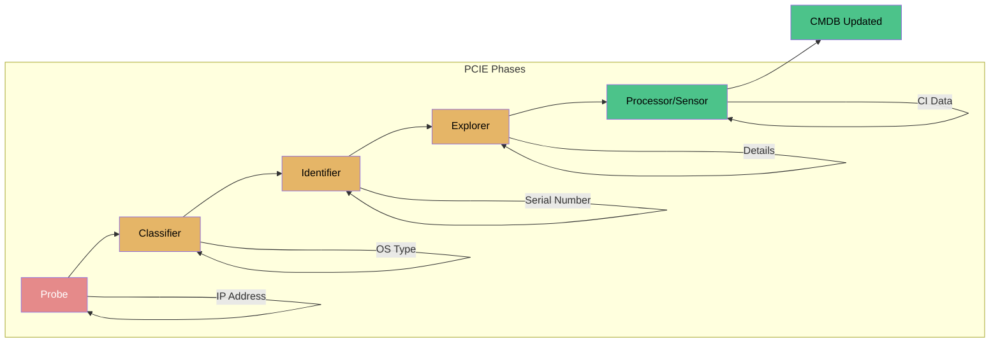
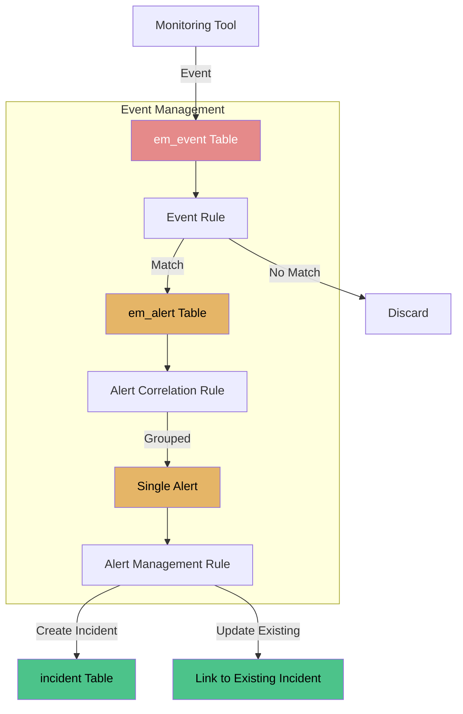
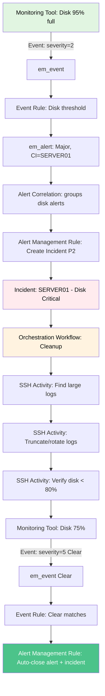
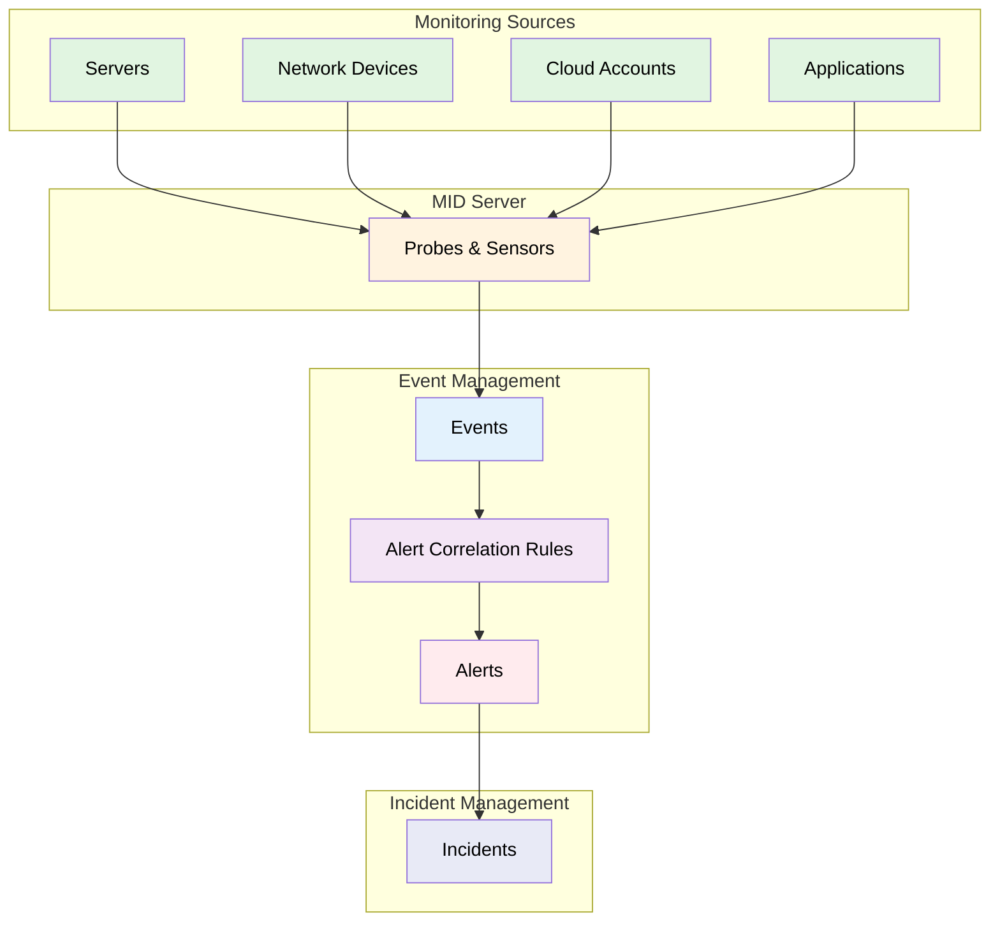
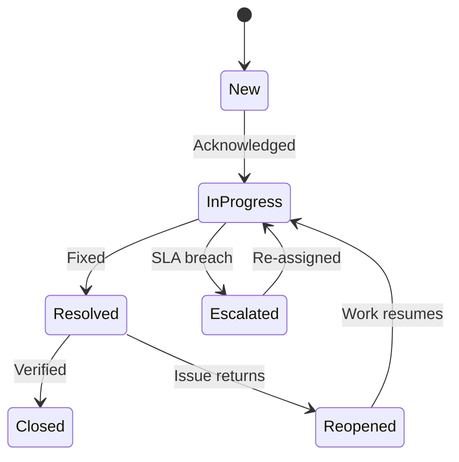

# ITOM — IT Operations Management

**Agent:** opencode  
**Date:** 2026-11-10  
**Module:** ITOM (IT Operations Management)  
**App:** IT Operations Management  
**Confidence:** high  

---

## Contents


- [Purpose](#purpose)
- [Where to Find It](#where-to-find-it)
- [Official Exam Alignment — CIS-Discovery & CIS-Event Management](#official-exam-alignment--cis-discovery--cis-event-management)
  - [CIS-Discovery (KB0011545)](#cis-discovery-kb0011545)
  - [CIS-Event Management (KB0011604)](#cis-event-management-kb0011604)
- [Discovery PCIE Phase Diagram](#discovery-pcie-phase-diagram)
- [Event Management → Incident Flow Diagram](#event-management--incident-flow-diagram)
- [Out-of-Box Values & Dropdowns](#out-of-box-values--dropdowns)
  - [Event Severity (em_event.severity / em_alert.severity)](#event-severity-em_eventseverity-em_alertseverity)
  - [Alert State (em_alert.state)](#alert-state-em_alertstate)
  - [Discovery PCIE Phases](#discovery-pcie-phases)
  - [MID Server Status (sys_mid_server.status)](#mid-server-status-sys_mid_serverstatus)
- [Re-usable Code / Metadata](#re-usable-code-metadata)
  - [Scoped Application](#scoped-application)
  - [Re-usable Metadata Inventory](#re-usable-metadata-inventory)
  - [Re-usable Code Snippets](#re-usable-code-snippets)
- [Out-of-Box Features](#out-of-box-features)
- [Key Table Hierarchy](#key-table-hierarchy)
  - [Table Relationships](#table-relationships)
- [Integrations](#integrations)
- [Key Fields](#key-fields)
- [Common Mistakes](#common-mistakes)
- [Automatic Issue Resolution with ITOM](#automatic-issue-resolution-with-itom)
  - [Resolution Patterns](#resolution-patterns)
  - [Event Management Acceleration Techniques](#event-management-acceleration-techniques)
  - [Orchestration Activities for Common Remediation](#orchestration-activities-for-common-remediation)
  - [Example: End-to-End Auto-Resolution Flow](#example-end-to-end-auto-resolution-flow)
  - [Service Mapping Integration for Targeted Remediation](#service-mapping-integration-for-targeted-remediation)
  - [Configuration Checklist for Auto-Resolution](#configuration-checklist-for-auto-resolution)
- [ITOM Portfolio Pillars](#itom-portfolio-pillars)
  - [Pillar 1: ITOM Visibility](#pillar-1:-itom-visibility)
  - [Pillar 2: ITOM Health (AIOps)](#pillar-2:-itom-health-(aiops))
  - [Pillar 3: ITOM Cloud Accelerate](#pillar-3:-itom-cloud-accelerate)
- [Deep Dive: Event Management → Incident](#deep-dive-event-management--incident)
  - [The flow](#the-flow)
  - [Severity mapping](#severity-mapping)
- [Lab: Create an Event and Watch It Become an Incident](#lab-create-an-event-and-watch-it-become-an-incident)
- [Lab: Auto-Resolve an Incident via Event Management](#lab:-auto-resolve-an-incident-via-event-management)
- [Goals, Benefits & Key Metrics](#goals-benefits--key-metrics)
- [Core Concept Diagrams](#core-concept-diagrams)
- [SLAs, Dashboards & Workspaces](#slas-dashboards--workspaces)
  - [SLA Support](#sla-support)
  - [Out-of-Box Dashboards](#out-of-box-dashboards)
  - [Out-of-Box Workspaces](#out-of-box-workspaces)
- [Quiz](#quiz)
- [💡 Memory Aids & Mnemonics](#memory-aids--mnemonics)
  - [Business Rule Types — BAA](#business-rule-types--baa)
  - [Client Script Types — LOCS](#client-script-types--locs)
  - [UI Policy vs Data Policy vs Client Script](#ui-policy-vs-data-policy-vs-client-script)
  - [IRE — Identification Before Reconciliation](#ire--identification-before-reconciliation)
  - [Update Set Conflicts — ARM](#update-set-conflicts--arm)
  - [CMDB — Retire Before Delete](#cmdb--retire-before-delete)
  - [Order vs Priority — Lower = First](#order-vs-priority--lower-=-first)
  - [Transform Script — Coalesce = Match](#transform-script--coalesce-=-match)
  - [Debugging — Log First, Then Debug](#debugging--log-first-then-debug)
- [Related Guides](#related-guides)
- [Official Learning Resources](#official-learning-resources)
  - [Now Learning (Structured Training)](#now-learning-structured-training)
  - [Product Documentation (Technical Reference)](#product-documentation-technical-reference)
  - [Official Videos & Playlists](#official-videos--playlists)


---

## Purpose

IT Operations Management (ITOM) is the set of ServiceNow applications that help IT monitor, discover, and manage infrastructure and services. It includes Discovery, Event Management, Service Mapping, Orchestration, and Cloud Management. ITOM's goal is proactive operations — detecting issues before users report them, and automating routine infrastructure tasks.

ServiceNow organizes ITOM into three core pillars: **ITOM Visibility** (Discovery, Service Mapping, Certificate & Firewall Audits, Service Graph Connectors), **ITOM Health / AIOps** (Event Management, Metric Intelligence, Service Observability, Now Assist), and **ITOM Cloud Accelerate** (Cloud Services Catalog, Cloud Configuration Governance, Cloud Account Management, Cloud Action Library). All three pillars share the CMDB as their data foundation.

ITOM sits on top of the CMDB. Discovery populates CIs; Event Management consumes alerts from monitoring tools; Service Mapping connects CIs to business services; Orchestration automates remediation.

---

## Where to Find It

| Breadcrumb | Path |
|------------|------|
| Module entry | All > IT Operations Management > ... |
| Discovery | All > Discovery > Discovery Schedules |
| Event Management | All > Event Management > Events > All |
| Alerts | All > Event Management > Alerts > All |
| Orchestration | All > Orchestration > ... |
| Service Mapping | All > Service Mapping > ... |
| MID Servers | All > MID Server > MID Servers |

**Tip:** ITOM requires Discovery (`com.snc.discovery.core`) and Event Management (`com.snc.em`) plugins, plus ITOM licensing. Verify both before building ITOM workflows.

---

## Official Exam Alignment — CIS-Discovery & CIS-Event Management

This guide maps to two official exam blueprints:

### CIS-Discovery (KB0011545)
| Guide Section | CIS-DISCO Domain | Exam Weight | What's Covered |
|---------------|-----------------|-------------|----------------|
| **Discovery Configuration** | Domain 2: Discovery Configuration — Discovery Setup, Process Flow, Troubleshooting | 35% | Behaviors, clusters, IP services, schedules, PCIE phases, ECC Queue, credentials |
| **CMDB** | Domain 3: Configuration Management Database — CI Class Manager, Identification & Reconciliation | 15% | CI identifiers, reconciliation definitions, data source precedence, de-duplication |
| **Discovery Pattern Design** | Domain 1: Discovery Pattern Design | 35% | Pattern Designer, operations, application identification and connection sections |

### CIS-Event Management (KB0011604)
| Guide Section | CIS-EM Domain | Exam Weight | What's Covered |
|---------------|-----------------|-------------|----------------|
| **Event Management → Incident** | Domain 3: Event Configuration and Use — Event setup, process flow, CI binding | 27% | Event rules, thresholds, CI binding, alert management rules |
| **Alerts and Tasks** | Domain 4: Alerts and Tasks — Alert process flow, correlation rules, alert intelligence | 30% | Alert grouping, correlation, priority scores, incident creation |

**Official preparation courses (CIS-Discovery):**
- ServiceNow Fundamentals
- ServiceNow Get Started with Now Create
- ServiceNow Platform Implementation
- CMDB Fundamentals
- Discovery Fundamentals
- CIS-Discovery: Certification Test Prep

**Official preparation courses (CIS-EM):**
- Welcome to ServiceNow
- ServiceNow Administration Fundamentals
- Event Management Fundamentals
- ITOM Overview

**Exam guidance:** Questions are based on official ServiceNow training materials, the ServiceNow Product documentation site, and the ServiceNow developer site.

---

## Discovery PCIE Phase Diagram



**Exam focus:** PCIE phases, ECC Queue, Discovery errors, credentials, CI identifiers (35% of CIS-Discovery exam).

---

## Event Management → Incident Flow Diagram



**Exam focus:** Event rules, CI binding, alert correlation, alert management rules, incident creation (27% + 30% of CIS-EM exam).

---

## Out-of-Box Values & Dropdowns

ServiceNow ships with predefined event/alert states and Discovery configurations. Verify against your instance.

### Event Severity (em_event.severity / em_alert.severity)
| Value | Label | Incident Priority |
|-------|-------|-------------------|
| `1` | Critical | P1 |
| `2` | Major | P2 |
| `3` | Minor | P3 |
| `4` | Warning | P4 |
| `5` | Clear | Auto-close |

### Alert State (em_alert.state)
| State | When to Use |
|-------|-------------|
| `New` | Alert created, not yet processed |
| `In Progress` | Agent working the alert |
| `Resolved` | Issue resolved |
| `Closed` | Alert closed |

### Discovery PCIE Phases
| Phase | Purpose |
|-------|---------|
| `Probe` | Sends request to target (IP address) |
| `Classifier` | Determines CI type from probe results (OS type) |
| `Identifier` | Checks if CI already exists (serial number) |
| `Explorer` | Gathers detailed CI information |
| `Processor/Sensor` | Parses data and maps to CMDB |

### MID Server Status (sys_mid_server.status)
| Status | Meaning |
|--------|---------|
| `Up` | MID Server is running and reachable |
| `Down` | MID Server is not reachable |
| `Warning` | MID Server has issues but is partially functional |

**Exam focus (CIS-Discovery 35%, CIS-EM 27%+30%):** PCIE phases, event severity, alert states, CI binding, ECC Queue.

---

## Re-usable Code / Metadata

### Scoped Application

ITOM spans multiple scoped applications.

| Scope Aspect | Detail |
|--------------|--------|
| Discovery Scope | `com.snc.discovery` |
| Event Management Scope | `com.snc.em` |
| Orchestration Scope | `com.glide.orchestration` |
| Key tables | `em_event`, `em_alert`, `cmdb_ci`, `sys_mid_server`, `discovery_schedule`, `em_metric` |
| Roles | `itil`, `admin`, `em_admin`, `discovery_admin` |

### Re-usable Metadata Inventory

| Re-usable piece | What it is | Where it lives (breadcrumb) |
|-----------------|------------|------------------------------|
| **Discovery Schedules** | Recurring or one-time scans of IP ranges | All > Discovery > Discovery Schedules |
| **Discovery Patterns** | Identification logic for devices and applications | All > Discovery > Discovery Definition > Patterns |
| **Event Rules** | Rules that turn raw events into alerts | All > Event Management > Event Rules |
| **Alert Correlation Rules** | Rules that group related alerts into one incident | All > Event Management > Alert Correlation |
| **MID Server** | Agent that runs discovery/orchestration inside your network | All > MID Server > MID Servers |
| **Orchestration Activities** | Prebuilt automation steps (SSH, PowerShell, SQL, etc.) | All > Orchestration > Activities |

### Re-usable Code Snippets

#### Business Rule: Create Incident from High Severity Alert

```javascript
(function rule(current, previous) {
    if (current.operation() == 'insert' && current.severity == '1') { // Critical
        var gr = new GlideRecord('incident');
        gr.short_description = 'Critical alert: ' + current.node;
        gr.description = current.message;
        gr.priority = '1';
        gr.assignment_group = 'NOC';
        gr.cmdb_ci = current.ci;
        gr.insert();
    }
})(current, previous);
```

#### Script Include: Event Severity Helper

```javascript
var EventSeverityHelper = Class.create();
EventSeverityHelper.prototype = Object.extendsObject(AbstractAjaxProcessor, {
    getSeverityLabel: function() {
        var sev = this.getParameter('severity');
        var map = {'1': 'Critical', '2': 'Major', '3': 'Minor', '4': 'Warning', '5': 'Clear'};
        return map[sev] || 'Unknown';
    },
    type: 'EventSeverityHelper'
});
```

---

## Out-of-Box Features

| Feature | Description | Where |
|---------|-------------|-------|
| Discovery | Auto-discover servers, network devices, applications | All > Discovery > Discovery Schedules |
| Event Management | Ingest events from monitoring tools, create alerts | All > Event Management > Events |
| Alert Correlation | Group related alerts into single incidents | All > Event Management > Alert Correlation |
| Service Mapping | Map CIs to business services | All > Service Mapping > Application Services |
| Orchestration | Automate remediation (SSH, PowerShell, SQL, etc.) | All > Orchestration > ... |
| Cloud Management | Discover and manage cloud resources (AWS, Azure, GCP) | All > Cloud Management > ... |
| MID Server | Bridge between ServiceNow cloud and on-prem network | All > MID Server > MID Servers |

---

## Key Table Hierarchy

| Table | Purpose | Key Fields |
|-------|---------|------------|
| `em_event` | Raw events from monitoring tools | `node`, `resource`, `message`, `severity`, `source`, `time_of_event` |
| `em_alert` | Processed alerts (de-duplicated, correlated) | `node`, `resource`, `message`, `severity`, `state`, `ci` |
| `cmdb_ci` | Configuration items discovered by Discovery | `name`, `ip_address`, `os`, `serial_number` |
| `sys_mid_server` | MID Server records | `name`, `ip_address`, `status`, `version` |
| `discovery_schedule` | Discovery scan schedules | `name`, `ip_address`, `frequency`, `state` |
| `em_metric` | Metric data for Event Management | `name`, `value`, `threshold`, `state` |

### Table Relationships

```
em_event
    │
    ├──► em_alert (event → alert via event rules)
    │       (one alert can group many events via correlation)
    │
    ├──► cmdb_ci (event's related CI)
    │
    └──► incident (alert → incident via business rule or correlation)

cmdb_ci
    │
    ├──► cmdb_rel_ci (CI relationships for service mapping)
    │
    └──► sys_mid_server (MID Server that discovered this CI)
```

---

## Integrations

| Integration | Direction | Purpose | Protocol |
|-------------|-----------|---------|----------|
| Monitoring Tools (SolarWinds, Datadog, Nagios) | Inbound | Send events/alerts to Event Management | REST/SNMP/Email |
| Cloud Providers (AWS, Azure, GCP) | Inbound | Discover cloud resources | REST API |
| CMDB | Bidirectional | Store discovered CIs and relationships | Internal |
| Orchestration Targets | Outbound | Run commands on discovered hosts | SSH/PowerShell/SNMP |
| ServiceNow REST API | Outbound | Call other ServiceNow instances or external APIs | REST |

---

## Key Fields

| Table | Field | Type | Why It Matters |
|-------|-------|------|----------------|
| `em_event` | `node` | String | The device/resource that generated the event |
| `em_event` | `severity` | Choice | 1=Critical, 2=Major, 3=Minor, 4=Warning, 5=Clear |
| `em_event` | `source` | String | The monitoring tool that sent the event |
| `em_alert` | `state` | Choice | New → In Progress → Resolved → Closed |
| `em_alert` | `ci` | Reference | Related CMDB CI for impact analysis |
| `discovery_schedule` | `frequency` | Choice | How often the scan runs |
| `sys_mid_server` | `status` | Choice | Up, Down, Warning |

---

## Common Mistakes

| Mistake | Symptom | Fix |
|---------|---------|-----|
| No event rules configured | Events arrive but never become alerts | Create event rules for each monitoring tool |
| No correlation rules | Hundreds of alerts for one outage | Configure alert correlation by node or CI |
| MID Server can't reach network | Discovery returns no CIs | Place MID Server in each network segment |
| Not de-duplicating events | Alert storm during outage | Use event rules with de-duplication (node + resource + type) |
| Discovery without credentials | Incomplete CI data | Configure Discovery credentials per OS/application |
| Alerts never become incidents | NOC never sees the alert | Business rule or correlation rule creates incident from critical alerts |
| No automatic remediation | Issues persist without auto-resolution | Configure Orchestration activities and alert management rules for auto-closure |

---

## Automatic Issue Resolution with ITOM

ITOM enables automatic issue resolution through the combination of **Event Management**, **Orchestration**, **Service Mapping**, and **Discovery**. When configured properly, issues can be detected, diagnosed, and resolved without human intervention.

### Resolution Patterns

| Pattern | Trigger | Action | Speed Advantage |
|---------|---------|--------|-----------------|
| **Auto-Closure via Clear Event** | Monitoring tool sends `severity=5` (Clear) event | Alert Management Rule auto-closes alert and linked incident | Seconds — no human action needed |
| **Orchestration Remediation** | Critical alert matches Alert Management Rule | Orchestration workflow runs (restart service, clear disk, reboot) | Minutes — faster than manual runbook |
| **Self-Healing via MID Server** | Discovery detects CI change (service down) | MID Server probe triggers Orchestration to restart | Near real-time — proactive before user impact |
| **Event Correlation + Auto-Resolve** | Multiple related events correlate to single alert | Business rule checks if root cause resolved via subsequent events | Reduces MTTR by grouping related symptoms |
| **Service-Aware Remediation** | Service Mapping shows impacted business service | Orchestration targets only affected CI, not entire service | Prevents unnecessary disruption to healthy components |

### Event Management Acceleration Techniques

| Technique | How It Works | Time Saved |
|-----------|--------------|------------|
| **Pre-configured Event Rules** | OOTB rules for common tools (SolarWinds, Datadog, Nagios) parse events → alerts instantly | Minutes per event type |
| **CI Binding via Discovery** | Discovery populates `cmdb_ci`; Event Rules auto-bind alerts to CIs using `node` + `resource` | Eliminates manual CI lookup |
| **Alert Correlation Rules** | Groups related alerts (e.g., "CPU high" + "Memory high" on same host) into one incident | Reduces incident count 50-80% |
| **Alert Management Rules** | Auto-create incidents from critical alerts; auto-close on clear events; assign to groups via `cmdb_ci.support_group` | Removes manual triage step |
| **Metric-Based Thresholds** | `em_metric` tables track KPIs; thresholds trigger events before breach | Shifts from reactive to proactive |

### Orchestration Activities for Common Remediation

| Activity Pack | Common Use Cases | Where to Find |
|---------------|------------------|---------------|
| **SSH** | Restart Linux service, clear logs, check disk space, run custom scripts | All > Orchestration > Activities > SSH |
| **PowerShell** | Restart Windows service, IIS app pool recycle, clear Event Viewer, run scripts | All > Orchestration > Activities > PowerShell |
| **SQL** | Truncate tables, rebuild indexes, check replication status | All > Orchestration > Activities > SQL |
| **SNMP** | Reboot network device, change port state, poll interface status | All > Orchestration > Activities > SNMP |
| **REST** | Call external APIs (PagerDuty, Slack, cloud provider), trigger CI/CD pipelines | All > Orchestration > Activities > REST |
| **Cloud (AWS/Azure/GCP)** | Stop/start instance, resize volume, modify security group, invoke Lambda | All > Orchestration > Activities > Cloud |

### Example: End-to-End Auto-Resolution Flow



**Key acceleration points:**
1. **Event Rule** processes event → alert in < 30 seconds
2. **Alert Management Rule** creates incident instantly (no NOC triage)
3. **Orchestration** runs remediation in parallel with incident creation
4. **Clear event** auto-closes everything — zero manual steps

### Service Mapping Integration for Targeted Remediation

| Scenario | Without Service Mapping | With Service Mapping |
|----------|------------------------|----------------------|
| Database CI alert | Orchestration restarts DB, may impact app tier | Only restart DB; app tier health verified via service map |
| Web server down | Restart all web servers in cluster | Restart only affected node; load balancer handles failover |
| Cloud resource spike | Scale all instances in account | Scale only the service's specific instance group |

**Exam focus:** Service Mapping enables **impact analysis** — you know exactly which business services a CI supports, so remediation is surgical, not blanket.

### Configuration Checklist for Auto-Resolution

| Component | Required Setup | Verification |
|-----------|----------------|--------------|
| **Discovery** | Credentials for all OS/app types; schedules covering all networks | CI count matches expected inventory |
| **Event Management** | Event rules per monitoring source; correlation rules by CI/node | Alert volume < 20% of raw event volume |
| **Alert Management** | Rules for auto-create (severity 1-2), auto-close (severity 5), assignment | > 80% critical alerts auto-create incidents |
| **Orchestration** | MID Server access to target hosts; activity packs installed; workflows tested | Workflow success rate > 95% in test |
| **Service Mapping** | Application services defined; CI relationships accurate | Service map shows correct upstream/downstream |

---

## Deep Dive: Event Management → Incident

### The flow

1. **Monitoring tool** detects an issue (server down, disk full, service stopped)
2. **Event sent to ServiceNow** via REST, SNMP, or email → `em_event`
3. **Event Rule** evaluates the event → creates `em_alert`
4. **Alert Correlation** groups related alerts → one alert represents one issue
5. **Business Rule** or auto-closure → creates `incident`
6. **NOC agent** works the incident → resolves → closes alert

### Severity mapping

| Event Severity | Alert Severity | Incident Priority |
|----------------|----------------|-------------------|
| 1 (Critical) | Critical | P1 |
| 2 (Major) | Major | P2 |
| 3 (Minor) | Minor | P3 |
| 4 (Warning) | Warning | P4 |
| 5 (Clear) | Clear | Auto-close |

---

## Lab: Create an Event and Watch It Become an Incident

**Instance requirement:** Event Management plugin active.

1. **Navigate** to All > Event Management > Events > All
2. **Click New** and fill:
   - Node: `WEB01`
   - Resource: `CPU`
   - Type: `threshold`
   - Message: `CPU usage at 98%`
   - Severity: `1 - Critical`
   - Source: `Test Monitor`
3. **Submit** — the event appears in the list
4. **Verify** an Event Rule processes it → creates an Alert in `em_alert`
5. **Navigate** to All > Event Management > Alerts > All
6. **Verify** the alert exists with severity Critical
7. **Check** if a Business Rule auto-creates an Incident from critical alerts
8. **If not**, manually create an Incident related to the alert's CI

---

## Lab: Auto-Resolve an Incident via Event Management

**Instance requirement:** Event Management + Orchestration (SSH or PowerShell) active.

1. **Navigate** to All > Event Management > Alerts > All
2. **Find or create** a critical alert (e.g., Disk full on `SERVER01`)
3. **Check** Alert Management Rule — if it auto-created an incident, verify the incident is linked
4. **Simulate remediation:**
   - Navigate to All > Orchestration > Orchestration Workflows
   - Open "Disk Cleanup" workflow (or create one with SSH activity)
   - Execute the workflow manually → verify it targets `SERVER01`
5. **Send a Clear event:**
   - Navigate to All > Event Management > Events > All > New
   - Node: `SERVER01`, Resource: `Disk`, Severity: `5 - Clear`
   - Submit
6. **Verify auto-closure:**
   - Navigate to All > Event Management > Alerts > All
   - Find the original alert → verify it auto-closed (via Alert Management Rule on severity 5)
   - Navigate to the linked incident → verify it auto-resolved
7. **Result:** Issue resolved with zero manual steps — only event processing + orchestration + clear event

---

## Goals, Benefits & Key Metrics

| Goal | Benefit | Key Metric | Example Target |
|------|---------|------------|----------------|
| Reduce unplanned downtime | Faster detection of infrastructure issues | Mean Time to Detect (MTTD) | < 5 minutes |
| Faster incident resolution | Events auto-create incidents with full context | Mean Time to Resolve (MTTR) | < 30 minutes |
| Proactive problem prevention | Pattern detection before users notice | Incident volume trend | -10% quarter-over-quarter |
| Better infrastructure visibility | All CIs and their health in one view | CMDB coverage % | > 95% |
| Reduce alert noise | Correlation rules suppress duplicate events | Alert volume | -50% after tuning |
| Faster change impact assessment | Know which services a CI supports | Change success rate | > 95% |

---

## ITOM Portfolio Pillars

ServiceNow organizes its IT Operations Management (ITOM) portfolio into three core pillars — **ITOM Visibility**, **ITOM Health (AIOps)**, and **ITOM Cloud Accelerate** — all sharing the ServiceNow CMDB as their data foundation.

### Pillar 1: ITOM Visibility

Creates a real-time, accurate map of your on-premises and multi-cloud infrastructure inside the CMDB.

| Capability | What It Does | Where to Find It |
|------------|--------------|------------------|
| **Discovery** | Automatically scans networks, cloud accounts, containers, and Kubernetes clusters to identify hardware and software assets without manual data entry | All > Discovery > Discovery Schedules |
| **Service Mapping** | Maps top-down dependencies between business services and underlying infrastructure so teams immediately see what a server or app outage affects | All > Service Mapping > Application Services |
| **Certificate & Firewall Audits** | Tracks TLS/SSL certificates to prevent unexpected expirations; audits firewall rules to support security and compliance | All > Discovery > Certificate & Firewall Audit |
| **Service Graph Connectors** | Integrates third-party monitoring and discovery data cleanly into the CMDB | All > Service Graph > Service Graph Connectors |

**Exam focus:** Discovery PCIE phases, Service Mapping automated vs manual mapping, CMDB relationships (35% of CIS-Discovery exam).

---

### Pillar 2: ITOM Health (AIOps)

Focuses on predicting, detecting, and resolving service issues before users feel the impact.

| Capability | What It Does | Where to Find It |
|------------|--------------|------------------|
| **Event Management** | Collects alerts from third-party monitoring tools, deduplicates alert noise, and correlates events into actionable incidents | All > Event Management > Events |
| **Metric Intelligence & Health Log Analytics (HLA)** | Uses machine learning to spot unusual performance patterns and log anomalies before a full outage happens | All > Event Management > Metric Intelligence |
| **Service Observability & Reliability** | Tracks SLOs/SLIs and synthetic monitoring for cloud-native apps | All > Observability > ... |
| **Now Assist for ITOM** | Uses generative AI inside the Service Operations Workspace to summarize alerts and suggest root causes in plain language | Service Operations Workspace |

**Exam focus:** Event rules, alert correlation, alert management rules, incident creation (27% + 30% of CIS-EM exam).

---

### Pillar 3: ITOM Cloud Accelerate

Formerly packaged as ITOM Optimization and Governance; automates cloud provisioning and enforces policy compliance across multi-cloud environments.

| Capability | What It Does | Where to Find It |
|------------|--------------|------------------|
| **Cloud Services Catalog (CSC)** | Self-service portal for teams to request and deploy approved cloud resources (AWS, Azure, GCP) with built-in governance | All > Cloud Management > Cloud Services Catalog |
| **Cloud Configuration Governance (CCG)** | Continuously checks cloud resources against security and compliance policies and automates remediation for violations | All > Cloud Management > Cloud Configuration Governance |
| **Cloud Account Management (CAM)** | Streamlines onboarding, lifecycle tracking, and access governance for cloud accounts | All > Cloud Management > Cloud Accounts |
| **Cloud Action Library & Migration Assessment** | Prebuilt workflows for day-two cloud operations and tools to plan cloud migrations | All > Cloud Management > Cloud Action Library |

---

## Core Concept Diagrams



**Reading the diagram:** Monitoring sources feed events through the MID Server → Event Management creates alerts → Correlation rules reduce noise → Alerts become incidents for resolution teams.



**Event/alert lifecycle states** — tracking an event from detection through resolution and closure.

---

## SLAs, Dashboards & Workspaces

### SLA Support

ITOM alerting and incident handling use ServiceNow SLAs defined on `task_sla`, which tracks SLA records against task-based tables (`incident`, `em_alert`, `task`).

| SLA Area | What It Tracks | Typical Target |
|----------|---------------|----------------|
| Alert acknowledgment | Time from alert creation to `In Progress` state | < 15 minutes |
| Alert resolution | Time from alert creation to `Resolved` state | < 4 hours |
| Incident response | Time from incident creation to first agent action | < 30 minutes |
| Incident resolution | Time from incident creation to `Resolved` state | < 4 hours |

**MTTD (Mean Time to Detect)** — measured from the triggering event in `em_event` until an alert exists in `em_alert`. Typical target: under 5 minutes.

**MTTR (Mean Time to Resolve)** — measured from alert creation until the related incident reaches `Resolved`. Typical target: under 30 minutes for P1/P2, under 4 hours for P3/P4.

Use `task_sla` to:
- Attach SLA definitions to incidents created from critical alerts (`severity = 1`)
- Track breach risk with `stage`, `has_breached`, and `business_duration` fields
- Escalate tasks when an SLA stage approaches its threshold

### Out-of-Box Dashboards

| Dashboard | Purpose | Where to Find It |
|-----------|---------|------------------|
| Cloud Operations Workspace | Unified view of cloud resource health, cost, and alerts across AWS/Azure/GCP | All > Cloud Operations > Cloud Operations Workspace |
| Event Management Dashboard | Alert volume, severity distribution, top nodes, correlation health | All > Event Management > Dashboards > Event Management |
| Cloud Operations Dashboard | Cloud account usage, spend anomalies, resource utilization trends | All > Cloud Management > Dashboards |

**Key metrics surfaced OOTB:** alert count by severity, MTTD, MTTR, top offending CIs, correlation rate, MID Server health, cloud spend variance.

### Out-of-Box Workspaces

| Workspace | Purpose | Path |
|-----------|---------|------|
| Cloud Operations Workspace | Monitor cloud resources, costs, and alerts in one console | All > Cloud Operations > Cloud Operations Workspace |
| IT Operations Management Workspace | Central entry point for Discovery, Event Management, Service Mapping, Orchestration, MID Server | All > IT Operations Management > IT Operations Management Workspace |

**Workflow tip:** Start in the ITOM Workspace to launch Discovery schedules or Event Management rules, then switch to the Cloud Operations Workspace for cloud-specific health and cost monitoring.

---

## Quiz

1. What is the difference between an event and an alert?
   <details><summary>Answer</summary>Event = raw data from a monitoring tool; Alert = processed, de-duplicated event ready for human action</details>

2. What table stores raw events?  
   <details><summary>Answer</summary>`em_event`</details>

3. What does a MID Server do in ITOM?  
   <details><summary>Answer</summary>Runs Discovery and Orchestration inside the customer's network, bridging cloud ServiceNow to on-prem systems</details>

4. Name three monitoring tools that can send events to ServiceNow.  
   <details><summary>Answer</summary>SolarWinds, Datadog, Nagios (also SNMP traps, email, REST)</details>

5. What severity value means Critical in Event Management?  
   <details><summary>Answer</summary>`1`</details>

6. How does ITOM auto-resolve an incident without human action?  
   <details><summary>Answer</summary>Monitoring tool sends a Clear event (severity 5) → Event Rule processes it → Alert Management Rule auto-closes the linked alert + incident. If Orchestration is configured, remediation runs automatically on critical alerts.</details>

7. What is the main benefit of Service Mapping during automatic remediation?  
   <details><summary>Answer</summary>It shows which business services a CI supports, so Orchestration can target only the affected component instead of restarting an entire service tier.</details>

8. Name three Orchestration activity packs used for auto-remediation.  
   <details><summary>Answer</summary>SSH (Linux), PowerShell (Windows), SQL (database), SNMP (network), REST (external APIs), Cloud (AWS/Azure/GCP)</details>

9. What is the fastest path from monitoring alert to closed incident with zero human steps?  
   <details><summary>Answer</summary>Monitoring tool → Event Rule → em_alert → Alert Management Rule (auto-create incident) → Orchestration workflow (remediation) → Clear event (severity 5) → Alert Management Rule (auto-close alert + incident)</details>

10. What metric tracks time from triggering event to alert creation?  
    <details><summary>Answer</summary>MTTD (Mean Time to Detect) — target under 5 minutes</details>

11. Into how many core pillars does ServiceNow organize ITOM?  
    <details><summary>Answer</summary>Three: ITOM Visibility, ITOM Health (AIOps), and ITOM Cloud Accelerate</details>

12. What does the ITOM Visibility pillar use as its shared data foundation?  
    <details><summary>Answer</summary>The ServiceNow CMDB</details>

13. What capability belongs to ITOM Health / AIOps but not ITOM Visibility?  
    <details><summary>Answer</summary>Event Management / Metric Intelligence / Service Observability / Now Assist — i.e., the health/monitoring side of the service</details>

14. What capability belongs to ITOM Cloud Accelerate?  
    <details><summary>Answer</summary>Cloud Services Catalog (CSC), Cloud Configuration Governance (CCG), Cloud Account Management (CAM), or Cloud Action Library & Migration Assessment</details>

---


## 💡 Memory Aids & Mnemonics

<details>
<summary>💡 Click to reveal mnemonics & memory aids</summary>

### Business Rule Types — BAA
| Mnemonic | Type | When It Runs | Use Case |
|----------|------|--------------|----------|
| **B**efore | before | Before DB write | Validate/modify data, cancel save (`abort = true`) |
| **A**fter | after | After DB write | Create related records, send notifications |
| **A**sync | async | After commit (separate thread) | Long-running tasks — emails, REST calls, integrations |

**Remember:** **BAA** = Before, After, Async — and they run in that order.

---

### Client Script Types — LOCS
| Mnemonic | Type | When It Runs | Use Case |
|----------|------|--------------|----------|
| **L**oad | onLoad | Form opens | Set defaults, show/hide fields, UI initialization |
| **O**nChange | onChange | Field value changes | Dynamic field behavior, cross-field validation |
| **C**lick | onSubmit | User clicks Save | Final validation before form submits |
| **S**ave | onCellEdit | List cell edits | Inline list editing validation |

**Remember:** **LOCS** = Load, OnChange, Click (Submit), CellEdit (Save).

---

### UI Policy vs Data Policy vs Client Script
| Mnemonic | What | Where It Runs | Scope |
|----------|------|---------------|-------|
| **U**I | UI Policy | Browser (form load/change) | UI behavior only — mandatory, read-only, visible |
| **D**ata | Data Policy | Server (every save path) | Data integrity — form, API, import, all writes |
| **C**lient | Client Script | Browser only | UX feedback — can be bypassed by API/import saves |

**Remember:** **U**→UI (looks), **D**→Data (truth), **C**→Client (feel). Never rely on Client Script for security.

---

### IRE — Identification Before Reconciliation
**Mnemonic:** **I before R**

1. **I**dentification = "Does this CI already exist?" → match existing CI or create new
2. **R**econciliation = "Whose data wins for each field?" → update attributes on matched CI

**Remember:** You can't reconcile what you haven't identified first. Identification runs first; reconciliation only runs on matched CIs.

---

### Update Set Conflicts — ARM
| Mnemonic | Option | What It Does | When to Use |
|----------|--------|--------------|-------------|
| **A**ccept | Accept Remote | Update Set version overwrites target | Update Set version is newer/correct |
| **S**kip | Skip remote update | Keep target instance's version | Target has a fix that must be preserved |
| **M**erge | Merge | Review both versions, combine manually | Both versions have valid changes |

**Remember:** **ARM** = Accept Remote, Skip remote, Merge. For script conflicts (Business Rules, Script Includes), always choose **Merge**.

---

### CMDB — Retire Before Delete
**Mnemonic:** **R before D**

- **R**etire: Set `install_status = retired` — keeps `cmdb_rel_ci` relationships intact for historical impact analysis
- **D**elete: Hard delete — breaks `cmdb_rel_ci` parent/child references, orphaned incidents

**Remember:** Always retire, never delete.

---

### Order vs Priority — Lower = First
| Feature | Ordering Field | Lower Number = |
|---------|---------------|----------------|
| Business Rule | `Order` | Runs first |
| UI Policy | `Order` | Runs first |
| Decision Table | `Order` | Runs first |
| Scheduled Job | `Priority` | Runs first |
| Identification Rule entry | `Priority` | Runs first |
| Reconciliation Rule | `Priority` | Runs first |

**Remember:** **Lower number = runs first**, regardless of whether the field is called `Order` or `Priority`.

---

### Transform Script — Coalesce = Match
| Mnemonic | Setting | Result |
|----------|---------|--------|
| **C**oalesce | `coalesce = true` | Update existing CI (match on key fields) |
| **N**o coalesce | `coalesce = false` | Insert new CI (create duplicate) |

**Remember:** **Coalesce** = "come together" = match existing records instead of duplicating.

---

### Debugging — Log First, Then Debug
| Context | Primary Tool | Command |
|---------|-------------|---------|
| **S**erver | System Log (`sys_log`) | `gs.print()`, `gs.error()`, `gs.info()` |
| **C**lient | Browser Console (F12) | `console.log()`, `debugger;` |
| **B**oth | Script Debugger | Breakpoints, step-through, variable inspection |

**Remember:** **Log first** — `gs.print()` for server, `console.log()` for client. `console.log()` does NOT work in server-side business rules.

---

</details>

---

## Related Guides

- [Discovery guide](./discovery-guide.md)
- [Service Mapping guide](./servicemapping-guide.md)
- [CMDB guide](./cmdb-guide.md)
- [ITSM guide](./itsm-guide.md)
- [TSOM guide](./tsom-guide.md)
- [ITOM getting-started](./../../getting-started/itom.md)

---

## Official Learning Resources

### Now Learning (Structured Training)
- [ITOM Fundamentals](https://nowlearning.com/) — Search "IT Operations Management" on Now Learning Portal
- [Event Management Fundamentals](https://nowlearning.com/) — Search "Event Management" on Now Learning Portal
- [Discovery Fundamentals](https://nowlearning.com/) — Search "Discovery" on Now Learning Portal

### Product Documentation (Technical Reference)
- [ServiceNow Product Documentation — ITOM](https://docs.servicenow.com/) → Search "IT Operations Management", "Event Management", "Discovery"
- [ServiceNow Product Documentation — Event Management](https://docs.servicenow.com/) → Search "event rules", "alert correlation"
- [ServiceNow Product Documentation — MID Server](https://docs.servicenow.com/) → Search "MID Server"

### Official Videos & Playlists
- [ServiceNow YouTube Channel](https://www.youtube.com/c/ServiceNow) — Search "ServiceNow ITOM", "ServiceNow Event Management", "ServiceNow Discovery", "ServiceNow MID Server"
- [Event Management demo](https://www.youtube.com/results?search_query=servicenow+event+management+demo)
- [Discovery demo](https://www.youtube.com/results?search_query=servicenow+discovery+demo)

---
