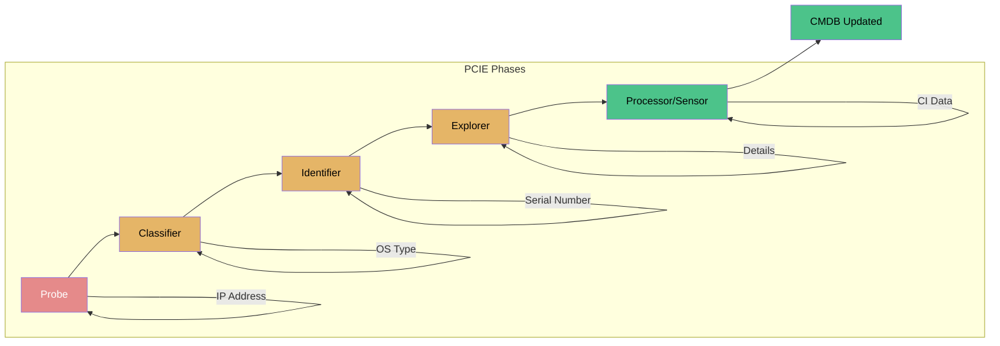
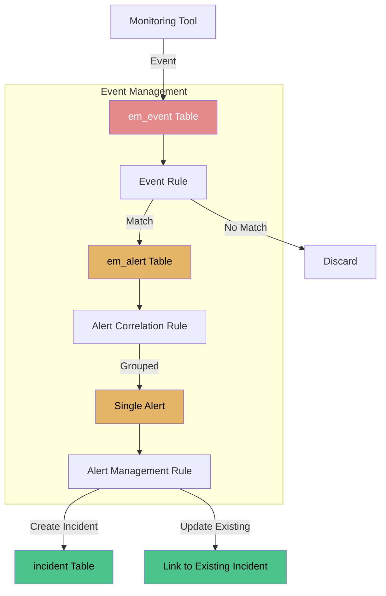
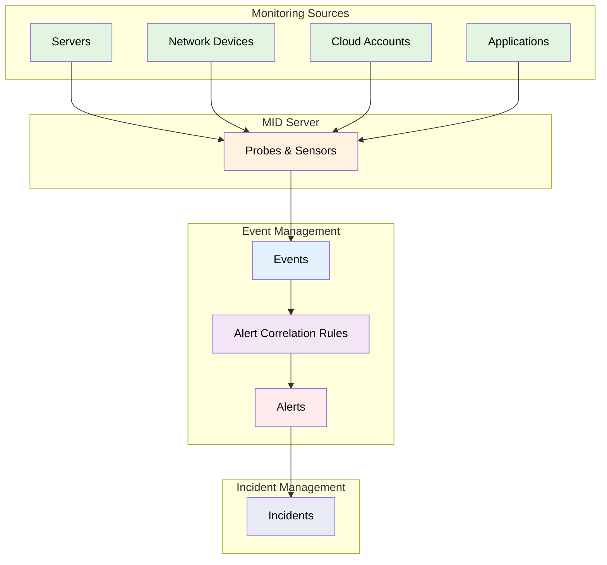
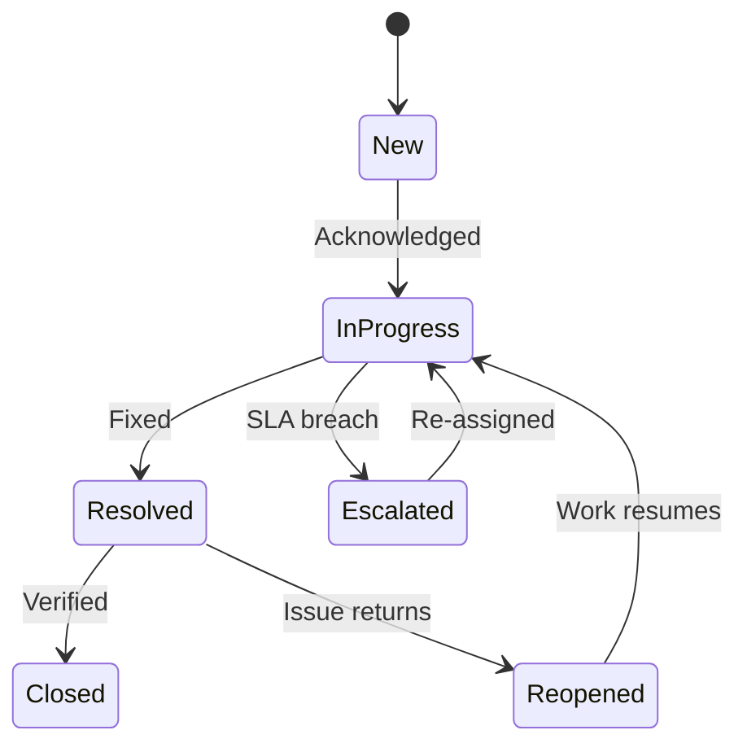

# ITOM — IT Operations Management

**Agent:** opencode  
**Date:** 2026-11-10  
**Module:** ITOM (IT Operations Management)  
**App:** IT Operations Management  
**Confidence:** high  

---

## Contents

- [Purpose](#purpose)
- [Where to Find It](#where-to-find-it)
- [Re-usable Code / Metadata](#re-usable-code--metadata)
- [Out-of-Box Features](#out-of-box-features)
- [Key Table Hierarchy](#key-table-hierarchy)
- [Integrations](#integrations)
- [Key Fields](#key-fields)
- [Common Mistakes](#common-mistakes)
- [Deep Dive: Event Management → Incident](#deep-dive-event-management-to-incident)
- [Lab: Create an Event and Watch It Become an Incident](#lab-create-an-event-and-watch-it-become-an-incident)
- [Quiz](#quiz)
- [Official Learning Resources](#official-learning-resources)
- [Visual & Video Guides](#visual--video-guides)

---

## Purpose

IT Operations Management (ITOM) is the set of ServiceNow applications that help IT monitor, discover, and manage infrastructure and services. It includes Discovery, Event Management, Service Mapping, Orchestration, and Cloud Management. ITOM's goal is proactive operations — detecting issues before users report them, and automating routine infrastructure tasks.

ITOM sits on top of the CMDB. Discovery populates CIs; Event Management consumes alerts from monitoring tools; Service Mapping connects CIs to business services; Orchestration automates remediation.

---

## Where to Find It

| Breadcrumb | Path |
|------------|------|
| Module entry | All > IT Operations Management > ... |
| Discovery | All > Discovery > Discovery Schedules |
| Event Management | All > Event Management > Events > All |
| Alerts | All > Event Management > Alerts > All |
| Orchestration | All > Orchestration > ... |
| Service Mapping | All > Service Mapping > ... |
| MID Servers | All > MID Server > MID Servers |

**Tip:** ITOM requires Discovery (`com.snc.discovery.core`) and Event Management (`com.snc.em`) plugins, plus ITOM licensing. Verify both before building ITOM workflows.

---

## Official Exam Alignment — CIS-Discovery & CIS-Event Management

This guide maps to two official exam blueprints:

### CIS-Discovery (KB0011545)
| Guide Section | CIS-DISCO Domain | Exam Weight | What's Covered |
|---------------|-----------------|-------------|----------------|
| **Discovery Configuration** | Domain 2: Discovery Configuration — Discovery Setup, Process Flow, Troubleshooting | 35% | Behaviors, clusters, IP services, schedules, PCIE phases, ECC Queue, credentials |
| **CMDB** | Domain 3: Configuration Management Database — CI Class Manager, Identification & Reconciliation | 15% | CI identifiers, reconciliation definitions, data source precedence, de-duplication |
| **Discovery Pattern Design** | Domain 1: Discovery Pattern Design | 35% | Pattern Designer, operations, application identification and connection sections |

### CIS-Event Management (KB0011604)
| Guide Section | CIS-EM Domain | Exam Weight | What's Covered |
|---------------|-----------------|-------------|----------------|
| **Event Management → Incident** | Domain 3: Event Configuration and Use — Event setup, process flow, CI binding | 27% | Event rules, thresholds, CI binding, alert management rules |
| **Alerts and Tasks** | Domain 4: Alerts and Tasks — Alert process flow, correlation rules, alert intelligence | 30% | Alert grouping, correlation, priority scores, incident creation |

**Official preparation courses (CIS-Discovery):**
- ServiceNow Fundamentals
- ServiceNow Get Started with Now Create
- ServiceNow Platform Implementation
- CMDB Fundamentals
- Discovery Fundamentals
- CIS-Discovery: Certification Test Prep

**Official preparation courses (CIS-EM):**
- Welcome to ServiceNow
- ServiceNow Administration Fundamentals
- Event Management Fundamentals
- ITOM Overview

**Exam guidance:** Questions are based on official ServiceNow training materials, the ServiceNow Product documentation site, and the ServiceNow developer site.

---

## Discovery PCIE Phase Diagram



**Exam focus:** PCIE phases, ECC Queue, Discovery errors, credentials, CI identifiers (35% of CIS-Discovery exam).

---

## Event Management → Incident Flow Diagram



**Exam focus:** Event rules, CI binding, alert correlation, alert management rules, incident creation (27% + 30% of CIS-EM exam).

---

## Out-of-Box Values & Dropdowns

ServiceNow ships with predefined event/alert states and Discovery configurations. Verify against your instance.

### Event Severity (em_event.severity / em_alert.severity)
| Value | Label | Incident Priority |
|-------|-------|-------------------|
| `1` | Critical | P1 |
| `2` | Major | P2 |
| `3` | Minor | P3 |
| `4` | Warning | P4 |
| `5` | Clear | Auto-close |

### Alert State (em_alert.state)
| State | When to Use |
|-------|-------------|
| `New` | Alert created, not yet processed |
| `In Progress` | Agent working the alert |
| `Resolved` | Issue resolved |
| `Closed` | Alert closed |

### Discovery PCIE Phases
| Phase | Purpose |
|-------|---------|
| `Probe` | Sends request to target (IP address) |
| `Classifier` | Determines CI type from probe results (OS type) |
| `Identifier` | Checks if CI already exists (serial number) |
| `Explorer` | Gathers detailed CI information |
| `Processor/Sensor` | Parses data and maps to CMDB |

### MID Server Status (sys_mid_server.status)
| Status | Meaning |
|--------|---------|
| `Up` | MID Server is running and reachable |
| `Down` | MID Server is not reachable |
| `Warning` | MID Server has issues but is partially functional |

**Exam focus (CIS-Discovery 35%, CIS-EM 27%+30%):** PCIE phases, event severity, alert states, CI binding, ECC Queue.

---

## Re-usable Code / Metadata

### Scoped Application

ITOM spans multiple scoped applications.

| Scope Aspect | Detail |
|--------------|--------|
| Discovery Scope | `com.snc.discovery` |
| Event Management Scope | `com.snc.em` |
| Orchestration Scope | `com.glide.orchestration` |
| Key tables | `em_event`, `em_alert`, `cmdb_ci`, `sys_mid_server`, `discovery_schedule`, `em_metric` |
| Roles | `itil`, `admin`, `em_admin`, `discovery_admin` |

### Re-usable Metadata Inventory

| Re-usable piece | What it is | Where it lives (breadcrumb) |
|-----------------|------------|------------------------------|
| **Discovery Schedules** | Recurring or one-time scans of IP ranges | All > Discovery > Discovery Schedules |
| **Discovery Patterns** | Identification logic for devices and applications | All > Discovery > Discovery Definition > Patterns |
| **Event Rules** | Rules that turn raw events into alerts | All > Event Management > Event Rules |
| **Alert Correlation Rules** | Rules that group related alerts into one incident | All > Event Management > Alert Correlation |
| **MID Server** | Agent that runs discovery/orchestration inside your network | All > MID Server > MID Servers |
| **Orchestration Activities** | Prebuilt automation steps (SSH, PowerShell, SQL, etc.) | All > Orchestration > Activities |

### Re-usable Code Snippets

#### Business Rule: Create Incident from High Severity Alert

```javascript
(function rule(current, previous) {
    if (current.operation() == 'insert' && current.severity == '1') { // Critical
        var gr = new GlideRecord('incident');
        gr.short_description = 'Critical alert: ' + current.node;
        gr.description = current.message;
        gr.priority = '1';
        gr.assignment_group = 'NOC';
        gr.cmdb_ci = current.ci;
        gr.insert();
    }
})(current, previous);
```

#### Script Include: Event Severity Helper

```javascript
var EventSeverityHelper = Class.create();
EventSeverityHelper.prototype = Object.extendsObject(AbstractAjaxProcessor, {
    getSeverityLabel: function() {
        var sev = this.getParameter('severity');
        var map = {'1': 'Critical', '2': 'Major', '3': 'Minor', '4': 'Warning', '5': 'Clear'};
        return map[sev] || 'Unknown';
    },
    type: 'EventSeverityHelper'
});
```

---

## Out-of-Box Features

| Feature | Description | Where |
|---------|-------------|-------|
| Discovery | Auto-discover servers, network devices, applications | All > Discovery > Discovery Schedules |
| Event Management | Ingest events from monitoring tools, create alerts | All > Event Management > Events |
| Alert Correlation | Group related alerts into single incidents | All > Event Management > Alert Correlation |
| Service Mapping | Map CIs to business services | All > Service Mapping > Application Services |
| Orchestration | Automate remediation (SSH, PowerShell, SQL, etc.) | All > Orchestration > ... |
| Cloud Management | Discover and manage cloud resources (AWS, Azure, GCP) | All > Cloud Management > ... |
| MID Server | Bridge between ServiceNow cloud and on-prem network | All > MID Server > MID Servers |

---

## Key Table Hierarchy

| Table | Purpose | Key Fields |
|-------|---------|------------|
| `em_event` | Raw events from monitoring tools | `node`, `resource`, `message`, `severity`, `source`, `time_of_event` |
| `em_alert` | Processed alerts (de-duplicated, correlated) | `node`, `resource`, `message`, `severity`, `state`, `ci` |
| `cmdb_ci` | Configuration items discovered by Discovery | `name`, `ip_address`, `os`, `serial_number` |
| `sys_mid_server` | MID Server records | `name`, `ip_address`, `status`, `version` |
| `discovery_schedule` | Discovery scan schedules | `name`, `ip_address`, `frequency`, `state` |
| `em_metric` | Metric data for Event Management | `name`, `value`, `threshold`, `state` |

### Table Relationships

```
em_event
    │
    ├──► em_alert (event → alert via event rules)
    │       (one alert can group many events via correlation)
    │
    ├──► cmdb_ci (event's related CI)
    │
    └──► incident (alert → incident via business rule or correlation)

cmdb_ci
    │
    ├──► cmdb_rel_ci (CI relationships for service mapping)
    │
    └──► sys_mid_server (MID Server that discovered this CI)
```

---

## Integrations

| Integration | Direction | Purpose | Protocol |
|-------------|-----------|---------|----------|
| Monitoring Tools (SolarWinds, Datadog, Nagios) | Inbound | Send events/alerts to Event Management | REST/SNMP/Email |
| Cloud Providers (AWS, Azure, GCP) | Inbound | Discover cloud resources | REST API |
| CMDB | Bidirectional | Store discovered CIs and relationships | Internal |
| Orchestration Targets | Outbound | Run commands on discovered hosts | SSH/PowerShell/SNMP |
| ServiceNow REST API | Outbound | Call other ServiceNow instances or external APIs | REST |

---

## Key Fields

| Table | Field | Type | Why It Matters |
|-------|-------|------|----------------|
| `em_event` | `node` | String | The device/resource that generated the event |
| `em_event` | `severity` | Choice | 1=Critical, 2=Major, 3=Minor, 4=Warning, 5=Clear |
| `em_event` | `source` | String | The monitoring tool that sent the event |
| `em_alert` | `state` | Choice | New → In Progress → Resolved → Closed |
| `em_alert` | `ci` | Reference | Related CMDB CI for impact analysis |
| `discovery_schedule` | `frequency` | Choice | How often the scan runs |
| `sys_mid_server` | `status` | Choice | Up, Down, Warning |

---

## Common Mistakes

| Mistake | Symptom | Fix |
|---------|---------|-----|
| No event rules configured | Events arrive but never become alerts | Create event rules for each monitoring tool |
| No correlation rules | Hundreds of alerts for one outage | Configure alert correlation by node or CI |
| MID Server can't reach network | Discovery returns no CIs | Place MID Server in each network segment |
| Not de-duplicating events | Alert storm during outage | Use event rules with de-duplication (node + resource + type) |
| Discovery without credentials | Incomplete CI data | Configure Discovery credentials per OS/application |
| Alerts never become incidents | NOC never sees the alert | Business rule or correlation rule creates incident from critical alerts |

---

## Deep Dive: Event Management → Incident

### The flow

1. **Monitoring tool** detects an issue (server down, disk full, service stopped)
2. **Event sent to ServiceNow** via REST, SNMP, or email → `em_event`
3. **Event Rule** evaluates the event → creates `em_alert`
4. **Alert Correlation** groups related alerts → one alert represents one issue
5. **Business Rule** or auto-closure → creates `incident`
6. **NOC agent** works the incident → resolves → closes alert

### Severity mapping

| Event Severity | Alert Severity | Incident Priority |
|----------------|----------------|-------------------|
| 1 (Critical) | Critical | P1 |
| 2 (Major) | Major | P2 |
| 3 (Minor) | Minor | P3 |
| 4 (Warning) | Warning | P4 |
| 5 (Clear) | Clear | Auto-close |

---

## Lab: Create an Event and Watch It Become an Incident

**Instance requirement:** Event Management plugin active.

1. **Navigate** to All > Event Management > Events > All
2. **Click New** and fill:
   - Node: `WEB01`
   - Resource: `CPU`
   - Type: `threshold`
   - Message: `CPU usage at 98%`
   - Severity: `1 - Critical`
   - Source: `Test Monitor`
3. **Submit** — the event appears in the list
4. **Verify** an Event Rule processes it → creates an Alert in `em_alert`
5. **Navigate** to All > Event Management > Alerts > All
6. **Verify** the alert exists with severity Critical
7. **Check** if a Business Rule auto-creates an Incident from critical alerts
8. **If not**, manually create an Incident related to the alert's CI

---

## Goals, Benefits & Key Metrics

| Goal | Benefit | Key Metric | Example Target |
|------|---------|------------|----------------|
| Reduce unplanned downtime | Faster detection of infrastructure issues | Mean Time to Detect (MTTD) | < 5 minutes |
| Faster incident resolution | Events auto-create incidents with full context | Mean Time to Resolve (MTTR) | < 30 minutes |
| Proactive problem prevention | Pattern detection before users notice | Incident volume trend | -10% quarter-over-quarter |
| Better infrastructure visibility | All CIs and their health in one view | CMDB coverage % | > 95% |
| Reduce alert noise | Correlation rules suppress duplicate events | Alert volume | -50% after tuning |
| Faster change impact assessment | Know which services a CI supports | Change success rate | > 95% |

---

## Core Concept Diagrams



**Reading the diagram:** Monitoring sources feed events through the MID Server → Event Management creates alerts → Correlation rules reduce noise → Alerts become incidents for resolution teams.



**Event/alert lifecycle states** — tracking an event from detection through resolution and closure.

---

## SLAs, Dashboards & Workspaces

### SLA Support

ITOM alerting and incident handling use ServiceNow SLAs defined on `task_sla`, which tracks SLA records against task-based tables (`incident`, `em_alert`, `task`).

| SLA Area | What It Tracks | Typical Target |
|----------|---------------|----------------|
| Alert acknowledgment | Time from alert creation to `In Progress` state | < 15 minutes |
| Alert resolution | Time from alert creation to `Resolved` state | < 4 hours |
| Incident response | Time from incident creation to first agent action | < 30 minutes |
| Incident resolution | Time from incident creation to `Resolved` state | < 4 hours |

**MTTD (Mean Time to Detect)** — measured from the triggering event in `em_event` until an alert exists in `em_alert`. Typical target: under 5 minutes.

**MTTR (Mean Time to Resolve)** — measured from alert creation until the related incident reaches `Resolved`. Typical target: under 30 minutes for P1/P2, under 4 hours for P3/P4.

Use `task_sla` to:
- Attach SLA definitions to incidents created from critical alerts (`severity = 1`)
- Track breach risk with `stage`, `has_breached`, and `business_duration` fields
- Escalate tasks when an SLA stage approaches its threshold

### Out-of-Box Dashboards

| Dashboard | Purpose | Where to Find It |
|-----------|---------|------------------|
| Cloud Operations Workspace | Unified view of cloud resource health, cost, and alerts across AWS/Azure/GCP | All > Cloud Operations > Cloud Operations Workspace |
| Event Management Dashboard | Alert volume, severity distribution, top nodes, correlation health | All > Event Management > Dashboards > Event Management |
| Cloud Operations Dashboard | Cloud account usage, spend anomalies, resource utilization trends | All > Cloud Management > Dashboards |

**Key metrics surfaced OOTB:** alert count by severity, MTTD, MTTR, top offending CIs, correlation rate, MID Server health, cloud spend variance.

### Out-of-Box Workspaces

| Workspace | Purpose | Path |
|-----------|---------|------|
| Cloud Operations Workspace | Monitor cloud resources, costs, and alerts in one console | All > Cloud Operations > Cloud Operations Workspace |
| IT Operations Management Workspace | Central entry point for Discovery, Event Management, Service Mapping, Orchestration, MID Server | All > IT Operations Management > IT Operations Management Workspace |

**Workflow tip:** Start in the ITOM Workspace to launch Discovery schedules or Event Management rules, then switch to the Cloud Operations Workspace for cloud-specific health and cost monitoring.

---

## Quiz

1. What is the difference between an event and an alert?
   <details><summary>Answer</summary>Event = raw data from a monitoring tool; Alert = processed, de-duplicated event ready for human action</details>

2. What table stores raw events?  
   <details><summary>Answer</summary>`em_event`</details>

3. What does a MID Server do in ITOM?  
   <details><summary>Answer</summary>Runs Discovery and Orchestration inside the customer's network, bridging cloud ServiceNow to on-prem systems</details>

4. Name three monitoring tools that can send events to ServiceNow.  
   <details><summary>Answer</summary>SolarWinds, Datadog, Nagios (also SNMP traps, email, REST)</details>

5. What severity value means Critical in Event Management?  
   <details><summary>Answer</summary>`1`</details>

---


---

## Related Guides

- [Discovery guide](./discovery-guide.md)
- [Service Mapping guide](./servicemapping-guide.md)
- [CMDB guide](./cmdb-guide.md)
- [ITSM guide](./itsm-guide.md)
- [TSOM guide](./tsom-guide.md)
- [ITOM getting-started](./../../getting-started/itom.md)

---

## Official Learning Resources

### Now Learning (Structured Training)
- [ITOM Fundamentals](https://nowlearning.com/) — Search "IT Operations Management" on Now Learning Portal
- [Event Management Fundamentals](https://nowlearning.com/) — Search "Event Management" on Now Learning Portal
- [Discovery Fundamentals](https://nowlearning.com/) — Search "Discovery" on Now Learning Portal

### Product Documentation (Technical Reference)
- [ServiceNow Product Documentation — ITOM](https://docs.servicenow.com/) → Search "IT Operations Management", "Event Management", "Discovery"
- [ServiceNow Product Documentation — Event Management](https://docs.servicenow.com/) → Search "event rules", "alert correlation"
- [ServiceNow Product Documentation — MID Server](https://docs.servicenow.com/) → Search "MID Server"

### Official Videos & Playlists
- [ServiceNow YouTube Channel](https://www.youtube.com/c/ServiceNow) — Search "ServiceNow ITOM", "ServiceNow Event Management", "ServiceNow Discovery", "ServiceNow MID Server"
- [Event Management demo](https://www.youtube.com/results?search_query=servicenow+event+management+demo)
- [Discovery demo](https://www.youtube.com/results?search_query=servicenow+discovery+demo)

---
