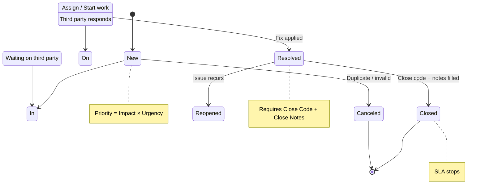
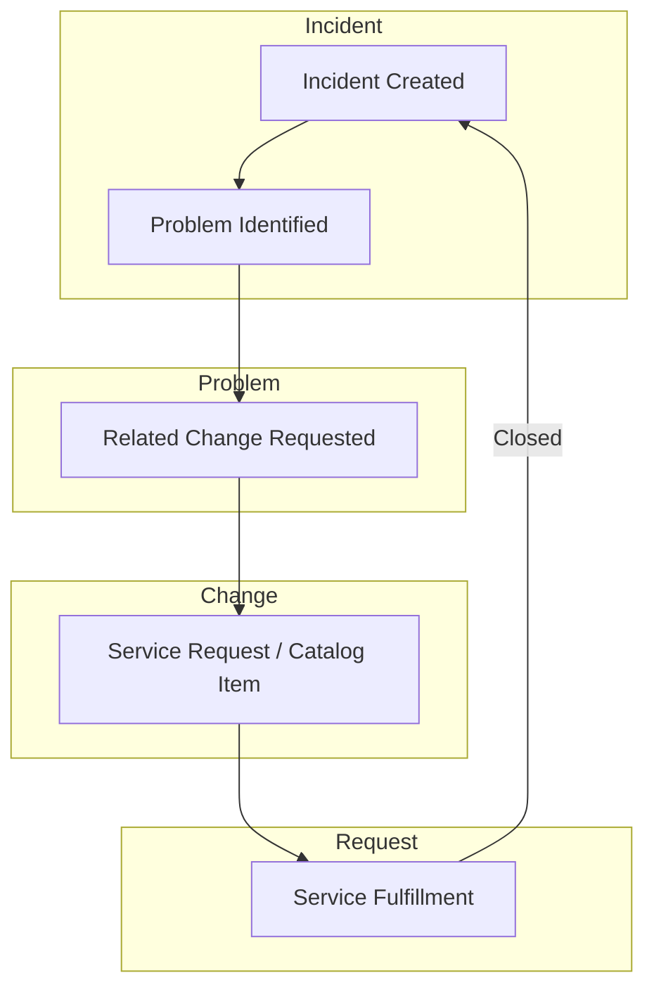

# ITSM — IT Service Management

**Agent:** opencode  
**Date:** 2026-11-05  
**Module:** ITSM (IT Service Management)  
**App:** ITSM  
**Confidence:** high  

---

## Contents

- [Purpose](#purpose)
- [Where to Find It](#where-to-find-it)
- [Re-usable Code / Metadata](#re-usable-code--metadata)
- [Out-of-Box Features](#out-of-box-features)
- [Key Table Hierarchy](#key-table-hierarchy)
- [Integrations](#integrations)
- [Key Fields](#key-fields)
- [Common Mistakes](#common-mistakes)
- [Deep Dive: A CSDM Map, End to End (SCCM Laptop Example)](#deep-dive-a-csdm-map-end-to-end-sccm-laptop-example)
- [Lab: Create and Resolve Your First Incident](#lab-create-and-resolve-your-first-incident)
- [Quiz](#quiz)
- [Official Learning Resources](#official-learning-resources)
- [Visual & Video Guides](#visual--video-guides)

---

## Purpose

IT Service Management (ITSM) is ServiceNow's flagship application for managing IT services. ITSM covers Incident, Problem, Change, Change Task, Knowledge, and Configuration Management. It is the reference implementation of the platform—every other module follows the same patterns. ITSM defines how IT receives, prioritizes, assigns, resolves, and reports on service disruptions and planned changes.

---

## Prerequisites & Setup

**Plugins / Scoped Apps that must be active:**
- `com.snc.itsm` — core ITSM scoped application (tables: incident, problem, change_request, change_task, task, task_sla; roles: itil, sn_incident.read, sn_incident.write, sn_change.write, sn_problem.write, admin)
- `com.snc.cmdb` — CMDB integration for affected CI relationships and CI lifecycle
- `com.snc.discovery` — Discovery / MID Server for auto-discovering CIs and maintaining identifier reconciliation
- `com.snc.service_catalog` — Service Catalog for request fulfillment, record producers, and order guides
- `com.snc.km` — Knowledge Management for containment articles and KEDB publication

**Guided Setup:**
- Run **ITSM Guided Setup** (All > ITSM > Administration > Guided Setup) to configure incident categories, assignment groups, SLAs, priority matrices, and default change types. This is the fastest path to a production-ready instance.

**System properties to consider:**
- `glide.incident.close_code_required` — enforce close codes on incident close
- `glide.incident.close_notes_required` — enforce close notes on incident close
- `glide.sla.enabled` — global SLA engine toggle
- `sn_incident.use_assignment_groups` — route incidents by assignment group
- `glide.cmdb.use_cmdb` — enable CMDB for CI relationships

**Cross-module dependencies:**
- CMDB (`cmdb_ci`) — affected CI lookups, CI lifecycle state, service-mapping relationships
- Discovery — auto-discovery of CIs, identifier & reconciliation rules
- Service Catalog (`sc_request`) — request fulfillment, record producers, order guides
- Knowledge Management (`kb_knowledge`) — articles for containment, KEDB publication
- Event Management (`em_event`) — create incidents from monitoring alerts
- CSM (`com.snc.customerservice`) — case↔incident integration patterns

**ACLs related to core tables:**
- **incident** (`sn_incident`): read/write by `itil`, `sn_incident.read`, `sn_incident.write`; assignment_group and assignment_group_id require `itil` or equivalent; close_code/close_notes visibility controlled by UI policy/ACL
- **problem** (`sn_problem`): read/write by `sn_problem.write`, visible under `itil`; root_cause and kedb_link fields require appropriate ACLs
- **change_request** (`sn_change`): read/write by `sn_change.write`, CAB approvals require `change_admin` or `cab` roles; risk and implementation_plan fields have field-level ACLs
- **sc_request** (`sc_request`): read by `sc_request.read`, write by `sc_request.write`; used by Service Catalog order flows; catalog item ACLs control who can submit

**Breadcrumbs — enable in this order:**
1. Verify `com.snc.itsm` is active (System Definition → Plugins)
2. Run ITSM Guided Setup to provision categories, groups, SLAs
3. Ensure CMDB is populated (Discovery or manual CI import)
4. Configure Service Catalog items and record producers
5. Enable Knowledge Management if containment articles are needed
6. Enable Event Management if alert→incident integration is required
7. Enable CSM plugin if cross-module case↔incident patterns are needed

---

## Where to Find It

|| Breadcrumb | Path |
||------------|------|
|| Module entry | All > IT Service Management > ... |
| Incidents | All > Incident > All |
| Problems | All > Problem > All |
| Changes | All > Change > All |
| Change Tasks | All > Change > Tasks > All |
| Knowledge | All > Knowledge > All |
| Configuration Items | All > CMDB > CI List |
| Service Catalog | All > Service Catalog > All |
| Administration | All > ITSM > Administration > ... |

**Tip:** If menus are missing, verify the `com.snc.itsm` plugin is active (System Definition → Plugins).

---

## Official Exam Alignment — CIS-ITSM

This guide maps to the **Certified Implementation Specialist – IT Service Management (CIS-ITSM)** exam blueprint (ServiceNow University, KB0011560). Exam weightings shown are the official domain percentages.

| Guide Section | CIS-ITSM Domain | Exam Weight | What's Covered |
|---------------|-----------------|-------------|----------------|
| **Incident Management** (deep dive + lab) | Domain 1: Incident Management — Architecture, Scoping & Requirements, Configuration: Incident lifecycle | 25% | Incident lifecycle, state model, priority (impact × urgency), assignment groups, SLAs, major incident management |
| **Problem Management** (deep dive) | Domain 2: Problem Management — Architecture, Scoping & requirements, Problem Lifecycle Configuration | 15% | Problem vs incident, root cause analysis, KEDB, problem tasks, permanent fix vs workaround |
| **Change Management** (deep dive) | Domain 3: Change Management — Architecture and configuration | 25% | Change types (standard/normal/emergency), CAB, state model, risk/impact, conflict detection, blackout windows |
| **Service Catalog & Request Fulfillment** | Domain 5: Service Catalog and Request Management — Architecture, Scoping & Requirements, Configuration, Integrations | 25% | Catalog items, record producers, order guides, RITM, catalog tasks, approval workflows |
| **Service Portfolio Management** | Domain 4: Service Portfolio Management | 5% | Business services, service offerings, access to Service Owner Workspace |
| **CMDB integration** | Domain 6: Configuration Management Database | 5% | cmdb_ci, affected CI relationships, CI lifecycle |

**Official preparation courses** (recommended by ServiceNow for this exam):
- Welcome to ServiceNow
- ServiceNow Administration Fundamentals
- ServiceNow Administration Advanced
- ServiceNow Get Started with Now Create
- ServiceNow Platform Implementation
- CMDB Fundamentals
- ServiceNow ITSM Fundamentals
- ServiceNow ITSM Implementation

**Exam guidance:** Questions are based on official ServiceNow training materials, the ServiceNow Product documentation site, and the ServiceNow developer site. Study materials posted elsewhere online are not official.

---

## Re-usable Code / Metadata

### Scoped Application

ITSM ships as a scoped application (`com.snc.itsm`).

| Scope Aspect | Detail |
|--------------|--------|
| Scope name | `com.snc.itsm` |
| Tables | `incident`, `problem`, `change_request`, `change_task`, `task`, `task_sla` |
| Roles | `itil`, `sn_incident.read`, `sn_incident.write`, `sn_change.write`, `sn_problem.write`, `admin` |

### Meta Data Patterns

| Metadata Element | Example | Notes |
|------------------|---------|-------|
| Application menu | `sn_itsm.menu.main` | ITSM left-nav root |
| Module | `sn_itsm.menu.incidents` | Points to incident list |
| Choice list | `sn_itsm.incident_state` | New → In Progress → Resolved → Closed |
| UI Policy | `sn_itsm.policy.mandatory_fields` | Validates required fields |
| Business Rule | `sn_itsm.rule.auto_assign_incident` | Auto-assigns based on category |

### The re-usable metadata inventory

ITSM's scale comes from these shared objects — every process below is defined once and consumed by all the others:

| Re-usable piece | What it is | Where it lives (breadcrumb) |
|-----------------|------------|------------------------------|
| **Variable sets (Service Catalog)** | Groups of catalog variables (location picker, cost centre, justification…) defined once and attached to dozens of catalog items — the single highest-leverage reuse in the catalog. Items and record producers supply their own variables only for what is unique. | All > Service Catalog > **Variables** (Variable Sets) |
| **Catalog items, record producers & order guides** | The reusable intake patterns themselves: one record producer pattern creates incidents/requests from many forms; order guides bundle related items into one checkout. | All > Service Catalog > **Catalog Definitions** |
| **Task templates** | Pre-filled incident/change/problem templates (`sys_template` and process templates) so common work starts 90% complete — "password reset", "standard server patch". | All > System Definition > **Templates** |
| **Change models & standard changes** | Change models define the states, approvals, and tasks for a *class* of change; standard change templates are the pre-approved, reusable instances. A good standard-change library is most of a healthy change process. | All > Change > **Change Models** / **Standard Change** |
| **SLA definitions** | Clocks, conditions, and schedules defined once and attached to any task type — incident, case, work order all read the same definition style. | All > Service Level Management > **SLA Definitions** |
| **Assignment rules & on-call rotations** | Assignment rules route by category/group data; on-call schedules and rotations (`cmn_rota`) define who is reachable, reused by every escalation and major-incident page-out. | All > System Policy > **Assignment Rules** · All > On-Call Scheduling |
| **Approval rules** | Reusable approval logic (by amount, by group, by CI owner) consumed by change, catalog, and knowledge publishing alike. | All > System Policy > **Approvals** |
| **Flows, subflows & IntegrationHub spokes** | Flow Designer automation is the platform's shared library: a subflow like "create AD account" or a spoke action is built once and called from ITSM, CSM, HR — everywhere. | All > Process Automation > **Flow Designer** · **IntegrationHub** |
| **CMDB identification & reconciliation rules** | The IRE rule set (identifiers, reconciliation, de-duplication) that *all* data sources share — Discovery, connectors, imports. See the Discovery guide for the identifier deep treatment. | All > Configuration > **Identification/Reconciliation** |
| **Dynamic CI groups** | Query-defined CI collections (e.g. "all Windows 11 workstations") reused by change impact, reporting, and service mapping — the group definition is maintained once, membership stays current by itself. Worked end to end in this guide's CSDM deep dive below. | All > Configuration > **Dynamic CI Groups** |
| **Knowledge article templates** | Templates per article type (how-to, FAQ, policy) that keep thousands of articles consistent, plus the feedback loop that maintains them. | All > Knowledge > **Article Templates** |

### Re-usable Code Snippets

#### Business Rule: Auto-assign Incident by Category

```javascript
(function rule(current, previous) {
    if (current.operation() == 'insert' && current.category && !current.assignment_group) {
        var gr = new GlideRecord('cmn_Category');
        gr.addQuery('name', current.category);
        gr.query();
        if (gr.next() && gr.assignment_group) {
            current.assignment_group = gr.assignment_group;
        }
    }
})(current, previous);
```

#### UI Priority: Calculate Priority from Impact and Urgency

```javascript
(function rule(current) {
    if (current.impact && current.urgency) {
        var priorityMap = {
            '1|1': '1', '1|2': '1', '1|3': '2',
            '2|1': '1', '2|2': '2', '2|3': '3',
            '3|1': '2', '3|2': '3', '3|3': '4',
            '4|1': '3', '4|2': '4', '4|3': '5'
        };
        var key = current.impact + '|' + current.urgency;
        if (priorityMap[key]) {
            g_form.setValue('priority', priorityMap[key]);
        }
    }
})(current);
```

#### Script Include: ITSM Helper

```javascript
var ITSMHelper = Class.create();
ITSMHelper.prototype = Object.extendsObject(AbstractAjaxProcessor, {
    getIncidentStats: function() {
        var gr = new GlideRecord('incident');
        gr.addQuery('state', '!=', 'closed');
        gr.query();
        var stats = {new: 0, in_progress: 0, on_hold: 0, total: 0};
        while (gr.next()) {
            var state = gr.getValue('state');
            if (state == '1') stats.new++;
            if (state == '2') stats.in_progress++;
            if (state == '3') stats.on_hold++;
            stats.total++;
        }
        return JSON.stringify(stats);
    },
    type: 'ITSMHelper'
});
```

#### Business Rule: SLA Pause/Resume on State Change

```javascript
(function rule(current, previous) {
    if (current.operation() == 'update' && current.state) {
        var oldState = previous.state;
        var newState = current.state;
        var gr = new GlideRecord('task_sla');
        gr.addQuery('task', current.sys_id);
        gr.addQuery('stage', 'in progress');
        gr.query();
        while (gr.next()) {
            if (newState == 'resolved' || newState == 'closed') {
                gr.pause();
            } else if (oldState == 'resolved' || oldState == 'closed') {
                gr.restart();
            }
            gr.update();
        }
    }
})(current, previous);
```

---

## Out-of-Box Features

| Feature | Description | Where |
|---------|-------------|-------|
| Incidents | Track broken things reported by users | All > Incident > All |
| Problems | Root cause of incidents | All > Problem > All |
| Changes | Planned changes to IT services | All > Change > All |
| Change Tasks | Tasks within a change | All > Change > Tasks |
| Knowledge Base | Articles for agents and users | All > Knowledge > All |
| Service Catalog | Service requests from catalog | All > Service Catalog > All |
| SLAs | Service Level Agreements | All > Service Level Management > SLA Definitions |
| CMDB | Configuration items and relationships | All > CMDB > CI List |
| Dashboards | ITSM performance dashboards | All > ITSM > Dashboards |

---

## Out-of-Box Values & Dropdowns

ServiceNow ships with predefined choice list values. Do not hardcode these in scripts — reference them by display value or sys_id, and verify against your instance (values can vary by release).

### Incident — State
| State | When to Use |
|-------|-------------|
| `New` | Incident created, not yet assigned |
| `In Progress` | Work actively being performed |
| `On Hold` | Waiting on a dependency (caller, change, problem, vendor) |
| `Resolved` | Fix applied, awaiting closure |
| `Closed` | Close code + close notes completed |
| `Canceled` | Duplicate or invalid incident |

### Incident — On Hold Reason
| On Hold Reason | Notes |
|----------------|-------|
| `Awaiting Caller` | Waiting for the user to respond |
| `Awaiting Change` | Waiting for a change to be implemented |
| `Awaiting Problem` | Waiting for problem investigation (ServiceNow recommends removing this choice) |
| `Awaiting Vendor` | Waiting on a third-party vendor |

### Change — Type
| Type | Description | Default Values |
|------|-------------|----------------|
| `Normal` | Requires CAB approval, risk assessed | State: `New`, Category: `Other`, Risk: `Moderate` |
| `Standard` | Low risk, pre-approved (e.g., monthly patching) | — |
| `Emergency` | Fixes critical outage; approved by ECAB | — |

### Problem — State
| State | When to Use |
|-------|-------------|
| `New` | Problem created |
| `Assess` | Problem under investigation |
| `Known Error` | Root cause identified, workaround documented in KEDB |
| `Resolved` | Permanent fix applied |
| `Closed` | Problem closed |

**Exam focus (CIS-ITSM Domain 1, 25%):** Incident state transitions, On Hold reasons, Change types, default change values, priority calculation.

---


## 🔍 Process Deep Dives

### 🚨 Incident Management



**Major Incident Management (MIM):** A separate process for high-impact outages. Includes a "Communication Plan" to update stakeholders.

**Priority Matrix (Impact × Urgency):**

| Impact \ Urgency | 1 - High | 2 - Medium | 3 - Low |
|------------------|----------|------------|---------|
| 1 - High | **P1** | **P1** | **P2** |
| 2 - Medium | **P1** | **P2** | **P3** |
| 3 - Low | **P2** | **P3** | **P4** |
| 4 - Low | **P3** | **P4** | **P5** |

**Exam focus (Domain 1, 25%):** Incident lifecycle, state transitions, priority calculation, assignment groups, SLAs, major incident management.


🚀 **Interview Insight:** Focus on the **"Restore Service"** goal. Mention that Incident is about speed, while Problem is about the root cause.

### 🧩 Problem Management
- **Root Cause Analysis (RCA):** The process of finding the *why*.
- **KEDB (Known Error Database):** Publishing workarounds so Incident agents can resolve tickets faster without escalating.
- **Problem Tasks:** Investigating logs or testing a fix.
- **Permanent Fix vs Workaround:** A workaround restores service; a permanent fix prevents recurrence.

### ⚙️ Change Management
- **Change Types:**
  - **Standard:** Low risk, pre-approved (e.g., monthly patching).
  - **Normal:** Needs CAB approval, risk assessed.
  - **Emergency:** Fixes a critical outage; approved by ECAB.
- **CAB (Change Advisory Board):** The group that reviews and approves Normal changes.
- **Blackout windows:** Dates where no changes are allowed (e.g., Black Friday for retail).

### 📦 Request Fulfillment
- **Catalog Item:** The "Product" the user sees.
- **Record Producer:** A simple form that creates a record (Incident or Case).
- **RITM (Requested Item):** The actual order.
- **Catalog Task:** The work assigned to a team (e.g., "Configure Laptop").
- **Approval workflows:** Manager $	o$ Finance $	o$ Fulfillment.

### 📖 Knowledge Management
- **Knowledge Bases:** Separating "Public" (customer) from "Internal" (agent) knowledge.
- **Article versioning:** Tracking changes to a KB over time.
- **AI Search:** Using Natural Language Processing (NLP) to find the right article faster.


## Key Table Hierarchy

### ITSM Core Table Relationship Diagram

```mermaid
graph TD
    subgraph "Task Base Table"
        task[task]
    end
    
    subgraph "ITSM Child Tables (extend task)"
        incident[incident]
        problem[problem]
        change_request[change_request]
        change_task[change_task]
        task_sla[task_sla]
    end
    
    subgraph "Configuration Management"
        cmdb_ci[cmdb_ci]
    end
    
    subgraph "Knowledge"
        kb_knowledge[kb_knowledge]
    end

    task --> incident
    task --> problem
    task --> change_request
    task --> change_task
    task --> task_sla
    
    incident -.->|affected CI| cmdb_ci
    problem -.->|root cause CI| cmdb_ci
    change_request -.->|affected CIs| cmdb_ci
    incident -.->|related problem| problem
    problem -.->|related change| change_request
    change_request -.->|tasks within| change_task
    task_sla -.->|SLA on| task
    kb_knowledge -.->|related CI| cmdb_ci

    style task fill:#0b0e11,stroke:#4cc38a,stroke-width:2px
    style incident fill:#10141a,stroke:#4cc38a
    style problem fill:#10141a,stroke:#4cc38a
    style change_request fill:#10141a,stroke:#4cc38a
    style cmdb_ci fill:#0a0d10,stroke:#e5b567
```



### Table Relationships

```
incident
    │
    ├──► cmdb_ci (affected CI)
    ├──► assignment_group (assigned group)
    ├──► assigned_to (assigned person)
    ├──► caller_id (who reported)
    ├──► problem (linked problem)
    │
problem
    │
    ├──► incident (related incidents)
    ├──► change_request (related change)
    │
change_request
    │
    ├──► change_task (tasks within change)
    ├──► change_task (parent/child changes)
    │
task_sla
    │
    ├──► incident/problem/change_request (task)
    ├──► sla (SLA definition)
    │
cmdb_ci
    │
    ├──► cmdb_rel_ci (relationships to other CIs)
    │
```

### CMDB Integration

| ITSM Table | Maps to CMDB Table | Relationship |
|------------|-------------------|--------------|
| `incident` | `cmdb_ci` | Affected CI |
| `change_request` | `cmdb_ci` | Affected CIs (multiple) |
| `problem` | `cmdb_ci` | Root cause CI |
| `kb_knowledge` | `cmdb_ci` | Related CI (optional) |

---

## Integrations

| Integration | Direction | Purpose | Protocol |
|-------------|-----------|---------|----------|
| Email | Inbound/Outbound | Create incidents from email, send notifications | Email/SMTP |
| Discovery (MID Server) | Inbound | Auto-discover servers, network devices | Discovery/MID Server |
| CMDB | Bidirectional | Link incidents/changes to CIs | Internal |
| Knowledge Base | Inbound | Publish articles for agents/users | Internal |
| Service Catalog | Outbound | Create incidents from catalog requests | Internal |
| Remote Table | Inbound | View external asset data | Remote Table API |
| REST Message | Outbound | Call external monitoring tools | REST/SOAP |
| Event Management | Inbound | Create incidents from monitoring alerts | EM |
| Chat | Inbound | Create incidents from chat (MS Teams, Slack) | Chat API |

---

## Key Fields

| Table | Field | Type | Why It Matters |
|-------|-------|------|----------------|
| `incident` | `number` | String | Auto-number; user-facing ID |
| `incident` | `short_description` | String | Mandatory; searchable summary |
| `incident` | `category` | Choice | Drives assignment and routing |
| `incident` | `state` | Choice | New → In Progress → Resolved → Closed |
| `incident` | `priority` | Choice | Drives SLA and escalation |
| `incident` | `assignment_group` | Reference | Routing; who works it |
| `incident` | `assigned_to` | Reference | Individual owner |
| `incident` | `caller_id` | Reference | Who reported it |
| `incident` | `cmdb_ci` | Reference | Affected configuration item |
| `incident` | `impact` | Choice | Business impact level |
| `incident` | `urgency` | Choice | How quickly needed |
| `incident` | `close_code` | Choice | Why resolved (required at close) |
| `incident` | `close_notes` | String | Required at close |
| `problem` | `caused_by` | Reference | Incident that caused problem |
| `change_request` | `type` | Choice | Standard, Normal, Emergency |
| `change_request` | `risk` | Choice | Risk level |
| `change_request` | `implementation_plan` | String | Required for normal changes |
| `task_sla` | `breach_time` | DateTime | When SLA expires |

---

## Common Mistakes

| Mistake | Symptom | Fix |
|---------|---------|-----|
| Creating incidents without categories | Form fields don't appear | Define categories first |
| Not setting assignment_group | Incidents never get worked | Always assign a group |
| Editing state without understanding SLA | SLA pauses/resumes incorrectly | Understand state→SLA mapping |
| Deleting demo users | Flows break that reference them | Never delete; deactivate |
| Testing as admin only | ACLs bypassed; "it works" means nothing | Test as actual user |
| Making assignment_group optional | Tickets orphaned | Always required |
|| Not closing with close_code/notes | Reporting is incomplete | Enforce at close |
|| Creating custom fields when OOB exists | Unnecessary complexity | Use existing fields first |

---

## Goals, Benefits & Key Metrics

| Goal / Metric | Description | Example Value |
|-------------|-------------|---------------|
| First-time Resolution Rate | % of incidents resolved on first contact without reopening | 65% |
| MTTR (Mean Time To Resolve) | Average time from incident creation to final resolution | 4 hours |
| MTBF (Mean Time Between Failures) | Average time between recurring incidents for the same CI | 30 days |
| SLA Compliance % | Incidents meeting SLA target within agreed time window | 95% |
| Incident Volume | Total incidents created per 30-day period | 1,200/month |
| Backlog Age | Average age of open incidents older than 30 days | 23 days |
| Reopened Rate | % of closed incidents that reopen within 7 days | 8% |
| Average Resolution Time | Average time to resolve across all severity levels | 6.5 hours |

---

## Core Concept Diagrams

### Incident Lifecycle State Diagram


### Incident → Problem → Change → Request Flow


### SLA Lifecycle and Priority Matrix
```mermaid
graph TD
    subgraph "SLA Stages"
        dir[Draft]
        act[Active]
        bre[Breached]
        clo[Closed]
    end
    dir --> act : Define terms
    act --> bre : Breach time reached
    bre --> clo : SLA resolution / escalation
    
    subgraph "Priority Matrix (Impact × Urgency)"
        direction LR
        P1[P1 - Critical]
        P2[P2 - High]
        P3[P3 - Medium]
        P4[P4 - Low]
        P5[P5 - Optional]
    end
    P1 -->|Impact 1×| Urg1[Urgency 1 - High]
    P1 -->|Impact 1×| Urg2[Urgency 2 - Medium]
    P2 -->|Impact 2×| Urg1
    P2 -->|Impact 2×| Urg2
    P3 -->|Impact 3×| Urg1
    P3 -->|Impact 3×| Urg2
    P4 -->|Impact 4×| Urg2
    P5 -->|Impact 4×| Urg3
```

---

## Deep Dive: A CSDM Map, End to End (SCCM Laptop Example)

The Common Service Data Model (CSDM) framework connects raw configuration items (CIs) to the business and technical services that rely on them. When you use the Service Graph Connector for SCCM, it targets the **Design** and **Manage Technical Services** domains of the CSDM, primarily populating the technical physical layer (CIs) and occasionally mapping them to foundational elements like models and manufacturers.

Here is a practical, end-to-end example of how a laptop brought in via SCCM maps across the CSDM domains.

### The End-to-End Map

| CSDM Domain | Table Name | Example Data / Record Name | Managed By / Source |
|-------------|------------|----------------------------|---------------------|
| Foundation (Core Metadata) | `core_company`, `cmdb_hardware_product_model` | Manufacturer: Lenovo · Model: ThinkPad X1 Carbon Gen 11 | Automatically normalized by Hardware Asset Management (HAM) using data ingested by the SCCM connector |
| Design (What is planned) | `cmdb_ci_business_app` | SCCM Endpoint Management | Enterprise Architecture / IT Planning |
| Manage Technical Services (How IT supports it) | `cmdb_ci_query_service` (Technical Service), `service_offering` (Tech Service Offering), `cmdb_ci_service_group` (Dynamic CI Group) | Technical Service: Workplace Compute Support · Offering: Windows Device Support – Gold · Dynamic CI Group: All Windows 11 Workstations | IT Support / Desktop Engineering. The Dynamic CI Group uses a CMDB query to automatically bundle all Windows 11 CIs populated by SCCM |
| Sell / Consume (The Business view) | `cmdb_ci_service_auto` (Business Service), `service_offering` (Business Service Offering) | Business Service: Employee Digital Workspace · Offering: Standard Remote Employee Package | Product Owner / Business Units |
| Build (The Infrastructure CIs) | `cmdb_ci_computer` (or `cmdb_ci_laptop`), `cmdb_sam_sw_install` | CI Name: LAPTOP-US-RE89 · Serial: L3-XYZ123 · OS: Windows 11 Pro · Software: MS 365, Adobe Acrobat | Service Graph Connector for SCCM. This is where the raw data contract lands, using the Identification and Reconciliation Engine (IRE) to avoid duplicates |

### Visualizing the Relationships (Top-Down Object Model)

The map establishes relationships between these layers so that if SCCM reports a laptop is broken, IT instantly understands the downstream business impact:

```
 [Sell/Consume]    Business Service: Employee Digital Workspace
                          │
                          ▼
 [Sell/Consume]    Business Offering: Standard Remote Employee Package
                          │
                          ▼
 [Technical]       Technical Service Offering: Windows Device Support - Gold
                          │
                          ▼
 [Technical]       Dynamic CI Group: All Windows 11 Workstations
                          │ (Automatically groups via CMDB Query)
                          ▼
 [Build / SCCM]    Configuration Item (CI): LAPTOP-US-RE89 (Lenovo ThinkPad)
                          │
                          ▼
 [Foundation]      Product Model: ThinkPad X1 Carbon Gen 11 ──► Manufacturer: Lenovo
```

### Why This Mapping Matters for SCCM

- **Dynamic Scoping:** Rather than manually linking thousands of laptops to a technical service, the CSDM uses a Dynamic CI Group. This group queries the CMDB for any laptop where `discovery_source = SG-SCCM` and `os = Windows 11`.
- **Blast Radius Analysis:** When an incident ticket is opened against LAPTOP-US-RE89, the Service Desk can look upstream at the CSDM map to see that this affects the Windows Device Support – Gold offering and rolls up to the Employee Digital Workspace business service.

---

## Lab: Create and Resolve Your First Incident

1. **Navigate** to All > Incident > All
2. **Click New** and fill:
   - Short Description: Email server not responding
   - Category: Network
   - Subcategory: Email
   - Priority: High
   - Assignment Group: IT Service Desk
   - Caller ID: Select a user (create one if needed)
   - Configuration Item: Select an email server CI (or create one)
   - Description: Users cannot send or receive email since 2 AM
3. **Submit** and note the incident number
4. **Open** the incident → change State to "In Progress"
5. **Add** a work note: "Investigating SMTP server connectivity"
6. **Assign** to yourself (or a test user) in Assigned To
7. **Change** State to "Resolved"
8. **Fill** Close Code: "Resolved by IT"
9. **Fill** Close Notes: "Restarted SMTP service; issue resolved"
10. **Change** State to "Closed"
11. **Verify** in Related Lists: Task SLA, Tasks, Approvals, Knowledge, Comments


---


## 📺 Visual & Video Guides

### ITSM Demo
<div style="text-align: center; margin: 1.5rem 0;">
  <iframe width="560" height="315" src=" title="ITSM Demo" frameborder="0" allow="accelerometer; autoplay; clipboard-write; encrypted-media; gyroscope; picture-in-picture" allowfullscreen></iframe>
</div>

Fallback link: [ITSM Demo]()

---


## 📺 Visual & Video Guides

### ITSM Demo
<div style="text-align: center; margin: 1.5rem 0;">
  <iframe width="560" height="315" src=" title="ITSM Demo" frameborder="0" allow="accelerometer; autoplay; clipboard-write; encrypted-media; gyroscope; picture-in-picture" allowfullscreen></iframe>
</div>

Fallback link: [ITSM Demo]()
---

## Quiz

1. What fields determine incident priority, and where is that matrix defined?
<details><summary>Answer</summary>Impact and Urgency; defined in the Priority Lookup table.</details>

2. What record type implements an SLA on a given incident?
<details><summary>Answer</summary>SLA Definition</details>

3. Name three things that break if you reorder state values.
<details><summary>Answer</summary>Workflows, Reporting, State-based scripts.</details>

4. What is the difference between an incident and a problem?
<details><summary>Answer</summary>Incident = Restoration of service; Problem = Root cause identification.</details>

5. What field determines which assignment group gets the incident?
<details><summary>Answer</summary>Assignment Group field.</details>

---

---

---

## 🎓 Official Learning Resources

To avoid unofficial or outdated content, always use these validated official ServiceNow sources:

### 📺 Verified Videos & Playlists

### 🚀 Quick Start Guide
For those new to the module, we recommend starting with this official overview:
<div style="text-align: center; margin: 1.5rem 0;">
  <iframe width="560" height="315" src="https://www.youtube.com/embed/q_P85jz7r4Q" title="IT Service Management Beginner Overview" frameborder="0" allow="accelerometer; autoplay; clipboard-write; encrypted-media; gyroscope; picture-in-picture" allowfullscreen></iframe>
</div>
Fallback link: [IT Service Management Official Overview](https://www.youtube.com/watch?v=q_P85jz7r4Q)


- [Ask a Ranger: Now Assist for ITSM](https://www.youtube.com/playlist?list=PLkGSnjw5y2U7C6nGNCzBJa9T4vbmogMPB)
- [IT Service Management Demos](https://www.youtube.com/playlist?list=PLkGSnjw5y2U7nPqD6rW9F3ComoXoV_JEj)
- [Workforce Optimization for ITSM (Docs)](https://www.youtube.com/playlist?list=PLCOmiTb5WX3p1e1nxlu1AVg194igSSGwO)
- [Service Operations Workspace (Docs)](https://www.youtube.com/playlist?list=PLCOmiTb5WX3p9_wNUn86rQ92BfS1jZIhB)

### 🚀 The Authoritative Path
1. **Now Learning (Structured Training)**
   - The only official source for certification paths and structured video courses.
   - [Go to Now Learning Portal](https://nowlearning.com/) $\rightarrow$ Search for "IT Service Management"
   
2. **Product Documentation (Technical Reference)**
   - The definitive source for every table, field, and OOB behavior.
   - [ServiceNow Product Documentation](https://docs.servicenow.com/) $\rightarrow$ Search for "IT Service Management"

---

## Related Guides

- [CSM guide](./csm-guide.md)
- [FSM guide](./fsm-guide.md)
- [CMDB guide](./cmdb-guide.md)
- [Discovery guide](./discovery-guide.md)
- [TSOM guide](./tsom-guide.md)
- [ITOM guide](./itom-guide.md)
- [HRSD guide](./hrsd-guide.md)
- [ITSM getting-started](./../../getting-started/itsm.md)

---
