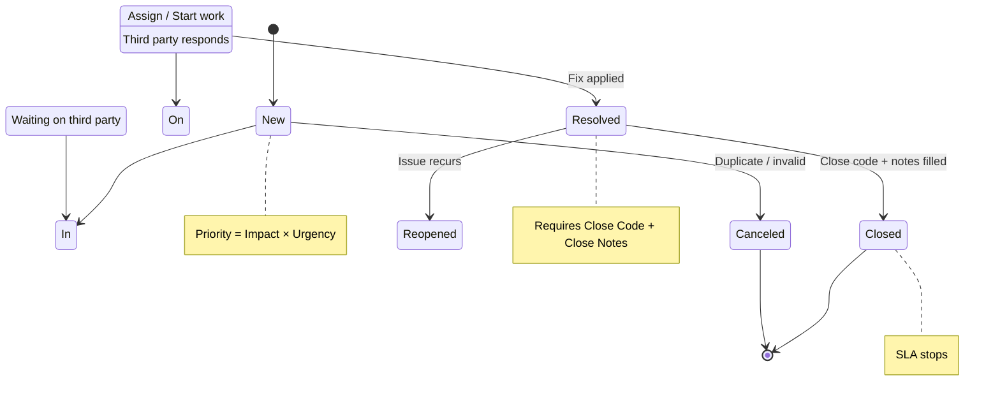
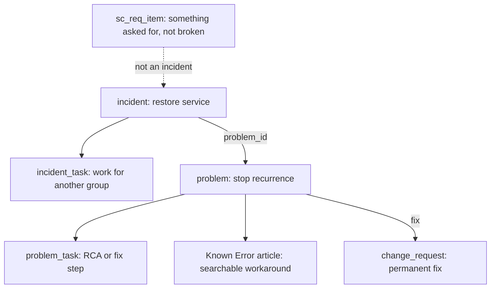
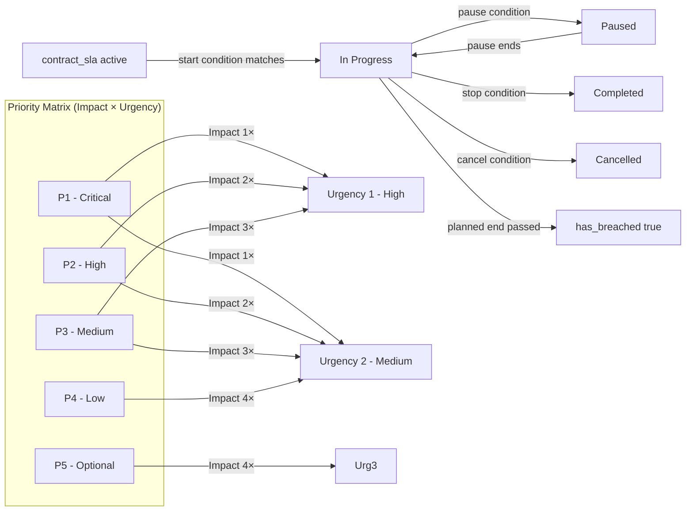

# ITSM — IT Service Management

**Agent:** opencode  
**Date:** 2026-11-05  
**Module:** ITSM (IT Service Management)  
**App:** ITSM  
**Confidence:** high  

---

## Contents


- [Purpose](#purpose)
- [Prerequisites & Setup](#prerequisites--setup)
- [Where to Find It](#where-to-find-it)
- [Official Exam Alignment — CIS-ITSM](#official-exam-alignment--cis-itsm)
- [Re-usable Code / Metadata](#re-usable-code-metadata)
  - [Scoped Application](#scoped-application)
  - [Meta Data Patterns](#meta-data-patterns)
  - [The re-usable metadata inventory](#the-re-usable-metadata-inventory)
  - [Re-usable Code Snippets](#re-usable-code-snippets)
- [Out-of-Box Features](#out-of-box-features)
- [Out-of-Box Values & Dropdowns](#out-of-box-values--dropdowns)
  - [Incident — State](#incident--state)
  - [Incident — On Hold Reason](#incident--on-hold-reason)
  - [Change — Type](#change--type)
  - [Problem — State](#problem--state)
- [🔍 Process Deep Dives](#process-deep-dives)
  - [🚨 Incident Management](#incident-management)
  - [🚨 Major Incident Management (MIM)](#major-incident-management-mim)
  - [🧩 Problem Management](#problem-management)
  - [Incident, Problem, and the records next to them](#incident-problem-and-the-records-next-to-them)
  - [⚙️ Change Management](#change-management)
  - [📊 Major Incident vs Normal Incident Comparison](#major-incident-vs-normal-incident-comparison)
  - [📊 CAB & Change Types Decision Flow](#cab--change-types-decision-flow)
  - [📊 Change Collision Detection & Blackout Windows](#change-collision-detection--blackout-windows)
  - [📦 Request Fulfillment](#request-fulfillment)
  - [📖 Knowledge Management](#knowledge-management)
- [Key Table Hierarchy](#key-table-hierarchy)
  - [ITSM Core Table Relationship Diagram](#itsm-core-table-relationship-diagram)
  - [Table Relationships](#table-relationships)
  - [CMDB Integration](#cmdb-integration)
- [Integrations](#integrations)
- [Key Fields](#key-fields)
- [Common Mistakes](#common-mistakes)
- [Goals, Benefits & Key Metrics](#goals-benefits--key-metrics)
- [Core Concept Diagrams](#core-concept-diagrams)
  - [Incident Lifecycle State Diagram](#incident-lifecycle-state-diagram)
  - [Incident, Problem, Change — what links to what](#incident-problem-change--what-links-to-what)
  - [SLA Lifecycle and Priority Matrix](#sla-lifecycle-and-priority-matrix)
- [Deep Dive: A CSDM Map, End to End (SCCM Laptop Example)](#deep-dive-a-csdm-map-end-to-end-sccm-laptop-example)
  - [The End-to-End Map](#the-end-to-end-map)
  - [Visualizing the Relationships (Top-Down Object Model)](#visualizing-the-relationships-top-down-object-model)
  - [Why This Mapping Matters for SCCM](#why-this-mapping-matters-for-sccm)
- [Lab: Create and Resolve Your First Incident](#lab-create-and-resolve-your-first-incident)
- [Integrations for Legacy / Public-Sector Environments](#integrations-for-legacy-public-sector-environments)
- [SLAs, Dashboards & Workspaces](#slas-dashboards--workspaces)
  - [Out-of-box incident SLAs, breach, and every definition option](#out-of-box-incident-slas-breach-and-every-definition-option)
- [Quiz](#quiz)
- [🎓 Official Learning Resources](#official-learning-resources)
  - [📺 Verified Videos & Playlists](#verified-videos--playlists)
  - [🚀 Quick Start Guide](#quick-start-guide)
  - [🚀 The Authoritative Path](#the-authoritative-path)
- [💡 Memory Aids & Mnemonics](#memory-aids--mnemonics)
  - [Business Rule Types — BAA](#business-rule-types--baa)
  - [Client Script Types — LOCS](#client-script-types--locs)
  - [UI Policy vs Data Policy vs Client Script](#ui-policy-vs-data-policy-vs-client-script)
  - [IRE — Identification Before Reconciliation](#ire--identification-before-reconciliation)
  - [Update Set Conflicts — ARM](#update-set-conflicts--arm)
  - [CMDB — Retire Before Delete](#cmdb--retire-before-delete)
  - [Order vs Priority — Lower = First](#order-vs-priority--lower-=-first)
  - [Transform Script — Coalesce = Match](#transform-script--coalesce-=-match)
  - [Debugging — Log First, Then Debug](#debugging--log-first-then-debug)
- [Related Guides](#related-guides)


---

## Purpose

IT Service Management (ITSM) is ServiceNow's flagship application for managing IT services. ITSM covers Incident, Problem, Change, Change Task, Knowledge, and Configuration Management. It is the reference implementation of the platform—every other module follows the same patterns. ITSM defines how IT receives, prioritizes, assigns, resolves, and reports on service disruptions and planned changes.

---

## Prerequisites & Setup

**Plugins / Scoped Apps that must be active:**
- `com.snc.itsm` — core ITSM scoped application (tables: incident, incident_task, problem, problem_task, change_request, change_task, task, contract_sla, task_sla; roles: itil, sn_incident.read, sn_incident.write, sn_change.write, sn_problem.write, admin)
- `com.snc.cmdb` — CMDB integration for affected CI relationships and CI lifecycle
- `com.snc.discovery` — Discovery / MID Server for auto-discovering CIs and maintaining identifier reconciliation
- `com.snc.service_catalog` — Service Catalog for request fulfillment, record producers, and order guides
- `com.snc.km` — Knowledge Management for containment articles and KEDB publication

**Guided Setup:**
- Run **ITSM Guided Setup** (All > ITSM > Administration > Guided Setup) to configure incident categories, assignment groups, SLAs, priority matrices, and default change types. This is the fastest path to a production-ready instance.

**System properties to consider:**
- `glide.incident.close_code_required` — enforce close codes on incident close
- `glide.incident.close_notes_required` — enforce close notes on incident close
- `glide.sla.enabled` — global SLA engine toggle
- `sn_incident.use_assignment_groups` — route incidents by assignment group
- `glide.cmdb.use_cmdb` — enable CMDB for CI relationships

**Cross-module dependencies:**
- CMDB (`cmdb_ci`) — affected CI lookups, CI lifecycle state, service-mapping relationships
- Discovery — auto-discovery of CIs, identifier & reconciliation rules
- Service Catalog (`sc_request`) — request fulfillment, record producers, order guides
- Knowledge Management (`kb_knowledge`) — articles for containment, KEDB publication
- Event Management (`em_event`) — create incidents from monitoring alerts
- CSM (`com.snc.customerservice`) — case↔incident integration patterns

**ACLs related to core tables:**
- **incident** (`sn_incident`): read/write by `itil`, `sn_incident.read`, `sn_incident.write`; assignment_group and assignment_group_id require `itil` or equivalent; close_code/close_notes visibility controlled by UI policy/ACL
- **problem** (`sn_problem`): read/write by `sn_problem.write`, visible under `itil`; root_cause and kedb_link fields require appropriate ACLs
- **change_request** (`sn_change`): read/write by `sn_change.write`, CAB approvals require `change_admin` or `cab` roles; risk and implementation_plan fields have field-level ACLs
- **sc_request** (`sc_request`): read by `sc_request.read`, write by `sc_request.write`; used by Service Catalog order flows; catalog item ACLs control who can submit

**Breadcrumbs — enable in this order:**
1. Verify `com.snc.itsm` is active (System Definition → Plugins)
2. Run ITSM Guided Setup to provision categories, groups, SLAs
3. Ensure CMDB is populated (Discovery or manual CI import)
4. Configure Service Catalog items and record producers
5. Enable Knowledge Management if containment articles are needed
6. Enable Event Management if alert→incident integration is required
7. Enable CSM plugin if cross-module case↔incident patterns are needed

---

## Where to Find It

|| Breadcrumb | Path |
||------------|------|
|| Module entry | All > IT Service Management > ... |
| Incidents | All > Incident > All |
| Problems | All > Problem > All |
| Changes | All > Change > All |
| Change Tasks | All > Change > Tasks > All |
| Knowledge | All > Knowledge > All |
| Configuration Items | All > CMDB > CI List |
| Service Catalog | All > Service Catalog > All |
| Administration | All > ITSM > Administration > ... |

**Tip:** If menus are missing, verify the `com.snc.itsm` plugin is active (System Definition → Plugins).

---

## Official Exam Alignment — CIS-ITSM

This guide maps to the **Certified Implementation Specialist – IT Service Management (CIS-ITSM)** exam blueprint (ServiceNow University, KB0011560). Exam weightings shown are the official domain percentages.

| Guide Section | CIS-ITSM Domain | Exam Weight | What's Covered |
|---------------|-----------------|-------------|----------------|
| **Incident Management** (deep dive + lab) | Domain 1: Incident Management — Architecture, Scoping & Requirements, Configuration: Incident lifecycle | 25% | Incident lifecycle, state model, priority (impact × urgency), assignment groups, SLAs, major incident management |
| **Problem Management** (deep dive) | Domain 2: Problem Management — Architecture, Scoping & requirements, Problem Lifecycle Configuration | 15% | Problem vs incident, root cause analysis, KEDB, problem tasks, permanent fix vs workaround |
| **Change Management** (deep dive) | Domain 3: Change Management — Architecture and configuration | 25% | Change types (standard/normal/emergency), CAB, state model, risk/impact, conflict detection, blackout windows |
| **Service Catalog & Request Fulfillment** | Domain 5: Service Catalog and Request Management — Architecture, Scoping & Requirements, Configuration, Integrations | 25% | Catalog items, record producers, order guides, RITM, catalog tasks, approval workflows |
| **Service Portfolio Management** | Domain 4: Service Portfolio Management | 5% | Business services, service offerings, access to Service Owner Workspace |
| **CMDB integration** | Domain 6: Configuration Management Database | 5% | cmdb_ci, affected CI relationships, CI lifecycle |

**Official preparation courses** (recommended by ServiceNow for this exam):
- Welcome to ServiceNow
- ServiceNow Administration Fundamentals
- ServiceNow Administration Advanced
- ServiceNow Get Started with Now Create
- ServiceNow Platform Implementation
- CMDB Fundamentals
- ServiceNow ITSM Fundamentals
- ServiceNow ITSM Implementation

**Exam guidance:** Questions are based on official ServiceNow training materials, the ServiceNow Product documentation site, and the ServiceNow developer site. Study materials posted elsewhere online are not official.

---

## Re-usable Code / Metadata

### Scoped Application

ITSM ships as a scoped application (`com.snc.itsm`).

| Scope Aspect | Detail |
|--------------|--------|
| Scope name | `com.snc.itsm` |
| Tables | `incident`, `incident_task`, `problem`, `problem_task`, `change_request`, `change_task`, `task`, `contract_sla`, `task_sla` |
| Roles | `itil`, `sn_incident.read`, `sn_incident.write`, `sn_change.write`, `sn_problem.write`, `admin` |

### Meta Data Patterns

| Metadata Element | Example | Notes |
|------------------|---------|-------|
| Application menu | `sn_itsm.menu.main` | ITSM left-nav root |
| Module | `sn_itsm.menu.incidents` | Points to incident list |
| Choice list | `sn_itsm.incident_state` | New → In Progress → Resolved → Closed |
| UI Policy | `sn_itsm.policy.mandatory_fields` | Validates required fields |
| Business Rule | `sn_itsm.rule.auto_assign_incident` | Auto-assigns based on category |

### The re-usable metadata inventory

ITSM's scale comes from these shared objects — every process below is defined once and consumed by all the others:

| Re-usable piece | What it is | Where it lives (breadcrumb) |
|-----------------|------------|------------------------------|
| **Variable sets (Service Catalog)** | Groups of catalog variables (location picker, cost centre, justification…) defined once and attached to dozens of catalog items — the single highest-leverage reuse in the catalog. Items and record producers supply their own variables only for what is unique. | All > Service Catalog > **Variables** (Variable Sets) |
| **Catalog items, record producers & order guides** | The reusable intake patterns themselves: one record producer pattern creates incidents/requests from many forms; order guides bundle related items into one checkout. | All > Service Catalog > **Catalog Definitions** |
| **Task templates** | Pre-filled incident/change/problem templates (`sys_template` and process templates) so common work starts 90% complete — "password reset", "standard server patch". | All > System Definition > **Templates** |
| **Change models & standard changes** | Change models define the states, approvals, and tasks for a *class* of change; standard change templates are the pre-approved, reusable instances. A good standard-change library is most of a healthy change process. | All > Change > **Change Models** / **Standard Change** |
| **SLA definitions** | One clock per commitment. The row lives on `contract_sla`. The **Table** field decides incident vs task vs both. Type (SLA / OLA / Underpinning Contract) does not. | All > Service Level Management > **SLA Definitions** |
| **Assignment rules & on-call rotations** | Assignment rules route by category/group data; on-call schedules and rotations (`cmn_rota`) define who is reachable, reused by every escalation and major-incident page-out. | All > System Policy > **Assignment Rules** · All > On-Call Scheduling |
| **Approval rules** | Reusable approval logic (by amount, by group, by CI owner) consumed by change, catalog, and knowledge publishing alike. | All > System Policy > **Approvals** |
| **Flows, subflows & IntegrationHub spokes** | Flow Designer automation is the platform's shared library: a subflow like "create AD account" or a spoke action is built once and called from ITSM, CSM, HR — everywhere. | All > Process Automation > **Flow Designer** · **IntegrationHub** |
| **CMDB identification & reconciliation rules** | The IRE rule set (identifiers, reconciliation, de-duplication) that *all* data sources share — Discovery, connectors, imports. See the Discovery guide for the identifier deep treatment. | All > Configuration > **Identification/Reconciliation** |
| **Dynamic CI groups** | Query-defined CI collections (e.g. "all Windows 11 workstations") reused by change impact, reporting, and service mapping — the group definition is maintained once, membership stays current by itself. Worked end to end in this guide's CSDM deep dive below. | All > Configuration > **Dynamic CI Groups** |
| **Knowledge article templates** | Templates per article type (how-to, FAQ, policy) that keep thousands of articles consistent, plus the feedback loop that maintains them. | All > Knowledge > **Article Templates** |

### Re-usable Code Snippets

#### Business Rule: Auto-assign Incident by Category

```javascript
(function rule(current, previous) {
    if (current.operation() == 'insert' && current.category && !current.assignment_group) {
        var gr = new GlideRecord('cmn_Category');
        gr.addQuery('name', current.category);
        gr.query();
        if (gr.next() && gr.assignment_group) {
            current.assignment_group = gr.assignment_group;
        }
    }
})(current, previous);
```

#### UI Priority: Calculate Priority from Impact and Urgency

```javascript
(function rule(current) {
    if (current.impact && current.urgency) {
        var priorityMap = {
            '1|1': '1', '1|2': '1', '1|3': '2',
            '2|1': '1', '2|2': '2', '2|3': '3',
            '3|1': '2', '3|2': '3', '3|3': '4',
            '4|1': '3', '4|2': '4', '4|3': '5'
        };
        var key = current.impact + '|' + current.urgency;
        if (priorityMap[key]) {
            g_form.setValue('priority', priorityMap[key]);
        }
    }
})(current);
```

#### Script Include: ITSM Helper

```javascript
var ITSMHelper = Class.create();
ITSMHelper.prototype = Object.extendsObject(AbstractAjaxProcessor, {
    getIncidentStats: function() {
        var gr = new GlideRecord('incident');
        gr.addQuery('state', '!=', 'closed');
        gr.query();
        var stats = {new: 0, in_progress: 0, on_hold: 0, total: 0};
        while (gr.next()) {
            var state = gr.getValue('state');
            if (state == '1') stats.new++;
            if (state == '2') stats.in_progress++;
            if (state == '3') stats.on_hold++;
            stats.total++;
        }
        return JSON.stringify(stats);
    },
    type: 'ITSMHelper'
});
```

#### Read-only: which SLAs attached

Do not write a business rule that pauses or completes `task_sla`. Pause, stop, and cancel belong on the SLA definition. Resolving an incident is a **stop** condition, not a pause. This script only reads the clocks the engine already created.

```javascript
var sla = new GlideRecord('task_sla');
sla.addQuery('task', current.sys_id);
sla.query();
while (sla.next()) {
    gs.info(sla.sla.getDisplayValue()
        + ' stage=' + sla.getDisplayValue('stage')
        + ' breach=' + sla.getValue('planned_end_time'));
}
```

---

## Out-of-Box Features

| Feature | Description | Where |
|---------|-------------|-------|
| Incidents | Track broken things reported by users | All > Incident > All |
| Problems | Root cause of incidents | All > Problem > All |
| Changes | Planned changes to IT services | All > Change > All |
| Change Tasks | Tasks within a change | All > Change > Tasks |
| Knowledge Base | Articles for agents and users | All > Knowledge > All |
| Service Catalog | Service requests from catalog | All > Service Catalog > All |
| SLAs | Service Level Agreements | All > Service Level Management > SLA Definitions |
| CMDB | Configuration items and relationships | All > CMDB > CI List |
| Dashboards | ITSM performance dashboards | All > ITSM > Dashboards |

---

## Out-of-Box Values & Dropdowns

ServiceNow ships with predefined choice list values. Do not hardcode these in scripts — reference them by display value or sys_id, and verify against your instance (values can vary by release).

### Incident — State
| State | When to Use |
|-------|-------------|
| `New` | Incident created, not yet assigned |
| `In Progress` | Work actively being performed |
| `On Hold` | Waiting on a dependency (caller, change, problem, vendor) |
| `Resolved` | Fix applied, awaiting closure |
| `Closed` | Close code + close notes completed |
| `Canceled` | Duplicate or invalid incident |

### Incident — On Hold Reason
| On Hold Reason | Notes |
|----------------|-------|
| `Awaiting Caller` | Waiting for the user to respond |
| `Awaiting Change` | Waiting for a change to be implemented |
| `Awaiting Problem` | Waiting for problem investigation (ServiceNow recommends removing this choice) |
| `Awaiting Vendor` | Waiting on a third-party vendor |

### Change — Type
| Type | Description | Default Values |
|------|-------------|----------------|
| `Normal` | Requires CAB approval, risk assessed | State: `New`, Category: `Other`, Risk: `Moderate` |
| `Standard` | Low risk, pre-approved (e.g., monthly patching) | — |
| `Emergency` | Fixes critical outage; approved by ECAB | — |

### Problem — State
| State | When to Use |
|-------|-------------|
| `New` | Problem created |
| `Assess` | Problem under investigation |
| `Known Error` | Root cause identified, workaround documented in KEDB |
| `Resolved` | Permanent fix applied |
| `Closed` | Problem closed |

**Exam focus (CIS-ITSM Domain 1, 25%):** Incident state transitions, On Hold reasons, Change types, default change values, priority calculation.

---


## 🔍 Process Deep Dives

### 🚨 Incident Management



**Major Incident Management (MIM):** A separate process for high-impact outages. Includes a "Communication Plan" to update stakeholders.

**Priority Matrix (Impact × Urgency):**

| Impact \ Urgency | 1 - High | 2 - Medium | 3 - Low |
|------------------|----------|------------|---------|
| 1 - High | **P1** | **P1** | **P2** |
| 2 - Medium | **P1** | **P2** | **P3** |
| 3 - Low | **P2** | **P3** | **P4** |
| 4 - Low | **P3** | **P4** | **P5** |

**Exam focus (Domain 1, 25%):** Incident lifecycle, state transitions, priority calculation, assignment groups, SLAs, major incident management.


🚀 **Interview Insight:** Focus on the **"Restore Service"** goal. Mention that Incident is about speed, while Problem is about the root cause.

### 🚨 Major Incident Management (MIM)

A major incident is **not** just a P1. Priority is a form value; a major incident is a *declared business event* with its own process, cadence, and communication obligations.

| Aspect | Normal incident | Major incident |
|--------|-----------------|----------------|
| Who drives it | Assignment group (tier 1 → tier 2) | **Major Incident Manager** on a bridge |
| Cadence | As tickets arrive | Fixed update cadence (e.g. every 30 min) until resolution |
| Comms | Caller gets notifications | **Communication Plan / comms tasks** to stakeholders, execs, business owners |
| Coordination | Within one group | Multi-team swarm; separate "candidate" tasks tracked on a child record |
| Exit | Resolve + close | Resolve → **post-incident review** → Problem record for root cause |

**Mechanics on the platform:**

- A separate **Major Incident** state or field (`major_incident_state` on newer releases) tracks the declaration lifecycle.
- **`incident.major_incident`** flag / candidate records group related P1s under one parent.
- **Comms plans** generate stakeholder notification tasks so updates are auditable rather than ad-hoc.
- A **bridge** (conference) is usually recorded on the record; the Manager owns the timeline.
- Closure requires a **post-incident review** — the deliverable is "what we will change", which feeds Change or Problem.

**Interview framing:** "I distinguish severity from declaration. A P1 in a single department may not be a major incident; an outage affecting a public-facing service is declared major regardless of ticket count. The Major Incident Manager owns communication cadence and the bridge, and the review output becomes a Problem record with a linked Change."

### 🧩 Problem Management

A problem is not a worse incident. An incident restores service. A problem explains why it broke and stops it happening again. One problem can sit behind many incidents. Most incidents never need a problem.

- **Root cause analysis** is the work of finding the cause. It lives on the problem (`cause_notes`) and on problem tasks. It is not a second incident.
- **Workaround** restores service now so the incident can resolve. The problem stays open. Field: `problem.workaround`. Publish it where agents will search it.
- **Known Error** is a problem whose cause is known and whose workaround is published, usually as an article in the Known Error knowledge base, with the problem state moved to Known Error. A known error is not a closed problem. The problem closes when the permanent fix is done.
- **Problem task** (`problem_task` extends `task`) is a unit of investigation or fix work under that problem (root-cause task or general task). Completing the task does not resolve the linked incidents.
- **Permanent fix** is a change (`change_request`), not a state you type into the incident. The problem says what must change. The change authorizes doing it.

Open a problem when the same failure repeats, the cause is unknown after restore, or a major-incident review requires it. Do not open one per ticket.

### Incident, Problem, and the records next to them

These records get mixed up because several of them extend `task` and several of them show up on the incident form. The table name is the distinction. If you cannot name the table, you do not yet know which record you are in.

| Record | Table | What it is | What it is not | Done when |
|--------|-------|------------|----------------|-----------|
| Incident | `incident` | Unplanned interruption or degraded service. Goal: restore. Customer SLA runs here. | A request, a root-cause study, or a unit of work for a second team | Caller has service back. Close code and close notes filled |
| Request | `sc_request` / `sc_req_item` | Someone asked for a standard thing that is not broken | An incident. "Password reset" as a catalog item is a request. A service that failed and locked people out is an incident | The requested item is fulfilled |
| Incident task | `incident_task` | Work under one incident, often for another group | A second incident. Resolving the task does not resolve the incident. An SLA whose table is `incident` does not attach here | That group's work is finished |
| Parent incident | `incident` with children | Coordination record for one shared failure | A problem. Children are still incidents | Shared impact is gone and children are resolved or canceled |
| Major incident | `incident` plus `major_incident_state` | A declared business event: bridge, comms plan, post-incident review | A synonym for P1. Priority is a form value. Declaration is a process | Service restored, review written, problem opened if the cause must be removed |
| Outage | `cmdb_ci_outage` | The CI unavailability window linked from the incident | The ticket, and not the SLA. The clock still runs on `task_sla` | CI is back; the outage end time is set |
| Problem | `problem` | Cause behind one or many incidents. Goal: prevent recurrence | A place to hide an incident you have not restored. No caller-restore SLA belongs here | Cause addressed, or accepted, and the record is closed |
| Known error | problem state + Known Error article | Cause known, workaround published for agents | A closed problem, and not a knowledge article of any other type | Workaround is searchable. The problem stays open until the fix lands |
| Problem task | `problem_task` | RCA or fix work under the problem | An incident, and not a change | That investigation or fix step is done |
| Change | `change_request` | Planned modification. Emergency change can restore service now. Normal change delivers the problem's permanent fix | A problem. Identifying the cause does not authorize the change | Implemented, reviewed, closed |

How they connect, and only in this direction:

1. Incident restores service. Link repeating incidents to one problem through `incident.problem_id`. Do not copy the incident onto a made-up cause field.
2. If the cause is already known, publish the workaround and move the problem to Known Error so the next incident is short.
3. The permanent fix is a change. An emergency change can also hang off the incident when restore itself needs a production modification. That change is still not a problem.
4. On Hold is a pause on the **incident**, with a reason. Awaiting Caller and Awaiting Vendor are real holds. Awaiting Problem is shipped, and ServiceNow recommends removing that choice — linking a problem is not a reason to stop restoring service.

Priority is Impact × Urgency on the incident, from the priority lookup. It chooses which SLA duration matches. It does not declare a major incident, and it does not open a problem.

### ⚙️ Change Management

**Change Types:**

| Change type | Approval path | Risk | Typical use |
|-------------|---------------|------|-------------|
| **Standard** | Pre-approved, templated | Low | Monthly patching, routine config changes |
| **Normal** | Assessed, **CAB-reviewed** | High | New deployments, infrastructure changes |
| **Emergency** | **ECAB**, expedited | High | Fixes a critical outage in production |

**CAB (Change Advisory Board):** The group that reviews and approves Normal changes. CAB membership spans IT, security, business owners, and vendors.

**ECAB (Emergency CAB):** A smaller, on-call subset that can convene within minutes for Emergency changes.

**Blackout windows:** Dates where no changes are allowed (e.g., Black Friday for retail, month-end for finance).

**Lead-level point:** Most change volume should be pushed toward **standard changes** so CAB time is spent only on genuinely risky changes. Standard changes are pre-approved templates — if you find yourself taking the same Normal change to CAB repeatedly, promote it to Standard.

**Change collision detection:** The platform checks for overlapping CIs and blackout windows when a Normal/Emergency change is submitted — this is the "conflict check" the City test asks about.

**Change tasks:** Work assigned to fulfillment groups; completion of all tasks is required before the change can move to Implement.

---

### 📊 Major Incident vs Normal Incident Comparison

```mermaid
flowchart TD
    subgraph "Normal Incident"
        N1[Incident Created] --> N2[Triage & Assign]
        N2 --> N3[Investigate & Resolve]
        N3 --> N4[Resolve & Close]
        N4 --> N5[Post-incident review optional]
    end
    
    subgraph "Major Incident"
        M1[Incident Created] --> M2{Business impact = major?}
        M2 -->|Yes| M3[Declare Major Incident]
        M3 --> M4[MIM Workbench Opens]
        M4 --> M5[Bridge Call Scheduled]
        M5 --> M6[Comms Plan Executed]
        M6 --> M7[Stakeholder Tasks Created]
        M7 --> M8[War Room Coordination]
        M8 --> M9[Resolution Applied]
        M9 --> M10[Post-Incident Review Scheduled]
        M10 --> M11[Lessons Learned Documented]
    end
    
    N2 -->|Low impact| N5
    M2 -->|No| N1
    
    style M3 fill:#ff6b6b,color:#fff
    style M4 fill:#ff6b6b,color:#fff
    style M5 fill:#ff6b6b,color:#fff
    style M8 fill:#ff6b6b,color:#fff
    
    note right of N1
        Standard workflow
        SLA: P1-P5 targets
        Owner: Incident Manager
    end note
    
    note right of M3
        Declaration triggers:
        - Business impact threshold
        - Executive notification required
        - Public-facing outage
    end note
```

---

### 📊 CAB & Change Types Decision Flow

```mermaid
flowchart TD
    START[Change Request Created] --> TYPE{Change type?}
    
    TYPE -->|Standard| STD[Pre-approved, templated]
    TYPE -->|Normal| NORM[Requires assessment]
    TYPE -->|Emergency| EMRG[Expedited path]
    
    STD --> STD_APPROVE{Template exists? Low risk?}
    STD_APPROVE -->|Yes| STD_EXEC[Auto-approve → Implement]
    STD_APPROVE -->|No| NORM
    
    NORM --> CAB[CAB Review]
    CAB --> CAB_DECISION{Approved?}
    CAB_DECISION -->|Yes| NORM_EXEC[Implement with approval]
    CAB_DECISION -->|No| REJECT[Rejected / Return for revision]
    
    EMRG --> ECAB[ECAB (on-call subset)]
    ECAB --> EMRG_DECISION{Expedited approval?}
    EMRG_DECISION -->|Yes| EMRG_EXEC[Implement immediately → Retro review]
    EMRG_DECISION -->|No| REJECT
    
    STD_EXEC --> POST[Post-implementation review optional]
    NORM_EXEC --> POST
    EMRG_EXEC --> RETRO[Retro CAB review required within 7 days]
    
    style STD fill:#6bcb77,color:#fff
    style STD_EXEC fill:#6bcb77,color:#fff
    style NORM fill:#ffd93d,color:#000
    style CAB fill:#ffd93d,color:#000
    style EMRG fill:#ff6b6b,color:#fff
    style ECAB fill:#ff6b6b,color:#fff
    
    note right of STD
        Standard changes:
        - Pre-approved
        - Low risk
        - No CAB needed
        - Examples: password reset, routine patching
    end note
    
    note right of NORM
        Normal changes:
        - CAB-reviewed
        - Higher risk
        - Requires approval
        - Examples: new deployment, infra change
    end note
    
    note right of EMRG
        Emergency changes:
        - ECAB-approved
        - Production outage fix
        - Retro review mandatory
        - Blackout window exceptions
    end note
```

---

### 📊 Change Collision Detection & Blackout Windows

```mermaid
flowchart TD
    subgraph "Pre-Implementation Checks"
        CHECK1[Change start time within blackout window?]
        CHECK2[CI collision detected? Same CI, overlapping windows]
        CHECK3[Dependency chain blocked? Upstream change not complete]
    end
    
    CHECK1 -->|Yes → BLOCKED| BLOCK[Block implementation]
    CHECK1 -->|No → OK| CHECK2
    CHECK2 -->|Yes → BLOCKED| BLOCK
    CHECK2 -->|No → OK| CHECK3
    CHECK3 -->|Yes → BLOCKED| BLOCK
    CHECK3 -->|No → OK| ALLOW[Allow implementation]
    
    BLOCK --> NOTIF[Notify requester: "Change blocked due to blackout/collision/dependency"]
    NOTIF --> RESOLVE[Adjust schedule or wait for resolution]
    RESOLVE --> CHECK1
    
    style BLOCK fill:#ff6b6b,color:#fff
    style ALLOW fill:#6bcb77,color:#fff
    
    note right of CHECK1
        Blackout windows:
        - Month-end close
        - Holiday periods
        - Scheduled maintenance
        - Business-critical events
    end note
    
    note right of CHECK2
        Collision detection:
        - Same CI affected
        - Time windows overlap
        - Prevents conflicting changes
    end note
```
### 📦 Request Fulfillment
- **Catalog Item:** The "Product" the user sees.
- **Record Producer:** A simple form that creates a record (Incident or Case).
- **RITM (Requested Item):** The actual order.
- **Catalog Task:** The work assigned to a team (e.g., "Configure Laptop").
- **Approval workflows:** Manager $	o$ Finance $	o$ Fulfillment.

### 📖 Knowledge Management
- **Knowledge Bases:** Separating "Public" (customer) from "Internal" (agent) knowledge.
- **Article versioning:** Tracking changes to a KB over time.
- **AI Search:** Using Natural Language Processing (NLP) to find the right article faster.


## Key Table Hierarchy

### ITSM Core Table Relationship Diagram

```mermaid
graph TD
    subgraph "Task Base Table"
        task[task]
    end
    
    subgraph "ITSM Child Tables (extend task)"
        incident[incident]
        incident_task[incident_task]
        problem[problem]
        problem_task[problem_task]
        change_request[change_request]
        change_task[change_task]
    end
    subgraph "SLA engine (does not extend task)"
        contract_sla[contract_sla]
        task_sla[task_sla]
    end
    
    subgraph "Configuration Management"
        cmdb_ci[cmdb_ci]
    end
    
    subgraph "Knowledge"
        kb_knowledge[kb_knowledge]
    end

    task --> incident
    task --> incident_task
    task --> problem
    task --> problem_task
    task --> change_request
    task --> change_task

    incident -.->|affected CI| cmdb_ci
    problem -.->|root cause CI| cmdb_ci
    change_request -.->|affected CIs| cmdb_ci
    incident -.->|problem_id| problem
    problem -.->|fix is a change| change_request
    change_request -.->|tasks within| change_task
    task_sla -.->|task reference| task
    contract_sla -.->|definition| task_sla
    kb_knowledge -.->|related CI| cmdb_ci

    style task fill:#0b0e11,stroke:#4cc38a,stroke-width:2px
    style incident fill:#10141a,stroke:#4cc38a
    style problem fill:#10141a,stroke:#4cc38a
    style change_request fill:#10141a,stroke:#4cc38a
    style cmdb_ci fill:#0a0d10,stroke:#e5b567
```



### Table Relationships

```
incident
    │
    ├──► cmdb_ci (affected CI)
    ├──► caller_id, assignment_group, assigned_to
    ├──► incident_task (work under this incident; not a second incident)
    ├──► problem_id → problem (the cause; not a child ticket)
    ├──► parent incident (shared failure; children are still incidents)
    │
problem
    │
    ├──► incidents via incident.problem_id
    ├──► problem_task (RCA or fix step)
    ├──► change_request (permanent fix)
    ├──► Known Error article (workaround agents can search)
    │
change_request
    │
    ├──► change_task
    │
contract_sla
    │
    ├──► collection = incident, or task, or another task child
    ├──► type = SLA, OLA, or Underpinning Contract (does not pick the table)
    │
task_sla
    │
    ├──► task (the record the clock is running on)
    ├──► sla → contract_sla (there is no sla_definition table)
    │
cmdb_ci
    │
    ├──► cmdb_rel_ci (relationships to other CIs)
    │
```

### CMDB Integration

| ITSM Table | Maps to CMDB Table | Relationship |
|------------|-------------------|--------------|
| `incident` | `cmdb_ci` | Affected CI |
| `change_request` | `cmdb_ci` | Affected CIs (multiple) |
| `problem` | `cmdb_ci` | Root cause CI |
| `kb_knowledge` | `cmdb_ci` | Related CI (optional) |

---

## Integrations

| Integration | Direction | Purpose | Protocol |
|-------------|-----------|---------|----------|
| Email | Inbound/Outbound | Create incidents from email, send notifications | Email/SMTP |
| Discovery (MID Server) | Inbound | Auto-discover servers, network devices | Discovery/MID Server |
| CMDB | Bidirectional | Link incidents/changes to CIs | Internal |
| Knowledge Base | Inbound | Publish articles for agents/users | Internal |
| Service Catalog | Outbound | Create incidents from catalog requests | Internal |
| Remote Table | Inbound | View external asset data | Remote Table API |
| REST Message | Outbound | Call external monitoring tools | REST/SOAP |
| Event Management | Inbound | Create incidents from monitoring alerts | EM |
| Chat | Inbound | Create incidents from chat (MS Teams, Slack) | Chat API |

---

## Key Fields

| Table | Field | Type | Why It Matters |
|-------|-------|------|----------------|
| `incident` | `number` | String | Auto-number; user-facing ID |
| `incident` | `short_description` | String | Mandatory; searchable summary |
| `incident` | `category` | Choice | Drives assignment and routing |
| `incident` | `state` | Choice | New → In Progress → Resolved → Closed |
| `incident` | `priority` | Choice | Drives SLA and escalation |
| `incident` | `assignment_group` | Reference | Routing; who works it |
| `incident` | `assigned_to` | Reference | Individual owner |
| `incident` | `caller_id` | Reference | Who reported it |
| `incident` | `cmdb_ci` | Reference | Affected configuration item |
| `incident` | `impact` | Choice | Business impact level |
| `incident` | `urgency` | Choice | How quickly needed |
| `incident` | `close_code` | Choice | Why resolved (required at close) |
| `incident` | `close_notes` | String | Required at close |
| `incident` | `problem_id` | Reference | The problem behind this incident. Many incidents, one problem |
| `incident` | `hold_reason` | Choice | Only meaningful in On Hold. Awaiting Vendor starts the vendor clock |
| `incident` | `major_incident_state` | Choice | Declaration lifecycle. Not the same field as priority |
| `incident_task` | `incident` | Reference | Parent incident. This row is work, not another caller ticket |
| `problem` | `workaround` | String | Restores service now. Does not close the problem |
| `problem` | `cause_notes` | String | The why. Empty cause notes means it is not a known error yet |
| `problem_task` | `problem` | Reference | RCA or fix step under the problem |
| `change_request` | `type` | Choice | Standard, Normal, Emergency |
| `change_request` | `risk` | Choice | Risk level |
| `change_request` | `implementation_plan` | String | Required for normal changes |
| `contract_sla` | `collection` | Table name | `incident` attaches to incidents only. `task` attaches to incidents and every other task child |
| `contract_sla` | `type` | Choice | SLA, OLA, or Underpinning Contract. Does not choose the table |
| `contract_sla` | `start_condition` | Conditions | No match, no `task_sla` row |
| `task_sla` | `stage` | Choice | In Progress, Paused, Completed, Breached. Engine-owned. Do not script it |
| `task_sla` | `sla` | Reference | The `contract_sla` definition |
| `task_sla` | `planned_end_time` | DateTime | When this clock breaches |

---

## Common Mistakes

| Mistake | Symptom | Fix |
|---------|---------|-----|
| Creating incidents without categories | Form fields don't appear | Define categories first |
| Not setting assignment_group | Incidents never get worked | Always assign a group |
| Editing state without understanding SLA | Customer clock pauses or stops for the wrong reason | Put pause and stop on `contract_sla`. Do not script `task_sla` |
| Opening a problem for every incident | Problem queue becomes a second incident queue | Open a problem for recurrence, unknown cause, or a major-incident review |
| Using On Hold / Awaiting Problem instead of restoring service | Incident SLA hides behind a problem that has no restore action | Link `problem_id` if needed. Keep restoring. ServiceNow recommends removing Awaiting Problem |
| Putting the customer SLA on table `task` | The same clock attaches to problems, changes, and catalog tasks | Table = `incident` unless you mean every task child |
| Calling a P1 a major incident | Bridge and comms never happen, or they happen for a single-user P1 | Declare on `major_incident_state`. Priority is only Impact × Urgency |
| Treating a known error as a closed problem | Next incident has no workaround, or the fix is never scheduled | Known Error means cause and workaround are published. Close the problem when the change is done |
| Deleting demo users | Flows break that reference them | Never delete; deactivate |
| Testing as admin only | ACLs bypassed; "it works" means nothing | Test as actual user |
| Making assignment_group optional | Tickets orphaned | Always required |
|| Not closing with close_code/notes | Reporting is incomplete | Enforce at close |
|| Creating custom fields when OOB exists | Unnecessary complexity | Use existing fields first |

---

## Goals, Benefits & Key Metrics

| Goal / Metric | Description | Example Value |
|-------------|-------------|---------------|
| First-time Resolution Rate | % of incidents resolved on first contact without reopening | 65% |
| MTTR (Mean Time To Resolve) | Average time from incident creation to final resolution | 4 hours |
| MTBF (Mean Time Between Failures) | Average time between recurring incidents for the same CI | 30 days |
| SLA Compliance % | Incidents meeting SLA target within agreed time window | 95% |
| Incident Volume | Total incidents created per 30-day period | 1,200/month |
| Backlog Age | Average age of open incidents older than 30 days | 23 days |
| Reopened Rate | % of closed incidents that reopen within 7 days | 8% |
| Average Resolution Time | Average time to resolve across all severity levels | 6.5 hours |

---

## Core Concept Diagrams

### Incident Lifecycle State Diagram


### Incident, Problem, Change — what links to what

A request does not fall out of a change, and a change does not close an incident by itself. Restore on the incident. Explain it on the problem. Authorize the permanent fix on the change.



### SLA clock and priority matrix

`contract_sla` is the definition. `task_sla.stage` is the clock. Breach is `has_breached` on that clock, not a state you set by hand.



---

## Deep Dive: A CSDM Map, End to End (SCCM Laptop Example)

The Common Service Data Model (CSDM) framework connects raw configuration items (CIs) to the business and technical services that rely on them. When you use the Service Graph Connector for SCCM, it targets the **Design** and **Manage Technical Services** domains of the CSDM, primarily populating the technical physical layer (CIs) and occasionally mapping them to foundational elements like models and manufacturers.

Here is a practical, end-to-end example of how a laptop brought in via SCCM maps across the CSDM domains.

### The End-to-End Map

| CSDM Domain | Table Name | Example Data / Record Name | Managed By / Source |
|-------------|------------|----------------------------|---------------------|
| Foundation (Core Metadata) | `core_company`, `cmdb_hardware_product_model` | Manufacturer: Lenovo · Model: ThinkPad X1 Carbon Gen 11 | Automatically normalized by Hardware Asset Management (HAM) using data ingested by the SCCM connector |
| Design (What is planned) | `cmdb_ci_business_app` | SCCM Endpoint Management | Enterprise Architecture / IT Planning |
| Manage Technical Services (How IT supports it) | `cmdb_ci_query_service` (Technical Service), `service_offering` (Tech Service Offering), `cmdb_ci_service_group` (Dynamic CI Group) | Technical Service: Workplace Compute Support · Offering: Windows Device Support – Gold · Dynamic CI Group: All Windows 11 Workstations | IT Support / Desktop Engineering. The Dynamic CI Group uses a CMDB query to automatically bundle all Windows 11 CIs populated by SCCM |
| Sell / Consume (The Business view) | `cmdb_ci_service_auto` (Business Service), `service_offering` (Business Service Offering) | Business Service: Employee Digital Workspace · Offering: Standard Remote Employee Package | Product Owner / Business Units |
| Build (The Infrastructure CIs) | `cmdb_ci_computer` (or `cmdb_ci_laptop`), `cmdb_sam_sw_install` | CI Name: LAPTOP-US-RE89 · Serial: L3-XYZ123 · OS: Windows 11 Pro · Software: MS 365, Adobe Acrobat | Service Graph Connector for SCCM. This is where the raw data contract lands, using the Identification and Reconciliation Engine (IRE) to avoid duplicates |

### Visualizing the Relationships (Top-Down Object Model)

The map establishes relationships between these layers so that if SCCM reports a laptop is broken, IT instantly understands the downstream business impact:

```
 [Sell/Consume]    Business Service: Employee Digital Workspace
                          │
                          ▼
 [Sell/Consume]    Business Offering: Standard Remote Employee Package
                          │
                          ▼
 [Technical]       Technical Service Offering: Windows Device Support - Gold
                          │
                          ▼
 [Technical]       Dynamic CI Group: All Windows 11 Workstations
                          │ (Automatically groups via CMDB Query)
                          ▼
 [Build / SCCM]    Configuration Item (CI): LAPTOP-US-RE89 (Lenovo ThinkPad)
                          │
                          ▼
 [Foundation]      Product Model: ThinkPad X1 Carbon Gen 11 ──► Manufacturer: Lenovo
```

### Why This Mapping Matters for SCCM

- **Dynamic Scoping:** Rather than manually linking thousands of laptops to a technical service, the CSDM uses a Dynamic CI Group. This group queries the CMDB for any laptop where `discovery_source = SG-SCCM` and `os = Windows 11`.
- **Blast Radius Analysis:** When an incident ticket is opened against LAPTOP-US-RE89, the Service Desk can look upstream at the CSDM map to see that this affects the Windows Device Support – Gold offering and rolls up to the Employee Digital Workspace business service.

---

## Lab: Create and Resolve Your First Incident

1. **Navigate** to All > Incident > All
2. **Click New** and fill:
   - Short Description: Email server not responding
   - Category: Network
   - Subcategory: Email
   - Priority: High
   - Assignment Group: IT Service Desk
   - Caller ID: Select a user (create one if needed)
   - Configuration Item: Select an email server CI (or create one)
   - Description: Users cannot send or receive email since 2 AM
3. **Submit** and note the incident number
4. **Open** the incident → change State to "In Progress"
5. **Add** a work note: "Investigating SMTP server connectivity"
6. **Assign** to yourself (or a test user) in Assigned To
7. **Change** State to "Resolved"
8. **Fill** Close Code: "Resolved by IT"
9. **Fill** Close Notes: "Restarted SMTP service; issue resolved"
10. **Change** State to "Closed"
11. **Verify** in Related Lists: Task SLA, Tasks, Approvals, Knowledge, Comments


---


## Integrations for Legacy / Public-Sector Environments

The City-of-Toronto-style test leans on **legacy integration** more than modern spokes. The full treatment lives in [Cross-Cutting Platform Skills](../../cross-cutting.md); the short version:

| Pattern | How it works | Where it's configured |
|---------|--------------|----------------------|
| **JDBC / ODBC data source** | ServiceNow pulls rows from an external SQL/Oracle DB over JDBC, executed by a **MID Server** inside the network → lands in an **import set** → transform map coalesces into the target table | All > System Import Sets > **Data Sources** |
| **SOAP web service** | ServiceNow consumes a legacy SOAP endpoint with basic auth / WS-Security; MID Server for on-prem endpoints | All > System Web Services > **Outbound SOAP** |
| **Flat-file transfer** | Nightly file drop picked up by a MID Server probe, parsed into an import set | All > System Import Sets > **Load Data** (file) |
| **REST Message** | Modern outbound; OAuth 2.0 preferred, basic auth still common in legacy vendors | All > Outbound > **REST Message** |
| **Flow Designer vs Workflow** | Flow Designer is the current no-code/low-code engine (flows, subflows, actions, spokes). Workflow Studio is the legacy graphical engine — you maintain it, you don't start new work in it | All > Process Automation > **Flow Designer** |

**Data migration shape:** import set (staging) → transform map (field maps, transform scripts, **coalesce** on the legacy key) → target table. Coalesce is the duplicate-prevention mechanism: matching record = update, no match = insert.

---

## SLAs, Dashboards & Workspaces

There is no `sla_definition` table. The definition you edit is `contract_sla` (UI label: SLA Definition). The running clock the engine creates is `task_sla`. Do not insert, pause, or complete `task_sla` by script. Pause, stop, and cancel are conditions on the definition. Resolving an incident is a stop, not a pause.

Navigation: All > Service Level Management > SLA Definitions. The engine has to be on (`glide.sla.enabled`).

### What makes a clock attach

Attachment is the **Table** field (`contract_sla.collection`) plus the **Start condition**, and the definition must be active. Type does not pick the table.

| Table on the definition | Incident | Plain task, catalog task, problem |
|-------------------------|----------|-------------------------------------|
| `incident` | Yes | No |
| `task` | Yes, because `incident` extends `task` | Yes. Every task child, including `problem`, `change_request`, `incident_task` |
| `sc_task` | No | Catalog tasks only |
| `incident_task` | No | Incident tasks only |

One definition cannot cleanly mean "this incident and this vendor task, but not problem or change." Use two definitions. A definition on `task` attaches to both, and to everything else that extends `task`.

Type is a separate choice on the same row:

| Type | Who the commitment is with | Typical table |
|------|----------------------------|---------------|
| SLA | The caller / customer | `incident` |
| OLA | Another internal team | `incident` or `incident_task` |
| Underpinning Contract | A vendor | `incident`, started only while you are waiting on that vendor |

### Incident SLA and vendor SLA

Build these as two `contract_sla` rows. Do not put the vendor duration on the customer resolution SLA. Their pause and stop fight each other.

**Customer resolution SLA.** Type = SLA. Table = `incident`. Start when Active is true and priority matches. Pause when State is On Hold and Hold reason is Awaiting Caller or Awaiting Vendor. Stop when State is Resolved or Closed. Schedule is a `cmn_schedule` (and `cmn_schedule_span` for the hours). Duration comes from the priority matrix, not from a script.

**Vendor SLA.** Type = Underpinning Contract. Table = `incident`. Start only when State is On Hold and Hold reason is Awaiting Vendor. Stop when that hold ends. This clock measures the vendor. It does not replace the customer clock, which should be paused for the same window.

Confirm the hold-reason values on the instance before you write the condition. Awaiting Problem is shipped, and ServiceNow recommends removing it. Linking `problem_id` is not a pause reason.

Conditions are fields on `contract_sla` (start, pause, stop, reset, cancel). You do not edit a child table to create them. You also do not edit the SLA engine business rules.

### Configure and test from scratch

1. Create or pick a 24x7 schedule if you want the test to breach in real minutes. A business schedule will not breach at 19:00.
2. New SLA Definition. Name it `SLA-TEST Incident`. Table = `incident`. Type = SLA. Duration = 1 minute. Schedule = that 24x7 schedule. Active = true.
3. Start condition: Short description starts with `SLA-TEST`. Stop condition: State is Resolved or Closed. Pause condition: State is On Hold.
4. Second definition, `SLA-TEST Vendor`. Type = Underpinning Contract. Table = `incident`. Duration = 1 minute. Start: State is On Hold and Hold reason is Awaiting Vendor. Stop: State is not On Hold.
5. Create an incident whose short description starts with `SLA-TEST`. Related list Task SLAs should show one `task_sla` in In Progress, pointing at the incident definition. The vendor definition must not be there yet.
6. Set State to On Hold, Hold reason Awaiting Vendor. Customer clock pauses. Vendor clock starts.
7. Resolve the incident. Customer clock completes with `has_breached` false if you stopped inside the minute. If you wait out the minute first, stage stays In Progress, `has_breached` becomes true, and resolving after that completes the clock with `has_breached` still true.
8. If no row appears, the definition is inactive, the table is wrong, or the start condition missed. Use Repair SLAs. Do not hand-insert `task_sla`.

### Out-of-box incident SLAs, breach, and every definition option

`has_breached` is not a condition you write. Nothing on `contract_sla` says "set has_breached = true". The engine sets `task_sla.has_breached` when the business clock reaches the duration. Stage does not become a "Breached" state. Stage stays In Progress until pause, stop, cancel, or reset. Breach is the flag.

Open **All > Service Level Management > SLA Definitions** and filter Table is `incident`. The duration is in the name. Families have changed the hours. Eureka shipped **Priority 1 resolution (8 hour)**. Later instances ship **Priority 1 resolution (1 hour)** and a separate **Priority 1 response (15 minutes)**. Read the record on your instance. Do not copy hours from a blog into a design.

Names seen on current base-system-style instances:

| Name | Target | Duration in the name |
|------|--------|----------------------|
| Priority 1 resolution (1 hour) | Resolution | 1 hour |
| Priority 1 response (15 minutes) | Response | 15 minutes |
| Priority 2 resolution (8 hour) | Resolution | 8 hours |
| Priority 2 response (1 hour) | Response | 1 hour |
| Priority 3 resolution (1 day) | Resolution | 1 day |
| Priority 3 response (4 hours) | Response | 4 hours |
| Priority 4 resolution (2 day) | Resolution | 2 days |
| Priority 4 response (8 hours) | Response | 8 hours |
| Priority 5 response (40 hours) | Response | 40 hours |

A Priority 5 resolution row is not in every instance. If the list does not show it, it was not shipped or it is inactive. Do not create it from memory and call it out of box.

A user-specified "1 day" is 24 hours, not one business day. Business time comes from the schedule. A day that falls on a holiday does not count if the schedule excludes holidays.

#### What the engine requires before `has_breached` is true

All of these have to be true. Any one of them keeps the flag false.

| # | Condition | Where it lives |
|---|-----------|----------------|
| 1 | A `task_sla` row exists for this definition and this incident | Engine, after start condition matches |
| 2 | Stage is not Cancelled, and the row was not completed before the breach instant | `task_sla.stage` |
| 3 | Business elapsed time is greater than or equal to the duration | `task_sla.business_elapsed` vs `contract_sla.duration` |
| 4 | That is the same moment as now reaching `task_sla.planned_end_time` (breach time) | Engine |
| 5 | Time spent matching the pause condition is excluded | `pause_condition` |
| 6 | Time outside the schedule is excluded | `schedule` + `timezone_source` |
| 7 | Retroactive pause, if on, also excludes pause time between the retroactive start and the moment the SLA attached | `retroactive_pause` |

What the flag does after that:

| Event | `has_breached` | Stage |
|-------|----------------|-------|
| Planned end reached, incident still open, not paused | true | In Progress |
| Stop condition met before planned end | false | Completed |
| Stop condition met after planned end | stays true | Completed |
| Cancel (start condition no longer met, or cancel condition met) | stays whatever it was; the row is not a success | Cancelled |
| Reset | old row is cancelled or completed; a new `task_sla` starts clean unless retroactive start makes it already late | new row In Progress |

A breached response SLA does not set `has_breached` on the resolution SLA. They are two rows.

#### P1, response, and resolution

P1 is not a special engine. It is the definition whose start condition is priority 1. Response and resolution are two definitions, not two checkboxes that change the clock by themselves. The **Target** field (`response` or `resolution`) is for reporting. The stop condition is what ends the clock.

| | P1 response | P1 resolution |
|--|-------------|---------------|
| Name | Priority 1 response (15 minutes) on current instances | Priority 1 resolution (1 hour) on current instances |
| Table | `incident` | `incident` |
| Type | SLA | SLA |
| Target | Response | Resolution |
| Start | Active is true and Priority is 1 - Critical | Same |
| Stop | The response event on that record. Open the definition and read Stop condition. Do not assume it is "Assigned to is not empty" or "State is In Progress" unless that is what the record says | State is Resolved or Closed |
| Pause | Whatever Pause condition is on that record. Resolution definitions pause while the incident is On Hold. Confirm which hold reasons are in the query | Same rule: read the record |
| Cancel | Start conditions are not met, unless the record says otherwise. Priority leaving 1 cancels this clock and the P2 definition can attach | Same |
| Retroactive start | On. Set start to is Opened (`opened_at`) | On. Set start to is Opened |
| Retroactive pause | On when the definition has a pause condition | On |
| Schedule | Often 24 x 7 for P1. Confirm the Schedule field | Same |
| Flow | Default SLA flow | Default SLA flow |

If a P3 is raised to P1 at 10:00 and it was opened at 09:00, retroactive start makes the P1 clocks begin at 09:00. A 15-minute response SLA is already breached at attach. That is `has_breached=true` with no one having "missed" the new priority. Turn retroactive start off if the hour should begin when it became P1.

Retroactive pause is the other half. If the incident was already On Hold between 09:00 and 10:00, retroactive pause subtracts that hold from the business elapsed time, back to Opened. Without it, the hold that happened before the SLA attached still burns the clock. Retroactive pause applies to a user-specified duration. It does not apply to a relative duration.

#### Every parameter on the SLA definition

These are the fields on `contract_sla`. Options are the choices the form offers. A blank duration type means user-specified duration.

| Field | Options | What it does |
|-------|---------|--------------|
| Name | free text | OOB names include the duration. Do not rename them if reports filter on the name |
| Active | true, false | False never attaches. Existing `task_sla` rows are not deleted |
| Type | SLA, OLA, Underpinning Contract | Reporting only. Does not attach and does not stop |
| Target | None, Response, Resolution | Reporting only. Does not attach and does not stop |
| Table (`collection`) | `incident`, `task`, any task child, and on some configurations a CI or service table | What the clock can attach to. `incident` is not `task` |
| Vendor | a company | Used on an underpinning contract. Empty on an incident SLA |
| Service commitment | true, false | Marks a definition that belongs to a service offering. OOB incident priority SLAs are not service-commitment rows |
| Flow | a flow, or empty | Runs when the SLA attaches. OOB rows use Default SLA flow. Choosing a flow clears Workflow |
| Workflow | a workflow, or empty | Legacy. Choosing a workflow clears Flow. Do not start a new one here |
| Enable logging | true, false | Debug for this definition only |
| Duration type | empty (user-specified), or a relative-duration record | User-specified is a fixed glide duration. Relative is a scripted rule |
| Duration | glide duration, stored as `1970-01-01 HH:MM:SS` | Ignored when a relative duration is selected. "1 day" here is 24 hours |
| Relative duration | Breach on due date, End of next business day, or another `cmn_relative_duration` | Evaluated against the record named in Relative duration works on |
| Relative duration works on | Task record, or the SLA record | Which record's dates and schedule the relative rule reads |
| Schedule source | No schedule, SLA definition, Task field | No schedule means 24x7. SLA definition uses the Schedule field. Task field uses Schedule source field |
| Schedule | a `cmn_schedule` | OOB schedules include 24 x 7, 8-5 weekdays, and 8-5 weekdays excluding holidays |
| Schedule source field | a reference field on the task, often the CI schedule | Used only when Schedule source is Task field |
| Time zone source | Caller's time zone, SLA definition's time zone, CI location, task location, caller location | Which zone the schedule is evaluated in. OOB is often the caller's time zone (`task.caller_id.time_zone`) |
| Time zone | a zone | Used when the source is the SLA definition's own zone |
| Start condition | encoded query | No match, no `task_sla` |
| When to cancel | Start conditions are not met (default), Cancel conditions are met, Never | OOB priority SLAs use the default, so leaving P1 cancels the P1 clock |
| Cancel condition | encoded query | Read only when When to cancel is Cancel conditions are met |
| Retroactive start (`retroactive`) | true, false | True: start time is Set start to, not the moment the start condition became true |
| Set start to | any date/time field on the task | OOB is Opened (`opened_at`) |
| Retroactive pause (`retroactive_pause`) | true, false | True: pause time before attach, back to the retroactive start, does not count. User-specified duration only |
| Pause condition | encoded query | While true, business elapsed time does not advance |
| When to resume | Pause conditions are not met (default), Resume conditions are met | Default resumes as soon as the pause query is false |
| Resume condition | encoded query | Read only when When to resume is Resume conditions are met |
| Stop condition | encoded query | Completes the `task_sla` whether or not it has breached |
| Reset condition | encoded query | Ends the running `task_sla` and attaches a new one |
| Reset action | Cancel existing Task SLA, Complete existing Task SLA | What happens to the old row. The new row still obeys retroactive start |
| Condition type (`adv_condition_type`) | none, or a scripted condition class | none means the encoded queries above are the whole rule |
| Condition class | a script include | Only when Condition type is not none. Custom attach, pause, or stop logic |

OOB schedules you will see on the Schedule field, not on the incident:

| Schedule | What it excludes |
|----------|------------------|
| 24 x 7 | Nothing. Nights and weekends count |
| 8-5 weekdays | Nights and weekends |
| 8-5 weekdays excluding holidays | Nights, weekends, and the holiday child schedule |

The Default SLA flow is what the OOB definitions call. It notifies as business percentage crosses the thresholds configured in that flow, and the 100% path is the breach notification. Open the flow before you quote 50% or 75%. Those percentages are flow configuration, not fields on `contract_sla`.

Repair SLAs replays history after you change a definition or a schedule. The SLA Timeline shows start, pause, resume, and stop against the audit history. Use those. Do not update `has_breached` by hand.

### Dashboards and workspaces

**OOTB Dashboards**: ITSM OOTB dashboards are accessible at **All > ITSM > Dashboards**. Key dashboards include the **IT Agent Dashboard** (displays incident volumes, open/closed counts, SLA breach rates by priority) and the SLA compliance dashboard (shows SLA target vs actual performance across severity levels).

**OOTB Workspaces**: 
- **Service Operations Workspace** - **All > IT Service Management > Service Operations**
- **Dispatcher Workspace** - **All > IT Service Management > Dispatch**
- **IT Agent Workspace** - **All > IT Service Management > Agent Workspace**

## Quiz

1. What fields determine incident priority, and where is that matrix defined?
<details><summary>Answer</summary>Impact and Urgency; defined in the Priority Lookup table.</details>

2. Which table is the SLA definition, which table is the running clock, and what makes it attach to an incident but not a task?
<details><summary>Answer</summary>`contract_sla` is the definition. `task_sla` is the clock. There is no `sla_definition` table. Table = `incident` plus a matching start condition attaches to incidents only. Table = `task` attaches to incidents and every other task child.</details>

3. Name three things that break if you reorder state values.
<details><summary>Answer</summary>Workflows, Reporting, State-based scripts.</details>

4. What is the difference between an incident, a problem, a known error, and a problem task?
<details><summary>Answer</summary>Incident restores service. Problem stops recurrence and can sit behind many incidents. Known Error means the cause is known and the workaround is published; the problem stays open. A problem task is RCA or fix work under the problem, not another incident.</details>

5. When does the vendor underpinning contract start, and what happens to the customer incident SLA in that same window?
<details><summary>Answer</summary>The vendor clock starts when the incident is On Hold / Awaiting Vendor. The customer resolution SLA pauses for that window. They are two `contract_sla` rows, not one.</details>

6. What field determines which assignment group gets the incident?
<details><summary>Answer</summary>Assignment Group field.</details>

---

---

---

## 🎓 Official Learning Resources

To avoid unofficial or outdated content, always use these validated official ServiceNow sources:

### 📺 Verified Videos & Playlists

### 🚀 Quick Start Guide
For those new to the module, we recommend starting with this official overview:
<div style="text-align: center; margin: 1.5rem 0;">
  <iframe width="560" height="315" src="https://www.youtube.com/embed/q_P85jz7r4Q" title="IT Service Management Beginner Overview" frameborder="0" allow="accelerometer; autoplay; clipboard-write; encrypted-media; gyroscope; picture-in-picture" allowfullscreen></iframe>
</div>
Fallback link: [IT Service Management Official Overview](https://www.youtube.com/watch?v=q_P85jz7r4Q)


- [Ask a Ranger: Now Assist for ITSM](https://www.youtube.com/playlist?list=PLkGSnjw5y2U7C6nGNCzBJa9T4vbmogMPB)
- [IT Service Management Demos](https://www.youtube.com/playlist?list=PLkGSnjw5y2U7nPqD6rW9F3ComoXoV_JEj)
- [Workforce Optimization for ITSM (Docs)](https://www.youtube.com/playlist?list=PLCOmiTb5WX3p1e1nxlu1AVg194igSSGwO)
- [Service Operations Workspace (Docs)](https://www.youtube.com/playlist?list=PLCOmiTb5WX3p9_wNUn86rQ92BfS1jZIhB)

### 🚀 The Authoritative Path
1. **Now Learning (Structured Training)**
   - The only official source for certification paths and structured video courses.
   - [Go to Now Learning Portal](https://nowlearning.com/) $\rightarrow$ Search for "IT Service Management"
   
2. **Product Documentation (Technical Reference)**
   - The definitive source for every table, field, and OOB behavior.
   - [ServiceNow Product Documentation](https://docs.servicenow.com/) $\rightarrow$ Search for "IT Service Management"

## 💡 Memory Aids & Mnemonics

<details>
<summary>💡 Click to reveal mnemonics & memory aids</summary>

### Business Rule Types — BAA
| Mnemonic | Type | When It Runs | Use Case |
|----------|------|--------------|----------|
| **B**efore | before | Before DB write | Validate/modify data, cancel save (`abort = true`) |
| **A**fter | after | After DB write | Create related records, send notifications |
| **A**sync | async | After commit (separate thread) | Long-running tasks — emails, REST calls, integrations |

**Remember:** **BAA** = Before, After, Async — and they run in that order.

---

### Client Script Types — LOCS
| Mnemonic | Type | When It Runs | Use Case |
|----------|------|--------------|----------|
| **L**oad | onLoad | Form opens | Set defaults, show/hide fields, UI initialization |
| **O**nChange | onChange | Field value changes | Dynamic field behavior, cross-field validation |
| **C**lick | onSubmit | User clicks Save | Final validation before form submits |
| **S**ave | onCellEdit | List cell edits | Inline list editing validation |

**Remember:** **LOCS** = Load, OnChange, Click (Submit), CellEdit (Save).

---

### UI Policy vs Data Policy vs Client Script
| Mnemonic | What | Where It Runs | Scope |
|----------|------|---------------|-------|
| **U**I | UI Policy | Browser (form load/change) | UI behavior only — mandatory, read-only, visible |
| **D**ata | Data Policy | Server (every save path) | Data integrity — form, API, import, all writes |
| **C**lient | Client Script | Browser only | UX feedback — can be bypassed by API/import saves |

**Remember:** **U**→UI (looks), **D**→Data (truth), **C**→Client (feel). Never rely on Client Script for security.

---

### IRE — Identification Before Reconciliation
**Mnemonic:** **I before R**

1. **I**dentification = "Does this CI already exist?" → match existing CI or create new
2. **R**econciliation = "Whose data wins for each field?" → update attributes on matched CI

**Remember:** You can't reconcile what you haven't identified first. Identification runs first; reconciliation only runs on matched CIs.

---

### Update Set Conflicts — ARM
| Mnemonic | Option | What It Does | When to Use |
|----------|--------|--------------|-------------|
| **A**ccept | Accept Remote | Update Set version overwrites target | Update Set version is newer/correct |
| **S**kip | Skip remote update | Keep target instance's version | Target has a fix that must be preserved |
| **M**erge | Merge | Review both versions, combine manually | Both versions have valid changes |

**Remember:** **ARM** = Accept Remote, Skip remote, Merge. For script conflicts (Business Rules, Script Includes), always choose **Merge**.

---

### CMDB — Retire Before Delete
**Mnemonic:** **R before D**

- **R**etire: Set `install_status = retired` — keeps `cmdb_rel_ci` relationships intact for historical impact analysis
- **D**elete: Hard delete — breaks `cmdb_rel_ci` parent/child references, orphaned incidents

**Remember:** Always retire, never delete.

---

### Order vs Priority — Lower = First
| Feature | Ordering Field | Lower Number = |
|---------|---------------|----------------|
| Business Rule | `Order` | Runs first |
| UI Policy | `Order` | Runs first |
| Decision Table | `Order` | Runs first |
| Scheduled Job | `Priority` | Runs first |
| Identification Rule entry | `Priority` | Runs first |
| Reconciliation Rule | `Priority` | Runs first |

**Remember:** **Lower number = runs first**, regardless of whether the field is called `Order` or `Priority`.

---

### Transform Script — Coalesce = Match
| Mnemonic | Setting | Result |
|----------|---------|--------|
| **C**oalesce | `coalesce = true` | Update existing CI (match on key fields) |
| **N**o coalesce | `coalesce = false` | Insert new CI (create duplicate) |

**Remember:** **Coalesce** = "come together" = match existing records instead of duplicating.

---

### Debugging — Log First, Then Debug
| Context | Primary Tool | Command |
|---------|-------------|---------|
| **S**erver | System Log (`sys_log`) | `gs.print()`, `gs.error()`, `gs.info()` |
| **C**lient | Browser Console (F12) | `console.log()`, `debugger;` |
| **B**oth | Script Debugger | Breakpoints, step-through, variable inspection |

**Remember:** **Log first** — `gs.print()` for server, `console.log()` for client. `console.log()` does NOT work in server-side business rules.

---

</details>

---

## Related Guides

- [CSM guide](./csm-guide.md)
- [FSM guide](./fsm-guide.md)
- [CMDB guide](./cmdb-guide.md)
- [Discovery guide](./discovery-guide.md)
- [TSOM guide](./tsom-guide.md)
- [ITOM guide](./itom-guide.md)
- [HRSD guide](./hrsd-guide.md)
- [ITSM getting-started](./../../getting-started/itsm.md)

---
