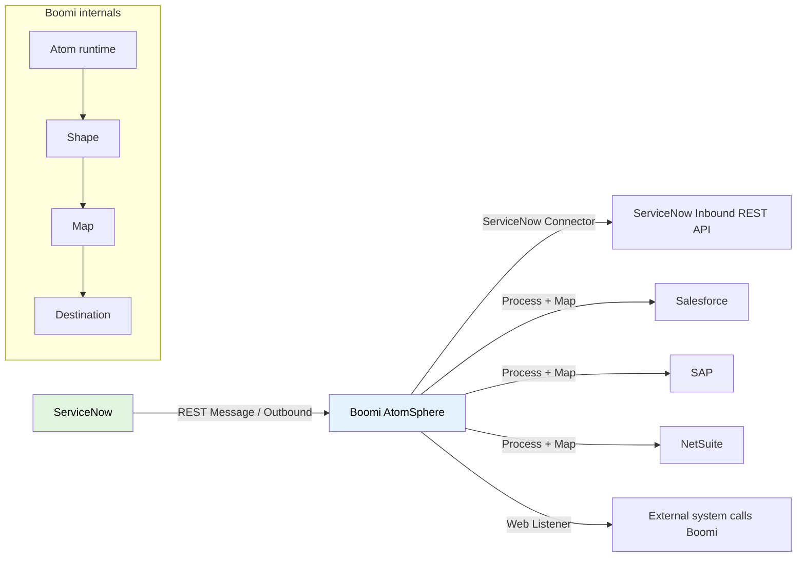
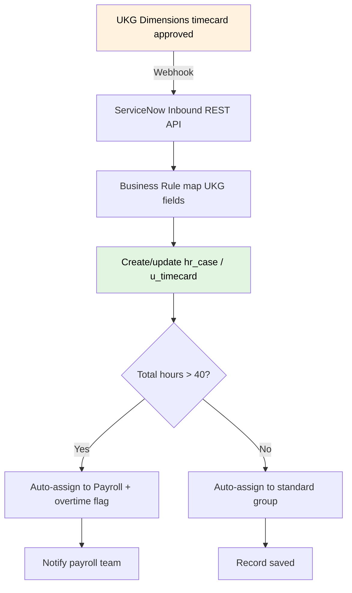
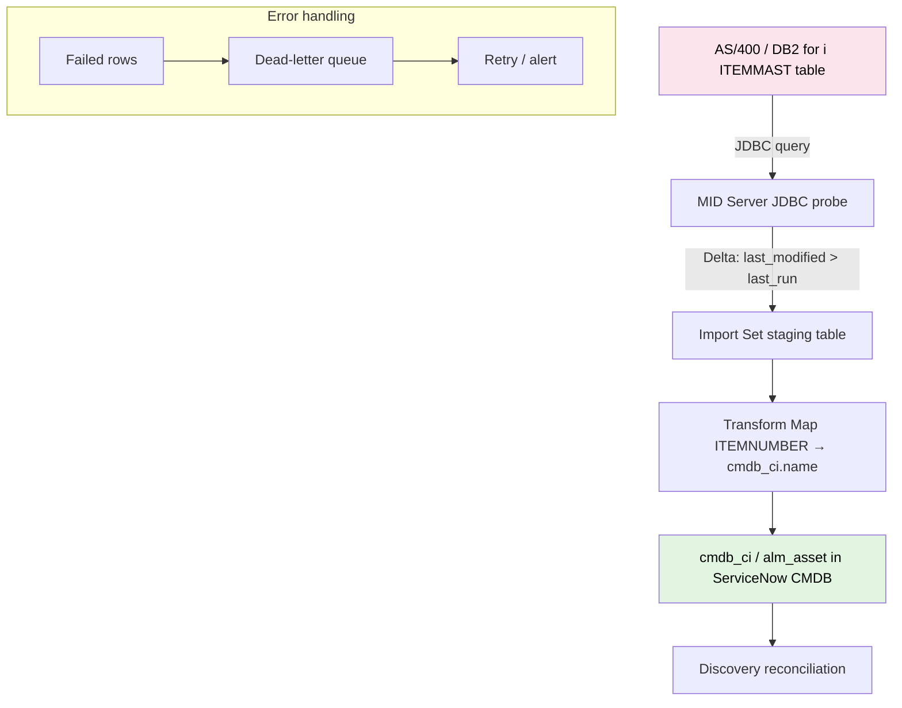
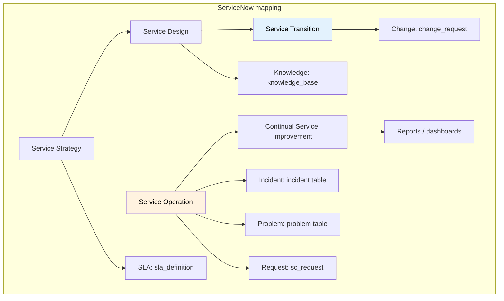
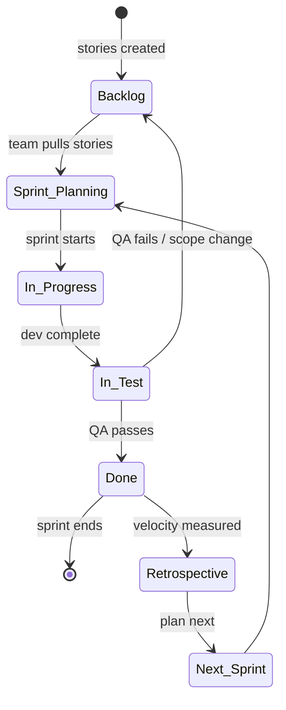

# Other — Enterprise Integration, Workforce, Legacy, ITIL & Agile

**Agent:** opencode  
**Date:** 2026-11-09  
**Section:** Other (cross-enterprise systems & methodologies)  
**Confidence:** verify  

---

## Purpose

Not every system a ServiceNow developer touches is a ServiceNow module. Enterprise environments run a mix of cloud iPaaS platforms, workforce-management suites, decades-old mainframe/midrange systems, and formal process frameworks. This guide covers the "Other" systems and concepts that show up in job postings, integration projects, and interviews alongside ServiceNow:

- **Boomi (Dell Boomi / AtomSphere)** — enterprise iPaaS for connecting apps
- **UKG** — workforce management / human capital management
- **Legacy middleware** — AS/400 (IBM i), DB2, and retail/supply-chain data extraction
- **ITIL** — IT service management process framework
- **Agile** — iterative software delivery methodology

For each item you'll find an ELI5 explanation, the business reason companies use it, key terms, the API/integration surface, and how it relates to ServiceNow.

## Free vs Paid — what you can actually touch

| Item | Free on ServiceNow PDI? | Paid / subscription needed? | What you can practice free |
|------|-------------------------|------------------------------|----------------------------|
| **ServiceNow PDI** (Personal Developer Instance) | ✅ Yes — completely free | No | Everything ServiceNow-native: HRSD, REST/SOAP inbound & outbound, MID Server config, Import Sets, Transform Maps, Scripted REST APIs, ITIL (ITSM module), Agile Development app, Jelly, Service Portal |
| **Boomi (Dell Boomi / AtomSphere)** | ❌ No | Paid enterprise iPaaS | Boomi offers a limited free trial, but no ongoing free tier. You can read Boomi's connector docs and learn the ServiceNow-side patterns (REST Message → Boomi web listener → target app) on PDI, then connect when you have a Boomi account |
| **UKG (Pro / Dimensions)** | ❌ No | Paid enterprise HCM / workforce management | No free tier. You can read UKG's API docs and build the ServiceNow-side inbound REST API / webhook receiver on PDI, but you need a real UKG customer account to test against |
| **AS/400 (IBM i) / DB2** | ❌ No | Paid legacy hardware + software | No free tier. You can practice the ServiceNow side (JDBC probe config, Import Sets, Transform Maps, DB2-for-i concepts) on PDI without the AS/400, then point it at a real DB2 when you have access |
| **ITIL framework** | ✅ Yes — public knowledge | No | ITIL concepts are free to study; practice incident/problem/change/CMDB end-to-end on PDI |
| **Agile / Scrum** | ✅ Yes — methodology | No | Practice Agile tracking in ServiceNow's Agile Development app on PDI |

**Bottom line:** Everything on the *ServiceNow side* of each integration can be built and tested free on a PDI. The external systems (Boomi, UKG, AS/400) require paid accounts — you learn their concepts and the ServiceNow integration patterns on PDI, then connect to the real systems when you have access to them.

---

## Prerequisites & Setup

Before working through the integration and framework content in this guide, ensure your ServiceNow instance is ready for the patterns covered.

### Required Plugins / Scoped Apps

| Plugin / App | ID | Required? | Notes |
|---|---|---|---|
| **IntegrationHub** | `com.glide.integrationhub` | ✅ Yes | Low-code integration layer; required for spokes, flows, connection aliases, and Flow Designer integration actions. |
| **IntegrationHub Spokes** | Various | As needed | E.g., Salesforce, Microsoft Teams, Jira spokes; Boomi/UKG connectors as needed. |
| **Flow Designer** | `com.snc.flow_designer` | ✅ Yes | Core automation engine for triggers → conditions → actions; required for integrationHub flows. |
| **MID Server** | — | Conditional | Required for on-prem targets (AS/400 via JDBC, legacy databases); not needed for pure cloud SaaS integrations. |
| **Agile Development** | `com.snc.agile` | Conditional | Required for the Agile/Scrum labs. |
| **ServiceNow API Access** | `com.snc.api_access` | ✅ Yes | Enables REST/SOAP API access for integration labs. |

### Guided Setup

There is no single Guided Setup wizard for cross-enterprise integrations. Configuration is done per-pattern:

1. **Set up IntegrationHub**: Navigate to IntegrationHub > IntegrationHub to confirm spokes/flows are available.
2. **Create Connection & Credential Aliases**: System Web Services > Connection & Credential Aliases for reusable auth across flows/REST messages.
3. **Deploy MID Server** (for AS/400 / on-prem): Install and configure MID Server in the target network; monitor ECC Queue (MID Server > ECC Queue).
4. **Configure Inbound REST**: System Web Services > Scripted REST APIs for external callers (e.g., Boomi web listeners, UKG webhooks).
5. **Enable Flow Designer**: Flow Designer > Flow Designer; flows activate on save.

### System Properties to Consider

| Property | Default | Description |
|---|---|---|
| `glide.rest.max_request_size` | `2MB` | Max REST payload size; increase for bulk integration uploads. |
| `glide.integrations.enabled` | `true` | Enables IntegrationHub features. |
| `glide.midsrv.*` | — | MID Server configuration properties. |
| `glide.email.*` | — | Email properties for inbound mail flows (lead ingestion, notifications). |

### Cross-Module Dependencies

| Dependent Module | Why It Matters | Integration Point |
|---|---|---|
| **ITSM** | Incident creation from monitoring alerts via inbound REST | `incident` table |
| **HRSD** | HR cases from UKG data | `hrsd_case` |
| **ITOM** | CMDB sync from AS/400 inventory | `cmdb_ci`, `alm_asset` |
| **Agile Development** | Agile tracking of integration work | `x_agile_*` tables |
| **ITSM / CSM** | Integration patterns reused for service integrations | `sn_*` scoped tables |

### ACLs Related to Core Tables

| Table | Key ACLs | Typical Roles |
|---|---|---|
| `incident` | `create`, `read`, `write` | `admin`, `sn_incident_*` roles |
| `cmdb_ci` | `read`, `write` | `admin`, `cmdb_admin`, `sn_importer` |
| `alm_asset` | `read`, `write` | `admin`, `alm_admin` |
| `x_*` (custom integration staging tables) | `create`, `read`, `write` | Integration roles / `admin` |

### Breadcrumbs — Enable First

1. **Enable IntegrationHub**: IntegrationHub > IntegrationHub > activate spokes needed.
2. **Set up MID Server**: MID Server > MID Servers > New; deploy MID Server in target network; monitor ECC Queue (MID Server > ECC Queue).
3. **Set up REST**: System Web Services > REST Messages; Scripted REST APIs for inbound.
4. **Set up Email**: System Mailboxes for inbound email (lead ingestion, notifications).
5. **Set up Flow Designer**: Flow Designer > Flow Designer for flow-based automations.

---

## 1. Boomi (Dell Boomi / AtomSphere) — Enterprise iPaaS

### ELI5

Boomi is like a universal translator and courier for business software. Instead of writing custom code every time two applications need to share data (for example, "when a new hire is created in ServiceNow, create their record in Workday and provision their laptop in Jamf"), you use Boomi to visually draw the flow. Boomi moves the data, transforms field names, handles errors, and retries if a system is down.

### Why companies use it

- Connect cloud SaaS apps (Salesforce, ServiceNow, Workday, NetSuite, SAP) to each other and to on-prem systems without custom code for every connection
- Move data in real time or on a schedule (batch)
- Expose existing integrations as reusable APIs
- Reduce "point-to-point" spaghetti: one platform instead of N² custom connectors

### Key terms & background

| Term | Meaning |
|------|---------|
| iPaaS | Integration Platform as a Service — cloud-based integration middleware |
| Atom | Lightweight runtime engine that executes integration processes (can run in cloud or on-prem behind a firewall) |
| AtomSphere | Boomi's management/plane where you design, deploy, and monitor integrations |
| Connector | Pre-built adapter to a specific application (e.g., ServiceNow connector, Salesforce connector) |
| Process | The integration flow (source → transformations → destination) built in the low-code designer |
| Shape | Data structure definition for a source or destination (defines fields) |
| Map | Field-level transformation (e.g., map ServiceNow `u_employee_id` to Workday `Employee_ID`) |
| API Management | Publish, secure, and version integrations as REST/SOAP APIs |

### API / integration surface

- **AtomSphere API** — REST API to manage Boomi itself (deploy processes, check execution status, manage environments)
- **Connectors** — each connector exposes the target app's API (e.g., the ServiceNow connector uses ServiceNow's Table API / Import Set API)
- **Web listeners** — expose a Boomi process as an inbound REST/SOAP endpoint other systems can call
- **Execution records** — logs of every process run, with input/output data for debugging

### How it connects to ServiceNow

- Boomi offers a **ServiceNow connector** that authenticates via OAuth2/basic auth and performs CRUD on ServiceNow tables (insert, update, query, delete)
- Common pattern: ServiceNow REST Message → Boomi web listener → Boomi process → target app (or reverse)
- Boomi can listen to ServiceNow Import Sets or poll ServiceNow tables for changes

### Common mistakes

| Mistake | Symptom | Fix |
|---------|---------|-----|
| Hard-coding credentials | Integration breaks when passwords rotate | Use Connection & Credential Aliases / secrets management |
| No error handling | One bad record stops the whole batch | Add Try/Catch shapes and route errors to a dead-letter process |
| Mapping every field blindly | Target system rejects unknown/mismatched fields | Map only required fields; validate shapes before deploy |
| Running high-volume syncs synchronously | Atom timeouts / memory crashes | Use batching, Data Stream processing, or chunked queries |

### Mini lab: Conceptual Boomi → ServiceNow sync

1. Create a Boomi **Process** with a **ServiceNow Connector** operation (Query)
2. Set the source shape to a Boomi **Web Listener** (inbound REST trigger)
3. Map the incoming JSON (e.g., `employeeNumber`, `email`) to ServiceNow `u_employee_id` / `email` fields on the `user` table
4. Deploy to an Atom, note the web listener URL, and call it from an external system
5. Check Boomi **Execution Records** to confirm the ServiceNow insert succeeded

### Mini lab: Conceptual Boomi → ServiceNow sync

1. Create a Boomi **Process** with a **ServiceNow Connector** operation (Query)
2. Set the source shape to a Boomi **Web Listener** (inbound REST trigger)
3. Map the incoming JSON (e.g., `employeeNumber`, `email`) to ServiceNow `u_employee_id` / `email` fields on the `user` table
4. Deploy to an Atom, note the web listener URL, and call it from an external system
5. Check Boomi **Execution Records** to confirm the ServiceNow insert succeeded

## SLAs, Dashboards & Workspaces

### SLA Support

**N/A — Other modules (Boomi, UKG, legacy middleware, ITIL, Agile) do not have native ServiceNow `task_sla` support.** These are external systems or third-party integrations that operate outside ServiceNow's task-based SLA framework. Any SLA tracking for these systems must be done at the integration layer (e.g., Boomi monitor, UKG integration monitoring) or via external monitoring tools.

| Area | What It Tracks | Typical Target |
|------|---------------|----------------|
| Integration uptime | Boomi Atom / UKG webhook availability | 99.9% SLA from integration provider |
| Data sync latency | Time from source change to ServiceNow record | < 15 minutes for near-real-time syncs |
| Batch job completion | Daily legacy extract/load success | 100% completion, zero failed records |

SLAs for external systems are governed by their own SLAs (vendor contracts) rather than ServiceNow `task_sla`.

### Out-of-Box Dashboards

Other modules do not ship OOTB ServiceNow dashboards — dashboards for these systems live in their own platforms:

| Dashboard | Purpose | Where to Find It |
|-----------|---------|------------------|
| **Boomi AtomSphere Platform** | Atom health, process execution records, error rates, integration latency | Boomi Platform (external) |
| **UKG Dimensions / Pro** | Workforce data freshness, timecard sync status, payroll batch results | UKG (external) |
| **Legacy middleware / AS400** | Job schedules, data extract completion, error logs | Native system consoles |

### Out-of-Box Workspaces

**Other modules have no native ServiceNow workspaces.** These are external systems that do not integrate into ServiceNow's configurable Workspace framework:

| System | Native Workspace? | Notes |
|--------|------------------|-------|
| **Boomi** | No | Management via Boomi AtomSphere Platform |
| **UKG** | No | Management via UKG Dimensions / Pro admin console |
| **Legacy / AS400** | No | Management via native system consoles |
| **ITIL / Agile** | No | Methodology frameworks, not software with a workspace |

For ServiceNow-side AI governance/observability (if AI features are used alongside), use **AI Control Tower** — see AI guide for details.

---

### Quiz

1. What is an Atom in Boomi?
2. Name one way Boomi connects to ServiceNow.
3. What's the difference between a Shape and a Map?

<details><summary>Answer</summary>
1. A lightweight runtime engine that executes integration processes (can run in cloud or on-prem).<br>
2. Via the Boomi ServiceNow connector (CRUD on ServiceNow tables) or by exposing a Boomi web listener that ServiceNow's REST Message calls.<br>
3. A Shape defines a data structure (fields); a Map transforms fields from one shape to another.
</details>

### Quiz

1. What is an Atom in Boomi?
2. Name one way Boomi connects to ServiceNow.
3. What's the difference between a Shape and a Map?

<details><summary>Answer</summary>
1. A lightweight runtime engine that executes integration processes (can run in cloud or on-prem).<br>
2. Via the Boomi ServiceNow connector (CRUD on ServiceNow tables) or by exposing a Boomi web listener that ServiceNow's REST Message calls.<br>
3. A Shape defines a data structure (fields); a Map transforms fields from one shape to another.
</details>

---

## 2. UKG — Workforce & Human Capital Management

### ELI5

UKG (Ultimate Kronos Group) is software that companies use to manage their people: tracking when hourly employees clock in and out, building work schedules, calculating overtime, managing time-off requests, and running payroll. If you've ever used a badge or a mobile app to punch a time clock at a retail store, hospital, or warehouse, that data likely flows through a UKG system.

### Why companies use it

- Track time & attendance for hourly and salaried workers
- Build schedules that match labor demand (retail shifts, nurse staffing, warehouse waves)
- Enforce labor-law and union rules (overtime, meal breaks, minor work restrictions)
- Process payroll and manage benefits (UKG Pro = HCM/payroll; UKG Dimensions = workforce management/timekeeping)

### Key terms & background

| Term | Meaning |
|------|---------|
| UKG Pro | UKG's Human Capital Management (HCM) suite — core HR, payroll, benefits, talent |
| UKG Dimensions | UKG's workforce management platform — timekeeping, scheduling, absence, labor analytics |
| Timekeeper | Employee who records time (punch in/out, breaks) |
| Accrual | Balance of earned time-off (vacation, sick) that builds up over time |
| Labor allocation | Assigning worked hours to cost centers, jobs, or projects |
| Punch | A single clock-in or clock-out event |

### API / integration surface

- **UKG Pro API** — REST API for employee data, jobs, pay, time-off, benefits (OAuth2)
- **UKG Dimensions API** — REST API for timecards, schedules, punches, and labor data
- **Webhooks** — notify external systems when timecards are approved or schedules change
- **SFTP / flat-file batch** — traditional bulk exchange (legacy customers still use nightly CSV extracts)

### How it connects to ServiceNow

- ServiceNow HRSD (Human Resource Service Delivery) often integrates with UKG Pro: new hires created in UKG flow into ServiceNow as HR cases/employee records, and vice versa
- ServiceNow can poll UKG Dimensions for approved timecards to feed into project costing or field-service billing
- Common pattern: UKG webhook → ServiceNow Inbound REST API → create/update HR case or task

### Common mistakes

| Mistake | Symptom | Fix |
|---------|---------|-----|
| Treating a "punch" as final | Timecards get adjusted after approval | Reconcile against the final approved timecard, not the raw punch |
| Ignoring time zones | Shifts appear off by several hours | Store and compare in UTC; convert for display |
| Syncing every field | Massive payloads, slow integrations | Sync only fields that changed (delta) |
| Missing accrual rules | Employees show wrong PTO balances | Sync accrual balances, not just timecodes |

### Mini lab: Conceptual UKG → ServiceNow flow

1. Configure a UKG Dimensions webhook for "timecard approved"
2. Point the webhook at a ServiceNow Inbound REST API (Scripted REST API)
3. In ServiceNow, map the UKG timecard fields to an `hr_case` or custom `u_timecard` table
4. Create a ServiceNow Business Rule to auto-assign the case to Payroll when total hours > 40 (overtime flag)
5. Verify by approving a timecard in UKG and confirming the ServiceNow case appears

### Quiz

1. What's the difference between UKG Pro and UKG Dimensions?
2. What is a "punch"?
3. Name one integration pattern between UKG and ServiceNow.

<details><summary>Answer</summary>
1. UKG Pro = HCM/payroll/core HR; UKG Dimensions = workforce management (timekeeping, scheduling, absence).<br>
2. A single clock-in or clock-out event recorded by a timekeeper.<br>
3. UKG webhook → ServiceNow Inbound REST API → create/update HR case or task (or ServiceNow polling UKG Dimensions API for approved timecards).
</details>

---

## 3. Legacy Middleware — AS/400 (IBM i), DB2 & Retail/Supply-Chain Data

### ELI5

The AS/400 (now called IBM i) is a business computer that's been around since the 1980s. It's incredibly reliable and still runs the back office of many retailers, distributors, manufacturers, and banks. It uses the DB2 database and programs written in RPG or COBOL. "Legacy middleware" is the software that bridges these old systems to modern ones — pulling inventory and order data out of the AS/400 and pushing it into ServiceNow, a data warehouse, or an e-commerce site.

### Why companies use it

- Stability: IBM i systems can run for years without rebooting; they handle massive transaction volumes
- Existing investment: decades of business logic (pricing, allocation, replenishment) live in RPG/COBOL programs
- Retail & supply chain: many chains run store inventory, distribution-center management, and purchase-order processing on AS/400
- Companies modernize around it rather than replace it, because the core logic is proven and hard to replicate

### Key terms & background

| Term | Meaning |
|------|---------|
| AS/400 | IBM midrange computer line (1988); now marketed as IBM i running on Power Systems |
| IBM i | The current operating system name for AS/400 successors |
| DB2 | IBM's relational database; "DB2 for i" is the database built into IBM i |
| RPG / RPGLE | Report Program Generator — the dominant language for business apps on IBM i |
| COBOL | Older business language still present on many AS/400 estates |
| Middleware | Software connecting legacy systems to modern apps (IBM MQ, WebSphere IIB/ACE, MFT) |
| ECC Queue | (ServiceNow concept) Mid Server queue for probes — relevant when a MID Server reaches into an AS/400 |
| Flat file / CSV | The lowest-common-denominator way legacy systems export data |
| SQL over JDBC/ODBC | Modern way to query DB2 for i from external applications |

### API / integration surface

- **DB2 for i via JDBC/ODBC** — query DB2 tables directly from Java/Python/.NET; read inventory, orders, customers
- **IBM MQ** — message queuing; legacy apps drop messages onto queues that modern systems consume
- **WebSphere IIB / ACE (App Connect Enterprise)** — enterprise service bus that transforms and routes messages between AS/400 and modern systems
- **MI (Machine Interface) / APIs** — IBM i system APIs for program calls (e.g., calling an RPG program with parameters)
- **SFTP / batch files** — nightly extracts of inventory, sales, and supply-chain data to CSV/flat files

### How it connects to ServiceNow

- ServiceNow MID Server can run JDBC probes against DB2 for i to pull inventory or asset data into the CMDB (`cmdb_ci` / `alm_asset`)
- Import Sets + Transform Maps load flat-file extracts (from AS/400 nightly dumps) into ServiceNow tables
- ServiceNow REST inbound APIs let an AS/400 middleware layer (WebSphere ACE) push order/shipment updates into ServiceNow tasks or inventory records
- Common retail pattern: AS/400 → nightly CSV → ServiceNow Import Set → `cmdb_ci` / `inv_*` / custom supply-chain table

### Common mistakes

| Mistake | Symptom | Fix |
|---------|---------|-----|
| Treating DB2 for i like a modern SQL DB | Date formats, packed-decimal fields, EBCDIC encoding break queries | Learn DB2-for-i quirks (date formats, zoned/packed decimals, CCSID/EBCDIC) |
| Pulling full tables nightly | Long runtimes, timeouts, table locks | Use delta/changed-record queries or message queues |
| Ignoring file locks | AS/400 job holds an exclusive lock, extract fails | Coordinate with the AS/400 admin; extract during batch window |
| Mapping legacy codes directly | Cryptic RPG status codes (e.g., "01", "99") are meaningless in ServiceNow | Add a lookup/translation table in the Transform Map |

### Mini lab: Conceptual AS/400 inventory → ServiceNow CMDB

1. Identify the DB2 for i table holding inventory (e.g., `ITEMMAST` with item number, description, quantity on hand, warehouse)
2. Configure a ServiceNow MID Server with JDBC access to DB2 for i
3. Create a ServiceNow JDBC probe/query to pull changed items (where `last_modified > last_run`)
4. Load results into an Import Set table
5. Build a Transform Map: `ITEMNUMBER` → `cmdb_ci.name`, `QTY_ON_HAND` → `u_stock_level`, `WAREHOUSE` → `location`
6. Run the import and verify inventory items appear in the ServiceNow CMDB

### Quiz

1. What is DB2 for i?
2. Name two ways to get data out of an AS/400.
3. Why do retailers still run AS/400?

<details><summary>Answer</summary>
1. IBM's relational database built into the IBM i (AS/400) operating system.<br>
2. JDBC/ODBC SQL queries; IBM MQ messages; WebSphere ACE message flows; SFTP/flat-file batch extracts.<br>
3. Stability, huge transaction throughput, and decades of proven retail/supply-chain business logic that is costly and risky to replace.
</details>

---

## 4. ITIL — IT Service Management Framework

### ELI5

ITIL (Information Technology Infrastructure Library) is a playbook for how a company should run its IT department like a service business. Instead of every team fixing computers however they want, ITIL defines standard ways to handle incidents (something broke), problems (why it keeps breaking), changes (updating systems), and service requests (someone needs a new laptop). ServiceNow is built to support ITIL processes — incident, problem, change, knowledge, and CMDB are all ITIL concepts.

### Why companies use it

- Standardize how IT delivers and supports services across teams
- Improve service quality and reduce downtime
- Align IT work with business priorities
- Meet audit/compliance requirements (change approvals, incident records, problem root-cause)

### Key terms & background

| Term | Meaning |
|------|---------|
| ITIL | Information Technology Infrastructure Library — IT service management best-practice framework |
| ITIL 4 | Current version; introduces the Service Value System (SVS) and Service Value Chain |
| Service Value Chain | Six activities: Plan, Improve, Engage, Design & Transition, Obtain/Build, Deliver & Support |
| Practice | A way of working to achieve an objective (ITIL 4 has 34 practices; ITIL v3 had 26 processes) |
| Incident | Unplanned interruption to a service or reduction in quality (goal: restore service fast) |
| Problem | Root cause of one or more incidents (goal: prevent recurrence) |
| Change Enablement | Controlling changes to services to minimize risk (ITIL 4 renamed "Change Management") |
| Service Desk | Single point of contact between users and IT |
| CMDB | Configuration Management Database — record of IT assets and their relationships |
| SLA | Service Level Agreement — promised response/resolution times |
| KEDB | Known Error Database — documented problems with workarounds |

### ITIL v3 Service Lifecycle (still referenced)

1. **Service Strategy** — what services to offer and how to fund them
2. **Service Design** — design services, processes, and technology
3. **Service Transition** — build, test, and move services into production
4. **Service Operation** — day-to-day delivery (incident, problem, event, access, request fulfillment)
5. **Continual Service Improvement (CSI)** — ongoing improvement based on metrics

### How it connects to ServiceNow

- ServiceNow ITSM module is essentially an ITIL implementation platform:
  - Incident → ITIL Incident Management
  - Problem → ITIL Problem Management
  - Change Request → ITIL Change Enablement
  - Change Task → change implementation tasks
  - Knowledge Base → ITIL Knowledge Management
  - CMDB → ITIL Service Asset & Configuration Management
  - SLA definitions → ITIL service levels
- Common interview question: "How does ServiceNow support ITIL?" → map the modules above

### Common mistakes

| Mistake | Symptom | Fix |
|---------|---------|-----|
| Treating every incident as a problem | Problem queue flooded with one-off tickets | Open problems only for recurring root-cause analysis |
| No change approvals | Unauthorized changes break production | Enforce Change Enablement workflow with CAB approvals |
| Stale CMDB | CMDB doesn't match reality, impact analysis is wrong | Run Discovery + reconcile regularly; assign data owners |
| Ignoring SLAs | Teams miss response targets; business complains | Define and automate SLA workflows in ServiceNow |

### Mini lab: ITIL incident → problem → change in ServiceNow

1. Create an `incident` (login broken for 3 users) and set State = "In Progress"
2. Resolve the incident with a workaround (reset passwords) and close it
3. Notice the same issue happened twice this week → create a `problem` linked to the incidents
4. Investigate and document root cause in the problem (e.g., faulty LDAP group) → add to KEDB
5. Propose a `change request` to fix the LDAP group permanently → route through Change Enablement approval
6. After approval, implement and close the change; link it back to the problem

### Quiz

1. What's the difference between an incident and a problem?
2. What does Change Enablement replace in ITIL 4 terminology?
3. Name two ServiceNow tables that map to ITIL practices.

<details><summary>Answer</summary>
1. Incident = unplanned interruption; restore service fast. Problem = root cause behind one or more incidents; prevent recurrence.<br>
2. Change Management (renamed to Change Enablement in ITIL 4).<br>
3. `incident` (Incident Management), `problem` (Problem Management), `change_request` (Change Enablement), `cmdb_ci` (Service Asset & Configuration Management).
</details>

---

## 5. Agile — Iterative Software Delivery

### ELI5

Agile is a way of building software in small, repeated cycles instead of one giant "big bang" release. A team picks a small chunk of the most important work, builds and tests it in a short window (usually 1–4 weeks called a Sprint), shows it to stakeholders, gets feedback, and then plans the next chunk. It's the opposite of Waterfall, where you plan everything upfront, build for months, and release once at the end.

### Why companies use it

- Deliver working software faster and more frequently
- Adapt to changing requirements without restarting the whole project
- Get customer/stakeholder feedback early and often
- Reduce risk: if something is wrong, you find it in weeks, not months

### Key terms & background

| Term | Meaning |
|------|---------|
| Agile Manifesto | 2001 statement: individuals & interactions over processes/tools; working software over documentation; customer collaboration over negotiation; responding to change over following a plan |
| Scrum | Most common Agile framework: fixed-length Sprints, defined roles and ceremonies |
| Kanban | Flow-based Agile: visualize work on a board, limit work-in-progress, pull as capacity allows |
| Sprint | Time-boxed iteration (commonly 2 weeks) in Scrum |
| Product Owner | Owns the Product Backlog; decides what to build and in what order |
| Scrum Master | Facilitates Scrum; removes impediments; coaches the team |
| Development Team | Cross-team that designs, builds, tests the product increment |
| Product Backlog | Prioritized list of all desired work (user stories, bugs, tech debt) |
| Sprint Backlog | Subset of the Product Backlog committed to for the current Sprint |
| User Story | Small, user-valued piece of work: "As a [role], I want [goal] so that [benefit]" |
| Story Point | Relative estimate of effort/complexity (not hours) |
| Velocity | How many story points a team completes per Sprint (used for forecasting) |
| Increment | The sum of all completed backlog items at the end of a Sprint |

### Scrum ceremonies & artifacts

| Ceremony | Purpose | Frequency |
|----------|---------|-----------|
| Sprint Planning | Select backlog items for the Sprint and define the Sprint Goal | Start of each Sprint |
| Daily Standup | 15-min sync: what I did, what I'll do, blockers | Daily |
| Sprint Review | Demo the Increment to stakeholders; get feedback | End of each Sprint |
| Sprint Retrospective | Team reflects on process; identifies improvements | End of each Sprint |

| Artifact | Meaning |
|----------|---------|
| Product Backlog | All work, ordered by value |
| Sprint Backlog | Work committed for this Sprint |
| Increment | Potentially shippable product at end of Sprint |

### How it connects to ServiceNow

- ServiceNow has an **Agile Development** application (formerly Project Portfolio / Agile) for managing backlogs, sprints, and stories inside ServiceNow
- DevOps teams use ServiceNow to track defects (`change_request`, `problem`, custom `u_agile_story` tables) and link them to CI/CD pipelines
- ServiceNow's own development and many customer implementations run on Agile/Scrum
- Common pattern: Jira/ADO for team-level Agile, ServiceNow for enterprise portfolio/ITSM; integrated via APIs or middleware (e.g., Boomi)

### Common mistakes

| Mistake | Symptom | Fix |
|---------|---------|-----|
| "Agile" but no backlog prioritization | Team works on low-value items | Product Owner must own and order the backlog |
| Two-week "Sprints" that never ship | Waterfall in disguise | Every Sprint must produce a potentially shippable Increment |
| Skipping retrospectives | Same blockers repeat every Sprint | Hold retrospectives; act on at least one improvement |
| Story points as hours | Points become a deadline weapon | Points are relative complexity, not time commitments |

### Mini lab: Run one Scrum Sprint

1. **Product Backlog:** write 5 user stories (e.g., "As a ServiceNow admin, I want an import set for UKG timecards so I can sync workforce data")
2. **Sprint Planning:** pull the top 3 stories into the Sprint Backlog; set a 2-week Sprint Goal
3. **Daily Standup:** 15 minutes; surface blockers (e.g., "waiting on UKG API credentials")
4. **Build:** deliver the import set + transform map; demo it
5. **Sprint Review:** show working import to stakeholders; capture feedback
6. **Sprint Retrospective:** pick one process improvement for next Sprint

### Quiz

1. What are the four values of the Agile Manifesto?
2. What is a User Story format?
3. Name two Scrum ceremonies.

<details><summary>Answer</summary>
1. Individuals & interactions over processes & tools; working software over comprehensive documentation; customer collaboration over contract negotiation; responding to change over following a plan.<br>
2. "As a [role], I want [goal] so that [benefit]."<br>
3. Sprint Planning, Daily Standup, Sprint Review, Sprint Retrospective (any two).
</details>

---

## 6. SNUtils — ServiceNow Utility Script Library

### ELI5

SNUtils is a collection of reusable server-side utility functions (Script Includes) that ServiceNow developers build once and call from everywhere — business rules, UI actions, workflows, flows, and other script includes. Instead of writing the same date formatting, GlideRecord query, or logging code in ten different places, you write it once in SNUtils and call it from any script.

Think of it as your instance's "standard library" — like `Math` or `String` in JavaScript, but for ServiceNow-specific operations.

### Why companies use it

- **DRY principle:** Don't repeat yourself — write common logic once, reuse everywhere
- **Consistent behavior:** Date formatting, null handling, and logging work the same across the instance
- **Faster development:** Developers call `SNUtils.getFormattedDate()` instead of writing GlideDateTime boilerplate every time
- **Easier maintenance:** Fix a bug in one utility function, and every script that uses it is fixed automatically
- **Cleaner code:** Business rules and script includes stay short and readable because the heavy lifting lives in SNUtils

### Key terms & background

| Term | Meaning |
|------|---------|
| Script Include | Server-side JavaScript library stored in `sys_script_include`; callable from any server-side script |
| Scoped app | Application sandbox that owns its tables, scripts, and records; SNUtils is usually packaged as one |
| GlideRecord | ServiceNow's server-side API for querying and manipulating table records |
| GlideDateTime / GlideDate | ServiceNow's date/time handling classes |
| gs.log / gs.info / gs.error | Platform logging functions that write to the system log (`sys_log`) |
| `sys_script_include` | The table that stores all Script Includes on an instance |

### Common utility functions in SNUtils

Typical SNUtils Script Includes include:

- **`SNUtils.String`** — `isEmpty()`, `trim()`, `capitalize()`, `formatMessage()`
- **`SNUtils.Date`** — `getFormattedDate()`, `daysBetween()`, `addBusinessDays()`, `getStartOfWeek()`
- **`SNUtils.Record`** — `getRecordBySysId()`, `safeGetValue()`, `insertOrUpdate()`
- **`SNUtils.Log`** — `info()`, `warn()`, `error()` with consistent prefix and timestamp
- **`SNUtils.Array`** — `unique()`, `intersect()`, `flatten()`
- **`SNUtils.System`** — `getPropertySafe()`, `isProduction()`, `getCurrentUserName()`

### How it connects to ServiceNow

- Lives in `sys_script_include` — same table as OOTB Script Includes like `SnCustomLogger` or `GlideSystem`
- Called from business rules, UI actions, client scripts (via GlideAjax), workflows, and Flow Designer custom actions
- Usually packaged as a scoped app (`x_snc_snutils` or customer namespace like `x_myco_snutils`)
- Can be deployed via Update Set or App Engine Studio / Git linkage between instances

### Common mistakes

| Mistake | Symptom | Fix |
|---------|---------|-----|
| Putting business logic in SNUtils | Utility library becomes a dumping ground; hard to test | Keep SNUtils for generic utilities; domain logic belongs in domain-specific script includes |
| No null-safety | `NullPointerException` when a field is missing | Always check `nil` / `undefined` / empty before using a value |
| Hard-coding table names | Breaks when table names differ between dev/test/prod | Use `gs.getTableName()` or pass table names as parameters |
| Logging everything at `gs.error` | System log flooded; real errors hard to find | Use `gs.info` / `gs.debug` for routine; `gs.error` only for actual failures |
| No versioning | Can't tell which instance has which SNUtils version | Tag releases in update sets or App Engine Studio |

### Mini lab: Create your first SNUtils function

1. Navigate to **System Definition → Script Includes** → **New**
2. Name: `SNUtils.String.isBlank` (or similar)
3. Application scope: your scoped app (e.g., `x_myco_snutils`)
4. Script body:

```javascript
var SNUtils = Class.create();
SNUtils.prototype = Object.extendsObject(AbstractAjaxProcessor, {
    isBlank: function(value) {
        return (value === null || value === undefined || value === '' || value === 'null');
    },
    type: 'SNUtils'
});
```

5. Save, then test from another script include or business rule:
```javascript
if (SNUtils.String.isBlank(current.short_description)) {
    gs.error('Short description is required');
}
```

> **Note:** If you use a scoped app, make the Script Include "Accessible from" other scopes (set the **Accessible from** field to `All` or your consumer scopes) so other scripts can call it.

### Quiz

1. Where do Script Includes live on a ServiceNow instance?
2. What does the DRY principle mean in the context of SNUtils?
3. Name two utility categories you might put in SNUtils.

<details><summary>Answer</summary>
1. `sys_script_include` table (System Definition → Script Includes)<br>
2. Don't Repeat Yourself — write common logic once, reuse everywhere instead of duplicating code<br>
3. String manipulation, date/time handling, GlideRecord helpers, logging, array operations (any two)
</details>

---

## 8. App Engine Studio & Code Deployment Methods

Not all ServiceNow development happens the same way. Depending on who is building (citizen developer vs pro-code developer) and where the code is going (lower environment vs production), you choose different tools and different deployment paths.

### App Engine Studio (AES) — who uses it and where

**App Engine Studio** is ServiceNow's guided, low-code development environment. It sits inside **App Engine** — the platform layer that provides infrastructure, governance, and application lifecycle management. AES is the development tool you use within that layer.

| Who uses AES | What they do |
|---|---|
| **Citizen developers** (line-of-business, little/no coding) | Build apps from templates or scratch using guided, visual flows — tables, forms, experiences, automation |
| **Pro-code developers** | Build more complex scoped apps, write scripts, edit metadata, integrate with external systems |
| **App Engine Studio admin** | Manages the pipeline via App Engine Management Center (AEMC) — reviews submissions, approves deployments, controls collaborator access |

**Key facts about AES:**
- AES requires an **App Engine subscription** (or a product packaged with one).
- **Development happens on a non-production instance** — delegated developers build safely without touching production.
- When an app is complete, the AES admin uses AEMC to request deployment into the pipeline (development → test → staging → production).
- Final approval deploys the app to **production**, where it's available organization-wide.
- AES is **not production-only** — you build and test in lower environments, then promote through the pipeline to prod.

**test → staging → production are separate ServiceNow instances**, not just statuses in AEMC:
- Each environment (dev, test, staging, prod) is its own ServiceNow instance with its own URL, database, credentials, and data.
- You configure each one in AEMC under **Pipelines and Deployments > Environments** (instance type: Development, Testing, Staging, Production).
- **AEMC / Pipelines and Deployments** is the management layer that orchestrates moving the app between those instances — it defines the pipeline order, tracks deployment requests, runs approvals, and records which version is installed where.
- The **controller instance** is usually production — that's where deployment requests are created, approved, and tracked.

---

### Code deployment methods — comparison

ServiceNow offers two primary ways to move applications between environments:

| Method | What it is | Best for | Production? |
|---|---|---|---|
| **Application Repository (App Repo)** | Central, versioned artifact store. Publish an app version from dev; test/prod instances install that published version. | Moving full applications across environments (preferred method) | ✅ Yes — install published version on prod |
| **Update Sets** | Groups of configuration changes moved between instances. Move from dev → test → prod ("bottom of the stack up"). | Patches/changes to installed apps; when App Repo isn't available | ✅ Yes — commit on prod, but not for installing new apps |

**Important:** Update Sets and the Application Repository are **mutually exclusive per application per instance**. Once you deploy via App Repo on an instance, you can't switch to Update Sets for that app on that instance (and vice versa).

---

### Source control / repository linkage (Git)

Linking a scoped application to a **Git repository** (GitHub, Bitbucket, Azure DevOps) is another deployment method — but with an important constraint:

- Source control linkage works on **non-production instances only** (development, test).
- It is **not supported on production instances**.
- On production, you manage applications using the **Application Repository**, an **Update Set**, or **ServiceNow Studio**.

**Typical Git-based flow:**
1. Developer builds in a sandbox/dev instance, pushes work to a feature branch in Git.
2. Feature branch merged to `main` via pull request.
3. `main` installed on the main development instance.
4. App published from dev to **Application Repository** — this published version becomes the immutable artifact.
5. Test instance installs the published version from App Repo; once it passes testing, production installs the same version.

**Why this matters:** Git is the source of truth for development, but **production installs from the published Application Repository version**, not directly from Git. This gives you immutability, rollback, and an audit trail on prod.

---

### Lower environments vs production — the practical distinction

The user's question: *"One method is for lower environments, and one is for prod only where it's just packaged?"*

That's essentially right, with nuance:

| Environment | What you do | Deployment method |
|---|---|---|
| **Development / Test** (lower) | Build, edit, iterate, break things safely | Source control (Git), Update Sets, or App Repo publish |
| **Production** | Run the stable, approved version | Install from **Application Repository** (published version) or **Update Set** — **not** direct source control linkage |

So in lower environments you use **source control + Update Sets + App Repo publish** to develop and validate. In production you consume the **packaged, published version** from App Repo. You don't link Git directly on production.

---

### Mini lab: Deploy an app from dev to test via Update Sets

**Goal:** Move a custom scoped application from a development instance to a test instance using Update Sets.

**Prerequisites:**
- Two ServiceNow instances (dev and test)
- A scoped application built on the dev instance
- `admin` role on both instances

**Steps:**

1. **Create the Update Set on dev**
   - On the dev instance, go to **System Update Sets > Update Sets > New**
   - Name it (e.g., "My App v1.0"), set State = "In progress"
   - Make it the **current** update set (so changes are captured)

2. **Build your app while the update set is current**
   - Create tables, fields, forms, business rules, etc. in your scoped app
   - All changes are automatically added to the current update set

3. **Complete the update set**
   - When done, open the update set record and set State = **Complete**

4. **Move to test**
   - On the test instance, go to **System Update Sets > Retrieve Update Sets**
   - Select the dev instance as the source, retrieve the completed update set
   - Open the retrieved update set, review the changes, then click **Commit**

5. **Verify on test**
   - Confirm your scoped app and its customizations appear on the test instance
   - Test the app thoroughly before any production move

**Proof of concept:** The Update Set record on test shows State = "Committed" and all customization records (`sys_update_xml`) are applied. If something is wrong, you can fix it on dev with a new update set and repeat.

---

### Collapsible Mini Labs: Deployment Scenarios

<details>
<summary><strong>Lab A: Single developer — Update Sets on one widget</strong></summary>

**Goal:** One developer builds a Service Portal widget and moves it dev → test using Update Sets.

**When to use:** You're the only person touching this app/widget. Simple, linear changes, no merging needed.

**Steps:**
1. On dev, create Update Set "Widget v1" and set it as **current**.
2. Navigate to **Service Portal → Widgets → New**, build your widget (add header title, fields, client script).
3. All changes are captured in "Widget v1" automatically.
4. Set State = **Complete** on the update set.
5. On test: **System Update Sets > Retrieve Update Sets** → select dev as source → retrieve → review → **Commit**.
6. Verify the widget appears on test with all your changes.

**Pros:** Simple, no branching/merging, easy to understand.
**Cons:** Only one person can safely work at a time; if two people each have their own update set touching the same widget, the second one committed can overwrite the first's changes (no automatic merge).

**Proof of concept:** The widget on test shows your header title and fields exactly as built on dev.

</details>

<details>
<summary><strong>Lab B: Multiple developers, different features — parallel update sets</strong></summary>

**Goal:** Two developers build separate features on the same scoped app, each in their own update set, then both move to test.

**When to use:** Small team, each developer owns a distinct feature (e.g., Developer A builds a table, Developer B builds a flow).

**Steps:**
1. Developer A creates Update Set "Feature A — New Table" (current), builds a custom table `x_myapp_table`, completes it.
2. Developer B creates Update Set "Feature B — New Flow" (current), builds a Flow Designer flow, completes it.
3. Both retrieve their update sets on test and commit them.

**What happens:** If Feature A and Feature B touch different records (different tables, different flows), both commit cleanly. Test now has both features.

**Pros:** Parallel work is possible when features don't overlap.
**Cons:** No automatic conflict detection. If Developer A and Developer B both edit the *same* record (e.g., both modify the same widget), the second update set committed on test can silently overwrite the first's changes. ServiceNow does **not** merge update set contents intelligently — it's last-write-wins at the record level.

**Proof of concept:** Check `sys_update_xml` on test — both update sets' customization records should be present if they didn't overlap.

</details>

<details>
<summary><strong>Lab C: Two developers edit the same widget — no diff, last-write-wins</strong></summary>

**Goal:** See exactly what happens when two people modify the same widget via update sets — including whether ServiceNow shows a conflict or diff.

**Short answer up front:** ServiceNow does **not** show a conflict, diff, or merge warning. When two update sets contain the same table record (the same widget), the one committed last wins for **every field in that record**. There is no field-level merge.

| Scenario | Who does what | What breaks | Does ServiceNow warn? |
|---|---|---|---|
| **Scenario 1** | Alice & Bob both commit update sets containing the same widget, different headers | Last commit wins; first change is lost | No |
| **Scenario 2** | Alice edits prod directly; Bob commits an update set to prod | Direct edit overwritten by update set (or vice versa) | No |
| **Scenario 3** | After both commit | No diff view — only the last-committed value remains | No |

---

### Scenario 1: Both using update sets (dev → test)

**The setup:**
- Original widget header on dev: `<h1>Welcome</h1>`
- **Developer Alice** opens Widget "Client Portal Home" in her update set "US-ALICE". She changes the header to `<h1>Our Page</h1>`.
- **Developer Bob** opens the same widget in his update set "US-BOB". He changes the header to `<h1>ITAM Homepage</h1>`.
- Both captured the widget from the same dev baseline. Neither knows the other touched it.

**What happens on test:**

| Step | Action | Widget header on test after step |
|---|---|---|
| 1 | Alice commits US-ALICE on test | `<h1>Our Page</h1>` |
| 2 | Bob commits US-BOB on test | `<h1>ITAM Homepage</h1>` |

**Result:** Alice's `<h1>Our Page</h1>` is **lost**. Bob's update set contained the widget record with `<h1>ITAM Homepage</h1>` (his captured version), and when it committed last, it overwrote Alice's version entirely — not just the header, every field in that widget record.

**Does the system show a conflict?** No. No warning, no diff, no merge prompt. Bob's commit succeeded silently. You only discover the problem when you open the widget and see Alice's change is gone.

---

### Scenario 2: Alice edits directly in Prod, Bob commits an update set to Prod

**The setup:**
- Widget header on prod: `<h1>Welcome</h1>`
- **Alice** directly edits the widget on **prod** (not via an update set — she just opens the widget form and saves), changing the header to `<h1>Our Page</h1>`.
- **Bob** commits US-BOB to prod, which contains the widget record with header `<h1>ITAM Homepage</h1>` (captured from dev/test).

**What happens:**
- Bob's update set is committed to prod. It contains the widget record with `<h1>ITAM Homepage</h1>`.
- This overwrites Alice's direct prod edit.
- Widget header on prod after Bob commits: `<h1>ITAM Homepage</h1>`. **Alice's direct edit is lost.**

**The reverse (Bob commits first, then Alice edits directly):**
1. Bob commits US-BOB to prod: header = `<h1>ITAM Homepage</h1>`
2. Alice directly edits the widget on prod: header = `<h1>Our Page</h1>`
3. Widget header on prod: `<h1>Our Page</h1>` — Alice's direct edit is the last change, but it is **not captured in any update set**. If someone later commits another update set containing this widget, Alice's change could be overwritten again.

---

### Scenario 3: What the "conflict" actually looks like

There is no diff view in ServiceNow. You only see the aftermath:

- Alice's `sys_update_xml` record for the widget shows `title = "<h1>Our Page</h1>"`.
- Bob's `sys_update_xml` record for the same widget shows `title = "<h1>ITAM Homepage</h1>"`.
- After both commit on test/prod, the widget's actual `title` field holds whichever was committed last. The other value is gone — not merged, not conflict-flagged, just overwritten.

---

### The fixing process

1. Alice notices her header `<h1>Our Page</h1>` is missing; the widget shows `<h1>ITAM Homepage</h1>` or `<h1>Welcome</h1>`.
2. Alice creates a **new update set** "US-ALICE-FIX" on dev, sets it current, re-applies `<h1>Our Page</h1>` to the widget, completes it.
3. Alice retrieves US-ALICE-FIX on test/prod and commits it.
4. Widget now shows `<h1>Our Page</h1>` — but Bob's footer (if he added one) may also be gone if Bob's update set included it and Alice's fix doesn't. They need to re-coordinate.

**Lesson:** Update Sets do **not** diff or merge field-level changes. Last committed record wins. Coordinate who edits what, use source control (Git) for real merging, or designate a single owner per widget/app to avoid these silent overwrites.

</details>

<details>
<summary><strong>Lab D: Two ways to deploy Update Sets — pros and cons</strong></summary>

**Goal:** Compare the two methods for moving an update set from dev to test.

**Method 1: Retrieve Update Sets (pull from source)**

| Step | What you do |
|---|---|
| On dev | Complete the update set, leave it on the dev instance. |
| On test | Go to **System Update Sets > Retrieve Update Sets**, select dev as source, choose the update set, retrieve it. |
| On test | Open the retrieved update set, review `sys_update_xml` entries, click **Commit**. |

**Pros:**
- Test instance pulls what it needs; dev doesn't push anything.
- You can review all changes on test before committing.
- Natural for "test pulls from dev" workflows.

**Cons:**
- Requires test instance to have network/access to dev.
- You must remember to retrieve *before* committing; forgetting means test is behind.

**Method 2: Push via Update Set XML export/import (or via a middle/staging instance)**

| Step | What you do |
|---|---|
| On dev | Open the completed update set, click **Export** (downloads an XML file). |
| On test | Go to **System Update Sets > Import Update Set**, upload the XML file. |
| On test | Review and **Commit** the imported update set. |

**Pros:**
- Works when test can't directly reach dev (e.g., air-gapped, different networks).
- The XML file is a portable artifact you can store, email, or version.
- Good for one-off moves or emergency fixes.

**Cons:**
- Manual file handling — easy to export the wrong version or forget to re-export after changes.
- No automatic tracking of what's been moved; you manage versioning yourself.
- More steps = more human error.

**Recommendation:** Use **Retrieve Update Sets** for routine dev→test moves when instances can reach each other. Use **XML export/import** for cross-network or emergency situations. For production, prefer **Application Repository** (published version) over either update set method when possible.

</details>

---

#
---

## Related Guides

- [ITSM guide](./itsm-guide.md)
- [CSM guide](./csm-guide.md)
- [FSM guide](./fsm-guide.md)
- [Sales CRM guide](./sales-crm-guide.md)

---

## Official Learning Resources
- [Deploy your app — ServiceNow Product Documentation](https://www.servicenow.com/docs/r/application-development/deploy-your-app.html) — Application Repository vs Update Sets
- [Link an app to source control — ServiceNow Studio](https://www.servicenow.com/docs/r/zurich/application-development/servicenow-studio-classic/link-app-to-source-control.html) — Git linkage (non-prod only)
- [App Engine Studio overview — ServiceNow](https://www.servicenow.com/docs/r/application-development/app-engine-studio/aes-overview.html) — AES, AEMC, pipelines
- [Configure your pipeline environments — AES](https://www.servicenow.com/docs/r/yokohama/application-development/app-engine-studio/config-pipeline-environments.html) — dev/test/staging/prod pipeline setup

## Goals, Benefits & Key Metrics

The "Other" systems (Boomi, UKG, legacy AS/400, ITIL, Agile) are measured on integration reliability, data fidelity, and process discipline — not on feature adoption inside ServiceNow. These KPIs apply to the integration layer and the teams that own it.

| Business Goal | Benefit Provided | Key Metric | Example Target Value |
|---------------|------------------|------------|----------------------|
| Connect systems without custom code per pair | One iPaaS instead of N² point-to-point connectors | **Integration Success Rate** (successful runs ÷ total runs) | 99.5%+ |
| Data moves when it's supposed to | Real-time webhooks + scheduled batches | **Sync Latency** (event → record in ServiceNow) | < 5 min (webhook); < 2h (batch) |
| Fewer data errors | Transform maps + error routing + dead-letter queues | **Integration Error Rate** (failed ÷ total records) | < 0.5% |
| New integrations ship fast | Reusable spokes, connection aliases, low-code flows | **Time-to-Integrate** (days from requirement → production) | < 5 days for standard sync |
| Legacy data is trustworthy | Delta queries, lookup tables, reconciliation jobs | **Extract Data Accuracy** (spot-check match rate) | 99%+ vs source system |
| Pipelines don't silently die | ECC Queue monitoring + alerting on MID Server | **ECC Queue Error Count** (state = Error, last 24h) | 0 |
| IT processes are auditable | ITIL records (incident/problem/change) with full history | **Change Approval Compliance** (approved changes ÷ total) | 100% |
| Teams deliver predictably | Agile tracking in ServiceNow Agile Development app | **Sprint Velocity** (story points completed ÷ committed) | Stable within ±15% over 3 sprints |
| Manual work is eliminated | Automated syncs replace spreadsheet shuffling | **Manual Effort Hours Saved / Month** | 20–40h per integration |
| Uptime of connected systems | Retry logic, circuit breakers, runbooks | **Pipeline Uptime** (integration available ÷ time) | 99.9% |

**How to measure in ServiceNow:** Monitor **ECC Queue** (MID Server → ECC Queue) for probe/sensor errors. Check **IntegrationHub > Flow Log** for flow run status. Review **System Import Sets > Import Set History** for batch load failures. Track ITIL metrics in **ITSM > Performance > SLA Tracking**. Use **Agile Development > Reports** for sprint velocity.

---

## Core Concept Diagrams

### Diagram 1: Boomi Integration Flow (ServiceNow ↔ Boomi ↔ Target Apps)



### Diagram 2: UKG → ServiceNow Timecard Flow



### Diagram 3: AS/400 (DB2 for i) → ServiceNow CMDB Extraction



### Diagram 4: ITIL v3 Service Lifecycle → ServiceNow Mapping



### Diagram 5: Agile Sprint Flow in ServiceNow Agile Development



---

## How These Fit With ServiceNow

| "Other" item | ServiceNow connection point | Typical integration direction |
|--------------|----------------------------|------------------------------|
| Boomi | ServiceNow Connector / Inbound REST API | Bidirectional (ServiceNow ↔ Boomi ↔ other apps) |
| UKG | HRSD / Inbound REST API / webhooks | UKG → ServiceNow (timecards, employees, time-off) |
| AS/400 + DB2 | MID Server JDBC / Import Sets / CMDB | AS/400 → ServiceNow (inventory, assets, orders) |
| ITIL | ITSM module (incident, problem, change, CMDB) | ServiceNow IS the ITIL platform |
| Agile | ServiceNow Agile Development / DevOps | ServiceNow tracks Agile work and defects |

---

## 6. ServiceNow Integration Breadcrumbs — REST/SOAP APIs & MID Server

### ELI5

ServiceNow is rarely an island. It needs to send data out (e.g., "create a ticket in Jira when an incident is raised") and receive data in (e.g., "create an incident when a monitoring alert fires"). ServiceNow provides menu paths — breadcrumbs — that admins and developers use to configure these connections without writing everything from scratch.

### Key breadcrumbs (where to click in ServiceNow)

| Breadcrumb | Path | What you configure there |
|------------|------|--------------------------|
| System Web Services | System Web Services → ... | REST and SOAP message definitions, inbound and outbound |
| REST Message | System Web Services → REST Messages | Outbound REST calls: endpoint, HTTP method, auth, headers, body |
| SOAP Message | System Web Services → SOAP Messages | Outbound SOAP calls: WSDL, endpoint, operation, envelope |
| Inbound REST (Scripted REST APIs) | System Web Services → Scripted REST APIs | Expose ServiceNow data as a REST endpoint others can call |
| Message Inbound / Outbound | System Web Services → Inbound/Outbound | Web service inbound/outbound records (legacy SOAP/REST) |
| MID Servers | MID Server → MID Servers | Install, configure, and monitor Mid Server instances |
| ECC Queue | MID Server → ECC Queue | View Mid Server probe/sensor commands and results |
| Import Sets | System Import Sets → ... | Load flat-file/CSV data (often from legacy extracts) into staging tables |
| Transform Maps | System Import Sets → Transform Maps | Map imported fields to target tables (e.g., CMDB) |

### Inbound REST (Scripted REST API) vs Table API

When should you use Inbound REST (Scripted REST API) vs the Table API?

**Table API** is ServiceNow's native, low-level CRUD interface for tables. It's ideal for:
- Direct table operations (create, read, update, delete records)
- Simple, well-understood data transformations
- When you need to work with tables that aren't exposed via REST
- Internal ServiceNow applications where you already have table references

**Inbound REST (Scripted REST API)** is a higher-level, RESTful endpoint that exposes ServiceNow data to external systems. Use it when you need to:
- Let external applications (other SaaS, legacy systems, custom code) call ServiceNow data
- Build webhooks or event-driven integrations
- Provide a stable, versioned contract for third-party integrations
- Decouple your ServiceNow instance from direct table access

**Practical example:**
A monitoring system needs to receive alerts when a server's CPU usage exceeds 90% and create a ServiceNow incident automatically.

- **Table API approach:** The monitoring script queries the `incident` table directly (or uses a script include that does) and creates records. This couples the integration to a specific table and requires the external system to know the table structure.
- **Inbound REST approach:** You create a Scripted REST API on the `incident` table (or a custom table) that accepts a POST request with alert data, validates it, and creates the incident. The external system calls this REST endpoint instead of knowing about ServiceNow tables.

**Why choose one over the other:**
| Aspect | Table API | Inbound REST (Scripted REST API) |
|--------|-----------|----------------------------------|
| Abstraction | Low-level, direct table access | High-level, RESTful endpoint |
| Coupling | Tightly couples to specific tables | Loose coupling — external systems call your API |
| Security | Requires careful table-level permissions | Can enforce API-level auth (OAuth2, API keys) |
| Versioning | Table schema changes break consumers | API versioning is explicit in the REST contract |
| Scalability | Can hit table limits with high volume | Stateless, can be scaled horizontally |
| Use case | Internal ServiceNow app logic | External integrations, webhooks, third-party systems |

**Comparison table**

| Feature | Table API | Inbound REST (Scripted REST API) |
|---------|-----------|----------------------------------|
| Primary purpose | CRUD on ServiceNow tables | Expose data to external callers |
| Authentication | Table/record-level permissions | API-level (OAuth2, API key, basic auth) |
| Request format | Direct table queries | JSON/REST payloads |
| Response format | Record objects | JSON with custom structure |
| Scalability | Limited by table capacity | Horizontally scalable, stateless |
| Coupling | Tight (depends on table schema) | Loose (external system defines its own payload) |
| Ideal for | Internal ServiceNow integrations | Third-party systems, webhooks, external apps |

**When to use each:**
- **Use Table API** when building internal ServiceNow applications, performing bulk data operations, or when the integration only needs to read/write a few specific tables.
- **Use Inbound REST** when you need to integrate with external systems (other SaaS, legacy mainframes, custom code) that should be able to call ServiceNow data without knowing the internal table structure.

### REST APIs — outbound vs inbound

Direction | Purpose | Key config
----------|----------|------------|
Outbound REST Message | ServiceNow calls an external API | `System Web Services → REST Messages` → New → set endpoint, method, auth |
Inbound Scripted REST API | External system calls ServiceNow | `System Web Services → Scripted REST APIs` → create API, define resources/HTTP methods, return JSON |

### IntegrationHub — low-code integration platform

IntegrationHub is ServiceNow's built-in, low-code integration layer. Instead of writing every REST Message or SOAP call from scratch, you use **spokes** (prebuilt adapters), **Flow Designer** actions, and **Connection & Credential Aliases** for secure, reusable auth.

| Concept | What it is | Example |
|---|---|---|
| **Spoke** | Prebuilt adapter wrapping an external API | Salesforce, Microsoft Teams, Jira, ServiceNow (instance-to-instance), SAP |
| **Flow** | Low-code automation built in Flow Designer | "When a CI changes in Discovery, post to Teams" |
| **Action** | One step in a flow | Create a Jira issue, send a Teams message, query a CMDB CI |
| **Connection & Credential Alias** | Stored auth (OAuth2, basic, API key) | One alias reused across flows; rotate the password in one place |

### IntegrationHub vs raw REST Messages

| | Raw REST Message | IntegrationHub Spoke + Flow |
|---|---|---|
| **Effort** | Build endpoint, auth, parsing from scratch | Drag-and-drop spoke, map fields |
| **Prebuilt adapters** | None — you write every call | Dozens of spokes (Salesforce, Teams, Jira, SAP, etc.) |
| **Auth** | Configure per message | Connection & Credential Alias reused across flows |
| **Best for** | Custom APIs, one-off integrations | SaaS-to-SaaS sync, webhooks, event-driven flows |
| **Breadcrumbs** | `System Web Services → REST Messages` | `IntegrationHub → IntegrationHub` / Flow Designer |

**Practical example:** You need to post a message to Microsoft Teams when a high-priority incident is created.
- **Raw REST:** Build a REST Message, figure out Teams' webhook JSON schema, handle auth, parse responses — all by hand.
- **IntegrationHub:** Use the Microsoft Teams spoke in Flow Designer, map `incident.number` and `short_description` to the Teams message fields, activate. Done.

**Connection & Credential Aliases:** Instead of hardcoding a username/password in every REST Message, you create one **Credential Alias** (`System Web Services → Connection & Credential Aliases`) and reference it by name. Rotate the password once in the alias; every flow and message using it keeps working.

---

### Mini lab: IntegrationHub — notify Teams on high-priority incident

**Goal:** Use Flow Designer + a Microsoft Teams webhook (free) to post a message to a Teams channel when a Priority 1 or 2 incident is created in ServiceNow. This demonstrates the IntegrationHub pattern: trigger → condition → action → activate → verify.

**Prerequisites:**
- A ServiceNow PDI with Flow Designer active (free)
- A Microsoft Teams team and channel (free)
- A Teams Incoming Webhook connector (free, built into Teams)

**Steps:**

1. **Create the Teams webhook** (free, native Teams feature)
   - In Teams, go to your channel → `…` (More options) → **Connectors**
   - Search for **Incoming Webhook**, click **Add**
   - Name it "ServiceNow Alerts", click **Create**
   - Copy the webhook URL — **save it**, you cannot view it again

2. **Create the Flow in ServiceNow**
   - Navigate to **Flow Designer > Flow Designer**
   - Click **New** → Name: "Notify Teams on High Priority Incident"
   - Table: `incident`
   - Trigger: **Record created**

3. **Add a condition block**
   - Add **Condition** block after the trigger
   - Condition: `Priority` is `1 - Critical` OR `2 - High`

4. **Add a REST Message action** (posts to the Teams webhook)
   - Inside the condition branch, add **Action** > **Core** > **REST Message**
   - HTTP Method: `POST`
   - Endpoint: Paste the Teams webhook URL from Step 1
   - Content Type: `application/json`
   - Request Body:
     ```json
     {
       "text": "🚨 High Priority Incident: ${number} - ${short_description}",
       "themeColor": "FF0000"
     }
     ```

5. **Activate and test**
   - Click **Activate** (top right)
   - Create a Priority 1 or 2 incident in ServiceNow
   - Open **Flow Designer > Flow Designer > [your flow] > Flow Log** (or **Flow Log** related list on the flow record) to confirm the flow ran and the action completed
   - Verify the message appears in the Teams channel within seconds

**Proof of concept:** The Flow Log shows each run with status (Completed / Failed), inputs, and outputs. If the action failed, the log shows the error — no guessing.

**Why this is free and real:** Teams Incoming Webhooks are a free, native Teams feature. Flow Designer is included on a PDI. No Postman, no webhook echo service, no paid IntegrationHub spoke license required — you're using the core Flow Designer + REST Message capability that comes with ServiceNow.

**IntegrationHub note:** If your instance has the IntegrationHub plugin with the Microsoft Teams spoke licensed, you can replace step 4's REST Message action with the native **Microsoft Teams** spoke action — same result, less manual JSON. The pattern (trigger → condition → action → activate → verify log) is identical.


### MID Server connectivity


Concept | What it is | Why it matters
--------|------------|------------|
MID Server | Java agent installed inside your network | Lets the cloud ServiceNow instance reach on-prem systems behind firewalls
ECC Queue | Queue of commands sent to / received from MID Servers | Where you see probe execution status (Running / Completed / Error)
Probe | Definition of what the MID Server should do | E.g., JDBC query, SSH command, SNMP scan, directory lookup
Sensor | Processes the MID Server's response back into ServiceNow | Turns raw probe output into CMDB records, events, etc.
JDBC Probe | Queries a database (e.g., DB2 for i, SQL Server) via MID Server | Used for legacy middleware extraction (AS/400 inventory → CMDB)

### Common mistakes

| Mistake | Symptom | Fix |
|---------|---------|-----|
| Hard-coding credentials in REST messages | Breaks when passwords or tokens rotate | Use **credential aliases** — one ServiceNow credential record referenced by many REST messages; rotate the password/token in one place, not every integration. OAuth2 is an alternative (scoped, time-limited access) but its tokens still expire, so you still want aliases for centralized management. |
| No MID Server for on-prem targets | Connection refused / timeout | Install a MID Server inside the target network |
| Ignoring ECC Queue errors | Integration silently fails | Monitor ECC Queue → State = Error, inspect output |
| Calling inbound API without auth | 401 Unauthorized | Add basic auth, API key, or OAuth token to the request |
| Synchronous outbound call too long | Transaction timeout | Use asynchronous outbound (Execution Queue) for long calls |

### Mini lab: Call an external REST API from ServiceNow

1. Go to **System Web Services → REST Messages → New**
2. Name: "Get UKG Timecards"; Endpoint: `https://api.ukg.com/dimensions/timecards`
3. Set HTTP method: GET; Auth: Basic (enter username/password or use credential alias)
4. Add a header `Accept: application/json`
5. Click **Test** and confirm a 200 response with JSON body
6. (Optional) Create a **Scripted REST API** under **System Web Services → Scripted REST APIs** to expose a ServiceNow table as JSON to external callers

### Quiz

1. Where do you configure an outbound REST Message?
2. What does the ECC Queue show?
3. Why do you need a MID Server for on-prem systems?

<details><summary>Answer</summary>
1. **System Web Services → REST Messages**.<br>
2. Commands sent to / received from MID Servers (probe/sensor state, input/output).<br>
3. ServiceNow is cloud; a MID Server runs inside your network so it can reach databases, mainframes, and APIs behind your firewall.
</details>

---

## 7. Jelly in ServiceNow

### ELI5

Jelly is ServiceNow's XML-based scripting language. It's used mainly for **UI Pages**, older **CMS/Content Management**, and some **email templates** — not the main way Service Portal is built. Modern Service Portal uses HTML plus client/server scripts (AngularJS in legacy portals, vanilla JS in newer ones). Think of Jelly as XML with embedded ServiceNow logic (GlideRecord queries, variables, conditions) that renders server-side into HTML.

### Where Jelly Is Used

| Platform | Uses Jelly? | Notes |
|----------|-------------|-------|
| **UI Pages** | ✅ Yes | Primary modern use case. Custom pages built with Jelly + server/client scripts. |
| **Service Portal (legacy widgets)** | ⚠️ Partial | Older portal widgets used Jelly for server-side rendering. Newer widgets use HTML + client/server scripts. |
| **Email Templates** | ✅ Yes | Some email templates use Jelly for dynamic content. |
| **Legacy CMS / Content Sites** | ✅ Yes | Older content management system used Jelly heavily. |
| **Workspace (Agent Workspace / now experience)** | ❌ No | Workspaces are built with **Vue.js** (SPA framework), not Jelly. Configuration is JSON-based. |
| Legacy UI (11.x / old interface) | ✅ Yes | Older ServiceNow UI used Jelly for list views, forms, and UI pages. |

### Key terms

| Term | Meaning |
|------|---------|
| Jelly | XML-based templating/scripting language in ServiceNow |
| UI Page | Custom page type that uses Jelly for server-side rendering |
| Widget | A reusable Service Portal building block; modern widgets use HTML + client/server scripts |
| Client Script | Runs in the browser (standard JavaScript) |
| Server Script | Runs on the server within a UI Page/widget; has access to GlideRecord, current, etc. |
| `g_user`, `current`, `glide` | Common objects available in Jelly/server scripts |

### Jelly example

Here's a simple Jelly snippet used inside a **UI Page** to greet the logged-in user and list their open incidents:

```xml
<j:jelly trim="true" xmlns:j="jelly:core" xmlns:g="glide">
  <j:if test="${!gs.hasRole('admin')}">
    <div class="alert alert-info">
      Welcome, <span>${g_user.getDisplayName()}</span>. Here are your open incidents:
    </div>
    <table class="table table-striped">
      <thead>
        <tr>
          <th>Number</th>
          <th>Short Description</th>
          <th>State</th>
        </tr>
      </thead>
      <tbody>
        <j:forEach var="inc" items="${current.incidentList}">
          <tr>
            <td>${inc.number}</td>
            <td>${inc.short_description}</td>
            <td>${inc.state.display_value}</td>
          </tr>
        </j:forEach>
      </tbody>
    </table>
  </j:if>
</j:jelly>
```

### How it connects to ServiceNow

- **UI Pages** use Jelly for **server-side rendering** before the page reaches the browser
- **Service Portal** (modern) uses HTML + client/server scripts; Jelly is legacy in portal widgets
- **Workspaces** (the modern agent experience) do **not** use Jelly; they're Vue.js apps driven by JSON page configs
- **Email templates** can use Jelly for dynamic content generation
- If you're maintaining an older ServiceNow implementation (pre-UI Builder), you'll see Jelly in UI pages, list views, and form overlays

### Common mistakes

| Mistake | Symptom | Fix |
|---------|---------|-----|
| Using Jelly in a Workspace panel | Doesn't render; Workspace expects Vue/JSON | Use Workspace page config (JSON) or a Service Portal page embedded via iframe if needed |
| Putting heavy logic in Jelly | Slow page loads | Move business logic to a Server Script or Script Include; keep Jelly for presentation |
| Forgetting `trim="true"` | Extra whitespace breaks layout | Add `trim="true"` to the `<j:jelly>` tag |
| Exposing raw GlideRecord without limits | Performance / security risk | Always add `.setLimit()` and check roles (`gs.hasRole()`) |
| Assuming Jelly is the main Service Portal technology | Confusion in interviews | Clarify: UI Pages = Jelly; Service Portal = HTML + JS; Workspaces = Vue/JSON |

### Mini lab: Show user's name in a UI Page

1. Go to **System UI → UI Pages → New**
2. In the **HTML** field, write Jelly to fetch `gs.getUser().getDisplayName()`
3. Example: `<h1>Hello, ${g_user.getDisplayName()}</h1>`
4. Preview the UI Page as a logged-in user
5. Verify the name displays correctly

### Quiz

1. Is Jelly used in Agent Workspace?
2. What is Jelly primarily used for in ServiceNow today?
3. Name one object available in Jelly/server scripts.

<details><summary>Answer</summary>
1. No — Workspaces use Vue.js/JSON config, not Jelly.<br>
2. UI Pages, legacy CMS, and some email templates. Modern Service Portal uses HTML + client/server scripts.<br>
3. `g_user` (current user), `gs` (GlideSystem), `current` (current record), or `glide` (Glide object).
</details>

---

## How These Fit With ServiceNow

| "Other" item | ServiceNow connection point | Typical integration direction |
|--------------|----------------------------|------------------------------|
| Boomi | ServiceNow Connector / Inbound REST API | Bidirectional (ServiceNow ↔ Boomi ↔ other apps) |
| UKG | HRSD / Inbound REST API / webhooks | UKG → ServiceNow (timecards, employees, time-off) |
| AS/400 + DB2 | MID Server JDBC / Import Sets / CMDB | AS/400 → ServiceNow (inventory, assets, orders) |
| ITIL | ITSM module (incident, problem, change, CMDB) | ServiceNow IS the ITIL platform |
| Agile | ServiceNow Agile Development / DevOps | ServiceNow tracks Agile work and defects |
| ServiceNow Integrations | System Web Services, MID Server, ECC Queue | Outbound REST/SOAP / Inbound Scripted REST APIs |
|| Jelly | Service Portal widgets (server-side rendering) | Portal pages display ServiceNow data to end users ||
|| App Engine Studio & Code Deployment | App Engine Studio (low-code build), Source Control (Git), Update Sets, Application Repository | Build in AES on non-prod → publish to App Repo → install on prod ||

---

## Quick Glossary (All Sections)

| Term | Plain-English meaning |
|------|----------------------|
| iPaaS | Cloud service that connects other applications |
| Atom | Boomi's integration runtime engine |
| UKG Pro | HR/payroll suite |
| UKG Dimensions | Timekeeping/scheduling suite |
| AS/400 / IBM i | Legacy midrange business computer |
| DB2 | Database on IBM i and other IBM platforms |
| RPG / COBOL | Legacy programming languages on AS/400 |
| ITIL | Framework for managing IT as a service |
| Incident | "Something broke — fix it fast" |
| Problem | "Why does this keep breaking?" |
| Change Enablement | Controlled approval of changes to production |
| Agile | Build in small cycles, get feedback often |
| Sprint | Fixed-length work cycle (1–4 weeks) |
| User Story | Small piece of user-valued work |
| MID Server | Java agent reaching on-prem systems for ServiceNow |
| ECC Queue | Queue of Mid Server probe/sensor commands |
| Scripted REST API | Expose ServiceNow data as REST for external callers |
| Jelly | XML templating language for Service Portal |
| Service Portal | Customer/employee-facing website (uses Jelly) |
|| Workspace / Agent Workspace | Modern agent UI (Vue.js, not Jelly) ||
|| App Engine Studio (AES) | Guided low-code development environment inside App Engine; build apps without heavy coding ||
|| Application Repository (App Repo) | Central, versioned artifact store; publish app versions from dev, install on test/prod ||
|| Update Set | Group of configuration changes moved from dev → test → prod ||
|| Source Control (Git) | Link scoped apps to Git repos on non-prod instances; Git is source of truth, prod installs from App Repo ||

---

*Prepared for the ServiceNow Module Guides "Other" section. Verify specifics against each vendor's official documentation and your own environment.*
