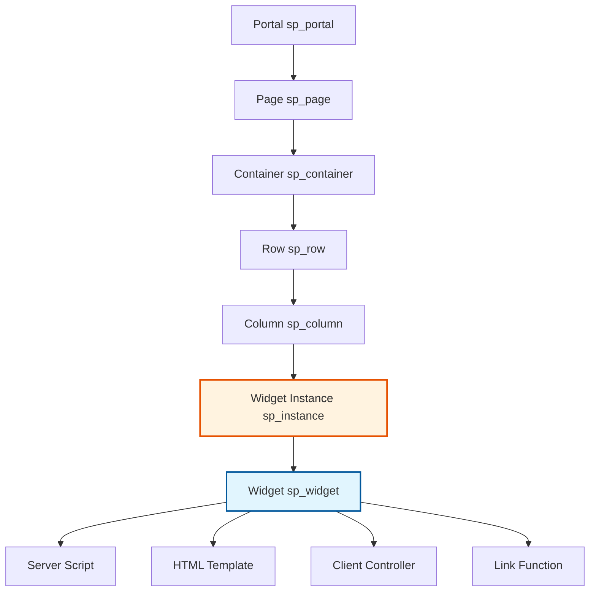
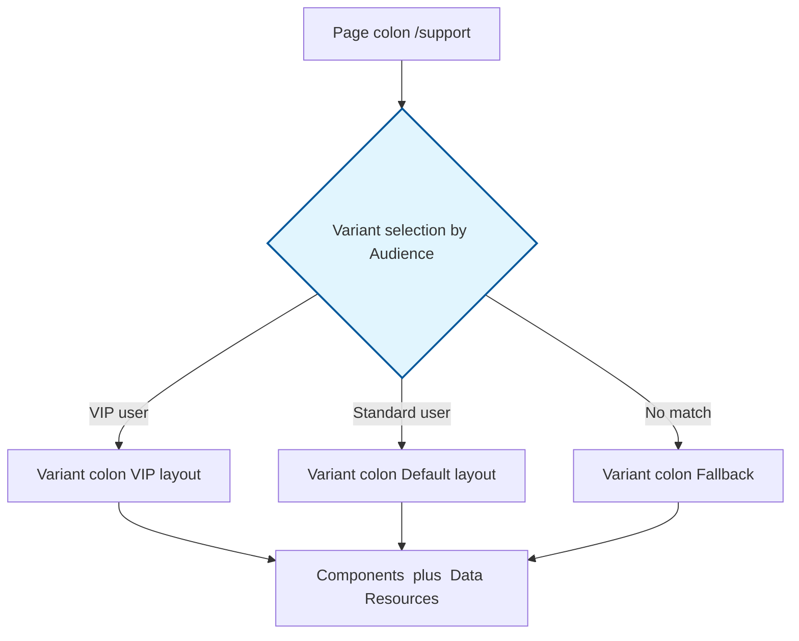

# Service Portals & UI Builder — End-to-End Guide

**Agent:** Hermes
**Date:** 2026-11-20
**Module:** Portals & User Experience (Service Portal, UI Builder / Next Experience, Employee Center)
**App:** Now Platform (Service Portal, UI Builder, Employee Center, Configurable Workspace)
**Confidence:** high on architecture, **verify** on environment-specific URLs/versions

---

## Contents

- [Why this matters](#why-this-matters)
- [The two portal stacks — choose the right one](#the-two-portal-stacks--choose-the-right-one)
- [Service Portal (classic) — deep dive](#service-portal-classic--deep-dive)
  - [Architecture & core tables](#architecture--core-tables)
  - [Anatomy of a page](#anatomy-of-a-page)
  - [Widget anatomy](#widget-anatomy)
  - [Themes, CSS, and responsiveness](#themes-css-and-responsiveness)
  - [Route maps & pretty URLs](#route-maps--pretty-urls)
- [UI Builder / Next Experience — deep dive](#ui-builder--next-experience--deep-dive)
  - [What UI Builder actually is](#what-ui-builder-actually-is)
  - [Pages, page variants, and audiences](#pages-page-variants-and-audiences)
  - [Components and data resources](#components-and-data-resources)
  - [Configurable Workspaces](#configurable-workspaces)
  - [Page URLs and routing](#page-urls-and-routing)
- [Employee Center (Employee Service Portal)](#employee-center-employee-service-portal)
- [Out-of-the-box portals catalog](#out-of-the-box-portals-catalog)
- [Decision guide — which portal, which stack](#decision-guide--which-portal-which-stack)
- [Governance & best practices](#governance--best-practices)
- [Common pitfalls](#common-pitfalls)
- [Related guides](#related-guides)
- [Official resources](#official-resources)

- [Further learning:](#further-learning)
---

## Why this matters

A "portal" is how humans actually touch ServiceNow. Get the portal stack wrong and you inherit years of rework: classic Service Portal pages can't be reused in UI Builder, and UI Builder pages can't run in the AngularJS Service Portal runtime. Choosing the wrong stack early is one of the most expensive UX decisions on the platform.

There are **two distinct front-end runtimes**, plus a set of **out-of-the-box portals** built on them:

- **Service Portal (classic)** — AngularJS 1.x, `sp_*` tables, widget-based.
- **Next Experience / UI Builder** — web-components (Seismic), no-code/low-code page builder, page variants and audiences.
- **Employee Center** — the modern employee portal, built on Next Experience / UI Builder.

---

## The two portal stacks — choose the right one

| Dimension | Service Portal (classic) | UI Builder / Next Experience |
|-----------|--------------------------|------------------------------|
| Runtime | **AngularJS 1.x** | **Seismic web components** (not Angular) |
| Builder | Widget Editor, Page Designer (sp) | **UI Builder** (drag-and-drop visual) |
| Data model | `sp_portal`, `sp_page`, `sp_widget`, `sp_instance`, `sp_theme` | Next Experience pages, page variants, components, data resources |
| Custom code | Server script, HTML template, client controller (AngularJS) | Component properties, client scripts, **data resources** (GraphQL/REST/transform) |
| Reusability of classic widgets | Native | **Not reusable** — different runtime |
| Best for | Legacy/custom portals, teams fluent in AngularJS, existing sp investments | New portals/workspaces, Employee Center, agent Configurable Workspaces, low-code teams |
| OOB examples | Service Portal demo, CSM Customer Service Portal | Employee Center, Configurable Workspace (CSM/ITSM/HR agent) |
| Strategic direction | Maintenance / legacy | **ServiceNow's forward direction** for new builds |

> **Rule of thumb:** For anything **new**, build on **UI Builder / Next Experience**. Keep Service Portal for existing classic portals you're not ready to migrate. Do not plan to reuse classic widgets inside UI Builder — they are different runtimes.

---

## Service Portal (classic) — deep dive

### Architecture & core tables

| Concept | Table | What it is |
|---------|-------|-----------|
| Portal | `sp_portal` | A top-level site (e.g. "Service Portal", "Customer Service Portal"), with URL suffix, theme, logo |
| Page | `sp_page` | A URL-addressable page (e.g. `index`, `sc_home`, `ticket`) |
| Page route map | `sp_page_route_map` | Maps URL patterns (e.g. `/ticket/:sys_id`) to a page + optional user criteria |
| Widget | `sp_widget` | A reusable component: server script + HTML template + client controller + option schema |
| Widget instance | `sp_instance` | A widget **placed** on a page with specific option values |
| Container / row / column | `sp_container`, `sp_row`, `sp_column` | The layout grid that holds instances |
| Menu | `sp_menu` | Header/mega-menu navigation |
| Theme | `sp_theme` | Bootstrap-based theme, CSS variables, header/footer |
| User criteria | `user_criteria` | Audience rules that show/hide containers, widgets, routes |

**Breadcrumbs:** `Service Portal → Service Portal Configuration → Designer / Widgets / Portals`. Widgets: `Service Portal → Widgets`.

### Anatomy of a page

**Page → Container → Row → Column → Widget Instance → Widget.** A widget is the **definition**; an instance is a **placement** with its own options. Instance options override widget defaults — so the same widget can behave differently on two pages.

### Widget anatomy

A widget (`sp_widget`) has four code areas plus option config:

| Part | Runs | Purpose |
|------|------|---------|
| **Server script** | Server (AngularJS provider) | Queries data via GlideRecord/GlideAggregate, sets `data.*`, runs **first** |
| **HTML template** | Browser | Renders `data.*`/`c.*`; rendered **second** |
| **Client controller** | Browser (AngularJS) | Adds `c.*` behavior, `$scope` logic; runs **third** |
| **Link function** | Browser (optional) | DOM manipulation after render; runs **last** |
| **Option schema** | Config | Declares instance options (types, defaults) |

> Lifecycle order: **Server → HTML → Client Controller → Link (optional)**. See the [Angular guide](angular-guide) for the full flow, `$scope`, `server.update()`, GlideAjax, and Scripted REST integration.

### Themes, CSS, and responsiveness

- Service Portal is **Bootstrap 3** based. Themes (`sp_theme`) set CSS variables, header/footer, logo, and a custom CSS include.
- Custom CSS goes in the theme's **CSS** field or a CSS include record.
- Use the grid (`sp_row`/`sp_column`) with Bootstrap classes (`col-md-6`, etc.) for responsiveness.
- **Sass variables** (where enabled) let you rebrand without overriding every rule.

### Route maps & pretty URLs

- `sp_page_route_map` maps a URL pattern to a page and can carry **user criteria** — so the same URL shows different pages/views to different audiences.
- Pretty URLs (e.g. `/sp/ticket/INC0010013`) come from route maps + `$location` in the widget.
- Deep-link parameters arrive via `$location.search()` and are read in the client controller.

---

## UI Builder / Next Experience — deep dive

### What UI Builder actually is

UI Builder is ServiceNow's **visual page builder** for the **Next Experience** runtime. It builds pages from **components** (Seismic web components) on a drag-and-drop canvas, backed by **data resources** that fetch and shape data. It is **not AngularJS** and does **not** reuse `sp_widget` widgets — this is the single most important thing to internalize.

**Where to find it:** `All → UI Builder` (or from a page's "Edit in UI Builder"). Workspaces (Configurable Workspace) and Employee Center pages are edited here.

### Pages, page variants, and audiences

- A **page** is a route/URL in a Next Experience experience (portal or workspace).
- A **page variant** is an alternate rendering of the same page for a specific **audience** (e.g. VIP customers get a different layout). Variants carry an **Audience** (user criteria) and an **Order** (precedence when multiple match).
- This is the Next Experience equivalent of Service Portal's route maps + user criteria, but more flexible: one URL, many variants, chosen by audience.

### Components and data resources

- **Components** are the UI building blocks (lists, forms, cards, charts, rich text). Drop them on the canvas and bind properties.
- **Data resources** fetch data. Three common types:
  - **GraphQL** — query ServiceNow's GraphQL API with a typed query.
  - **REST** — call a REST endpoint (including Scripted REST).
  - **Transform** — reshape data between resources (map/merge/filter).
- Components bind to data resource outputs; you can chain resources (fetch → transform → render).
- **Client scripts** on components handle interactivity (events, navigation, state).

### Configurable Workspaces

Agent-facing experience is **Configurable Workspace** (Next Experience), also built with UI Builder:
- **CSM Configurable Workspace**, **ITSM Configurable Workspace / Agent Workspace**, **HR Agent Workspace**, **Security Incident Response Workspace**, etc.
- Workspaces are **not** "portals" for end users — they're agent consoles. But they share the UI Builder/Next Experience stack, so skills transfer.
- Legacy **Agent Workspace** (older) vs **Configurable Workspace** (current) — prefer Configurable Workspace for new builds.

### Page URLs and routing

- Next Experience pages have **URLs/routes** configured on the page (page URL settings), including dynamic route parameters.
- **Page variants** don't change the URL — they change what renders at that URL for a given audience.
- Route/experience configuration lives with the experience (portal or workspace), not a separate `sp_page_route_map`.

---

## Employee Center (Employee Service Portal)

**Employee Center** is the modern, OOB **employee-facing portal**, built on **Next Experience / UI Builder**. It is the strategic replacement for the classic Service Portal-based employee portal.

**What it gives employees**
- A single front door across **IT, HR, Facilities, Legal, Procurement, Workplace** — not just IT.
- **Topics** (curated content groupings), a **mega menu**, **targeted content** by audience, unified **search** and **knowledge**.
- **Approvals, requests, tasks** in one place; **service catalog** embedded.
- **Employee Center Pro** (licensed add-on) adds advanced features (e.g. enhanced journeys, campaigns, advanced analytics) — the base Employee Center is included.

**How it's built/configured**
- Pages are UI Builder pages with page variants and audiences.
- Configure **topics**, **content**, **audiences**, **mega menu**, and **search** in the Employee Center admin area.
- Audience targeting uses user criteria — the same mechanism as page variants.

**Migrating from the classic employee portal**
- Older implementations used a Service Portal-based "Employee Service Portal." Move to Employee Center on Next Experience.
- Classic `sp_widget` content does **not** port directly — rebuild as UI Builder components or embed via supported means.
- Plan content migration (topics, knowledge, catalog items) separately from the UX rebuild.

> **Verify on your instance:** the exact Employee Center entry URL (commonly `/esc` or the portal's configured suffix) and which features require **Employee Center Pro** licensing in your release.

---

## Out-of-the-box portals catalog

ServiceNow ships several OOB portals. Each is built on one of the two stacks — check before customizing, because the stack dictates how you edit it.

| Portal | Audience | Typical use | Stack |
|--------|----------|-------------|-------|
| **Employee Center** | Employees (all departments) | Unified employee front door: IT/HR/Facilities/Legal requests, knowledge, approvals | **Next Experience / UI Builder** |
| **Service Portal (demo / "sp")** | Any (reference implementation) | Baseline classic portal; starting point for custom classic portals | **Service Portal (classic)** |
| **Customer Service Portal (CSM)** | Customers / consumers | Case submission, knowledge, self-service for CSM | **Service Portal (classic)** (with CSM workspace for agents) |
| **HR Service Portal / HRSD** | Employees | HR cases, lifecycle events (often delivered through **Employee Center**) | Next Experience via Employee Center |
| **Vendor / Supplier Portal** | Vendors/suppliers | Vendor onboarding, invoices, performance (Source-to-Pay / Vendor Mgmt) | Mixed — verify per app |
| **Partner Portal** | Partners/channel | Partner deal registration, cases | Verify per app |
| **Field Service (mobile + portal)** | Field technicians / customers | Work orders on mobile; customer appointment/status | Field Service Mobile app + portal (verify) |
| **Knowledge Portal** | Any | Standalone knowledge browsing | Service Portal or Next Experience (verify) |
| **Configurable Workspace** (CSM/ITSM/HR/SecOps) | **Agents** | Agent consoles (not end-user portals) | **Next Experience / UI Builder** |

> **Verify:** exact portal names, URLs, and which release/plugin enable each one — they vary by product and version. The repo convention is "working notebook, not product documentation."

---

## Decision guide — which portal, which stack

| If you need… | Build with… |
|--------------|-------------|
| A **new** employee experience | **Employee Center** (Next Experience) |
| A **new** customer self-service portal | UI Builder / Next Experience (if available in your release) **or** CSM Customer Service Portal (classic) if you need CSM OOB features now |
| A **new** agent console | **Configurable Workspace** (UI Builder) |
| To extend an **existing classic** Service Portal | Service Portal widget editor (AngularJS) — don't mix runtimes |
| To migrate a classic portal | Rebuild in UI Builder; migrate content separately; don't expect widget reuse |
| Low-code team, fast iteration | **UI Builder** (visual, data resources) |
| Team fluent only in AngularJS, existing sp investment | Keep **Service Portal** for now; plan migration |

**Never** try to render a classic `sp_widget` inside a UI Builder page or vice-versa — the runtimes are incompatible.

---

## Governance & best practices

1. **Pick the stack once, per experience.** Mixing classic and Next Experience in one portal causes confusion and duplicated content.
2. **Audience first.** Use user criteria / page variant audiences to target content rather than building separate portals per group.
3. **Don't fork OOB portals blindly.** Extend Employee Center / CSM portal through supported config; deep forks break on upgrade.
4. **Keep data access in data resources / server scripts,** not client-side queries, for security and performance.
5. **Test upgrades against portals** — UI Builder pages and page variants are upgrade-sensitive; capture them in regression.
6. **Performance:** paginate lists, lazy-load data resources, avoid heavy client scripts; measure page load (< 2s target).
7. **Accessibility:** both stacks support WCAG — verify component contrast, focus order, and ARIA on custom components.
8. **Document the audience model** (who sees which variant) — it's the most-forgotten design artifact.

---

## Common pitfalls

- **Assuming widget reuse:** classic `sp_widget` does not work in UI Builder. Budget a rebuild.
- **Editing the wrong layer:** changing a widget when the real difference is an **instance option**, or changing a page when the real difference is a **page variant/audience**.
- **Variant/audience order bugs:** overlapping audiences with wrong order show the wrong variant — check the Order field and test with each audience.
- **Route map confusion (classic):** a URL that "doesn't work" is often a missing `sp_page_route_map` entry or a user-criteria block.
- **Licensing surprises:** Employee Center Pro and some portal features need licensing — confirm before scoping.
- **Upgrade breakage:** forked portal pages/themes are the usual upgrade casualty. Keep customizations in supported extension points.

---

## Related guides

- [Angular guide](angular-guide) — AngularJS Service Portal widgets, the Server→HTML→Client→Link lifecycle, Scripted REST integration, and Page Variants vs Route Maps.
- [App Engine Studio guide](../app-engine/app-engine-guide) — building scoped apps and experiences.
- [Service Catalog guide](../catalog/catalog-guide) — catalog items and fulfillment that portals surface.
- [HRSD guide](../hrsd/hrsd-guide) — HR services delivered through Employee Center.

---

## Official resources

- ServiceNow product documentation — **Service Portal** (widgets, pages, themes, route maps).
- ServiceNow product documentation — **UI Builder** and **Next Experience** (pages, variants, data resources).
- ServiceNow product documentation — **Employee Center** and **Employee Center Pro**.
- ServiceNow Developer — **Seismic / web components** and **GraphQL API**.

> Verify all environment-specific paths, URLs, and licensing against your own instance and the official docs — this notebook is a learning aid, not product documentation.

## Further learning:

Capabilities this guide does not cover in depth. Bullet points first; the deep dives are added below as they are researched.

- **Employee Center (ESC)** — the current-generation portal for employees, replacing classic Service Portal for most new deployments.
- **UI Builder / Next Experience** — page and variant authoring for workspaces and modern portals.
- **Portal analytics** — page views, search terms with no results, and deflection; the zero-result search report is the cheapest content roadmap you will ever get.
- **AI Search** — semantic portal search with results tuning; replaces the legacy Zing search configuration.
- **Widgets vs custom components** — Service Portal widgets (AngularJS) vs UI Builder components (Next Experience); they are not interchangeable, and mixing them in one page is a common trap.
- **Themes and branding** — theme records, CSS variables and logo/asset management per portal.
- **Multi-language and localisation** — translated content and message records; portal strings do not come from the UI16 message table.
- **Page variants and audiences** — role/condition-based rendering at the same URL (UI Builder); classic Portal uses page route maps and user criteria instead.

- **Verify in your instance**: most items above are plugin-gated (e.g. `com.snc.`) or release-specific; check *All › System Applications › All Available Applications* before relying on one.
