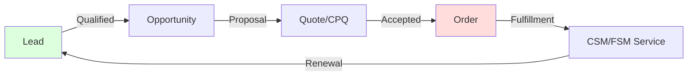

# Sales CRM

**Agent:** opencode  
**Date:** 2026-11-05  
**Module:** Sales CRM  
**App:** Sales (ServiceNow Sales)  
**Confidence:** verify  

---

## Contents

- [Purpose](#purpose)
- [Where to Find It](#where-to-find-it)
- [Re-usable Code / Metadata](#re-usable-code--metadata)
- [Out-of-Box Features](#out-of-box-features)
- [Key Table Hierarchy](#key-table-hierarchy)
- [Integrations](#integrations)
- [Key Fields](#key-fields)
- [Common Mistakes](#common-mistakes)
- [Lab: Create Your First Sales Opportunity](#lab-create-your-first-sales-opportunity)
- [Quiz](#quiz)
- [Official Learning Resources](#official-learning-resources)
- [Visual & Video Guides](#visual--video-guides)

---

## Purpose

ServiceNow Sales CRM is the platform's customer relationship management application, built on the same ServiceNow platform as ITSM and CSM but optimized for sales pipeline management. Sales CRM tracks leads, opportunities, accounts, contacts, quotes, and orders—giving sales teams a single system of record from prospect to closed deal. Unlike traditional CRMs, ServiceNow Sales CRM integrates natively with ITSM, CSM, and FSM, enabling quote-to-cash-to-service workflows in one platform.

---

## Where to Find It

| Breadcrumb | Path |
|------------|------|
| Module entry | All > Sales > ... |
| Accounts | All > Sales > Accounts > All |
| Contacts | All > Sales > Contacts > All |
| Leads | All > Sales > Leads > All |
| Opportunities | All > Sales > Opportunities > All |
| Quotes | All > Sales > Quotes > All |
| Orders | All > Sales > Orders > All |
| Products | All > Sales > Products > All |
| Price Lists | All > Sales > Administration > Price Lists |
| Administration | All > Sales > Administration > ... |

**Tip:** If menus are missing, verify the `com.snc.sales` plugin is active (System Definition → Plugins).

---

## Re-usable Code / Metadata

### Scoped Application

ServiceNow Sales CRM ships as a scoped application.

| Scope Aspect | Detail |
|--------------|--------|
| Scope name | `com.snc.sales` |
| Tables | `sn_sales_account`, `sn_sales_contact`, `sn_sales_lead`, `sn_sales_opportunity`, `sn_sales_quote`, `sn_sales_order`, `sn_sales_product` |
| Roles | `sn_sales.admin`, `sn_sales.user`, `sn_sales.reader`, `admin` |

### Meta Data Patterns

| Metadata Element | Example | Notes |
|------------------|---------|-------|
| Application menu | `sn_sales.menu.main` | Sales left-nav root |
| Module | `sn_sales.menu.opportunities` | Points to opportunity list |
| Stage | `sn_sales.opportunity_stage` | Prospecting, Qualification, Proposal, Negotiation, Closed Won, Closed Lost |
| Choice list | `sn_sales.lead_status` | New, Contacted, Qualified, Unqualified |
| UI Policy | `sn_sales.policy.validate_quote` | Validates quote before submission |
| Business Rule | `sn_sales.rule.auto_create_opportunity` | Creates opportunity from qualified lead |

### The re-usable metadata inventory

In Sales & Order Management, the catalog *is* the reusable metadata — orders are just instantiations of it:

| Re-usable piece | What it is | Where it lives (breadcrumb) |
|-----------------|------------|------------------------------|
| **Product specifications** | The reusable definition of what a product *is* (a fibre line, a handset, a licence) with its characteristics — defined once, sold through many offerings, decomposed the same way every time. | All > Sales and Order Management > **Product Specifications** |
| **Characteristics & values** | The shared attribute vocabulary (bandwidth, colour, term length, region) with allowed values. One characteristic definition serves every specification, offering, quote, and order that touches it — this is the module's deepest reuse. | On specifications / offerings (Characteristics) |
| **Product offerings** | The sellable packaging of specifications: bundles, eligibility, and commercial terms layered over the same underlying specs. Many offerings, one spec. | All > Sales and Order Management > **Product Offerings** |
| **Price lists & pricing rules** | Prices live in price lists and pricing matrices/rules, never on the quote: a price change is made once in the list and every new quote and order reads it. | All > Sales and Order Management > **Pricing** |
| **Decomposition rules** | The reusable mapping from what was sold to what must be fulfilled: one commercial product decomposes into domain orders and tasks the same way on every order. Change the rule, change all future fulfilment. | On the specification / offering (Decomposition) |
| **Orchestration plans & order task templates** | The fulfilment plan definitions per product — sequence, dependencies, jeopardy points, instantiated per order line instead of being designed per order. | All > Sales and Order Management > **Order Management** (plan definitions) |
| **Quote & order templates** | Standard quote structures and terms reused across opportunities, so sellers start from the approved pattern rather than a blank page. | All > Sales and Order Management > **Quotes** |
| **TM Forum API contracts** | The catalog/order APIs (TMF620 catalog, TMF622 ordering, TMF641 service ordering) are fixed contracts: every channel and integration reuses the same definitions, which is what makes multi-channel selling possible. | Developer / API documentation for the SOM applications |

### Re-usable Code Snippets

#### Business Rule: Auto-create Opportunity from Qualified Lead

```javascript
(function rule(current, previous) {
    if (current.operation() == 'insert' && current.status == 'qualified' && !current.opportunity) {
        var gr = new GlideRecord('sn_sales_opportunity');
        gr.initialize();
        gr.name = 'Opportunity for ' + (current.company || current.first_name + ' ' + current.last_name);
        gr.account = current.company;
        gr.contact = current.sys_id;
        gr.stage = 'prospecting';
        gr.amount = current.estimated_value;
        gr.expected_close_date = new Date();
        gr.expected_close_date.setMonth(gr.expected_close_date.getMonth() + 1);
        gr.source_lead = current.sys_id;
        gr.insert();
        current.opportunity = gr.sys_id;
        current.update();
    }
})(current, previous);
```

#### UI Policy: Validate Quote Before Submission

```javascript
(function rule(current) {
    if (current.quote_status == 'submitted') {
        if (!current.valid_until) {
            g_form.showErrorMsg('valid_until', 'Valid until date is required when submitting a quote');
            g_form.setMandatory('valid_until', true);
        }
        if (!current.terms_and_conditions) {
            g_form.showErrorMsg('terms_and_conditions', 'Terms and conditions must be accepted');
            g_form.setMandatory('terms_and_conditions', true);
        }
    }
})(current);
```

#### Script Include: Sales Helper

```javascript
var SalesHelper = Class.create();
SalesHelper.prototype = Object.extendsObject(AbstractAjaxProcessor, {
    getOpportunityPipeline: function() {
        var gr = new GlideRecord('sn_sales_opportunity');
        gr.addQuery('stage', '!=', 'closed_won');
        gr.addQuery('stage', '!=', 'closed_lost');
        gr.addQuery('stage', '!=', 'abandoned');
        gr.query();
        var total = 0;
        var count = 0;
        while (gr.next()) {
            total += parseFloat(gr.getValue('amount') || 0);
            count++;
        }
        return JSON.stringify({
            total_pipeline: total,
            open_opportunities: count,
            average_deal_size: count > 0 ? total / count : 0
        });
    },
    type: 'SalesHelper'
});
```

#### Business Rule: Update Account Last Contact Date

```javascript
(function rule(current, previous) {
    if (current.operation() == 'insert' && current.account) {
        var gr = new GlideRecord('sn_sales_account');
        gr.addQuery('sys_id', current.account);
        gr.query();
        if (gr.next()) {
            gr.last_contact_date = new Date();
            gr.update();
        }
    }
})(current, previous);
```

---

## Out-of-Box Features

| Feature | Description | Where |
|---------|-------------|-------|
| Accounts | B2B customer accounts | All > Sales > Accounts |
| Contacts | Individual contacts | All > Sales > Contacts |
| Leads | Sales leads/prospects | All > Sales > Leads |
| Opportunities | Sales opportunities/deals | All > Sales > Opportunities |
| Quotes | Formal price quotes | All > Sales > Quotes |
| Orders | Confirmed sales orders | All > Sales > Orders |
| Products | Product catalog | All > Sales > Products |
| Price Lists | Pricing by product | All > Sales > Administration > Price Lists |
| Lead Stages | Lead lifecycle stages | All > Sales > Administration > Lead Stages |
| Opportunity Stages | Opportunity pipeline stages | All > Sales > Administration > Opportunity Stages |
| Sales Dashboard | Sales performance dashboard | All > Sales > Dashboards |

---

## Key Table Hierarchy

### Core Tables

| Table | Purpose | Extends | Key Fields |
|-------|---------|---------|------------|
| `sn_sales_account` | Customer account | `task` | `name`, `account_number`, `industry`, `annual_revenue`, `parent_account` |
| `sn_sales_contact` | Individual contact | `sys_user` | `first_name`, `last_name`, `email`, `phone`, `account` |
| `sn_sales_lead` | Sales lead | `task` | `company`, `first_name`, `last_name`, `email`, `status`, `estimated_value` |
| `sn_sales_opportunity` | Sales opportunity | `task` | `name`, `account`, `contact`, `stage`, `amount`, `expected_close_date`, `source_lead` |
| `sn_sales_quote` | Formal quote | `task` | `opportunity`, `valid_until`, `total_amount`, `quote_status` |
| `sn_sales_order` | Confirmed order | `task` | `quote`, `account`, `order_date`, `total_amount`, `order_status` |
| `sn_sales_product` | Product | `cmdb_ci` | `name`, `sku`, `description`, `list_price` |

### Table Relationships

```
sn_sales_account
    │
    ├──► sn_sales_contact (one account → many contacts)
    ├──► sn_sales_opportunity (one account → many opportunities)
    ├──► sn_sales_order (one account → many orders)
    │
sn_sales_lead
    │
    ├──► sn_sales_opportunity (qualified lead → opportunity)
    │
sn_sales_opportunity
    │
    ├──► sn_sales_quote (one opportunity → many quotes)
    ├──► sn_sales_contact (primary contact)
    │
sn_sales_quote
    │
    ├──► sn_sales_order (accepted quote → order)
    │
sn_sales_product
    │
    ├──► sn_sales_quote (quoted products)
    ├──► sn_sales_order (ordered products)
```

### CMDB Integration

| Sales Table | Maps to CMDB Table | Relationship |
|-------------|-------------------|--------------|
| `sn_sales_product` | `cmdb_ci` | Extends |
| `sn_sales_contact` | `sys_user` | Extends |
| `sn_sales_account` | Standalone | Standalone (not CI) |

---

## Integrations

| Integration | Direction | Purpose | Protocol |
|-------------|-----------|---------|----------|
| Email | Inbound/Outbound | Create leads from email, send quotes | Email/SMTP |
| ERP | Outbound | Push orders to ERP (SAP, Oracle, NetSuite) | REST/SOAP |
| Accounting | Outbound | Push invoices to accounting system | REST/SFTP |
| Marketing Automation | Inbound | Import leads from Marketo/HubSpot | REST/API |
| CRM Data Enrichment | Outbound | Enrich leads with company data | REST API |
| E-signature | Outbound | Send quotes for signature | DocuSign/Docusign spoke |
| Payment Gateway | Outbound | Process payments on orders | Stripe/PayPal API |
| Calendar | Outbound | Sync meetings to calendar | iCal/Exchange |
| CSM | Outbound | Create CSM case from won opportunity | Internal |
| FSM | Outbound | Create work order from order | Internal |

---

## Key Fields

| Table | Field | Type | Why It Matters |
|-------|-------|------|----------------|
| `sn_sales_account` | `name` | String | Account name |
| `sn_sales_account` | `account_number` | String | External account ID |
| `sn_sales_account` | `industry` | Choice | Industry classification |
| `sn_sales_account` | `annual_revenue` | Currency | Account size for segmentation |
| `sn_sales_contact` | `first_name` | String | Contact first name |
| `sn_sales_contact` | `last_name` | String | Contact last name |
| `sn_sales_contact` | `email` | String | Primary contact email |
| `sn_sales_contact` | `account` | Reference | Which account this contact belongs to |
| `sn_sales_lead` | `company` | String | Lead company name |
| `sn_sales_lead` | `status` | Choice | New → Contacted → Qualified → Unqualified |
| `sn_sales_lead` | `estimated_value` | Currency | Estimated deal value |
| `sn_sales_opportunity` | `name` | String | Opportunity name |
| `sn_sales_opportunity` | `account` | Reference | Which account this opportunity belongs to |
| `sn_sales_opportunity` | `stage` | Choice | Prospecting → Qualification → Proposal → Negotiation → Closed Won/Lost |
| `sn_sales_opportunity` | `amount` | Currency | Expected deal value |
| `sn_sales_opportunity` | `expected_close_date` | Date | Expected close date |
| `sn_sales_opportunity` | `source_lead` | Reference | Lead that created this opportunity |
| `sn_sales_quote` | `opportunity` | Reference | Which opportunity this quote belongs to |
| `sn_sales_quote` | `valid_until` | Date | Quote expiration date |
| `sn_sales_quote` | `total_amount` | Currency | Total quote amount |
| `sn_sales_quote` | `quote_status` | Choice | Draft → Sent → Accepted → Rejected → Expired |
| `sn_sales_order` | `quote` | Reference | Quote this order is based on |
| `sn_sales_order` | `order_status` | Choice | Draft → Confirmed → Fulfilled → Cancelled |
| `sn_sales_product` | `sku` | String | Stock keeping unit |
| `sn_sales_product` | `list_price` | Currency | Standard list price |

---

## Common Mistakes

| Mistake | Symptom | Fix |
|---------|---------|-----|
| Creating opportunities without accounts | No entitlement/SLA context | Always populate account |
| Not setting expected close date | Pipeline reports are inaccurate | Always set expected close date |
| Skipping lead qualification | Opportunities created from junk leads | Qualify leads before converting |
| One opportunity for multiple products | Can't track per-product revenue | Create separate opportunities or use quote lines |
| Not updating stage | Pipeline is stale and inaccurate | Update stage as deal progresses |
| Creating quotes without valid_until | Quotes never expire | Always set valid_until date |
| Testing portal as admin | Can't see customer experience | Test as actual sales rep/customer |

---

## Lab: Create Your First Sales Opportunity

1. **Navigate** to All > Sales > Opportunities > All
2. **Click New** and fill:
   - Name: "Acme Corp - Enterprise License Renewal"
   - Account: Select existing account (or create one first)
   - Contact: Select contact under that account
   - Stage: Prospecting
   - Amount: 50000
   - Expected Close Date: 30 days from today
   - Source Lead: (leave blank or select existing lead)
   - Short Description: Renew enterprise license for 500 users
3. **Submit** and note the opportunity number
4. **Open** the opportunity → change Stage to "Qualification"
5. **Create** a Quote under the opportunity:
   - Valid Until: 30 days from today
   - Total Amount: 50000
   - Quote Status: Draft
   - Add quote lines for products
6. **Change** quote status to "Sent"
7. **Change** quote status to "Accepted"
8. **Create** an Order from the accepted quote:
   - Order Status: Confirmed
   - Order Date: Today
   - Total Amount: 50000
9. **Change** opportunity stage to "Closed Won"
10. **Verify** in Related Lists: Quotes, Orders, Contacts, Activities

---

## Quiz

1. What field determines which sales workflow fires?
2. What is the difference between an account and a contact in Sales CRM?
3. What happens if entitlement is missing on a case? (CSM comparison)
4. What table stores customer accounts?
5. How does Sales CRM differ from CSM?


## 📺 Visual & Video Guides

### Comprehensive Overview: Sales and Order Management
<div style="text-align: center; margin: 1.5rem 0;">
  <iframe width="560" height="315" src=" title="Sales and Order Management Overview" frameborder="0" allow="accelerometer; autoplay; clipboard-write; encrypted-media; gyroscope; picture-in-picture" allowfullscreen></iframe>
</div>

### Getting Started Webinar
<div style="text-align: center; margin: 1.5rem 0;">
  <iframe width="560" height="315" src=" title="Getting Started Webinar" frameborder="0" allow="accelerometer; autoplay; clipboard-write; encrypted-media; gyroscope; picture-in-picture" allowfullscreen></iframe>
</div>

### Detailed Demo: Lead to Order
<div style="text-align: center; margin: 1.5rem 0;">
  <iframe width="560" height="315" src=" title="Lead to Order Demo" frameborder="0" allow="accelerometer; autoplay; clipboard-write; encrypted-media; gyroscope; picture-in-picture" allowfullscreen></iframe>
</div>

**Fallback links (if embeds are blocked):**
- [Comprehensive Overview]()
- [Getting Started Webinar]()
- [Detailed Demo: Lead to Order]()
## 🗺️ Conceptual Flow (Lead-to-Cash)



---

---

---

---

## 🎓 Official Learning Resources

To avoid unofficial or outdated content, always use these validated official ServiceNow sources:

### 📺 Verified Videos & Playlists
- [Getting Started with Sales & Order Management](https://www.youtube.com/watch?v=zCCbYr15dG8)
- [38th Release – 38 Features in 38 Minutes!! Zurich](https://www.youtube.com/watch?v=YIDLs6UoeUA)
- [Search (Community)](https://www.youtube.com/@ServiceNowCommunity/search?query=Sales%20and%20Order%20Management)
- [Search (Docs)](https://www.youtube.com/@ServiceNowDocs/search?query=Order%20Management)

### 🚀 The Authoritative Path
1. **Now Learning (Structured Training)**
   - The only official source for certification paths and structured video courses.
   - [Go to Now Learning Portal](https://nowlearning.com/) $\rightarrow$ Search for "Sales CRM / Order Management"
   
2. **Product Documentation (Technical Reference)**
   - The definitive source for every table, field, and OOB behavior.
   - [ServiceNow Product Documentation](https://docs.servicenow.com/) $\rightarrow$ Search for "Sales CRM / Order Management"
