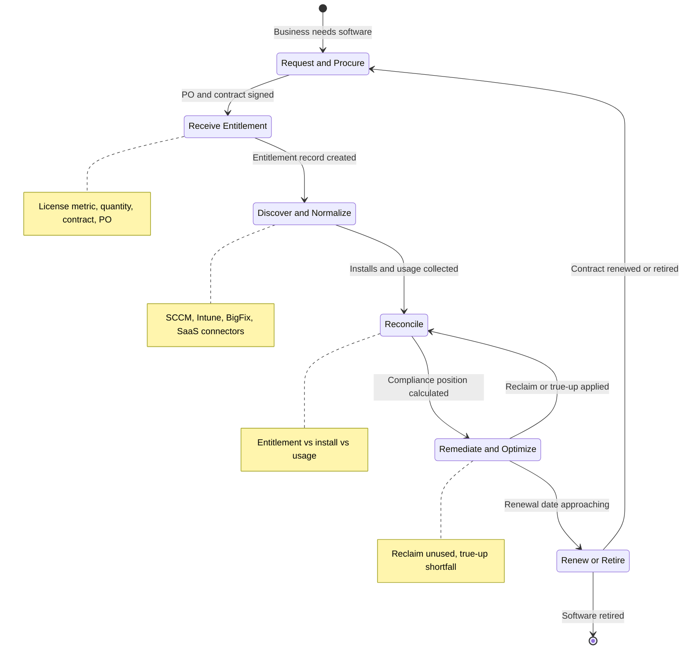
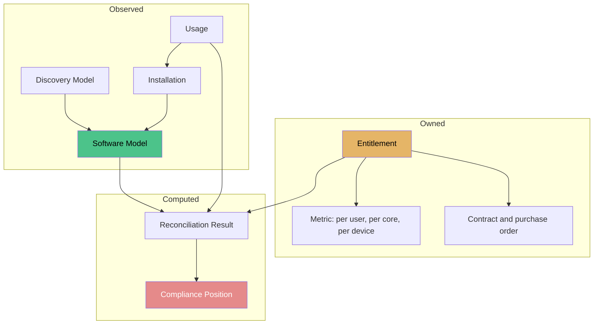
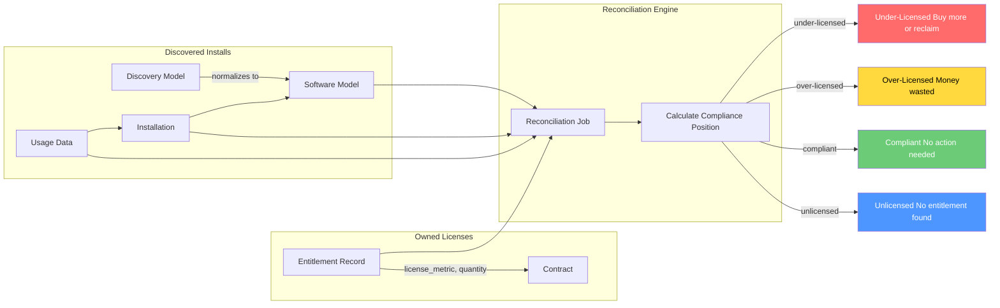
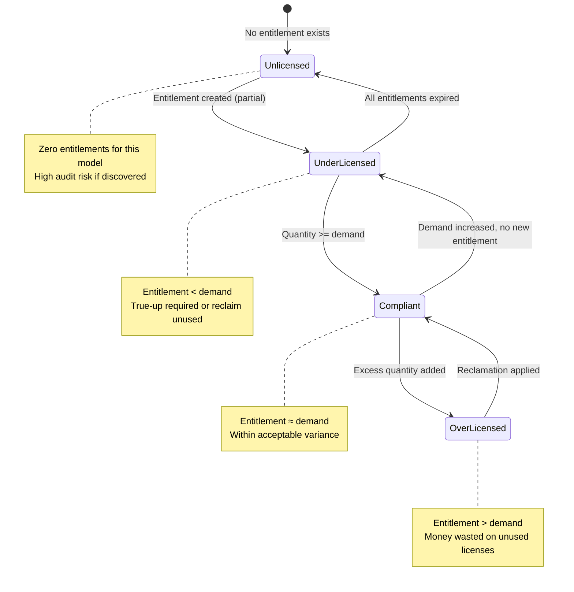
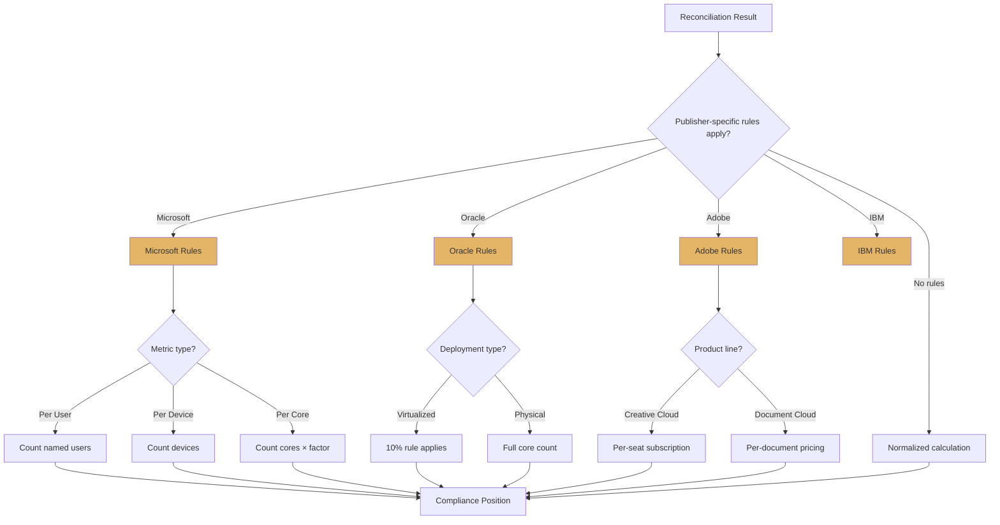
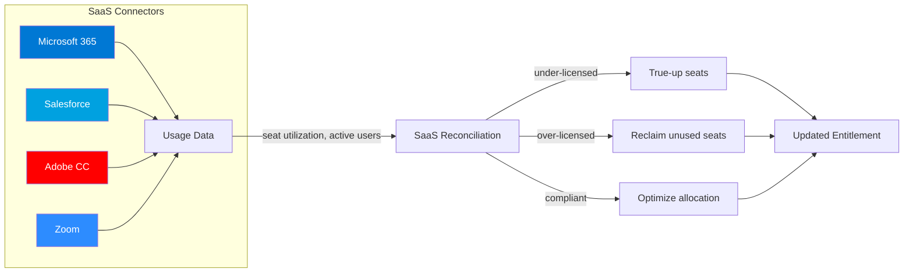

# SAM — Software Asset Management

**Agent:** opencode  
**Date:** 2026-11-12  
**Module:** SAM (Software Asset Management)  
**App:** ITAM (IT Asset Management) — SAM Pro  
**Confidence:** verify

> **Scope note:** This guide targets the **SAM Administrator** role: entitlements, software models, reconciliation, compliance reporting, publisher audits, optimization/reclamation, renewal tracking, and SaaS license management. It is the software counterpart to the [HAM guide](../ham/ham-guide/).

---

## Contents


- [Purpose](#purpose)
- [SAM vs HAM vs ITAM](#sam-vs-ham-vs-itam)
- [Where to Find It](#where-to-find-it)
- [Official Exam Alignment — CIS-Software Asset Management](#official-exam-alignment--cis-software-asset-management)
- [SAM Lifecycle Diagram](#sam-lifecycle-diagram)
- [The Three Record Types You Must Never Confuse](#the-three-record-types-you-must-never-confuse)
- [Software Models & Normalization (SUMN)](#software-models--normalization-sumn)
- [Entitlements — The Contract Side](#entitlements--the-contract-side)
- [Reconciliation — The Core Engine](#reconciliation--the-core-engine)
  - [📊 Reconciliation Flow Diagram](#reconciliation-flow-diagram)
  - [📊 Compliance Position States](#compliance-position-states)
  - [📊 Publisher-Specific Rules Flow](#publisher-specific-rules-flow)
  - [📊 SaaS License Management Flow](#saas-license-management-flow)
- [Compliance Positions Explained](#compliance-positions-explained)
- [Discovery & Data Sources](#discovery--data-sources)
- [SaaS License Management](#saas-license-management)
- [Optimization & Reclamation](#optimization--reclamation)
- [Publisher-Specific Traps](#publisher-specific-traps)
- [Re-usable Code / Metadata](#re-usable-code-metadata)
  - [Business Rule — flag an installation with no normalized software model](#business-rule--flag-an-installation-with-no-normalized-software-model)
  - [Scheduled Job — expire entitlements past their end date](#scheduled-job--expire-entitlements-past-their-end-date)
  - [Script Include — compliance summary per publisher](#script-include--compliance-summary-per-publisher)
  - [Client Script — require a metric when creating an entitlement](#client-script--require-a-metric-when-creating-an-entitlement)
  - [Report definitions worth building on day one](#report-definitions-worth-building-on-day-one)
- [Out-of-Box Features](#out-of-box-features)
- [Key Table Hierarchy](#key-table-hierarchy)
- [Integrations](#integrations)
- [Key Fields](#key-fields)
  - [Essential fields by record](#essential-fields-by-record)
  - [Fields people forget](#fields-people-forget)
- [Goals, Benefits & Key Metrics](#goals-benefits--key-metrics)
- [Common Mistakes](#common-mistakes)
- [Lab: Entitlement → Reconciliation → Compliance](#lab-entitlement--reconciliation--compliance)
  - [Step 1 — Choose and verify a software model](#step-1--choose-and-verify-a-software-model)
  - [Step 2 — Create an entitlement far below demand](#step-2--create-an-entitlement-far-below-demand)
  - [Step 3 — Confirm installs exist](#step-3--confirm-installs-exist)
  - [Step 4 — Run reconciliation](#step-4--run-reconciliation)
  - [Step 5 — Prove the fix](#step-5--prove-the-fix)
  - [Step 6 — Prove normalization matters](#step-6--prove-normalization-matters)
  - [Step 7 — Teach back (write it down)](#step-7--teach-back-write-it-down)
- [SLAs, Dashboards & Workspaces](#slas-dashboards--workspaces)
  - [Workspaces and consoles](#workspaces-and-consoles)
  - [Dashboards/indicators worth standing up](#dashboardsindicators-worth-standing-up)
  - [SLA-style targets](#sla-style-targets)
- [Quiz](#quiz)
- [Official Learning Resources](#official-learning-resources)
  - [Now Learning (structured training)](#now-learning-structured-training)
  - [Product documentation](#product-documentation)
  - [Official videos](#official-videos)
- [💡 Memory Aids & Mnemonics](#memory-aids--mnemonics)
  - [Business Rule Types — BAA](#business-rule-types--baa)
  - [Client Script Types — LOCS](#client-script-types--locs)
  - [UI Policy vs Data Policy vs Client Script](#ui-policy-vs-data-policy-vs-client-script)
  - [IRE — Identification Before Reconciliation](#ire--identification-before-reconciliation)
  - [Update Set Conflicts — ARM](#update-set-conflicts--arm)
  - [CMDB — Retire Before Delete](#cmdb--retire-before-delete)
  - [Order vs Priority — Lower = First](#order-vs-priority--lower-=-first)
  - [Transform Script — Coalesce = Match](#transform-script--coalesce-=-match)
  - [Debugging — Log First, Then Debug](#debugging--log-first-then-debug)
- [Related Guides](#related-guides)


---

## Purpose

Software Asset Management (SAM) answers one question that costs companies millions when answered wrong: **are we legally and financially in control of the software we actually run?**

SAM is the software half of ServiceNow IT Asset Management (ITAM). Where HAM tracks *things you can hold* (laptops, servers, monitors), SAM tracks *things you install* (Microsoft 365, Oracle DB, SAP, Adobe, IBM, Salesforce seats). SAM reconciles two independent truths:

1. **What we own / are entitled to buy** — contracts, purchase orders, entitlements, license metrics
2. **What is actually installed and used** — Discovery, SCCM/Intune, BigFix, SaaS integrations

Reconciliation compares those two streams per software model and per license metric, then produces a **compliance position**: compliant, over-licensed (money wasted), or under-licensed (audit exposure). Everything else in SAM — optimization, reclamation, true-up, renewal, publisher audit defence — is downstream of that calculation.

**ELI5:** You have 1,000 Microsoft 365 E3 entitlements. Discovery finds 1,180 installs and 1,090 active users. Reconciliation says you are 90 users under-licensed. You either buy 90 more (true-up) or reclaim 90 unused accounts before the publisher audits you.

---

## SAM vs HAM vs ITAM

| Aspect | HAM | SAM | ITAM (umbrella) |
|--------|-----|-----|-----------------|
| **Tracks** | Physical hardware assets | Software entitlements, installs, usage | Both |
| **Primary question** | What do we own, where is it, who has it? | Are we compliant, are we over/under-licensed? | Full asset portfolio cost & risk |
| **Core record** | `alm_asset` / `alm_hardware` | Software model + entitlement + install | `alm_asset` hierarchy |
| **Key engine** | Asset lifecycle, hardware normalization | **Reconciliation** (entitlement vs install vs usage) | Both engines |
| **Key risk** | Lost/stolen/stale assets, depreciation errors | Publisher audit fines, wasted license spend | Both |
| **Typical owner** | IT operations / desktop team | SAM administrator / license manager | ITAM manager / CIO office |
| **Shared tables** | `alm_asset`, `alm_model`, `ast_contract` | `alm_asset` (licenses), `ast_contract` | all of the above |

**Exam-critical distinction:** HAM and SAM share the ITAM application and the `alm_*` asset tables, but SAM adds the **software model → discovery model → installation → usage → entitlement → reconciliation result** chain. HAM has no equivalent of reconciliation.

---

## Where to Find It

| Breadcrumb | Path |
|------------|------|
| Module entry | All > Software Asset Management > ... |
| SAM Workspace (SAM Pro) | All > Software Asset Management > SAM Workspace |
| License Operations | All > Software Asset Management > License Operations |
| Software Models | All > Software Asset Management > Software Models |
| Software Licenses / Entitlements | All > Software Asset Management > Licenses > All |
| Reconciliation results | All > Software Asset Management > Reconciliation > Results |
| Compliance reports | All > Software Asset Management > License Operations > Compliance |
| Discovery models | All > Software Asset Management > Discovery Models |
| Software installations | All > Software Asset Management > Installations |
| Software usage | All > Software Asset Management > Usage |
| Content Library / Publisher packs | All > Software Asset Management > Administration > Content Library |
| Suites & bundles | All > Software Asset Management > Administration > Suites |
| Contracts (shared with HAM) | All > Asset Management > Contracts > All |
| Assets > Software | All > Asset Management > Assets > Software |
| SaaS integrations | All > Software Asset Management > SaaS License Management |

**Tip:** If the SAM menus are missing, verify the `com.snc.sams` (SAM Foundation/Pro) plugin and the ITAM plugin `com.snc.iam` are active, and that you hold `sam_admin` or `sam_user`. Plugin names and licensing differ between SAM Foundation, SAM Professional, and SAM Pro (see [SaaS License Management](#saas-license-management) for the Pro-only pieces).

---

## Official Exam Alignment — CIS-Software Asset Management

This guide maps to the **Certified Implementation Specialist – Software Asset Management (CIS-SAM)** blueprint. Domain percentages are the published exam weightings; always confirm against the current blueprint on Now Learning.

| Guide Section | CIS-SAM Domain | Exam Weight | What's Covered |
|---------------|----------------|-------------|----------------|
| [Purpose](#purpose), [SAM vs HAM](#sam-vs-ham-vs-itam) | Domain 1: Software Asset Management Overview & Fundamentals | ~15% | ITAM/SAM positioning, lifecycle, roles, value case |
| [Software Models & Normalization](#software-models--normalization-sumn) | Domain 2: Data Integrity — Software Models, Normalization, Content Library | ~25% | Software models, SUMN, publisher packs, suites, discovery models |
| [Entitlements](#entitlements--the-contract-side), [Reconciliation](#reconciliation--the-core-engine), [Compliance Positions](#compliance-positions-explained) | Domain 3: Entitlements, Licenses, and Reconciliation | ~30% | License metrics, entitlement records, reconciliation logic, compliance states |
| [Optimization & Reclamation](#optimization--reclamation), [Publisher Traps](#publisher-specific-traps) | Domain 4: Optimization, Reclamation, Audit Defence | ~20% | Reclamation, true-up, publisher-specific rules, audit workflow |
| [Out-of-Box Features](#out-of-box-features), [Key Metrics](#goals-benefits--key-metrics) | Domain 5: Reporting, Dashboards, and Operational Integration | ~10% | SAM Workspace, dashboards, KPIs, integrations |

**Official preparation courses (verify current catalogue):**
- Welcome to ServiceNow
- ServiceNow Administration Fundamentals
- Software Asset Management (SAM) Fundamentals
- Software Asset Management Professional / Implementation
- CIS-SAM Exam Preparation

**Exam guidance:** CIS-SAM questions are drawn from official ServiceNow training material, the Product Documentation site, and the Developer site. Publisher-specific questions are usually conceptual (which metric, which rule), not tool-click memorisation.

---

## SAM Lifecycle Diagram



**Exam focus:** The loop is continuous, not one-pass. Reclamation feeds back into reconciliation, and renewal decisions are driven by the resulting compliance position.

---

## The Three Record Types You Must Never Confuse

This is the single most common source of confusion for new SAM administrators, and a frequent exam question.



| Record | Table (verify in your release) | Plain-English meaning | Who creates it |
|--------|-------------------------------|----------------------|----------------|
| **Software Model** | `cmdb_software_product_model` | The canonical, normalized definition of a product ("Microsoft Office Professional Plus 2019") | Content Library (auto) or SAM admin (manual) |
| **Discovery Model** | `cmdb_sam_sw_discovery_model` | A raw fingerprint observed in the field ("Office16 ProPlus") that must map to a software model | Discovery / SCCM / Intune import (auto) |
| **Installation** | `cmdb_sam_sw_install` | One concrete install of that software on one device | Discovery import |
| **Usage** | `cmdb_sam_sw_usage` | Evidence the install was actually run (last-used, launch count) | Usage connectors (SCCM metering, BigFix, EUC) |
| **Entitlement** | `alm_license` (label: License) | The right to use N units under a specific metric, backed by a contract | SAM admin |
| **Reconciliation Result** | `sam_sw_reconciliation_result` | The computed per-model compliance verdict | Reconciliation job (auto) |

**Rule of thumb:** *Software model = what it is. Entitlement = what you may use. Installation = what exists. Usage = what is used. Reconciliation = the difference.*

---

## Software Models & Normalization (SUMN)

**Normalization** converts messy raw discovery fingerprints into publisher-sanctioned software models so that reconciliation compares apples to apples. ServiceNow calls this **Software Usage and Normalization Mapping (SUMN)** and delivers it through the **Content Library** with **publisher packs** maintained by ServiceNow.

**Why it matters:** Without normalization, Discovery reports 40 variants of "Microsoft Office" (Office16, Office15, O365ProPlus, MSOffice2019, ...). Reconciliation against one Office entitlement would show catastrophic under-licensing on some variants and untracked installs on others.

**Normalization workflow:**
1. Discovery/SUMN collects raw software fingerprints → creates a **Discovery Model**
2. SUMN matches the discovery model to a **Software Model** in the Content Library (mapping rules provided by the publisher pack)
3. Unmatched discovery models land in a **normalization queue** for manual review
4. SAM admin maps unmatched discovery models manually (`Normalize` action) or ignores them
5. Normalized installs then participate in reconciliation

**Software model essentials:**
- Software models extend `cmdb_model`; they can be **standalone**, part of a **suite**, or a **bundle**
- **Suites** matter enormously: Oracle Database Enterprise Edition, Microsoft Office, Adobe Creative Cloud — installs of components must roll up to the suite for correct counting
- **License metric** on the model (per user, per device, per core, per processor, subscription) determines how entitlement quantity is compared to install/usage quantity
- **Product lifecycle / end-of-life** data drives retirement and upgrade planning

**Do table names differ by release?** Yes. `cmdb_software_product_model`, `cmdb_sam_sw_discovery_model`, `cmdb_sam_sw_install`, and `cmdb_sam_sw_usage` are the conventional names in recent Washington/Vancouver/`Xanadu`-era releases, but verify in your instance via `sys_db_object.list` before building reports.

---

## Entitlements — The Contract Side

An **entitlement** records the legal right to use software, and must carry:

| Attribute | Why it matters |
|-----------|----------------|
| **Software model** | Which product the entitlement covers (must match the normalized model) |
| **Publisher** | Drives publisher-specific counting rules |
| **License metric** | Per user / per device / per core / per processor / subscription — must match the contract |
| **Purchased quantity** | The number reconciliation divides against installs/usage |
| **License type** | Perpetual vs subscription vs maintenance (maintenance alone does not grant usage rights) |
| **Contract + PO reference** | Audit evidence; links to `ast_contract` |
| **Start / end date** | Expiry impacts compliance and renewals |
| **Unit cost** | Enables cost/optimization reporting |
| **Owned by / cost center** | Chargeback and showback |
| **Downgrade / upgrade rights** | Microsoft and Adobe permit version downgrades; Oracle and IBM do not |

**Entitlement hygiene rules:**
- **One entitlement per contract line**, not per PO — auditors trace entitlement → contract → PO
- **Never overwrite quantity** to make a report look compliant; create an adjustment record or a true-up entitlement
- **Maintenance ≠ license.** Maintenance-only records must not be counted as usage rights
- **Metric mismatch is silent.** A per-device entitlement reconciled against per-user usage produces a plausible-looking but meaningless number

---

## Reconciliation — The Core Engine

Reconciliation is a scheduled job (default nightly) that walks every software model with activity and computes:

```
Compliance position = f(entitlement quantity, normalized installs, usage evidence, metric, rules)
```

**Step by step:**

1. **Gather entitlements** for the software model, filtered by date validity
2. **Gather normalized installs** for the software model, de-duplicated per device (and per user where the metric is user-based)
3. **Apply usage evidence** — for reclamation and "not in use" classification, and for publishers that license on use rather than presence
4. **Apply publisher rules and exclusions** — ignore lists, virtual machine rules (per-host vs per-VM), suite roll-ups, downgrade rights
5. **Calculate the position** per model and per metric
6. **Persist a reconciliation result** record, timestamped, with the inputs that produced it
7. **Roll up** to publisher and portfolio dashboards

**What breaks reconciliation (and what it looks like):**

| Symptom | Likely root cause |
|---------|-------------------|
| Everything shows "unlicensed" | No entitlements loaded for that model, or metric mismatch |
| Huge duplicate install count | Discovery from two sources without the duplicate-suppression rule |
| Installs appear then vanish | Discovery source rotation or normalization remap |
| Compliance fluctuates nightly | Usage data feed is intermittent |
| Specific publisher wildly over-licensed | Suite/bundle roll-up missing, so components counted individually |
| Oracle shows impossible numbers | Core-factor table not configured (Oracle licenses physical cores with a core factor) |

**Reconciliation is a report, not a correction.** Fixing the underlying model, entitlement, or normalization — never editing the result.

---

---

### 📊 Reconciliation Flow Diagram



### 📊 Compliance Position States



---

### 📊 Publisher-Specific Rules Flow



---

### 📊 SaaS License Management Flow


## Compliance Positions Explained

| Position | Meaning | Financial meaning | Typical action |
|----------|---------|-------------------|----------------|
| **Compliant** | Entitlements ≥ calculated demand | Neutral | Monitor; harvest reclaimed licenses |
| **Over-licensed** | Entitlements > demand | Money already spent and wasted | Reclaim, reduce renewal quantity, renegotiate |
| **Under-licensed** | Entitlements < demand | Audit exposure / unbudgeted true-up | True-up purchase, or reclaim/remove installs before audit |
| **Unlicensed** | Installs exist with no matching entitlement at all | Highest audit risk | Remove, purchase, or reclassify as freeware/OSS |
| **Not counted** | Excluded by rule (ignore list, excluded CI, excluded publisher) | Excluded from risk | Review annually — exclusions creep |
| **Unknown / Unallocated** | Insufficient data (unmatched discovery model, no usage feed) | Unknown risk | Fix normalization or data feed — **do not report as compliant** |

**Exam-critical:** "Unknown" is not "compliant". A SAM program that reports unknown as compliant is the reason audit penalties appear out of nowhere.

---

## Discovery & Data Sources

SAM is only as good as its data feeds. Typical sources:

| Source type | Examples | Feeds |
|-------------|----------|-------|
| **Agent-based inventory** | SCCM/MECM, Microsoft Intune, BigFix (HCL), Tanium, Flexera, Lansweeper | Installs, device inventory, usage metering |
| **Agentless / network** | ServiceNow Discovery (horizontal patterns), SNMP, WMI, SSH | Installs on servers and network-reachable devices |
| **Publisher portals** | Microsoft M365 admin center, Adobe VIP/ETLA, Salesforce, Oracle LMS | SaaS subscriptions, assigned seats |
| **Usage metering** | SCCM software metering, BigFix usage, EUC experience data | Last-used dates, launch counts |
| **Procurement** | PO system, ERP, reseller invoices | Entitlements, unit cost, contract references |
| **Contract repository** | `ast_contract`, vendor management | Renewal dates, terms, downgrade rights |

**Data quality rules:**
- One primary inventory source per platform class, or explicit duplicate suppression
- Decommissioned devices must be excluded — stale CIs inflate demand
- Usage feeds need a consistent retention window; "last used 400 days ago" needs the data to still exist
- SaaS connectors must reconcile **assigned seats** (not sign-in counts) for user-based subscriptions

---

## SaaS License Management

SAM Pro (and later) extends SAM to cloud subscriptions rather than on-premise installs. Key differences:

| On-premise SAM | SaaS License Management |
|----------------|------------------------|
| Discovery finds installs | Connector pulls **subscriptions and assigned seats** from the vendor API |
| Metric is usually per device/core | Metric is almost always **per user / named user** |
| Usage = launch metering | Usage = **last activity / sign-in**, frequently stale |
| Reconciliation vs installs | Reconciliation vs **assigned but inactive seats** |
| Optimization = uninstall | Optimization = **reclaim dormant seats** |

**Typical SaaS targets:** Microsoft 365, Salesforce, Adobe Creative Cloud, Zoom, Slack, Workday, ServiceNow itself.

**The classic SaaS waste pattern:** 1,000 assigned M365 E5 seats, 260 never signed in for 90+ days. That is 26% of spend recoverable with zero user impact — if your connector data is trustworthy and your reclaim process has an owner.

**Connector configuration essentials:** API credentials scoped least-privilege, a refresh cadence matched to the vendor's API limits, an owner for each connector, and alerting when a connector silently stops syncing (a dead connector looks exactly like "no waste").

---

## Optimization & Reclamation

Optimization is where SAM pays for itself. In priority order:

1. **Reclaim dormant seats** — SaaS and named-user models first; largest, fastest, lowest-risk savings
2. **Uninstall unused installs** — especially on servers where per-core licensing is expensive (Oracle, SQL Server)
3. **Right-size editions** — Enterprise → Standard, E5 → E3 where feature usage justifies it
4. **Consolidate overlapping tools** — duplicate PDF/archiving/monitoring products are common post-merger
5. **Align renewal quantities to actual demand** — negotiate using the reconciled number, not the vendor's proposal
6. **Enforce process** — new software requests gated by an approval that checks existing entitlement first

**Reclamation workflow:**
```
Identify (reconciliation + usage) → Validate with owner → Notify user → Grace period
→ Reclaim/remove → Re-run reconciliation → Confirm savings recorded
```

**Never** reclaim based on a single night's data. Usage feeds gap. Require a sustained inactivity window (typically 60–90 days) and business owner sign-off.

---

## Publisher-Specific Traps

Publisher rules are where SAM projects fail audits. High-level traps (always confirm against the current publisher agreement — terms change):

| Publisher | Licensing trap |
|-----------|----------------|
| **Microsoft** | Per-core licensing for SQL Server (physical cores with core factor, minimum 4 cores per socket); virtualization rules; M365 licence suites overlap; downgrade rights exist but must be documented |
| **Oracle** | Core-factor table per processor family; licensing of the **server** (not the VM) unless hard partitioning is certified; Oracle LMS scripts are the audit instrument; "named user plus" minimums |
| **IBM** | PVU (Processor Value Unit) tables per processor model; sub-capacity licensing requires ILMT or equivalent evidence |
| **SAP** | Named-user classification by usage type (developer, professional, limited professional, employee self-service); indirect/digital access is a live audit battleground |
| **Adobe** | VIP/ETLA named-user model; shared-device licensing differs; Creative Cloud suite roll-up |
| **ServiceNow** | Subscription by product line and by fulfilled user / approved requester; over-consumption is billed, not audited — treat as a cost-control problem |

**Exam guidance:** expect conceptual questions ("which metric applies to X", "why is an Oracle count higher than the install count"), not menu-path trivia.

---

## Re-usable Code / Metadata

### Business Rule — flag an installation with no normalized software model

```javascript
// Business Rule: "SAM - Flag Unnormalized Install"
// Table: cmdb_sam_sw_install   When: before insert/update
(function executeRule(current, previous) {
  // An install that has no software model cannot be reconciled.
  if (!current.software_model) {
    current.u_normalization_status = 'unmatched';
    gs.warn('[SAM] Install ' + current.sys_id +
            ' has no software model on ' + current.installed_on);
    return;
  }

  // Installs on decommissioned devices must not inflate demand.
  var ci = new GlideRecord('cmdb_ci');
  if (ci.get(current.installed_on) && ci.install_status == 7) { // 7 = Retired
    current.u_exclude_from_reconciliation = true;
  }
})(current, previous);
```

### Scheduled Job — expire entitlements past their end date

```javascript
// Scheduled Job: "SAM - Expire Lapsed Entitlements"   Run: daily
var gr = new GlideRecord('alm_license');
gr.addQuery('end_date', '<', gs.nowDateTime());
gr.addQuery('u_sam_status', '!=', 'expired');
gr.query();

while (gr.next()) {
  gr.u_sam_status = 'expired';
  gr.update();
  gs.info('[SAM] Entitlement ' + gr.number +
          ' for ' + gr.getDisplayValue('software_model') + ' expired on ' +
          gr.getDisplayValue('end_date'));
}
```

### Script Include — compliance summary per publisher

```javascript
var SAMCompliance = Class.create();
SAMCompliance.prototype = {
  /**
   * Returns [{publisher, compliant, over, under, unlicensed}] for the top N publishers.
   * Adjust the table/field names to your release before use.
   */
  summarize: function(limit) {
    var out = [];
    var agg = new GlideAggregate('sam_sw_reconciliation_result');
    agg.addAggregate('COUNT', 'sys_id');
    agg.groupBy('publisher');
    agg.groupBy('compliance_state');
    agg.addHaving('COUNT', '>', 0);
    agg.query();

    var byPublisher = {};
    while (agg.next()) {
      var p = agg.publisher.toString() || 'UNKNOWN';
      var state = agg.compliance_state.toString() || 'unknown';
      var count = parseInt(agg.getAggregate('COUNT', 'sys_id'), 10);
      if (!byPublisher[p]) {
        byPublisher[p] = { publisher: p, compliant: 0, over: 0, under: 0, unlicensed: 0, unknown: 0 };
      }
      if (byPublisher[p][state] === undefined) { byPublisher[p].unknown += count; }
      else { byPublisher[p][state] += count; }
    }

    for (var key in byPublisher) { out.push(byPublisher[key]); }
    out.sort(function (a, b) { return b.under - a.under; });
    return out.slice(0, limit || 20);
  },

  type: 'SAMCompliance'
};
```

### Client Script — require a metric when creating an entitlement

```javascript
// Client Script: onChange on alm_license.license_metric_type
function onChange(control, oldValue, newValue, isLoading) {
  if (isLoading || !newValue) { return; }
  if (!g_form.getValue('u_license_metric_notes')) {
    g_form.showFieldMsg(
      'u_license_metric_notes',
      'Document how this metric is counted before saving — metric mismatch silently breaks reconciliation.',
      'warning'
    );
  }
}
```

### Report definitions worth building on day one

| Report | Table | Grouping | Why |
|--------|-------|----------|-----|
| Entitlements expiring in 90 days | `alm_license` | publisher, end_date | Renewal pipeline |
| Under-licensed software models | `sam_sw_reconciliation_result` | publisher, model | Audit risk triage |
| Unmatched discovery models | `cmdb_sam_sw_discovery_model` | publisher | Normalization backlog |
| Installs with no usage in 90 days | `cmdb_sam_sw_install` + usage | software model | Reclamation pipeline |
| Cost of over-licensing | `alm_license` | publisher, unit_cost | CFO conversation |

---

## Out-of-Box Features

| Feature | What it does |
|---------|-------------|
| **SAM Workspace** | Unified administrator cockpit: compliance, normalization backlog, entitlements, optimization |
| **License Operations** | Task-oriented views for reconciliation, reclamation, and publisher workflows |
| **Content Library** | ServiceNow-maintained publisher packs, software models, and normalization rules |
| **SUMN normalization** | Automatic mapping of discovery fingerprints to software models |
| **Reconciliation engine** | Scheduled per-model compliance calculation with persisted results |
| **Optimization / reclamation suggestions** | Suggests reclaim candidates from usage evidence |
| **SaaS connectors** | Subscription and seat ingestion for major SaaS publishers |
| **Contract & renewal management** | `ast_contract` integration with entitlement lifecycle |
| **Software model lifecycle** | EOL/EOS tracking per model |
| **Compliance dashboards** | Portfolio-level positions by publisher and by business unit |
| **Audit package export** | Entitlement + install + usage evidence for publisher audit response |
| **Playbooks / flows** | Reclamation, renewal, and normalization task orchestration |

---

## Key Table Hierarchy

```
alm_asset (asset)
 ├── alm_hardware (hardware asset) .................. see HAM guide
 └── alm_license (software entitlement / license)
      ├── software_model → cmdb_software_product_model
      ├── contract → ast_contract
      └── purchase order reference (u_ / procurement integration)

cmdb_software_product_model (software model, extends cmdb_model)
 ├── publisher / product
 ├── license_metric_type
 ├── suite parent (suite roll-up)
 └── normalization rules ← Content Library publisher pack

cmdb_sam_sw_discovery_model (raw fingerprint)
 └── → normalized to cmdb_software_product_model

cmdb_sam_sw_install (installation)
 ├── installed_on → cmdb_ci
 ├── software_model → cmdb_software_product_model
 └── discovery_source

cmdb_sam_sw_usage (usage evidence)
 └── install / user / device last-used data

sam_sw_reconciliation_result (computed compliance)
 ├── software_model
 ├── publisher
 └── compliance_state, entitlement qty, demand qty
```

> **Verify before building:** run `sys_db_object.list` and filter on `name STARTS WITH cmdb_sam` / `STARTS WITH sam_` to confirm the exact table names in your release. SAM table names have shifted across releases and between SAM Foundation / Professional / Pro.

---

## Integrations

| Direction | System | Protocol / mechanism | Purpose |
|-----------|--------|---------------------|---------|
| Inbound | SCCM / MECM | IntegrationHub spoke or import set | Installs, devices, metering |
| Inbound | Microsoft Intune | REST / spoke | Installs, device compliance |
| Inbound | BigFix (HCL) | REST / spoke | Installs, usage |
| Inbound | ServiceNow Discovery | Horizontal patterns, MID Server | Installs on servers |
| Inbound | Microsoft 365 admin | Graph API | Subscriptions, assigned seats |
| Inbound | Adobe VIP / ETLA | REST / CSV | Named-user subscriptions |
| Inbound | Salesforce | REST | Seat assignments, last login |
| Inbound | Oracle LMS | CSV / extract | Audit-grade usage |
| Inbound | IBM ILMT | CSV / API | PVU sub-capacity evidence |
| Inbound | SAP | CSV / API | Named-user classification |
| Outbound | ERP / finance | REST / SFTP | Cost allocation, chargeback |
| Outbound | Procurement | REST | True-up purchase orders |
| Outbound | CMDB / reporting | Platform native | Asset-to-CI correlation, dashboards |

---

## Key Fields

### Essential fields by record

| Record | Field | Why it matters |
|--------|-------|----------------|
| Software model | `name`, `publisher`, `version`, `license_metric_type` | Identity + counting basis |
| Software model | `suite` / suite membership | Component installs must roll up |
| Software model | `end_of_life`, `end_of_support` | Upgrade and retirement planning |
| Discovery model | `name`, `publisher`, `version`, `normalized_software_model` | Normalization backlog |
| Installation | `installed_on`, `software_model`, `discovery_source`, `last_seen` | Demand calculation |
| Usage | `last_used`, `usage_count`, `user` | Reclamation evidence |
| Entitlement (`alm_license`) | `software_model`, `license_metric_type`, `quantity`, `start_date`, `end_date` | Compliance numerator |
| Entitlement | `contract`, `purchase_order`, `unit_cost`, `owned_by` | Audit evidence + cost |
| Entitlement | `u_downgrade_rights` (custom) | Version-right adjustments |
| Reconciliation result | `software_model`, `publisher`, `compliance_state`, `entitlement_count`, `install_count`, `usage_count` | The verdict |

### Fields people forget

- **`license_metric_type` on both the model and the entitlement** — a mismatch is the #1 silent reconciliation failure
- **Suite membership on the software model** — without it, suite components are over-counted individually
- **`installed_on` pointing at a retired CI** — inflates demand forever if not excluded
- **`end_date` on entitlements** — an expired entitlement still counted as valid overstates compliance
- **Virtualization / hosting flags on the CI** — required for Microsoft and Oracle per-host rules

---

## Goals, Benefits & Key Metrics

| Goal | Metric | Healthy target (indicative) |
|------|--------|-----------------------------|
| Audit readiness | % of software models with a current reconciliation result | > 95% |
| Data quality | % of discovery models normalized | > 90% |
| Compliance | % of portfolio compliant or over-licensed (i.e. not under/unlicensed) | > 95% |
| Cost avoidance | Reclaimed license value per quarter | Trend up |
| Waste reduction | % of entitlements over-licensed | Trend down |
| SaaS efficiency | % of assigned seats active in 90 days | > 85% |
| Normalization debt | Open unmatched discovery models | Trend down |
| Renewal discipline | Renewals executed with a reconciled demand number | 100% |
| Cost transparency | % of entitlement spend attributed to a cost center | > 95% |

**Business case in one line:** SAM typically returns 5–15% of software spend in year one through reclamation and right-sizing, and removes catastrophic audit exposure on the top three publishers.

---

## Common Mistakes

| Mistake | Consequence | Fix |
|---------|-------------|-----|
| Loading entitlements before software models are normalized | Everything reports unlicensed | Normalize first, then entitle |
| One entitlement record per PO line | Breaks audit evidence chain | One entitlement per contract line |
| Ignoring suite roll-up | Massive over-counting of suite components | Configure suite membership + rules |
| Treating maintenance as a license | Overstates compliance; audit finding | Separate maintenance from usage rights |
| Overwriting entitlement quantity to "fix" a report | Destroys audit trail; possibly fraud | Create true-up / adjustment records |
| Reporting unknown as compliant | Hidden audit exposure | Report unknown explicitly, assign an owner |
| Reconciling against total device count instead of installs | Inflates demand for per-device metrics | Use normalized installs |
| Not excluding retired CIs | Permanent phantom demand | Exclude or delete retired device installs |
| Reclaiming on one night of usage data | Removes licenses people need | 60–90 day inactivity window |
| Leaving a dead SaaS connector | "No waste" illusion | Connector health monitoring + owner |
| Ignoring publisher-specific rules | Wrong position on the biggest contracts | Publisher-specific rule review before audit |
| SAM owned by IT only, no finance partner | No authority to reclaim or renegotiate | Joint IT + procurement + finance ownership |

---

## Lab: Entitlement → Reconciliation → Compliance

A complete, repeatable lab that demonstrates the whole SAM chain. Use a sub-production instance.

### Step 1 — Choose and verify a software model

1. Navigate to **All > Software Asset Management > Software Models**
2. Pick a common product present in your instance (for example a Microsoft or Adobe model delivered by the Content Library)
3. Confirm it has: `publisher`, `version`, `license_metric_type`, and correct suite membership
4. Record the model's `sys_id`

**Verify:** the model opens without errors and the license metric is populated. An empty metric means reconciliation cannot compute.

### Step 2 — Create an entitlement far below demand

1. Navigate to **All > Software Asset Management > Licenses > All** → **New**
2. Set: software model = the model from Step 1, license metric = same as the model, quantity = **1**, start date = today, end date = today + 1 year
3. Attach a contract record if one exists (optional for the lab)
4. Save and record the entitlement number

**Verify:** the entitlement appears in the model's related list and its metric matches the model's metric exactly.

### Step 3 — Confirm installs exist

1. Navigate to **All > Software Asset Management > Installations**
2. Filter by `software_model = <your model>`
3. Confirm install count > 1 (if zero, pick a model with real discovery data — a lab without installs proves nothing)

**Verify:** note the install count; this is your demand numerator.

### Step 4 — Run reconciliation

1. Navigate to **All > Software Asset Management > Reconciliation > Results** (or the reconciliation entry point in your release)
2. Trigger reconciliation for the single software model (or run the scheduled job for all)
3. Wait for completion, then open the result for your model

**Verify:** a reconciliation result record exists with `entitlement_count = 1`, `install_count = <n>`, and a compliance state of **under-licensed** or **unlicensed**.

### Step 5 — Prove the fix

1. Update the entitlement quantity to exceed install count (e.g. install count + 5)
2. Re-run reconciliation
3. Confirm the compliance state flips to **compliant** (or over-licensed)

**Verify:** the state change is timestamped and the previous result is retained — reconciliation results are history, not a single mutable row.

### Step 6 — Prove normalization matters

1. Navigate to **All > Software Asset Management > Discovery Models**
2. Find an unmatched discovery model in the same publisher family
3. Note the compliance impact if it were counted separately
4. Normalize it to your software model
5. Re-run reconciliation and observe the demand change

**Verify:** the install count increased and the compliance position moved. This is the single best demonstration of why normalization precedes reconciliation.

### Step 7 — Teach back (write it down)

Write five sentences covering: what a software model is, what an entitlement is, what an installation is, what reconciliation computes, and what a compliance position means.

---

## SLAs, Dashboards & Workspaces

### Workspaces and consoles

| Area | What it is for |
|------|----------------|
| **SAM Workspace** | Primary admin surface — compliance, normalization backlog, optimization, entitlements |
| **License Operations** | Task-based reconciliation, reclamation, and renewal workflows |
| **Software Model view** | Model detail with entitlements, installs, usage, and reconciliation history in one place |
| **Contract view** | Renewal dates, vendor, terms, linked entitlements |

### Dashboards/indicators worth standing up

- Compliance by publisher (compliant / over / under / unlicensed)
- Top 20 under-licensed models by estimated cost
- Normalization backlog by publisher
- Entitlements expiring in 30 / 60 / 90 days
- Reclamation candidates (no usage 90 days)
- SaaS seat utilization by publisher
- Reconciliation freshness (models with stale results)

### SLA-style targets

| Commitment | Target |
|------------|--------|
| New discovery model normalized | within 5 business days |
| Reconciliation run | nightly, results < 24h old |
| Under-licensed finding triaged | within 5 business days |
| Renewal review completed before expiry | 60 days |
| Reclamation candidate validated | within 10 business days |

---

## Quiz

1. What is the difference between a software model, a discovery model, and an installation?
2. What are the three inputs reconciliation compares?
3. Why does an entitlement's license metric have to match the software model's license metric?
4. What does a compliance position of "unknown" mean, and why must it never be reported as compliant?
5. Why must suite membership be configured on software models?
6. What is the correct way to fix a report that shows under-licensing caused by a wrong quantity?
7. Why is a 60–90 day inactivity window required before reclaiming a license?
8. Name two publisher-specific rules that commonly cause audit findings.

<details><summary>Answers</summary>

1. Software model = normalized canonical product; discovery model = raw observed fingerprint needing mapping; installation = one concrete install on one device.
2. Entitlement quantity, normalized install demand, and usage evidence (plus publisher rules).
3. A mismatch compares different counting bases (e.g. per-device entitlement vs per-user demand), producing a plausible but meaningless number.
4. Insufficient data (unmatched model or missing feed) — treating it as compliant hides real audit exposure.
5. Without suite membership, component installs are counted individually instead of rolling up, producing large false over/under-licensing.
6. Create a true-up or adjustment entitlement record — never overwrite the original quantity.
7. Usage feeds have gaps and absence of evidence is not evidence of absence; reclaiming on thin data removes licenses people need.
8. Microsoft SQL Server core counting and virtualization rules; Oracle core factors and server-level licensing; IBM PVU sub-capacity evidence; SAP indirect/digital access.
</details>

---

## Official Learning Resources

### Now Learning (structured training)

- [Software Asset Management Fundamentals](https://learn.servicenow.com/learning-plans)
- [Software Asset Management Professional](https://learn.servicenow.com/learning-plans)
- [CIS – Software Asset Management (exam blueprint)](https://learn.servicenow.com/certification)
- [IT Asset Management overview learning path](https://learn.servicenow.com/learning-plans)

### Product documentation

- [Software Asset Management documentation](https://docs.servicenow.com/)
- [IT Asset Management documentation](https://docs.servicenow.com/)
- [Content Library and normalization](https://docs.servicenow.com/)

### Official videos

**Official ServiceNow channels** (browse for SAM/ITAM content):

- [ServiceNow — YouTube channel](https://www.youtube.com/@ServiceNow/videos) — official ServiceNow product videos and how-to guides
- [ServiceNow Community — YouTube channel](https://www.youtube.com/@ServiceNowCommunity) — official Community channel with SAM/ITAM playlists and how-to clinics

**ServiceNow-official playlists:**

- [Ask a Ranger: Software Asset Management](https://www.youtube.com/playlist?list=PLkGSnjw5y2U4zdMtBnktGnnoH_higJEN0) — ServiceNow Community 10-part Ask a Ranger series covering SAM fundamentals, reconciliation, entitlements, and compliance positions
- [ITAM Talks](https://www.youtube.com/playlist?list=PLkGSnjw5y2U7FAV6w-4SlOtEStyHylK5b) — ServiceNow Community ITAM Talks series with SAM-focused sessions

**Third-party playlist (not ServiceNow-official — useful for CIS-SAM exam prep):**

- [Software Asset Management (CIS-SAM)](https://www.youtube.com/playlist?list=PL4_OpwAooZqR1vH_XCzuu88BkJCVvnTmO) — exam prep and key concept reviews

Individual official videos, in suggested watch order:

| # | Video | Channel | Length | Why watch it |
|---|-------|---------|--------|--------------|
| 1 | [Software Asset Management — Getting started](https://www.youtube.com/watch?v=_5WrfM9t4lg) | ServiceNow Documentation | 6:02 | Shortest official orientation; aligns to [Purpose](#purpose) and [SAM vs HAM](#sam-vs-ham-vs-itam) |
| 2 | [Get Started with Software Asset Management](https://www.youtube.com/watch?v=GBsH5QJPlUQ) | ServiceNow Community | 45:25 | Full walkthrough of setup, normalization, and the compliance workflow |
| 3 | [How-To Clinic: Software Asset Management (SAM)](https://www.youtube.com/watch?v=5irN51Sx_K4) | ServiceNow Community | 57:59 | Deep-dive clinic covering entitlements and reconciliation |
| 4 | [Software Asset Management: Setup and Success Guide (Part 1)](https://www.youtube.com/watch?v=IKgcBGS2tr0) | ServiceNow Community | 38:10 | Implementation path — maps to [Where to Find It](#where-to-find-it) and the [Lab](#lab-entitlement--reconciliation--compliance) |
| 5 | [Software Asset Management — Reconciliation Process](https://www.youtube.com/watch?v=-80kNkoSFvQ) | ServiceNow Community | 11:07 | Focused explanation of [Reconciliation](#reconciliation--the-core-engine) |
| 6 | [DEX — Software Asset Management App Usage Monitoring](https://www.youtube.com/watch?v=XeVS6pMi9-g) | ServiceNow Community | 3:10 | Usage evidence for [Optimization & Reclamation](#optimization--reclamation) |

## 💡 Memory Aids & Mnemonics

<details>
<summary>💡 Click to reveal mnemonics & memory aids</summary>

### Business Rule Types — BAA
| Mnemonic | Type | When It Runs | Use Case |
|----------|------|--------------|----------|
| **B**efore | before | Before DB write | Validate/modify data, cancel save (`abort = true`) |
| **A**fter | after | After DB write | Create related records, send notifications |
| **A**sync | async | After commit (separate thread) | Long-running tasks — emails, REST calls, integrations |

**Remember:** **BAA** = Before, After, Async — and they run in that order.

---

### Client Script Types — LOCS
| Mnemonic | Type | When It Runs | Use Case |
|----------|------|--------------|----------|
| **L**oad | onLoad | Form opens | Set defaults, show/hide fields, UI initialization |
| **O**nChange | onChange | Field value changes | Dynamic field behavior, cross-field validation |
| **C**lick | onSubmit | User clicks Save | Final validation before form submits |
| **S**ave | onCellEdit | List cell edits | Inline list editing validation |

**Remember:** **LOCS** = Load, OnChange, Click (Submit), CellEdit (Save).

---

### UI Policy vs Data Policy vs Client Script
| Mnemonic | What | Where It Runs | Scope |
|----------|------|---------------|-------|
| **U**I | UI Policy | Browser (form load/change) | UI behavior only — mandatory, read-only, visible |
| **D**ata | Data Policy | Server (every save path) | Data integrity — form, API, import, all writes |
| **C**lient | Client Script | Browser only | UX feedback — can be bypassed by API/import saves |

**Remember:** **U**→UI (looks), **D**→Data (truth), **C**→Client (feel). Never rely on Client Script for security.

---

### IRE — Identification Before Reconciliation
**Mnemonic:** **I before R**

1. **I**dentification = "Does this CI already exist?" → match existing CI or create new
2. **R**econciliation = "Whose data wins for each field?" → update attributes on matched CI

**Remember:** You can't reconcile what you haven't identified first. Identification runs first; reconciliation only runs on matched CIs.

---

### Update Set Conflicts — ARM
| Mnemonic | Option | What It Does | When to Use |
|----------|--------|--------------|-------------|
| **A**ccept | Accept Remote | Update Set version overwrites target | Update Set version is newer/correct |
| **S**kip | Skip remote update | Keep target instance's version | Target has a fix that must be preserved |
| **M**erge | Merge | Review both versions, combine manually | Both versions have valid changes |

**Remember:** **ARM** = Accept Remote, Skip remote, Merge. For script conflicts (Business Rules, Script Includes), always choose **Merge**.

---

### CMDB — Retire Before Delete
**Mnemonic:** **R before D**

- **R**etire: Set `install_status = retired` — keeps `cmdb_rel_ci` relationships intact for historical impact analysis
- **D**elete: Hard delete — breaks `cmdb_rel_ci` parent/child references, orphaned incidents

**Remember:** Always retire, never delete.

---

### Order vs Priority — Lower = First
| Feature | Ordering Field | Lower Number = |
|---------|---------------|----------------|
| Business Rule | `Order` | Runs first |
| UI Policy | `Order` | Runs first |
| Decision Table | `Order` | Runs first |
| Scheduled Job | `Priority` | Runs first |
| Identification Rule entry | `Priority` | Runs first |
| Reconciliation Rule | `Priority` | Runs first |

**Remember:** **Lower number = runs first**, regardless of whether the field is called `Order` or `Priority`.

---

### Transform Script — Coalesce = Match
| Mnemonic | Setting | Result |
|----------|---------|--------|
| **C**oalesce | `coalesce = true` | Update existing CI (match on key fields) |
| **N**o coalesce | `coalesce = false` | Insert new CI (create duplicate) |

**Remember:** **Coalesce** = "come together" = match existing records instead of duplicating.

---

### Debugging — Log First, Then Debug
| Context | Primary Tool | Command |
|---------|-------------|---------|
| **S**erver | System Log (`sys_log`) | `gs.print()`, `gs.error()`, `gs.info()` |
| **C**lient | Browser Console (F12) | `console.log()`, `debugger;` |
| **B**oth | Script Debugger | Breakpoints, step-through, variable inspection |

**Remember:** **Log first** — `gs.print()` for server, `console.log()` for client. `console.log()` does NOT work in server-side business rules.

---

</details>

---

## Related Guides

- **[HAM Guide](../ham/ham-guide/)** — Hardware Asset Management: the hardware half of ITAM
- **[CMDB Guide](../cmdb/cmdb-guide/)** — CI classes, IRE, CMDB Health (installs reference CIs)
- **[Discovery Guide](../discovery/discovery-guide/)** — how installs and CIs are actually collected
- **[Service Mapping Guide](../servicemapping/servicemapping-guide/)** — service context for software on servers
- **[ITSM Guide](../itsm/itsm-guide/)** — request/change/procurement context for software acquisition
- **[Data Management & Migration](../../interviews/data-management-migration/)** — import sets, transform maps, coalesce for entitlement loads
- **[JavaScript Reference](../ai/javascript-reference/)** — GlideRecord, GlideAggregate patterns for SAM reporting

---

*Part of the ServiceNow Module Guides. Verify table names, plugin names, and publisher rules against your instance, release, and the official ServiceNow documentation before relying on them operationally.*

---

## Carry-Over Addendum — Items Documented Elsewhere, Not Yet Above

This addendum tracks the **apparent gaps** between this guide and the configuration-focused repository `eltonaguiar/ALT_PARALLELSWARM_SAM` (final/grok doc + cross-reference analysis, 2026-11-13). Items here have not yet been woven into the main numbered sections but are stage-relevant for-plan, ready for promotion.

### Foundations — edition vs. scope

- **SAM Foundation (`com.snc.sams`) vs SAM Professional (`com.sn_samp_master_ws` / `com.snc.samp`)** — the upgrade to Pro is **irreversible**. Keep the decision reversible until the spend on publisher packs is justified.
- **SAM Pro roles** (NOT `sam_license_manager` / `sn_sam.admin`, which are curriculum-only names): `sam_admin` (contains `sam_user`, `sam_spend_import`, `asset`, `model_manager`, `contract_manager`), `sam_user`, `sam_developer` (script privileges, trained admin only), `sam_integrator` (SaaS profiles; also needs `connection_admin` + `flow_operator`), `sam_spend_import`.
- **SaaS LM** as a distinct Store plugin `sn_sam_saas_int` — enable only after the source inventory is in a defensible state; do not attach both SSO and direct integration to the same app.

### Four Discovery-to-SAM paths (conceptual ordering)

1. **Path A — Catalog (requestable)**. Adds a `sc_cat_item` in the software catalog; **does not** change reconciliation unless linked to a SAM model.
2. **Path B — Create in SAM before discovery**. Curated model exists ahead of any installs; good for top publishers.
3. **Path C — Discovered → linked to a SAM model** (the typical Crawl landing). Discovery model matches to a software model; model pulls license metric + suite roll-up.
4. **Path D — Block/Exclude/Do-not-manage**. Hardware boolean + `com.snc.samp.exclude_device_flag` + `SAM — Adjust Installs for excluded CIs` job, phase-wise publishing, Content Service opt-out, `automaticsmrcreation` **off in Crawl**.

### Exclusion, phase-freeze, and content-service gates

- `com.snc.samp.manage.published.products` (default **false**) → enable, add licensable products, **re-run reconciliation** to make published products the report surface.
- `com.snc.samp.automaticsmrcreation` (default **off in Crawl**) → leave off until normalization hit-rate is above the ~85% SCCM-class figure; ~95% after Content Service opt-in.
- `com.snc.sam.auto_suite_inference` (false default) → turn on **only after** suite hierarchies are verified in the Content Library.
- `com.snc.samp.ire.datasource.integration` property (+ payload keys `publisher`, `version`, `display_name`, optional `edition`) and CI lookup by `name`; send `sys_class_name` to prevent CI reclassification; role required `sam_developer`.
- Content Service default **OFF**; decide region/end-point (anonymized telemetry) explicitly in a data-residency review.

### Dead-connector monitoring (SaaS)

- Capture **assigned-seat count + sign-in count per connector per run** with timestamp; drift alert ≥ 20% between runs without a matching PA/Audit event → notify `sam_integrator`.
- Stale alert after ≥ 36h without a successful sync → alert + pause reclamation rules to avoid reclaiming from stale.

### Hypercare KPIs

Monitor these on day 1 post-go-live (Success Portal is pointless without baselines):

- Failed/missed jobs with `Name starts with SAM`.
- DMAP count by normalization status; stabilization expected within week 1.
- Unlicensed product-result count trend (downward in pilot publisher set).
- % in-scope CIs with owner+location+company.
- Published-products ratio (`published_count / in_scope_count`).
- Time since last successful reconciliation and last SaaS sync.

### Rollback / deactivation (summary runbook)

1. Wrong license metric on a model → create a corrected model, never edit in place; run reconciliation and deprecate the old.
2. Wrong entitlement metric → true-up-style retirement + corrected entitlement.
3. Bad normalization rule → disable rule, re-run `…Discovery Model to Software Model matching…`, inspect delta in `Match Not Found`, gated by Change Record.
4. Garbage third-party feed → disable IRE datasource; do not delete raw installs by hand; use the drop job to reverse staged data.
5. Snapshot before model/metric change (update set); reconciliation is computed live with no built-in versioning.

### Change-control blast radius (quick rubric)

| Change | Blast radius | CAB? |
|---|---|---|
| Add manual-normalization exception | Low | No |
| Add a pattern-rule / wide-net rule | Medium | Owner sample-check |
| Create/match a Software Model (high publisher) | Medium | Yes if high spend |
| Change license metric group/type on a model | **High** | Yes |
| Modify `com.snc.samp.recon.group` | **High** | Yes |
| Disable a SaaS connector | **High** | Yes |
| Published-products list change | Medium/High | RCO review |

### Identity / privacy

- Per-user metrics rely on correct active/inactive status on `sys_user` (manager, department, location).
- Document telemetry/consent posture for SCCM/BigFix agent metering; define retention for `samp_sw_usage`.
- Pick one system of record for CI ownership (`managed_by`/`assigned_to`).

### Implementation option pick at Sprint 0

- **Guided Setup** (OOB): SAM Foundation, single-publisher scope. Does not scale to many publishers or custom integrations.
- **Phase-wise + published-products freeze** (recommended): **decide at Sprint 0** — re-scoping mid-flight resets the normalization baselines.

*Source cross-reference ends; the items above are additive to the official sections earlier in this guide.*

---

<details>
<summary>Experimental: Alternate learning paths, guidance, and study methods (collapsed)</summary>

## Experimental learning tracks (use, measure, discard what fails)

These are **opt-in**. They are not part of the canonical SAM learning path or CIS-SAM exam blueprint. Treat each as an experiment with a success measure.

### 1. Evidence-based learning principles applied to SAM
- **Retrieval practice over re-reading**: after each section, close the guide and write the three record types and their tables from memory.
- **Spaced repetition**: review license metrics and publisher traps at 1 day, 1 week, 1 month.
- **Interleaving**: alternate publishers (Microsoft → Oracle → IBM) instead of blocking one publisher per session.
- **Dual coding**: pair every reconciliation concept with one diagram and one numerical example.
- **Worked examples → fading**: first solve with the lab steps; then remove one hint at a time until independent.
- **Cognitive load control**: cap each session to one publisher or one reconciliation step; avoid switching metrics and metrics groups in the same block.
- **Elaboration**: explain why "unknown ≠ compliant" in your own words; if you cannot, re-study the section.
- **Feedback loops**: reconcile, inspect the verdict, identify one root cause, repeat; never move on without a documented root cause.

### 2. Learner-persona adaptations
| persona / constraint | suggested approach | success signal |
|---|---|---|
| Visual/spatial | Use diagrams, table hierarchies, and color-coded compliance states (red under, yellow over, green compliant) | Can draw the three-record-type graph from memory |
| Auditory | Narrate the reconciliation steps; record a 90-second summary for one publisher | Can explain aloud without notes |
| Kinesthetic/hands-on | Complete the lab on a sub-prod instance; deliberately introduce one wrong metric | Can induce and fix three failure modes |
| Reading/writing | Summarize each section in 5 bullets + 1 sentence of exam tip | A study card per section |
| Attention variability (ADHD-friendly) | 15-minute sprints: one concept + one verification + one exit cue | Complete at least one verified step per sprint |
| Time-limited | Follow the 30/60/90-day plan below; prioritize lab + publisher traps |
| Exam-focused | Start with CIS-SAM domain weights and the quiz; backfill weak areas | Score ≥ 80% on the guide quiz twice |

### 3. 30 / 60 / 90-day plans
- **30 days**: Purpose, SAM vs HAM, lifecycle, three record types, discovery → installs, normalization statuses, one reconciliation lab.
- **60 days**: Entitlements + metric matching, publisher traps, SaaS lifecycle, optimization/reclamation, common mistakes 2×.
- **90 days**: CIS-SAM domain mapping, publisher audit defence, runnable lab repeats, flashcards daily, lab teardown/rebuild.

### 4. Advanced guided methods ("thorough")
- **Contrast cases**: compare the same install set under per-device vs per-user metrics and write why the compliance position differs.
- **Prediction → check**: before reconciling, write your expected compliance position and three assumptions; reconcile; score assumptions.
- **"Teach the model" drill**: verbalize the model → discovery model → install → entitlement → reconciliation chain to a non-expert; ambiguity becomes a bug.
- **Failure museum**: maintain a personal log of "every time an admin said 'it reconciles' but it was wrong" with root cause.
- **Reverse problem generation**: create an entitlement that makes a normal dataset look under-licensed, then explain the trap.
- **Counterfactual reconciliation**: remove one install or change one metric and predict the new position before recomputing.

### 5. Accessibility and inclusive learning
- Provide alt text for all Mermaid diagrams in prose form; ensure color is never the only differentiator.
- Offer plain-text versions of all tables.
- Allow keyboard-only navigation of any embedded repo tooling and avoid time pressure in quizzes.
- Use short sentences and define acronyms on first use.

### 6. Measurement of learning (not just completion)
- Pre-test (10 items) before study; post-test after; track delta by domain.
- Lab artifacts scored on: terminology precision, metric choice justification, root-cause identification, audit-defense narrative.
- Retain only interventions that improve post-test score or reduce error rate; archive the rest.

### 7. Warning labels
- Publisher rules and metrics change; the "Publisher-Specific Traps" must be re-validated against current agreements.
- Usage data is not proof of absence; never treat a missing feed as "no waste".
- "Unknown ≠ compliant" in this guide applies to SAM metrics; the principle of unknown states should be reused with care.

*Experimental section added by beam__kilo__cli — 2026-11-13T15:54Z. Review and prune if unhelpful.*
</details>

<details>
<summary>Hidden: Mnemonics for key SAM turns (collapsed)</summary>

## Mnemonics for fast recall during labs/exams
- **M D I U R** = **M**odel, **D**iscovery model, **I**nstall, entitlement (**U**ser/right), **R**econciliation verdict.
- **N O R M** = **N**ormalize before **O**wning rights, then **R**econcile, then **M**onitor.
- **M M = E M** = **M**odel **M**etric must equal **E**ntitlement **M**etric.
- **U≠C** = **U**nknown is **n**ot **C**ompliant; never fold unknown into green.
- **Suites roll up**: count **once at suite level**, not per component.
- **60-90 rule**: reclaim only after 60–90 days of inactivity + owner sign-off.
- **C-U-O-U-N**: compliance states in order: **C**ompliant, **U**nder-licensed, **O**ver-licensed, **U**nlicensed, **N**ot-counted/Unknown (treat unknown as a separate tracked bucket).
- **D-C-M**: **D**iscovery finds, **C**ontent library maps, **M**etric decides compliance.

*Added by beam__kilo__cli — 2026-11-13T15:55Z.*
</details>
