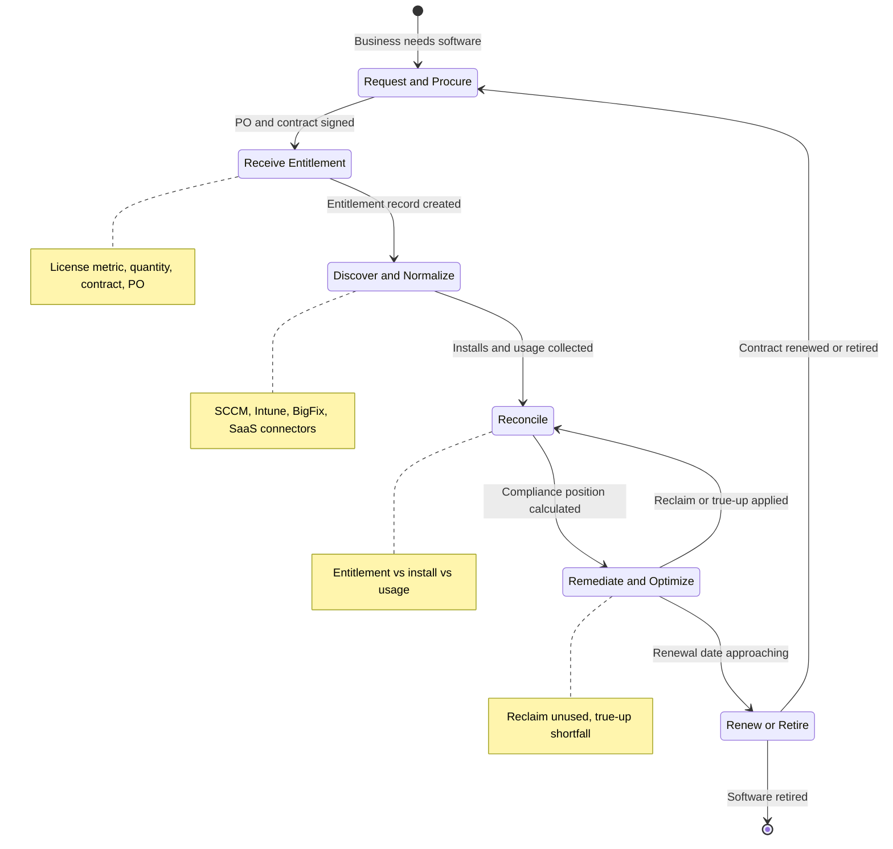
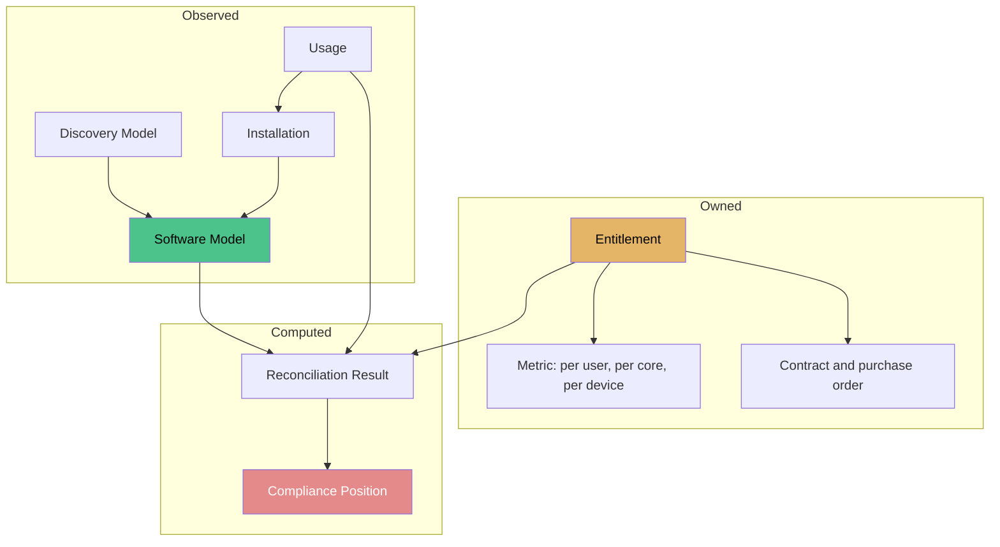
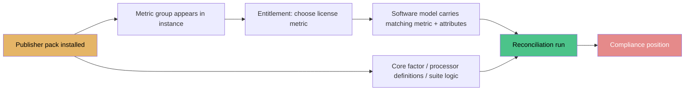
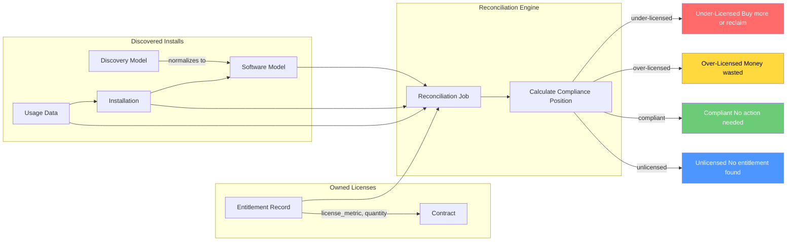
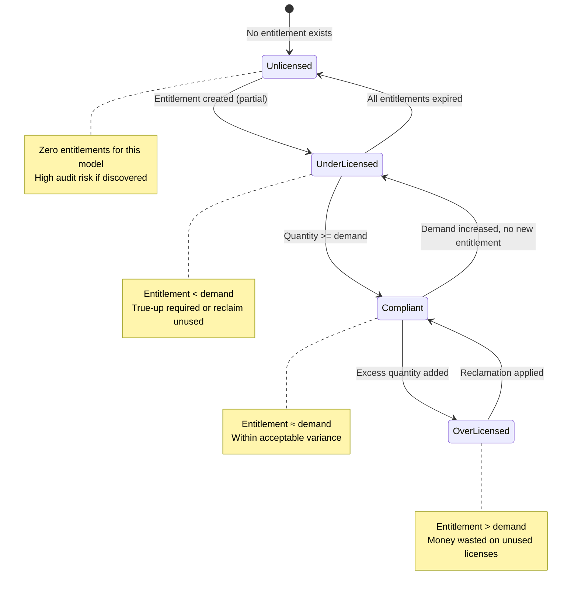
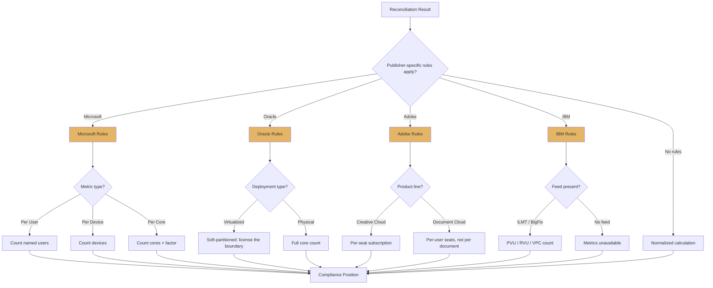
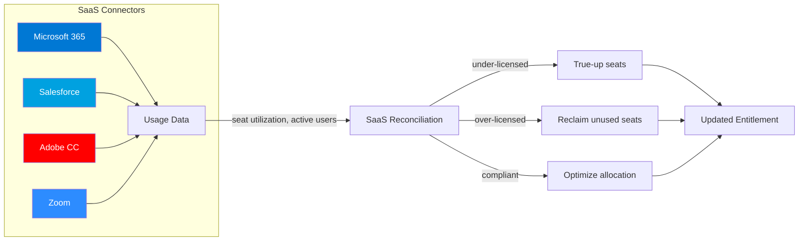

# SAM — Software Asset Management

**Agent:** opencode  
**Date:** 2026-11-12  
**Module:** SAM (Software Asset Management)  
**App:** ITAM (IT Asset Management) — SAM Pro  
**Confidence:** verify  
**Updated:** 2026-11-16 — publisher-pack section (validated against Brazil docs), reconciliation arithmetic, soft-partitioning/10-percent myth, gaps closed  

> **Scope note:** This guide targets the **SAM Administrator** role: entitlements, software models, reconciliation, compliance reporting, publisher audits, optimization/reclamation, renewal tracking, and SaaS license management. It is the software counterpart to the [HAM guide](../ham/ham-guide/).

---

## Contents


- [Purpose](#purpose)
- [SAM vs HAM vs ITAM](#sam-vs-ham-vs-itam)
- [Where to Find It](#where-to-find-it)
- [Official Exam Alignment — CIS-Software Asset Management](#official-exam-alignment--cis-software-asset-management)
- [SAM Lifecycle Diagram](#sam-lifecycle-diagram)
- [The Three Record Types You Must Never Confuse](#the-three-record-types-you-must-never-confuse)
- [Software Models & Normalization (SUMN)](#software-models--normalization-sumn)
- [Entitlements — The Contract Side](#entitlements--the-contract-side)
- [Publisher Packs & License Metrics (Add-Ons)](#publisher-packs--license-metrics-add-ons)
  - [Plugin IDs — verify in your instance](#plugin-ids--verify-in-your-instance)
  - [Where packs are installed and verified](#where-packs-are-installed-and-verified)
  - [What a metric group actually is (and where to find it)](#what-a-metric-group-actually-is-and-where-to-find-it)
  - [Metric attributes — the numbers the counting rule reads](#metric-attributes--the-numbers-the-counting-rule-reads)
  - [Metric groups and their metrics](#metric-groups-and-their-metrics)
  - [Pack-specific properties that change reconciliation](#pack-specific-properties-that-change-reconciliation)
  - [Verification snippets](#verification-snippets)
  - [Failure modes by pack](#failure-modes-by-pack)
  - [The 10-percent rule that is not a rule: soft partitioning](#the-10-percent-rule-that-is-not-a-rule-soft-partitioning)
- [Reconciliation — The Core Engine](#reconciliation--the-core-engine)
  - [📊 Reconciliation Flow Diagram](#reconciliation-flow-diagram)
  - [📊 Compliance Position States](#compliance-position-states)
  - [📊 Publisher-Specific Rules Flow](#publisher-specific-rules-flow)
  - [📊 SaaS License Management Flow](#saas-license-management-flow)
- [Compliance Positions Explained](#compliance-positions-explained)
- [Discovery & Data Sources](#discovery--data-sources)
- [SaaS License Management](#saas-license-management)
- [Optimization & Reclamation](#optimization--reclamation)
- [Publisher-Specific Traps](#publisher-specific-traps)
- [Gaps Closed — Depth That Was Missing](#gaps-closed--depth-that-was-missing)
- [Re-usable Code / Metadata](#re-usable-code-metadata)
  - [Business Rule — flag an installation with no normalized software model](#business-rule--flag-an-installation-with-no-normalized-software-model)
  - [Scheduled Job — expire entitlements past their end date](#scheduled-job--expire-entitlements-past-their-end-date)
  - [Script Include — compliance summary per publisher](#script-include--compliance-summary-per-publisher)
  - [Client Script — require a metric when creating an entitlement](#client-script--require-a-metric-when-creating-an-entitlement)
  - [Report definitions worth building on day one](#report-definitions-worth-building-on-day-one)
- [Out-of-Box Features](#out-of-box-features)
- [Key Table Hierarchy](#key-table-hierarchy)
- [Integrations](#integrations)
- [Key Fields](#key-fields)
  - [Essential fields by record](#essential-fields-by-record)
  - [Fields people forget](#fields-people-forget)
- [Goals, Benefits & Key Metrics](#goals-benefits--key-metrics)
- [Common Mistakes](#common-mistakes)
- [Lab: Entitlement → Reconciliation → Compliance](#lab-entitlement--reconciliation--compliance)
  - [Step 1 — Choose and verify a software model](#step-1--choose-and-verify-a-software-model)
  - [Step 2 — Create an entitlement far below demand](#step-2--create-an-entitlement-far-below-demand)
  - [Step 3 — Confirm installs exist](#step-3--confirm-installs-exist)
  - [Step 4 — Run reconciliation](#step-4--run-reconciliation)
  - [Step 5 — Prove the fix](#step-5--prove-the-fix)
  - [Step 6 — Prove normalization matters](#step-6--prove-normalization-matters)
  - [Step 7 — Teach back (write it down)](#step-7--teach-back-write-it-down)
- [SLAs, Dashboards & Workspaces](#slas-dashboards--workspaces)
  - [Workspaces and consoles](#workspaces-and-consoles)
  - [Dashboards/indicators worth standing up](#dashboardsindicators-worth-standing-up)
  - [SLA-style targets](#sla-style-targets)
- [Quiz](#quiz)
- [Official Learning Resources](#official-learning-resources)
  - [Now Learning (structured training)](#now-learning-structured-training)
  - [Product documentation](#product-documentation)
  - [Official videos](#official-videos)
- [💡 Memory Aids & Mnemonics](#memory-aids--mnemonics)
  - [Business Rule Types — BAA](#business-rule-types--baa)
  - [Client Script Types — LOCS](#client-script-types--locs)
  - [UI Policy vs Data Policy vs Client Script](#ui-policy-vs-data-policy-vs-client-script)
  - [IRE — Identification Before Reconciliation](#ire--identification-before-reconciliation)
  - [Update Set Conflicts — ARM](#update-set-conflicts--arm)
  - [CMDB — Retire Before Delete](#cmdb--retire-before-delete)
  - [Order vs Priority — Lower = First](#order-vs-priority--lower-=-first)
  - [Transform Script — Coalesce = Match](#transform-script--coalesce-=-match)
  - [Debugging — Log First, Then Debug](#debugging--log-first-then-debug)
- [Related Guides](#related-guides)
- [AI Swarm Generated Videos (unofficial)](#ai-swarm-generated-videos-unofficial)


---

## Purpose

Software Asset Management (SAM) answers one question that costs companies millions when answered wrong: **are we legally and financially in control of the software we actually run?**

SAM is the software half of ServiceNow IT Asset Management (ITAM). Where HAM tracks *things you can hold* (laptops, servers, monitors), SAM tracks *things you install* (Microsoft 365, Oracle DB, SAP, Adobe, IBM, Salesforce seats). SAM reconciles two independent truths:

1. **What we own / are entitled to buy** — contracts, purchase orders, entitlements, license metrics
2. **What is actually installed and used** — Discovery, SCCM/Intune, BigFix, SaaS integrations

Reconciliation compares those two streams per software model and per license metric, then produces a **compliance position**: compliant, over-licensed (money wasted), or under-licensed (audit exposure). Everything else in SAM — optimization, reclamation, true-up, renewal, publisher audit defence — is downstream of that calculation.

**ELI5:** You have 1,000 Microsoft 365 E3 entitlements. Discovery finds 1,180 installs and 1,090 active users. Reconciliation says you are 90 users under-licensed. You either buy 90 more (true-up) or reclaim 90 unused accounts before the publisher audits you.

---

## SAM vs HAM vs ITAM

| Aspect | HAM | SAM | ITAM (umbrella) |
|--------|-----|-----|-----------------|
| **Tracks** | Physical hardware assets | Software entitlements, installs, usage | Both |
| **Primary question** | What do we own, where is it, who has it? | Are we compliant, are we over/under-licensed? | Full asset portfolio cost & risk |
| **Core record** | `alm_asset` / `alm_hardware` | Software model + entitlement + install | `alm_asset` hierarchy |
| **Key engine** | Asset lifecycle, hardware normalization | **Reconciliation** (entitlement vs install vs usage) | Both engines |
| **Key risk** | Lost/stolen/stale assets, depreciation errors | Publisher audit fines, wasted license spend | Both |
| **Typical owner** | IT operations / desktop team | SAM administrator / license manager | ITAM manager / CIO office |
| **Shared tables** | `alm_asset`, `alm_model`, `ast_contract` | `alm_asset` (licenses), `ast_contract` | all of the above |

**Exam-critical distinction:** HAM and SAM share the ITAM application and the `alm_*` asset tables, but SAM adds the **software model → discovery model → installation → usage → entitlement → reconciliation result** chain. HAM has no equivalent of reconciliation.

---

## Where to Find It

| Breadcrumb | Path |
|------------|------|
| Module entry | All > Software Asset Management > ... |
| SAM Workspace (SAM Pro) | All > Software Asset Management > SAM Workspace |
| License Operations | All > Software Asset Management > License Operations |
| Software Models | All > Software Asset Management > Software Models |
| Software Licenses / Entitlements | All > Software Asset Management > Licenses > All |
| Reconciliation results | All > Software Asset Management > Reconciliation > Results |
| Compliance reports | All > Software Asset Management > License Operations > Compliance |
| Discovery models | All > Software Asset Management > Discovery Models |
| Software installations | All > Software Asset Management > Installations |
| Software usage | All > Software Asset Management > Usage |
| Content Library / Publisher packs | All > Software Asset Management > Administration > Content Library |
| Suites & bundles | All > Software Asset Management > Administration > Suites |
| Contracts (shared with HAM) | All > Asset Management > Contracts > All |
| Assets > Software | All > Asset Management > Assets > Software |
| SaaS integrations | All > Software Asset Management > SaaS License Management |

**Tip:** If the SAM menus are missing, verify the `com.snc.sams` (SAM Foundation/Pro) plugin and the ITAM plugin `com.snc.iam` are active, and that you hold `sam_admin` or `sam_user`. Plugin names and licensing differ between SAM Foundation, SAM Professional, and SAM Pro (see [SaaS License Management](#saas-license-management) for the Pro-only pieces).

---

## Official Exam Alignment — CIS-Software Asset Management

This guide maps to the **Certified Implementation Specialist – Software Asset Management (CIS-SAM)** blueprint. Domain percentages are the published exam weightings; always confirm against the current blueprint on Now Learning.

| Guide Section | CIS-SAM Domain | Exam Weight | What's Covered |
|---------------|----------------|-------------|----------------|
| [Purpose](#purpose), [SAM vs HAM](#sam-vs-ham-vs-itam) | Domain 1: Software Asset Management Overview & Fundamentals | ~15% | ITAM/SAM positioning, lifecycle, roles, value case |
| [Software Models & Normalization](#software-models--normalization-sumn) | Domain 2: Data Integrity — Software Models, Normalization, Content Library | ~25% | Software models, SUMN, publisher packs, suites, discovery models |
| [Entitlements](#entitlements--the-contract-side), [Reconciliation](#reconciliation--the-core-engine), [Compliance Positions](#compliance-positions-explained) | Domain 3: Entitlements, Licenses, and Reconciliation | ~30% | License metrics, entitlement records, reconciliation logic, compliance states |
| [Optimization & Reclamation](#optimization--reclamation), [Publisher Traps](#publisher-specific-traps) | Domain 4: Optimization, Reclamation, Audit Defence | ~20% | Reclamation, true-up, publisher-specific rules, audit workflow |
| [Out-of-Box Features](#out-of-box-features), [Key Metrics](#goals-benefits--key-metrics) | Domain 5: Reporting, Dashboards, and Operational Integration | ~10% | SAM Workspace, dashboards, KPIs, integrations |

**Official preparation courses (verify current catalogue):**
- Welcome to ServiceNow
- ServiceNow Administration Fundamentals
- Software Asset Management (SAM) Fundamentals
- Software Asset Management Professional / Implementation
- CIS-SAM Exam Preparation

**Exam guidance:** CIS-SAM questions are drawn from official ServiceNow training material, the Product Documentation site, and the Developer site. Publisher-specific questions are usually conceptual (which metric, which rule), not tool-click memorisation.

---

## SAM Lifecycle Diagram



**Exam focus:** The loop is continuous, not one-pass. Reclamation feeds back into reconciliation, and renewal decisions are driven by the resulting compliance position.

---

## The Three Record Types You Must Never Confuse

This is the single most common source of confusion for new SAM administrators, and a frequent exam question.



| Record | Table (verify in your release) | Plain-English meaning | Who creates it |
|--------|-------------------------------|----------------------|----------------|
| **Software Model** | `cmdb_software_product_model` | The canonical, normalized definition of a product ("Microsoft Office Professional Plus 2019") | Content Library (auto) or SAM admin (manual) |
| **Discovery Model** | `cmdb_sam_sw_discovery_model` | A raw fingerprint observed in the field ("Office16 ProPlus") that must map to a software model | Discovery / SCCM / Intune import (auto) |
| **Installation** | `cmdb_sam_sw_install` | One concrete install of that software on one device | Discovery import |
| **Usage** | `cmdb_sam_sw_usage` | Evidence the install was actually run (last-used, launch count) | Usage connectors (SCCM metering, BigFix, EUC) |
| **Entitlement** | `alm_license` (label: License) | The right to use N units under a specific metric, backed by a contract | SAM admin |
| **Reconciliation Result** | `sam_sw_reconciliation_result` | The computed per-model compliance verdict | Reconciliation job (auto) |

**Rule of thumb:** *Software model = what it is. Entitlement = what you may use. Installation = what exists. Usage = what is used. Reconciliation = the difference.*

---

## Software Models & Normalization (SUMN)

**Normalization** converts messy raw discovery fingerprints into publisher-sanctioned software models so that reconciliation compares apples to apples. ServiceNow calls this **Software Usage and Normalization Mapping (SUMN)** and delivers it through the **Content Library** with **publisher packs** maintained by ServiceNow.

**Why it matters:** Without normalization, Discovery reports 40 variants of "Microsoft Office" (Office16, Office15, O365ProPlus, MSOffice2019, ...). Reconciliation against one Office entitlement would show catastrophic under-licensing on some variants and untracked installs on others.

**Normalization workflow:**
1. Discovery/SUMN collects raw software fingerprints → creates a **Discovery Model**
2. SUMN matches the discovery model to a **Software Model** in the Content Library (mapping rules provided by the publisher pack)
3. Unmatched discovery models land in a **normalization queue** for manual review
4. SAM admin maps unmatched discovery models manually (`Normalize` action) or ignores them
5. Normalized installs then participate in reconciliation

**Software model essentials:**
- Software models extend `cmdb_model`; they can be **standalone**, part of a **suite**, or a **bundle**
- **Suites** matter enormously: Oracle Database Enterprise Edition, Microsoft Office, Adobe Creative Cloud — installs of components must roll up to the suite for correct counting
- **License metric** on the model (per user, per device, per core, per processor, subscription) determines how entitlement quantity is compared to install/usage quantity
- **Product lifecycle / end-of-life** data drives retirement and upgrade planning

**Do table names differ by release?** Yes. `cmdb_software_product_model`, `cmdb_sam_sw_discovery_model`, `cmdb_sam_sw_install`, and `cmdb_sam_sw_usage` are the conventional names in recent Washington/Vancouver/`Xanadu`-era releases, but verify in your instance via `sys_db_object.list` before building reports.

---

## Entitlements — The Contract Side

An **entitlement** records the legal right to use software, and must carry:

| Attribute | Why it matters |
|-----------|----------------|
| **Software model** | Which product the entitlement covers (must match the normalized model) |
| **Publisher** | Drives publisher-specific counting rules |
| **License metric** | Per user / per device / per core / per processor / subscription — must match the contract |
| **Purchased quantity** | The number reconciliation divides against installs/usage |
| **License type** | Perpetual vs subscription vs maintenance (maintenance alone does not grant usage rights) |
| **Contract + PO reference** | Audit evidence; links to `ast_contract` |
| **Start / end date** | Expiry impacts compliance and renewals |
| **Unit cost** | Enables cost/optimization reporting |
| **Owned by / cost center** | Chargeback and showback |
| **Downgrade / upgrade rights** | Microsoft and Adobe permit version downgrades; Oracle and IBM do not |

**Entitlement hygiene rules:**
- **One entitlement per contract line**, not per PO — auditors trace entitlement → contract → PO
- **Never overwrite quantity** to make a report look compliant; create an adjustment record or a true-up entitlement
- **Maintenance ≠ license.** Maintenance-only records must not be counted as usage rights
- **Metric mismatch is silent.** A per-device entitlement reconciled against per-user usage produces a plausible-looking but meaningless number

---

## Publisher Packs & License Metrics (Add-Ons)

**What a publisher pack actually is.** SAM ships with *base* logic (software models, entitlements, reconciliation). A **publisher pack** is a per-vendor add-on that extends four things:

| What the pack adds | Why it matters |
|---|---|
| **Metric groups** — publisher-specific license metrics (PVU, Named User Plus, User Subscription, Per Core with CAL…) | The entitlement's metric drives the whole calculation, and you can only pick a metric the instance actually has. What the field is and where it lives: [What a metric group actually is](#what-a-metric-group-actually-is-and-where-to-find-it) |
| **Counting rules and reference data** — core-factor / processor-definition tables, suite and bundle logic, edition rules, cost ratios | Reconciliation counts cores, users or documents the publisher's way instead of a generic way |
| **Dashboards** — Software Publisher Analytics, Office 365 / Adobe Cloud dashboards | Pack-gated: without the pack the dashboard simply is not there |
| **Pack-scoped system properties** — Oracle recon level, SQL Server SA cost ratio, IBM region, Citrix app license period | Defaults that silently change results when left unset or wrong |

Available packs: **Adobe, Citrix, IBM (includes Red Hat), Microsoft, Oracle, SAP, VMware.** SaaS License Management adds the `Subscription` and `Consumption` metric groups. On **Foundation** you get base logic only — publisher-specific metric groups are a **Professional** capability.

> **Release pin:** metric names, plugin IDs and defaults below were re-validated against ServiceNow's Brazil-release documentation on 2026-11-16 (metric and pack pages dated 2026-09-10, properties page 2026-03-12); the first draft came from the `ALT_PARALLELSWARM_SAM` corpus. Per-claim status, the exact quotes each statement rests on, and the leftovers that remain unverified are in [Publisher Pack Notes — Validation Log](../publisher-packs-validated-notes/). Still verify in your own release — ServiceNow renames and retires metrics between releases (see the *Per Core* deprecation under Microsoft).



### Plugin IDs — verify in your instance

| Pack / capability | Plugin ID | Edition | Notes |
|---|---|---|---|
| Adobe pack | `com.sn_samp_adobe` | Professional | Adobe subscription reconciliation |
| Citrix pack | `com.sn_samp_citrix` | Professional | Virtual apps / desktops; needs a Discovery schedule |
| IBM pack | `com.sn_samp_ibm` | Professional | PVU/RVU **and** Red Hat metrics |
| Microsoft pack | `com.snc.samp.microsoft` | Professional | SQL Server per-core etc. |
| Oracle pack | `com.snc.samp.oracle` | Professional | Oracle DB / WebLogic |
| SAP pack | `com.sn_samp_sap` | Professional | SAP named-user compliance |
| VMware pack | `com.sn_samp_vmware` | Professional | vCenter / vSphere |
| SaaS License Management | `sn_sam_saas_int` | Professional + Store request | Adds Subscription / Consumption groups |
| Engineering Applications | `com.sn_samp_eng_app` | Professional | OpenLM / Open iT concurrent licensing |
| SAM Professional master (Brazil+) | `com.sn_samp_master_ws` | Professional | Loads `com.sn_samp_master` + workspace |
| SAM Professional core (pre-Brazil path) | `com.snc.samp` | Professional | Loads publisher packs, UI components |
| SAM Foundation | `com.snc.sams` | Foundation | Separate edition — no publisher packs |

Note the inconsistent prefixes (`com.sn_samp_*` vs `com.snc.samp.*`) — that is how the packs are published, not a typo. Always confirm the ID from `System Applications > All Available Applications` in your instance rather than copying a plugin ID from any guide, including this one.

### Where packs are installed and verified

1. `All > System Applications > All Available Applications` (ServiceNow Store for store apps) → search `samp` → activate the pack plugins you are licensed for.
2. **Metric group check first, modelling second.** The license-metric picker on a software entitlement only offers metrics from groups present in the instance. If "Oracle" metrics are missing from the picker, the pack is not active — do not model an Oracle entitlement with a generic metric to get around it.
3. `All > Software Asset Management > Administration > Properties` → review the pack-scoped properties you depend on (table below).
4. Open the software model → **Metric Attributes** related list. These rows are group + metric + numeric knobs the counting rule reads (`Minimum cores per processor`, `Maximum processors per right`, `Minimum users per processor`); set them such as *Maximum cores per processor* (VMware, default 32) or edition / Software Assurance flags. The entitlement inherits the group from here.
5. Confirm dashboards appeared: *Software Publisher Analytics* covers Citrix, IBM, Microsoft, Oracle, SAP and VMware; the **Office 365** and **Adobe Cloud** dashboards are pack-gated too.

**Exam-critical nuance:** the metric group is **auto-populated from the software model**, and the available license metrics change with the group — mechanics, UI locations and the group-vs-metric-vs-attribute table are in [What a metric group actually is](#what-a-metric-group-actually-is-and-where-to-find-it). Pick the group that matches the metric your contract actually uses, not the publisher string on the title: the counting rule follows the metric, so a mismatched pairing still reconciles — to a precise, meaningless number. (The corpus records an official sentence saying the group need not match the publisher; it is not on the Brazil pages re-checked in the validation log, so treat it as practice rather than a documented platform rule.)

### What a metric group actually is (and where to find it)

A **metric group** is the taxonomy layer between a publisher pack and a license metric. It is one field on the software entitlement, inherited from the software model, whose only job is to answer: *which family of counting rules may this record use?* It is not a licence, not a quantity, and not the publisher name — it is a filter that scopes the **License metric** picker.

```text
software model  ->  metric group  ->  allowed license metrics  ->  counting rule  ->  compliance position
```

The field definitions are short enough to quote in full (S12, *Software entitlement fields*):

> **Metric group** — "This field is automatically populated based on the Software Model field. Each metric group has a set of license metrics that are specific to the software publisher." Note: "If this field is set to Consumption or Subscription, the License type field is automatically set to Subscription."
>
> **License metric** — "License metric for the license group that the software license is counted against when reconciliation is run. The options for license metric change based on the Metric group field."

**Where you actually see it**

| # | Surface | How to get there | What is on screen |
|---|---|---|---|
| 1 | Software entitlement (`alm_license`) | `All > Software Asset > Licenses > All` → open an entitlement (workspace: License operations → entitlements) | `Metric group` and `License metric` side by side; the group is populated from the model, and the reference icon next to `License metric` opens that metric's calculation text |
| 2 | Software model → **Metric Attributes** | `All > Software Asset > Software Models` → open a model → Metric Attributes related list | One row per group + metric pairing, each carrying attributes (`Minimum cores per processor`, `Maximum processors per right`, `Minimum users per processor`, `Maximum active OSEs per server`…)  with an integer value or an *unlimited* flag. Every attribute and default: [Metric attributes — the numbers the counting rule reads](#metric-attributes--the-numbers-the-counting-rule-reads) |
| 3 | Custom license metrics | `All > Software Asset > Administration > Custom License Metrics` | The form's `Metric group` is fixed to **Custom**; the metric's *name* is what later appears in the entitlement's picker |
| 4 | Entitlement import | Download the entitlement import template | `Metric group` is a **required** column, and its valid values are group names, not metric names |
| 5 | Foundation | Create an entitlement on Foundation | **Common** only, plus custom metrics — publisher groups arrive with the Professional packs |

**What the field actually controls**

- **The picker.** Choose `Microsoft` and Microsoft metrics appear; choose `Common` and you get Per Core, Per Device, Per User, the CALs. A metric outside the group cannot be selected, which is why "the metric is missing" almost always means "the pack is missing".
- **The calculator.** The group routes the model to a publisher counting engine — Oracle core factors, IBM PVU full vs sub-capacity, Citrix distinct user/device, VMware per-processor caps. Change the group and a different engine runs.
- **License type side effects.** `Consumption` or `Subscription` forces `License type = Subscription`.
- **Which metric attributes exist.** Publisher groups auto-create attributes on the model: VMware *Maximum cores per processor* (default 32, and 16 cores per processor hardcoded for Per Core), Oracle edition floors, Microsoft per-socket floors. Every attribute, its default and the formula it feeds: [Metric attributes — the numbers the counting rule reads](#metric-attributes--the-numbers-the-counting-rule-reads).
- **Whether script runs.** `Custom` means a scripted metric; every other group is shipped logic.
- **Nothing about scope.** Quantity, dates, company, region — all live elsewhere.

**Five fields people conflate** — this is the exam trap *and* the production trap:

| Term | What it is | Example value | Lives on |
|---|---|---|---|
| **Metric group** | Family of counting rules; scopes the picker | `Microsoft` | Entitlement field, inherited from the model |
| **License metric** | The counting rule itself — what is counted | `Per Core (with CAL)` | Entitlement field |
| **Metric attribute** | A numeric knob the rule reads | `Minimum cores per processor = 16` | Model → Metric Attributes |
| **License type** | Contract shape, not a counting rule | `Perpetual + Software Assurance` | Entitlement field |
| **Reconciliation group** | *Organisational* slice a position is reported for | `Cost center`, `Region` | `com.snc.samp.recon.group` property — not on the entitlement |

> **Name collision worth stating in any handover:** "metric group" is not "reconciliation group". `com.snc.samp.recon.group` (Company / Cost Center / Country / Department / Region / None) decides *how positions are sliced*; the metric group decides *how they are counted*. Same word, unrelated fields — a reliable source of "the report is wrong" tickets.

**How to enumerate the groups your instance actually has** — three checks, cheapest first:

1. Open any entitlement → `Metric group` field → the choice list is authoritative. If `Oracle` is absent, no Oracle pack is active, full stop.
2. `System Applications > All Available Applications` → search `samp` → confirm the pack is **Active** (plugin table above).
3. The import template: its accepted `Metric group` values mirror the choice list, which is the practical check when preparing a bulk load without clicking through the UI.

**The shortcut that must not be taken:** do not "make it work" by putting a publisher product on a `Common` metric. The platform permits it, the entitlement saves, and reconciliation returns a confident number computed with the wrong rule. Record the product as out of scope until the pack is installed.

**Worked chain — SQL Server, end to end**

1. Model `Microsoft SQL Server 2022 Enterprise` exists and is normalised.
2. Model → Metric Attributes: group `Microsoft`, metric `Per Core`, attribute *Minimum cores per processor* set to the contract floor.
3. New entitlement → `Software model` = that model → `Metric group` auto-fills `Microsoft` → the picker now offers only Microsoft metrics → select `Per Core`.
4. `Rights per license pack` 2 × `Number of packs` 12 → `Purchased rights` 24, computed for you.
5. Reconciliation: the group selects the Microsoft calculator; `required` = cores on the physical **and** virtual side with the per-socket floor; `delta = required - 24`.

Run step 3 again with a `Common` `Per Core` entitlement and the arithmetic still completes — against a different demand formula. That is precisely why the group is a first-class field and not a label on the title.

**ELI5:** the group is the language, the metric is the sentence, the attributes are the grammar. "Per core" means nothing until you know whether you are speaking Microsoft (packs of two, four-core floors) or Oracle (core factors, edition minimums).

### Metric attributes — the numbers the counting rule reads

A **metric attribute** is a per-model, per-metric number that the counting engine substitutes into its formula. Where the license metric says *what* to count ("cores", "processors", "users"), the attribute says *with what floor, cap or divisor*. Three fields make a row:

| Field | What it holds |
|---|---|
| `Attribute` | Which rule the row configures — `Minimum cores per processor`, `Maximum active OSEs per server`, `Maximum cores per processor`, `Maximum VMs per right`, `Minimum NUPs on cloud`… |
| `Attribute value` | An integer, in the metric's own units |
| `Attribute value is unlimited` | When true, the engine applies no cap (typical for `Maximum installs per right` on per-user and per-device metrics) |

Rows are **created automatically** when an entitlement uses that metric group + license metric (S17), and the engine reads them from the **model**, not the entitlement: `All > Software Asset > Software Models` → open the model → **Metric Attributes**. Edit the row, not the entitlement, then re-run reconciliation — attributes change `required`, never `active_rights`.

**Documented defaults, by group** (S17; all editable, so treat these as the shipped starting point and verify in the instance):

| Attribute | Default | Group → license metric | What the engine does with it | What breaks when it is wrong |
|---|---|---|---|---|
| Minimum cores per processor | **4** | Microsoft → Per Core | `Licensable cores = Processors × Max(Minimum cores per processor, Cores)` | Set to 1, and a 2-socket 8-core server demands 16 instead of the contract's 4-per-socket floor |
| Minimum cores per VM | **4** | Microsoft → Per Core | Same floor applied per virtual machine | VDI estates under-counted |
| Minimum cores per processor | **8** | Microsoft → Per Core (with CAL) | Same formula | Wrong floor on the CAL variant — the two Microsoft per-core metrics do **not** share a default |
| Minimum cores per VM | **8** | Microsoft → Per Core (with CAL) | Per-VM floor | VMs escape the 8-core floor |
| Minimum cores per server | **16** | Microsoft → Per Core (with CAL) | `Licensable cores = Max(Processors × Max(Minimum cores per processor, Cores), Minimum cores per server)` | 4-core branch servers drop below the 16-core server floor |
| Maximum active OSEs per server | **2** | Microsoft → Per Core (with CAL), Per Processor | `Licenses required = (Licensable OSEs / Maximum active OSEs per server) × Licensable cores` | Five OSEs on a licensed-for-two server consumes nothing extra — the classic Windows Server audit gap |
| Maximum installs per OSE | **1** | Microsoft → Per Core (with CAL), Per Processor, Server (Per Instance) | Extra installs inside one OSE consume further rights | Two SQL instances in one OSE count as one |
| Maximum processors per right | **2** | Microsoft → Per Processor | `Licenses required = Processors / Maximum processors per right` | Doubles or halves the processor count |
| Maximum installs per right | **Unlimited** | Per User / Per Device / Per Named User / Per Named Device across Microsoft, Adobe, IBM, Citrix, Common, VMware | Caps installs per user or device before another right is consumed | Left unlimited, a user with the software on four machines consumes **one** right — the most common silent under-count in SAM |
| Minimum users per processor | **25** | Oracle → Named User Plus | Enterprise Edition floor: rights = max(25 × processors, users + devices) | NUP under-licensed on large servers |
| Minimum NUPs | **5** | Oracle → Named User Plus (SE, SE One) | Hard floor of 5 NUPs per database | Tiny deployments report compliant when they are not |
| Minimum NUPs per server | **10** | Oracle → Named User Plus (SE2) | 10 NUPs per database server | SE2 under-count |
| Minimum NUPs on cloud | **10** | Oracle → Named User Plus (SE2 on AWS/Azure) | 10 NUPs per 8 vCPUs | Cloud SE2 under-count |
| Minimum NUPs for WebLogic on-premise deployments | **10** | Oracle → Named User Plus (WebLogic) | WebLogic Standard counts sockets, Enterprise counts cores | WebLogic NUP under-count |
| Minimum NUPs for WebLogic cloud deployments | **10** | Oracle → Named User Plus (WebLogic on AWS/Azure) | 10 per 8 vCPUs (Standard); Enterprise: 10 per 2 vCPUs with hyper-threading, 10 per vCPU without | Wrong cloud WebLogic number |
| Maximum number of sockets per server | **2** | Oracle → Per Processor, Named User Plus | SE / SE One / SE2 may only be licensed on servers below the socket cap | Standard Edition on a 4-socket box reconciles clean |
| Maximum size of instance on cloud | **8** | Oracle → Per Processor, Named User Plus | SE-family instance-size cap on Oracle Authorized Cloud (EE has none) | Oversized cloud instance escapes the SE ceiling |
| Maximum cores per processor | **32** | VMware → Per Processor | `Licenses required = Processors × (Cores / Maximum cores per processor)`; VMware's 32-core-per-CPU rule effective 2 April 2020 | A 64-core CPU counted as one licence instead of two |
| Maximum installs per right | **1** | VMware → Per Application Instance | One right per application instance | vCenter instances under-counted |
| Maximum installs per right | **Unlimited** | VMware → Per Named User, Per OSI | Cap per user / per OS instance | Multi-install named users consume one right |
| Maximum sockets per right | **2** | Red Hat → Per Socket-pair | One subscription per two sockets | Socket-pair count halved or doubled |
| Maximum VMs per right | **2** | Red Hat → Per Socket-pair | RHEL Server: VMs one subscription licenses per host; RHEL for Virtual Datacenters: VMs per socket-pair subscription | VM density under-counted |
| Maximum cores per processor | **Unlimited** | IBM, Citrix, Common → Per Processor | One license per CPU up to the physical core maximum, extra licenses beyond it | Fine at unlimited; a stale low value inflates demand |
| Minimum cores per processor | **1** | Common → Per Core | Effectively "no floor" | A contract with a core floor gets **no** enforcement on the Common group — install the publisher pack |

**Three things this table teaches that no amount of reading the metric name will:**

1. **Defaults differ between look-alike metrics.** Microsoft `Per Core` starts at 4 cores per processor and per VM; `Per Core (with CAL)` starts at 8, plus 16 per server. Copying a contract clause into the wrong metric gives a plausible wrong answer.
2. **"Unlimited" is a decision, not a null.** For per-user and per-device metrics the install cap ships unlimited, so one right covers every install that user or device has. If the contract says one install per user, the attribute is the only place that rule can live.
3. **Attributes are per model.** Two models of the same product with different attributes produce two different demands from identical installs. That is a feature (editions, contracts, regions) and a trap (a copied model inherits the numbers).

**Worked examples**

*Windows Server Datacenter, Per Core (with CAL), 2 sockets × 8 cores, 2 OSEs:* `Licensable cores = 2 × Max(8, 8) = 16`, then `Max(16, Minimum cores per server 16) = 16`; OSE factor `2 / 2 = 1` → **16 rights**. Add a third OSE and it becomes `(3 / 2) × 16 = 24`.

*SQL Server Enterprise, Per Core, 2 sockets × 16 cores, 4-per-socket floor:* `Processors × Max(4, Cores) = 2 × 16 = 32` rights; the 4 floor only bites on small sockets — 2 × 4 cores would demand `2 × Max(4, 4) = 8`, not 4.

*Oracle SE2 on AWS, 16 vCPUs:* `Minimum NUPs on cloud = 10 per 8 vCPUs` → 20 NUP floor, regardless of how few users connect.

*VMware vSphere, Per Processor, 4 CPUs × 32 cores:* `4 × (32 / 32) = 4` rights. Swap in 64-core CPUs and it doubles to 8 — the attribute, not the metric name, drives that.

**What is *not* an attribute** — do not go looking for these in the related list:

- **VMware Per Core minimum of 16 cores per processor** (VVS/VVEP) — a rule in the metric, not a row you can edit.
- **Oracle core factor** and **IBM PVU core factors** — processor-definition reference data (`samp_processor_definition`), not model attributes.
- **VVEP's 3 hosts × 2 CPUs × 32 cores cap** — contract terms enforced by the metric, not knobs.
- **Microsoft's SQL Server per-socket minimum** — the platform ships it as the `Minimum cores per processor` default of 4; the *reason* it is 4 is Microsoft's licensing, which is why changing it needs a contract clause, not a preference.

**Five checks before you trust a position**

1. List every model whose attribute value **differs from the default above**, and attach the contract clause that justifies each. No clause, no override.
2. Check `Maximum installs per right` on every per-user and per-device entitlement — if it is still unlimited, decide deliberately whether that matches the contract.
3. Check the two Microsoft per-core variants separately; the floors are 4/4 and 8/8/16 and they are easy to mix up.
4. Check Oracle floors against the **edition actually deployed** — 25 per processor is Enterprise, 5 is SE/SE One, 10 per server is SE2, and cloud has its own pair.
5. After editing an attribute, re-run reconciliation and confirm `required` moved and `active_rights` did not. If both moved, you edited an entitlement by mistake.

### Metric groups and their metrics

| Metric group | License metrics | Counting rule in one line | Gate |
|---|---|---|---|
| **Common** | Per Core, Per Device, Per Named Device, Per Named User, Per Processor, Per User, User CAL, Device CAL, User/Device CAL, Concurrent User, Resource Consumption | Base metrics; `Per Core` = CPU core count × CPU count on a physical server or VM | No pack |
| **Microsoft** | Per Core, Per Core (with CAL), Per Processor, Per Device, Per User, User CAL, Device CAL, Server (Per Instance), Server (Per Server), User Subscription | Cores on physical **and** virtual sides; CAL and server-install variants | Microsoft pack |
| **Oracle** | Per Processor, Named User Plus, Employee | Cores on a processor (hyper-threading matters on AWS); NUP licenses the host plus users *and* devices, with edition minimums applied automatically; Employee counts total employees | Oracle pack |
| **IBM** | PVU, RVU, Virtual Processor Core, Authorized User, Authorized/Employee/External User Value Unit, Per Processor, Per Device, Per User, Per Named User, plus Australia Patch 6+ metrics (Application Instance, Concurrent User, Connection, Events Per Second, Floating User, Flows Per Minute, Managed Client/Device/Virtual Server, Order Lines, RPU Decimal Petabyte Managed, Storage Device, Terabyte, Token) | Full-capacity vs sub-capacity against activated cores | IBM pack |
| **Red Hat** | Per Socket-pair, Per Core | Socket pairs on the host or VM pair; cores physical + virtual | IBM pack |
| **SAP** | Named User, Engine Measurement, Digital Access, User Subscription (S/4HANA Cloud Public), Full Usage Equivalent (S/4HANA Cloud Private) | Named-user **type** comes from the software model; Digital Access counts third-party documents | SAP pack |
| **Adobe** | Per Device, Per User, User Subscription | User Subscription consumes a right per active subscription record, with allocated / not-allocated in-use states | Adobe pack |
| **Citrix** | Concurrent User, Per Device, Per Processor, Per User, Per User/Device | Per User/Device is evaluated on **distinct** users and devices across related models | Citrix pack |
| **VMware** | Per Processor, Per Core, Per OSI, Per Application Instance, Per Device, Per Named User | Per Processor = one right per 32 cores; Per Core = minimum 16 cores per processor | VMware pack |
| **Consumption** | SaaS Consumption | Unit-of-measure consumption | SaaS License Management |
| **Subscription** | User Subscription | Per user | SaaS License Management |
| **CrowdStrike** | Reserved Hourly Average Sensor, Sensor Subscription | Hourly unique active endpoints averaged over 28 days; weekly endpoint totals averaged over 4 weeks | Yokohama Patch 1+, `sn_sam_saas_int` 15.0.8 / `sn_itam_samp` 2.1.0; earlier builds need KB1801232 |

#### Microsoft — SQL Server per core is the one that bites

| Metric | What it counts | Trap |
|---|---|---|
| **Per Core** | Cores on both the physical server **and** the virtual cores supporting the VMs; cost-efficient model based on rights used | Licensing only the VM's vCPUs understates entitlement — the physical host's cores are in scope unless Software Assurance + mobility applies |
| **Per Core (with CAL)** | Physical servers, based on number of installs and Operating System Environments (OSEs) | On an ESX cluster it licenses at **cluster level** — all processors on every host in the cluster. If vMotion or DRS is enabled, peak core capacity across the cluster is the demand |
| **Server (Per Instance)** | A set number of installs on a physical server **or** a VM | Not the same as Per Server — per-VM counting is what most virtual estates actually need |
| **Server (Per Server)** | All installs on a physical server **and** every VM it hosts | On a large host this is far more expensive than per-instance; never pick it "to be safe" |
| **User CAL / Device CAL** | Users / devices accessing server software | CALs are additive to the server licence, not a substitute |
| **User Subscription** | Active unique subscription records per user | Overlaps with M365 suites — check for double counting against `User Subscription` entitlements from the Adobe/Microsoft SaaS side |

**SQL Server specifics to configure, not just know:**

- **Minimum 4 cores per socket** applies even when the socket has fewer cores — a 2-core socket still consumes 4. The entitlement quantity must reflect the minimum, not the raw core count.
- **Core factor / processor definition** lives in the processor-definition configuration (`samp_processor_definition`). If the table is missing entries for your CPU families, reconciliation either over- or under-counts every non-x86 host.
- **Per Core (Physical Core)** and **Per Core (Virtual OSE)** are **deprecated from the New York release**. Existing entitlements were migrated to `Per Core` and ServiceNow explicitly warns that **reconciliation results may change** after upgrade. Expect a compliance shift on the release where this migration lands, and re-baseline before reporting to auditors.
- **Software Assurance changes the maths**: `com.snc.samp.ms.sa.to.nonsa.cost.ratio` (default `1.25`), `com.snc.samp.sqlserver.standard_sa.to.enterprise_sa.cost.ratio` (default `0.25`) and `com.snc.samp.windowserver.license.threshold` (default `4.59`, Datacenter vs Standard) drive edition-optimisation suggestions. Wrong ratios = wrong "upgrade to Enterprise" advice.
- **Component licences**: `com.snc.samp.use_component_licenses` (default `false`) decides whether component licences are used when the suite configuration is insufficient.
- **Guided setup**: Success Portal > Product Setups > Microsoft SQL Server / Windows Server / M365 configures one instance at a time — it is not a bulk loader.
- **Cluster is a calculation boundary, not an allocation unit.** The metric page says Per Core (with CAL) licenses at cluster level for an ESX server in a cluster (peak cores across all hosts); the Per Core (with CAL) rules page says you allocate to individual hosts or individual VMs, "not to cluster". Both are Brazil: allocate per host/VM, then let the cluster rule size the requirement.
- **Per-machine floors differ by product.** Windows Server floors are **8 licences per physical processor** and **16 per server**, and VM-based licensing needs SA/subscription with an **8-licence minimum per VM**. SQL Server's **4 cores per socket** minimum is Microsoft's contract term, not a documented SAM behaviour — do not mix the two in one explanation.
- **P+SA version assignment:** a PPN with a P+SA licence type and no version gets a model with the exact version applied automatically (on entitlement creation *and* MLS import); check *Upgrade history* before debugging a phantom P+SA mismatch.
- **Supported models list:** Per User, Per Device, Per Core, Per Core (with CAL), User CAL, Device CAL, Server (per instance), Server (per server), Per Processor, User Subscription, Software Assurance. Anything else is not a Microsoft-pack model.

#### Oracle

| Metric | What it counts | Trap |
|---|---|---|
| **Per Processor** | Cores on a processor | Enable Hyper-Threading when the VM runs on AWS, or the count is short |
| **Named User Plus** | All users **and** physical devices that access the product; through a client access record it licenses the accessing users | Needs a client access record; edition minimums are enforced for you (below) |
| **Employee** | Total full-time, part-time and temporary employees, including contractors, agents and consultants | For Java SE Universal the requirement is **total employees**, not employees who use the product |

- **Edition minimums are applied for you** through metric attributes (*Minimum users per processor*, *Minimum NUPs for WebLogic on-premise deployments*, *Minimum NUPs for WebLogic cloud deployments* — defaults 25, 10 and 10; see [Metric attributes](#metric-attributes--the-numbers-the-counting-rule-reads)). Rights = the **larger** of (minimum × processors/cores on the underlying physical server) and (users + devices). EE: 25 per processor (25 × 8 cores = 200 rights beats 20 users). SE: 5. SE2: 10 per database server, and each SE2 database may use a maximum of 16 CPU threads. WebLogic SE: 10 per processor; WebLogic EE and Suite: 10 per processor core.
- **Per Processor** applies the **Oracle Processor Core Factor Table**: 2 CPUs × 4 cores × 0.5 factor = 4 rights. It licenses only the underlying physical or cloud server — never individual VMs or partitions — and associated options/management packs inherit the same metric.
- **A CAL record changes the metric:** if a client access record exists, SAM licenses users and devices with NUP **only** and will not use Per Processor even when Per Processor rights are available.
- **Employee** consumption comes from resource-value records; cost uses the `samp_price_tier` tier table, with a one-year true-up for the subscription period.
- **Hard partitioning / virtualisation:** Oracle licenses the server unless partitioning is certified. The aggregation level for VMware-hosted Oracle instances is `com.snc.samp.oracle.reconlevel` — `ESX` (all cores on the host), `ESX cluster` (default; all processors on every host in the cluster) or `vCenter(s)` (all cores on every ESX host, maths keyed to ESXi version). `com.snc.samp.oracle.hostaffinityenabled` applies only at `vCenter(s)` and lets VM–host affinity rules reduce the count.
- **Audit instrument:** Oracle LMS scripts and Oracle's own 3PTV-verified collection, not SAM. SAM's job is to be able to explain the delta.
- **Unverified:** the `samp_oracle_options` *Considered for licensing* gating is corpus-only — check your instance before designing around it.

### The 10-percent rule that is not a rule: soft partitioning

The reconciliation diagram used to say "10% rule applies" for virtualised Oracle. That was wrong, and worth unpacking because the belief is widespread:

> **There is no 10% rule.** Neither Oracle's Partitioning Policy nor any ServiceNow Brazil page defines a percentage, a discount, or a tolerance for virtualised Oracle. The training video that says "it isn't a rule" is correct.

**Where the number comes from.** A database VM might hold 8 vCPUs on a 96-core cluster — roughly 8%. People see the VM's share, assume licensing tracks it, and the "10% rule" gets repeated as if it were policy. It isn't. Oracle counts **physical cores at the aggregation boundary** and multiplies by the core factor; the VM's size never appears in the arithmetic.

**What actually decides the number — the boundary:**

| Platform | Boundary Oracle makes you license | Source |
|---|---|---|
| Physical server | Every processor on that server | Oracle Processor definition |
| VMware ESXi 5.0 and earlier | All processors on every ESXi host within **the same shared storage under the same datacenter** | ServiceNow, soft-partitioned environments (Brazil) |
| VMware ESXi 5.1–5.5 | All processors on every ESXi host within **the same vCenter Server instance** | same |
| VMware vCenter 6.0 and later | All processors on all ESXi 5.1+ hosts within **all vCenter instances across your network** | same |
| VMware + VM–host affinity | Sum of the physical hosts the VMs **can** reside on, per the affinity rules — honoured only at the `vCenter(s)` aggregation level, and only if your agreement provisions affinity | `com.snc.samp.oracle.hostaffinityenabled` |
| Nutanix AHV | All physical cores on the AHV host, **and all cores in the cluster** if the host is in one (AHV is not approved hard partitioning) | same |
| Approved hard partitioning (IBM LPAR, Oracle VM Server for SPARC LDOM, IBM PR/SM, Fujitsu PPAR, Solaris Zones with capped CPUs) | Only the partition's capped cores | Oracle Partitioning Policy |

**ELI5.** Imagine a landlord with a building of 20 flats. You rent one flat, and your friend drops by to visit. Under Oracle's rules the question is not "how many flats do I use?" but "**which flats could my stuff be moved into without asking anyone?**" If the walls are on wheels — every flat can be reshuffled at any time (vMotion, DRS, HA) — you pay for the whole building. If the walls are concrete and bolted down with a fixed number of rooms (an approved hard partition: LPAR, LDOM, capped Solaris Zone), you pay for your flat. A VMware VM with 8 vCPUs is a flat with 8 chairs; if those chairs can be wheeled into any other flat, the chairs don't limit the bill. CPU pinning and affinity rules are wheels with a lock on them — Oracle doesn't accept the lock unless your contract says it does.

**What to do instead of invoking a percentage:**

1. Choose the aggregation level deliberately: `ESX`, `ESX cluster` (default) or `vCenter(s)` (`com.snc.samp.oracle.reconlevel`).
2. Isolate Oracle onto a small, dedicated cluster with no shared vMotion or storage path to the rest of the estate — this is the only lever that genuinely shrinks the boundary.
3. If VM–host affinity rules exist in your agreement, turn on `com.snc.samp.oracle.hostaffinityenabled` and let SAM sum the reachable hosts.
4. Model hard-partitioned platforms as hard partitions; do not let a soft-partitioned cluster inherit a host-level count.
5. Report the boundary you licensed next to the number — "200 EE NUP rights, cluster boundary, 8 cores × 25 minimum" survives an audit conversation; "about 10%" does not.

#### IBM (and Red Hat)

- **PVU / RVU / VPC only work with a sanctioned data feed.** They are supported *only* when the pack is integrated with **ILMT**, **BigFix Inventory**, or a SAM provider authorised in IBM's **Client Value Acceleration (CVA)** program — this is a hard prerequisite, not an audit nicety.
- **Discovery-tool matrix:** PVU and RVU accept ILMT/BigFix integration API **v1 or v2** (or Discovery + IBM License Compliance for a CVA provider). **VPC needs API v2** on ILMT/BigFix, or Discovery + IBM License Compliance. All other metrics (Authorized User, External UVU, …) accept any discovery tool.
- **Full vs sub-capacity:** full capacity requires licences for **all activated processor cores** in the physical environment; sub-capacity covers less than full capacity and is only defensible with the feed above. RVU works the same way over activated cores *used or managed*.
- **VPC** is only available if you request and install **IBM License Compliance for SAM** from the Store. The IBM pack itself ships with SAM Professional (`com.snc.samp`) and does not need the legacy PVU Process Pack.
- **Region matters**: `sn_samp_ibm_lic.default_region` defaults to North and South America, auto-associates hosts to a region, and **requires the IBM License Compliance app as well as the pack** — IBM usage cannot be calculated for hosts without a region.
- **Australia Patch 6+** IBM metrics (Events Per Second, Terabyte, Order Lines, Managed Device…) each need a **Resource Value** record (`samp_sw_resource_value`) identifying what is measured — no record, no demand, silent compliance.
- **Red Hat ships inside the IBM pack** (Per Socket-pair, Per Core) and covers RHEL Server plus RHEL for Virtual Datacenters. Teams that "don't have IBM" often still need this pack for RHEL, and the RHEL Server vs RHEL for VD choice is driven by a **3.2** cost-ratio threshold.

#### SAP

- **Named User** counts users assignable to a **Named User Type**, and that type is defined **on the software model linked to the entitlement** — a wrong model silently reclassifies the whole user population.
- **Digital Access** counts **documents created by the third-party / non-SAP application**, weighted by a document multiplier in `samp_sap_document`: **material and financial documents 0.2**, sales/purchase/invoice/manufacturing/quality/service/time documents **1.0**. Ten material documents = 2 licences; ten sales documents = 10. Creation counts, reading/updating/deleting does not. Data arrives via SAP Passport or SAP Estimation tooling — most shops collect none of it.
- **Engine Measurement** covers engines measured automatically, by calculation (multiple measurements plus an indicator), or by **manual self-declaration**. Brazil adds revenue-based licensing for engines (KB1641524).
- **S/4HANA Cloud Public Edition uses `User Subscription`** (renamed from Full Usage Equivalent in Brazil); **Private Edition keeps `Full Usage Equivalent`**. One FUE framework, four cloud use types with weighting factors (Self-Service, Core, Advanced, Development); Private Edition needs S/4HANA 2025 FPS01, SAP_BASIS 816.
- **Scope and freshness:** NetWeaver 7.4 / SAP_BASIS 740 and later. Master data weekly, user/web/engine activity monthly; user and web activity purged after 90 days, engine measurements after a year; the activity transform maps are **off by default** and must be enabled per connection.

#### Adobe

- **User Subscription** consumes one right per active unique subscription record assigned to a user, and reports three states: **Allocated in use** (allocation + subscription), **Not Allocated in use** (subscription without allocation), **Allocated not in use** (allocation without subscription — the reclaim target).
- Multiple rights in one user allocation mean that user holds the corresponding number of subscriptions: two rights with one subscription record = one *Allocated in use* + one *Allocated not in use*. This is where "we own 500, we're using 380" numbers come from.
- **Per Device / Per User** suit shared-device and named-user contracts respectively; VIP/ETLA named-user is the common case.
- **Agreement types** on the entitlement are Generic, **ETLA**, **CLP**, **TLP** or **VIP** — pick the one your contract names, because the Adobe Cloud integration (subscriptions vs installations) is what makes the subscription metrics meaningful. Reports *Adobe Cloud Users without Installations* and *Underused Adobe Cloud Installations* are the two audit-ready outputs.

#### Citrix

- **Per User/Device** is the metric that breaks naive reconciliation: the calculator evaluates compliance across **all related software models** using the number of **distinct** users and devices, so splitting products across models distorts the position.
- A **Discovery schedule must run on the Citrix Delivery Controller** (talking to the Citrix License Server) or there is no Citrix data at all — an empty Citrix position is a missing-connector symptom, not a compliance result.
- `com.snc.samp.citrix.app.license.period` (default `90` days) sets the app-licence measurement window.
- **Mapping precedence:** if you map users at both **Delivery Group** and **Application Group** level, SAM honours only the **Application Group** mapping — a Delivery-Group-only model silently over-counts potential access.
- **Concurrency mechanics:** a concurrent licence is checked out for the session and returned on disconnect, so "current sessions" ≠ "concurrent peak"; Potential access, not observed launches, is what the pack licenses.
- **Concurrent User** needs a **Resource Value** record identifying the resource being measured.

#### VMware

- **Per Processor**: one right for every **32 cores** on a CPU. A *Maximum cores per processor* metric attribute (default 32) is auto-created on software models for per-processor entitlements and is used during reconciliation — `Processors × (Cores / Maximum cores per processor)`.
- **Per Core**: minimum **16 cores per processor** must be licensed — applies to subscription products **VMware vSphere Standard (VVS)** and **vSphere Essentials Plus (VVEP)**. This minimum is the VMware analogue of SQL Server's 4-cores-per-socket rule and catches people out constantly.
- **Per OSI** (vRealize Operations, Log Insight, Automation, Business for Cloud, Code Stream), **Per Application Instance** (vCenter Server), **Per Named User** (Horizon, Workspace, ThinApp, UEM), **Per Device** (Horizon FLEX, ThinApp, Mirage).
- **VVEP ceiling:** each Essentials Plus licence covers a maximum of **3 physical hosts, 2 processors each, 32 cores per processor** — additional cores stay unlicensed, so a fat host can be non-compliant even with "enough" licences.
- **vCenters are inferred as suite components** of VVS and VVEP and **consume no rights** — do not model them as separate entitlements or you will double-count.
- **Perpetual reality:** VMware stopped selling new perpetual licences on **2023-12-11**; existing ones are still manageable, but new estate work is Per Core.

#### Common metrics (no pack required)

- **Per Core** = cores on a physical server or VM (`CPU core count × CPU count`). **Per Processor** = processors (CPU count).
- **Per Named User** and **Per Named Device** require you to add **allocations** — without them there is nothing to reconcile against.
- **Resource Consumption** is a 1:1 calculation between `samp_sw_resource_value.unit_consumption` and `samp_license_metric_result.licenses_required`.
- **Concurrent User** requires a Resource Value record.
- **Concurrent Licenses** (Floating, Token, Network) are visible only with **Engineering Applications** (`com.sn_samp_eng_app`) plus OpenLM or Open iT integration; rights consumed are based on **peak** checked-out licences in a window (`com.snc.samp.eng.app.peak.usage.period`, default `30` days).
- Custom metrics can be added; `com.snc.samp.recon.enablecustommetrics` (default `true`) decides whether reconciliation uses them.

### Pack-specific properties that change reconciliation

| Property | Pack | Default | Effect if wrong |
|---|---|---|---|
| `com.snc.samp.oracle.reconlevel` | Oracle | `ESX cluster` | Aggregation level for VMware-hosted Oracle — the difference between licensing a VM and a cluster |
| `com.snc.samp.oracle.hostaffinityenabled` | Oracle | not documented | VM–host affinity; only meaningful at `vCenter(s)` level |
| `samp_oracle_options` (record-level) | Oracle | — | Server excluded unless *Considered for licensing = Yes* with a physical-server relationship |
| `com.snc.samp.sqlserver.standard_sa.to.enterprise_sa.cost.ratio` | Microsoft | `0.25` | Edition optimisation advice between SQL Standard SA and Enterprise SA |
| `com.snc.samp.ms.sa.to.nonsa.cost.ratio` | Microsoft | `1.25` | SA vs non-SA cost comparison |
| `com.snc.samp.windowserver.license.threshold` | Microsoft | `4.59` | Datacenter vs Standard break-even |
| `com.snc.samp.use_component_licenses` | Microsoft | `false` — **unverified**, not on the published properties page | Component licences used when suite config is insufficient |
| `sn_samp_ibm_lic.default_region` | IBM | North + South America | PVU table region |
| `sn_samp_ibm_lic.ilmt_api_version` | IBM | not documented | ILMT / BigFix Inventory feed version — v2 required for VPC |
| RHEL Server vs RHEL for Virtual Datacenters threshold | IBM | `3.2` | Picks the cheaper Red Hat licence type from the list-price ratio |
| `com.snc.samp.citrix.app.license.period` | Citrix | `90` days | App licence measurement window |
| `com.snc.samp.eng.app.peak.usage.period` | Engineering | `30` days | Peak-usage window for Floating/Token/Network metrics |
| `com.snc.samp.automaticsmrcreation` | — | release-dependent | Auto-creates software models for licensable products; off = empty models for new titles |

### Verification snippets

```javascript
// Scripts - Background: which SAM/publisher-pack plugins are actually active?
var gr = new GlideRecord('v_plugin');
gr.addQuery('id', 'STARTSWITH', 'com.sn_samp')
  .addOrCondition('id', 'STARTSWITH', 'com.snc.samp')
  .addOrCondition('id', 'IN', 'sn_sam_saas_int,sn_sam_workspace,com.snc.sams');
gr.addQuery('active', true);
gr.orderBy('id');
gr.query();
while (gr.next()) {
    gs.info('[SAM] pack active: ' + gr.getValue('id') + ' v' + gr.getValue('version'));
}

// Which pack-scoped properties have been changed from their shipped value?
var p = new GlideRecord('sys_properties');
p.addQuery('name', 'STARTSWITH', 'com.snc.samp')
  .addOrCondition('name', 'STARTSWITH', 'sn_samp_ibm_lic')
  .addOrCondition('name', 'STARTSWITH', 'samp.');
p.query();
while (p.next()) {
    gs.info('[SAM] prop ' + p.getValue('name') + ' = ' + p.getValue('value'));
}
```

**Metric availability is UI-authoritative.** The license-metric picker on the entitlement shows exactly which metric groups exist in your instance; do not infer availability from a documentation table. If a metric named here is missing, the pack (or the SaaS/Engineering companion app) is not installed, or you are on a release that renamed it.

```javascript
// Report entitlements whose metric no longer exists as a choice value.
// Verify the choice table/field for your release before trusting this output.
var gr = new GlideRecord('alm_license');
gr.addNotNullQuery('license_metric_type');
gr.query();
var seen = {};
while (gr.next()) {
    var m = gr.getValue('license_metric_type');
    if (!seen[m]) { seen[m] = 0; }
    seen[m]++;
}
gs.info('[SAM] license_metric_type usage: ' + JSON.stringify(seen));
```

### Failure modes by pack

| Symptom | Pack | Root cause | Fix |
|---|---|---|---|
| SQL Server compliant on one release, under-licensed after upgrade | Microsoft | `Per Core (Physical Core)` / `Per Core (Virtual OSE)` retired in New York and folded into `Per Core` | Re-baseline, re-check core factor table, re-run reconciliation |
| SQL Server demand exactly 4× the expected cores | Microsoft | Minimum 4 cores per socket applied to low-core sockets | Adjust entitlement quantity; the minimum is contractual, not a bug |
| Every Oracle server shows as unlicensed | Oracle | `samp_oracle_options` row missing or *Considered for licensing* = No | Mark considered for licensing, attach physical-server relationship |
| Oracle count jumps when moved to vCenter aggregation | Oracle | `com.snc.samp.oracle.reconlevel` changed | Decide deliberately: cluster vs vCenter changes compliance |
| IBM sub-capacity claim cannot be supported | IBM | No ILMT / BigFix Inventory feed | Integrate ILMT, set `ilmt_api_version` — otherwise claim full capacity |
| Red Hat entitlement has no selectable metrics | IBM | Red Hat metrics live in the **IBM** pack | Install the IBM pack even with no IBM titles |
| VMware "Per Core" demand is a round 16 per socket | VMware | Minimum 16 cores per processor for VVS / VVEP | Expected — model it, do not "fix" it |
| VMware Per Processor demand is cores ÷ 32 rounded oddly | VMware | *Maximum cores per processor* attribute (default 32) | Check the metric attribute on the model |
| Adobe "Allocated not in use" seats never reclaimed | Adobe | Allocation exists, subscription does not | Reclaim process on `Allocated not in use`, owner required |
| Citrix position empty | Citrix | No Discovery schedule on the Delivery Controller | Create the schedule; restart reconciliation after data lands |
| SAP users all classified the same | SAP | Wrong software model attached to the entitlement → wrong Named User Type | Link the correct S/4 or ECC model with the right user types |
| Concurrent-user products show zero demand | Engineering | No Resource Value record for Concurrent User | Add the resource value row |

### Check yourself

<details><summary>Why is a Microsoft SQL Server "Per Core" count higher than the VM's vCPU count?</summary>

`Per Core` licenses physical cores *and* the virtual cores supporting the VMs. Without Software Assurance and licence mobility, licensing only the VM's vCPUs understates the entitlement — and the 4-cores-per-socket minimum applies on top.
</details>

<details><summary>Which pack gives you Red Hat metrics, and why do people miss it?</summary>

The **IBM** pack — it covers both IBM and Red Hat. Shops with no IBM titles often skip the pack and then find `Per Socket-pair` / `Per Core` missing from the RHEL entitlement's metric picker.
</details>

<details><summary>A pack is not installed. Can you model the entitlement with a Common metric instead?</summary>

The platform allows it — the metric group need not match the publisher — but the counting rule follows the metric, so you get a plausible number that means nothing in an audit. Install the pack or record the entitlement as out of scope, do not fake the metric.
</details>

<details><summary>Why do VMware per-core numbers look inflated by design?</summary>

Subscription VMware products (VVS, VVEP) require a minimum of **16 cores per processor**, just as SQL Server requires 4 per socket. The floor is contractual.
</details>

---

## Reconciliation — The Core Engine

Reconciliation is a scheduled job that walks every software model with activity and computes a compliance position. ServiceNow schedules it **weekly by default** (the properties page calls it "the weekly run of reconciliation"); most shops additionally trigger it on demand or nightly via a scheduled job, but weekly is the shipped cadence.

The one-line version — *compliance position = f(entitlement quantity, normalized installs, usage evidence, metric, rules)* — is true and useless for debugging. Written out, it is three separate computations compared at the end:

```text
demand(model, metric, as-of)   = count of licensed things AFTER exclusions
required(model, metric)        = metric_rule(demand)          # floors, factors, cluster boundary
active_rights(model, as-of)    = Σ entitlements valid on as-of
delta                          = required − active_rights

position = "Unlicensed" if active_rights = 0
         | "Under"      if delta > 0
         | "Compliant"  if delta = 0
         | "Over"       if delta < 0
```

Each term is defined below, because "it says we're under-licensed" is never actionable until you know which of the three moved.

**The five inputs, precisely:**

| Input | What it literally is | Where it comes from | How it is computed | How it usually breaks |
|---|---|---|---|---|
| **Entitlement quantity** | Rights you own, in the metric's own units | `alm_license` entitlements for the model, filtered by start/end date | `active_rights = Σ purchased rights` (for Microsoft per-core metrics: **number of packs × rights per pack**); expired and On Order rows excluded | Rights recorded as *users* against a *core* metric; expired renewals still counting; packs entered as raw cores |
| **Normalized installs** | Distinct things that consume a right | `cmdb_sam_sw_install` → software model | De-duplicated **per device**, or **per user** for user metrics; retired CIs, ignored installs and excluded devices dropped first | Same product from two discovery sources; installs on retired hardware; unmapped/downgraded versions |
| **Usage evidence** | Whether the thing was actually used | Resource Value (`samp_sw_resource_value`), vendor feeds (ILMT/BigFix, SAP, Citrix, Adobe Cloud, M365) | Metric-specific: peak concurrency, rolling average, document counts | Evidence exists but no resource-value record links it to the model → demand silently zero |
| **Metric** | The counting rule, not a label | Entitlement `Metric group` + `License metric` (auto-populated from the model) | See the demand table below | Model set to the wrong group, so a coarser metric reconciles confidently and wrongly |
| **Rules** | Publisher floors, factors, boundaries, exclusions | Publisher pack + pack-scoped properties | Applied inside `metric_rule(demand)` | Core-factor table incomplete; aggregation level left at a default that is wrong for the contract |

**Demand formulas by metric family (the part people get wrong):**

| Metric family | `required` in practice | Floors and boundaries that override the raw count |
|---|---|---|
| Per Core (Common / Microsoft) | CPU count × core count, physical **and** virtual side | SQL Server: minimum **4 core licences per socket** |
| Per Core (with CAL) | Peak cores across the **ESX cluster** when vMotion/DRS can move the VM | Cluster, not host, is the calculation boundary |
| Per Core (VMware VVS/VVEP) | Σ per processor: actual cores | Minimum **16 cores per processor**; VVEP caps 3 hosts × 2 CPUs × 32 cores |
| Per Processor (Oracle) | Total cores × **Oracle Processor Core Factor** | Licenses the underlying physical/cloud server only |
| Named User Plus (Oracle) | max(minimum × processors, users + devices) | EE 25/processor, SE 5, SE2 10/db, WebLogic 10/processor or core |
| Per User / Per Device | Distinct users or devices in the normalized install estate | Client access records replace installs for server software |
| Per Named User / Per Named Device | Count of **allocations** | No allocation = no demand, regardless of usage |
| User Subscription (SaaS/Adobe) | Active unique subscription records per user | Multi-right allocations split into in-use / not-in-use |
| Concurrent User | Peak simultaneous users in the window | Needs a Resource Value record |
| Digital Access (SAP) | Σ documents created × document multiplier | Material/financial 0.2, others 1.0 |
| Reserved Hourly Average Sensor (CrowdStrike) | Mean unique active endpoints per clock-hour over 28 days | Resets hourly; not a monthly peak |
| Resource Consumption | `unit_consumption` | 1:1 with `licenses_required` |

**Worked examples — read the delta, not the colour:**

```text
VMware VVS, Per Core
  host A: 2 CPUs × 20 cores            = 40 rights
  host B: 2 CPUs ×  8 cores → 2 × 16   = 32 rights   (16-core floor)
  required = 72   purchased = 64   → delta = +8 under-licensed

Oracle Database EE, Named User Plus
  minimum 25 per processor × 8 cores   = 200 rights
  actual users + devices               = 20
  required = max(200, 20) = 200   purchased = 150  → delta = +50 under-licensed
```

**What `f` is not:** it is not a heuristic, not a tolerance band, and not a percentage. There is no 10%, 5% or "close enough" allowance anywhere in the calculation — see [the 10-percent myth](#the-10-percent-rule-that-is-not-a-rule-soft-partitioning).

**Scope of one position:** per software model × metric, and per company/cost centre/department/region if `com.snc.samp.recon.group` (default **None**) is configured — which is why two reports can disagree while both being "right".

**Step by step:**

1. **Gather entitlements** for the software model, filtered by date validity
2. **Gather normalized installs** for the software model, de-duplicated per device (and per user where the metric is user-based)
3. **Apply usage evidence** — for reclamation and "not in use" classification, and for publishers that license on use rather than presence
4. **Apply publisher rules and exclusions** — ignore lists, virtual machine rules (per-host vs per-VM), suite roll-ups, downgrade rights
5. **Calculate the position** per model and per metric
6. **Persist a reconciliation result** record, timestamped, with the inputs that produced it
7. **Roll up** to publisher and portfolio dashboards

**What breaks reconciliation (and what it looks like):**

| Symptom | Likely root cause |
|---------|-------------------|
| Everything shows "unlicensed" | No entitlements loaded for that model, or metric mismatch |
| Huge duplicate install count | Discovery from two sources without the duplicate-suppression rule |
| Installs appear then vanish | Discovery source rotation or normalization remap |
| Compliance fluctuates nightly | Usage data feed is intermittent |
| Specific publisher wildly over-licensed | Suite/bundle roll-up missing, so components counted individually |
| Oracle shows impossible numbers | Core-factor table not configured (Oracle licenses physical cores with a core factor) |

**Reconciliation is a report, not a correction.** Fixing the underlying model, entitlement, or normalization — never editing the result.

---

---

### Reconciliation Flow Diagram



### Compliance Position States



---

### Publisher-Specific Rules Flow



---

### SaaS License Management Flow


## Compliance Positions Explained

| Position | Meaning | Financial meaning | Typical action |
|----------|---------|-------------------|----------------|
| **Compliant** | Entitlements ≥ calculated demand | Neutral | Monitor; harvest reclaimed licenses |
| **Over-licensed** | Entitlements > demand | Money already spent and wasted | Reclaim, reduce renewal quantity, renegotiate |
| **Under-licensed** | Entitlements < demand | Audit exposure / unbudgeted true-up | True-up purchase, or reclaim/remove installs before audit |
| **Unlicensed** | Installs exist with no matching entitlement at all | Highest audit risk | Remove, purchase, or reclassify as freeware/OSS |
| **Not counted** | Excluded by rule (ignore list, excluded CI, excluded publisher) | Excluded from risk | Review annually — exclusions creep |
| **Unknown / Unallocated** | Insufficient data (unmatched discovery model, no usage feed) | Unknown risk | Fix normalization or data feed — **do not report as compliant** |

**Exam-critical:** "Unknown" is not "compliant". A SAM program that reports unknown as compliant is the reason audit penalties appear out of nowhere.

---

## Discovery & Data Sources

SAM is only as good as its data feeds. Typical sources:

| Source type | Examples | Feeds |
|-------------|----------|-------|
| **Agent-based inventory** | SCCM/MECM, Microsoft Intune, BigFix (HCL), Tanium, Flexera, Lansweeper | Installs, device inventory, usage metering |
| **Agentless / network** | ServiceNow Discovery (horizontal patterns), SNMP, WMI, SSH | Installs on servers and network-reachable devices |
| **Publisher portals** | Microsoft M365 admin center, Adobe VIP/ETLA, Salesforce, Oracle LMS | SaaS subscriptions, assigned seats |
| **Usage metering** | SCCM software metering, BigFix usage, EUC experience data | Last-used dates, launch counts |
| **Procurement** | PO system, ERP, reseller invoices | Entitlements, unit cost, contract references |
| **Contract repository** | `ast_contract`, vendor management | Renewal dates, terms, downgrade rights |

**Data quality rules:**
- One primary inventory source per platform class, or explicit duplicate suppression
- Decommissioned devices must be excluded — stale CIs inflate demand
- Usage feeds need a consistent retention window; "last used 400 days ago" needs the data to still exist
- SaaS connectors must reconcile **assigned seats** (not sign-in counts) for user-based subscriptions

---

## SaaS License Management

SAM Pro (and later) extends SAM to cloud subscriptions rather than on-premise installs. Key differences:

| On-premise SAM | SaaS License Management |
|----------------|------------------------|
| Discovery finds installs | Connector pulls **subscriptions and assigned seats** from the vendor API |
| Metric is usually per device/core | Metric is almost always **per user / named user** |
| Usage = launch metering | Usage = **last activity / sign-in**, frequently stale |
| Reconciliation vs installs | Reconciliation vs **assigned but inactive seats** |
| Optimization = uninstall | Optimization = **reclaim dormant seats** |

**Typical SaaS targets:** Microsoft 365, Salesforce, Adobe Creative Cloud, Zoom, Slack, Workday, ServiceNow itself.

**The classic SaaS waste pattern:** 1,000 assigned M365 E5 seats, 260 never signed in for 90+ days. That is 26% of spend recoverable with zero user impact — if your connector data is trustworthy and your reclaim process has an owner.

**Connector configuration essentials:** API credentials scoped least-privilege, a refresh cadence matched to the vendor's API limits, an owner for each connector, and alerting when a connector silently stops syncing (a dead connector looks exactly like "no waste").

---

## Optimization & Reclamation

Optimization is where SAM pays for itself. In priority order:

1. **Reclaim dormant seats** — SaaS and named-user models first; largest, fastest, lowest-risk savings
2. **Uninstall unused installs** — especially on servers where per-core licensing is expensive (Oracle, SQL Server)
3. **Right-size editions** — Enterprise → Standard, E5 → E3 where feature usage justifies it
4. **Consolidate overlapping tools** — duplicate PDF/archiving/monitoring products are common post-merger
5. **Align renewal quantities to actual demand** — negotiate using the reconciled number, not the vendor's proposal
6. **Enforce process** — new software requests gated by an approval that checks existing entitlement first

### Reclamation Rules — What They Are and How They Work

A **reclamation rule** is a configurable SAM Pro definition that identifies removal candidates based on usage data. It does **not** automatically uninstall or email; it surfaces candidates for review.

**Key fields on a reclamation rule (`sam_sw_reclamation_rule`):**
- Software model or publisher filter
- Inactivity threshold (days since last use)
- Metric type (per-device, per-user, per-core)
- Exclusion list (critical servers, VIP users, lab machines)
- Action on candidate: "Create removal task", "Flag for review", or "Do nothing"

**Execution flow:**
1. Scheduled job (default nightly) runs all active reclamation rules.
2. Rule queries `cmdb_sam_sw_usage` joined to normalized installs.
3. Matches exceeding the inactivity threshold become **removal candidates** (`sam_sw_removal_candidate`).
4. Candidate record links back to the install, the device/user, and the rule that flagged it.
5. SAM admin reviews the candidate list in the SAM Workspace → Reclamation tab.
6. Admin can bulk-create removal tasks or mark candidates as "do not reclaim".
7. Actual removal (uninstall or license revocation) is a manual or orchestrated step outside the rule.

**Does it email automatically?** No. The rule itself does not send email. You can attach a notification or Flow Designer flow to the `sam_sw_removal_candidate` insert, but that is a separate configuration. Most mature shops require human review before any removal action.

**Unused vs. unused paid software:** The rule looks at usage evidence, not cost. A free tool with zero usage still appears as a candidate; a paid seat with zero usage is the one that actually saves money. Always join the candidate list to the entitlement cost before prioritizing removal work.

**Retail/pharmacy angle:** Pharmacy workstations often have long-idle licensed tools (specialized dispensing software). Set longer inactivity windows (120+ days) and exclude store-level devices from automatic reclamation to avoid operational risk.

---

## Publisher-Specific Traps

Publisher rules are where SAM projects fail audits. High-level traps (always confirm against the current publisher agreement — terms change):

| Publisher | Licensing trap |
|-----------|----------------|
| **Microsoft** | Per-core licensing for SQL Server (physical cores with core factor, minimum 4 cores per socket); virtualization rules; M365 licence suites overlap; downgrade rights exist but must be documented |
| **Oracle** | Core-factor table per processor family; licensing of the **server** (not the VM) unless hard partitioning is certified; Oracle LMS scripts are the audit instrument; "named user plus" minimums |
| **IBM** | PVU (Processor Value Unit) tables per processor model; sub-capacity licensing requires ILMT or equivalent evidence |
| **SAP** | Named-user classification by usage type (developer, professional, limited professional, employee self-service); indirect/digital access is a live audit battleground |
| **Adobe** | VIP/ETLA named-user model; shared-device licensing differs; Creative Cloud suite roll-up |
| **ServiceNow** | Subscription by product line and by fulfilled user / approved requester; over-consumption is billed, not audited — treat as a cost-control problem |

**Metric-level detail:** which pack supplies which metric, and how each one counts, is in [Publisher Packs & License Metrics](#publisher-packs--license-metrics-add-ons).

**Exam guidance:** expect conceptual questions ("which metric applies to X", "why is an Oracle count higher than the install count"), not menu-path trivia.

---

## Gaps Closed — Depth That Was Missing

This section exists because a first pass at the guide covered the shapes (models, entitlements, reconciliation) and missed several mechanisms that change the number. Audited against the Brazil pack, metric, property and entitlement pages; each item below was absent before and is now stated in one place.

### License types are not cosmetic

Perpetual, subscription, Software Assurance and cloud **BYOL** are different rights, and the entitlement carries the difference:

- **State is derived, not typed.** An entitlement is *On Order* when the start date is in the future and active rights are 0, *In Use* while today sits between start and end, and *Retired* when the end date has passed and active rights are 0. An empty end date means a subscription that never expires — the most common source of phantom rights.
- **Metric group forces license type.** Setting the metric group to **Consumption** or **Subscription** automatically sets License type = Subscription; SaaS entitlements default to `User Subscription`.
- **BYOL vs License Included.** Microsoft cloud licensing follows BYOL (and BYOS for subscriptions); Oracle BYOL covers Database and WebLogic across on-prem and public cloud. A cloud VM licensed *included* must not also be counted against a BYOL entitlement, or you double-pay.

### Microsoft core licences are bought in packs, not cores

For Microsoft products on **Per Core** or **Per Core (with CAL)**, the entitlement has two extra fields that people miss:

| Field | Meaning |
|---|---|
| **Rights per license pack** | Rights in one purchased pack — SQL Server core licences are sold in **packs of two** |
| **Number of packs** | Packs purchased; changing it **recalculates Purchased rights automatically** |

So `active_rights = packs × rights per pack`, not the number you typed into Purchased rights. A part-used pack also leaves **non-transferable rights** (visible in License Metric Results) that cannot license additional devices — the reason a position can read "32 rights left" and still be non-compliant for the next host.

### The License Metric Tier tab (Brazil)

Software entitlements now carry a **License Metric Tier** tab holding tier ranges and their calculation factors. This is what makes tiered metrics defensible in the product instead of a spreadsheet: Oracle Java SE **Employee** uses `samp_price_tier` for its tier pricing, IBM's tiered metrics (RPU decimal-petabyte, for example) work the same way. If a tiered metric reconciles strangely, check the tiers before the discovery data.

### Two reporting surfaces, and they are not the same

| Surface | Where | What it gives you |
|---|---|---|
| **Software Publisher Analytics** | SAM classic | Per-publisher dashboard (Citrix, IBM, Microsoft, Oracle, SAP, VMware) |
| **Publisher overview** | Software Asset Workspace | Per-publisher view with the same metrics, plus optimisation suggestions |
| **License usage view** | Software Asset Workspace | Drill from publisher → product → software model → license metric, with the calculation and compliance detail behind the latest reconciliation |

The License usage view is the one to use when someone disputes a number: it exposes the inputs, not just the result.

### Allocation management is what "optimise" actually means

Rights are not just counted, they are **allocated**. SAM can allocate manually or let the engine pick the most cost-effective option — for Microsoft, licensing by physical host versus by individual VM — using the cost-ratio properties (`com.snc.samp.sqlserver.standard_sa.to.enterprise_sa.cost.ratio`, `com.snc.samp.ms.sa.to.nonsa.cost.ratio`, `com.snc.samp.windowserver.license.threshold`). The payoff is reported as **realized vs potential** savings, which is why a wrong ratio produces confident, wrong "upgrade to Enterprise" advice.

### Verify the configuration before you trust the position

Before reporting a compliance position, confirm: the pack plugin is active; the metric group is present and matches the contract's metric; normalization coverage is high; every usage-based metric has a Resource Value record; pack properties still hold the defaults you expect; and the aggregation level matches the contract. A **SAM Health** style check of those six is cheaper than explaining a wrong number to an auditor.

## Re-usable Code / Metadata

### Business Rule — flag an installation with no normalized software model

```javascript
// Business Rule: "SAM - Flag Unnormalized Install"
// Table: cmdb_sam_sw_install   When: before insert/update
(function executeRule(current, previous) {
  // An install that has no software model cannot be reconciled.
  if (!current.software_model) {
    current.u_normalization_status = 'unmatched';
    gs.warn('[SAM] Install ' + current.sys_id +
            ' has no software model on ' + current.installed_on);
    return;
  }

  // Installs on decommissioned devices must not inflate demand.
  var ci = new GlideRecord('cmdb_ci');
  if (ci.get(current.installed_on) && ci.install_status == 7) { // 7 = Retired
    current.u_exclude_from_reconciliation = true;
  }
})(current, previous);
```

### Scheduled Job — expire entitlements past their end date

```javascript
// Scheduled Job: "SAM - Expire Lapsed Entitlements"   Run: daily
var gr = new GlideRecord('alm_license');
gr.addQuery('end_date', '<', gs.nowDateTime());
gr.addQuery('u_sam_status', '!=', 'expired');
gr.query();

while (gr.next()) {
  gr.u_sam_status = 'expired';
  gr.update();
  gs.info('[SAM] Entitlement ' + gr.number +
          ' for ' + gr.getDisplayValue('software_model') + ' expired on ' +
          gr.getDisplayValue('end_date'));
}
```

### Script Include — compliance summary per publisher

```javascript
var SAMCompliance = Class.create();
SAMCompliance.prototype = {
  /**
   * Returns [{publisher, compliant, over, under, unlicensed}] for the top N publishers.
   * Adjust the table/field names to your release before use.
   */
  summarize: function(limit) {
    var out = [];
    var agg = new GlideAggregate('sam_sw_reconciliation_result');
    agg.addAggregate('COUNT', 'sys_id');
    agg.groupBy('publisher');
    agg.groupBy('compliance_state');
    agg.addHaving('COUNT', '>', 0);
    agg.query();

    var byPublisher = {};
    while (agg.next()) {
      var p = agg.publisher.toString() || 'UNKNOWN';
      var state = agg.compliance_state.toString() || 'unknown';
      var count = parseInt(agg.getAggregate('COUNT', 'sys_id'), 10);
      if (!byPublisher[p]) {
        byPublisher[p] = { publisher: p, compliant: 0, over: 0, under: 0, unlicensed: 0, unknown: 0 };
      }
      if (byPublisher[p][state] === undefined) { byPublisher[p].unknown += count; }
      else { byPublisher[p][state] += count; }
    }

    for (var key in byPublisher) { out.push(byPublisher[key]); }
    out.sort(function (a, b) { return b.under - a.under; });
    return out.slice(0, limit || 20);
  },

  type: 'SAMCompliance'
};
```

### Client Script — require a metric when creating an entitlement

```javascript
// Client Script: onChange on alm_license.license_metric_type
function onChange(control, oldValue, newValue, isLoading) {
  if (isLoading || !newValue) { return; }
  if (!g_form.getValue('u_license_metric_notes')) {
    g_form.showFieldMsg(
      'u_license_metric_notes',
      'Document how this metric is counted before saving — metric mismatch silently breaks reconciliation.',
      'warning'
    );
  }
}
```

### Report definitions worth building on day one

| Report | Table | Grouping | Why |
|--------|-------|----------|-----|
| Entitlements expiring in 90 days | `alm_license` | publisher, end_date | Renewal pipeline |
| Under-licensed software models | `sam_sw_reconciliation_result` | publisher, model | Audit risk triage |
| Unmatched discovery models | `cmdb_sam_sw_discovery_model` | publisher | Normalization backlog |
| Installs with no usage in 90 days | `cmdb_sam_sw_install` + usage | software model | Reclamation pipeline |
| Cost of over-licensing | `alm_license` | publisher, unit_cost | CFO conversation |

---

## Out-of-Box Features

| Feature | What it does |
|---------|-------------|
| **SAM Workspace** | Unified administrator cockpit: compliance, normalization backlog, entitlements, optimization |
| **License Operations** | Task-oriented views for reconciliation, reclamation, and publisher workflows |
| **Content Library** | ServiceNow-maintained publisher packs, software models, and normalization rules |
| **SUMN normalization** | Automatic mapping of discovery fingerprints to software models |
| **Reconciliation engine** | Scheduled per-model compliance calculation with persisted results |
| **Optimization / reclamation suggestions** | Suggests reclaim candidates from usage evidence |
| **SaaS connectors** | Subscription and seat ingestion for major SaaS publishers |
| **Contract & renewal management** | `ast_contract` integration with entitlement lifecycle |
| **Software model lifecycle** | EOL/EOS tracking per model |
| **Compliance dashboards** | Portfolio-level positions by publisher and by business unit |
| **Audit package export** | Entitlement + install + usage evidence for publisher audit response |
| **Playbooks / flows** | Reclamation, renewal, and normalization task orchestration |

---

## Key Table Hierarchy

```
alm_asset (asset)
 ├── alm_hardware (hardware asset) .................. see HAM guide
 └── alm_license (software entitlement / license)
      ├── software_model → cmdb_software_product_model
      ├── contract → ast_contract
      └── purchase order reference (u_ / procurement integration)

cmdb_software_product_model (software model, extends cmdb_model)
 ├── publisher / product
 ├── license_metric_type
 ├── suite parent (suite roll-up)
 └── normalization rules ← Content Library publisher pack

cmdb_sam_sw_discovery_model (raw fingerprint)
 └── → normalized to cmdb_software_product_model

cmdb_sam_sw_install (installation)
 ├── installed_on → cmdb_ci
 ├── software_model → cmdb_software_product_model
 └── discovery_source

cmdb_sam_sw_usage (usage evidence)
 └── install / user / device last-used data

sam_sw_reconciliation_result (computed compliance)
 ├── software_model
 ├── publisher
 └── compliance_state, entitlement qty, demand qty
```

> **Verify before building:** run `sys_db_object.list` and filter on `name STARTS WITH cmdb_sam` / `STARTS WITH sam_` to confirm the exact table names in your release. SAM table names have shifted across releases and between SAM Foundation / Professional / Pro.

---

## Integrations

| Direction | System | Protocol / mechanism | Purpose |
|-----------|--------|---------------------|---------|
| Inbound | SCCM / MECM | IntegrationHub spoke or import set | Installs, devices, metering |
| Inbound | Microsoft Intune | REST / spoke | Installs, device compliance |
| Inbound | BigFix (HCL) | REST / spoke | Installs, usage |
| Inbound | ServiceNow Discovery | Horizontal patterns, MID Server | Installs on servers |
| Inbound | Microsoft 365 admin | Graph API | Subscriptions, assigned seats |
| Inbound | Adobe VIP / ETLA | REST / CSV | Named-user subscriptions |
| Inbound | Salesforce | REST | Seat assignments, last login |
| Inbound | Oracle LMS | CSV / extract | Audit-grade usage |
| Inbound | IBM ILMT | CSV / API | PVU sub-capacity evidence |
| Inbound | SAP | CSV / API | Named-user classification |
| Outbound | ERP / finance | REST / SFTP | Cost allocation, chargeback |
| Outbound | Procurement | REST | True-up purchase orders |
| Outbound | CMDB / reporting | Platform native | Asset-to-CI correlation, dashboards |

---

## Key Fields

### Essential fields by record

| Record | Field | Why it matters |
|--------|-------|----------------|
| Software model | `name`, `publisher`, `version`, `license_metric_type` | Identity + counting basis |
| Software model | `suite` / suite membership | Component installs must roll up |
| Software model | `end_of_life`, `end_of_support` | Upgrade and retirement planning |
| Discovery model | `name`, `publisher`, `version`, `normalized_software_model` | Normalization backlog |
| Installation | `installed_on`, `software_model`, `discovery_source`, `last_seen` | Demand calculation |
| Usage | `last_used`, `usage_count`, `user` | Reclamation evidence |
| Entitlement (`alm_license`) | `software_model`, `license_metric_type`, `quantity`, `start_date`, `end_date` | Compliance numerator |
| Entitlement | `contract`, `purchase_order`, `unit_cost`, `owned_by` | Audit evidence + cost |
| Entitlement | `u_downgrade_rights` (custom) | Version-right adjustments |
| Reconciliation result | `software_model`, `publisher`, `compliance_state`, `entitlement_count`, `install_count`, `usage_count` | The verdict |

### Fields people forget

- **`license_metric_type` on both the model and the entitlement** — a mismatch is the #1 silent reconciliation failure
- **Suite membership on the software model** — without it, suite components are over-counted individually
- **`installed_on` pointing at a retired CI** — inflates demand forever if not excluded
- **`end_date` on entitlements** — an expired entitlement still counted as valid overstates compliance
- **Virtualization / hosting flags on the CI** — required for Microsoft and Oracle per-host rules

---

## Goals, Benefits & Key Metrics

| Goal | Metric | Healthy target (indicative) |
|------|--------|-----------------------------|
| Audit readiness | % of software models with a current reconciliation result | > 95% |
| Data quality | % of discovery models normalized | > 90% |
| Compliance | % of portfolio compliant or over-licensed (i.e. not under/unlicensed) | > 95% |
| Cost avoidance | Reclaimed license value per quarter | Trend up |
| Waste reduction | % of entitlements over-licensed | Trend down |
| SaaS efficiency | % of assigned seats active in 90 days | > 85% |
| Normalization debt | Open unmatched discovery models | Trend down |
| Renewal discipline | Renewals executed with a reconciled demand number | 100% |
| Cost transparency | % of entitlement spend attributed to a cost center | > 95% |

**Business case in one line:** SAM typically returns 5–15% of software spend in year one through reclamation and right-sizing, and removes catastrophic audit exposure on the top three publishers.

---

## Common Mistakes

| Mistake | Consequence | Fix |
|---------|-------------|-----|
| Loading entitlements before software models are normalized | Everything reports unlicensed | Normalize first, then entitle |
| One entitlement record per PO line | Breaks audit evidence chain | One entitlement per contract line |
| Ignoring suite roll-up | Massive over-counting of suite components | Configure suite membership + rules |
| Treating maintenance as a license | Overstates compliance; audit finding | Separate maintenance from usage rights |
| Overwriting entitlement quantity to "fix" a report | Destroys audit trail; possibly fraud | Create true-up / adjustment records |
| Reporting unknown as compliant | Hidden audit exposure | Report unknown explicitly, assign an owner |
| Reconciling against total device count instead of installs | Inflates demand for per-device metrics | Use normalized installs |
| Not excluding retired CIs | Permanent phantom demand | Exclude or delete retired device installs |
| Reclaiming on one night of usage data | Removes licenses people need | 60–90 day inactivity window |
| Leaving a dead SaaS connector | "No waste" illusion | Connector health monitoring + owner |
| Ignoring publisher-specific rules | Wrong position on the biggest contracts | Publisher-specific rule review before audit |
| SAM owned by IT only, no finance partner | No authority to reclaim or renegotiate | Joint IT + procurement + finance ownership |

---

## Lab: Entitlement → Reconciliation → Compliance

A complete, repeatable lab that demonstrates the whole SAM chain. Use a sub-production instance.

### Step 1 — Choose and verify a software model

1. Navigate to **All > Software Asset Management > Software Models**
2. Pick a common product present in your instance (for example a Microsoft or Adobe model delivered by the Content Library)
3. Confirm it has: `publisher`, `version`, `license_metric_type`, and correct suite membership
4. Record the model's `sys_id`

**Verify:** the model opens without errors and the license metric is populated. An empty metric means reconciliation cannot compute.

### Step 2 — Create an entitlement far below demand

1. Navigate to **All > Software Asset Management > Licenses > All** → **New**
2. Set: software model = the model from Step 1, license metric = same as the model, quantity = **1**, start date = today, end date = today + 1 year
3. Attach a contract record if one exists (optional for the lab)
4. Save and record the entitlement number

**Verify:** the entitlement appears in the model's related list and its metric matches the model's metric exactly.

### Step 3 — Confirm installs exist

1. Navigate to **All > Software Asset Management > Installations**
2. Filter by `software_model = <your model>`
3. Confirm install count > 1 (if zero, pick a model with real discovery data — a lab without installs proves nothing)

**Verify:** note the install count; this is your demand numerator.

### Step 4 — Run reconciliation

1. Navigate to **All > Software Asset Management > Reconciliation > Results** (or the reconciliation entry point in your release)
2. Trigger reconciliation for the single software model (or run the scheduled job for all)
3. Wait for completion, then open the result for your model

**Verify:** a reconciliation result record exists with `entitlement_count = 1`, `install_count = <n>`, and a compliance state of **under-licensed** or **unlicensed**.

### Step 5 — Prove the fix

1. Update the entitlement quantity to exceed install count (e.g. install count + 5)
2. Re-run reconciliation
3. Confirm the compliance state flips to **compliant** (or over-licensed)

**Verify:** the state change is timestamped and the previous result is retained — reconciliation results are history, not a single mutable row.

### Step 6 — Prove normalization matters

1. Navigate to **All > Software Asset Management > Discovery Models**
2. Find an unmatched discovery model in the same publisher family
3. Note the compliance impact if it were counted separately
4. Normalize it to your software model
5. Re-run reconciliation and observe the demand change

**Verify:** the install count increased and the compliance position moved. This is the single best demonstration of why normalization precedes reconciliation.

### Step 7 — Teach back (write it down)

Write five sentences covering: what a software model is, what an entitlement is, what an installation is, what reconciliation computes, and what a compliance position means.

---

## SLAs, Dashboards & Workspaces

### Workspaces and consoles

| Area | What it is for |
|------|----------------|
| **SAM Workspace** | Primary admin surface — compliance, normalization backlog, optimization, entitlements |
| **License Operations** | Task-based reconciliation, reclamation, and renewal workflows |
| **Software Model view** | Model detail with entitlements, installs, usage, and reconciliation history in one place |
| **Contract view** | Renewal dates, vendor, terms, linked entitlements |

### Dashboards/indicators worth standing up

- Compliance by publisher (compliant / over / under / unlicensed)
- Top 20 under-licensed models by estimated cost
- Normalization backlog by publisher
- Entitlements expiring in 30 / 60 / 90 days
- Reclamation candidates (no usage 90 days)
- SaaS seat utilization by publisher
- Reconciliation freshness (models with stale results)

### SLA-style targets

| Commitment | Target |
|------------|--------|
| New discovery model normalized | within 5 business days |
| Reconciliation run | nightly, results < 24h old |
| Under-licensed finding triaged | within 5 business days |
| Renewal review completed before expiry | 60 days |
| Reclamation candidate validated | within 10 business days |

---

## Quiz

1. What is the difference between a software model, a discovery model, and an installation?
2. What are the three inputs reconciliation compares?
3. Why does an entitlement's license metric have to match the software model's license metric?
4. What does a compliance position of "unknown" mean, and why must it never be reported as compliant?
5. Why must suite membership be configured on software models?
6. What is the correct way to fix a report that shows under-licensing caused by a wrong quantity?
7. Why is a 60–90 day inactivity window required before reclaiming a license?
8. Name two publisher-specific rules that commonly cause audit findings.

<details><summary>Answers</summary>

1. Software model = normalized canonical product; discovery model = raw observed fingerprint needing mapping; installation = one concrete install on one device.
2. Entitlement quantity, normalized install demand, and usage evidence (plus publisher rules).
3. A mismatch compares different counting bases (e.g. per-device entitlement vs per-user demand), producing a plausible but meaningless number.
4. Insufficient data (unmatched model or missing feed) — treating it as compliant hides real audit exposure.
5. Without suite membership, component installs are counted individually instead of rolling up, producing large false over/under-licensing.
6. Create a true-up or adjustment entitlement record — never overwrite the original quantity.
7. Usage feeds have gaps and absence of evidence is not evidence of absence; reclaiming on thin data removes licenses people need.
8. Microsoft SQL Server core counting and virtualization rules; Oracle core factors and server-level licensing; IBM PVU sub-capacity evidence; SAP indirect/digital access.
</details>

---

## Official Learning Resources

### Now Learning (structured training)

- [Software Asset Management Fundamentals](https://learn.servicenow.com/learning-plans)
- [Software Asset Management Professional](https://learn.servicenow.com/learning-plans)
- [CIS – Software Asset Management (exam blueprint)](https://learn.servicenow.com/certification)
- [IT Asset Management overview learning path](https://learn.servicenow.com/learning-plans)

### Product documentation

- [Software Asset Management documentation](https://docs.servicenow.com/)
- [IT Asset Management documentation](https://docs.servicenow.com/)
- [Content Library and normalization](https://docs.servicenow.com/)

### Official videos

**Official ServiceNow channels** (browse for SAM/ITAM content):

- [ServiceNow — YouTube channel](https://www.youtube.com/@ServiceNow/videos) — official ServiceNow product videos and how-to guides
- [ServiceNow Community — YouTube channel](https://www.youtube.com/@ServiceNowCommunity) — official Community channel with SAM/ITAM playlists and how-to clinics

**ServiceNow-official playlists:**

- [Ask a Ranger: Software Asset Management](https://www.youtube.com/playlist?list=PLkGSnjw5y2U4zdMtBnktGnnoH_higJEN0) — ServiceNow Community 10-part Ask a Ranger series covering SAM fundamentals, reconciliation, entitlements, and compliance positions
- [ITAM Talks](https://www.youtube.com/playlist?list=PLkGSnjw5y2U7FAV6w-4SlOtEStyHylK5b) — ServiceNow Community ITAM Talks series with SAM-focused sessions

**Third-party playlist (not ServiceNow-official — useful for CIS-SAM exam prep):**

- [Software Asset Management (CIS-SAM)](https://www.youtube.com/playlist?list=PL4_OpwAooZqR1vH_XCzuu88BkJCVvnTmO) — exam prep and key concept reviews

Individual official videos, in suggested watch order:

| # | Video | Channel | Length | Why watch it |
|---|-------|---------|--------|--------------|
| 1 | [Software Asset Management — Getting started](https://www.youtube.com/watch?v=_5WrfM9t4lg) | ServiceNow Documentation | 6:02 | Shortest official orientation; aligns to [Purpose](#purpose) and [SAM vs HAM](#sam-vs-ham-vs-itam) |
| 2 | [Get Started with Software Asset Management](https://www.youtube.com/watch?v=GBsH5QJPlUQ) | ServiceNow Community | 45:25 | Full walkthrough of setup, normalization, and the compliance workflow |
| 3 | [How-To Clinic: Software Asset Management (SAM)](https://www.youtube.com/watch?v=5irN51Sx_K4) | ServiceNow Community | 57:59 | Deep-dive clinic covering entitlements and reconciliation |
| 4 | [Software Asset Management: Setup and Success Guide (Part 1)](https://www.youtube.com/watch?v=IKgcBGS2tr0) | ServiceNow Community | 38:10 | Implementation path — maps to [Where to Find It](#where-to-find-it) and the [Lab](#lab-entitlement--reconciliation--compliance) |
| 5 | [Software Asset Management — Reconciliation Process](https://www.youtube.com/watch?v=-80kNkoSFvQ) | ServiceNow Community | 11:07 | Focused explanation of [Reconciliation](#reconciliation--the-core-engine) |
| 6 | [DEX — Software Asset Management App Usage Monitoring](https://www.youtube.com/watch?v=XeVS6pMi9-g) | ServiceNow Community | 3:10 | Usage evidence for [Optimization & Reclamation](#optimization--reclamation) |

## 💡 Memory Aids & Mnemonics

<details>
<summary>💡 Click to reveal mnemonics & memory aids</summary>

### Business Rule Types — BAA
| Mnemonic | Type | When It Runs | Use Case |
|----------|------|--------------|----------|
| **B**efore | before | Before DB write | Validate/modify data, cancel save (`abort = true`) |
| **A**fter | after | After DB write | Create related records, send notifications |
| **A**sync | async | After commit (separate thread) | Long-running tasks — emails, REST calls, integrations |

**Remember:** **BAA** = Before, After, Async — and they run in that order.

---

### Client Script Types — LOCS
| Mnemonic | Type | When It Runs | Use Case |
|----------|------|--------------|----------|
| **L**oad | onLoad | Form opens | Set defaults, show/hide fields, UI initialization |
| **O**nChange | onChange | Field value changes | Dynamic field behavior, cross-field validation |
| **C**lick | onSubmit | User clicks Save | Final validation before form submits |
| **S**ave | onCellEdit | List cell edits | Inline list editing validation |

**Remember:** **LOCS** = Load, OnChange, Click (Submit), CellEdit (Save).

---

### UI Policy vs Data Policy vs Client Script
| Mnemonic | What | Where It Runs | Scope |
|----------|------|---------------|-------|
| **U**I | UI Policy | Browser (form load/change) | UI behavior only — mandatory, read-only, visible |
| **D**ata | Data Policy | Server (every save path) | Data integrity — form, API, import, all writes |
| **C**lient | Client Script | Browser only | UX feedback — can be bypassed by API/import saves |

**Remember:** **U**→UI (looks), **D**→Data (truth), **C**→Client (feel). Never rely on Client Script for security.

---

### IRE — Identification Before Reconciliation
**Mnemonic:** **I before R**

1. **I**dentification = "Does this CI already exist?" → match existing CI or create new
2. **R**econciliation = "Whose data wins for each field?" → update attributes on matched CI

**Remember:** You can't reconcile what you haven't identified first. Identification runs first; reconciliation only runs on matched CIs.

---

### Update Set Conflicts — ARM
| Mnemonic | Option | What It Does | When to Use |
|----------|--------|--------------|-------------|
| **A**ccept | Accept Remote | Update Set version overwrites target | Update Set version is newer/correct |
| **S**kip | Skip remote update | Keep target instance's version | Target has a fix that must be preserved |
| **M**erge | Merge | Review both versions, combine manually | Both versions have valid changes |

**Remember:** **ARM** = Accept Remote, Skip remote, Merge. For script conflicts (Business Rules, Script Includes), always choose **Merge**.

---

### CMDB — Retire Before Delete
**Mnemonic:** **R before D**

- **R**etire: Set `install_status = retired` — keeps `cmdb_rel_ci` relationships intact for historical impact analysis
- **D**elete: Hard delete — breaks `cmdb_rel_ci` parent/child references, orphaned incidents

**Remember:** Always retire, never delete.

---

### Order vs Priority — Lower = First
| Feature | Ordering Field | Lower Number = |
|---------|---------------|----------------|
| Business Rule | `Order` | Runs first |
| UI Policy | `Order` | Runs first |
| Decision Table | `Order` | Runs first |
| Scheduled Job | `Priority` | Runs first |
| Identification Rule entry | `Priority` | Runs first |
| Reconciliation Rule | `Priority` | Runs first |

**Remember:** **Lower number = runs first**, regardless of whether the field is called `Order` or `Priority`.

---

### Transform Script — Coalesce = Match
| Mnemonic | Setting | Result |
|----------|---------|--------|
| **C**oalesce | `coalesce = true` | Update existing CI (match on key fields) |
| **N**o coalesce | `coalesce = false` | Insert new CI (create duplicate) |

**Remember:** **Coalesce** = "come together" = match existing records instead of duplicating.

---

### Debugging — Log First, Then Debug
| Context | Primary Tool | Command |
|---------|-------------|---------|
| **S**erver | System Log (`sys_log`) | `gs.print()`, `gs.error()`, `gs.info()` |
| **C**lient | Browser Console (F12) | `console.log()`, `debugger;` |
| **B**oth | Script Debugger | Breakpoints, step-through, variable inspection |

**Remember:** **Log first** — `gs.print()` for server, `console.log()` for client. `console.log()` does NOT work in server-side business rules.

---

</details>

---

## Related Guides

- **[HAM Guide](../ham/ham-guide/)** — Hardware Asset Management: the hardware half of ITAM
- **[CMDB Guide](../cmdb/cmdb-guide/)** — CI classes, IRE, CMDB Health (installs reference CIs)
- **[Discovery Guide](../discovery/discovery-guide/)** — how installs and CIs are actually collected
- **[Service Mapping Guide](../servicemapping/servicemapping-guide/)** — service context for software on servers
- **[ITSM Guide](../itsm/itsm-guide/)** — request/change/procurement context for software acquisition
- **[Data Management & Migration](../../interviews/data-management-migration/)** — import sets, transform maps, coalesce for entitlement loads
- **[JavaScript Reference](../ai/javascript-reference/)** — GlideRecord, GlideAggregate patterns for SAM reporting

---

*Part of the ServiceNow Module Guides. Verify table names, plugin names, and publisher rules against your instance, release, and the official ServiceNow documentation before relying on them operationally.*

---

## Carry-Over Addendum — Items Documented Elsewhere, Not Yet Above

This addendum tracks the **apparent gaps** between this guide and the configuration-focused repository `eltonaguiar/ALT_PARALLELSWARM_SAM` (final/grok doc + cross-reference analysis, 2026-11-13). Items here have not yet been woven into the main numbered sections but are stage-relevant for-plan, ready for promotion.

### Foundations — edition vs. scope

- **SAM Foundation (`com.snc.sams`) vs SAM Professional (`com.sn_samp_master_ws` / `com.snc.samp`)** — the upgrade to Pro is **irreversible**. Keep the decision reversible until the spend on publisher packs is justified.
- **SAM Pro roles** (NOT `sam_license_manager` / `sn_sam.admin`, which are curriculum-only names): `sam_admin` (contains `sam_user`, `sam_spend_import`, `asset`, `model_manager`, `contract_manager`), `sam_user`, `sam_developer` (script privileges, trained admin only), `sam_integrator` (SaaS profiles; also needs `connection_admin` + `flow_operator`), `sam_spend_import`.
- **SaaS LM** as a distinct Store plugin `sn_sam_saas_int` — enable only after the source inventory is in a defensible state; do not attach both SSO and direct integration to the same app.

### Four Discovery-to-SAM paths (conceptual ordering)

1. **Path A — Catalog (requestable)**. Adds a `sc_cat_item` in the software catalog; **does not** change reconciliation unless linked to a SAM model.
2. **Path B — Create in SAM before discovery**. Curated model exists ahead of any installs; good for top publishers.
3. **Path C — Discovered → linked to a SAM model** (the typical Crawl landing). Discovery model matches to a software model; model pulls license metric + suite roll-up.
4. **Path D — Block/Exclude/Do-not-manage**. Hardware boolean + `com.snc.samp.exclude_device_flag` + `SAM — Adjust Installs for excluded CIs` job, phase-wise publishing, Content Service opt-out, `automaticsmrcreation` **off in Crawl**.

### Exclusion, phase-freeze, and content-service gates

- `com.snc.samp.manage.published.products` (default **false**) → enable, add licensable products, **re-run reconciliation** to make published products the report surface.
- `com.snc.samp.automaticsmrcreation` (default **off in Crawl**) → leave off until normalization hit-rate is above the ~85% SCCM-class figure; ~95% after Content Service opt-in.
- `com.snc.sam.auto_suite_inference` (false default) → turn on **only after** suite hierarchies are verified in the Content Library.
- `com.snc.samp.ire.datasource.integration` property (+ payload keys `publisher`, `version`, `display_name`, optional `edition`) and CI lookup by `name`; send `sys_class_name` to prevent CI reclassification; role required `sam_developer`.
- Content Service default **OFF**; decide region/end-point (anonymized telemetry) explicitly in a data-residency review.

### Dead-connector monitoring (SaaS)

- Capture **assigned-seat count + sign-in count per connector per run** with timestamp; drift alert ≥ 20% between runs without a matching PA/Audit event → notify `sam_integrator`.
- Stale alert after ≥ 36h without a successful sync → alert + pause reclamation rules to avoid reclaiming from stale.

### Hypercare KPIs

Monitor these on day 1 post-go-live (Success Portal is pointless without baselines):

- Failed/missed jobs with `Name starts with SAM`.
- DMAP count by normalization status; stabilization expected within week 1.
- Unlicensed product-result count trend (downward in pilot publisher set).
- % in-scope CIs with owner+location+company.
- Published-products ratio (`published_count / in_scope_count`).
- Time since last successful reconciliation and last SaaS sync.

### Rollback / deactivation (summary runbook)

1. Wrong license metric on a model → create a corrected model, never edit in place; run reconciliation and deprecate the old.
2. Wrong entitlement metric → true-up-style retirement + corrected entitlement.
3. Bad normalization rule → disable rule, re-run `…Discovery Model to Software Model matching…`, inspect delta in `Match Not Found`, gated by Change Record.
4. Garbage third-party feed → disable IRE datasource; do not delete raw installs by hand; use the drop job to reverse staged data.
5. Snapshot before model/metric change (update set); reconciliation is computed live with no built-in versioning.

### Change-control blast radius (quick rubric)

| Change | Blast radius | CAB? |
|---|---|---|
| Add manual-normalization exception | Low | No |
| Add a pattern-rule / wide-net rule | Medium | Owner sample-check |
| Create/match a Software Model (high publisher) | Medium | Yes if high spend |
| Change license metric group/type on a model | **High** | Yes |
| Modify `com.snc.samp.recon.group` | **High** | Yes |
| Disable a SaaS connector | **High** | Yes |
| Published-products list change | Medium/High | RCO review |

### Identity / privacy

- Per-user metrics rely on correct active/inactive status on `sys_user` (manager, department, location).
- Document telemetry/consent posture for SCCM/BigFix agent metering; define retention for `samp_sw_usage`.
- Pick one system of record for CI ownership (`managed_by`/`assigned_to`).

### Implementation option pick at Sprint 0

- **Guided Setup** (OOB): SAM Foundation, single-publisher scope. Does not scale to many publishers or custom integrations.
- **Phase-wise + published-products freeze** (recommended): **decide at Sprint 0** — re-scoping mid-flight resets the normalization baselines.

*Source cross-reference ends; the items above are additive to the official sections earlier in this guide.*

---

<details>
<summary>Experimental: Alternate learning paths, guidance, and study methods (collapsed)</summary>

## Experimental learning tracks (use, measure, discard what fails)

These are **opt-in**. They are not part of the canonical SAM learning path or CIS-SAM exam blueprint. Treat each as an experiment with a success measure.

### 1. Evidence-based learning principles applied to SAM
- **Retrieval practice over re-reading**: after each section, close the guide and write the three record types and their tables from memory.
- **Spaced repetition**: review license metrics and publisher traps at 1 day, 1 week, 1 month.
- **Interleaving**: alternate publishers (Microsoft → Oracle → IBM) instead of blocking one publisher per session.
- **Dual coding**: pair every reconciliation concept with one diagram and one numerical example.
- **Worked examples → fading**: first solve with the lab steps; then remove one hint at a time until independent.
- **Cognitive load control**: cap each session to one publisher or one reconciliation step; avoid switching metrics and metrics groups in the same block.
- **Elaboration**: explain why "unknown ≠ compliant" in your own words; if you cannot, re-study the section.
- **Feedback loops**: reconcile, inspect the verdict, identify one root cause, repeat; never move on without a documented root cause.

### 2. Learner-persona adaptations
| persona / constraint | suggested approach | success signal |
|---|---|---|
| Visual/spatial | Use diagrams, table hierarchies, and color-coded compliance states (red under, yellow over, green compliant) | Can draw the three-record-type graph from memory |
| Auditory | Narrate the reconciliation steps; record a 90-second summary for one publisher | Can explain aloud without notes |
| Kinesthetic/hands-on | Complete the lab on a sub-prod instance; deliberately introduce one wrong metric | Can induce and fix three failure modes |
| Reading/writing | Summarize each section in 5 bullets + 1 sentence of exam tip | A study card per section |
| Attention variability (ADHD-friendly) | 15-minute sprints: one concept + one verification + one exit cue | Complete at least one verified step per sprint |
| Time-limited | Follow the 30/60/90-day plan below; prioritize lab + publisher traps |
| Exam-focused | Start with CIS-SAM domain weights and the quiz; backfill weak areas | Score ≥ 80% on the guide quiz twice |

### 3. 30 / 60 / 90-day plans
- **30 days**: Purpose, SAM vs HAM, lifecycle, three record types, discovery → installs, normalization statuses, one reconciliation lab.
- **60 days**: Entitlements + metric matching, publisher traps, SaaS lifecycle, optimization/reclamation, common mistakes 2×.
- **90 days**: CIS-SAM domain mapping, publisher audit defence, runnable lab repeats, flashcards daily, lab teardown/rebuild.

### 4. Advanced guided methods ("thorough")
- **Contrast cases**: compare the same install set under per-device vs per-user metrics and write why the compliance position differs.
- **Prediction → check**: before reconciling, write your expected compliance position and three assumptions; reconcile; score assumptions.
- **"Teach the model" drill**: verbalize the model → discovery model → install → entitlement → reconciliation chain to a non-expert; ambiguity becomes a bug.
- **Failure museum**: maintain a personal log of "every time an admin said 'it reconciles' but it was wrong" with root cause.
- **Reverse problem generation**: create an entitlement that makes a normal dataset look under-licensed, then explain the trap.
- **Counterfactual reconciliation**: remove one install or change one metric and predict the new position before recomputing.

### 5. Accessibility and inclusive learning
- Provide alt text for all Mermaid diagrams in prose form; ensure color is never the only differentiator.
- Offer plain-text versions of all tables.
- Allow keyboard-only navigation of any embedded repo tooling and avoid time pressure in quizzes.
- Use short sentences and define acronyms on first use.

### 6. Measurement of learning (not just completion)
- Pre-test (10 items) before study; post-test after; track delta by domain.
- Lab artifacts scored on: terminology precision, metric choice justification, root-cause identification, audit-defense narrative.
- Retain only interventions that improve post-test score or reduce error rate; archive the rest.

### 7. Warning labels
- Publisher rules and metrics change; the "Publisher-Specific Traps" must be re-validated against current agreements.
- Usage data is not proof of absence; never treat a missing feed as "no waste".
- "Unknown ≠ compliant" in this guide applies to SAM metrics; the principle of unknown states should be reused with care.

*Experimental section added by beam__kilo__cli — 2026-11-13T15:54Z. Review and prune if unhelpful.*
</details>

<details>
<summary>💡 Mnemonics for key SAM turns (click to reveal)</summary>

## Mnemonics for fast recall during labs/exams
- **M D I U R** = **M**odel, **D**iscovery model, **I**nstall, entitlement (**U**ser/right), **R**econciliation verdict.
- **N O R M** = **N**ormalize before **O**wning rights, then **R**econcile, then **M**onitor.
- **M M = E M** = **M**odel **M**etric must equal **E**ntitlement **M**etric.
- **U≠C** = **U**nknown is **n**ot **C**ompliant; never fold unknown into green.
- **Suites roll up**: count **once at suite level**, not per component.
- **60-90 rule**: reclaim only after 60–90 days of inactivity + owner sign-off.
- **C-U-O-U-N**: compliance states in order: **C**ompliant, **U**nder-licensed, **O**ver-licensed, **U**nlicensed, **N**ot-counted/Unknown (treat unknown as a separate tracked bucket).
- **D-C-M**: **D**iscovery finds, **C**ontent library maps, **M**etric decides compliance.

*Added by beam__kilo__cli — 2026-11-13T15:55Z.*
</details>

---

# AI Swarm Generated Videos (unofficial)

> **Unofficial supplementary videos** generated by an AI agent swarm (deepseek-flash, grok-4.6, beam, kilo) to help reinforce the concepts in this guide. They are **not** ServiceNow-produced material — use them as a study aid alongside the official resources above, and always validate against the current product documentation and your instance.

**Source gallery:** [ServiceNow SAM Video Series](https://eltonaguiar.github.io/ALT_PARALLELSWARM_SAM/) · full playlist directory under `sam-videos/videos/`.

---

## Section 1 — SAM Foundations (Videos 1–2)

### Video 1 · SAM in 60 Seconds
<video controls width="100%"><source src="https://eltonaguiar.github.io/ALT_PARALLELSWARM_SAM/sam-videos/videos/video_01_clean.mp4" type="video/mp4"></video>
*Download:* [video_01_clean.mp4](https://eltonaguiar.github.io/ALT_PARALLELSWARM_SAM/sam-videos/videos/video_01_clean.mp4)

### Video 1f · SAM in 60 Seconds (Full)
<video controls width="100%"><source src="https://eltonaguiar.github.io/ALT_PARALLELSWARM_SAM/sam-videos/videos/video_01_clean.mp4" type="video/mp4"></video>
*Download:* [video_01_clean.mp4](https://eltonaguiar.github.io/ALT_PARALLELSWARM_SAM/sam-videos/videos/video_01_clean.mp4)

### Video 2 · The Chain
<video controls width="100%"><source src="https://eltonaguiar.github.io/ALT_PARALLELSWARM_SAM/sam-videos/videos/video_02_clean.mp4" type="video/mp4"></video>
*Download:* [video_02_clean.mp4](https://eltonaguiar.github.io/ALT_PARALLELSWARM_SAM/sam-videos/videos/video_02_clean.mp4)

---

## Section 2 — Data Integrity & Normalization (Videos 3–4)

### Video 3 · Normalization (SUMN) Deep Dive
<video controls width="100%"><source src="https://eltonaguiar.github.io/ALT_PARALLELSWARM_SAM/sam-videos/videos/video_03_clean.mp4" type="video/mp4"></video>
*Download:* [video_03_clean.mp4](https://eltonaguiar.github.io/ALT_PARALLELSWARM_SAM/sam-videos/videos/video_03_clean.mp4)

### Video 4 · Entitlements
<video controls width="100%"><source src="https://eltonaguiar.github.io/ALT_PARALLELSWARM_SAM/sam-videos/videos/video_04_clean.mp4" type="video/mp4"></video>
*Download:* [video_04_clean.mp4](https://eltonaguiar.github.io/ALT_PARALLELSWARM_SAM/sam-videos/videos/video_04_clean.mp4)

---

## Section 3 — Reconciliation & Compliance (Videos 5–6)

### Video 5 · Reconciliation Engine Explained
<video controls width="100%"><source src="https://eltonaguiar.github.io/ALT_PARALLELSWARM_SAM/sam-videos/videos/video_05_clean.mp4" type="video/mp4"></video>
*Download:* [video_05_clean.mp4](https://eltonaguiar.github.io/ALT_PARALLELSWARM_SAM/sam-videos/videos/video_05_clean.mp4)

### Video 6 · Compliance Positions
<video controls width="100%"><source src="https://eltonaguiar.github.io/ALT_PARALLELSWARM_SAM/sam-videos/videos/video_06_clean.mp4" type="video/mp4"></video>
*Download:* [video_06_clean.mp4](https://eltonaguiar.github.io/ALT_PARALLELSWARM_SAM/sam-videos/videos/video_06_clean.mp4)

---

## Section 4 — Publisher-Specific & SaaS (Videos 7–8)

### Video 7 · Publisher Traps
<video controls width="100%"><source src="https://eltonaguiar.github.io/ALT_PARALLELSWARM_SAM/sam-videos/videos/video_07_clean.mp4" type="video/mp4"></video>
*Download:* [video_07_clean.mp4](https://eltonaguiar.github.io/ALT_PARALLELSWARM_SAM/sam-videos/videos/video_07_clean.mp4)

### Video 8 · SaaS License Management
<video controls width="100%"><source src="https://eltonaguiar.github.io/ALT_PARALLELSWARM_SAM/sam-videos/videos/video_08_clean.mp4" type="video/mp4"></video>
*Download:* [video_08_clean.mp4](https://eltonaguiar.github.io/ALT_PARALLELSWARM_SAM/sam-videos/videos/video_08_clean.mp4)

---

## Section 5 — Optimization, Exam & Lab (Videos 9–12)

### Video 9 · Optimization & Reclamation
<video controls width="100%"><source src="https://eltonaguiar.github.io/ALT_PARALLELSWARM_SAM/sam-videos/videos/video_09_clean.mp4" type="video/mp4"></video>
*Download:* [video_09_clean.mp4](https://eltonaguiar.github.io/ALT_PARALLELSWARM_SAM/sam-videos/videos/video_09_clean.mp4)

### Video 10 · Top 8 SAM Traps
<video controls width="100%"><source src="https://eltonaguiar.github.io/ALT_PARALLELSWARM_SAM/sam-videos/videos/video_10_clean.mp4" type="video/mp4"></video>
*Download:* [video_10_clean.mp4](https://eltonaguiar.github.io/ALT_PARALLELSWARM_SAM/sam-videos/videos/video_10_clean.mp4)

### Video 11 · CIS-SAM Exam Map
<video controls width="100%"><source src="https://eltonaguiar.github.io/ALT_PARALLELSWARM_SAM/sam-videos/videos/video_11_clean.mp4" type="video/mp4"></video>
*Download:* [video_11_clean.mp4](https://eltonaguiar.github.io/ALT_PARALLELSWARM_SAM/sam-videos/videos/video_11_clean.mp4)

### Video 12 · Lab Walkthrough
<video controls width="100%"><source src="https://eltonaguiar.github.io/ALT_PARALLELSWARM_SAM/sam-videos/videos/video_12_clean.mp4" type="video/mp4"></video>
*Download:* [video_12_clean.mp4](https://eltonaguiar.github.io/ALT_PARALLELSWARM_SAM/sam-videos/videos/video_12_clean.mp4)

---

## Full Playlist & Source Content

- **Main gallery (GitHub Pages):** https://eltonaguiar.github.io/ALT_PARALLELSWARM_SAM/
- **Repository:** https://github.com/eltonaguiar/ALT_PARALLELSWARM_SAM
- **Consolidated key concepts:** `SAM_KEY_CONCEPTS.md` in the repo
- **Subtitles (SRT):** available alongside the videos in the repo's `sam-videos/` folder

*Unofficial swarm-generated study aids. Verify all technical claims against current ServiceNow documentation.*
