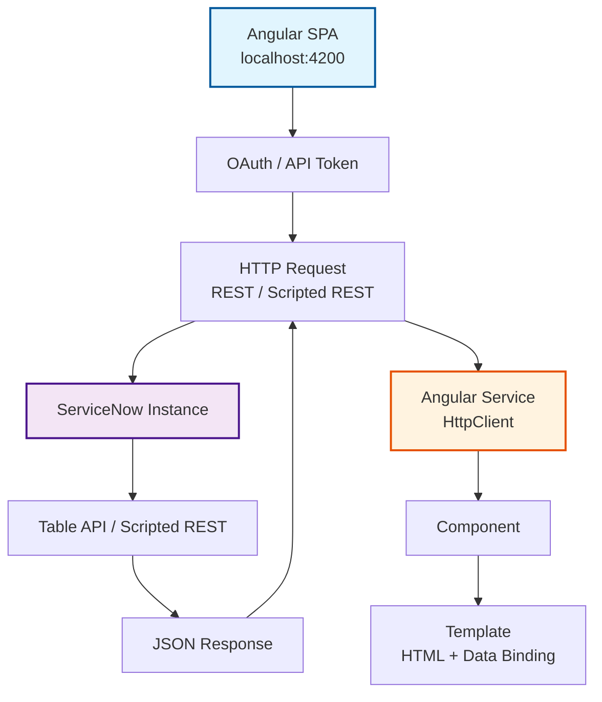

# Angular — AngularJS for Service Portal + Modern Angular for ServiceNow Integrations

**Agent:** opencode
**Date:** 2026-11-19
**Module:** Scripting / Frontend (AngularJS & Angular)
**App:** Now Platform (Service Portal, Custom SPA integrations)
**Confidence:** high
**Source:** ServiceNow product documentation (Service Portal / AngularJS), Angular official docs (angular.io)

---

## Contents

- [Purpose](#purpose)
- [Prerequisites & Setup](#prerequisites--setup)
- [Goals / Benefits / Metrics](#goals--benefits--metrics)
- [Core Concept Diagrams](#core-concept-diagrams)
- [AngularJS in Service Portal](#angularjs-in-service-portal)
- [AngularJS Widget → Scripted REST API Integration](#angularjs-widget--scripted-rest-api-integration)
- [Modern Angular for Custom Integrations](#modern-angular-for-custom-integrations)
- [AngularJS vs Modern Angular — Decision Table](#angularjs-vs-modern-angular--decision-table)
- [Common Mistakes](#common-mistakes)
- [Related Guides](#related-guides)
- [Official Learning Resources](#official-learning-resources)

---

## Purpose

This guide covers Angular in the ServiceNow ecosystem: **AngularJS (1.x)** which powers Service Portal widgets and pages, and **modern Angular (2+)** for building custom single-page applications (SPAs) that integrate with ServiceNow via REST/Table API or Scripted REST APIs.

Use this guide when you need to:
- Build or edit Service Portal widgets using AngularJS
- Understand how `$scope`, controllers, and services work in a Service Portal widget
- Call ServiceNow APIs from an Angular frontend (CORS, authentication, tokens)
- Decide between AngularJS (Service Portal) vs modern Angular (external SPA)

> **Key distinction:** Service Portal runs on AngularJS 1.x. Modern Angular (2+) is not used inside Service Portal natively — it's used for external web apps that call ServiceNow APIs.

---

## Prerequisites & Setup

### Required Plugins / Entitlements

| Plugin / Entitlement | Purpose |
|---|---|
| `com.glideapp.service_portal` | Service Portal (base) |
| `com.snc.pa` (optional) | Page Administration |
| Web server / Node.js (for modern Angular dev) | Local Angular CLI development |

### Breadcrumbs — Enable First

**Service Portal:** Service Portal > Service Portal Editor > [select portal] > Pages/Widgets  
**Widget Editor:** Service Portal > Widgets > [open widget] > AngularJS controller template  
**Scripted REST:** System Web Services > Scripted REST APIs > [create API]

### Cross-Module Dependencies

| Dependency | Why |
|---|---|
| CMDB | Widgets often display CI data from `cmdb_ci` |
| Table API / Scripted REST | External Angular apps need ServiceNow data access |
| OAuth / API authentication | Modern Angular SPAs need tokens to call ServiceNow |
| GlideRecord / Business Rules | Backend data that Angular widgets display |

### ACLs Related to Core Tables

When an Angular widget reads ServiceNow data via `server.update()` or `GlideAjax`, the running user needs read ACL on the target table:
- `incident`, `task`, `cmdb_ci`, `sys_user` — standard read ACLs apply
- Custom tables — ensure `*` role or specific role ACL grants read access

---

## Goals / Benefits / Metrics

### Goals

| Goal | Description |
|---|---|
| Build Service Portal widgets | Create AngularJS-based widgets that display and interact with ServiceNow data |
| Integrate external Angular apps | Build modern Angular SPAs that call ServiceNow REST/Scripted REST APIs |
| Maintain widget performance | Keep AngularJS watchers and digest cycles lean in Service Portal |

### Benefits

| Benefit | Why it matters |
|---|---|
| AngularJS is native to Service Portal | No build step, no bundler — widgets run directly in the browser |
| Two-way data binding | `$scope` changes auto-update the DOM in widgets |
| Modern Angular ecosystem | TypeScript, CLI, component architecture for external apps |
| Reusable widget code | AngularJS controllers/services can be shared across portal pages |

### Metrics

| Metric | Target | How to Measure |
|---|---|---|
| Widget load time | < 2 seconds | Service Portal page load, browser DevTools Network tab |
| AngularJS watcher count | < 200 per widget | `$$watchers` count in browser console |
| API call latency | < 500ms | Network tab XHR/fetch timing |
| Digest cycle errors | 0 | Console errors about `$digest already in progress` |

---

## Core Concept Diagrams

### Diagram 1: AngularJS in Service Portal — Data Flow

```mermaid
graph TD
    A[Service Portal Page] --> B[Widget]
    B --> C[AngularJS Controller]
    C --> D[$scope]
    C --> E[server.update() / GlideAjax]
    E --> F[ServiceNow Server]
    F --> G[GlideRecord / Table API]
    G --> H[JSON Response]
    H --> E
    E --> C
    C --> D
    D --> I[DOM / HTML Template]
    I --> B
    B --> A
    style C fill:#e1f5fe,stroke:#01579b,stroke-width:2px
    style D fill:#fff3e0,stroke:#e65100,stroke-width:2px
    style E fill:#f3e5f5,stroke:#4a148c,stroke-width:2px
```

### Diagram 2: Modern Angular SPA → ServiceNow Integration



### Diagram 3: AngularJS Component Hierarchy in Service Portal

```mermaid
graph TD
    A[Portal Page] --> B[Widget Instance]
    B --> C[AngularJS Module<br/>angular.module()]
    C --> D[Controller<br/>function($scope, server)]
    C --> E[Service<br/>factory / service]
    C --> F[Directive<br/>custom element]
    D --> G[$scope data]
    E --> G
    F --> G
    G --> H[Widget HTML Template]
    H --> B
    style C fill:#e8f5e9,stroke:#1b5e20,stroke-width:2px
    style D fill:#fff8e1,stroke:#f57f17,stroke-width:2px
    style E fill:#e8f5e9,stroke:#1b5e20,stroke-width:2px
```

---

## AngularJS in Service Portal

Service Portal widgets use AngularJS 1.x. Each widget has:

1. **HTML template** — The widget markup with AngularJS expressions (`{{ }}`, `ng-repeat`, `ng-if`, etc.)
2. **Client script (controller)** — AngularJS controller function with `$scope`, `server`, and `options`
3. **Server script** — `server.update()` to call server-side GlideRecord or business logic

### Minimal Widget Example

```html
<!-- Widget HTML template -->
<div>
  <h2>{{ widget.title }}</h2>
  <p ng-repeat="inc in widget.incidents">{{ inc.number }} - {{ inc.short_description }}</p>
  <button ng-click="c.refresh()">Refresh</button>
</div>
```

```javascript
// Client controller (AngularJS)
function($scope, server) {
  var c = this;
  c.refresh = function() {
    server.get('getIncidents', {}, function(response) {
      $scope.widget.incidents = response.data;
    });
  };
  c.refresh();
}
```

```javascript
// Server script
(function process(/*RESTAPIRequest*/ request, /*RESTAPIResponse*/ response) {
  var gr = new GlideRecord('incident');
  gr.addQuery('active', 'true');
  gr.setLimit(10);
  gr.query();
  var data = [];
  while (gr.next()) {
    data.push({ number: gr.number, short_description: gr.short_description });
  }
  response.setBody({ data: data });
})(request, response);
```

### Key AngularJS Concepts in Service Portal

| Concept | Service Portal Usage |
|---|---|
| `$scope` | Data model shared between controller and template |
| `ng-controller` | Auto-applied by Service Portal widget framework |
| `server` object | Bridge to call server scripts (`server.get`, `server.update`) |
| `options` | Widget instance options (from page editor) |
| `widget` object | The widget's data model exposed to template |

### Common AngularJS Patterns in Widgets

```javascript
// Two-way binding example
$scope.widget.priority = '1';
// Template: <select ng-model="widget.priority">...</select>

// Watcher for changes
$scope.$watch('widget.state', function(newVal, oldVal) {
  if (newVal !== oldVal) {
    console.log('State changed to:', newVal);
  }
});

// Calling server from controller
server.get('myApiMethod', { sys_id: $scope.widget.sys_id }, function(response) {
  $scope.$apply(function() {
    $scope.widget.result = response.data;
  });
});
```

---

## AngularJS Widget → Scripted REST API Integration

A **Scripted REST API** gives a Service Portal widget a custom web endpoint to send or receive data over HTTP. Usually, a widget talks to the ServiceNow server using its own built-in Server Script (`server.get` / `server.update`). However, connecting a widget's AngularJS Client Controller directly to a Scripted REST API is useful in specific situations.

### How They Work Together

| Step | What Happens | Technology |
|---|---|---|
| 1 | **Client Controller Makes the Request** | Inside the widget's client script, use Angular's `$http` service to call your custom REST endpoint (e.g., `/api/x_company/my_custom_api`). |
| 2 | **Scripted REST Runs Server Logic** | The API receives the request, runs server-side JavaScript (querying tables, calling external systems, etc.), and sends back a JSON response. |
| 3 | **Widget Updates the View** | The widget receives that JSON data and updates what the user sees on the page — without reloading. |

### Why Use a Scripted REST API Instead of a Normal Widget Server Script?

| Reason | Explanation |
|---|---|
| **Reusability Across Apps** | A normal widget server script is locked inside that one widget. A Scripted REST API can be shared by multiple widgets, mobile apps, and external websites at the same time. |
| **Asynchronous Background Loading** | Calling a REST API via `$http` lets parts of a heavy widget load independently. The page renders immediately while slower data fetches in the background. |
| **Custom Security & Headers** | Scripted REST APIs give fine-grained control over HTTP status codes, custom headers, and API-specific authentication or rate limits. |
| **Decoupled Architecture** | Separating your data logic into an API keeps your widget lightweight and focused strictly on the user interface. |

### Minimal Example: Widget Calling Scripted REST via $http

**Step 1 — Create the Scripted REST API**

```javascript
// Scripted REST API: /api/x_company/incident_summary
(function process(/*RESTAPIRequest*/ request, /*RESTAPIResponse*/ response) {
  var gr = new GlideRecord('incident');
  gr.addQuery('active', 'true');
  gr.setLimit(request.queryParams?.limit || 10);
  gr.query();
  var data = [];
  while (gr.next()) {
    data.push({
      number: gr.number,
      short_description: gr.short_description,
      priority: gr.priority,
      state: gr.state
    });
  }
  response.setBody({ success: true, data: data, count: data.length });
  response.setStatus(200);
})(request, response);
```

**Step 2 — AngularJS Client Controller Using $http**

```javascript
// Widget Client Controller
function($scope, $http) {
  var c = this;
  c.loading = false;
  c.incidents = [];
  c.error = null;

  c.loadIncidents = function() {
    c.loading = true;
    c.error = null;

    $http.get('/api/x_company/incident_summary?limit=25', {
      headers: { 'Accept': 'application/json' }
    })
    .then(function(response) {
      // Success — update the view via $scope
      $scope.$apply(function() {
        c.incidents = response.data.data;
        c.loading = false;
      });
    })
    .catch(function(error) {
      $scope.$apply(function() {
        c.error = 'Failed to load incidents: ' + (error.status || 'unknown');
        c.loading = false;
      });
    });
  };

  c.loadIncidents();
}
```

**Step 3 — Widget HTML Template**

```html
<div>
  <h2>Recent Incidents</h2>
  
  <div ng-if="c.loading">Loading...</div>
  <div ng-if="c.error" class="error">{{ c.error }}</div>
  
  <table ng-if="!c.loading && !c.error">
    <thead>
      <tr><th>Number</th><th>Description</th><th>Priority</th><th>State</th></tr>
    </thead>
    <tbody>
      <tr ng-repeat="inc in c.incidents">
        <td>{{ inc.number }}</td>
        <td>{{ inc.short_description }}</td>
        <td>{{ inc.priority }}</td>
        <td>{{ inc.state }}</td>
      </tr>
    </tbody>
  </table>
</div>
```

### When to Use Each Approach

| Scenario | Recommended Approach |
|---|---|
| Widget-only data, no reuse | Widget server script (`server.get` / `server.update`) |
| Data shared across multiple widgets | Scripted REST API + `$http` |
| Data needed by mobile app or external site | Scripted REST API |
| Background/async loading within a heavy widget | Scripted REST API + `$http` |
| Need custom HTTP status codes or headers | Scripted REST API |
| Simple CRUD on a single table | Table API (`/api/now/table/{table}`) |

### Common Pitfalls

| Pitfall | Fix |
|---|---|
| Forgetting `$scope.$apply()` after `$http` response | Wrap view updates in `$scope.$apply()` so AngularJS re-renders |
| Calling API on every digest cycle | Debounce user input, load once on controller init |
| Not handling HTTP error codes | Always add `.catch()` / error callback to `$http` calls |
| Exposing sensitive data via API | Add ACLs on the Scripted REST API; filter fields in server logic |
| Hardcoding the API path | Use a widget option or system property for the endpoint URL |

---

## Modern Angular for Custom Integrations

Modern Angular (2+) is used for **external** single-page applications that integrate with ServiceNow — not inside Service Portal. Common use cases:

- Employee self-service portals hosted outside ServiceNow
- Customer-facing support portals
- Internal dashboards pulling data from multiple ServiceNow instances

### Angular Service for ServiceNow API Calls

```typescript
// servicenow.service.ts
import { Injectable } from '@angular/core';
import { HttpClient, HttpHeaders } from '@angular/common/http';
import { Observable } from 'rxjs';

@Injectable({ providedIn: 'root' })
export class ServiceNowService {
  private baseUrl = 'https://your-instance.service-now.com/api/now/table';
  
  constructor(private http: HttpClient) {}
  
  getIncidents(): Observable<any> {
    const headers = new HttpHeaders({
      'Authorization': 'Bearer ' + this.getToken(),
      'Accept': 'application/json'
    });
    return this.http.get(`${this.baseUrl}/incident`, { headers });
  }
  
  private getToken(): string {
    return localStorage.getItem('sn_token') || '';
  }
}
```

### OAuth Token Flow for Angular SPA

1. Register an OAuth client in ServiceNow (System OAuth > Applications > OAuth)
2. Angular app redirects user to ServiceNow OAuth authorization endpoint
3. ServiceNow redirects back with an authorization code
4. Angular exchanges code for access token
5. Store token in memory or `localStorage`, send as `Authorization: Bearer <token>`

### CORS Considerations

ServiceNow must allow your Angular app's origin:
- System Properties > `glide.webserver.cors.allow_origin` — add your SPA domain
- Or use a backend proxy (Node.js/Express) to avoid CORS entirely

---

## AngularJS vs Modern Angular — Decision Table

| Factor | AngularJS (1.x) | Modern Angular (2+) |
|---|---|---|
| Where it runs | Inside Service Portal widgets | External SPA (separate hosting) |
| Build step | None (runs in browser) | Angular CLI, TypeScript compilation |
| ServiceNow data access | `server.update()`, GlideAjax | REST API, Scripted REST, OAuth |
| Learning curve | Lower for Service Portal admins | Higher (TypeScript, RxJS, CLI) |
| Best for | Quick widgets, portal customizations | Full SPAs, customer portals, dashboards |
| Mobile support | Limited | Good (Angular Material, PWA) |
| Official SN support | Native to Service Portal | Not native — external integration only |

**Rule of thumb:** If it lives inside Service Portal, use AngularJS. If it's a standalone app calling ServiceNow APIs, use modern Angular.

---

## Common Mistakes

| Mistake | Why it's a problem | Fix |
|---|---|---|
| Too many `$watch` expressions | Slows down widget digest cycle | Use one-time binding `{{ ::value }}` where possible |
| Calling `server.update()` in a loop | Excessive API calls, rate limiting | Batch requests, debounce user input |
| Forgetting `$scope.$apply()` | Template doesn't update after async data | Wrap async updates in `$scope.$apply()` |
| CORS errors in Angular SPA | Browser blocks cross-origin requests | Configure CORS on ServiceNow or use proxy |
| Hardcoding instance URL | Breaks when moving dev→test→prod | Use environment variables or system properties |
| Storing OAuth token in localStorage | XSS vulnerability risk | Use in-memory storage or HttpOnly cookies via proxy |
| Using jQuery DOM manipulation in AngularJS | Conflicts with Angular's digest cycle | Use AngularJS directives and data binding instead |

---

## Related Guides

- [JavaScript Reference](/docs/modules/ai/javascript-reference/) — Platform scripting reference (GlideRecord, GlideAjax, GlideForm, Business Rules)
- [GlideRecord & Server-Side Data](/docs/modules/scripting/gliderecord-guide/) — Query engine and server-side data patterns used by Angular widgets
- [CMDB](/docs/modules/cmdb/cmdb-guide/) — CI data that Angular widgets commonly display
- [Cross-Cutting Skills](/docs/cross-cutting/) — Integrations, Update Sets, App Engine, Platform Governance

---

## Official Learning Resources

| Resource | URL | What it covers |
|---|---|---|
| ServiceNow Service Portal | docs.servicenow.com | Service Portal development, AngularJS widgets |
| AngularJS Developer Guide | docs.angularjs.org | AngularJS 1.x core concepts ($scope, controllers, services) |
| Angular (modern) | angular.io | TypeScript, components, HttpClient, routing |
| ServiceNow OAuth | docs.servicenow.com | OAuth setup for external API access |
| ServiceNow Table API | developer.servicenow.com | REST API reference for table operations |

---
