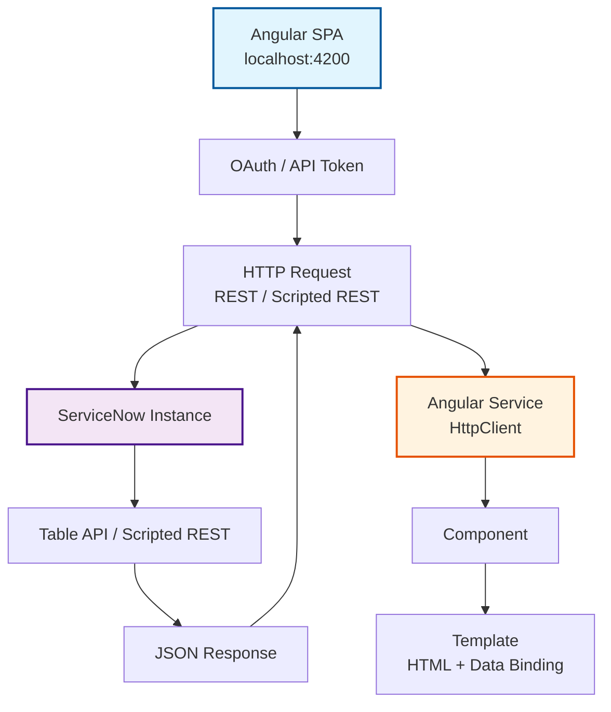

# Angular — AngularJS for Service Portal + Modern Angular for ServiceNow Integrations

**Agent:** opencode
**Date:** 2026-11-19
**Module:** Scripting / Frontend (AngularJS & Angular)
**App:** Now Platform (Service Portal, Custom SPA integrations)
**Confidence:** high
**Source:** ServiceNow product documentation (Service Portal / AngularJS), Angular official docs (angular.io)

---

## Contents

- [Purpose](#purpose)
- [Prerequisites & Setup](#prerequisites--setup)
- [Goals / Benefits / Metrics](#goals--benefits--metrics)
- [Core Concept Diagrams](#core-concept-diagrams)
- [AngularJS in Service Portal](#angularjs-in-service-portal)
- [Widget Setup Options — Every Option Explained](#widget-setup-options--every-option-explained)
- [Widget Instance (Placing a Widget on a Page)](#widget-instance--placing-a-widget-on-a-page)
- [Page Variants vs Page Route Maps (Showing Different Views to Different Users)](#page-variants-vs-page-route-maps--showing-different-views-to-different-users)
- [Calling Server-Side Code from AngularJS](#calling-server-side-code-from-angularjs)
- [How the Flow Works — Client → Server → HTML (ELI5)](#how-the-flow-works--client--server--html-eli5)
- [AngularJS Widget → Scripted REST API Integration](#angularjs-widget--scripted-rest-api-integration)
- [Modern Angular for Custom Integrations](#modern-angular-for-custom-integrations)
- [AngularJS vs Modern Angular — Decision Table](#angularjs-vs-modern-angular--decision-table)
- [Common Mistakes](#common-mistakes)
- [How to Test Your Widget & API](#how-to-test-your-widget--api)
- [Related Guides](#related-guides)
- [Official Learning Resources](#official-learning-resources)
- [Where This Is Deployed](#where-this-is-deployed)

---

## Purpose

This guide covers Angular in the ServiceNow ecosystem: **AngularJS (1.x)** which powers Service Portal widgets and pages, and **modern Angular (2+)** for building custom single-page applications (SPAs) that integrate with ServiceNow via REST/Table API or Scripted REST APIs.

Use this guide when you need to:
- Build or edit Service Portal widgets using AngularJS
- Understand how `$scope`, controllers, and services work in a Service Portal widget
- Call ServiceNow APIs from an Angular frontend (CORS, authentication, tokens)
- Decide between AngularJS (Service Portal) vs modern Angular (external SPA)

> **Key distinction:** Service Portal runs on AngularJS 1.x. Modern Angular (2+) is not used inside Service Portal natively — it's used for external web apps that call ServiceNow APIs.

---

## Prerequisites & Setup

### Required Plugins / Entitlements

| Plugin / Entitlement | Purpose |
|---|---|
| `com.glideapp.service_portal` | Service Portal (base) |
| `com.snc.pa` (optional) | Page Administration |
| Web server / Node.js (for modern Angular dev) | Local Angular CLI development |

### Breadcrumbs — Enable First

**Service Portal:** Service Portal > Service Portal Editor > [select portal] > Pages/Widgets  
**Widget Editor:** Service Portal > Widgets > [open widget] > AngularJS controller template  
**Scripted REST:** System Web Services > Scripted REST APIs > [create API]

### Cross-Module Dependencies

| Dependency | Why |
|---|---|
| CMDB | Widgets often display CI data from `cmdb_ci` |
| Table API / Scripted REST | External Angular apps need ServiceNow data access |
| OAuth / API authentication | Modern Angular SPAs need tokens to call ServiceNow |
| GlideRecord / Business Rules | Backend data that Angular widgets display |

### ACLs Related to Core Tables

When an Angular widget reads ServiceNow data via `server.update()` or `GlideAjax`, the running user needs read ACL on the target table:
- `incident`, `task`, `cmdb_ci`, `sys_user` — standard read ACLs apply
- Custom tables — ensure `*` role or specific role ACL grants read access

---

## Goals / Benefits / Metrics

### Goals

| Goal | Description |
|---|---|
| Build Service Portal widgets | Create AngularJS-based widgets that display and interact with ServiceNow data |
| Integrate external Angular apps | Build modern Angular SPAs that call ServiceNow REST/Scripted REST APIs |
| Maintain widget performance | Keep AngularJS watchers and digest cycles lean in Service Portal |

### Benefits

| Benefit | Why it matters |
|---|---|
| AngularJS is native to Service Portal | No build step, no bundler — widgets run directly in the browser |
| Two-way data binding | `$scope` changes auto-update the DOM in widgets |
| Modern Angular ecosystem | TypeScript, CLI, component architecture for external apps |
| Reusable widget code | AngularJS controllers/services can be shared across portal pages |

### Metrics

| Metric | Target | How to Measure |
|---|---|---|
| Widget load time | < 2 seconds | Service Portal page load, browser DevTools Network tab |
| AngularJS watcher count | < 200 per widget | `$$watchers` count in browser console |
| API call latency | < 500ms | Network tab XHR/fetch timing |
| Digest cycle errors | 0 | Console errors about `$digest already in progress` |

---

## Core Concept Diagrams

### Diagram 1: AngularJS in Service Portal — Data Flow

```mermaid
graph TD
    A[Service Portal Page] --> B[Widget]
    B --> C[AngularJS Controller]
    C --> D[$scope]
    C --> E[server.update() / GlideAjax]
    E --> F[ServiceNow Server]
    F --> G[GlideRecord / Table API]
    G --> H[JSON Response]
    H --> E
    E --> C
    C --> D
    D --> I[DOM / HTML Template]
    I --> B
    B --> A
    style C fill:#e1f5fe,stroke:#01579b,stroke-width:2px
    style D fill:#fff3e0,stroke:#e65100,stroke-width:2px
    style E fill:#f3e5f5,stroke:#4a148c,stroke-width:2px
```

### Diagram 2: Modern Angular SPA → ServiceNow Integration



### Diagram 3: AngularJS Component Hierarchy in Service Portal

```mermaid
graph TD
    A[Portal Page] --> B[Widget Instance]
    B --> C[AngularJS Module<br/>angular.module()]
    C --> D[Controller<br/>function($scope, server)]
    C --> E[Service<br/>factory / service]
    C --> F[Directive<br/>custom element]
    D --> G[$scope data]
    E --> G
    F --> G
    G --> H[Widget HTML Template]
    H --> B
    style C fill:#e8f5e9,stroke:#1b5e20,stroke-width:2px
    style D fill:#fff8e1,stroke:#f57f17,stroke-width:2px
    style E fill:#e8f5e9,stroke:#1b5e20,stroke-width:2px
```

---

## AngularJS in Service Portal

Service Portal widgets use AngularJS 1.x. Each widget has:

1. **HTML template** — The widget markup with AngularJS expressions (`{{ }}`, `ng-repeat`, `ng-if`, etc.)
2. **Client script (controller)** — AngularJS controller function with `$scope`, `server`, and `options`
3. **Server script** — `server.update()` to call server-side GlideRecord or business logic

### Minimal Widget Example

```html
<!-- Widget HTML template -->
<div>
  <h2>{{ widget.title }}</h2>
  <p ng-repeat="inc in widget.incidents">{{ inc.number }} - {{ inc.short_description }}</p>
  <button ng-click="c.refresh()">Refresh</button>
</div>
```

```javascript
// Client controller (AngularJS)
// 'c' is shorthand for 'this' — it's the controller object that holds all the
// data and functions the HTML template will use (widget.title, c.refresh, etc.)
function($scope, server) {
  var c = this;
  c.refresh = function() {
    server.get('getIncidents', {}, function(response) {
      $scope.widget.incidents = response.data;
    });
  };
  c.refresh();  // Run refresh right away when the widget loads
}
```

```javascript
// Server script — runs server-side on ServiceNow
// 'request' — contains data sent from the client (URL parameters, body, headers).
// Use it when the client needs to pass information to the server (e.g., a record number to look up).
// 'response' — the object you use to send data back to the client.
// Use response.setBody({...}) to return JSON, and response.setStatus(200) for success.
(function process(/*RESTAPIRequest*/ request, /*RESTAPIResponse*/ response) {
  var gr = new GlideRecord('incident');
  gr.addQuery('active', 'true');
  gr.setLimit(10);
  gr.query();
  var data = [];
  while (gr.next()) {
    data.push({ number: gr.number, short_description: gr.short_description });
  }
  response.setBody({ data: data });
})(request, response);
```

### Key AngularJS Concepts in Service Portal

| Concept | Service Portal Usage |
|---|---|
| `$scope` | Data model shared between controller and template |
| `ng-controller` | Auto-applied by Service Portal widget framework |
| `server` object | Bridge to call server scripts (`server.get`, `server.update`) |
| `$http` | Browser messenger that calls web addresses (REST APIs) |
| `$watch` | Watches a value for changes and runs code when it changes |
| `options` | Widget instance options (from page editor) |
| `widget` object | The widget's data model exposed to template |

#### What is an AngularJS Watcher? (ELI5)

A **watcher** is like a **security alarm** that AngularJS sets up to monitor a piece of data. You tell AngularJS "watch this value," and AngularJS keeps checking it over and over. The moment the value changes, AngularJS runs your code automatically.

**Where is it set up?**
In your widget's **client script** tab, using `$scope.$watch('valueName', function(newVal, oldVal) { ... })`.

**Why set one up?**
- To react when data changes (e.g., when a user picks a different priority from a dropdown, update other fields)
- To keep the screen in sync with data that might change from multiple places
- To trigger calculations or validations when a value changes

Example:
```javascript
// Watch the widget's priority field
$scope.$watch('widget.priority', function(newPriority, oldPriority) {
  if (newPriority !== oldPriority) {
    console.log('Priority changed from ' + oldPriority + ' to ' + newPriority);
    // You could auto-update other fields here
  }
});
```

**Important:** Each watcher runs on every AngularJS "digest cycle" (which happens many times per second). Too many watchers slow down your widget. That's why the metric target is **< 200 watchers per widget**.

### Common AngularJS Patterns in Widgets

```javascript
// Two-way binding example
$scope.widget.priority = '1';
// Template: <select ng-model="widget.priority">...</select>

// Watcher for changes
$scope.$watch('widget.state', function(newVal, oldVal) {
  if (newVal !== oldVal) {
    console.log('State changed to:', newVal);
  }
});

// Calling server from controller
server.get('myApiMethod', { sys_id: $scope.widget.sys_id }, function(response) {
  $scope.$apply(function() {
    $scope.widget.result = response.data;
  });
});
```

---

## How the Flow Works — Client → Server → HTML (ELI5)

Here is the order of events when a user loads your widget:

### Step 1 — Client Runs First (Browser)
When the page loads, the **Client Controller** runs inside the user's browser. It sets up initial data (`c.loading = false`, `c.incidents = []`) and may immediately call `$http.get()` or `server.get()` to fetch data. The HTML template shows placeholder text or a "Loading..." spinner.

### Step 2 — Server (ServiceNow)
The client's request travels to the ServiceNow server. Depending on your approach:
- **`server.get`** → calls the widget's own Server Script
- **GlideAjax** → calls a client-callable Script Include
- **`$http`** → calls your Scripted REST API endpoint

The server runs its JavaScript (GlideRecord queries, etc.), builds a JSON or XML response, and sends it back.

### Step 3 — HTML Template Updates
When the response comes back, the client controller updates `$scope` variables (e.g., `$scope.widget.incidents = response.data`). AngularJS automatically re-renders the HTML template — the table rows appear, the "Loading..." spinner disappears, and the user sees the data.

**The cycle repeats** whenever the user clicks a button (like "Refresh") or when a `$watch` detects a data change.

```text
Browser (Client)              ServiceNow (Server)              Browser (Client)
-----------                   ----------------                 ------------
1. Controller loads           4. Request arrives               8. Response received
2. $http.get() / server.get() 5. GlideRecord query runs        9. $scope updated
3. Shows "Loading..."         6. JSON/XML built                10. HTML re-renders
                              7. Response sent                 11. User sees data
```


## Widget Setup Options — Every Option Explained

When you create or edit a widget in Service Portal (**Service Portal > Widgets > [widget]**), you configure several setup options. Here is what each one means and how to use it.

---

### Widget Options (Client State Parameters)

Widget Options are key-value pairs stored on the widget record. They act as **client state parameters** — configuration that admins can change without editing code. You access them in your client controller via the `options` parameter.

**Where to configure:** Service Portal > Widgets > [widget] > Options related list > New

| Option Name | What It Stores | Example Value | Use In Client Controller |
|---|---|---|---|
| `api_endpoint` | Scripted REST API URL | `/api/x_company/incidents` | `options.api_endpoint` |
| `default_limit` | Number of records to load | `10` | `options.default_limit` |
| `show_refresh_button` | Whether to show a refresh button | `true` | `options.show_refresh_button` |
| `table_name` | Source table for queries | `incident` | `options.table_name` |

**Client controller example:**
```javascript
function($scope, $http, options) {
  var c = this;
  c.apiUrl = options.api_endpoint || '/api/default';
  c.limit = options.default_limit || 10;
}
```

**Why this matters:** Admins can change the API endpoint or limit on the widget record without touching code. This makes widgets reusable across different portals.

---

### Data Parameter (`data`)

The **`data`** parameter is passed from the server script to the client controller. It's the bridge between server-side and client-side.

**Server script** (runs server-side):
```javascript
// Server script (runs server-side)
// 'request' — contains data sent from the client (URL parameters, body, headers).
// 'response' — the object you use to send data back to the client.
// Use response.setBody({...}) to return JSON.
(function process(/*RESTAPIRequest*/ request, /*RESTAPIResponse*/ response) {
  var data = {};
  data.incidentCount = 5;
  data.userName = 'John Doe';
  response.setBody(data);
})(request, response);
```

**Client controller** (runs client-side):
```javascript
function($scope, server) {
  var c = this;
  server.get('getData', {}, function(response) {
    // response.data contains what the server script put in data{}
    c.incidentCount = response.data.incidentCount;
    c.userName = response.data.userName;
  });
}
```

**Key point:** `response.data` in the client controller matches the object you passed to `response.setBody()` on the server.

---

### Widget Variables (HTML Template)

Widget variables are values you expose from the client controller to the HTML template using `$scope.widget`. They are **not** the same as Widget Options — variables are runtime data, options are configuration.

**Client controller:**
```javascript
function($scope) {
  var c = this;
  c.title = 'My Dashboard';
  c.incidents = [];
  c.loading = false;
  
  // These become available in the HTML template as {{ widget.title }}, etc.
  $scope.widget.title = c.title;
  $scope.widget.incidents = c.incidents;
  $scope.widget.loading = c.loading;
}
```

**HTML template:**
```html
<div>
  <h2>{{ widget.title }}</h2>
  <div ng-if="widget.loading">Loading...</div>
  <p ng-repeat="inc in widget.incidents">{{ inc.number }}</p>
</div>
```

| Concept | Where Set | Where Used | Purpose |
|---|---|---|---|
| **Widget Options** | Widget Options list (admin UI) | `options.paramName` in client controller | Admin-configurable settings |
| **Data Parameter** | `response.setBody()` in server script | `response.data` in client controller | Server → client data bridge |
| **Widget Variables** | `$scope.widget.xxx` in client controller | `{{ widget.xxx }}` in HTML template | Controller → template data bridge |

---

### Client Script Dependencies

When your widget uses external libraries (like AngularJS modules, jQuery, or custom JS), you declare them in **Client Script Dependencies**.

**Where to configure:** Service Portal > Widgets > [widget] > Client Script Dependencies related list

| Dependency | Purpose | Example |
|---|---|---|
| AngularJS | Core framework (auto-loaded) | `angular` |
| Custom JS library | Third-party code | `moment.js`, `lodash` |
| ServiceNow modules | Platform APIs | `glide_ajax` |

---

### CSS / Styles

**Where to configure:** Service Portal > Widgets > [widget] > CSS tab

CSS styles the widget's HTML. Use widget-specific class names to avoid conflicts with other widgets on the same page.

```css
.my-widget-table {
  width: 100%;
  border-collapse: collapse;
}

.my-widget-table th {
  background-color: #f5f5f5;
}

.loading-spinner {
  display: inline-block;
  width: 20px;
  height: 20px;
  border: 3px solid #f3f3f3;
  border-top: 3px solid #3498db;
  border-radius: 50%;
  animation: spin 1s linear infinite;
}
```

**HTML template usage:**
```html
<table class="my-widget-table">...</table>
<div class="loading-spinner" ng-if="widget.loading"></div>
```

---

### Widget Choice (Choice List / Select Options)

Some widgets present a dropdown of choices. These are configured as widget choice records.

**Where to configure:** Service Portal > Widgets > [widget] > Choice related list

| Field | Purpose | Example |
|---|---|---|
| Name | Internal name | `priority_level` |
| Label | What the user sees | `Priority Level` |
| Value | The actual value stored | `1`, `2`, `3` |
| Sequence | Order in dropdown | `10`, `20`, `30` |

**Client controller usage:**
```javascript
// Access choice values (usually via server script or options)
c.priorityChoices = options.priority_choices || ['1', '2', '3'];
```

---

### Complete Widget Setup Checklist

| Setup Area | Where to Configure | Required? | Purpose |
|---|---|---|---|
| Widget record | Service Portal > Widgets > New | Yes | Creates the widget |
| HTML Template | Template tab | Yes | What the user sees |
| Client Script | Client Script tab | Yes | Controller logic (`$scope`, `$http`, `server`) |
| Server Script | Server Script tab | No | Server-side data (`GlideRecord`, `response.setBody`) |
| Widget Options | Options related list | No | Admin-configurable parameters |
| Client Script Dependencies | Client Script Dependencies | No | External JS libraries |
| CSS | CSS tab | No | Styling |
| Choice List | Choice related list | No | Dropdown options |
| ACL | System Security > ACL | No | Who can call Scripted REST API |

---

## Widget Instance (Placing a Widget on a Page)

A **widget instance** is what you get when you drag a widget onto a portal page. The widget is the reusable definition; the instance is a specific placement of that widget on a specific page. Each instance can have its own options.

**Where to configure:** Service Portal > Service Portal Editor > [select portal] > Pages > [select page] > drag widget onto canvas

| Concept | What It Is | Example |
|---|---|---|
| **Widget** | The reusable definition (template + client script + server script) | "Incidents List" widget |
| **Widget Instance** | One placement of that widget on a page | Two "Incidents List" instances on the same page — one showing P1 incidents, one showing P2 incidents |
| **Instance Options** | Options set on this specific instance (overrides widget-level options) | Instance A: `table_name=incident`, `limit=5`; Instance B: `table_name=change_request`, `limit=10` |

**Key point:** Each widget instance gets its own copy of the client controller and `$scope`. If you have two instances of the same widget on a page, they each maintain their own data — changing one doesn't affect the other.

**Breadcrumb:** Service Portal > Service Portal Editor > [portal] > Pages > [page] > click widget instance > configure options

### How Instance Options Work

When you place a widget on a page, you can set instance-specific options:

1. Open the Service Portal Editor
2. Drag your widget onto the page
3. Click the widget instance on the canvas
4. Set options for this specific instance

These instance options are passed to your client controller via the `options` parameter, just like widget-level options — but instance options take precedence.

```javascript
// Client controller — uses options (which may come from widget OR instance)
function($scope, $http, options) {
  var c = this;
  c.tableName = options.table_name || 'incident';  // instance option overrides widget option
  c.limit = options.default_limit || 10;
}
```


---

## Page Variants vs Page Route Maps (Showing Different Views to Different Users)

When you want different users to see different content on the same page URL, ServiceNow has two main approaches depending on which interface you're using:

---

### 1. Next Experience / UI Builder (Workspaces & Modern Portals) — Page Variants

In ServiceNow UI Builder (used in Workspaces and modern portals), you can create **Page Variants** — multiple versions of the same page URL.

| Concept | What It Is |
|---|---|
| **Page Variant** | A different version of the same page URL, shown to specific users |
| **Audience** | The user roles or criteria that determine who sees this variant |
| **Order** | The priority order — ServiceNow checks variants in order and serves the first match |

**How it works:** When a user visits a page, ServiceNow checks their roles and conditions against each variant's Audience. The first matching variant is served.

**Breadcrumb:** UI Builder > Pages > [page] > Variants

---

### 2. Classic Service Portal (Widgets) — Page Route Maps & User Criteria

Classic Service Portal uses widgets rather than UI Builder components, so it handles different views differently:

| Approach | What It Is | Where to Configure |
|---|---|---|
| **Page Route Maps** (`sp_page_route_map`) | Redirects users from one page ID to a different page ID based on conditions/roles, without changing links across your portal | Service Portal > Route Maps |
| **User Criteria on Widget Instances** | Shows/hides specific widget instances based on user roles (the "Can View" / "Cannot View" related lists) | Widget instance > Can View / Cannot View related lists |
| **Widget Instances** | Each placement of a widget on a page is a separate instance (`sp_instance`) with its own options | Service Portal Editor > Pages > drag widget > configure instance |

**Page Route Maps example:**
- User with role `itil` visits `/$sp/pageA` → redirected to `/$sp/pageA_ITIL`
- User without `itil` visits `/$sp/pageA` → sees the normal pageA

**User Criteria example:**
- Widget Instance A (shows P1 incidents): Can View = `itil` role
- Widget Instance B (shows general incidents): Cannot View = `itil` role
- Both on the same page — ITIL users see Instance A, everyone else sees Instance B

---

### Which Should You Use?

| Your Situation | Use This |
|---|---|
| Using UI Builder / Next Experience / Workspaces | **Page Variants** with Audiences |
| Using classic Service Portal with widgets | **Page Route Maps** OR **User Criteria on widget instances** |
| Same widget, different data per page placement | **Widget Instances** with different options |
| Redirect entire pages based on role | **Page Route Maps** |

**Rule of thumb:** If you're building with widgets (classic Service Portal), use Widget Instances with different options + User Criteria to show different data to different users. If you're building with UI Builder, use Page Variants.

---

## Calling Server-Side Code from AngularJS

There are two main ways an AngularJS widget can call server-side ServiceNow code:

1. **`server.get` / `server.update`** — The widget's built-in bridge to its own Server Script
2. **GlideAjax** — A reusable ServiceNow client-server bridge that can call Script Includes marked "client callable"

### What is GlideAjax? (ELI5)

Think of **GlideAjax** as a **courier service** that runs inside the browser. Your AngularJS Client Controller hands GlideAjax a package (a request with a script include name and parameters), and GlideAjax delivers it to the server. The server runs the logic, puts the result back in the package, and sends it back. Your controller then reads the result and updates the page.

In plain English:
- **Without GlideAjax**: Your widget can only talk to its own widget server script.
- **With GlideAjax**: Your widget can call any Script Include that's marked "client callable" — even ones shared across multiple widgets or applications.

---

### Can AngularJS Call a Client-Callable Script Include?

**Yes.** ServiceNow Script Includes have a flag called **"Client callable"**. When checked, that Script Include becomes reachable from client-side code using GlideAjax.

Here is how it works end-to-end:

**Step 1 — Create a Client-Callable Script Include**

Go to: **System Definition > Script Includes > New**

Create a script include with these settings:
- **Name:** `x_company_incident_utils`
- **Client callable:** ✅ Checked
- **Accessible from:** All applications

```javascript
var x_company_incident_utils = Class.create();
x_company_incident_utils.prototype = Object.extendsObject(AbstractAjaxProcessor, {
  getActiveIncidentCount: function() {
    var gr = new GlideRecord('incident');
    gr.addQuery('active', 'true');
    gr.query();
    return gr.getRowCount();
  },
  getIncidentByNumber: function() {
    var number = this.getParameter('sysparm_number');
    var gr = new GlideRecord('incident');
    gr.addQuery('number', number);
    gr.query();
    if (gr.next()) {
      return gr.getValue('short_description');
    }
    return 'Not found';
  },
  type: 'x_company_incident_utils'
});
```

**Step 2 — Call It from AngularJS Using GlideAjax**

In your widget's **client script** tab:

```javascript
function($scope) {
  // $scope — the data model shared between this controller and the HTML template.
  // Use it to expose data that AngularJS should auto-update in the UI.
  var c = this;
  c.incidentCount = 0;
  c.incidentDesc = '';

  // GlideAjax is the messenger that calls the server-side Script Include
  var ga = new GlideAjax('x_company_incident_utils');

  // Tell GlideAjax which server-side method to run (must match a method name in the Script Include)
  ga.addParam('sysparm_name', 'getActiveIncidentCount');

  // Send the request; when the server replies, the callback runs
  ga.getXML(function(response) {
    // response — the XML document returned from the server
    // Read the text answer using documentElement.getAttribute('answer')
    var answer = response.documentElement.getAttribute('answer');
    $scope.$apply(function() {
      c.incidentCount = answer;
    });
  });

  // Example: call with a parameter (passing data TO the server)
  var ga2 = new GlideAjax('x_company_incident_utils');
  ga2.addParam('sysparm_name', 'getIncidentByNumber');
  ga2.addParam('sysparm_number', 'INC0010001');  // extra data sent to the server
  ga2.getXML(function(response) {
    var answer = response.documentElement.getAttribute('answer');
    $scope.$apply(function() {
      c.incidentDesc = answer;
    });
  });
}
```

---

### GlideAjax vs `server.get` — When to Use Each

| Factor | `server.get` / `server.update` | GlideAjax |
|---|---|---|
| **What it calls** | The widget's own Server Script only | Any client-callable Script Include |
| **Reusable across widgets?** | No — locked inside one widget | Yes — one Script Include, many widgets |
| **Client-callable flag needed?** | No | Yes — must check "Client callable" on the Script Include |
| **Response format** | JSON (easy to parse) | XML (needs `getAttribute('answer')`) |
| **Best for** | Simple widget-specific data | Shared server logic used by multiple widgets |

---

### GlideAjax in Plain English

| Term | What It Means |
|---|---|
| `new GlideAjax('script_include_name')` | Creates a courier addressed to your server-side Script Include |
| `ga.addParam('sysparm_name', 'method_name')` | Tells the server which function to run |
| `ga.addParam('sysparm_foo', 'bar')` | Sends extra data (like a record number) to the server |
| `ga.getXML(callback)` | Sends the request; when the server replies, the callback runs |
| `response.documentElement.getAttribute('answer')` | Reads the text answer the server sent back |

---

## AngularJS Widget → Scripted REST API Integration

A **Scripted REST API** gives a Service Portal widget a custom web endpoint to send or receive data over HTTP. Usually, a widget talks to the ServiceNow server using its own built-in Server Script (`server.get` / `server.update`). However, connecting a widget's AngularJS Client Controller directly to a Scripted REST API is useful in specific situations.

### How They Work Together

| Step | What Happens | Technology |
|---|---|---|
| 1 | **Client Controller Makes the Request** | Inside the widget's client script, use Angular's `$http` service to call your custom REST endpoint (e.g., `/api/x_company/my_custom_api`). |
| 2 | **Scripted REST Runs Server Logic** | The API receives the request, runs server-side JavaScript (querying tables, calling external systems, etc.), and sends back a JSON response. |
| 3 | **Widget Updates the View** | The widget receives that JSON data and updates what the user sees on the page — without reloading. |

### Why Use a Scripted REST API Instead of a Normal Widget Server Script?

| Reason | Explanation |
|---|---|
| **Reusability Across Apps** | A normal widget server script is locked inside that one widget. A Scripted REST API can be shared by multiple widgets, mobile apps, and external websites at the same time. |
| **Asynchronous Background Loading** | Calling a REST API via `$http` lets parts of a heavy widget load independently. The page renders immediately while slower data fetches in the background. |
| **Custom Security & Headers** | Scripted REST APIs give fine-grained control over HTTP status codes, custom headers, and API-specific authentication or rate limits. |
| **Decoupled Architecture** | Separating your data logic into an API keeps your widget lightweight and focused strictly on the user interface. |

### Minimal Example: Widget Calling Scripted REST via $http

**Step 1 — Create the Scripted REST API**

```javascript
// Scripted REST API: /api/x_company/incident_summary
(function process(/*RESTAPIRequest*/ request, /*RESTAPIResponse*/ response) {
  var gr = new GlideRecord('incident');
  gr.addQuery('active', 'true');
  gr.setLimit(request.queryParams?.limit || 10);
  gr.query();
  var data = [];
  while (gr.next()) {
    data.push({
      number: gr.number,
      short_description: gr.short_description,
      priority: gr.priority,
      state: gr.state
    });
  }
  response.setBody({ success: true, data: data, count: data.length });
  response.setStatus(200);
})(request, response);
```

**Step 2 — AngularJS Client Controller Using $http**

```javascript
// Widget Client Controller
function($scope, $http) {
  var c = this;
  c.loading = false;
  c.incidents = [];
  c.error = null;

  c.loadIncidents = function() {
    c.loading = true;
    c.error = null;

    $http.get('/api/x_company/incident_summary?limit=25', {
      headers: { 'Accept': 'application/json' }
    })
    .then(function(response) {
      // Success — update the view via $scope
      $scope.$apply(function() {
        c.incidents = response.data.data;
        c.loading = false;
      });
    })
    .catch(function(error) {
      $scope.$apply(function() {
        c.error = 'Failed to load incidents: ' + (error.status || 'unknown');
        c.loading = false;
      });
    });
  };

  c.loadIncidents();
}
```

**Step 3 — Widget HTML Template**

```html
<div>
  <h2>Recent Incidents</h2>
  
  <div ng-if="c.loading">Loading...</div>
  <div ng-if="c.error" class="error">{{ c.error }}</div>
  
  <table ng-if="!c.loading && !c.error">
    <thead>
      <tr><th>Number</th><th>Description</th><th>Priority</th><th>State</th></tr>
    </thead>
    <tbody>
      <tr ng-repeat="inc in c.incidents">
        <td>{{ inc.number }}</td>
        <td>{{ inc.short_description }}</td>
        <td>{{ inc.priority }}</td>
        <td>{{ inc.state }}</td>
      </tr>
    </tbody>
  </table>
</div>
```

### When to Use Each Approach

| Scenario | Recommended Approach |
|---|---|
| Widget-only data, no reuse | Widget server script (`server.get` / `server.update`) |
| Data shared across multiple widgets | Scripted REST API + `$http` |
| Data needed by mobile app or external site | Scripted REST API |
| Background/async loading within a heavy widget | Scripted REST API + `$http` |
| Need custom HTTP status codes or headers | Scripted REST API |
| Simple CRUD on a single table | Table API (`/api/now/table/{table}`) |

### Common Pitfalls

| Pitfall | Fix |
|---|---|
| Forgetting `$scope.$apply()` after `$http` response | Wrap view updates in `$scope.$apply()` so AngularJS re-renders |
| Calling API on every digest cycle | Debounce user input, load once on controller init |
| Not handling HTTP error codes | Always add `.catch()` / error callback to `$http` calls |
| Exposing sensitive data via API | Add ACLs on the Scripted REST API; filter fields in server logic |
| Hardcoding the API path | Use a widget option or system property for the endpoint URL |

---

## Modern Angular for Custom Integrations

Modern Angular (2+) is used for **external** single-page applications (SPAs) that integrate with ServiceNow — not inside Service Portal. Common use cases:

- Employee self-service portals hosted outside ServiceNow
- Customer-facing support portals
- Internal dashboards pulling data from multiple ServiceNow instances

### What is an Angular SPA? (ELI5)

**Angular** is a popular front-end web development framework maintained by Google for building structured, dynamic user interfaces using TypeScript and HTML.

**SPA (Single-Page Application)** is a type of website that loads a single HTML page initially and dynamically updates only the parts of the screen that change as you click around. Instead of forcing the browser to reload a brand-new page from the server on every click, it fetches raw data (like JSON from ServiceNow) in the background and smoothly swaps out content.

### Why are you seeing a port (`localhost:4200`)?

- **localhost**: A special network name that always points back to your own computer (the local machine).
- **:4200 (The Port Number)**: Think of your computer's IP address as a building's street address and the port number as a specific apartment or door number. Because your computer runs many networked programs at the same time, each development tool claims its own port so traffic does not collide.
- **Angular's Default**: When a developer runs the standard command (`ng serve`) to preview an Angular app during development, the Angular CLI automatically spins up a mini local web server on port 4200.
- **What happens in production**: Once the app is finished and deployed to a real live website for users, the port number disappears behind standard web addresses (which silently use port 80 for HTTP or port 443 for HTTPS).

### Angular Service for ServiceNow API Calls

```typescript
// servicenow.service.ts
import { Injectable } from '@angular/core';
import { HttpClient, HttpHeaders } from '@angular/common/http';
import { Observable } from 'rxjs';

@Injectable({ providedIn: 'root' })
export class ServiceNowService {
  private baseUrl = 'https://your-instance.service-now.com/api/now/table';
  
  constructor(private http: HttpClient) {}
  
  getIncidents(): Observable<any> {
    const headers = new HttpHeaders({
      'Authorization': 'Bearer ' + this.getToken(),
      'Accept': 'application/json'
    });
    return this.http.get(`${this.baseUrl}/incident`, { headers });
  }
  
  private getToken(): string {
    return localStorage.getItem('sn_token') || '';
  }
}
```

### OAuth Token Flow for Angular SPA

1. Register an OAuth client in ServiceNow (System OAuth > Applications > OAuth)
2. Angular app redirects user to ServiceNow OAuth authorization endpoint
3. ServiceNow redirects back with an authorization code
4. Angular exchanges code for access token
5. Store token in memory or `localStorage`, send as `Authorization: Bearer <token>`

### CORS Considerations

ServiceNow must allow your Angular app's origin:
- System Properties > `glide.webserver.cors.allow_origin` — add your SPA domain
- Or use a backend proxy (Node.js/Express) to avoid CORS entirely

---

## AngularJS vs Modern Angular — Decision Table

| Factor | AngularJS (1.x) | Modern Angular (2+) |
|---|---|---|
| Where it runs | Inside Service Portal widgets | External SPA (separate hosting) |
| Build step | None (runs in browser) | Angular CLI, TypeScript compilation |
| ServiceNow data access | `server.update()`, GlideAjax | REST API, Scripted REST, OAuth |
| Learning curve | Lower for Service Portal admins | Higher (TypeScript, RxJS, CLI) |
| Best for | Quick widgets, portal customizations | Full SPAs, customer portals, dashboards |
| Mobile support | Limited | Good (Angular Material, PWA) |
| Official SN support | Native to Service Portal | Not native — external integration only |

**Rule of thumb:** If it lives inside Service Portal, use AngularJS. If it's a standalone app calling ServiceNow APIs, use modern Angular.

---

## Common Mistakes

| Mistake | Why it's a problem | Fix |
|---|---|---|
| Too many `$watch` expressions | Slows down widget digest cycle | Use one-time binding `{{ ::value }}` where possible |
| Calling `server.update()` in a loop | Excessive API calls, rate limiting | Batch requests, debounce user input |
| Forgetting `$scope.$apply()` | Template doesn't update after async data | Wrap async updates in `$scope.$apply()` |
| CORS errors in Angular SPA | Browser blocks cross-origin requests | Configure CORS on ServiceNow or use proxy |
| Hardcoding instance URL | Breaks when moving dev→test→prod | Use environment variables or system properties |
| Storing OAuth token in localStorage | XSS vulnerability risk | Use in-memory storage or HttpOnly cookies via proxy |
| Using jQuery DOM manipulation in AngularJS | Conflicts with Angular's digest cycle | Use AngularJS directives and data binding instead |

---

## Related Guides

- [JavaScript Reference](/docs/modules/ai/javascript-reference/) — Platform scripting reference (GlideRecord, GlideAjax, GlideForm, Business Rules)
- [GlideRecord & Server-Side Data](/docs/modules/scripting/gliderecord-guide/) — Query engine and server-side data patterns used by Angular widgets
- [CMDB](/docs/modules/cmdb/cmdb-guide/) — CI data that Angular widgets commonly display
- [Cross-Cutting Skills](/docs/cross-cutting/) — Integrations, Update Sets, App Engine, Platform Governance

---

## Official Learning Resources

| Resource | URL | What it covers |
|---|---|---|
| ServiceNow Service Portal | docs.servicenow.com | Service Portal development, AngularJS widgets |
| AngularJS Developer Guide | docs.angularjs.org | AngularJS 1.x core concepts ($scope, controllers, services) |
| Angular (modern) | angular.io | TypeScript, components, HttpClient, routing |
| ServiceNow OAuth | docs.servicenow.com | OAuth setup for external API access |
| ServiceNow Table API | developer.servicenow.com | REST API reference for table operations |
| ServiceNow Scripted REST API | developer.servicenow.com | Scripted REST API development guide |

---

## How to Test Your Widget & API

### Test the Scripted REST API Directly

1. Open a browser tab and go to your API URL:
   `https://your-instance.service-now.com/api/x_company/incidents`
2. You should see JSON output like:
   ```json
   { "success": true, "data": [ { "number": "INC0010001", ... } ] }
   ```
3. If you see JSON, the API works. If you see an error page, check:
   - The API is published (not in draft)
   - Your user has the `rest_api` role or appropriate ACL
   - The resource path is correct

### Test the Widget Client Controller

1. Open your Service Portal page that contains the widget
2. Open browser DevTools (F12) and go to the **Network** tab
3. Refresh the page
4. You should see a request to `/api/x_company/incidents` with a `200` status
5. Check the **Console** tab for any AngularJS errors
6. Verify the widget displays the data in the HTML table

### Common Test Issues

| Problem | Likely Cause | Fix |
|---|---|---|
| Widget shows "Loading..." forever | `$http` request failing | Check Network tab for 404/500 errors |
| Widget shows empty table | API returns no data | Check API script logic and table filters |
| Browser console shows CORS error | External SPA calling ServiceNow | Configure `glide.webserver.cors.allow_origin` |
| Widget shows error message | API returned non-200 status | Check API script for exceptions |
| Data doesn't update after clicking Refresh | Missing `$scope.$apply()` | Wrap `$http` response handling in `$scope.$apply()` |

---

## Where This Is Deployed

This guide is live on **GitHub Pages** at:

**`https://eltonaguiar.github.io/ServiceNow_Learning_TSOM-_CSM_FSM_SalesCRM_HAM_ITSM/docs/modules/scripting/angular-guide/`**

It is part of the **ServiceNow Module Guides** site, under the **Scripting** section, as a standalone page titled "Angular — AngularJS for Service Portal + Modern Angular for ServiceNow Integrations." The Angular card was added to the homepage's Available Guides grid, linking to this page.

---
