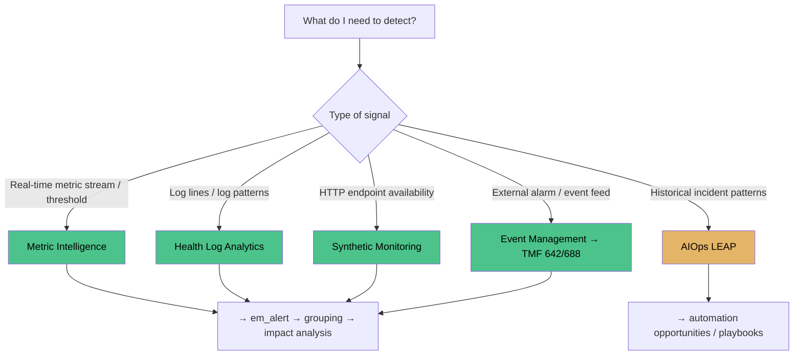
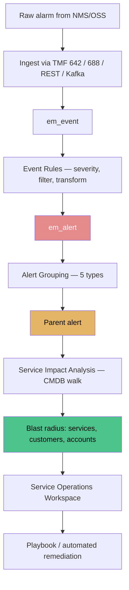

# TSOM Assurance — Event Management, AIOps, Service Impact & Synthetic Monitoring

**Agent:** opencode  
**Date:** 2026-11-11  
**Module:** TSOM (Telecom Service Operations Management)  
**App:** TSOM / Service Assurance  
**Confidence:** verified against ServiceNow product documentation  
---

## Contents

- [Purpose](#purpose)
- [The TSOM Assurance Pipeline — End to End](#the-tsom-assurance-pipeline--end-to-end)
- [Where Each Assurance Capability Lives](#where-each-assurance-capability-lives)
- [Event Management & Alarm Ingestion](#event-management--alarm-ingestion)
- [Alert Management — Grouping vs Correlation](#alert-management--grouping-vs-correlation)
- [Metric Intelligence](#metric-intelligence)
- [Health Log Analytics](#health-log-analytics)
- [Service Impact Analysis](#service-impact-analysis)
- [Service Observability](#service-observability)
- [Synthetic Monitoring](#synthetic-monitoring)
- [AIOps LEAP — Automation & Playbooks](#aiops-leap--automation--playbooks)
- [Now Assist for ITOM — Alert Skills](#now-assist-for-itom--alert-skills)
- [The Proactive Service Workflow (Detect → Analyze → Communicate → Act)](#the-proactive-service-workflow-detect--analyze--communicate--act)
- [Assurance Decision Diagrams](#assurance-decision-diagrams)
- [Out-of-Box Assurance Features](#out-of-box-assurance-features)
- [Common Mistakes & Gotchas](#common-mistakes--gotchas)
- [Quiz](#quiz)
- [Related Guides](#related-guides)
- [Official Learning Resources](#official-learning-resources)

---

## Purpose

TSOM's assurance layer is how a communications service provider (CSP) moves from *"thousands of raw alarms"* to *"a handful of actionable, service-impacting issues."* It collects, correlates, prioritizes, and visualizes network and service health across access, transport, and core domains — and then tells you which customers are affected and how to fix it.

TSOM does not build every assurance engine from scratch. It composes ITOM capabilities — Event Management, Metric Intelligence, Health Log Analytics, Service Impact Analysis, Service Observability, Synthetic Monitoring, AIOps LEAP, and Now Assist for ITOM — around a telecom-aware CMDB and the TM Forum alarm/event APIs.

---

## The TSOM Assurance Pipeline — End to End

```mermaid
flowchart TD
    subgraph "Ingest — Alarms & Events"
        TMF642[TMF 642 Alarm API — CRUD alarms]
        TMF688[TMF 688 Event API — callback notifications]
        REST[REST Poll / Push]
        KAFKA[Kafka Stream Connect — bidirectional]
    end

    subgraph "Event Management"
        EM[em_event / em_alert]
        ER[Event Rules — filter, transform, assign severity]
        AC[Alert Correlation Rules]
    end

    subgraph "AIOps — Detection"
        MI[Metric Intelligence — anomaly vs learned baseline]
        HLA[Health Log Analytics — log anomaly → event]
        SM[Synthetic Monitoring — HTTP endpoint tests]
    end

    subgraph "Grouping & Impact"
        GRP[Alert Grouping — 5 types → parent alert]
        SIA[Service Impact Analysis — walk CMDB service model]
    end

    subgraph "Act"
        SOW[Service Operations Workspace]
        PLAY[Playbooks / Automated Remediation]
        LEAP[LEAP — automation opportunities]
        NA[Now Assist — Alert Investigation / Analysis]
    end

    TMF642 --> EM
    TMF688 --> EM
    REST --> EM
    KAFKA --> EM
    EM --> ER
    ER --> AC
    MI --> EM
    HLA --> EM
    SM --> EM
    AC --> GRP
    GRP --> SIA
    SIA --> SOW
    SIA --> PLAY
    LEAP --> PLAY
    NA --> SOW

    style EM fill:#0b0e11,stroke:#4cc38a,stroke-width:2px
    style GRP fill:#e5b567,color:#000
    style SIA fill:#4cc38a,color:#000
    style SOW fill:#e58a8a,color:#fff
```

**The short version:** Raw alarms → Event Management (rules/correlation) → AIOps detection (Metric Intelligence / HLA / Synthetic) → Alert Grouping → Service Impact Analysis (blast radius) → Service Operations Workspace + Playbooks.

---

## Where Each Assurance Capability Lives

TSOM is not one doc tree. Most assurance capabilities are ITOM features that TSOM consumes, documented under their own ITOM breadcrumb.

| Capability | Product doc cluster / breadcrumb | TSOM role |
|------------|----------------------------------|-----------|
| TSOM assurance overview, discrepancy ID&R, TMF APIs | **Telecom Service Operations Management** (`/docs/r/telecom-service-ops/…`) | TSOM-specific framing: Telecom Assurance, Fault Management |
| Event Management / alert grouping | **ITOM → Event Management** | Alert ingestion, correlation rules, grouping types, suppression |
| Metric Intelligence | **ITOM → Metric Intelligence** | Statistical anomaly detection over CI metrics |
| Health Log Analytics | **ITOM → Health Log Analytics** | Log triage, baseline comparison, root cause |
| Service Impact Analysis | **ITOM → Service Impact Analysis** | Blast radius — which services/customers does this break? |
| Service Observability | **Service Operations Workspace** | Operator-facing health signals, related entity visibility |
| Synthetic Monitoring | **ITOM → Synthetic monitoring** (`com.snc.uib.sow_synthetics`) | Proactive HTTP endpoint tests |
| AIOps LEAP | **ITOM → AIOps LEAP** | Automation opportunities + remediation playbooks |
| Now Assist for ITOM | **Now Assist for IT Operations Management** | Alert Investigation / Alert Analysis generative skills |
| Telecom Discovery patterns | **ITOM Discovery → Discovery patterns** (`sn_tsom_patterns`) | SNMP/CLI collection from network elements |
| Service Graph Connectors | **Service Graph Connectors → <connector> → Setup** | EMS/NMS/controller imports via API |

**Interview-safe phrasing:** *"TSOM sits on top of ITOM. The telecom layer is the data model, discovery patterns, and TM Forum APIs; the assurance engine underneath is Event Management, Metric Intelligence, Health Log Analytics, and Service Impact Analysis — each documented in its own ITOM tree."*

---

## Event Management & Alarm Ingestion

This is how alarms get into ServiceNow. Two directions exist, and confusing them is a classic exam trap.

| Mechanism | Direction | What it does |
|-----------|-----------|--------------|
| **TMF 642 Alarm Management Open API** (`sn_ind_tmf642`) | Inbound + outbound | RESTful CRUD contract for alarms — external OSS creates/updates/clears alarm records in a standard schema |
| **TMF 688 Event Management API notifications** | Inbound | Subscription-based: external system registers a callback URL; each pushed notification triggers an event-creation flow |
| **REST Poll / Push** | Inbound | Generic pull on a schedule or push to an endpoint; per-payload, not a stream |
| **Kafka Stream Connect** | Bidirectional | The streaming option — consumes external Kafka topics into ServiceNow **and** publishes event data back to the platform |

**Rule of thumb:** *CRUD on alarms → TMF 642. Callback notifications → TMF 688. Sustained bidirectional streaming → Kafka Stream Connect.*

TSOM documentation calls the whole inbound side **External event management via Telecommunications API notifications**, TM Forum-aligned (TMF 642 for alarms, TMF 688 for events).

### Event Rules

Once an event lands in `em_event`, Event Rules filter, transform, enrich, and assign severity before it becomes an alert (`em_alert`). Rules run at event create/update. A well-tuned rule set is what turns raw traps into a workable alert list instead of a wall of noise.

---

## Alert Management — Grouping vs Correlation

A regional fibre cut produces thousands of downstream alarms. Untriaged, that is **alert fatigue** — operators dismiss alerts wholesale and miss the one that mattered. ServiceNow publishes *up to ~98–99% event noise reduction* with proper alert management.

### Grouping vs Correlation — the distinction that gets tested

| | **Grouping** | **Correlation** |
|---|-------------|-----------------|
| Question it answers | *Which of these alerts are the same problem?* | *What does this problem break, and for whom?* |
| What it does | Combines related child alerts into one **parent alert** — one actionable item | Maps grouped alerts to **services, customers, accounts** via the CMDB/service model |
| Output | Volume reduction | Business impact / prioritisation |
| Driven by | Event Management grouping rules | Service Impact Analysis + CMDB service model |

They are complementary: grouping shrinks the queue; correlation makes the surviving items rankable.

### The five grouping types (Event Management)

| Type | Icon | Formed by |
|------|------|-----------|
| **Rule-based** | R | Alert correlation rules — business rule on `em_alert` at create/update |
| **Automated / aggregated** | A | ML + alert aggregation: alerts sharing CI type and metric name, virtual primary alert; scheduled job |
| **CMDB-based** | C | CI relationships in the CMDB; catches what rules and automation missed; scheduled job |
| **Text-based** | T | Similar frequently-used words in Description / Metric Name / CI Class; scheduled job |
| **Tag cluster** | Tag | User-defined tag clustering definitions; scheduled job |

### Temporal analysis

Grouping has several dimensions: **temporal** (did these fire close together in a rolling window?), **topological** (Discovery/Service Map data — are they on related CIs?), **CMDB relationship** (shared ancestor/dependency?), and **content** (ML/NLP tagging of the alert text).

Temporal analysis is the time dimension — flapping and bursty alerts inside a rolling window are recognized as one pattern, and repeated time-of-day patterns expose chronic issues as a single problem instead of daily noise.

**Caveat:** the temporal window is evaluated continuously in the product; a nightly offline batch over a 30-day window is the wrong framing — that belongs to the CMDB-based, automated, and text grouping jobs, not temporal pattern analysis.

---

## Metric Intelligence

**Purpose:** Monitor performance trends, detect **threshold breaches and anomalies** in metrics, and surface issues before customers notice.

| | Traditional threshold tool | Metric Intelligence |
|---|---------------------------|---------------------|
| Who defines "abnormal" | A human writes a static rule (e.g., "CPU > 90% for 5 min") | It **learns each metric's normal shape**, including seasonality |
| What fires | The configured condition | **Deviation from the learned baseline**, with an anomaly score (0–10 — higher means greater risk of service disruption) |
| Blind spot | Slow drift; false positives on legitimately spiky series | Catches subtle drift below any hard threshold |

**Tooling:** Statistical models project expected values with control bounds. **Insights Explorer** shows metric statistics and charts. The **Anomaly Map** plots correlated anomaly scores across CIs on a timeline. Anomalies can be promoted to regular IT alerts and appear in Service Operations Workspace and service-health dashboards.

**Key distinction:** Metric Intelligence is *not* the log analyser. It is the source of **metric alerts**. Metrics tell you *how much / how fast*; logs (HLA) tell you *why*.

---

## Health Log Analytics

**Purpose:** Analyze large volumes of telecom infrastructure **logs**, compare them against a **baseline**, triage related issues, and identify the **underlying cause** of recurring service degradation.

**What happens on detection:** HLA raises the anomaly and **forwards it as an event to Event Management**, where it is correlated with alarms and metric anomalies for the same CI and service and becomes part of the normal alert path. It does not open CMDB tasks, does not write into Metric Intelligence's queue, and does not silently annotate CI records.

**Metric Intelligence vs HLA in one line:** metrics tell you *how much / how fast*; logs tell you *why*.

---

## Service Impact Analysis

**Purpose:** Walk the service model to answer: *which services, customers, and accounts does this broken thing hurt?* It is what makes a port failure a business decision rather than just a network event.

Service Impact Analysis traverses the CMDB service model (services → service offerings → CIs → relationships) to calculate **blast radius**. A failed OLT isn't just "a device down" — it's "500 broadband customers in the North region affected."

**Input:** Grouped/parented alerts from Event Management + CMDB service model relationships.
**Output:** Prioritized list of impacted services, customers, and accounts — ranked by business impact.

---

## Service Observability

**Purpose:** The operator-facing view inside **Service Operations Workspace**, built from four capabilities:

| Capability | What it gives the operator |
|------------|---------------------------|
| **Health signal centralization** | Metrics, logs, and alerts from many sources in one pane — *what are the signals saying?* |
| **Related entity visibility** | The CIs, services, and infrastructure components related to the record — *who is involved, and is this device the contributor?* |
| **Service goal tracking** | SLO / health-goal status per service — the scoreboard |
| **Observability vendor integration** | The plumbing that pulls third-party observability data in |

When an operator is asked to determine *whether a network device, service, or infrastructure component is contributing to an incident*, the capability being exercised is **related entity visibility**.

---

## Synthetic Monitoring

**Breadcrumb:** IT Operations Management → Synthetic monitoring (plugin `com.snc.uib.sow_synthetics`).

**Purpose:** Run automated tests against HTTP endpoints **before subscribers complain** — continually calling endpoints registered in the CMDB (`cmdb_ci_endpoint_http`) and checking availability, response time, status code, or the presence of a defined string in the body.

| Aspect | Detail |
|--------|--------|
| Test target | HTTP endpoint CIs (`cmdb_ci_endpoint_http`) — must exist in the CMDB |
| Pass/fail criteria | e.g. status 200 **and** response time < 500 ms |
| Where tests run | Agent Client Collector (ACC), a **MID Server**, or a ServiceNow-hosted location (public endpoints only) |
| On failure | Alert sent through Event Management (alert settings toggled per monitor, with chosen severity), assigned to the monitor's support group |
| Extras | Create monitors from incidents (post-incident recommended action), API Insights-discovered API monitors, monitor history with full alert context |

**Why the distractors fail:** Metric Intelligence watches *real* metric streams; Service Observability is where you *see* results; HLA reads logs. None of them execute a test transaction — only Synthetic Monitoring does.

---

## AIOps LEAP — Automation & Playbooks

**Purpose:** Identify **automation opportunities** and generate **remediation playbooks** from evidence.

What it does with your history:
- Clusters incidents by short description and assignment group (via the Group Action Framework), using historical work notes and resolution notes.
- Treats those clusters as **automation opportunities**.
- **Recommends automations** and generates **actionable playbooks** from the resolution workflows it saw.
- Accumulates a knowledge base of documented resolution steps, and can create problem records for root-cause work.

**So:** LEAP is the *"what should we stop doing by hand?"* layer — not monitoring, not discovery, not inventory reconciliation.

---

## Now Assist for ITOM — Alert Skills

Both sound alike; they answer different questions.

| Skill | Question it answers | What the agent gets |
|-------|--------------------|---------------------|
| **Alert Investigation** | *"What is this alert right now, and how bad is it?"* | A concise generative summary of the alert, its potential **service impact**, and next steps |
| **Alert Analysis** | *"How was this solved before?"* | Resolution insights drawn from **similar past alerts/incidents**, including who fixed it and how |

Given a fresh BGP peer-down on a core router: the agent judging **impact** uses Alert Investigation; the agent looking for **how it was resolved last time on that router** uses Alert Analysis.

**Remember:** Now Assist *assists*; it does not autonomously manage alerts end-to-end, and AI-driven assignment rules are routing configuration, not a Now Assist summarisation skill.

---

## The Proactive Service Workflow (Detect → Analyze → Communicate → Act)

TSOM's story is a four-stage loop, easy to reorder by accident:

| Stage | What happens | Typical confusion |
|-------|-------------|-------------------|
| **Detect** | Gather alerts from multiple network domains via AIOps; eliminate up to ~98% of noise so only actionable alerts reach the operator | Confused with correlation |
| **Analyze** | Correlate related events, group them into actionable alerts, and identify **which customers are affected** | Confused with Communicate — impact *identification* is analysis, impact *notification* is communication |
| **Communicate** | Generate incidents from detected issues, correlate them to related cases, and **notify affected customers** about service disruptions | The stage people forget exists |
| **Act / Remediate** | Collaborate with support teams and use automation integrations to remediate using **predefined workflows** | If a question mentions "predefined workflow" or "playbook runs", it is this stage |

---

## Assurance Decision Diagrams

### Detection Capability Selector

### Alert Path — Raw Alarm to Service Impact

---

## Out-of-Box Assurance Features

| Feature | Description | Where |
|---------|-------------|-------|
| Alarms | Correlate network alarms into service-impacting events | All > TSOM > Alarms |
| Event Management | Event rules, alert correlation, suppression, grouping | All > Event Management > Event Rules / Alert Correlation |
| Metric Intelligence | Anomaly detection over metric baselines | ITOM → Metric Intelligence |
| Health Log Analytics | Log analysis, baseline comparison, root cause | ITOM → Health Log Analytics |
| Service Impact Analysis | Blast radius — which services/customers are affected | ITOM → Service Impact Analysis |
| Service Observability | Health signals, related entity visibility, SLO tracking | Service Operations Workspace |
| Synthetic Monitoring | Proactive HTTP endpoint tests | ITOM → Synthetic monitoring |
| AIOps LEAP | Automation opportunities + remediation playbooks | ITOM → AIOps LEAP |
| Now Assist for ITOM | Alert Investigation / Alert Analysis generative skills | Now Assist for IT Operations Management |
| Service Operations Workspace | Operator console for assurance triage | All > Service Operations > Service Operations Workspace |

---

## Common Mistakes & Gotchas

| Mistake | Symptom | Fix |
|---------|---------|-----|
| Confusing grouping with correlation | Can't explain why alerts were merged vs which services are affected | Grouping = same problem (volume reduction); correlation = business impact via CMDB |
| Treating HLA as a log viewer | Expecting HLA to store/search all logs indefinitely | HLA analyzes logs against a baseline and forwards anomalies to EM; it's not a general log archive |
| Using static thresholds for everything | False positives on spiky metrics; missed slow drift | Use Metric Intelligence for learned baselines; reserve static thresholds for hard safety limits |
| Forgetting the CMDB service model | Service Impact Analysis returns empty blast radius | Populate `cmdb_ci_service` + relationships; impact analysis walks the model |
| Confusing Synthetic Monitoring with real monitoring | Expecting synthetic tests to replace metric collection | Synthetic = proactive transaction test; Metric Intelligence = real observed metric stream |
| Assuming Now Assist acts autonomously | Expecting AI to close tickets without human input | Now Assist summarizes and recommends; a human (or playbook) still acts |

---

## Quiz

1. What is the difference between alert grouping and alert correlation?  
   

Answer
Grouping combines related child alerts into one parent alert (volume reduction). Correlation maps alerts to services/customers/accounts via the CMDB (business impact/prioritisation).

2. Which TSOM assurance capability detects deviations from a learned metric baseline rather than a static threshold?  
   

Answer
Metric Intelligence.

3. What does Health Log Analytics do when it detects a log anomaly?  
   

Answer
Forwards it as an event to Event Management, where it is correlated with alarms and metric anomalies.

4. Which capability proactively tests HTTP endpoints before subscribers complain?  
   

Answer
Synthetic Monitoring (ITOM → Synthetic monitoring, plugin `com.snc.uib.sow_synthetics`).

5. What does Service Impact Analysis use to calculate blast radius?  
   

Answer
The CMDB service model — services, service offerings, CIs, and their relationships.

6. Which two Now Assist for ITOM alert skills exist, and what does each answer?  
   

Answer
Alert Investigation ("What is this alert now, and how bad?") and Alert Analysis ("How was this solved before?").

7. Is TSOM's assurance engine documented under the Telecom doc tree or the ITOM doc tree?  
   

Answer
Mostly ITOM (Event Management, Metric Intelligence, HLA, SIA, Synthetic Monitoring each have their own ITOM breadcrumb); TSOM provides the telecom framing, TMF APIs, and data model.

8. What is AIOps LEAP's role in assurance?  
   

Answer
Identifies automation opportunities from historical incident clusters and generates remediation playbooks.

---

## Related Guides

- [TSOM guide](./tsom-guide.md) — module overview, data model, discovery, integrations
- [TSOM capabilities](./tsom-capabilities.md) — companion capability map with doc breadcrumbs for every TSOM piece
- [CMDB guide](./cmdb-guide.md) — CI model, IRE, relationships that Service Impact Analysis walks
- [Discovery guide](./discovery-guide.md) — telecom discovery patterns (SNMP/CLI), Service Graph Connectors
- [ITSM guide](./itsm-guide.md) — incident/case handling that assurance alerts feed into

---

## Official Learning Resources

### Now Learning (Structured Training)

- [Telecom Service Operations Management](https://nowlearning.com/) — Search "TSOM" on Now Learning Portal
- [Event Management Fundamentals](https://nowlearning.com/) — Search "Event Management" on Now Learning Portal
- [Operational Intelligence Fundamentals](https://nowlearning.com/) — Search "Metric Intelligence" / "Health Log Analytics" on Now Learning Portal
- [Service Operations Workspace](https://nowlearning.com/) — Search "Service Operations Workspace" on Now Learning Portal

### Product Documentation (Technical Reference)

- [ServiceNow Product Documentation — TSOM](https://docs.servicenow.com/) → Search "Telecom Service Operations Management", "Telecom Assurance", "Fault Management"
- [ServiceNow Product Documentation — Event Management](https://docs.servicenow.com/) → Search "alert grouping", "correlation rules"
- [ServiceNow Product Documentation — Metric Intelligence](https://docs.servicenow.com/) → Search "anomaly detection", "Insights Explorer"
- [ServiceNow Product Documentation — Health Log Analytics](https://docs.servicenow.com/) → Search "log anomaly", "baseline"

### Official Videos & Playlists

- [ServiceNow YouTube Channel](https://www.youtube.com/c/ServiceNow) — Search "ServiceNow TSOM", "ServiceNow Event Management", "ServiceNow Metric Intelligence", "ServiceNow Synthetic Monitoring"
- [TSOM overview](https://www.youtube.com/watch?v=L3VzhB5uD3M)
- [What's new in ServiceNow for Telecom](https://www.youtube.com/watch?v=Njyt-YgpONY)

---
