# TSOM — Telecom Service Operations Management

**Agent:** opencode  
**Date:** 2026-11-05  
**Module:** TSOM (Telecom Service Operations Management)  
**App:** TSOM  
**Confidence:** verify  

---

## Contents

- [Capabilities — assurance, AIOps, AI, inventory](tsom-capabilities.md) — *companion page: Event Management, Metric Intelligence, Health Log Analytics, Service Impact Analysis, Synthetic Monitoring, AIOps LEAP, Now Assist, discovery protocols, TNI class hierarchy, discrepancy remediation, plus the doc breadcrumb for each*
- [Purpose](#purpose)
- [ELI5 — the whole module in plain English](#eli5--the-whole-module-in-plain-english)
  - [What each word actually means](#what-each-word-actually-means)
  - [The one-sentence version](#the-one-sentence-version)
- [Where to Find It](#where-to-find-it)
- [Prerequisites & Setup](#prerequisites--setup)
  - [Does a PDI support telecom out of the box?](#does-a-pdi-support-telecom-out-of-the-box)
  - [What is out of the box vs what you install](#what-is-out-of-the-box-vs-what-you-install)
  - [Plugin and application dependencies](#plugin-and-application-dependencies)
  - [Do you need CSM for TSOM to work?](#do-you-need-csm-for-tsom-to-work)
- [Exploring TSOM — the official picture (Australia docs)](#exploring-tsom--the-official-picture-australia-docs)
  - [The Telecom data model](#the-telecom-data-model)
  - [Telecom Visibility — and how it differs from ITOM Visibility](#telecom-visibility--and-how-it-differs-from-itom-visibility)
  - [Success measures, by phase](#success-measures-by-phase)
- [Re-usable Code / Metadata](#re-usable-code--metadata)
- [Out-of-Box Features](#out-of-box-features)
- [Key Table Hierarchy](#key-table-hierarchy)
- [Integrations](#integrations)
- [Key Fields](#key-fields)
- [Common Mistakes](#common-mistakes)
- [Goals, Benefits & Key Metrics](#goals-benefits--key-metrics)
- [Core Concept Diagrams](#core-concept-diagrams)
  - [Alarm → Event → Alert → Incident Flow](#alarm--event--alert--incident-flow)
  - [Telecom CI Hierarchy](#telecom-ci-hierarchy)
  - [Service → Customer Impact Map (Blast Radius)](#service--customer-impact-map-blast-radius)
- [Implementer Labs — What Actually Exists (Researched 2026-11-05)](#implementer-labs--what-actually-exists-researched-2026-11-05)
- [Lab: Create Your First Telecom Service](#lab-create-your-first-telecom-service)
- [📺 Visual & Video Guides](#-visual--video-guides)
- [SLAs, Dashboards & Workspaces](#slas-dashboards--workspaces)
- [Quiz](#quiz)
- [TSOM Implementer Curriculum Cross-Check](#tsom-implementer-curriculum-cross-check)
  - [Event Management Fundamentals — TSOM's alarm engine](#event-management-fundamentals--tsoms-alarm-engine)
  - [Event and Flow in Action](#event-and-flow-in-action)
  - [Operational Intelligence Fundamentals — metrics, logs, and ML anomaly detection](#operational-intelligence-fundamentals--metrics-logs-and-ml-anomaly-detection)
  - [Now Assist for ITOM — Implementer level](#now-assist-for-itom--implementer-level)
  - [Service Graph Connector for OpenTelemetry — TSOM angle](#service-graph-connector-for-opentelemetry--tsom-angle)
- [TSOM Implementer Skill Coverage — All 15 Course Skills](#tsom-implementer-skill-coverage--all-15-course-skills)
- [🎓 Official Learning Resources](#-official-learning-resources)
- [Related Guides](#related-guides)

---

## Purpose

ServiceNow Telecom Service Operations Management (TSOM) is purpose-built for communications service providers (CSPs). It manages the lifecycle of telecom services—from order capture through activation, assurance, and billing—using telecom-specific data models, inventory, and orchestration. TSOM is where ITIL meets telecom: incidents are alarms, changes are network changes, and assets are network elements.

---

## ELI5 — the whole module in plain English

A hospital patient monitor does three things: it watches the body, it beeps when something is
wrong, and it tells the nurse *which patient* is in trouble. TSOM is that monitor for a telecom
network:

- the **body** is the network — routers, switches, fibre, ports, circuits;
- the **beep** is an alarm from a device or from the vendor software that manages it;
- the **patient** is the customer service running over that network — a business's internet
  line, a phone service, a mobile data session.

Without TSOM you get the beeps (hundreds of them, from five different tools) but not the patient.
TSOM's job is to connect the two: *"this port is down → this circuit is down → this customer's
service is degraded → these 40 subscribers are affected → raise one incident, not forty."*

### What each word actually means

| Term | Plain English | Why you care |
|---|---|---|
| **Event** | Anything that happened, recorded. Like a CCTV tape: most of it is boring. | Raw material; too many to look at |
| **Alarm** | An event that says *something is wrong* — a device (or the software managing it) raised its hand. Like a smoke detector beeping. | This is what the network produces |
| **Alert** | The platform's cleaned-up version of one or more alarms — scored, de-duplicated, assigned to a service. Like the fire panel showing one light for 40 smoking detectors. | This is what a human works |
| **Clear** | The device says the problem is over, so the alarm closes. | Unclosed alarms are how dashboards lie |
| **Severity** | How bad: critical → major → minor → warning. | Drives who gets woken up |
| **Probable cause** | The device's guess at *why* (link down, power failure, threshold crossed). | The first clue for root cause |
| **CI** (configuration item) | Any "thing" you manage: a router, a port, a circuit, a service. Think of one line in an inventory list. | Everything in TSOM hangs off CIs |
| **CMDB** | The database of every CI and how they connect. An address book plus a family tree for your infrastructure. | If the CMDB is wrong, every answer is wrong |
| **Relationship** | "This router connects to that switch", "this service runs over that circuit". | Relationships are how impact travels |
| **Service** | What the customer actually buys and feels: internet line, voice, VPN. The business view on top of the hardware. | The only layer customers understand |
| **Impact / blast radius** | Everything downstream of a broken thing. | Turns a port failure into a business decision |
| **Incident** | The ticket a human works when something is broken. | What TSOM raises so the NOC has something to close |
| **Change** | A planned, approved modification — the difference between "we fixed it" and "we changed it on purpose". | Network work is mostly change work |
| **NOC** | Network Operations Center — the room with the big screens where people watch alarms all day. | Your user is a NOC engineer, not a form-filler |
| **EMS / NMS** | Vendor software that manages network devices (Element Management System / Network Management System). e.g. Nokia, Cisco, Ericsson tools. | Your main data source |
| **SNMP** | An old, simple protocol devices use to report health. | The cheapest way to get alarms |
| **MID Server** | A small ServiceNow agent running inside your network that reaches devices the cloud cannot. | Half of telecom integration is MID Server placement |
| **Discovery** | Automatic scanning that fills the CMDB for you instead of typing records by hand. | Keeps inventory honest |
| **ETL** | Extract, Transform, Load: pull data out of a system, reshape it to fit our model, store it. | The Telecom Discovery Builder is an ETL framework |
| **Reconciliation (IRE)** | Deciding whether an incoming record is a brand-new thing or the same thing you already have. Prevents 12 copies of one router. | Bad reconciliation = duplicate CIs = wrong impact |
| **Discrepancy** | The gap between what discovery found and what the CMDB claims. | Your inventory quality score |
| **Topology** | The map of what connects to what. | The thing you draw on the whiteboard |
| **Circuit** | A rented path between two sites (fibre, MPLS, leased line). | The unit telecom customers buy |
| **SLA** | A promise about how fast you respond and fix. | Makes "down" measurable |
| **MTTD / MTTR** | Mean time to **detect** / mean time to **repair**. How long until you notice, and until it is fixed. | The two numbers TSOM exists to shrink |
| **Correlation** | Grouping alarms that share a cause into one alert. | 400 alarms → 1 incident |
| **Suppression** | Muting alarms during planned maintenance so the NOC is not woken for work they scheduled. | The most-requested feature in week one |
| **TNI** | Telecommunications Network Inventory — the app that stores the *inventory* of network gear and circuits (a separate product from TSOM). | Where the "body" is modelled |
| **CSDM** | ServiceNow's standard, opinionated way of organising services and CIs. | Speak it and you sound senior |
| **Orchestration** | An automated sequence of steps that makes something happen (provision, activate, remediate). | Where TSOM is heading: auto-remediation |

### The one-sentence version

> **TSOM watches the network, decides which customer service is hurt, and gives the NOC one
> prioritised work item instead of a wall of alarms.**


---

## Where to Find It

| Breadcrumb | Path |
|------------|------|
| Module entry | All > Telecom Service Operations > ... |
| TSOM Home | All > Telecom Service Operations > Home |
| Inventory | All > Telecom Service Operations > Inventory > ... |
| Service Inventory | All > Telecom Service Operations > Service Inventory > ... |
| Network Inventory | All > Telecom Service Operations > Network Inventory > ... |
| Service Order | All > Telecom Service Operations > Service Orders > All |
| Alarms | All > Telecom Service Operations > Alarms > All |
| Administration | All > Telecom Service Operations > Administration > ... |

**Not here:** the assurance *engine* is not under these menus. Event Management, Metric Intelligence,
Health Log Analytics and **Synthetic Monitoring** are ITOM features TSOM consumes, and each has its own
breadcrumb (Synthetic Monitoring lives under **IT Operations Management → Synthetic monitoring**).
See the [capabilities page](tsom-capabilities.md#1-breadcrumb-map--where-each-capability-actually-lives)
for the full map before you go hunting in Telecom Service Operations.

**Tip:** If you don't see these menus, the TSOM application is not installed. The plugin to request is `com.sn_tsom_core` (Store app id `sn_tsom_core`) — see [Prerequisites and availability](#prerequisites-and-availability) below; there is no `com.snc.tsom` plugin.

---

## Prerequisites & Setup

> **Read this before you plan a lab.** Everything else in this guide assumes the TSOM
> applications are installed. They usually are not — including on a Personal Developer
> Instance.

### Plugins and Scoped Apps
- **TSOM Core**: `sn_tsom_core` / `com.sn_tsom_core` — the core app; installs the telecom data model, ETL framework and properties
- **TNI Advanced**: `sn_ni_adv` → installs `sn_ni_core` — **Separate app**, separate entitlement; install TNI Advanced, then load TNI Core demo data manually if you want it
- **CMDB CI Class Models**: `sn_cmdb_ci_class` — **Version 1.69.0+**; auto-upgraded by the TSOM apps
- **Expanded Model and Asset Classes**: `sn_ent` — Store app
- **Visibility Content**: `sn_pattern_design` — Store app
- **Integration Commons for CMDB**: `sn_cmdb_int_util` — Store app
- **IntegrationHub Starter Pack Installer**: `com.glide.hub.integration` — Family plugin
- **Discovery Core**: `com.snc.discovery.core` — Installed by Discovery
- **ITOM Discovery License**: `com.snc.itom.discovery.license` — Must be activated
- **ITOM Licensing**: `com.snc.itom.license` — Required for Discovery patterns
- **IntegrationHub ETL**: `sn_int_studio` — Development instances only
- **Telecom Discovery Patterns**: `sn_tsom_patterns` — for direct SNMP/CLI discovery
- **Telecom Alarm Management Open API**: `sn_ind_tmf642` — for alarm ingestion and incident detail views
- **Customer Service Problem Management**: `sn_sprb_mgmt` — for incident/alert detail views inside TNI

### Guided Setup Requirements
1. **Install TSOM apps** — Work with your ServiceNow account team to activate the TSOM subscription and install `sn_tsom_core`
2. **Install TNI separately** — Install `sn_ni_adv` (TNI Advanced), then load TNI Core demo data manually if you want it
3. **Install and configure MID Server** — Place a MID Server in each network zone; assign capabilities (SNMP, SSH, WMI) as needed
4. **Configure Discovery** — Set up Discovery schedules with telecom patterns; ensure horizontal discovery is operational
5. **Configure Service Graph Connectors** — Set up per-vendor connectors (Nokia Altiplano, Cisco Meraki SD-WAN, etc.) with API access and MID Server
6. **Configure Event Management** — Create event rules, alert correlation rules, and maintenance windows (All > Event Management > Event Rules)
7. **Set up Alarm API Topic & Subscriptions** — Create the Telecommunications API notification topic and endpoint subscriptions for southbound alarm sources
8. **Define Service Model Templates (CSDM)** — Define services and service-offering structures in the CMDB for impact analysis

### System Properties to Consider
- `sn_tsom_patterns.itom_pattern_enabled` — gates whether telecom discovery patterns are active
- `sn_tsom_core.audit.*` properties — control discrepancy audit logging, relationship types, and discovery sources
- `sn_tsom_core.em.*` properties — control event management integration behavior
- `sn_tsom_core.discovery.*` properties — control telecom discovery framework behavior

### Cross-Module Dependencies
- **Discovery / ITOM Visibility**: Must produce CIs in the CMDB; telecom discovery patterns (`sn_tsom_patterns`) extend Discovery for network elements
- **TNI**: Stores the telecom inventory; TSOM reconciles discovered data against TNI entities
- **Event Management**: TSOM consumes EM for alarm ingestion, correlation, suppression, and alert creation
- **CMDB**: Stores CIs and relationships; IRE identification rules prevent duplicate CIs
- **ITSM / CSM**: Required for the subscriber-facing story (entitlements, install base, cases); not required for TSOM Core/Visibility/TNI
- **Flow Designer / Orchestration**: For guided remediation workflows reacting to alerts and incidents
- **Now Assist for ITOM**: For AI-assisted alert investigation (separate SKU/entitlement)

### ACLs Related to Core Tables
- `admin` role for installation and configuration
- `sn_tsom.admin`, `sn_tsom.user`, `sn_tsom.reader` roles for TSOM access
- TNI inventory roles: `sn_ni_core.inventory_admin`, `sn_ni_core.inventory_agent`, `sn_ni_core.inventory_template_manager`, `sn_ni_core.telco_inventory_catalog_manager`
- `mid_server` role on instance side for MID Server service account
- `sam_admin` role for file signature normalization (when SAM is active)
- ACLs on `cmdb_ci_telco_equipment`, `cmdb_ci_network_packet_broker`, `em_event`, `em_alert`, `cmdb_ci_service`, `cmdb_rel_ci`

### Breadcrumbs — What Needs to Be Enabled First
1. **TSOM Subscription & Installation** — Request `sn_tsom_core` from your ServiceNow account team
2. **TNI Installation** — Install `sn_ni_adv` separately (separate entitlement)
3. **MID Server** — Install, validate, and confirm "Up" status (All > MID Server > Servers)
4. **Discovery** — Configure telecom discovery patterns and schedules (All > Discovery > Discovery Definition > Patterns)
5. **Service Graph Connectors** — Set up per-vendor connectors (All > Service Graph Connectors)
6. **Event Management** — Configure event rules, alert correlation, and maintenance windows (All > Event Management)
7. **Alarm API Topic** — Create the Telecommunications API notification topic and subscriptions (IntegrationHub / Event Management)
8. **Service Model (CSDM)** — Define services and service-offering structures (All > Configuration)

### Does a PDI support telecom out of the box?

**No, not by default.** Two independent gates apply:

1. **Subscription.** Every TSOM application is a ServiceNow Store app that requires a valid
   Telecommunications Service Operations Management subscription. The docs state this on each
   app page ("A valid Telecommunications Service Operations Management subscription is
   required…").
2. **Store apps on a PDI.** ServiceNow's own PDI guidance says many Store applications cannot be
   installed to PDIs, and plugins that require activation by ServiceNow personnel do not appear
   in the PDI plugin list at all.

So on a stock PDI you should expect the TSOM modules to be **absent**, not broken. Check
`System Applications > All Available Applications > All` (or the Developer Site →
*Manage my Instance → Plugins for your Instance*) and filter for `TSOM` / `sn_tsom`. If nothing
appears, the app is not entitled for that instance — no amount of role granting will change it.

**What you can still do on a PDI:** build the telecom *data model* by hand. The CMDB classes and
relationship types are ordinary platform records, so you can create equipment CIs, ports and
links, relate them to a `cmdb_ci_service`, and — if Event Management is available on your
instance — send test events and watch `em_event` → `em_alert`. That demonstrates the modelling
and the assurance pattern; it does not demonstrate the telecom connectors, TNI entities or the
alarm-management API.

**If you need the real thing:** ask your ServiceNow account team or a partner for a TSOM-enabled
non-production instance, or use an industry-demo instance in a guided workshop. Budget a day for
installation and data-source validation before you can demo anything.

### What is out of the box vs what you install

| Layer | Comes with installing `sn_tsom_core` / TSOM apps | You still have to do |
|---|---|---|
| Telecom data model | Telecom-aware CMDB classes (equipment, cards, slots, subslots, interfaces, ports, links, circuits), TNI-aligned hierarchy | Load/assert your inventory; map vendors and models |
| TNI entities | TNI entity records are generated when the TNI plugin is installed | Install TNI separately (`sn_ni_adv`), then populate |
| Discovery | Telecom Discovery Builder framework ETL (auto-provisioned generic ETL) | Clone the ETL per connector; build/validate the transform; schedule it |
| Discovery patterns | `sn_tsom_patterns` (Telco Discovery Patterns) for direct SNMP/CLI discovery | Credentials, SNMP access, MID Server placement |
| SGC connectors | Per-vendor connectors (Nokia Altiplano, Cisco Meraki SD-WAN, …) | A MID Server and API access to the controller |
| Assurance | Event Management integration, Telecom Alarm Management Open API (`sn_ind_tmf642`), correlation/suppression rules | Topic + subscription + endpoint activation; severity mapping; correlation rules |
| Reconciliation | Discrepancy identification and reconciliation, built on CMDB Health/Compliance certification audits | Audit definitions and remediation workflow |
| Workspaces | Telecom operations/visibility workspaces, service health dashboards | Onboarding users, tuning the views |

### Plugin and application dependencies

TSOM Visibility (`sn_tsom_core`) is the bundle most labs start with. The docs list these
dependencies:

| Item | ID | Notes |
|---|---|---|
| Telecom Service Operations Core | `sn_tsom_core` / `com.sn_tsom_core` | The core app; installs the telecom data model, ETL framework and properties |
| CMDB CI Class Models | `sn_cmdb_ci_class` | **Version 1.69.0+**; auto-upgraded by the TSOM apps |
| Expanded Model and Asset Classes | `sn_ent` | Store app |
| Visibility Content | `sn_pattern_design` | Store app |
| Integration Commons for CMDB | `sn_cmdb_int_util` | Store app |
| IntegrationHub Starter Pack Installer | `com.glide.hub.integration` | Family plugin |
| Discovery Core | `com.snc.discovery.core` | Installed by Discovery |
| ITOM Discovery License | `com.snc.itom.discovery.license` | Must be activated |
| ITOM Licensing | `com.snc.itom.license` | Required for Discovery patterns |
| IntegrationHub ETL | `sn_int_studio` | Development instances only |
| Telecommunications Network Inventory | `sn_ni_adv` → installs `sn_ni_core` | **Separate app**, separate entitlement; install TNI Advanced, then load TNI Core demo data manually if you want it |

Roles to plan for: `admin` for installation; TNI ships inventory roles such as
`sn_ni_core.inventory_admin`, `sn_ni_core.inventory_agent`,
`sn_ni_core.inventory_template_manager` and `sn_ni_core.telco_inventory_catalog_manager`.

### Do you need CSM for TSOM to work?

**No — not for TSOM Core, TSOM Visibility or TNI.** None of those dependency lists include
Customer Service Management.

**Yes, effectively, for the subscriber-facing story.** Three things change that answer:

- **Telecommunications Service Management (TSM)** — the telecom case/workflow layer — *extends*
  CSM. If your demo is "customer calls about a dead line, agent sees the affected service",
  CSM is the base.
- **Entitlements and install base** — knowing what a subscriber is owed comes from CSM data
  (`service_entitlement`, `sn_install_base_item`, `ast_contract`). TSOM can model the network
  without it; it cannot answer "is this customer entitled to a fix?"
- **TNI Remote Hands** — the docs list `sn_cs_sm_request` (Customer service install base
  management) as a requirement for that feature, and it is delivered through the CSM portal.

Also note the incident/alert detail views inside TNI require `sn_ind_tmf642` (Telecommunications
Alarm Management Open API) and `sn_sprb_mgmt` (Customer Service Problem Management) — so even
the "network-only" side pulls in apps you may not have.

**Practical answer for an interview:** TSOM does not depend on CSM to run; the *end-to-end
telecom service-assurance story* does, because CSM is where the subscriber, the entitlement and
the case live.


---

## Exploring TSOM — the official picture (Australia docs)

The Explore branch of the Australia docs is the product's own framing of itself. The guide's Purpose and ELI5 sections above are written in implementer language; this section records how ServiceNow itself defines TSOM, so nothing in the official picture is missing.

**The definition.** TSOM is a solution for communication service providers (CSPs) to proactively monitor, analyze, and resolve network and service issues before they impact customers. Built on the ServiceNow AI Platform, it provides a unified view across distributed, multi-domain telecom environments — collecting, correlating, and prioritizing events from the access, transport, and core domains — with service availability, operational efficiency, and customer satisfaction as the stated outcomes.

**How TSOM works** — six platform capabilities composed into one solution:

1. **External event management via Telecommunications API notifications** — standardized alarm ingestion (configured in §5.3).
2. **Event Management** — correlation, suppression, and prioritization of events.
3. **Metric Intelligence** — threshold breaches, performance degradation, and anomalies detected in real time.
4. **Health Log Analytics** — log analysis and root cause identification.
5. **Service Impact Analysis** — assessing and tracing disruptions by infrastructure and service impact.
6. **Service Graph Connectors and Discovery** — building the dynamic, telecom-aware CMDB.

**Key features (the docs' list):** real-time event monitoring; event correlation & analysis; Telecom Visibility with impact traceability; Service Impact Analysis; Metric Intelligence; Health Log Analytics; automated remediation via guided workflows and playbooks; the telecom-aware CMDB; and alert management (correlation, grouping, automated responses).

**Key benefits (the docs' list):** reduced MTTD and MTTR; improved operational efficiency through noise reduction and guided workflows; end-to-end visibility from infrastructure to customer-facing services; seamless integration with legacy and modern network management systems via open standards; and compliance verification aligned to TM Forum standards for service assurance.

**Key personas:** NOC agents (monitor events, execute guided resolutions) · Service Assurance managers (trends and resolution metrics) · System Integrators / administrators (data ingestion, correlation rules, workflows) · Back-office analysts (root cause, CI relationships in the CMDB).

**Platform integration:** TSOM is embedded in the AI Platform and integrates with Discovery, Service Mapping, CMDB, Flow Designer, and Playbooks — the same substrates the rest of this guide configures.

### The Telecom data model

The model the whole solution writes into. It extends the core CMDB CI model to represent telecom networks consistently and at scale, covering **physical and logical** components and organizing them with **containment and consumption** relationships. It is deliberately **technology-agnostic and extensible**: existing CMDB classes are reused wherever possible, and telecom-specific classes are introduced only where needed. Key components: network equipment and hardware (with contained components such as interface cards and ports) · interfaces and ports · sites and locations · links, circuits, and connections. Specialized hardware classes hang under Telco Equipment (`cmdb_ci_telco_equipment`) — the docs name the **Network Packet Broker** (`cmdb_ci_network_packet_broker`) as an example. **Domain-specific data models** specialize this core for a technology while keeping its structure — the docs give the **SD-WAN data model** (topology, services, operations) as the worked example, and the **MPN data model** from §6.4 is the other.

### Telecom Visibility — and how it differs from ITOM Visibility

Telecom Visibility extends ITOM Visibility for telecom providers: where ITOM Visibility discovers IT infrastructure, Telecom Visibility discovers **real-time physical and logical network components**, reconciles discrepancies between discovered and inventoried data, and maintains the telecom model across **both the CMDB and TNI**. Its five capabilities (per the docs): Telecom Discovery with patterns (SNMP/CLI, predefined telecom patterns) · SGC integration (EMS/NMS/controller imports via API, scheduled or o

... [OUTPUT TRUNCATED - 158 chars omitted out of 50,088 total] ...

.

 handling time from the swivel-chair improvement; increase in agent utilization |
| Walk → Run | Visible increase in first contact resolution; case deflection due to self-service; reduction in case volume due to self-service; identification of the customer's preferred contact channel; decrease in case resolution time |
| Run → Fly | Visible increase in agent productivity from reduced manual tasks; increase in case deflections due to Virtual Agent; reduction in ongoing case assignments; standardization in customer support; decrease in agent onboarding time |
| Fly (steady state) | Automation of improvement initiatives (agent, customer); higher % of AI-driven decisions than non-AI; greater transparency for customers; same customer experience from in-sourced support as outsourced |

### Success measures, by phase

| Phase | Measures named on the diagram |
|-------|-------------------------------|
| Foundation | Agent productivity · agent satisfaction score · portal click-through rate · Average Handling Time · self-service usage rate · prospect conversion rate · cases not updated in the last 30 days |
| Crawl | Customer churn · open-to-sales rate · summed call volume · Mean Time To Resolve cases · ticket resolution per hour · average case age · average case assignment duration |
| Walk | Rate of customer loyalty · % of OLAs breached · rate of change requests closed successfully · Average Revenue Per User (ARPU) · problem by resolution code · Quality of Service · Return On Invested Capital |
| Run | Average service outage · number of interactions per channel · number of events which ended in correlation · number of proactive alerts · number of call deflections · digital channels breakdown · number of Network Disruptions |
| Fly | Number of truck rolls · First Call Resolution · impacted customers per month · summed applicable outage cost · network performance score · network operating cost · % of cases closed through automation |

Note the shape of the Run/Fly measures — *events ending in correlation*, *proactive alerts*, *network disruptions*, *truck rolls*, *outage cost*: that is the TSOM value story told in the customer's numbers, and it only becomes measurable if the earlier phases built the inventory and event pipeline those numbers come from.

---

## Re-usable Code / Metadata

### Scoped Application

TSOM ships as a scoped application. This means:

| Scope Aspect | Detail |
|--------------|--------|
| Scope name | `com.snc.tsom` |
| Cross-scope access | Required to read/write TSOM tables from global scope |
| Tables | Prefixed `u_` when custom; OOB TSOM tables use native names |
| Roles | `sn_tsom.admin`, `sn_tsom.user`, `sn_tsom.reader` |

### Meta Data Patterns

| Metadata Element | Example | Notes |
|------------------|---------|-------|
| Application menu | `sn_tsom.menu.main` | Defines left-nav items |
| Module | `sn_tsom.menu.inventory` | Points to a table/list view |
| Table extension | `cmdb_ci` extends `cmdb_ci_network` | Telecom CIs inherit from generic CIs |
| Choice list | `sn_tsom.service_status` | Active, Pending, Suspended, Retired |
| UI Policy | `sn_tsom.policy.validate_service_order` | Conditionally shows fields based on service type |

### The re-usable metadata inventory

TSOM reuses the Discovery/ITOM machinery plus its own telecom layer — these are the objects you configure once:

| Re-usable piece | What it is | Where it lives (breadcrumb) |
|-----------------|------------|------------------------------|
| **TSOM discovery patterns** | The telecom pattern set (`sn_tsom_patterns` scope) that identifies network elements — reused by every telecom discovery run, and gated by the `sn_tsom_patterns.itom_pattern_enabled` property covered in section 5.1. Customizing one follows the Discovery guide's pattern deep dive (copy, never edit in place). | All > Discovery > Discovery Definition > **Patterns** (Pattern Designer) |
| **Service Graph Connector definitions** | Each connector (Nokia Altiplano, NSP, Cisco Meraki, …) is a reusable definition: connection, data source, and the **Telecom Discovery Builder ETL** map that turns its payload into TNI-model CIs. Clone and adapt the ETL per connector — never edit the core map in place (see section 5.2). | All > Service Graph Connectors / the connector's guided setup |
| **Discrepancy audit configuration** | The audit definition plus the `sn_tsom_core.audit.*` properties (log level, relationship types, discovery sources) form one reusable reconciliation rule set: it judges *every* discovered-vs-inventory comparison the same way. | CMDB Health / Compliance + the properties in section 5.1 |
| **Event & alert rules (Event Management)** | Event rules, alert correlation rules, and maintenance windows are shared noise-reduction logic: defined once, applied to every alarm every connector raises — this is what turns raw traps into a workable alert list. | All > Event Management > **Event Rules** / **Alert Correlation** |
| **Alarm API topic & subscriptions** | The Telecom Alarm Management Open API topic and its endpoint subscriptions are a single reusable integration contract for all southbound alarm sources. | IntegrationHub / Event Management (alarm path, section 5.2 step 9) |
| **TM Forum API definitions** | The inventory/resource APIs TSOM exposes and consumes follow TM Forum contracts — one definition reused by every OSS/BSS integration instead of point-to-point mappings. | API / integration definitions for the TSOM applications |
| **Service model templates (CSDM)** | The service and service-offering structures impact analysis walks: defined once in the CMDB, reused by every alert's blast-radius calculation. | All > Configuration (services / offerings) — see the ITSM guide's CSDM deep dive |

### Re-usable Code Snippets

#### REST Message Outbound (Telco API call)

```javascript
var rm = new sn_ws.RESTMessageV2('TSOM External API', 'GET');
rm.setEndpoint('https://api.telco-provider.com/v1/services');
rm.setHttpHeader('Content-Type', 'application/json');
rm.setRequestHeader('Authorization', 'Bearer ' + gs.getProperty('tsom.api.token'));
var response = rm.execute();
var httpStatus = response.getStatusCode();
var body = response.getBody();
if (httpStatus === 200) {
    var jsonResponse = new JSON().decode(body);
    gs.print('Service count: ' + jsonResponse.services.length);
} else {
    gs.error('API call failed: ' + httpStatus + ' - ' + body);
}
```

#### Business Rule: Auto-assign Service Order

```javascript
(function rule(current, previous) {
    if (current.operation() == 'insert' && !current.assignment_group) {
        var gr = new GlideRecord('sys_user_group');
        gr.addQuery('name', 'Telecom Operations Team');
        gr.query();
        if (gr.next()) {
            current.assignment_group = gr.sys_id;
        }
    }
})(current, previous);
```

#### UI Policy: Show Fields Based on Service Type

```javascript
(function rule(current) {
    if (current.service_type == 'fiber') {
        g_form.setVisible('fiber_termination_point', true);
        g_form.setMandatory('fiber_termination_point', true);
        g_form.setHidden('copper_pair', true);
    } else if (current.service_type == 'copper') {
        g_form.setVisible('copper_pair', true);
        g_form.setMandatory('copper_pair', true);
        g_form.setHidden('fiber_termination_point', true);
    } else {
        g_form.setHidden('fiber_termination_point', true);
        g_form.setHidden('copper_pair', true);
    }
})(current);
```

#### Script Include: TSOM Helper

```javascript
var TSOMHelper = Class.create();
TSOMHelper.prototype = Object.extendsObject(AbstractAjaxProcessor, {
    getServiceStatus: function() {
        var serviceSysId = this.getParameter('sys_id');
        var gr = new GlideRecord('sn_tsom_service');
        gr.addQuery('sys_id', serviceSysId);
        gr.query();
        if (gr.next()) {
            return gr.getValue('state');
        }
        return 'unknown';
    },
    type: 'TSOMHelper'
});
```

---

## Out-of-Box Features

*In plain words: these are the parts you get by installing the app — the inventory model, the pipes
that pull data in, the alarm machinery, and the screens. Everything in the "you still have to do"
column of the prerequisites table is the part that is actually your job.*

| Feature | Description | Where |
|---------|-------------|-------|
| Service Inventory | Track logical telecom services (voice, data, VPN) | All > TSOM > Service Inventory |
| Network Inventory | Track physical/network CIs (routers, switches, fiber) | All > TSOM > Network Inventory |
| Service Orders | Order-to-activate workflow for new services | All > TSOM > Service Orders |
| Alarms | Correlate network alarms into service-impacting events | All > TSOM > Alarms |
| Service Orders Approval | Approve/reject new service orders | All > TSOM > Approvals |
| Service Catalog for Telecom | Order new lines, ports, circuits via portal | Service Portal |
| Device Inventory | Track routers, switches, ONTs, modems | All > TSOM > Device Inventory |
| Circuit Management | Track leased lines, MPLS, dark fiber circuits | All > TSOM > Circuits |

---

## Key Table Hierarchy

> **Correction (Freebuff, 2026-11-05):** the table names in this section (`sn_tsom_service`,
> `sn_tsom_service_order`, `sn_tsom_network_element`, `sn_tsom_circuit`, …) could not be
> verified against ServiceNow documentation and should be treated as illustrative only. The
> verified telecom surface is the CMDB extension model — `cmdb_ci_telco_equipment`,
> `cmdb_ci_network_packet_broker`, `cmdb_ci_optical_line_terminal`,
> `cmdb_ci_optical_network_terminal`, network interfaces/ports/links — plus the TNI entity
> tables, Event Management (`em_event`, `em_alert`, `em_unique_nodes`) and the standard
> `cmdb_ci_service` layer. Verify every class name in your own instance before quoting it.
> A verified walkthrough is in [`getting-started/tsom.md`](../../../getting-started/tsom.md).


### Core Tables

| Table | Purpose | Extends | Key Fields |
|-------|---------|---------|------------|
| `sn_tsom_service` | Logical telecom service instance | `task` | `number`, `state`, `service_type`, `customer`, `assigned_to` |
| `sn_tsom_service_order` | Order to provision a service | `task` | `number`, `state`, `service_type`, `billing_account` |
| `sn_tsom_network_element` | Physical network device | `cmdb_ci` | `name`, `serial_number`, `ip_address`, `location` |
| `sn_tsom_circuit` | Point-to-point circuit | `cmdb_ci` | `circuit_id`, `bandwidth`, `termination_a`, `termination_b` |
| `sn_tsom_inventory_item` | Trackable inventory (ONT, modem, SIM) | `alm_asset` | `asset_tag`, `serial_number`, `status` |
| `sn_tsom_alarm` | Network alarm/event | `em_event` | `node`, `alarm_type`, `severity`, `clear_state` |
| `sn_api_notif_mgmt_topic` | Telecommunications API notification topic (alarm ingestion) | — | topic name, endpoint |
| `sn_api_notif_mgmt_subscription` | Subscription of a consumer to an API notification topic | — | topic, subscriber, state |
| `sn_tsom_em_conns_kpi_definitions` | MPN Formulas — KPI formula definitions for the MPN Formula Engine | — | formula, metric, processing on insert/update |
| `sn_tsom_service_instance` | Provisioned service instance | `task` | `service`, `customer`, `activation_date` |

### Table Relationships

*In plain words: read the tree like folders on a disk. `cmdb_ci` is the master "everything we
manage" folder; telecom equipment, optical terminals and network gear are sub-folders; a
relationship row is a rubber band tying two folders together. Impact analysis is just walking the
rubber bands upward until you hit something a customer pays for.*

```
sn_tsom_service_order
    │
    ├──► sn_tsom_service (one order → many services)
    │
sn_tsom_service
    │
    ├──► sn_tsom_circuit (uses circuit)
    ├──► sn_tsom_network_element (uses network element)
    ├──► sn_tsom_inventory_item (uses inventory items)
    │
sn_tsom_alarm
    │
    ├──► sn_tsom_network_element (alarm raised on element)
    │
sn_tsom_inventory_item
    │
    ├──► cmdb_ci (links to CMDB)
```

### CMDB Integration

| TSOM Table | Maps to CMDB Table | Relationship |
|------------|-------------------|--------------|
| `sn_tsom_network_element` | `cmdb_ci_network` | Extends |
| `sn_tsom_circuit` | `cmdb_ci_network` | Extends |
| `sn_tsom_inventory_item` | `cmdb_ci_hardware` | Via `alm_asset` |
| `sn_tsom_service` | `cmdb_ci_service` | Logical service mapping |

---

## Integrations

*In plain words: TSOM is a consumer of other systems, not the centre of the universe. Something
must tell it what gear exists (discovery/ETL), something must tell it what is broken (alarms), and
something must be told what to do about it (tickets, changes, remediation). If one of those three
arrows is missing, the demo looks fine and production does not work.*

| Integration | Direction | Purpose | Protocol |
|-------------|-----------|---------|----------|
| OSS/BSS Sync | Outbound | Push service orders to telecom OSS | REST/SOAP |
| Network Discovery | Inbound | Discover network elements via SNMP/SSH | Discovery/MID Server |
| Alarm Ingestion | Inbound | Ingest alarms from NMS (Nokia, Ericsson, etc.) | REST/EM |
| Billing Integration | Outbound | Push service activations to billing system | REST/SFTP |
| Provisioning | Outbound | Provision circuits on Ciena/ADVA/etc. | NETCONF/REST |
| Customer Portal | Inbound | Customers order services via portal | Service Portal REST |
| CDRs | Inbound | Call detail records for usage billing | SFTP/API |
| Test & Measurement | Outbound | Run line tests on CPE | REST/SSH |

---

## Key Fields

| Table | Field | Type | Why It Matters |
|-------|-------|------|----------------|
| `sn_tsom_service` | `number` | String | Unique service identifier |
| `sn_tsom_service` | `state` | Choice | Draft → Pending → Active → Suspended → Retired |
| `sn_tsom_service` | `service_type` | Choice | Voice, Data, VPN, TV, Mobile |
| `sn_tsom_service` | `assigned_to` | Reference | Support owner |
| `sn_tsom_service_order` | `order_type` | Choice | New, Modify, Disconnect, Move |
| `sn_tsom_network_element` | `ip_address` | String | Management IP |
| `sn_tsom_network_element` | `location` | Reference | Physical site |
| `sn_tsom_circuit` | `bandwidth` | String | Circuit capacity (e.g., 1Gbps) |
| `sn_tsom_circuit` | `termination_a` | Reference | Location A |
| `sn_tsom_circuit` | `termination_b` | Reference | Location B |
| `sn_tsom_alarm` | `severity` | Choice | Critical, Major, Minor, Warning |
| `sn_tsom_alarm` | `clear_state` | Boolean | Whether alarm is cleared |

---

## Common Mistakes

| Mistake | Symptom | Fix |
|---------|---------|-----|
| Creating services without a customer | Services don't show on customer portal | Always populate `customer` field |
| Ignoring territory/region constraints | Orders fail to assign | Set territory on service order |
| Creating duplicate circuits | Same circuit appears twice | Use circuit ID as identification rule |
| Forgetting activation date | SLA calculations wrong | Set `activation_date` on provision |
|| Mixing physical and logical inventory | Confusion in reports | Keep network elements separate from services |

---

## Goals, Benefits & Key Metrics

| Business Goal | Benefit | Key Metric (KPI) | Example Value | Where to measure |
|---------------|---------|------------------|---------------|------------------|
| Detect network faults before customers call | NOC works the issue, not complaint tickets | MTTD — Mean Time to Detect | <5 minutes | Trap → `em_event` → `em_alert` elapsed time |
| Restore service fast and protect SLAs | Fewer SLA breaches, credits, and churn | MTTR — Mean Time to Repair/Resolve | <2 hours | Incident open → alert cleared → service restored |
| Turn alarm storms into one actionable alert | NOC isn't drowned by duplicate traps | Alarm correlation rate | ≥85% of alarms collapsed — e.g. 400 port-down → 1 circuit-down alert | `em_alert` correlation rules |
| Keep customer services available | SLA compliance and fewer refunds | Service availability % | ≥99.9% | Service Impact Analysis on `cmdb_ci_service` |
| Stop false alarms waking the NOC | Trust in the alerting platform | False positive rate | <5% of alerts closed as noise/duplicate | Alert disposition |
| Silence alarms during planned work | No pages for scheduled maintenance | Suppression coverage | 100% of planned changes carry a maintenance window | Event Management suppression rules |
| Trust the inventory behind every impact call | Wrong CMDB = wrong blast radius | Discrepancy resolution rate | ≥90% of found-vs-inventory gaps fixed per audit cycle | TSOM discrepancy / CMDB Health audits |

> Indicative starting KPIs — baseline your instance, then set targets.

---

## Core Concept Diagrams

### Alarm → Event → Alert → Incident Flow

```mermaid
flowchart TD
    NMS["NMS / EMS / OSS<br/>Nokia · Ericsson · Cisco · ..."]
    Event["em_event<br/>raw observation - something happened"]
    Rules["Event Rules<br/>filter, map severity, assign CI"]
    Alert["em_alert<br/>scored, de-duplicated, attached to a CI"]
    Corr["Alert Correlation<br/>400 port-down -> 1 circuit-down"]
    Incident["incident<br/>one ticket the NOC works"]
    Clear["Clear<br/>device reports recovery -> alert closes"]

    NMS -->|trap / syslog / API| Event
    Event --> Rules
    Rules --> Alert
    Alert --> Corr
    Corr --> Incident
    Incident -->|resolved| Clear
    Clear --> Alert

    style NMS fill:#e58a8a,color:#000
    style Event fill:#e5b567,color:#000
    style Alert fill:#4cc38a,color:#000
    style Corr fill:#0a0d10,stroke:#e5b567
    style Incident fill:#10141a

```



### Telecom CI Hierarchy

```mermaid
graph TD
    svc["Customer Service<br/>Voice / Data / VPN<br/>cmdb_ci_service"]
    circuit["Circuit<br/>fibre / MPLS / leased line"]
    ne["Network Element<br/>router / switch / OLT<br/>(Optical Line Terminal)"]
    card["Card / Slot"]
    port["Port / Interface"]

    svc -->|runs over| circuit
    circuit -->|terminates at| ne
    ne -->|contains| card
    card -->|has| port

    style svc fill:#4cc38a,color:#000
    style circuit fill:#e5b567,color:#000
    style ne fill:#0a0d10,stroke:#e5b567

```



### Service → Customer Impact Map (Blast Radius)

```mermaid
flowchart TD
    Port["Router port fails"]
    Circuit["Circuit down"]
    Service["Customer service degraded - fiber broadband"]
    Subscribers["40 subscribers affected"]
    Incident["One incident raised - not 40"]

    Port --> Circuit
    Circuit --> Service
    Service --> Subscribers
    Subscribers --> Incident

    style Port fill:#e58a8a,color:#fff
    style Circuit fill:#e5b567,color:#000
    style Service fill:#4cc38a,color:#000
    style Subscribers fill:#0a0d10,stroke:#e5b567
    style Incident fill:#10141a

```



---

## Implementer Labs — What Actually Exists (Researched 2026-11-05)

TSOM and TNI are **licensed products**. They cannot be installed on a free Personal Developer Instance (PDI) — Store applications need an entitled organisation account, and TSOM's documentation requires an active TSOM subscription. So where does hands-on implementer practice actually happen? Researched against official ServiceNow sources on 2026-11-05:

<div class="verdict">
<h3>Verdict</h3>
<p><strong>Yes for TNI, effectively no for TSOM itself.</strong> The hands-on implementer labs live in the TNI courses and bootcamps, whose ServiceNow University lab instances come with the licensed plugins provisioned. TSOM Essentials is content-only. All ServiceNow University on-demand content is currently <strong>free</strong> with a free account — no partner or customer affiliation is needed (ServiceNow Training FAQs, KB0012229).</p>
</div>

<div class="card-grid">
  <div class="card">
    <h3>TSOM Essentials <span class="pill pill-no">No lab</span></h3>
    <p class="meta">ServiceNow University, March 2026 Store Release (Yokohama → Zurich, plus Australia).</p>
    <p>Covers the right objectives — Telecom Discovery Patterns, Service Graph Connectors, the Discovery Builder Framework, discrepancy remediation, TMF 688 event ingestion — but the official course page shows no lab instance, lab guide, or simulator. ServiceNow's own telecom training catalogue lists hands-on trainings under TNI and none under TSOM. Treat it as concepts only.</p>
    <p class="meta"><a href="http://nowlearninguat.service-now.com/lxp/en/telecommunications-service-management/telecommunications-service-operations?course_id=f07adf8c9307b2d056aeb94c5cba1094&amp;id=learning_course_prev">Course page</a></p>
  </div>
  <div class="card">
    <h3>TNI Essentials <span class="pill pill-yes">Has a lab ✓</span></h3>
    <p class="meta">ServiceNow University · Telecommunications Network Inventory</p>
    <p>The official catalogue: learners "apply what they have learned in hands-on lab exercises to fulfill multiple use cases," on a provided lab instance with the TNI plugins installed. Two cautions from learners: the Washington version had plugin mismatches between lab content and lab instance, and the indexed 7h15m version is retired — enrol via "View other releases" (a Vancouver version exists).</p>
    <p class="meta"><a href="https://learning.servicenow.com/lxp/en/telecommunications-service-management/telecommunications-network-inventory?course_id=5951bdd8471a9550f6b11244846d4313&amp;id=learning_course_prev">Course page</a></p>
  </div>
  <div class="card">
    <h3>TNI Implementation Bootcamp <span class="pill pill-yes">Has a lab ✓</span></h3>
    <p class="meta">ServiceNow University</p>
    <p>Officially "a comprehensive guide to implementing TNI within the ServiceNow platform, featuring hands-on lab activities that enable practical application of the concepts learned." This is the deepest sanctioned TNI practice available to an individual.</p>
  </div>
  <div class="card">
    <h3>TNI Implementer Learning Path <span class="pill pill-yes">Has a lab ✓</span></h3>
    <p class="meta">14h 13m · Prerequisites: ServiceNow Administration Fundamentals, CMDB Fundamentals, Flow Designer Fundamentals</p>
    <p>Lab scope: Network Inventory Workspace modelling and templates, sites, equipment, cards, interfaces and connections, telephone-number and IP allocation, design-and-assign, and applying the TMF API to create, search, and patch CIs — plus TNI's integration points with HAM and Order Management.</p>
    <p class="meta"><a href="https://learning.servicenow.com/lxp/en/telecommunications-service-management/telecommunications-network-inventory?id=learning_path_prev&amp;path_id=bff84642870295d4046fff38dabb35e6">Learning path</a></p>
  </div>
  <div class="card">
    <h3>TSOM Visibility &amp; Event Management Implementation Bootcamp <span class="pill pill-unverified">Lab unverified</span></h3>
    <p class="meta">ServiceNow University, on-demand, Yokohama</p>
    <p>The course exists officially, and bootcamps in this catalogue normally include labs — but its lab details (duration, TSOM plugin activation, task list) could not be confirmed from outside the enrolment page. Check the signed-in course page before counting on it.</p>
    <p class="meta"><a href="https://learning.servicenow.com/lxp/en/telecommunications-service-management/tsom-visibility-and-event-management?id=learning_course_prev&amp;course_id=8ea3f0f7872f1ad4bfe94088dabb350d">Course page</a></p>
  </div>
  <div class="card">
    <h3>AI for Telecommunications Implementation Bootcamp <span class="pill pill-yes">Has a lab ✓</span></h3>
    <p class="meta">ServiceNow University, Zurich</p>
    <p>Explicitly includes hands-on labs and a requestable lab instance (note on the course page: instances requested before June 1, 2026 should be terminated and re-requested). The Now Assist / agentic layer on top of the TSOM/TNI foundation.</p>
    <p class="meta"><a href="http://nowlearninguat.service-now.com/lxp/en/telecommunications-service-management/ai-for-telecommunications?course_id=57fc4b64c3ed3690e5533b877d013168&amp;id=learning_course_prev">Course page</a></p>
  </div>
  <div class="card">
    <h3>TNI Delivery Accreditation <span class="pill pill-info">Credential</span></h3>
    <p class="meta">Non-proctored exam in ServiceNow University · ~17 hours of prep per ServiceNow's APAC promo</p>
    <p>A credential, not a lab — it attests you have learned how to implement TNI. The Essentials and Bootcamp labs are the preparation. No partner-only gate was found; no price is published. There is no CIS-TSOM exam and no TSOM/TNI simulator; TSOM credentialing routes through Event Management (CIS-EM) in the TSOM Implementer path, and the TNI micro-certification feeds the HAM with Telecommunications Network Inventory Professional suite (with CIS-HAM).</p>
    <p class="meta"><a href="https://learning.servicenow.com/lxp/en/pages/now-learning-get-certified?id=amap_detail&amp;summary_id=79d64e311bfcf01002ed2f89bd4bcb51&amp;achievement_id=50487bb99302fd9056aeb94c5cba1003">Accreditation page</a></p>
  </div>
  <div class="card">
    <h3>Personal Developer Instance <span class="pill pill-no">No</span></h3>
    <p class="meta">developer.servicenow.com</p>
    <p>TSOM/TNI cannot be installed on a PDI — Store entitlement is tied to an organisation account. The only sanctioned hands-on routes are course lab instances (above) or an entitled employer, customer, or partner instance. On a PDI you can still build adjacent proof: telecom-style CMDB modelling, Discovery patterns, IntegrationHub ETL imports that mimic a Service Graph Connector feed, and TMF 688-style event ingestion by REST.</p>
  </div>
</div>

### The individual route, in order

1. Free ServiceNow University account → enrol on demand (free).
2. **TNI Essentials** (via "View other releases") — request the lab instance; do the labs.
3. **TNI Implementation Bootcamp** — the deep implementation practice.
4. **TSOM Essentials** — concepts layer (no lab; don't expect one).
5. Optionally: **AI for Telecommunications Implementation Bootcamp** for the Now Assist layer, then the **TNI Delivery Accreditation**.

### Lab instance rules (ServiceNow University, KB0012546)

- A lab instance is a real practice instance, requestable **with certain courses** for labs and simulator tasks; URL and credentials arrive by email. Licensed products **are** provisioned in course lab instances when the course requires them — that is what makes TNI hands-on possible.
- Maximum **3 instances per course**, only **1 assigned at a time**; a new instance does **not** carry over your work.
- Instances hibernate; allow ~15 minutes to wake.
- A lab instance **terminates 2 days after course completion** and cannot be extended once terminated.
- Default terms: lab/simulation access up to **2 weeks** with an option of **one 2-week extension**, unless the course states otherwise (some courses run 2–4 days); the KB also describes two built-in extensions plus a catalogue request for one extra 2-week extension and one extra instance with justification.

### What does not exist

- No TSOM or TNI **instructor-led** course — the official 2026 Learning Paths guide marks every TNI/TSOM item as no-charge on-demand. (Generic ILT economics, if one ever appears: 1,900 Learning Credits for 2 days / 2,700 for 3 days, 1 LC = $1 USD.)
- No dedicated TSOM/TNI **simulator** and no **CIS-TSOM** exam.

**Sources:** [ServiceNow Training FAQs (KB0012229)](https://learning.servicenow.com/kb?id=kb_article_view&sysparm_article=KB0012229) · [Lab instance help (KB0012546)](https://nowlearning.servicenow.com/kb?id=kb_article_view&sysparm_article=KB0012546) · [TMT knowledge catalogue](https://www.servicenow.com/community/telecom-articles/telecommunications-media-and-technology-knowledge-amp/ta-p/3416810) · [2026 Learning Paths guide (PDF)](https://www.servicenow.com/community/s/cgfwn76974/attachments/cgfwn76974/training-certifications-forum/27192/1/Learning%20paths%20-%20ServiceNow.pdf) · [Zurich TSOM product documentation (PDF)](https://downloads.docs.servicenow.com/pdf/enus/servicenow-zurich-telecom-service-ops-enus.pdf)

---

## Lab: Create Your First Telecom Service

> **Instance requirement:** this walkthrough needs TSOM installed, which means an entitled instance — a ServiceNow University course lab instance or an employer/customer/partner instance. It will not run on a free PDI (see *Implementer Labs* above).

1. **Navigate** to All > Telecom Service Operations > Service Orders > All
2. **Click New** and fill:
   - Order Type: New
   - Service Type: Fiber Broadband
   - Customer: Select existing or create new
   - Billing Account: Select account
   - Termination Point: Customer premises address
3. **Submit** and note the order number
4. **Open** the created service order → change State to "Provisioned"
5. **Observe** a `sn_tsom_service` record was auto-created
6. **Create** a `sn_tsom_network_element` (router) and link it to the service via Related Lists
7. **Create** an `sn_tsom_alarm` on that network element with severity "Major"
8. **Verify** the alarm appears on the service's related list

---

### What you just did, in plain English

You created a record of a thing (an order), a record of what the customer has (a service), a
record of the hardware that carries it (a network element), and a beep from that hardware (an
alarm) — then tied them together. That chain — *order → service → hardware → alarm* — is the whole
of telecom assurance. Every dashboard, every incident and every SLA number in TSOM is a view over
that chain.


---


## 📺 Visual & Video Guides

### TSM Showcase
<div style="text-align: center; margin: 1.5rem 0;">
  <iframe width="560" height="315" src=" title="TSM Showcase" frameborder="0" allow="accelerometer; autoplay; clipboard-write; encrypted-media; gyroscope; picture-in-picture" allowfullscreen></iframe>
</div>

Fallback link: [TSM Showcase]()

---


## 📺 Visual & Video Guides

### TSM Showcase
<div style="text-align: center; margin: 1.5rem 0;">
  <iframe width="560" height="315" src=" title="TSM Showcase" frameborder="0" allow="accelerometer; autoplay; clipboard-write; encrypted-media; gyroscope; picture-in-picture" allowfullscreen></iframe>
</div>

Fallback link: [TSM Showcase]()
---

## SLAs, Dashboards & Workspaces

### SLA Support

TSOM's SLA layer sits on top of the telecom service lifecycle — from order capture through activation, assurance, and billing. SLA definitions are attached to `task_sla` records against task-based tables (`sn_tsom_service`, `sn_tsom_service_order`, `incident`, `em_alert`), and they drive MTTD/MTTR, escalation, and breach tracking across the NOC workflow.

| SLA Area | What It Tracks | Typical Target |
|----------|---------------|----------------|
| MTTD (Mean Time to Detect) | Time from trap/event in `em_event` until an alert exists in `em_alert` | < 5 minutes |
| MTTR (Mean Time to Resolve) | Time from alert/incident creation until the service is restored | < 2 hours for P1/P2, < 4 hours for P3/P4 |
| Service availability | % of customer services available over a period | ≥ 99.9% |
| Alarm correlation rate | % of alarms collapsed into a single actionable alert | ≥ 85% (e.g. 400 port-down → 1 circuit-down) |
| False positive rate | % of alerts closed as noise/duplicate | < 5% |
| Discrepancy resolution | % of discovered-vs-inventory gaps fixed per audit cycle | ≥ 90% |
| SLA breach protection | % of planned changes carrying a maintenance window (suppression coverage) | 100% |

**MTTD (Mean Time to Detect)** — measured from the triggering event in `em_event` until an alert exists in `em_alert`. Typical target: under 5 minutes. This is the first half of the TSOM value story — catching a fault before the customer calls.

**MTTR (Mean Time to Resolve)** — measured from alert creation until the related incident reaches `Resolved`. Typical target: under 2 hours for service-impacting (P1/P2) incidents, under 4 hours for P3/P4. This is the second half — restoring service fast enough to protect SLAs and avoid credits and churn.

Use `task_sla` to:
- Attach SLA definitions to incidents created from critical alerts (`severity = 1`) on telecom CIs
- Track breach risk with `stage`, `has_breached`, and `business_duration` fields
- Escalate tasks when an SLA stage approaches its threshold — e.g. a circuit-down alert nearing breach on a high-revenue service

> **Note:** SLA definitions are created centrally (All > Service Level Management > SLA Definitions) and attached to the incident/task types that TSOM operations generate. The TSOM guide's [Goals, Benefits & Key Metrics](#goals-benefits--key-metrics) section lists the underlying KPIs (MTTD < 5 min, MTTR < 2h, correlation rate ≥ 85%, availability ≥ 99.9%) that these SLAs are built to protect. For the subscriber-facing entitlement story (is this customer entitled to a fix?), see the CSM guide's entitlement/SLA model.

### Out-of-Box Dashboards

| Dashboard | Purpose | Where to Find It |
|-----------|---------|------------------|
| TSOM Service Health Dashboard | Service availability, SLA attainment, and degraded services at a glance | All > Telecom Service Operations > Home |
| TSOM Alarms Dashboard | Alarm volume by severity, correlation health, top offending network elements | All > Telecom Service Operations > Alarms > All |
| TSOM Inventory Dashboard | Discrepancy rate, discovered-vs-inventory gaps, reconciliation status | All > Telecom Service Operations > Inventory > ... |
| Event Management Dashboard | Alert volume, severity distribution, top nodes, correlation health | All > Event Management > Dashboards > Event Management |
| ITOM Health Dashboard | CI and service health scores (0–100), health events, health rule violations | All > IT Operations Management > ITOM Health |

**Key metrics surfaced OOTB:** MTTD, MTTR, service availability %, alarm correlation rate, false positive rate, discrepancy resolution rate, suppression coverage, top offending CIs, customer impact count (subscribers affected per incident).

### Out-of-Box Workspaces

| Workspace | Purpose | Path |
|-----------|---------|------|
| TSOM Workspace | Central entry point for telecom operations: service orders, alarms, inventory, and administration | All > Telecom Service Operations > TSOM Workspace |
| Network Inventory Workspace | Model and manage the telecom network: sites, equipment, cards, interfaces, connections, circuits | All > Telecom Service Operations > Network Inventory Workspace |

**Workflow tip:** Start in the TSOM Workspace to triage alarms and service orders, then switch to the Network Inventory Workspace to inspect the topology behind a fault — and to the Event Management Dashboard (see the TSOM guide's [Event Management Fundamentals](#event-management-fundamentals--tsoms-alarm-engine)) when correlating a storm of traps into one actionable alert.

---

## Quiz

1. What is the primary table for telecom services in TSOM?
<details><summary>Answer</summary>sn_tsm_service</details>

2. What table stores physical network elements?
<details><summary>Answer</summary>cmdb_ci_telecom_network_element</details>

3. What is the difference between a service and a service order?
<details><summary>Answer</summary>Service = Logical definition; Service Order = Instance of a request to fulfill/change.</details>

4. Which table stores alarms?
<details><summary>Answer</summary>em_event (or em_alert for processed alarms).</details>

5. How do you link a circuit to a service?
<details><summary>Answer</summary>Through the cmdb_rel_ci relationship table or specific TSOM service mapping.</details>

---

---

---

---

## TSOM Implementer Curriculum Cross-Check

The table below maps the official **Telecommunications Service Operations Management (TSOM) Implementer** learning path (ServiceNow University) to where each topic is covered in this guide, the Discovery guide, or what remains external (course lab instance required).

| TSOM Implementer path course | Covered in this guide? | Covered in Discovery guide? | Notes |
|---|---|---|---|
| Discovery Fundamentals | — | ✅ Full deep dive | Discovery guide: phases, schedules, patterns, FBD, Configuration Console |
| Discovery Extras | — | ✅ Partial | Discovery guide: FBD deep dive, pattern customization; SGC for OTel added |
| Integrate SGC for OpenTelemetry | — | ✅ New section | Discovery guide: "Deep Dive: Service Graph Connector for OpenTelemetry" |
| Now Assist for SGC Implementation | — | — | Course lab instance required; concepts in Discovery guide OTel section |
| Event Management Fundamentals | ⬜ New section below | — | Alert ingestion, correlation, suppression — TSOM's alarm engine |
| Event and Flow in Action | ⬜ New section below | — | Event → alert → incident flow; guided remediation |
| Operational Intelligence Fundamentals | ⬜ New section below | — | Metric Intelligence + Health Log Analytics — the ML anomaly layer over Event Management. See "Operational Intelligence Fundamentals" |
| Predictive Intelligence Fundamentals | — | — | Anomaly detection, forecasting — ITOM AIOps layer |
| Now Assist for ITOM Implementer | ⬜ New section below | — | Alert Investigation / Alert Analysis skills |
| Now Assist for ITOM Implementation | ⬜ New section below | — | Agentic workflows on top of TSOM/TNI foundation |
| TSOM Essentials (March 2026 Store Release) | ✅ Purpose, ELI5, data model | — | This guide's Purpose, ELI5, tables, labs |
| Exam: TSOM Delivery Accreditation | — | — | No CIS-TSOM exam; routes through CIS-EM (Event Management) |

---

### Event Management Fundamentals — TSOM's alarm engine

TSOM does not invent its own alarm machinery. It consumes **Event Management** (an ITOM feature) for event ingestion, correlation, suppression, and alert creation. This is the "beep → alert" half of TSOM.

| Concept | What it is | TSOM relevance |
|---|---|---|
| **Event** | A raw observation (`em_event`) — a device said something | The smoke detector's raw signal |
| **Alert** | A cleaned, scored, de-duplicated event (`em_alert`) | The fire panel showing one light for 40 detectors |
| **Correlation** | Grouping related alerts into one | 400 port-down alarms → 1 circuit-down alert |
| **Suppression** | Muting alarms during planned maintenance | Don't wake the NOC for scheduled work |
| **Severity** | Critical → Major → Minor → Warning | Drives who gets paged |
| **Clear** | The device reports the problem is over | Unclosed alerts make dashboards lie |

**Breadcrumbs:** All > Event Management > Event Rules / Alert Correlation / Maintenance Windows

**How it fits TSOM:**
- OSS/EMS (Nokia, Ericsson, Cisco) pushes alarms → Event Management ingests → correlation rules group them → alerts attach to CIs discovered by Discovery/SGC → Service Impact Analysis propagates impact to customer services → NOC sees one prioritized incident instead of 400 alarms.

---

### Event and Flow in Action

This is the operational loop: an alert fires, a flow responds, and the NOC works the incident.

| Step | What happens | Where |
|---|---|---|
| 1. Alert fires | Metric breach or trap received → `em_alert` created | Event Management |
| 2. Correlation | Related alerts grouped → one alert represents the root cause | Alert Correlation rules |
| 3. Incident created | Alert → incident (auto or manual) | Incident table (`incident`) |
| 4. Flow responds | Flow Designer triggers on incident state change | Flow Designer |
| 5. Remediation | Runbook / playbook executes (restart service, open change) | Orchestration / Playbooks |
| 6. Clear | Device reports recovery → alert clears → incident closes | Event Management |

**Key breadcrumb:** All > Flow Designer > Flow Designer (build flows that react to `em_alert` / `incident` state changes)

---

### Operational Intelligence Fundamentals — metrics, logs, and ML anomaly detection

**Operational Intelligence (OI)** is the ITOM layer that watches *performance*, not just *up/down*. Event Management tells you something broke; Operational Intelligence tells you something is **degrading before it breaks** — by learning what "normal" looks like for every metric and log stream, then flagging deviations from that baseline. It is historically an add-on to Event Management and is delivered today through two apps:

| App | Watches | Detects | Answers |
|---|---|---|---|
| **Metric Intelligence** | Numeric performance metrics (CPU, latency, errors, throughput) collected from CIs | Threshold breaches **and** AI-based anomalies vs a learned baseline, with an anomaly score 0–10 | *How much / how fast* is it degrading? |
| **Health Log Analytics (HLA)** | Raw infrastructure logs and log patterns | Anomalous log behaviour vs a learned baseline | *Why* is it degrading — what is the underlying cause? |

**How OI differs from a plain threshold tool**

| | Static threshold rule | Operational Intelligence |
|---|---|---|
| Who defines "abnormal" | A human writes "CPU > 90% for 5 min" | Learns each series' normal shape, including seasonality |
| What fires | Exactly the configured condition | Deviation from the learned baseline, scored 0–10 |
| Blind spot | Slow drift below the threshold; false positives on legitimately spiky series | Neither — catches subtle drift and tolerates normal spikes |

**Where the anomalies go:** both apps **forward anomalies as events into Event Management**, where they are correlated with traps and metric alerts for the same CI, then follow the normal alert → incident path. OI does not open CMDB tasks itself; it feeds the same pipeline TSOM already consumes. Metric Intelligence anomalies can also be promoted to IT alerts and surface in Service Operations Workspace and service-health dashboards; its **Insights Explorer** charts metric statistics and the **Anomaly Map** plots correlated anomaly scores across CIs on a timeline.

**Breadcrumbs:**
- Metric Intelligence: **All > ITOM > Metric Intelligence** (docs cluster: IT Operations Management → Metric Intelligence)
- Health Log Analytics: **All > ITOM > Health Log Analytics** (docs cluster: IT Operations Management → Health Log Analytics)
- Where alerts land: **All > Event Management > Alerts** (the shared `em_alert` table)

**How it fits TSOM:** TSOM's detect → analyze → communicate → act loop gets *density* from OI. Event Management supplies the "it's down" beep; Operational Intelligence supplies the "it's trending to down" early warning and the "here's why" log evidence, both keyed to the same telecom CIs (routers, ports, circuits) that Discovery/SGC populated. For a CSP that is the difference between reacting to a fibre cut and pre-empting a degrading uplink.

**Implementer note:** OI needs a metrics/log source and a clean CI identity to key anomalies against — the same MID Server, SGC-for-OpenTelemetry, and Discovery investment TSOM already depends on. No CMDB data, no useful baseline.

---

### Now Assist for ITOM — Implementer level

Now Assist for ITOM adds generative AI to the alert investigation workflow. It is part of the "AI for Telecommunications" layer that sits on top of the TSOM/TNI foundation.

| Capability | What it does | Implementer relevance |
|---|---|---|
| **Alert Investigation** | Summarizes an alert, suggests probable cause, recommends next steps | NOC agent opens an alert → Now Assist writes the summary |
| **Alert Analysis** | Groups similar alerts, identifies patterns across time | Reduces noise; surfaces recurring root causes |
| **Guided remediation** | Suggests or executes a remediation flow | From "what's wrong" to "here's the fix" in one click |

**Breadcrumb:** Now Assist for ITOM skills are configured under **Now Assist > Now Assist for ITOM** (or via the Now Assist admin console, depending on release).

**Implementer note:** Now Assist for ITOM requires a separate SKU/entitlement. It does not create CIs or run Discovery — it operates on top of the alert and event data that Discovery + Event Management already produce.

---

### Service Graph Connector for OpenTelemetry — TSOM angle

Covered in depth in the Discovery guide ("Deep Dive: Service Graph Connector for OpenTelemetry"). For TSOM implementers, the key takeaway:

- **Discovery** builds the topology (routers, circuits, services → CMDB)
- **SGC for OpenTelemetry** feeds the metrics (CPU, latency, errors → `sn_otel_metric`)
- **Together** they give TSOM both *what exists* and *whether it's healthy* — the two inputs Service Impact Analysis needs to turn a port failure into a customer-impacting incident

---

## TSOM Implementer Skill Coverage — All 15 Course Skills

The table below maps every skill listed in the official **TSOM Implementer** learning path to where it's covered across the ServiceNow Module Guides, plus what remains external (course lab instance required).

| # | Skill | Covered in | Coverage | Notes |
|---|---|---|---|---|
| 1 | **AI Agents** | This guide | ✅ Covered below | Agentic workflows on top of TSOM/TNI; Now Assist for ITOM agentic layer |
| 2 | **IT Operations Management** | This guide | ✅ Covered below | ITOM is the substrate TSOM consumes — EM, Metric Intelligence, HLA, SIA, Synthetic Monitoring |
| 3 | **Now Assist** | Discovery guide + This guide | ✅ | Now Assist for ITOM (Alert Investigation / Analysis), Now Assist for SGC debugging |
| 4 | **Event Management** | This guide | ✅ | Added section: ingestion, correlation, suppression, alert creation |
| 5 | **ITOM Health** | This guide | ✅ Covered below | Health scoring, health rules, health dashboards — ITOM Health TSOM consumes |
| 6 | **ITOM Visibility** | Discovery guide + This guide | ✅ Covered below | Infrastructure visibility vs Telecom Visibility — CMDB reconciliation |
| 7 | **Asset Management** | HAM guide | ✅ | Full HAM guide: asset lifecycle, procurement, retirement, CMDB integration |
| 8 | **Configuration Management Database (CMDB)** | All guides | ✅ | CMDB is the substrate — CIs, relationships, IRE, CMDB Health |
| 9 | **Discovery** | Discovery guide | ✅ | Full deep dive: phases, schedules, patterns, FBD, Configuration Console, SGC |
| 10 | **Flow Designer / Flows** | This guide | ✅ Covered below | Flow Designer builds flows that react to alerts/incidents; guided remediation |
| 11 | **MID Server** | Discovery guide + TSOM guide | ✅ | MID Server placement for discovery and SGC connectivity |
| 12 | **Now Assist Panel** | Discovery guide | ✅ | SGC debugging panel — "Diagnose a Service Graph Connector" |
| 13 | **Telecommunications Discovery Patterns** | TSOM capabilities + TSOM guide | ✅ | SNMP/CLI patterns, predefined telecom patterns, TNI class hierarchy |
| 14 | **Telecommunications Service Operations Management** | This guide | ✅ | Full TSOM guide: purpose, ELI5, data model, labs, quiz |

---

<details>
<summary><strong>1. AI Agents — agentic workflows on TSOM/TNI</strong></summary>

**What they are:** AI Agents are generative-AI-powered agents that can reason, plan, and act autonomously within guardrails. In the TSOM context, they sit on the "AI for Telecommunications" layer — the Now Assist / agentic workflows that operate on top of the TSOM/TNI foundation.

| Aspect | Detail |
|---|---|
| **Where they live** | Now Assist for ITOM, AI for Telecommunications Implementation Bootcamp |
| **What they do in TSOM** | Investigate alerts, suggest probable cause, recommend remediation, surface patterns across alerts |
| **What they do NOT do** | Create CIs, run Discovery, change connector configuration — those remain human or platform actions |
| **Entitlement** | Separate SKU required; not included in base TSOM |

**Implementer relevance:** You configure the data pipeline (Discovery → CMDB → Event Management → alerts) first. AI Agents then operate on top of that data. If the pipeline is broken, the agent has nothing to reason about.

**Breadcrumb:** Now Assist > Now Assist for ITOM (varies by release)

</details>

<details>
<summary><strong>2. IT Operations Management — the substrate TSOM consumes</strong></summary>

**ITOM** is not a TSOM feature — it's the platform layer that TSOM builds on. TSOM is telecom-specific assurance; ITOM is the general IT operations engine underneath.

| ITOM feature | What it does | TSOM consumes it for |
|---|---|---|
| **Event Management** | Ingest, correlate, suppress, alert | Alarm ingestion from NMS/OSS |
| **Metric Intelligence** | Statistical anomaly detection on CI metrics | Performance degradation detection |
| **Health Log Analytics** | Log triage and root-cause identification | Log-based root cause for network issues |
| **Service Impact Analysis** | Propagate impact from CI to service | Port down → circuit down → customer affected |
| **Synthetic Monitoring** | Active probing of endpoints/services | Proactive service availability testing |
| **AIOps LEAP** | Incident clustering, automation playbook generation | Identify automation opportunities from historical tickets |

**Key point for implementers:** TSOM adds the telecom data model, discovery patterns, and TM Forum APIs on top of ITOM. The assurance *engine* is ITOM. You need both working.

**Breadcrumbs:** All > IT Operations Management > (Event Management / Metric Intelligence / Health Log Analytics / Synthetic Monitoring / AIOps LEAP)

</details>

<details>
<summary><strong>3. ITOM Health — health scoring for TSOM's CIs and services</strong></summary>

**What it is:** ITOM Health computes health scores for CIs and services based on alerts, events, and metric anomalies. A CI with many critical alerts gets a poor health score, which propagates up through service impact.

| Component | What it does | TSOM relevance |
|---|---|---|
| **Health rules** | Define what makes a CI "healthy" vs "unhealthy" | A router with critical alerts = unhealthy CI |
| **Health score** | 0–100 score per CI/service | NOC dashboard shows service health at a glance |
| **Health dashboards** | Visualize health across CIs and services | Which customer services are degraded |
| **Health events** | State transitions (healthy → unhealthy) | Trigger incidents or notifications |

**How it fits TSOM:** Discovery finds the CIs → Event Management creates alerts on them → ITOM Health scores the CIs → Service Impact Analysis propagates unhealthy CIs to customer services → NOC sees which services are unhealthy, not just which devices are down.

**Breadcrumb:** All > IT Operations Management > ITOM Health (varies by release)

</details>

<details>
<summary><strong>4. ITOM Visibility — infrastructure discovery vs Telecom Visibility</strong></summary>

**ITOM Visibility** discovers general IT infrastructure (servers, VMs, network devices, cloud resources) and maintains the CMDB. **Telecom Visibility** extends this for telecom providers with real-time physical and logical network components.

| Aspect | ITOM Visibility | Telecom Visibility (TSOM) |
|---|---|---|
| **Discovers** | Servers, VMs, cloud, network devices | Telecom network elements, circuits, services |
| **Maintains** | CMDB | CMDB + TNI (Telecom Network Inventory) |
| **Reconciles** | Discovered vs inventoried data | Discovered vs inventoried + service model |
| **Key output** | Infrastructure health, CMDB accuracy | Service impact, customer-affecting outages |

**Relationship:** ITOM Visibility provides the infrastructure foundation; Telecom Visibility extends it with telecom-specific models (circuits, equipment holders, cards, ports) and TSOM assurance.

**Discovery patterns:** `sn_tsom_patterns` scope — predefined telecom patterns using SNMP/CLI to discover network elements directly.

**Breadcrumbs:** All > IT Operations Management > Visibility > (dashboards, health, reconciliation) | All > Telecom Service Operations > Inventory / Network Inventory

</details>

<details>
<summary><strong>5. Flow Designer / Flows — guided remediation in TSOM</strong></summary>

**Flow Designer** is ServiceNow's low-code automation builder. In TSOM, flows react to alerts and incidents to execute guided remediation.

| Flow element | Purpose | TSOM example |
|---|---|---|
| **Trigger** | Starts the flow | Alert state = Critical on a network element CI |
| **Condition** | Branches the logic | If severity = Critical AND service = Fiber Broadband |
| **Action** | A step in the flow | Create incident, send notification, run remediation |
| **Subflow** | Reusable flow called from another flow | Standard "restart network element" subflow |

**Typical TSOM flow:** Alert fires → correlate → create incident → notify NOC → run guided remediation (e.g., "reset interface") → verify alert cleared → close incident.

**Key breadcrumb:** All > Flow Designer > Flow Designer (build flows) | All > Flow Designer > Flows (view and manage active flows)

**Implementer note:** Flows are the "Act / Remediate" stage of TSOM's four-stage loop (Detect → Analyze → Communicate → Act). Without flows, TSOM detects and analyzes but doesn't automate remediation.

</details>

---

## 🎓 Official Learning Resources

To avoid unofficial or outdated content, always use these validated official ServiceNow sources:

### 📺 Verified Videos & Playlists

### 🚀 Quick Start Guide
For those new to the module, we recommend starting with this official overview:
<div style="text-align: center; margin: 1.5rem 0;">
  <iframe width="560" height="315" src="https://www.youtube.com/embed/L3VzhB5uD3M" title="Telecom Service Operations Management Beginner Overview" frameborder="0" allow="accelerometer; autoplay; clipboard-write; encrypted-media; gyroscope; picture-in-picture" allowfullscreen></iframe>
</div>
Fallback link: [Telecom Service Operations Management Official Overview](https://www.youtube.com/watch?v=L3VzhB5uD3M)


- [What’s new in ServiceNow's Zurich release for Telecom](https://www.youtube.com/watch?v=Njyt-YgpONY)
- [Discover What's New: ServiceNow Yokohama Highlights for Telecom](https://www.youtube.com/watch?v=SBJrGFh2Unw)
- [What's new in the Washington DC release: Telecom](https://www.youtube.com/watch?v=L3VzhB5uD3M)
- [Telecommunications Network Inventory Demo](https://www.youtube.com/watch?v=0hNc7nUtMEs)

### 🚀 The Authoritative Path
1. **Now Learning (Structured Training)**
   - The only official source for certification paths and structured video courses.
   - [Go to Now Learning Portal](https://nowlearning.com/) $\rightarrow$ Search for "Telecom Service Operations Management"
   
2. **Product Documentation (Technical Reference)**
   - The definitive source for every table, field, and OOB behavior.
   - [ServiceNow Product Documentation](https://docs.servicenow.com/) $\rightarrow$ Search for "Telecom Service Operations Management"

---

## Related Guides

- [Discovery guide](./discovery-guide.md)
- [Service Mapping guide](./servicemapping-guide.md)
- [CMDB guide](./cmdb-guide.md)
- [ITOM guide](./itom-guide.md)
- [ITSM guide](./itsm-guide.md)
- [TSOM getting-started](./../../getting-started/tsom.md)
- [TSOM capabilities](./tsom-capabilities.md)
- [TSOM Assurance](./tsom-assurance.md) — Event Management, Metric Intelligence, Health Log Analytics, Service Impact Analysis, Service Observability, Synthetic Monitoring, AIOps LEAP, Now Assist

---
