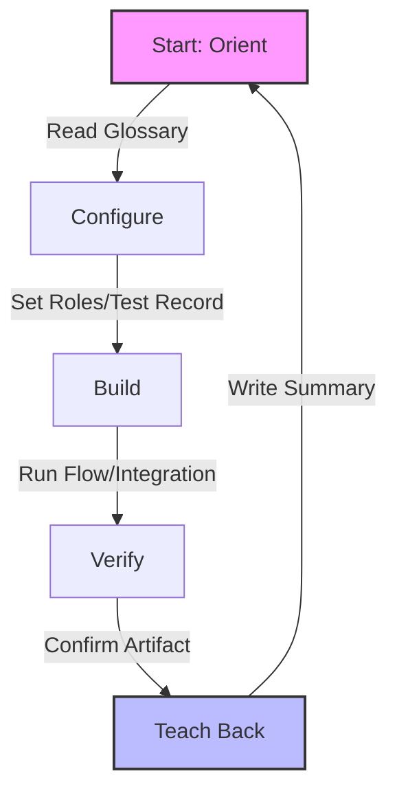

# ServiceNow Module Guides

Welcome to the ServiceNow Module Guides repository. This repo contains beginner-friendly getting-started guides for the modules below, plus a dedicated AI guide and a Salesforce track.

## Available Guides

  

    <h3>TSOM</h3>
    
Telecom Service Operations Management — services, network inventory, alarms, and the implementer labs that actually exist for it.

    
<a href="./docs/modules/tsom/tsom-guide/">Open the TSOM guide</a> · <a href="./docs/modules/tsom/tsom-capabilities.md">TSOM capabilities</a>

  

  

    <h3>TSOM Assurance</h3>
    
Event Management, AIOps, Service Impact Analysis, and Synthetic Monitoring — the observability stack for telecom and enterprise environments.

    
<a href="./docs/modules/tsom/tsom-assurance/">Open TSOM Assurance guide</a>

  

  

    <h3>CSM</h3>
    
Customer Service Management — cases, accounts, entitlements, and customer-facing SLAs.

    
<a href="./docs/modules/csm/csm-guide/">Open the CSM guide</a>

  

  

    <h3>FSM</h3>
    
Field Service Management — work orders, territories, scheduling constraints, and mobile work.

    
<a href="./docs/modules/fsm/fsm-guide/">Open the FSM guide</a>

  

  

    <h3>CMDB</h3>
    
Configuration Management Database — CI classes, Identification & Reconciliation (IRE), CMDB Health, relationships, and integrations.

    
<a href="./docs/modules/cmdb/cmdb-guide/">Open the CMDB guide</a>

  

  

    <h3>Sales CRM</h3>
    
Sales CRM — leads, opportunities, quotes, and orders on the Now Platform.

    
<a href="./docs/modules/sales-crm/sales-crm-guide/">Open the Sales CRM guide</a>

  

  

    <h3>HAM</h3>
    
Hardware Asset Management — the hardware lifecycle from procurement through disposal.

    
<a href="./docs/modules/ham/ham-guide/">Open the HAM guide</a>

  

  

    <h3>Discovery</h3>
    
ITOM Discovery — MID Servers, schedules, the Configuration Console, and File-Based Discovery end to end: configure it, run it, and prove the scan executed on the target.

    
<a href="./docs/modules/discovery/discovery-guide/">Open the Discovery guide</a>

  

  

    <h3>ITSM</h3>
    
IT Service Management — incident, problem, change, knowledge, and the CMDB patterns every other module follows.

    
<a href="./docs/modules/itsm/itsm-guide/">Open the ITSM guide</a>

  

  

    <h3>HRSD</h3>
    
Human Resources Service Delivery — case management, lifecycle events, and employee center portals for HR services.

    
<a href="./docs/modules/hrsd/hrsd-guide/">Open the HRSD guide</a>

  

  

    <h3>SAM</h3>
    
Software Asset Management — software models and SUMN normalization, entitlements, the reconciliation engine, compliance positions, SaaS seat management, optimization/reclamation, publisher audit traps, and a full entitlement→reconciliation→compliance lab.

    
<a href="./docs/modules/sam/sam-guide/">Open the SAM guide</a>

  

  

    <h3>Service Mapping</h3>
    
Application service discovery — pattern-based top-down mapping of CIs to business services, CMDB relationships, and service impact analysis.

    
<a href="./docs/modules/servicemapping/servicemapping-guide/">Open the Service Mapping guide</a>

  

  

    <h3>AI</h3>
    
AI-native tiers (Foundation/Advanced/Prime), Now Assist, Predictive Intelligence, Virtual Agent, AI Agents, Now Assist Skill Kit, governance, cost management, and guardrails.

    
<a href="./docs/modules/ai/ai-guide/">Open the AI guide</a>

  

  

    <h3>JavaScript Reference</h3>
    
Platform scripting reference — GlideRecord, GlideSystem, GlideAjax, GlideForm, GlideAggregate, GlideDateTime, Business Rules, Script Includes, UI Policies, UI Actions, Scheduled Jobs, and common scripting patterns.

    
<a href="./docs/modules/ai/javascript-reference/">Open the JavaScript reference</a>

  

  

    <h3>GlideRecord & Server-Side Data</h3>
    
The query engine in depth — the four query forms, encoded queries and every operator, setWorkflow(false) and what it actually suppresses, GlideAggregate for counts and sums, the loop trap, pagination, and the seven mistakes that cause governor-limit failures.

    
<a href="./docs/modules/scripting/gliderecord-guide/">Open the GlideRecord guide</a>

  

  

    <h3>Service Catalog</h3>
    
Catalog items vs record producers, variables and variable sets, catalog client scripts and g_form, UI policies, fulfilment flows, and the retail/high-volume self-service pattern for store and pharmacy requests.

    
<a href="./docs/modules/catalog/catalog-guide/">Open the Service Catalog guide</a>

  

  

    <h3>Cross-Cutting Skills</h3>
    
Integrations, Scripting, Jelly, Update Sets vs Source Control, App Engine & scoped apps, CMDB de-dup & health, Major Incident Management, CAB & change types, JDBC/ODBC via MID Server, Platform Governance & Lead Layer.

    
<a href="./docs/cross-cutting/">Open the Cross-Cutting guide</a>

  

  

    <h3>Interview Prep</h3>
    
Prioritized by interview order — what to review for each upcoming interview, STAR story bank, certification talking points.

    
<a href="./docs/interviews/prioritized-prep-list/">Open the Interview Prep guide</a>

  

  

    <h3>Learning Paths</h3>
    
Official courses & certifications — Now Learning paths for CSA, CAD, CIS-ITSM, CIS-SAM, and more.

    
<a href="./docs/learning/">Open the Learning Paths guide</a>

  

  

    <h3>Video Library</h3>
    
Official channels & playlists — ServiceNow YouTube, community playlists, and exam prep videos.

    
<a href="./docs/youtube/">Open the Video Library</a>

  

<h2 id="salesforce-training">Salesforce Training</h2>

Separate track from the ServiceNow guides above. Beginner-friendly ELI5 crash course covering the Salesforce platform, navigation, security, data handling, automation, and code (Apex, Visualforce, LWC), plus a DevOps release-engineering track for commercial-banking pipeline work.

  

    <h3>Salesforce Crash Course</h3>
    
Objects, records, fields, navigation breadcrumbs, users/profiles/roles, data integrity, Flow vs Apex vs Visualforce vs LWC, REST/SOAP integrations, troubleshooting, design considerations.

    
<a href="./docs/salesforce/crash-course/">Start the Salesforce crash course</a>

  

  

    <h3>Navigation & Breadcrumbs</h3>
    
Quick-reference Setup paths for every Salesforce admin and developer task — objects, security, automation, code, integration, deployment, monitoring, data.

    
<a href="./docs/salesforce/navigation-breadcrumbs/">Open navigation reference</a>

  

  

    <h3>Labs & Design</h3>
    
Four hands-on labs (custom object + Flow, Apex trigger + test, LWC, REST callout) plus design patterns, system properties, and out-of-box features.

    
<a href="./docs/salesforce/labs-design/">Open labs & design</a>

  

  

    <h3>User Management & Data</h3>
    
Users, profiles, permission sets, roles, licenses, import/export, validation rules, field-level security, duplicate management, data design best practices.

    
<a href="./docs/salesforce/user-management-data/">Open user & data guide</a>

  

  

    <h3>DevOps & Release Engineering</h3>
    
Training items for a Salesforce DevOps Engineer role: Git metadata lifecycle, Dev/QA/UAT/Pre-Prod/Prod, sandbox refresh and masking, feature/release/hotfix, CI validation, Gearset/Copado/AutoRABIT vs CLI, deploy conflicts, unlocked packages, rollback, and banking change control. Mapped to Scotiabank requisition 276046.

    
<a href="./docs/salesforce/devops-engineer/">Open the DevOps training track</a>

  

## What's in Each Guide

Each guide covers:

- **What the module is** — ELI5 explanation and business purpose
- **Where to find it** — Navigation breadcrumbs in ServiceNow
- **Reusable code** — Script includes, Business Rules, UI Policies you can copy-paste
- **Out-of-box features** — Workflows, playbooks, integrations, metrics, dashboards
- **Key table hierarchy** — Table relationships and CMDB mappings
- **Integrations** — External systems and protocols
- **Key fields** — Critical, useful, optional fields by table
- **Common mistakes** — What to avoid and how to fix
- **Hands-on lab** — Step-by-step walkthrough
- **Quiz** — Knowledge check questions

## The 5-Step Rapid Learning Loop

Every module guide follows the same repeatable process:

1. **Orient** — Read the ELI5 glossary + breadcrumbs for the module
2. **Configure** — Turn the module on. Set roles. Create a test record.
3. **Build** — Do the lab: create a record, run a flow, call an integration
4. **Verify** — Confirm the artifact works end-to-end
5. **Teach Back** — Write a summary

## Additional Resources

- **[Platform Cross-Cutting Skills](docs/cross-cutting.md)** — Integrations, Scripting, Jelly, Update Sets vs Source Control, App Engine & scoped apps, CMDB de-dup & health, Major Incident Management, CAB & change types, JDBC/ODBC via MID Server, Platform Governance & Lead Layer
- **[Interview Prep Guide](docs/interviews/prioritized-prep-list.md)** — Prioritized by interview order
- **[Learning Paths](docs/learning.md)** — Official courses & certifications
- **[Video Library](docs/youtube.md)** — Official channels & playlists
