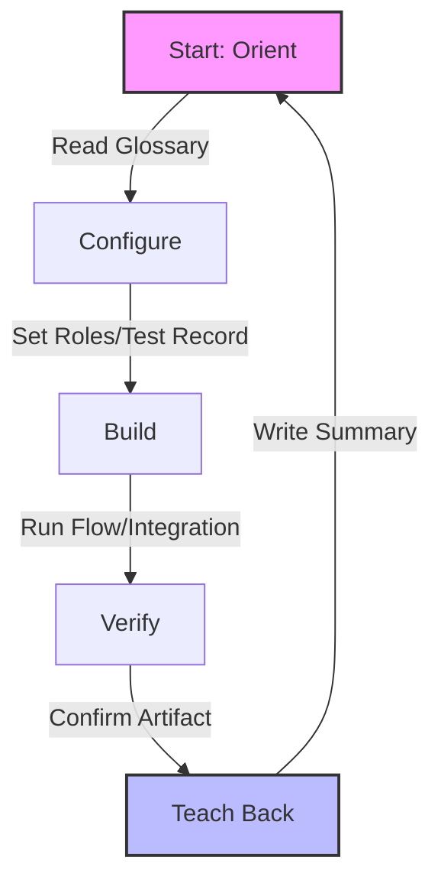

# ServiceNow Module Guides

Welcome to the ServiceNow Module Guides repository. This repo contains beginner-friendly getting-started guides for seven ServiceNow modules:

## Available Guides

  

    <h3>TSOM</h3>
    
Telecom Service Operations Management — services, network inventory, alarms, and the implementer labs that actually exist for it.

    
<a href="./docs/modules/tsom/tsom-guide.md">Open the TSOM guide</a> · <a href="./docs/modules/tsom/tsom-capabilities.md">TSOM capabilities</a>

  

  

    <h3>CSM</h3>
    
Customer Service Management — cases, accounts, entitlements, and customer-facing SLAs.

    
<a href="./docs/modules/csm/csm-guide.md">Open the CSM guide</a>

  

  

    <h3>FSM</h3>
    
Field Service Management — work orders, territories, scheduling constraints, and mobile work.

    
<a href="./docs/modules/fsm/fsm-guide.md">Open the FSM guide</a>

  

  

    <h3>Sales CRM</h3>
    
Sales CRM — leads, opportunities, quotes, and orders on the Now Platform.

    
<a href="./docs/modules/sales-crm/sales-crm-guide.md">Open the Sales CRM guide</a>

  

  

    <h3>HAM</h3>
    
Hardware Asset Management — the hardware lifecycle from procurement through disposal.

    
<a href="./docs/modules/ham/ham-guide.md">Open the HAM guide</a>

  

  

    <h3>Discovery</h3>
    
ITOM Discovery — MID Servers, schedules, the Configuration Console, and File-Based Discovery end to end: configure it, run it, and prove the scan executed on the target.

    
<a href="./docs/modules/discovery/discovery-guide.md">Open the Discovery guide</a>

  

  

    <h3>ITSM</h3>
    
IT Service Management — incident, problem, change, knowledge, and the CMDB patterns every other module follows.

    
<a href="./docs/modules/itsm/itsm-guide.md">Open the ITSM guide</a>

  

## What's in Each Guide

Each guide covers:

- **What the module is** — ELI5 explanation and business purpose
- **Where to find it** — Navigation breadcrumbs in ServiceNow
- **Reusable code** — Script includes, Business Rules, UI Policies you can copy-paste
- **Out-of-box features** — Workflows, playbooks, integrations, metrics, dashboards
- **Key table hierarchy** — Table relationships and CMDB mappings
- **Integrations** — External systems and protocols
- **Key fields** — Critical, useful, optional fields by table
- **Common mistakes** — What to avoid and how to fix
- **Hands-on lab** — Step-by-step walkthrough
- **Quiz** — Knowledge check questions

## The 5-Step Rapid Learning Loop

Every module guide follows the same repeatable process:

1. **Orient** — Read the ELI5 glossary + breadcrumbs for the module
2. **Configure** — Turn the module on. Set roles. Create a test record.
3. **Build** — Do the lab: create a record, run a flow, call an integration
4. **Verify** — Confirm the artifact works end-to-end
5. **Teach Back** — Write a summary

## Additional Resources
- **[Platform Cross-Cutting Skills](docs/cross-cutting.md)** — Integrations, Scripting, and Admin essentials

- **[Official Learning Portal](./docs/learning.md)** — Self-directed, English-language official courses and certification paths
- **[Official Video Resources](./docs/youtube.md)** — Curated official YouTube channels, playlists, and best practice videos

- **[SUCCESS_PACK_OPENCODE.MD](./SUCCESS_PACK_OPENCODE.MD)** — 90-day ServiceNow career landing strategy (opencode)
- **[SUCCESS_PACK_HERMES.MD](./SUCCESS_PACK_HERMES.MD)** — ServiceNow 2026 role landing strategy (hermes)
- **[Machine-readable module data](./data/modules.json)** — JSON with all module metadata
- **[Scripts](./scripts/)** — Tavily/Firecrawl web search scraper and cached job data processor

---

*Generated by opencode on 2026-11-05. Part of the ServiceNow_Learning_TSOM-_CSM_FSM_SalesCRM_HAM_ITSM repository.*